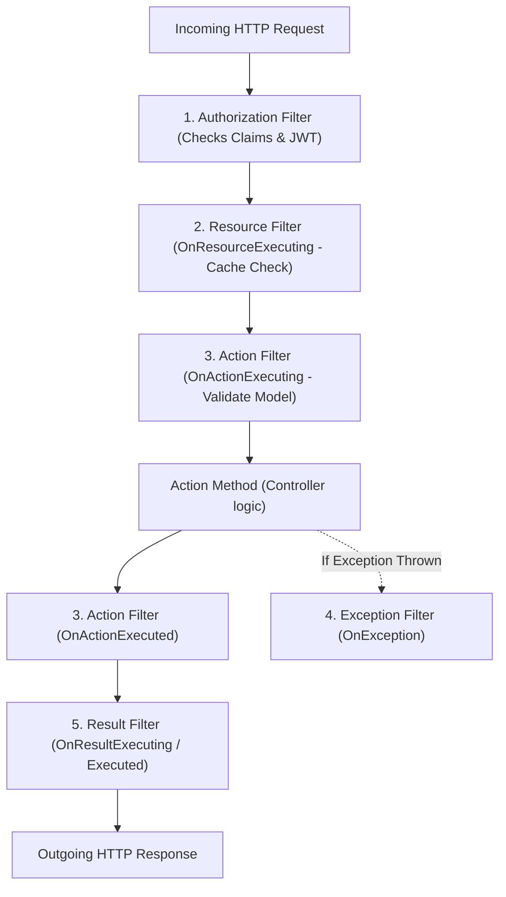

# 01. .NET Core & C# Experienced Developer (5–10+ YOE) Interview Master Guide — India Context

> **Target Audience:** Experienced Full-Stack & Backend Developers (5–10+ Years of Experience) preparing for Senior Developer, Tech Lead, and Module Lead technical rounds in India.  
> **Applicable Companies:**  
> - **Top IT Services & Global Consultancies:** TCS, Infosys, Cognizant, Wipro, Accenture, Capgemini, HCL, LTIMindtree, Tech Mahindra, Hexaware, Persistent, Nagarro, EPAM, Coforge, Virtusa, Deloitte, EY, PwC, KPMG.  
> - **Global Capability Centers (GCCs) & Tech Hubs:** Wells Fargo, Morgan Stanley, JPMorgan Chase, Barclays, Walmart Global Tech India, Lowe's India, Target India, Optum, Fidelity, Standard Chartered, HSBC.  
> - **Indian Product Firms & Unicorns:** Flipkart, Swiggy, Zomato, MakeMyTrip, Paytm, PhonePe, Zepto.  
>
> **Philosophy:** 100% grounded in real-world Indian interview rounds. Zero academic fluff, zero esoteric compiler trivia that no interviewer asks. Every question follows the **6-Part Senior Answer Architecture** (Tailored for Indian Technical Rounds):  
> 1. **⚡ 30-Second Senior Opening Pitch** (The immediate, confident opening sentence)  
> 2. **🎯 Exact Formal Definitions & Rubric Keywords Interviewers Want to Hear** (CS definitions, rubric keywords scored on evaluation sheet, & real-project delivery phrasing)  
> 3. **🧠 Intuitive Real-World Analogy** (Everyday Indian mental models for fast recall under interview pressure)  
> 4. **💻 Simple, Clean, Runnable Code Snippet (5–15 lines)** (Practical, copy-pasteable production code)  
> 5. **⚠️ Senior Trap & Cross-Question** (What the interviewer will ask next + Senior rebuttal)  
> 6. **📊 "When to Use What & What Must Be Done" Quick Decision Guide** (Actionable comparison decision tables)  
>
> *(Note: For niche, low-latency CLR engine internals like Card Tables, Tiered Compilation, and POH byte layouts, refer to [09_DotNet_CLR_Ultra_Deep_Niche_Internals.md](file:///home/ubermensch/Desktop/interview/09_DotNet_CLR_Ultra_Deep_Niche_Internals.md)).*

---

# TABLE OF CONTENTS

- [MODULE 1: C# LANGUAGE & OOPS FUNDAMENTALS (SCREENING HITLIST)](#module-1-c-language--oops-fundamentals-screening-hitlist)
  - [Q1: SOLID Principles with Real-Time Project Examples](#q1-solid-principles-with-real-time-project-examples)
  - [Q2: IEnumerable vs IQueryable vs IList vs ICollection](#q2-ienumerable-vs-iqueryable-vs-ilist-vs-icollection)
  - [Q3: String vs StringBuilder & String Immutability](#q3-string-vs-stringbuilder--string-immutability)
  - [Q4: ref vs out vs in vs params](#q4-ref-vs-out-vs-in-vs-params)
  - [Q5: throw vs throw ex vs throw new CustomException](#q5-throw-vs-throw-ex-vs-throw-new-customexception)
  - [Q6: Abstract Class vs Interface (with C# 8+ Default Methods)](#q6-abstract-class-vs-interface-with-c-8-default-methods)
  - [Q7: Boxing and Unboxing Mechanics & Performance](#q7-boxing-and-unboxing-mechanics--performance)
  - [Q8: Method Overloading vs Method Overriding vs Method Shadowing (new)](#q8-method-overloading-vs-method-overriding-vs-method-shadowing-new)
  - [Q9: const vs readonly vs static readonly](#q9-const-vs-readonly-vs-static-readonly)
  - [Q10: Delegates, Func, Action, Predicate & Lambda Expressions](#q10-delegates-func-action-predicate--lambda-expressions)
  - [Q11: Extension Methods in C#](#q11-extension-methods-in-c)
  - [Q12: Nullable Types, Null-Forgiving (!) & Null-Coalescing (??, ??=)](#q12-nullable-types-null-forgiving--null-coalescing--)
  - [Q13: class vs struct vs record (Record Class vs Record Struct)](#q13-class-vs-struct-vs-record-record-class-vs-record-struct)
  - [Q14: IDisposable Pattern & the using Statement](#q14-idisposable-pattern--the-using-statement)

- [MODULE 2: ASP.NET CORE & WEB API ARCHITECTURE](#module-2-aspnet-core--web-api-architecture)
  - [Q15: Dependency Injection Lifetimes (Transient vs Scoped vs Singleton & Captive Dependency)](#q15-dependency-injection-lifetimes-transient-vs-scoped-vs-singleton--captive-dependency)
  - [Q16: Middleware vs Action Filters (app.Use vs app.Run vs app.Map)](#q16-middleware-vs-action-filters-appuse-vs-apprun-vs-appmap)
  - [Q17: Writing Custom Middleware for Global Exception Handling](#q17-writing-custom-middleware-for-global-exception-handling)
  - [Q18: ASP.NET Core Filter Pipeline Order of Execution](#q18-aspnet-core-filter-pipeline-order-of-execution)
  - [Q19: JWT Authentication & Authorization in Web API](#q19-jwt-authentication--authorization-in-web-api)
  - [Q20: CORS (Cross-Origin Resource Sharing) Configuration](#q20-cors-cross-origin-resource-sharing-configuration)
  - [Q21: Configuration & Options Pattern (IOptions vs IOptionsSnapshot vs IOptionsMonitor)](#q21-configuration--options-pattern-ioptions-vs-ioptionssnapshot-vs-ioptionsmonitor)
  - [Q22: HTTP Status Codes & RESTful API Best Practices](#q22-http-status-codes--restful-api-best-practices)
  - [Q23: IHttpClientFactory: Typed Client vs Socket Exhaustion vs DNS Bug](#q23-ihttpclientfactory-typed-client-vs-socket-exhaustion-vs-dns-bug)

- [MODULE 3: ENTITY FRAMEWORK CORE & DATA ACCESS](#module-3-entity-framework-core--data-access)
  - [Q24: Eager Loading (.Include) vs Lazy Loading vs Explicit Loading](#q24-eager-loading-include-vs-lazy-loading-vs-explicit-loading)
  - [Q25: First vs FirstOrDefault vs Single vs SingleOrDefault vs Find](#q25-first-vs-firstordefault-vs-single-vs-singleordefault-vs-find)
  - [Q26: AsNoTracking() vs Tracked Queries](#q26-asnotracking-vs-tracked-queries)
  - [Q27: Code-First Migrations & Production CI/CD Scripts](#q27-code-first-migrations--production-cicd-scripts)
  - [Q28: EF Core vs Dapper: When to Use Which](#q28-ef-core-vs-dapper-when-to-use-which)
  - [Q29: Select() vs SelectMany() in LINQ](#q29-select-vs-selectmany-in-linq)
  - [Q30: Handling Concurrency in EF Core with RowVersion](#q30-handling-concurrency-in-ef-core-with-rowversion)

- [MODULE 4: ASYNCHRONOUS PROGRAMMING & CONCURRENCY](#module-4-asynchronous-programming--concurrency)
  - [Q31: async and await Internals: Does it Create a New Thread?](#q31-async-and-await-internals-does-it-create-a-new-thread)
  - [Q32: The Sync-over-Async Trap (.Result & .Wait Deadlocks)](#q32-the-sync-over-async-trap-result--wait-deadlocks)
  - [Q33: Task.WhenAll vs Task.WaitAll vs Task.WhenAny](#q33-taskwhenall-vs-taskwaitall-vs-taskwhenany)
  - [Q34: CancellationToken Propagation in Web APIs](#q34-cancellationtoken-propagation-in-web-apis)
  - [Q35: lock vs SemaphoreSlim in Asynchronous Code](#q35-lock-vs-semaphoreslim-in-asynchronous-code)

- [MODULE 5: DESIGN PATTERNS & ARCHITECTURE](#module-5-design-patterns--architecture)
  - [Q36: Repository Pattern & Unit of Work in EF Core Projects](#q36-repository-pattern--unit-of-work-in-ef-core-projects)
  - [Q37: Thread-Safe Singleton Pattern (Double-Check vs Lazy<T>)](#q37-thread-safe-singleton-pattern-double-check-vs-lazyt)
  - [Q38: Factory Pattern vs Abstract Factory Pattern](#q38-factory-pattern-vs-abstract-factory-pattern)
  - [Q39: CQRS & MediatR Pattern in Web APIs](#q39-cqrs--mediatr-pattern-in-web-apis)
  - [Q40: Caching Strategies: IMemoryCache vs IDistributedCache (Redis)](#q40-caching-strategies-imemorycache-vs-idistributedcache-redis)
  - [Q41: Microservices Communication: Synchronous vs Asynchronous](#q41-microservices-communication-synchronous-vs-asynchronous)

- [MODULE 6: SQL SERVER FOR .NET DEVELOPERS (MANDATORY ROUND)](#module-6-sql-server-for-net-developers-mandatory-round)
  - [Q42: Clustered vs Non-Clustered Index](#q42-clustered-vs-non-clustered-index)
  - [Q43: Finding the 2nd Highest / Nth Highest Salary](#q43-finding-the-2nd-highest--nth-highest-salary)
  - [Q44: DELETE vs TRUNCATE vs DROP](#q44-delete-vs-truncate-vs-drop)
  - [Q45: UNION vs UNION ALL](#q45-union-vs-union-all)
  - [Q46: Primary Key vs Unique Key](#q46-primary-key-vs-unique-key)
  - [Q47: Stored Procedure vs User-Defined Function (UDF)](#q47-stored-procedure-vs-user-defined-function-udf)
  - [Q48: ACID Properties Explained with a Banking Scenario](#q48-acid-properties-explained-with-a-banking-scenario)

---

# MODULE 1: C# LANGUAGE & OOPS FUNDAMENTALS (SCREENING HITLIST)

## Q1: SOLID Principles with Real-Time Project Examples
* **Asked At:** TCS, Infosys, Cognizant, Wipro, Accenture, Capgemini, Deloitte, EY, Nagarro, EPAM (Asked in 99% of interviews).
* **⚡ 30-Second Senior Opening Pitch:**  
  > "SOLID represents 5 object-oriented design principles formulated by Robert C. Martin (Uncle Bob) to create maintainable, decoupled, and testable enterprise software: **Single Responsibility** (high cohesion via single reason to change), **Open/Closed** (extensibility via polymorphic abstractions without code modification), **Liskov Substitution** (behavioral subtyping where derivatives never break base contracts), **Interface Segregation** (fine-grained role interfaces over fat monolithic contracts), and **Dependency Inversion** (high-level domain policies depending on abstractions, delivered via Dependency Injection)."

* **🎯 Exact Formal Definitions & Rubric Keywords Interviewers Want to Hear:**
  * **S — Single Responsibility Principle (SRP):**
    * *Exact Academic Definition:* **"A class should have one, and only one, reason to change."** *(Robert C. Martin)*
    * *Keywords Interviewer Evaluates:* **High Cohesion**, **Low Coupling**, **Separation of Concerns (SoC)**, **Single Responsibility**.
    * *How to say it in your project:* "In our checkout API, `OrderService` originally handled validation, tax calculation, database persistence, invoice PDF generation, and SMTP notification. We refactored it by extracting `OrderTaxCalculator`, `OrderRepository`, `InvoicePdfGenerator`, and `EmailNotificationService`."
  * **O — Open/Closed Principle (OCP):**
    * *Exact Academic Definition:* **"Software entities (classes, modules, functions) should be open for extension, but closed for modification."** *(Bertrand Meyer)*
    * *Keywords Interviewer Evaluates:* **Polymorphism**, **Strategy Design Pattern**, **Abstract Contracts**, **Elimination of Switch/Case Anti-Patterns**.
    * *How to say it in your project:* "In our payment gateway integration, rather than maintaining a giant `switch (paymentMode)` block that required modifying existing classes for every new payment option, we created an `IPaymentGateway` interface. When PhonePe/UPI was added, we simply implemented `UpiPaymentGateway : IPaymentGateway` without altering a single line of existing checkout logic."
  * **L — Liskov Substitution Principle (LSP):**
    * *Exact Academic Definition:* **"Subtypes must be substitutable for their base types without altering the correctness of the program."** *(Barbara Liskov)*
    * *Keywords Interviewer Evaluates:* **Behavioral Subtyping**, **Design by Contract**, **No NotImplementedException in Derived Classes**, **Favoring Composition Over Inheritance**.
    * *How to say it in your project:* "A junior developer created `ReadOnlyAuditRepository` deriving from `IRepository<T>` and threw `throw new NotImplementedException()` in `Save()`. Any generic service calling `Save()` crashed at runtime. We fixed it by segregating interfaces into `IReadOnlyRepository<T>` and `IWriteRepository<T>` so substitution never breaks program invariants."
  * **I — Interface Segregation Principle (ISP):**
    * *Exact Academic Definition:* **"Clients should not be forced to depend upon interfaces that they do not use."**
    * *Keywords Interviewer Evaluates:* **Role-Based Interfaces**, **Interface Pollution**, **Fat / Monolithic Interfaces**, **Fine-Grained Contracts**.
    * *How to say it in your project:* "We broke down a fat 30-method `IUserService` (which mixed profile edits, password resets, and Excel reporting) into focused role interfaces: `IUserAuthentication`, `IUserProfileManager`, and `IUserReportGenerator`."
  * **D — Dependency Inversion Principle (DIP):**
    * *Exact Academic Definition:* **"1. High-level modules should not depend on low-level modules; both should depend on abstractions. 2. Abstractions should not depend on details; details should depend on abstractions."**
    * *Keywords Interviewer Evaluates:* **Inversion of Control (IoC)**, **Dependency Injection (DI)**, **Constructor Injection**, **Decoupling Business Policies from Persistence Details**.
    * *How to say it in your project:* "`CheckoutService` (high-level business policy) depends strictly on `IPaymentGateway` and `IOrderRepository` (abstractions). The concrete implementations (`SqlOrderRepository`, `RazorpayGateway`) are injected by ASP.NET Core's DI container at runtime."

* **🧠 Everyday Analogies (Mental Models for Fast Recall):**  
  * **S (Swiss Army Knife Anti-pattern):** A knife that also acts as a scissors, flashlight, and screwdriver does everything poorly. Give each tool one job.
  * **O (Smartphone with Apps):** You don't open the motherboard to add WhatsApp; you install an app via a defined OS interface (open for extension, closed for modification).
  * **L (Electric Car vs Petrol Car):** Both accept the driver's steering and brake commands without changing the driving rules.
  * **I (Restaurant Menu):** A vegetarian shouldn't be forced to sign a contract acknowledging the seafood menu. Split interfaces into role-specific contracts.
  * **D (Wall Power Socket):** Your laptop charger doesn't solder directly into the electrical wiring of your house; both plug into a standard wall socket interface.
* **💻 Simple Code Example:**
```csharp
// 1. Single Responsibility: Separate persistence from invoice calculation
public class InvoiceService
{
    public decimal CalculateTotal(Order order) => order.Items.Sum(i => i.Price * i.Qty);
}

// 2. Open/Closed & Dependency Inversion: Interface open for new gateways without touching Checkout
public interface IPaymentGateway
{
    Task<bool> ProcessPaymentAsync(decimal amount);
}

public class UpiPaymentGateway : IPaymentGateway
{
    public Task<bool> ProcessPaymentAsync(decimal amount) => Task.FromResult(true);
}

// Checkout depends on abstraction (DIP), not concrete Razorpay/Upi class
public class CheckoutService
{
    private readonly IPaymentGateway _gateway;
    public CheckoutService(IPaymentGateway gateway) => _gateway = gateway;

    public async Task CompleteCheckout(decimal amount) => await _gateway.ProcessPaymentAsync(amount);
}
```
* **⚠️ Senior Trap & Cross-Question:**  
  * *Trap Question:* "Can you explain the difference between Dependency Inversion Principle (DIP) and Dependency Injection (DI)?"  
  * *Senior Answer:* "DIP is the high-level **design principle** stating high-level modules should not depend on low-level modules; both should depend on abstractions. DI is the concrete **design pattern and technique** (constructor injection, property injection) used to deliver that abstraction at runtime."
* **📊 Decision Guide:**
| Principle | What It Solves | What Must Be Done in Code |
| :--- | :--- | :--- |
| **SRP** | Giant 2,000-line "God Classes" | Move DB calls, email sending, and validation into separate dedicated services. |
| **OCP** | Modifying 10 switch-cases when adding a feature | Create an interface or abstract base class; implement new features in new classes. |
| **LSP** | Derived classes throwing `NotImplementedException` | Ensure derived classes honor base class behavior without unexpected exceptions. |
| **ISP** | Bloated interfaces forcing empty method stubs | Break large interfaces into small, focused interfaces (`IReadOnlyRepository`, `IWriteRepository`). |
| **DIP** | Tight coupling with `new ConcreteService()` | Register interfaces in `Program.cs` and inject them via constructors. |

---

## Q2: IEnumerable vs IQueryable vs IList vs ICollection
* **Asked At:** Literally 100% of Indian .NET Technical Rounds.
* **⚡ 30-Second Senior Opening Pitch:**  
  > "`IEnumerable` is an in-memory cursor abstraction that executes filtering on the client side (in application RAM) via delegates, whereas `IQueryable` encapsulates an expression tree (`System.Linq.Expressions`) translated into native SQL by an `IQueryProvider` and executed directly on the database server. Using `IEnumerable` with Entity Framework Core brings entire database tables across the network, exhausting memory and causing production crashes."

* **🎯 Exact Formal Definitions & Rubric Keywords Interviewers Want to Hear:**
  * **Exact Formal CS Definitions:**
    * **`IEnumerable<T>`:** "A forward-only, read-only cursor interface (`IEnumerator<T>`) for deferred iteration over in-memory collections via `Func<T, bool>` delegates (LINQ to Objects)."
    * **`IQueryable<T>`:** "A provider-based query interface that encapsulates a LINQ Expression Tree representing an Abstract Syntax Tree (AST); the provider parses the expression and translates it into native database queries (e.g., T-SQL) for remote server-side evaluation (LINQ to Entities)."
    * **`ICollection<T>`:** "An interface derived from `IEnumerable<T>` that defines mutation methods (`Add`, `Remove`, `Clear`), collection sizing (`Count`), and thread-safety properties (`IsReadOnly`)."
    * **`IList<T>`:** "An interface derived from `ICollection<T>` that provides index-based positional access (`this[int index]`), insertion (`Insert`), and removal by index (`RemoveAt`)."
  * **Keywords Interviewer Evaluates:** **Expression Tree (`System.Linq.Expressions`)**, **Abstract Syntax Tree (AST)**, **Deferred / Lazy Execution**, **Client-Side vs Server-Side Evaluation**, **`IQueryProvider`**, **LINQ to Entities vs LINQ to Objects**, **Network Serialization Overhead**, **Forward-Only Enumeration (`IEnumerator.MoveNext()`)**.
  * **How to say it in your project:** "In our e-commerce order management module, an `IEnumerable<Order>` return type in a repository caused EF Core to issue `SELECT * FROM Orders`, pulling 500,000 records into web server RAM and spiking memory to 95%. Changing the contract to `IQueryable<Order>` allowed our filter predicates to append to the SQL Expression Tree, generating `SELECT ... WHERE Status = 'Active'`, which SQL Server executed in 14ms."

* **🧠 Everyday Analogies (Mental Models for Fast Recall):**  
  * **`IEnumerable` (Swiggy delivery guy bringing the entire restaurant kitchen):** You order 1 Biryani. The delivery person brings raw chicken, rice, pots, and the chef to your living room table, and you scoop out 1 plate. Immense waste of transport and memory.
  * **`IQueryable` (The Waiter taking your order ticket):** You tell the waiter "1 Hyderabadi Chicken Biryani, extra spicy". The kitchen executes the cooking on the server, and the waiter brings only that 1 prepared plate to your table.
  * **`ICollection` (Shopping Cart):** You can check item count (`Count`), put in items (`Add`), or discard items (`Remove`).
  * **`IList` (Numbered Train Coach Seats):** You can walk directly to seat number 42 (`seats[42]`) without counting seats 1 to 41.

* **💻 Simple Code Example:**
```csharp
// ❌ DANGEROUS JUNIOR BUG: IEnumerable executes filtering in C# Memory!
// Generates: SELECT * FROM Orders; -> Downloads all 2,000,000 rows into RAM!
IEnumerable<Order> orders = dbContext.Orders; 
var recentOrders = orders.Where(o => o.Status == "Shipped").Take(10).ToList();

// ✅ SENIOR PATTERN: IQueryable executes filtering on SQL Server!
// Generates: SELECT TOP(10) * FROM Orders WHERE Status = 'Shipped';
IQueryable<Order> query = dbContext.Orders; 
var optimizedOrders = query.Where(o => o.Status == "Shipped").Take(10).ToList();
```

* **⚠️ Senior Trap & Cross-Question:**  
  * *Trap Question:* "What happens when you call a C# custom method (e.g., `o.CalculateTax()`) inside an `IQueryable.Where()` clause?"  
  * *Senior Answer:* "EF Core's `IQueryProvider` attempts to translate the expression tree to SQL. Since SQL Server has no definition for custom C# methods, EF Core throws an `InvalidOperationException: The LINQ expression could not be translated`. You must either compute the logic using supported SQL functions, compute it in a `.Select()` projection, or invoke `.AsEnumerable()` / `.ToList()` to intentionally switch to client-side evaluation."

* **📊 Decision Guide:**
| Interface | Where Filter Runs | Supports Index (`[i]`)? | Mutation (`Add`/`Remove`) | What Must Be Done in Code |
| :--- | :--- | :--- | :--- | :--- |
| **`IEnumerable<T>`** | In-Memory (C# RAM) | No | No | Use for in-memory collections, arrays, and LINQ to Objects. |
| **`IQueryable<T>`** | Database Server (SQL) | No | No | Keep queries as `IQueryable` until final `.ToListAsync()` / `.FirstOrDefaultAsync()`. |
| **`ICollection<T>`** | In-Memory (C# RAM) | No | Yes (`.Add()`, `.Count`) | Use for Entity navigation properties and DTO lists needing counts. |
| **`IList<T>`** | In-Memory (C# RAM) | Yes (`list[0]`) | Yes | Use for UI binding, sorting grids, and indexed lookups. |

---

## Q3: String vs StringBuilder & String Immutability
* **Asked At:** TCS, Wipro, Infosys, Cognizant, Accenture, Mindtree, Tech Mahindra.
* **⚡ 30-Second Senior Opening Pitch:**  
  > "`System.String` is an immutable reference type stored on the Managed Heap; once instantiated, its UTF-16 character buffer cannot be altered. Every concatenation (`+=`) allocates a brand-new string on the heap and discards the prior instance, creating high Garbage Collector Gen 0 allocation pressure. `StringBuilder` is mutable; it maintains an internal chunked character buffer (`char[]`) that grows dynamically, eliminating allocations during repetitive string manipulations."

* **🎯 Exact Formal Definitions & Rubric Keywords Interviewers Want to Hear:**
  * **Exact Formal CS Definitions:**
    * **String Immutability:** "In C#, `string` is an immutable reference type whose internal UTF-16 character sequence cannot be mutated post-instantiation. Immutability ensures thread safety, security hash consistency, and permits the CLR to optimize memory via the String Interning Pool (`ldstr`)."
    * **`StringBuilder`:** "A mutable buffer of characters (`System.Text.StringBuilder`) encapsulating a chunked array of characters (`m_ChunkChars`). Appends mutate the existing buffer in place, doubling capacity geometrically only when the buffer threshold is breached."
  * **Keywords Interviewer Evaluates:** **Immutability**, **Managed Heap Allocation**, **GC Generation 0 Allocation Pressure**, **String Interning Pool (`String.Intern`)**, **Contiguous Char Array Buffer**, **Geometric Growth / Capacity Doubling**, **`string.Concat` Compiler Optimization**.
  * **How to say it in your project:** "In our ledger export microservice, generating a 50,000-line CSV via `str += line` created over 50,000 temporary heap objects, inducing continuous Gen 0 and Gen 1 GC pauses totaling 3.8 seconds. Replacing it with `new StringBuilder(capacity: 2 * 1024 * 1024)` pre-allocated the buffer, dropping GC time to 0ms and runtime from 4.5s to 120ms."

* **🧠 Everyday Analogies (Mental Models for Fast Recall):**  
  * **String (Printed Aadhaar Card):** You cannot edit the name by scratching it with a pen; if there is a spelling mistake, the government prints an entirely new physical PVC card and shreds the old one.
  * **StringBuilder (A Classroom Whiteboard):** You write words, erase a part, and append more text on the same physical board without buying a new whiteboard.

* **💻 Simple Code Example:**
```csharp
// ❌ BAD: Allocates 1,000 distinct string objects on the managed heap!
string csv = "";
for (int i = 0; i < 1000; i++)
{
    csv += i.ToString() + ","; // Allocates new string every iteration -> GC pressure!
}

// ✅ SENIOR FIX: Single mutable internal buffer allocation
var sb = new StringBuilder(5000); // Pre-allocate initial capacity to prevent buffer resizing
for (int i = 0; i < 1000; i++)
{
    sb.Append(i).Append(',');
}
string result = sb.ToString();
```

* **⚠️ Senior Trap & Cross-Question:**  
  * *Trap Question:* "Is `StringBuilder` ALWAYS faster than string concatenation? What if you only concatenate 3 strings?"  
  * *Senior Answer:* "No! For 3 or 4 strings (e.g., `string s = a + b + c;`), the C# compiler internally translates it to `string.Concat(a, b, c)`, which calculates the exact final buffer length upfront and allocates the exact heap memory once. `StringBuilder` has class instantiation overhead and internal array buffer management overhead; it should only be used inside loops or when concatenating dynamic, unknown counts of text ($\ge 7-10$ iterations)."

* **📊 Decision Guide:**
| Scenario | What to Use | Why | What Must Be Done in Code |
| :--- | :--- | :--- | :--- |
| Concatenating 2 to 5 strings | String interpolation `$"{a} - {b}"` | Compiler translates to optimized `string.Concat`. Zero object overhead. | Use `$"{firstName} {lastName}"`. |
| Concatenation in a loop | `StringBuilder` | Modifies internal character array buffer; avoids thousands of GC allocations. | Instantiate `new StringBuilder()`, loop with `.Append()`. |
| Known large size string building | `new StringBuilder(estimatedCapacity)` | Eliminates internal array doubling copies when buffer reaches capacity. | Pre-size: `new StringBuilder(1024 * 64)`. |

---

## Q4: ref vs out vs in vs params
* **Asked At:** Accenture, Capgemini, Infosys, Cognizant, Persistent, HCL.
* **⚡ 30-Second Senior Opening Pitch:**  
  > "These keywords control parameter passing semantics in C#. By default, value types are passed by value (copied onto the stack). `ref` passes an argument by reference and requires the variable to be initialized *before* passing; `out` passes by reference and requires the *callee* to definitely assign a value before exiting; `in` passes by reference read-only for performance optimization without copying; and `params` enables passing a comma-separated variable number of arguments as an array."

* **🎯 Exact Formal Definitions & Rubric Keywords Interviewers Want to Hear:**
  * **Exact Formal CS Definitions:**
    * **`ref`:** "Passes an argument by reference via a managed pointer (`T&`). Requires the caller to definitely initialize the variable before invocation; the callee can read and mutate the variable."
    * **`out`:** "Passes an argument by reference via a managed pointer (`T&`). Does not require caller initialization, but enforces the Definite Assignment Rule on the callee method before returning."
    * **`in`:** "Passes an argument by reference via a managed pointer (`readonly T&`). The variable must be initialized prior to passing, and the compiler prevents the callee from mutating it, avoiding copy overhead for large value types (`struct`)."
    * **`params`:** "Specifies a parameter that takes a variable number of arguments, packed into a temporary single-dimensional array by the Roslyn compiler."
  * **Keywords Interviewer Evaluates:** **Pass-by-Reference vs Pass-by-Value**, **Managed Pointer (`T&`)**, **Definite Assignment Rule**, **Caller vs Callee Assignment Guarantee**, **Zero-Copy Performance Optimization for Large Structs**, **IL Signature Collision**, **Array Allocation Overhead of `params`**.
  * **How to say it in your project:** "In our payment processing engine, we used `bool TryAuthorize(PaymentRequest req, out TransactionResult result)` to return status while guaranteeing that `result` is assigned on exit. Additionally, for a 64-byte `struct GeoCoordinate`, we changed parameter passing to `in GeoCoordinate point`, avoiding stack copying on 20,000 calculations per second."

* **🧠 Everyday Analogies (Mental Models for Fast Recall):**  
  * **`ref` (Shared Google Doc with Edit Access):** You create a doc with notes, share the edit link with a coworker; they read what you wrote and modify the live text directly.
  * **`out` (Blank Exam Answer Sheet):** The teacher hands you a blank sheet; you don't need to bring notes, but you MUST write your answers on it before you leave the exam room.
  * **`in` (Laminated Security ID Badge):** The security officer inspects your ID up close without making a photocopy, but they are forbidden from writing on or altering your badge.
  * **`params` (Swiggy Multi-Item Cart):** Order 1 dish, 5 dishes, or none—they are all packed together into a single delivery bag.

* **💻 Simple Code Example:**
```csharp
public class ParameterDemo
{
    // 1. ref: Caller MUST initialize. Callee can read and write.
    public void UpdateScore(ref int score) => score += 10;

    // 2. out: Caller does not need to initialize. Callee MUST assign before exit.
    public bool TryParseToken(string input, out int id)
    {
        id = 42; // Mandatory assignment!
        return true;
    }

    // 3. in: Passed by reference for performance, but CALLEE CANNOT MODIFY!
    public decimal CalculateTax(in decimal totalAmount)
    {
        // totalAmount = 50; // COMPILER ERROR: Cannot assign to variable 'in decimal'
        return totalAmount * 0.18m;
    }

    // 4. params: Variable number of arguments passed as comma-separated list
    public int SumNumbers(params int[] numbers) => numbers.Sum();
}
```

* **⚠️ Senior Trap & Cross-Question:**  
  * *Trap Question:* "Can you overload two methods where one takes `ref int` and the other takes `out int`?"  
  * *Senior Answer:* "No. At the CLR Intermediate Language (IL) level, both `ref` and `out` are compiled identically as managed pointers (`int32&`). The compiler throws a compile-time duplicate signature error (CS0663). However, you *can* overload between normal by-value passing (`int`) and `ref`/`out`."

* **📊 Decision Guide:**
| Keyword | Must Be Initialized Before Passing? | Must Be Assigned Inside Method? | Can Method Mutate It? | Primary Use Case |
| :--- | :--- | :--- | :--- | :--- |
| *(default)* | Yes | No | Modifies copy only (for value types). | Normal parameter passing. |
| **`ref`** | **Yes** | No | Yes (modifies original variable). | Bidirectional state updating in-place. |
| **`out`** | No | **Yes (Mandatory)** | Yes (modifies original variable). | `Try*` pattern methods (`int.TryParse`). |
| **`in`** | **Yes** | No | **No (Read-Only reference)**. | Zero-copy performance for large structs ($\ge 16$ bytes). |
| **`params`**| Yes (or empty) | No | Modifies array elements only. | Convenience APIs (`string.Format`, `logger.Log`). |

---

## Q5: throw vs throw ex vs throw new CustomException
* **Asked At:** Asked in 90% of Indian screening rounds.
* **⚡ 30-Second Senior Opening Pitch:**  
  > "`throw;` re-throws the currently caught exception while strictly preserving the entire original call stack trace and line numbers. `throw ex;` resets the stack trace, making the exception appear as if it originated right at that catch block—completely erasing the original line number where the bug occurred. Wrapping with `throw new CustomException("message", ex);` is the enterprise best practice, encapsulating domain context while preserving the root cause in the `InnerException`."

* **🎯 Exact Formal Definitions & Rubric Keywords Interviewers Want to Hear:**
  * **Exact Formal CS Definitions:**
    * **`throw;`:** "Re-throws the active exception object without altering its runtime stack dispatch state, preserving the original call stack trace, source file path, and exact throwing method line number."
    * **`throw ex;`:** "Re-throws the caught exception variable as an explicit new dispatch point, destroying the upstream call stack frames and overwriting the stack trace origin to the current `catch` block."
    * **`throw new CustomException("message", ex);`:** "Instantiates a domain-specific exception wrapping the lower-level technical exception within its `InnerException` property, preserving the root-cause stack trace."
  * **Keywords Interviewer Evaluates:** **Stack Unwinding**, **Call Stack Trace Preservation**, **Exception Dispatch Info (`ExceptionDispatchInfo`)**, **InnerException Chaining**, **Domain Exception Pattern**, **Loss of Root-Cause Line Number**.
  * **How to say it in your project:** "In our payment microservice, a junior developer used `throw ex` inside a data repository. When timeouts occurred, our Application Insights alerts reported line 88 of the repository catch block instead of the exact EF Core query line inside the transaction. Refactoring to `throw;` restored the complete 6-level call stack down to the database socket driver, and wrapping domain failures in `PaymentGatewayException` standardized our API error handling."

* **🧠 Everyday Analogies (Mental Models for Fast Recall):**  
  * **`throw;` (The Honest Courier):** A package gets damaged in Chennai Depot Bay 4. The Bangalore delivery hub passes the original tracking report directly to you showing "Damaged at Chennai Depot, Bay 4".
  * **`throw ex;` (The Cover-up Courier):** The Bangalore hub rips off the original tracking label, sticks a brand-new label saying "Damaged at Bangalore Hub", hiding where the accident truly occurred.
  * **`throw new CustomException("...", ex)` (Diplomatic Bag with Original Diplomatic Documents):** The delivery service places the damaged item inside an official investigation envelope with clear business instructions, while attaching the original Chennai tracking sheet inside.

* **💻 Simple Code Example:**
```csharp
try
{
    _paymentClient.ChargeCreditCard(cardDetails); // Bug happens on line 45 inside PaymentClient
}
catch (SocketException ex)
{
    // ❌ FATAL ANTI-PATTERN: Resets stack trace! Line 45 is lost forever!
    // throw ex; 

    // ✅ SENIOR PATTERN 1: Preserves original line 45 in stack trace
    // throw; 

    // ✅ SENIOR PATTERN 2: Enterprise wrapping with InnerException preserved
    throw new PaymentGatewayException("Payment gateway unreachable during checkout", ex);
}
```

* **⚠️ Senior Trap & Cross-Question:**  
  * *Trap Question:* "When would you use an Exception Filter (`catch (HttpRequestException ex) when (ex.StatusCode == HttpStatusCode.NotFound)`)?"  
  * *Senior Answer:* "Exception filters evaluate a condition *before* the stack is unwound. If the condition is false, the CLR does not enter the catch block at all, preserving the original execution state without the performance cost of entering and re-throwing."

* **📊 Decision Guide:**
| Technique | Stack Trace Behavior | InnerException Present? | Production Recommendation |
| :--- | :--- | :--- | :--- |
| **`throw;`** | **Preserved 100% intact** | Keeps original | **Best for generic catch blocks** (logging and bubbling up). |
| **`throw ex;`** | **Overwritten / Destroyed** | No | **STRICTLY FORBIDDEN ANTI-PATTERN.** |
| **`throw new Custom(msg, ex);`**| Sets new top frame, retains root | **Yes (`ex` preserved)**| **Best for domain boundary exceptions.** |
| **Exception Filter (`when`)** | Evaluates without unwinding stack | N/A | **Best for conditional handling without re-throwing.** |

---

## Q6: Abstract Class vs Interface (with C# 8+ Default Methods)
* **Asked At:** TCS, Infosys, Cognizant, Accenture, Deloitte, Nagarro, EPAM.
* **⚡ 30-Second Senior Opening Pitch:**  
  > "An **Interface** defines a behavioral contract ('what' an object can do) and supports multiple inheritance; a class can implement multiple interfaces. An **Abstract Class** defines an identity hierarchy ('is-a' relationship) that can maintain internal state, fields, constructors, and access modifiers (`protected`, `internal`), but C# only permits single class inheritance. Since C# 8, interfaces can have Default Method Implementations to add new methods without breaking legacy implementations, but they still cannot hold instance state."

* **🎯 Exact Formal Definitions & Rubric Keywords Interviewers Want to Hear:**
  * **Exact Formal CS Definitions:**
    * **Interface:** "A contract that defines a set of member signatures (methods, properties, events) that an implementing class or struct must provide, supporting multiple inheritance of contracts. Since C# 8, interfaces can contain default implementations and static members, but cannot declare instance state/fields."
    * **Abstract Class:** "An incomplete class marked with the `abstract` modifier that cannot be instantiated directly and serves as a common base class in a single-inheritance hierarchy. It can contain concrete state (fields), constructors, non-virtual methods, and access-controlled members (`protected`, `internal`)."
  * **Keywords Interviewer Evaluates:** **Contract vs Identity**, **Multiple Interface Inheritance vs Single Class Inheritance**, **Lack of Instance State / Fields in Interfaces**, **Virtual Method Table (vtable) Resolution**, **Default Interface Methods (DIM)**, **Constructor Injection in Base Classes**, **Liskov Substitution Principle**.
  * **How to say it in your project:** "In our multi-tenant SaaS backend, we declared `IRepository<T>` as an interface so services could be mocked cleanly in xUnit tests. We created an `abstract class BaseSqlRepository<T> : IRepository<T>` that held the shared `protected readonly ApplicationDbContext _db;` and constructor injection logic, avoiding boilerplate across 25 specific domain repositories."

* **🧠 Everyday Analogies (Mental Models for Fast Recall):**  
  * **Interface (Driver's License):** Specifies what you can do (drive a car, drive a truck) regardless of whether you are human, android, or an employee. You can hold multiple licenses.
  * **Abstract Class (DNA / Species):** You inherit from `Mammal`—you have eyes, blood type, and lungs (state and physical identity). You can only have one biological parent species.

* **💻 Simple Code Example:**
```csharp
// Interface: Defines contract + Default Implementation (C# 8+)
public interface INotificationService
{
    Task SendAsync(string message);

    // Default interface implementation: doesn't break existing classes!
    Task SendUrgentAlertAsync(string message) => SendAsync($"[URGENT]: {message}");
}

// Abstract Class: Maintains state, constructors, and access control
public abstract class BaseRepository<T> where T : class
{
    protected readonly DbContext _context; // Holds state/fields!

    protected BaseRepository(DbContext context) => _context = context;

    public abstract Task<T?> GetByIdAsync(int id); // Derived class MUST implement

    public virtual async Task SaveAuditLogAsync(string action) // Concrete shared logic
    {
        await _context.Database.ExecuteSqlRawAsync($"INSERT INTO AuditLogs VALUES ('{action}')");
    }
}
```

* **⚠️ Senior Trap & Cross-Question:**  
  * *Trap Question:* "If interfaces can have default method implementations in C# 8+, why do we still need abstract classes?"  
  * *Senior Answer:* "Interfaces still **cannot have instance state (fields)**. An interface cannot have non-static fields, constructors, or `protected` variables. When you need to share constructor dependencies (like `DbContext` or `ILogger`) across a family of services, you must use an abstract class."

* **📊 Decision Guide:**
| Feature | Interface | Abstract Class |
| :--- | :--- | :--- |
| **Inheritance** | Multiple (class can implement 5+ interfaces) | Single (class can only inherit 1 class) |
| **Instance Fields / State**| **No** (Cannot hold instance fields) | **Yes** (Can have `protected int _count;`) |
| **Constructors** | No | **Yes** (Initializes shared base state) |
| **Access Modifiers** | Public by default | `public`, `protected`, `internal`, `private` |
| **Primary Use Case** | Decoupling dependencies for DI (`IPaymentGateway`) | Shared base plumbing (`BaseController`, `BaseEntity`) |

---

## Q7: Boxing and Unboxing Mechanics & Performance
* **Asked At:** Asked in 85% of Indian technical screening rounds.
* **⚡ 30-Second Senior Opening Pitch:**  
  > "**Boxing** is the implicit conversion of a Value Type (stored on the Stack, e.g., `int`, `struct`) into a Reference Type or Interface (allocated on the Managed Heap). **Unboxing** is the explicit extraction of that value back to the stack. Boxing causes severe performance degradation because it allocates a 16-byte object header on the heap, forcing the Garbage Collector to clean up ephemeral objects."

* **🎯 Exact Formal Definitions & Rubric Keywords Interviewers Want to Hear:**
  * **Exact Formal CS Definitions:**
    * **Boxing:** "The implicit conversion of a value type instance (normally allocated on the execution stack or inline within an enclosing object) to an `object` reference type or an interface it implements. The CLR allocates an object instance on the managed heap, copies the value type's payload into the heap memory, and returns a reference along with a MethodTable pointer and SyncBlock index."
    * **Unboxing:** "An explicit two-step conversion: first, verifying that the heap object reference is not null and points to an object of the exact target value type; second, copying the value out of the heap object's payload back onto the stack."
  * **Keywords Interviewer Evaluates:** **Value Type vs Reference Type**, **Stack Allocation vs Managed Heap Allocation**, **Object Header (SyncBlockIndex + MethodTable Pointer = 16 bytes on 64-bit)**, **Garbage Collection Gen 0 Pressure**, **Type Safety Verification (`InvalidCastException`)**, **Generics (`List<T>` vs `ArrayList`)**.
  * **How to say it in your project:** "In our legacy notification service, a loop processing 2,000,000 telemetry items stored integers in a non-generic `ArrayList`. Profiling with `dotnet-trace` revealed 48 MB of Gen 0 garbage per minute due to boxing. Replacing `ArrayList` with `List<int>` eliminated all boxing allocations, reducing CPU utilization by 18% and memory consumption by 65%."

* **🧠 Everyday Analogies (Mental Models for Fast Recall):**  
  * **Boxing (Amazon Packing Box):** You have a loose apple on your desk (stack value). To send it via courier, you put it inside a cardboard box with shipping labels and barcode stickers (heap object header) and store it in an Amazon warehouse (managed heap).
  * **Unboxing (Opening the Package):** You open the box, verify the barcode label matches an apple, and take the apple back out onto your desk (stack).

* **💻 Simple Code Example:**
```csharp
int val = 42; 

// 📦 BOXING: Implicitly allocates 24 bytes on Managed Heap (16-byte header + 4-byte int + 4-byte padding)
object boxedVal = val; 

// 📤 UNBOXING: Explicit cast. CLR verifies MethodTable type, then copies bits back to stack
int unboxedVal = (int)boxedVal; 

// ❌ CLASSIC JUNIOR BOXING TRAP: String.Format with value types
// In .NET Framework / unoptimized code, primitives were boxed to object!
string log = string.Format("Item ID: {0}, Quantity: {1}", val, 100); 

// ✅ SENIOR PATTERN: Modern string interpolation and Generics prevent boxing
List<int> numbers = new List<int>(); // Zero boxing!
numbers.Add(42);
```

* **⚠️ Senior Trap & Cross-Question:**  
  * *Trap Question:* "What happens if you unbox a boxed `int` into a `short` (`short s = (short)boxedInt;`)?"  
  * *Senior Answer:* "It throws an `InvalidCastException` at runtime! Unboxing strictly requires casting to the **exact identical underlying type** (`int`). You must first unbox to `int`, then cast to `short`: `short s = (short)(int)boxedInt;`."

* **📊 Decision Guide:**
| Operation | Direction | Memory Location | Performance Impact | What Must Be Done in Code |
| :--- | :--- | :--- | :--- | :--- |
| **Boxing** | Value Type $
ightarrow$ Reference Type | Stack $
ightarrow$ Heap | **High** (Allocates 16-byte header + GC pressure) | Replace `ArrayList` / `Hashtable` with `List<T>` / `Dictionary<K,V>`. |
| **Unboxing** | Reference Type $
ightarrow$ Value Type | Heap $
ightarrow$ Stack | Low (Type check + bitwise memory copy) | Cast only to the exact identical value type. |
| **Generics** | Strongly-Typed $\langle T 
angle$ | Pure Stack / Inline | **Zero Boxing** | Use `List<T>`, `Span<T>`, and `IEquatable<T>`. |

---

## Q8: Method Overloading vs Method Overriding vs Method Shadowing (new)
* **Asked At:** TCS, Wipro, Infosys, Cognizant, Accenture, Mindtree.
* **⚡ 30-Second Senior Opening Pitch:**  
  > "**Overloading** is compile-time (early binding) polymorphism where methods in the same class share the same name with different parameter signatures. **Overriding** is runtime (late binding) polymorphism where a derived class provides a new implementation for a base class method marked `virtual` or `abstract` using the `override` keyword. **Method Shadowing (`new` keyword)** explicitly hides a base class method; if invoked via a base class reference, the base implementation runs instead of the derived one."

* **🎯 Exact Formal Definitions & Rubric Keywords Interviewers Want to Hear:**
  * **Exact Formal CS Definitions:**
    * **Overloading:** "Compile-time (static/early binding) polymorphism where two or more methods in the same class scope share the exact same identifier but differ in parameter count, parameter types, or ordering. Resolved strictly by the Roslyn compiler during semantic analysis."
    * **Overriding:** "Runtime (dynamic/late binding) polymorphism where a subclass provides an alternate implementation of an inherited base method explicitly decorated with `virtual`, `abstract`, or `override`. The CLR resolves invocation dynamically at runtime via the object's virtual method table (vtable)."
    * **Method Shadowing (`new`):** "Hiding a base class member with an identically named member in a derived class using the `new` modifier. It severs the polymorphic chain: the method invoked depends strictly on the compile-time type of the reference, not the runtime type of the instance."
  * **Keywords Interviewer Evaluates:** **Compile-Time vs Runtime Polymorphism**, **Virtual Method Table (vtable) / Dispatch Slot**, **Early Binding vs Late Binding**, **Method Signature Resolution**, **Polymorphic Chain Severing**, **Compiler Warning CS0108**.
  * **How to say it in your project:** "In our discount engine, `BaseDiscountCalculator` declared `public virtual decimal Calculate()`. `VipDiscountCalculator` overrode it with `override`. A junior used `new` for `FestiveDiscountCalculator`; when invoked via `BaseDiscountCalculator calc = new FestiveDiscountCalculator()`, the base calculation executed instead, causing customers to lose festive discounts. Changing `new` to `override` restored correct late-binding dispatch."

* **🧠 Everyday Analogies (Mental Models for Fast Recall):**  
  * **Overloading (Multi-plug power strip):** Has different ports (USB-C, 3-pin, 2-pin) all labeled 'PlugIn'. The shape of the cable chooses which one is used before you leave the store.
  * **Overriding (Upgraded Ringtone on Smartphone):** When your phone rings, the upgraded customized tune plays because the phone's OS dynamically dispatches to the new software version.
  * **Shadowing (Mask over face):** If someone addresses the person behind the mask by their formal legal name, the old identity responds.

* **💻 Simple Code Example:**
```csharp
public class BasePrinter
{
    public virtual void Print() => Console.WriteLine("Base Print");
    public void Display() => Console.WriteLine("Base Display");
}

public class DerivedPrinter : BasePrinter
{
    // 1. Overriding: Dynamic dispatch via vtable
    public override void Print() => Console.WriteLine("Derived Overridden Print");

    // 2. Shadowing / Hiding: Hides base method with 'new'
    public new void Display() => Console.WriteLine("Derived Shadowed Display");
}

// ⚠️ THE INTERVIEW TRICK QUESTION EXECUTION:
BasePrinter printer = new DerivedPrinter();
printer.Print();   // Output: "Derived Overridden Print" (Runtime checks actual object type!)
printer.Display(); // Output: "Base Display" (Compile-time checks reference type! Base is called!)
```

* **⚠️ Senior Trap & Cross-Question:**  
  * *Trap Question:* "Can you override a `private virtual` method or overload a method based purely on its return type?"  
  * *Senior Answer:* "Neither is permitted. `virtual` methods cannot be `private` because derived classes cannot access private members to override them. And in C#, return types are not part of the method signature for overloading, because the compiler cannot determine which method to invoke if the return value is discarded (e.g., `Calculate();`)."

* **📊 Decision Guide:**
| Concept | Mechanism | Keyword | Resolved At | If Called via Base Reference (`Base b = new Derived()`) |
| :--- | :--- | :--- | :--- | :--- |
| **Overloading** | Same method name, different parameters | None | Compile Time | Resolves based on parameter types. |
| **Overriding** | Replaces virtual base method | `virtual` + `override` | Runtime (vtable lookup) | **Derived class method executes.** |
| **Shadowing** | Hides base method without polymorphism | `new` | Compile Time | **Base class method executes!** |

---

## Q9: const vs readonly vs static readonly
* **Asked At:** Capgemini, Accenture, Cognizant, Infosys, Persistent.
* **⚡ 30-Second Senior Opening Pitch:**  
  > "`const` is a compile-time constant evaluated during compilation and hardcoded directly into the calling assembly's IL code; it cannot be modified once compiled. `readonly` is a runtime constant that can be assigned at declaration or inside the class constructor. `static readonly` is initialized once per application lifecycle when the static constructor executes."

* **🎯 Exact Formal Definitions & Rubric Keywords Interviewers Want to Hear:**
  * **Exact Formal CS Definitions:**
    * **`const`:** "A compile-time constant evaluated during compilation. The Roslyn compiler replaces every reference to the `const` member with its literal primitive value directly in the call-site Intermediate Language (IL)."
    * **`readonly`:** "A runtime instance constant whose value is assigned either at declaration or within an instance constructor. Once constructor execution finishes, the field's memory address is write-protected by the CLR."
    * **`static readonly`:** "A runtime type-level constant evaluated and initialized exactly once when the class is loaded into the AppDomain (during static constructor execution). Shared across all instances of the type."
  * **Keywords Interviewer Evaluates:** **Compile-Time Constant vs Runtime Constant**, **IL Literal Inlining**, **Cross-Assembly Versioning Brittle Dependency**, **Constructor Assignment Immutability**, **Type Initialization / Type Initializer (`.cctor`)**, **Thread Safety of Static Constructors**.
  * **How to say it in your project:** "We had a shared NuGet package `Billing.Common` with `public const int TaxRate = 18;`. When the government altered the tax rate to 20, we deployed the new package DLL without recompiling consuming services. The consuming services continued charging 18% because the literal 18 was inlined in their IL. Refactoring to `public static readonly int TaxRate` solved the multi-assembly deployment bug."

* **🧠 Everyday Analogies (Mental Models for Fast Recall):**  
  * **`const` (Permanent Tattoo):** Inked before birth; embedded permanently into the skin; cannot change without cutting the skin.
  * **`readonly` (Passport Number):** Assigned on the day you are born/registered (constructor); never changes for your entire lifetime.
  * **`static readonly` (Office Wi-Fi Password):** Configured on the router when the office opened; identical for all 500 employees, but can be loaded dynamically from configuration files.

* **💻 Simple Code Example:**
```csharp
public class AppConfig
{
    // Compile-time: Evaluated during compilation, baked into calling DLL
    public const string ApiVersion = "v1.0"; 

    // Runtime instance constant: Can be assigned inside constructor
    public readonly DateTime CreatedAt;

    // Runtime static constant: Initialized once for the entire application
    public static readonly string ConnectionString;

    public AppConfig(DateTime createdAt)
    {
        CreatedAt = createdAt; // Allowed!
    }

    static AppConfig()
    {
        ConnectionString = Environment.GetEnvironmentVariable("DB_CONN") ?? "default";
    }
}
```

* **⚠️ Senior Trap & Cross-Question (The Versioning Trap):**  
  * *Trap Question:* "Why is declaring `public const` across shared NuGet packages or multi-assembly solutions dangerous?"  
  * *Senior Answer:* "Because the compiler literally replaces the variable reference with its raw literal value inside the consumer assembly's IL. If you update the constant in Assembly A and recompile only Assembly A, Assembly B will continue running with the old hardcoded literal until Assembly B is recompiled! Therefore, public constants across assembly boundaries must always be declared as `public static readonly`."

* **📊 Decision Guide:**
| Modifier | Evaluated At | Can Be Changed In | Memory Allocation | Cross-Assembly Safety |
| :--- | :--- | :--- | :--- | :--- |
| **`const`** | Compile Time | Never (Hardcoded literal) | None (Inlined in IL) | **Unsafe** (Requires consumer recompilation) |
| **`readonly`** | Runtime | Declaration or Constructor | Per instance heap/stack | **Safe** (Resolved at runtime) |
| **`static readonly`**| Runtime | Declaration or Static Constructor | Once per AppDomain | **Safe** (Resolved at runtime) |

---

## Q10: Delegates, Func, Action, Predicate & Lambda Expressions
* **Asked At:** Asked in 90% of Indian .NET rounds.
* **⚡ 30-Second Senior Opening Pitch:**  
  > "A **Delegate** is a type-safe function pointer holding a reference to a method with a specific parameter list and return type. To avoid declaring custom delegates for everything, .NET provides built-in generic delegates: **`Action<T>`** for methods that return `void`, **`Func<T, TResult>`** for methods that return a value, and **`Predicate<T>`** for methods returning a `bool`. A **Lambda Expression** is an anonymous function syntax used to instantiate these delegates inline."

* **🎯 Exact Formal Definitions & Rubric Keywords Interviewers Want to Hear:**
  * **Exact Formal CS Definitions:**
    * **Delegate:** "A type-safe object-oriented function pointer in the CLR (`System.MulticastDelegate`) that encapsulates a method reference along with an optional target instance, supporting single-cast or multi-cast method invocation."
    * **`Action`:** "A built-in generic delegate encapsulating a method that takes 0 to 16 input parameters and returns `void`."
    * **`Func`:** "A built-in generic delegate encapsulating a method that takes 0 to 16 input parameters and returns a value of type `TResult` (the final generic type argument)."
    * **`Predicate`:** "A specialized generic delegate equivalent to `Func<T, bool>` that represents a method defining criteria to determine whether an object satisfies a condition."
    * **Lambda Expression:** "An anonymous inline syntax (`(parameters) => expression-or-statement-block`) used to synthesize delegates or expression trees concisely."
  * **Keywords Interviewer Evaluates:** **Type-Safe Function Pointer**, **`System.MulticastDelegate`**, **Target Instance & MethodInfo (`_target`, `_methodPtr`)**, **Closure & Variable Capture (`DisplayClass`)**, **Heap Allocation of Delegate Instances**, **Event Subscriptions & Memory Leaks**.
  * **How to say it in your project:** "In our asynchronous order pipeline, we utilized `Func<OrderContext, Task<bool>>` pipeline filters to construct middleware-like validation chains. We replaced verbose custom delegate types with standard `Action<OrderCreatedEvent>` and `Predicate<Order>` across our domain events, reducing custom delegate definitions by 90%."

* **🧠 Everyday Analogies (Mental Models for Fast Recall):**  
  * **Delegate (Delivery Dispatch Slip):** A slip where you write down the address and recipient. Whoever holds the slip can execute the delivery.
  * **Action (Manager command):** "Go clean the meeting room" (returns void, no data back).
  * **Func (Inquiry to Accountant):** "What was our net tax liability?" (returns a decimal financial value).
  * **Predicate (Security Guard at Entrance):** "Does this visitor hold a valid security pass?" (returns true or false).

* **💻 Simple Code Example:**
```csharp
// 1. Action: Returns void (0 to 16 parameters)
Action<string> logMessage = msg => Console.WriteLine($"[LOG]: {msg}");
logMessage("Application Started");

// 2. Func: Last generic argument is ALWAYS the return type! Takes (int, int), returns int
Func<int, int, int> addNumbers = (a, b) => a + b;
int sum = addNumbers(10, 20); // 30

// 3. Predicate: Specialized delegate returning bool (equivalent to Func<T, bool>)
Predicate<int> isEven = x => x % 2 == 0;
bool check = isEven(4); // true
```

* **⚠️ Senior Trap & Cross-Question:**  
  * *Trap Question:* "What is a closure in lambda expressions and what performance hazard does it create?"  
  * *Senior Answer:* "A closure occurs when a lambda references an outer local variable. The compiler generates an internal hidden class (called a `<>c__DisplayClass`) on the managed heap to hold both the captured variable and the method. In tight loops or hot paths, closures allocate millions of temporary heap objects, generating severe GC Gen 0 pressure."

* **📊 Decision Guide:**
| Delegate Type | Input Parameters | Return Value | Common Enterprise Use Case |
| :--- | :--- | :--- | :--- |
| **`Action<T...>`** | 0 to 16 | `void` | Event handlers, fire-and-forget logging, dispatchers. |
| **`Func<T..., TResult>`** | 0 to 16 | `TResult` (Last generic arg) | Calculations, LINQ projections (`.Select()`), factories. |
| **`Predicate<T>`** | Exactly 1 | `bool` | In-memory filtering (`List<T>.FindAll`), condition checks. |
| **Custom Delegate** | Any | Any | When specialized `ref`/`out` parameters are strictly needed. |

---

## Q11: Extension Methods in C#
* **Asked At:** TCS, Infosys, Cognizant, Wipro, Accenture, Capgemini.
* **⚡ 30-Second Senior Opening Pitch:**  
  > "Extension methods allow developers to 'add' new methods to existing types (including sealed classes and third-party libraries) without modifying the original source code or using inheritance. They are static methods declared inside a non-generic static class with the `this` modifier on the first parameter, yet they are called using instance method syntax."

* **🎯 Exact Formal Definitions & Rubric Keywords Interviewers Want to Hear:**
  * **Exact Formal CS Definitions:**
    * **Extension Method:** "A static method declared inside a non-nested, non-generic static class decorated with the `this` keyword on its first parameter, enabling developers to append methods to existing types via Roslyn syntactic sugar without altering type metadata or binary definitions."
  * **Keywords Interviewer Evaluates:** **Syntactic Sugar**, **Static Invocation under the Hood**, **`this` Modifier on First Parameter**, **Instance Method Priority Rule**, **Null Invocation Tolerance (Extension methods CAN run on `null`)**, **Namespace Scope (`using` directive)**.
  * **How to say it in your project:** "In our core Web API, we authored `.ToIndianCurrencyFormat()` and `.ToMaskedPanCard()` extension methods on `string` and `decimal`. This allowed all UI and API response builders to write `employee.Salary.ToIndianCurrencyFormat()` directly, eliminating duplicated formatting logic across 12 microservices."

* **🧠 Everyday Analogies (Mental Models for Fast Recall):**  
  * **Phone Case with Kickstand:** Your smartphone didn't come with a kickstand from the factory, and you can't open its aluminium frame to solder one in. You snap on an external case that gives it kickstand functionality without altering the phone's internal electronics.

* **💻 Simple Code Example:**
```csharp
public static class StringValidationExtensions
{
    // 'this string input' binds the method to System.String
    public static bool IsValidIndianMobileNumber(this string? input)
    {
        if (string.IsNullOrWhiteSpace(input)) return false;
        return Regex.IsMatch(input, @"^[6-9]\d{9}$");
    }
}

// Everyday Usage in Web API:
string phone = "9876543210";
bool isValid = phone.IsValidIndianMobileNumber(); // Called as if it were a native method on string!
```

* **⚠️ Senior Trap & Cross-Question:**  
  * *Trap Question:* "What happens if an extension method has the exact same name and signature as an instance method already on the class, and can you call an extension method on a `null` reference?"  
  * *Senior Answer:* "1. The **instance method always takes priority!** The compiler will invoke the class's native instance method, ignoring the extension method without warning. 2. **Yes**, you CAN call an extension method on a `null` object because under the hood the compiler converts `obj.ExtensionMethod()` to `StaticClass.ExtensionMethod(obj)`. A `NullReferenceException` only occurs if the extension method attempts to dereference `input` internally without checking for null."

* **📊 Decision Guide:**
| Rule / Scenario | Behavior | What Must Be Done in Code |
| :--- | :--- | :--- |
| **Instance vs Extension Collision**| Instance method silently wins | Avoid naming extension methods identically to native class methods. |
| **Calling on `null` reference**| Executes successfully | Always perform `if (input == null) return ...` inside extension method. |
| **Namespace Visibility** | Requires matching `using` statement | Place enterprise extensions in root namespace (e.g., `System` or `Company.Core`). |

---

## Q12: Nullable Types, Null-Forgiving (!) & Null-Coalescing (??, ??=)
* **Asked At:** Mindtree, Cognizant, Nagarro, EPAM, Persistent.
* **⚡ 30-Second Senior Opening Pitch:**  
  > "In C#, Value Types are non-nullable by default; `Nullable<T>` (`int?`) allows them to represent `null`. In C# 8+, Nullable Reference Types (`string?`) introduce compiler static analysis warnings to eliminate `NullReferenceException`. C# provides operators: **`??` (Null-Coalescing)** returns a fallback if the operand is null, **`??=` (Null-Coalescing Assignment)** assigns only if null, and **`!` (Null-Forgiving)** suppresses compiler null warnings when you know a value cannot be null at runtime."

* **🎯 Exact Formal Definitions & Rubric Keywords Interviewers Want to Hear:**
  * **Exact Formal CS Definitions:**
    * **Nullable Value Types:** "`System.Nullable<T>` (`T?`), a value-type struct wrapping a primitive value type and a boolean flag (`HasValue`, `Value`), allowing value types to represent missing or undefined states."
    * **Nullable Reference Types (NRT):** "A Roslyn compiler feature (C# 8+) that uses static flow analysis and metadata annotations (`[Nullable]`) to warn developers when a reference type might be dereferenced as null, without changing runtime CLR behavior."
    * **Null-Coalescing (`??`) & Null-Coalescing Assignment (`??=`):** "Binary operators that evaluate whether the left-hand operand is null, returning the right-hand operand as a fallback (`??`) or assigning it if and only if null (`??=`)."
    * **Null-Forgiving Operator (`!`):** "A compile-time compiler directive instructing the Roslyn static analyzer to suppress null-safety warnings, asserting that the developer guarantees the reference is not null at runtime."
  * **Keywords Interviewer Evaluates:** **Roslyn Static Analysis**, **`System.Nullable<T>` Struct**, **`NullReferenceException` Prevention**, **Null-Forgiving / Bang Operator (`!`)**, **Null-Coalescing (`??`)**, **Short-Circuit Evaluation**, **CS8618 Warnings**.
  * **How to say it in your project:** "When migrating our 40-microservice platform to .NET 8, we enabled `<Nullable>enable</Nullable>`. By treating compiler warnings as errors, we eliminated over 80% of production `NullReferenceException` crashes. We used `??=` to lazily initialize in-memory caches and `!` only on Entity Framework navigation properties populated by `.Include()`."

* **🧠 Everyday Analogies (Mental Models for Fast Recall):**  
  * **`??` (Spare Tire in Trunk):** If your main tire is flat/missing (null), you use the spare tire.
  * **`??=` (Water Pitcher in Conference Room):** If the pitcher is empty, you fill it with water once; if it's already filled, you don't touch it.
  * **`!` (Parent's Signature on Permission Slip):** Bypasses the school's missing-document warning by having the parent say "Trust me, I take responsibility". If wrong, disaster strikes at runtime.

* **💻 Simple Code Example:**
```csharp
// Null-Coalescing (??): Fallback value
string? inputName = null;
string displayName = inputName ?? "Guest User"; // "Guest User"

// Null-Coalescing Assignment (??=): Assign only if current variable is null
List<string>? logs = null;
logs ??= new List<string>(); // Initializes list only because it was null!

// Null-Forgiving Operator (!): Tells Roslyn compiler "Trust me, this is not null"
[Required]
public string CustomerName { get; set; } = null!; // Prevents compiler warning CS8618
```

* **⚠️ Senior Trap & Cross-Question:**  
  * *Trap Question:* "Does the Null-Forgiving operator (`!`) prevent a `NullReferenceException` at runtime?"  
  * *Senior Answer:* "No! The null-forgiving operator is **strictly a compile-time directive** that silences Roslyn warnings. It generates zero IL code. If the variable is actually `null` at runtime, the CLR will still throw a `NullReferenceException` when dereferenced."

* **📊 Decision Guide:**
| Operator | Purpose | Runtime CLR Impact | Best Used For |
| :--- | :--- | :--- | :--- |
| **`??`** | Provide fallback if operand is null | Evaluates null check; short-circuits | Default values: `user?.Name ?? "Guest"` |
| **`??=`** | Lazy assignment if operand is null | Assigns value only if target is null | Cache/collection lazy initialization |
| **`!`** | Suppress Roslyn nullability warning | **Zero IL (Compile-time only)** | EF Core navigation properties, Unit test mocks |

---

## Q13: class vs struct vs record (Record Class vs Record Struct)
* **Asked At:** Asked in 90% of Indian senior rounds.
* **⚡ 30-Second Senior Opening Pitch:**  
  > "`class` is a Reference Type allocated on the Managed Heap with reference equality. `struct` is a Value Type allocated on the Stack or inline in containing objects, with value equality. `record` (introduced in C# 9) is primarily a reference type (`record class`) that provides compiler-generated **value-based equality**, immutability by default (`init`), and non-destructive mutation via `with { }` expressions, making it ideal for API DTOs and event contracts."

* **🎯 Exact Formal Definitions & Rubric Keywords Interviewers Want to Hear:**
  * **Exact Formal CS Definitions:**
    * **Class:** "A reference type allocated on the managed heap with identity-based reference equality (`ReferenceEquals`), supporting inheritance and mutable state."
    * **Struct:** "A value type allocated on the execution stack or inline within its enclosing type, using bitwise value-based equality (`ValueType.Equals`) without supporting class inheritance."
    * **Record (`record class` / `record struct`):** "A reference or value type providing compiler-synthesized value-based equality (`IEquatable<T>`), formatting (`ToString()`), hash code calculation (`GetHashCode()`), positional constructors with deconstruction, and non-destructive mutation via `with` expressions."
  * **Keywords Interviewer Evaluates:** **Managed Heap vs Thread Execution Stack**, **Reference Equality vs Structural/Value Equality**, **Non-Destructive Mutation (`with { }`)**, **`init`-only Properties**, **Positional Deconstruction**, **Record Struct vs Record Class**, **GC Allocation Reduction**.
  * **How to say it in your project:** "In our Kafka event consumer, incoming messages were deserialized into mutable classes. Multiple consumer threads occasionally mutated message fields concurrently. We switched to `public record OrderEvent(Guid Id, decimal Amount, DateTime CreatedAt);`. Immutability eliminated race conditions, and value equality allowed xUnit tests to assert `Assert.Equal(expectedEvent, actualEvent)` in a single clean line."

* **🧠 Everyday Analogies (Mental Models for Fast Recall):**  
  * **Class (Physical Bank Locker):** Two people holding keys to the same locker see the same contents; if one takes money out, it changes for both (reference identity).
  * **Struct (₹500 Currency Note):** If you give your friend a 500-rupee note, he has his own physical copy; if he tears his note, yours remains intact (value copy).
  * **Record (Payment Receipt / Statement):** If two transaction receipts have the same transaction ID, amount, and date, they represent the identical financial record (value-based equality).

* **💻 Simple Code Example:**
```csharp
// 1. Record: Value-based equality + non-destructive mutation
public record OrderDto(int OrderId, decimal Amount, string Status);

var order1 = new OrderDto(101, 500m, "Pending");
var order2 = new OrderDto(101, 500m, "Pending");

// Value equality: Returns TRUE even though they are different objects in heap!
bool areEqual = (order1 == order2); // true!

// Non-destructive mutation using 'with' expression
var order3 = order1 with { Status = "Shipped" }; // Creates new record with modified Status!
```

* **⚠️ Senior Trap & Cross-Question:**  
  * *Trap Question:* "When would you choose a `struct` or `record struct` over a `class`?"  
  * *Senior Answer:* "When the data structure is small ($\le 16$ bytes), immutable, short-lived, and instantiated frequently (e.g., `Point`, `DateTime`, `Money`). Structs avoid heap allocation and GC Gen 0 pressure. However, passing large structs ($> 64$ bytes) repeatedly creates stack copying overhead, making `class` or `in struct` preferable."

* **📊 Decision Guide:**
| Type | Memory Location | Equality Semantics | Best Used For | What Must Be Done in Code |
| :--- | :--- | :--- | :--- | :--- |
| **`class`** | Heap (Managed) | Reference Identity (`ReferenceEquals`) | Long-lived domain entities, stateful services, repositories. | Use for EF Core entities and business services. |
| **`struct`** | Stack / Inline | Value Equality (Bitwise) | Small geometric primitives ($\le 16$ bytes: `Point`, `DateTime`). | Keep fields $\le 16$ bytes and declare `readonly struct`. |
| **`record class`**| Heap (Managed) | **Value Equality** (Generated) | API Request/Response DTOs, Event payloads, immutable messages. | Use `public record MyDto(int Id, string Name);`. |
| **`record struct`**| Stack / Inline | **Value Equality** (Generated) | Stack-allocated lightweight immutable data models (`Money`, `Coordinate`). | Use `public readonly record struct Money(decimal Amount);`. |

---

## Q14: IDisposable Pattern & the using Statement
* **Asked At:** TCS, Wipro, Infosys, Cognizant, Accenture, Deloitte.
* **⚡ 30-Second Senior Opening Pitch:**  
  > "The .NET Garbage Collector only manages memory; it knows nothing about operating system unmanaged resources like database connections, open file handles, or network sockets. The `IDisposable` interface and its `Dispose()` method provide a deterministic mechanism for developers to release these unmanaged resources immediately without waiting for unpredictable GC collection cycles. The `using` statement guarantees `Dispose()` is called even if an exception occurs."

* **🎯 Exact Formal Definitions & Rubric Keywords Interviewers Want to Hear:**
  * **Exact Formal CS Definitions:**
    * **`IDisposable`:** "A standard interface defining a single parameterless method `Dispose()` used to provide deterministic cleanup of unmanaged system resources (file handles, database connections, socket handles, native memory) without waiting for non-deterministic Garbage Collection."
    * **`using` Statement / Declaration:** "Syntactic sugar that expands into a `try-finally` block at compile time, guaranteeing that `IDisposable.Dispose()` is invoked deterministically upon leaving scope, even in the event of unhandled exceptions."
    * **Full Dispose Pattern:** "An enterprise idiom combining `Dispose()`, `Dispose(bool disposing)`, and a Finalizer (`~MyClass()`), utilizing `GC.SuppressFinalize(this)` to prevent the GC finalizer thread from double-releasing unmanaged handles."
  * **Keywords Interviewer Evaluates:** **Deterministic Cleanup vs Non-Deterministic Finalization**, **Unmanaged Resources (OS Handles, Native Memory)**, **`GC.SuppressFinalize(this)`**, **`try-finally` IL Translation**, **`IAsyncDisposable` / `await using`**, **Finalizer Thread Starvation**.
  * **How to say it in your project:** "In our high-throughput reporting service, Excel files were generated using unmanaged GDI+ graphics contexts. Without proper disposal, the process ran out of OS GDI handles within 4 hours, crashing with `Win32Exception: Out of memory`. Implementing `IDisposable` with `using var graphics = ...` and `GC.SuppressFinalize` stabilized handle usage permanently."

* **🧠 Everyday Analogies (Mental Models for Fast Recall):**  
  * **Borrowing a Library Book:** You return the book directly to the desk when done (`Dispose`). If you forget, the library sends a recovery team to your house weeks later (Finalizer), which wastes immense resources and blocks others from borrowing the book.

* **💻 Simple Code Example:**
```csharp
// ✅ MODERN C# 8+ USING DECLARATION: Clean syntax, disposed at end of scope
public async Task ProcessFileAsync(string filePath)
{
    using var stream = new FileStream(filePath, FileMode.Open, FileAccess.Read);
    using var reader = new StreamReader(stream);

    string content = await reader.ReadToEndAsync();
    Console.WriteLine(content.Length);
} // stream and reader are automatically Disposed here, even if ReadToEndAsync throws!
```

* **⚠️ Senior Trap & Cross-Question:**  
  * *Trap Question:* "Why should a class with a finalizer always call `GC.SuppressFinalize(this)` inside its `Dispose()` method?"  
  * *Senior Answer:* "If `Dispose()` has already cleaned up the unmanaged resource, there is no need for the Finalizer to run. Objects with finalizers are promoted to GC Generation 1 or 2 and placed on the Finalization Queue, surviving initial collection and increasing memory pressure. Calling `GC.SuppressFinalize(this)` removes the object from the finalization queue, allowing the GC to collect it in Generation 0 immediately."

* **📊 Decision Guide:**
| Pattern / Feature | When to Use | Execution Timing | Impact if Omitted |
| :--- | :--- | :--- | :--- |
| **`using var x = ...`** | Standard C# managed disposables (`FileStream`, `HttpClient`) | Immediate at end of enclosing scope | File lock or connection leak until GC runs. |
| **`await using var x = ...`** | Async streams, database connections (`DbConnection`) | Asynchronous non-blocking cleanup | Blocks calling thread during network close. |
| **Full Dispose Pattern (`Dispose(bool)`)**| Classes directly wrapping raw native OS pointers (`IntPtr`) | Immediate via Dispose or delayed via Finalizer | OS resource exhaustion (File handles, GDI handles). |

---

# MODULE 2: ASP.NET CORE & WEB API ARCHITECTURE

## Q15: Dependency Injection Lifetimes (Transient vs Scoped vs Singleton & Captive Dependency)
* **Asked At:** Literally 100% of Indian .NET Technical Rounds.
* **⚡ 30-Second Senior Opening Pitch:**  
  > "ASP.NET Core provides three built-in service lifetimes: **Transient** creates a brand-new instance every time the service is injected; **Scoped** creates exactly one instance per HTTP request and shares it across all services during that request; and **Singleton** creates one instance when first requested and keeps it alive for the entire life of the application. The classic senior bug is a **Captive Dependency**, where a Scoped service (`DbContext`) is injected into a Singleton service, causing thread-safety crashes and memory leaks."

* **🎯 Exact Formal Definitions & Rubric Keywords Interviewers Want to Hear:**
  * **Exact Formal CS Definitions:**
    * **`Transient`:** "A service lifetime where the Inversion of Control (IoC) container instantiates a new instance for every single resolution request; instances are short-lived, stateless, and disposed at the end of the containing resolution scope."
    * **`Scoped`:** "A service lifetime where the IoC container instantiates exactly one instance per `IServiceScope` (which ASP.NET Core maps 1:1 to an HTTP request); shared across all components resolving it during that request lifecycle, and deterministically disposed when the request terminates."
    * **`Singleton`:** "A service lifetime where the IoC container creates a single instance upon initial resolution or application startup and retains it in memory for the entire process lifetime, disposing it only upon host shutdown."
    * **Captive Dependency:** "An architectural anti-pattern where a service with a longer lifetime holds a reference to a service with a shorter lifetime (e.g., Singleton holding Scoped), trapping the scoped instance and keeping it alive beyond its intended request lifecycle, inducing memory leaks and thread safety violations."
  * **Keywords Interviewer Evaluates:** **Inversion of Control (IoC) Container**, **Service Lifetime Scope (`IServiceScope`)**, **Captive Dependency Anti-Pattern**, **`IServiceScopeFactory`**, **Scope Validation (`ValidateScopes = true`)**, **Thread Safety of Singletons**, **Per-HTTP-Request Disposal**.
  * **How to say it in your project:** "In our order processing API, injecting `ApplicationDbContext` (Scoped) into an `OrderProcessingBackgroundService` (Singleton) caused concurrency exceptions because multiple threads attempted to use the same DbContext instance concurrently. We fixed this by injecting `IServiceScopeFactory`, creating an explicit scope via `using var scope = _scopeFactory.CreateScope();`, and resolving `ApplicationDbContext` per background work item."

* **🧠 Everyday Analogies (Mental Models for Fast Recall):**  
  * **Transient (Paper Tea Cup):** Every time someone asks for chai, you give them a fresh paper cup; when finished, it goes straight to the dustbin.
  * **Scoped (Office Cafeteria Thali):** You use one thali plate for your entire 30-minute lunch; when your lunch is finished, the plate is cleared away.
  * **Singleton (The Office Water Cooler):** One single machine installed in the hallway used by all 500 employees all day long.

* **💻 Simple Code Example:**
```csharp
// Program.cs Service Registrations
builder.Services.AddTransient<IEmailSender, EmailSender>();       // Lightweight & stateless
builder.Services.AddScoped<IOrderRepository, OrderRepository>();   // DbContext is Scoped!
builder.Services.AddSingleton<ICacheManager, MemoryCacheManager>(); // App-wide cache

// ❌ CAPTIVE DEPENDENCY BUG: Singleton holding Scoped DbContext!
public class AppHealthMonitor // Registered as Singleton!
{
    // CRASH: DbContext is NOT thread-safe! Multiple threads accessing this singleton
    // will throw "InvalidOperationException: A second operation was started on this context..."
    private readonly ApplicationDbContext _context;
    public AppHealthMonitor(ApplicationDbContext context) => _context = context;
}

// ✅ SENIOR FIX: Inject IServiceScopeFactory into Singleton to create temporary scope!
public class ResilientHealthMonitor
{
    private readonly IServiceScopeFactory _scopeFactory;
    public ResilientHealthMonitor(IServiceScopeFactory scopeFactory) => _scopeFactory = scopeFactory;

    public async Task CheckDatabaseAsync()
    {
        using var scope = _scopeFactory.CreateScope();
        var db = scope.ServiceProvider.GetRequiredService<ApplicationDbContext>();
        await db.Database.CanConnectAsync();
    }
}
```

* **⚠️ Senior Trap & Cross-Question:**  
  * *Trap Question:* "Does ASP.NET Core catch Captive Dependencies automatically?"  
  * *Senior Answer:* "In **Development mode**, the default host enables `ValidateScopes = true`, throwing an `InvalidOperationException` at startup. However, in **Production (Release mode)**, scope validation is disabled by default for performance! If you don't test for it, captive dependencies will leak silently into production!"

* **📊 Decision Guide:**
| Lifetime | Registration | Lifetime Span | Ideal For | Danger / Trap |
| :--- | :--- | :--- | :--- | :--- |
| **`Transient`** | `AddTransient<T>` | Every injection | Lightweight, stateless helpers, validators | High allocation if instantiated thousands of times in a loop. |
| **`Scoped`** | `AddScoped<T>` | Single HTTP Request | `DbContext`, Repositories, Unit of Work | Injecting into a Singleton causes **Captive Dependency** bug! |
| **`Singleton`** | `AddSingleton<T>` | Entire Application | In-memory caches, background queue workers | **Must be completely thread-safe!** (Read-only or synchronized). |

---

## Q16: Middleware vs Action Filters (app.Use vs app.Run vs app.Map)
* **Asked At:** Cognizant, TCS, Infosys, Accenture, Capgemini, Nagarro.
* **⚡ 30-Second Senior Opening Pitch:**  
  > "**Middleware** operates on the raw low-level HTTP request/response pipeline (`HttpContext`); it executes before routing or endpoint resolution and has no knowledge of MVC controllers or action arguments. **Action Filters** execute inside the MVC pipeline after endpoint routing has matched, providing access to `ActionArguments`, model state, and controller metadata. In the pipeline, **`app.Use()`** chains execution to the next middleware, **`app.Run()`** terminates the pipeline, and **`app.Map()`** branches the pipeline based on URL path matches."

* **🎯 Exact Formal Definitions & Rubric Keywords Interviewers Want to Hear:**
  * **Exact Formal CS Definitions:**
    * **Middleware:** "Software components assembled into an application pipeline to handle requests and responses via a chained `RequestDelegate` (`Func<HttpContext, Func<Task>, Task>`). Executes before MVC endpoint routing and has no knowledge of action methods or model state."
    * **Action Filters:** "Components operating inside the MVC Action Invocation pipeline after endpoint routing selects an action, providing access to `ActionExecutingContext`, action arguments, model state, and controller metadata."
    * **`app.Use()`:** "Registers middleware that can inspect/mutate the request, invoke the `next` delegate, and inspect/mutate the outgoing response."
    * **`app.Run()`:** "Registers terminal middleware that processes the request and terminates the pipeline without invoking any downstream components."
    * **`app.Map()`:** "Branches the request pipeline based on matching URL request paths."
  * **Keywords Interviewer Evaluates:** **HTTP Request Pipeline (`RequestDelegate`)**, **Middleware Chaining**, **Endpoint Routing (`EndpointRoutingMiddleware`)**, **MVC Action Invocation Pipeline**, **ActionArguments & ModelState Inspection**, **Branching Pipeline (`app.Map`)**, **Terminal Middleware (`app.Run`)**.
  * **How to say it in your project:** "In our healthcare API, we implemented request correlation ID tracking and global exception handling as Middleware because they must run for every incoming HTTP request (including static files and health checks). We used Action Filters for input model validation and fine-grained permission auditing because filters have direct access to MVC `ActionExecutingContext.ActionArguments` and controller metadata."

* **🧠 Everyday Analogies (Mental Models for Fast Recall):**  
  * **Middleware (Building Security at the Office Entrance Gate):** The security guard checks your badge before you even enter the building. He doesn't know what department you work in or what desk you sit at.
  * **Action Filter (Your Project Manager at your desk):** Inspects your specific task report and validates your input data before you start coding.

* **💻 Simple Code Example:**
```csharp
// Program.cs Middleware Chaining
var app = builder.Build();

// 1. app.Use(): Chained execution (calls next)
app.Use(async (context, next) =>
{
    Console.WriteLine("Incoming Request: " + context.Request.Path);
    await next(); // Pass control to next component!
    Console.WriteLine("Outgoing Response: " + context.Response.StatusCode);
});

// 2. app.Map(): Branches execution based on path
app.Map("/health", branchApp =>
{
    branchApp.Run(async context => await context.Response.WriteAsync("Healthy"));
});

// 3. app.Run(): Terminal middleware (does NOT call next)
app.Run();
```

* **⚠️ Senior Trap & Cross-Question:**  
  * *Trap Question:* "What happens if code after `await next()` attempts to write headers or cookies to the response when a downstream component has already started writing the response body?"  
  * *Senior Answer:* "It throws an `InvalidOperationException: Headers are read-only, response has already started`. Once the response body stream begins flushing to the client socket, the HTTP status code and response headers are frozen and cannot be mutated."

* **📊 Decision Guide:**
| Pipeline Component | Where It Executes | Has Controller Access? | Primary Use Case |
| :--- | :--- | :--- | :--- |
| **Middleware** | Outer HTTP Pipeline | **No** (Only `HttpContext`) | Authentication, CORS, Global Exception Handling, Logging. |
| **Action Filter** | Inner MVC Pipeline | **Yes** (`ActionArguments`, `ModelState`) | Model validation, Action performance profiling, Action audit logging. |
| **`app.Use`** | Chained Middleware | No | Modifying requests/responses and calling `next()`. |
| **`app.Run`** | Terminal Middleware | No | Short-circuiting terminal endpoints (e.g., `/health`). |
| **`app.Map`** | Path-branched Middleware| No | Isolated pipeline branches based on URL paths. |

---

## Q17: Writing Custom Middleware for Global Exception Handling
* **Asked At:** Asked in 95% of Indian technical rounds.
* **⚡ 30-Second Senior Opening Pitch:**  
  > "Rather than scattering `try-catch` blocks across every controller action, enterprise ASP.NET Core APIs implement a centralized Global Exception Handling Middleware. It intercepts all unhandled exceptions thrown anywhere in the downstream pipeline, logs the error with correlation IDs, and returns a standardized RFC 7807 `ProblemDetails` JSON response with proper HTTP status codes."

* **🎯 Exact Formal Definitions & Rubric Keywords Interviewers Want to Hear:**
  * **Exact Formal CS Definitions:**
    * **Global Exception Middleware:** "A pipeline component positioned at the very front of the middleware pipeline to catch all unhandled exceptions bubbling up from downstream components, ensuring consistent structured error reporting."
    * **ProblemDetails (RFC 7807):** "An IETF standard defining a machine-readable JSON format for specifying errors in HTTP APIs (`type`, `title`, `status`, `detail`, `instance`)."
  * **Keywords Interviewer Evaluates:** **Global Exception Handler Middleware**, **RFC 7807 `ProblemDetails` Standard**, **Correlation ID / TraceIdentifier**, **HTTP Status Code Mapping (400, 404, 409, 500)**, **Response Already Started Check (`Response.HasStarted`)**, **`app.UseExceptionHandler()` vs Custom Middleware**.
  * **How to say it in your project:** "In our banking platform, we created `GlobalExceptionMiddleware` that catches all unhandled domain exceptions. It inspects whether the exception is `NotFoundException` (404), `ValidationException` (400), or `UnauthorizedException` (401), logs the error with `context.TraceIdentifier`, and writes an RFC 7807 compliant JSON payload, preventing raw SQL or CLR stack traces from leaking to clients."

* **🧠 Everyday Analogies (Mental Models for Fast Recall):**  
  * **Airport Lost-and-Found Desk:** Instead of passengers panicking on the airplane runway when luggage is lost, they visit a centralized desk that issues a standard tracking receipt (`ProblemDetails`) with an incident reference code (`TraceIdentifier`).

* **💻 Simple Code Example:**
```csharp
public class ExceptionHandlingMiddleware
{
    private readonly RequestDelegate _next;
    private readonly ILogger<ExceptionHandlingMiddleware> _logger;

    public ExceptionHandlingMiddleware(RequestDelegate next, ILogger<ExceptionHandlingMiddleware> logger)
    {
        _next = next;
        _logger = logger;
    }

    public async Task InvokeAsync(HttpContext context)
    {
        try
        {
            await _next(context);
        }
        catch (Exception ex)
        {
            _logger.LogError(ex, "Unhandled exception: {TraceId}", context.TraceIdentifier);
            await HandleExceptionAsync(context, ex);
        }
    }

    private static async Task HandleExceptionAsync(HttpContext context, Exception exception)
    {
        context.Response.ContentType = "application/problem+json";
        var statusCode = exception switch
        {
            KeyNotFoundException => HttpStatusCode.NotFound,
            ArgumentException => HttpStatusCode.BadRequest,
            _ => HttpStatusCode.InternalServerError
        };

        context.Response.StatusCode = (int)statusCode;
        var problem = new ProblemDetails
        {
            Status = (int)statusCode,
            Title = "An error occurred while processing your request.",
            Detail = exception.Message,
            Instance = context.Request.Path
        };
        await context.Response.WriteAsJsonAsync(problem);
    }
}
```

* **⚠️ Senior Trap & Cross-Question:**  
  * *Trap Question:* "Why should you never write raw `ex.ToString()` or CLR stack traces into the API response in production?"  
  * *Senior Answer:* "Exposing CLR stack traces leaks internal implementation details—including SQL table structures, server file system paths, and third-party library versions—creating severe security vulnerabilities (CWE-209). In production, return an RFC 7807 `ProblemDetails` response with a unique `TraceIdentifier`, while logging the full exception internally in Application Insights / Serilog."

* **📊 Decision Guide:**
| Scenario | Status Code | RFC 7807 Problem Title | Action Taken |
| :--- | :--- | :--- | :--- |
| Entity Not Found (`KeyNotFoundException`) | 404 Not Found | "Resource Not Found" | Return resource identifier in detail. |
| Input Validation Failure (`ValidationException`) | 400 Bad Request | "Validation Error" | Return field-level error dictionary. |
| Concurrency Conflict (`DbUpdateConcurrencyException`)| 409 Conflict | "Concurrency Conflict" | Instruct client to reload state. |
| Unhandled Bug / Crash (`Exception`) | 500 Internal Error | "Internal Server Error" | Log trace ID; return sanitized message. |

---

## Q18: ASP.NET Core Filter Pipeline Order of Execution
* **Asked At:** Accenture, Capgemini, Cognizant, Wipro, Infosys.
* **⚡ 30-Second Senior Opening Pitch:**  
  > "Filters run within the ASP.NET Core Action Invocation pipeline after routing selects an endpoint. They execute in a strict sequential order: **1. Authorization Filters** (checks authentication/roles), **2. Resource Filters** (short-circuits pipeline, e.g., output caching), **3. Action Filters** (runs before and after action method; model state inspection), **4. Exception Filters** (catches action exceptions), and **5. Result Filters** (runs before and after action result serialization)."

* **🎯 Exact Formal Definitions & Rubric Keywords Interviewers Want to Hear:**
  * **Exact Formal CS Definitions:**
    * **Authorization Filter (`IAuthorizationFilter`):** "Executes first to determine whether the user is authorized for the request; short-circuits immediately with 401/403."
    * **Resource Filter (`IResourceFilter`):** "Wraps the remainder of the filter pipeline (`OnResourceExecuting`/`Executed`); ideal for output caching to short-circuit model binding."
    * **Action Filter (`IActionFilter`):** "Executes immediately before and after the action method runs (`OnActionExecuting`/`Executed`); inspects `ActionArguments` and `ModelState`."
    * **Exception Filter (`IExceptionFilter`):** "Executes when an unhandled exception occurs inside an action method or action filter."
    * **Result Filter (`IResultFilter`):** "Wraps action result execution (`OnResultExecuting`/`Executed`); inspects or modifies the formatted result before serialization."
  * **Keywords Interviewer Evaluates:** **Filter Pipeline Stage Sequence**, **Authorization Filters (`IAuthorizationFilter`)**, **Resource Filters (`IResourceFilter` - short-circuiting)**, **Action Filters (`IActionFilter`)**, **Exception Filters (`IExceptionFilter`)**, **Result Filters (`IResultFilter`)**, **Short-Circuiting Mechanics**.
  * **How to say it in your project:** "We implemented an `IResourceFilter` for output caching on catalog endpoints. By checking Redis inside `OnResourceExecuting`, cached requests returned immediately without executing model binding or action filters, cutting endpoint latency from 85ms to 4ms."

* **🧠 Everyday Analogies (Mental Models for Fast Recall):**  
  * **Boarding an International Flight:**
    * 1. **Authorization Filter (Visa / Passport Control):** If no visa, turned back immediately.
    * 2. **Resource Filter (Fast-Track Priority Gate):** If you already hold a valid transit pass, bypass the general boarding queue.
    * 3. **Action Filter (Gate Attendant checking bag size):** Inspects your carry-on luggage before entering the flight.
    * 4. **Exception Filter (In-Flight Doctor):** Treats emergencies that happen in flight.
    * 5. **Result Filter (Baggage Claim Hall):** Receives the completed flight output.

* **💻 Simple Code Example:**
```csharp
// Custom Action Filter for Execution Timing & Auditing
public class ActionAuditFilter : IActionFilter
{
    private readonly Stopwatch _timer = new Stopwatch();

    public void OnActionExecuting(ActionExecutingContext context)
    {
        _timer.Start();
        // Inspect action arguments or model state before controller runs
        Console.WriteLine($"Starting Action: {context.ActionDescriptor.DisplayName}");
    }

    public void OnActionExecuted(ActionExecutedContext context)
    {
        _timer.Stop();
        Console.WriteLine($"Finished in: {_timer.ElapsedMilliseconds} ms");
    }
}
```

* **📊 Visual Execution Order Diagram:**


* **⚠️ Senior Trap & Cross-Question:**  
  * *Trap Question:* "Why do senior architects prefer Global Exception Handling Middleware over `IExceptionFilter`?"  
  * *Senior Answer:* "Exception Filters **only** catch exceptions that originate within the MVC Controller or Action Filters. They cannot catch exceptions occurring in middleware, during authentication/authorization, or during Response Result Serialization! Middleware wraps the entire HTTP pipeline, ensuring 100% of uncaught exceptions are trapped."

* **📊 Decision Guide:**
| Filter Type | Executes When | Can Short-Circuit? | Best Used For |
| :--- | :--- | :--- | :--- |
| **`AuthorizationFilter`** | 1st (Before anything) | **Yes** (Immediate 401/403) | Security claims and token validation. |
| **`ResourceFilter`** | 2nd (Before model binding)| **Yes** | Output caching, large file stream interception. |
| **`ActionFilter`** | 3rd (Before/after action) | **Yes** | Model validation, parameter modification, audit timing. |
| **`ExceptionFilter`** | On action unhandled exception | **Yes** | Controller-specific exception translation. |
| **`ResultFilter`** | 5th (Before/after action result)| **Yes** | Modifying HTTP response headers, content negotiation. |

---

## Q19: JWT Authentication & Authorization in Web API
* **Asked At:** Literally 95% of Indian .NET Technical Rounds.
* **⚡ 30-Second Senior Opening Pitch:**  
  > "JSON Web Token (JWT) is a cryptographically signed standard (RFC 7519) consisting of Header, Payload (Claims), and Signature separated by dots. In ASP.NET Core, we configure `AddAuthentication(JwtBearerDefaults.AuthenticationScheme).AddJwtBearer()` in `Program.cs`. The middleware automatically validates the token's cryptographic signature against the secret key, verifies `Issuer`, `Audience`, and `Lifetime`, and populates `HttpContext.User` with a `ClaimsPrincipal` for role and policy authorization."

* **🎯 Exact Formal Definitions & Rubric Keywords Interviewers Want to Hear:**
  * **Exact Formal CS Definitions:**
    * **JWT (RFC 7519):** "A compact, URL-safe means of representing claims to be transferred between two parties, formatted as three base64url-encoded parts: Header (algorithm & token type), Payload (claims data), and Signature (HMAC or RSA hash)."
    * **Authentication vs Authorization:** "Authentication validates the cryptographic identity of the caller (`Who are you?`); Authorization verifies whether the authenticated identity possesses permissions to access the resource (`What are you allowed to do?`)."
  * **Keywords Interviewer Evaluates:** **RFC 7519 JSON Web Token Specification**, **Header, Payload, Signature Decomposition**, **`SymmetricSecurityKey` vs `AsymmetricSecurityKey` (RSA)**, **`TokenValidationParameters`**, **`ClockSkew = TimeSpan.Zero`**, **Claims-Based Authorization (`ClaimsPrincipal`)**, **Policy-Based Authorization**.
  * **How to say it in your project:** "In our enterprise portal, we configured JWT Bearer authentication with RS256 asymmetric keys. We enforced `ClockSkew = TimeSpan.Zero` to terminate expired sessions instantly, and created custom authorization policies using `RequireClaim("TenantId")` and `RequireRole("Admin")` to enforce multi-tenant isolation across all endpoints."

* **🧠 Everyday Analogies (Mental Models for Fast Recall):**  
  * **Airport Boarding Pass:**
    * **Header:** Airline branding and barcode encryption standard.
    * **Payload:** Passenger name, flight AI-202, seat 12B, departure date (Claims).
    * **Signature:** Digital barcode seal signed with airport private key. Anyone can read your name (not encrypted), but if you tamper with seat 12B, the signature verification fails.

* **💻 Simple Code Example:**
```csharp
// 1. Program.cs - JWT Configuration
builder.Services.AddAuthentication(JwtBearerDefaults.AuthenticationScheme)
    .AddJwtBearer(options =>
    {
        options.TokenValidationParameters = new TokenValidationParameters
        {
            ValidateIssuer = true,
            ValidIssuer = builder.Configuration["Jwt:Issuer"],
            ValidateAudience = true,
            ValidAudience = builder.Configuration["Jwt:Audience"],
            ValidateLifetime = true,
            ClockSkew = TimeSpan.Zero, // Eliminate 5-minute default clock grace period!
            ValidateIssuerSigningKey = true,
            IssuerSigningKey = new SymmetricSecurityKey(
                Encoding.UTF8.GetBytes(builder.Configuration["Jwt:SecretKey"]!))
        };
    });

builder.Services.AddAuthorization(options =>
{
    // Role-based policy
    options.AddPolicy("ManagerOnly", policy => policy.RequireRole("Manager"));
});

// 2. Controller Decoration
[ApiController]
[Route("api/payroll")]
[Authorize(Policy = "ManagerOnly")] // Protects endpoint
public class PayrollController : ControllerBase
{
    [HttpGet]
    public IActionResult GetSalaries() => Ok(new { Salary = 100000 });
}
```

* **⚠️ Senior Trap & Cross-Question:**  
  * *Trap Question:* "What is `ClockSkew = TimeSpan.Zero` and why should you set it?"  
  * *Senior Answer:* "By default, ASP.NET Core allows a **5-minute clock drift grace period**. An expired token with `exp` of 12:00 PM will remain valid until 12:05 PM! In financial and banking systems, setting `ClockSkew = TimeSpan.Zero` ensures expired tokens are rejected immediately."

* **📊 Decision Guide:**
| Security Requirement | Configuration Property | Recommended Value | Why |
| :--- | :--- | :--- | :--- |
| Expiration Precision | `ClockSkew` | `TimeSpan.Zero` | Disables 5-minute grace window for instant expiration. |
| Multi-Service Trust | `ValidateIssuer` / `ValidateAudience` | `true` | Prevents tokens generated for Service A from accessing Service B. |
| Key Cryptography | `IssuerSigningKey` | RS256 (Asymmetric) or 256-bit HMAC | Asymmetric allows public key verification without sharing private secret. |

---

## Q20: CORS (Cross-Origin Resource Sharing) Configuration
* **Asked At:** TCS, Infosys, Cognizant, Wipro, Accenture.
* **⚡ 30-Second Senior Opening Pitch:**  
  > "CORS is a browser-enforced security mechanism preventing a frontend application hosted on one origin (`https://myangularapp.com`) from making AJAX/Fetch HTTP requests to a backend API on a different origin (`https://api.mybackend.com`). The browser sends a preflight `OPTIONS` request to check if the server permits the origin, methods, and headers. In ASP.NET Core, we configure `AddCors()` and attach `app.UseCors()` strictly between `UseRouting()` and `UseAuthentication()`."

* **🎯 Exact Formal Definitions & Rubric Keywords Interviewers Want to Hear:**
  * **Exact Formal CS Definitions:**
    * **CORS:** "A browser-enforced W3C standard that allows a web server to explicitly permit cross-origin HTTP requests originating from a different scheme, domain, or port than the serving origin."
    * **Preflight Request:** "An HTTP `OPTIONS` request sent automatically by the browser prior to the actual request when custom headers, credentials, or non-simple HTTP methods (`PUT`, `DELETE`, `PATCH`) are used."
  * **Keywords Interviewer Evaluates:** **Same-Origin Policy (SOP)**, **Preflight `OPTIONS` Request**, **CORS Headers (`Access-Control-Allow-Origin`, `Access-Control-Allow-Methods`, `Access-Control-Allow-Headers`)**, **Middleware Placement Ordering (`UseRouting -> UseCors -> UseAuthentication -> UseAuthorization`)**, **`AllowCredentials()` with Wildcards Security Restriction**.
  * **How to say it in your project:** "When connecting our Angular SPA (`https://app.fintech.com`) to our Web API (`https://api.fintech.com`), browsers blocked API calls with CORS errors. We configured named CORS policies in `Program.cs` with explicit origins, and placed `app.UseCors()` strictly between `app.UseRouting()` and `app.UseAuthentication()`."

* **🧠 Everyday Analogies (Mental Models for Fast Recall):**  
  * **Country Border Visa Checkpoint:** The browser is the immigration officer. Before allowing your React app to contact an external server, it asks the server: 'Do you permit visitors from domain X with method Y?'. If the server does not return `Access-Control-Allow-Origin`, the browser refuses to deliver the response.

* **💻 Simple Code Example:**
```csharp
// Program.cs
builder.Services.AddCors(options =>
{
    options.AddPolicy("AllowAngularApp", policy =>
    {
        policy.WithOrigins("https://myangularapp.com")
              .AllowAnyMethod()
              .AllowAnyHeader()
              .AllowCredentials(); // If sending cookies/auth headers
    });
});

var app = builder.Build();

app.UseRouting();

// ⚠️ SENIOR ORDERING TRAP: UseCors MUST come between UseRouting and UseAuthorization!
app.UseCors("AllowAngularApp");

app.UseAuthentication();
app.UseAuthorization();
```

* **⚠️ Senior Trap & Cross-Question:**  
  * *Trap Question:* "Can you combine `AllowAnyOrigin()` (`*`) with `AllowCredentials()`?"  
  * *Senior Answer:* "No! The browser CORS specification strictly forbids `AllowCredentials()` when `Access-Control-Allow-Origin: *` (wildcard) is specified, because it exposes user authentication cookies to any arbitrary website. If `AllowCredentials()` is required, you must explicitly specify exact origins using `.WithOrigins("https://app.com")`."

* **📊 Decision Guide:**
| Requirement | CORS Policy Configuration | Security Implication |
| :--- | :--- | :--- |
| Public Static Data | `AllowAnyOrigin().AllowAnyMethod()` | Safe for non-sensitive public read APIs. |
| Production Web App with Cookies/Auth | `.WithOrigins("https://myclient.com").AllowCredentials()` | Highly secure; restricts access to designated domain. |
| Dynamic Origins (e.g. Subdomains) | `.SetIsOriginAllowed(origin => new Uri(origin).Host.EndsWith("fintech.com"))` | Permits all validated corporate subdomains. |

---

## Q21: Configuration & Options Pattern (IOptions vs IOptionsSnapshot vs IOptionsMonitor)
* **Asked At:** Nagarro, EPAM, Deloitte, EY, Wells Fargo.
* **⚡ 30-Second Senior Opening Pitch:**  
  > "The Options Pattern binds strongly-typed C# classes to configuration sections in `appsettings.json`. ASP.NET Core provides three interfaces: **`IOptions<T>`** is a Singleton that reads configuration once at startup and never re-reads; **`IOptionsSnapshot<T>`** is Scoped and re-evaluates configuration per HTTP request (ideal for hot-reloading in Web APIs); and **`IOptionsMonitor<T>`** is a Singleton that listens for file change notifications via `OnChange` callbacks."

* **🎯 Exact Formal Definitions & Rubric Keywords Interviewers Want to Hear:**
  * **Exact Formal CS Definitions:**
    * **Options Pattern:** "A software design pattern in .NET that uses classes to provide strongly-typed access to groups of related settings from configuration sources (`appsettings.json`, Azure Key Vault, Environment Variables)."
    * **`IOptions<T>`:** "Registered as a Singleton; reads configuration values once at startup and remains immutable throughout the application lifecycle. Does not reload on file changes."
    * **`IOptionsSnapshot<T>`:** "Registered as Scoped; re-evaluates configuration options on every HTTP request. Supports hot-reloading without restarting the application, but cannot be injected into Singletons."
    * **`IOptionsMonitor<T>`:** "Registered as a Singleton; retrieves the latest configuration via `.CurrentValue` and provides an `OnChange` notification token to react to file system modifications in real time."
  * **Keywords Interviewer Evaluates:** **Options Pattern**, **`IOptions<T>` (Singleton, startup read)**, **`IOptionsSnapshot<T>` (Scoped, per-request hot-reload)**, **`IOptionsMonitor<T>` (Singleton, `OnChange` listener)**, **Captive Dependency with Options in Singletons**, **Strongly-Typed Configuration Binding (`services.Configure<T>()`)**.
  * **How to say it in your project:** "In our currency conversion service, exchange rates in `appsettings.json` needed dynamic updates without pod restarts. In our Scoped controllers, we injected `IOptionsSnapshot<ExchangeRateConfig>` for automatic per-request reloading. In our Singleton background rate sync worker, we injected `IOptionsMonitor<ExchangeRateConfig>` using `_monitor.CurrentValue` and `_monitor.OnChange()`."

* **🧠 Everyday Analogies (Mental Models for Fast Recall):**  
  * **`IOptions` (Printed Employee Handbook):** Issued on your first day of joining; remains unchanged until you leave the company.
  * **`IOptionsSnapshot` (Daily Morning Memo):** Delivered to your desk every morning; updates daily, but once printed for today, doesn't change during your workday.
  * **`IOptionsMonitor` (Digital Stock Ticker):** Screen on the trading floor wall; updates continuously in real-time as prices fluctuate.

* **💻 Simple Code Example:**
```csharp
// 1. Strongly Typed Options Class
public class PaymentSettings
{
    public string GatewayUrl { get; set; } = string.Empty;
    public int TimeoutSeconds { get; set; }
}

// 2. Program.cs Registration
builder.Services.Configure<PaymentSettings>(builder.Configuration.GetSection("PaymentSettings"));

// 3. Injecting into Controller
public class CheckoutController : ControllerBase
{
    private readonly PaymentSettings _settings;
    // IOptionsSnapshot re-reads settings per HTTP request (supports hot-reload!)
    public CheckoutController(IOptionsSnapshot<PaymentSettings> options) => _settings = options.Value;
}
```

* **⚠️ Senior Trap & Cross-Question:**  
  * *Trap Question:* "Can you inject `IOptionsSnapshot<T>` into a Singleton service or a BackgroundService?"  
  * *Senior Answer:* "No! `IOptionsSnapshot<T>` is registered as Scoped. Injecting it into a Singleton service causes a **Captive Dependency** runtime exception (`InvalidOperationException: Cannot consume scoped service from singleton`). For Singleton services, you must inject `IOptionsMonitor<T>` and read `.CurrentValue`."

* **📊 Decision Guide:**
| Interface | Lifetime | Supports Hot-Reload without App Restart? | Can Be Injected in Singleton? | What Must Be Done in Code |
| :--- | :--- | :--- | :--- | :--- |
| **`IOptions<T>`** | Singleton | **No** (Reads once at startup) | **Yes** | Use for static configuration that never changes at runtime. |
| **`IOptionsSnapshot<T>`** | **Scoped** | **Yes** (Re-reads configuration per request) | **No** (Captive Dependency!) | Use in Controllers and Scoped services needing hot-reload. |
| **`IOptionsMonitor<T>`** | Singleton | **Yes** (Provides `.CurrentValue` & `OnChange`) | **Yes** | Use in Singletons and BackgroundServices needing hot-reload. |

---

## Q22: HTTP Status Codes & RESTful API Best Practices
* **Asked At:** Asked in 90% of Indian Web API interviews.
* **⚡ 30-Second Senior Opening Pitch:**  
  > "REST APIs must communicate semantic intent using standard HTTP response status codes: **200 OK** (successful GET/PUT), **201 Created** (successful POST with `Location` header), **204 No Content** (successful DELETE or void update), **400 Bad Request** (validation failure), **401 Unauthorized** (missing/invalid token), **403 Forbidden** (authenticated but lacks role/permission), **404 Not Found** (resource does not exist), and **409 Conflict** (duplicate unique key or concurrency conflict)."

* **🎯 Exact Formal Definitions & Rubric Keywords Interviewers Want to Hear:**
  * **Exact Formal CS Definitions:**
    * **REST Architectural Constraints:** "Representational State Transfer principles requiring statelessness, client-server separation, cacheability, and uniform interface utilizing standard HTTP methods and status codes."
    * **Idempotency:** "A property of HTTP methods stating that making multiple identical requests has the same intended effect on server state as making a single request (GET, PUT, DELETE, HEAD are idempotent; POST, PATCH are non-idempotent)."
  * **Keywords Interviewer Evaluates:** **REST Architectural Constraints (Roy Fielding)**, **Idempotency (GET, PUT, DELETE) vs Non-Idempotency (POST)**, **Status Code Semantics (200 OK, 201 Created with Location header, 204 No Content, 400 Bad Request, 401 vs 403, 404, 409 Conflict)**, **Content Negotiation**, **HATEOAS / Hypermedia**.
  * **How to say it in your project:** "In our product catalog API, we strictly mapped business outcomes to REST status codes: POST /orders returns `201 Created` with a `Location: /api/orders/{id}` header; DELETE returns `204 NoContent`; duplicate order numbers return `409 Conflict`; and invalid payloads return `400 BadRequest` with validation errors in RFC 7807 format."

* **🧠 Everyday Analogies (Mental Models for Fast Recall):**  
  * **Traffic & Official Administrative Seals:**
    * **200 OK:** Green light; transaction processed.
    * **201 Created:** Parcel deposited in post office; receipt given with tracking slip.
    * **204 No Content:** Trash can emptied; operation done, nothing to return.
    * **401 Unauthorized:** Missing company badge at office security gate.
    * **403 Forbidden:** Wearing valid badge, but trying to open the server vault door.
    * **409 Conflict:** Two people applying to reserve the exact same seat on a train simultaneously.

* **💻 Simple Code Example:**
```csharp
[HttpPost("orders")]
public async Task<IActionResult> CreateOrder([FromBody] CreateOrderDto dto)
{
    if (!ModelState.IsValid) 
        return BadRequest(ModelState); // 400 Bad Request

    var order = await _orderService.CreateAsync(dto);
    
    // 201 Created with Location header pointing to newly created resource
    return CreatedAtAction(nameof(GetOrderById), new { id = order.Id }, order);
}

[HttpDelete("orders/{id}")]
public async Task<IActionResult> DeleteOrder(int id)
{
    var deleted = await _orderService.DeleteAsync(id);
    if (!deleted) return NotFound(); // 404 Not Found
    
    return NoContent(); // 204 No Content
}
```

* **⚠️ Senior Trap & Cross-Question:**  
  * *Trap Question:* "Why is returning HTTP 200 OK with `{ success: false, error: 'User not found' }` an enterprise anti-pattern?"  
  * *Senior Answer:* "It breaks HTTP semantics, disables HTTP caching on reverse proxies/CDNs, confuses API Gateways (which monitor 4xx/5xx metrics for circuit breakers), and forces every client consuming the API to write custom JSON parser wrappers instead of relying on standard HTTP status code handling."

* **📊 Decision Guide:**
| Status Code | Name | Idempotent? | Best Used For |
| :--- | :--- | :--- | :--- |
| **200 OK** | Success | Yes | Successful GET queries, PUT updates that return payload. |
| **201 Created** | Created | No | Successful POST creation; must return `Location` header. |
| **204 No Content** | No Content | Yes | Successful DELETE or PUT that returns no payload. |
| **400 Bad Request** | Bad Request | Yes | Validation errors, malformed JSON syntax. |
| **401 Unauthorized** | Unauthenticated | Yes | Missing, expired, or invalid JWT Bearer token. |
| **403 Forbidden** | Forbidden | Yes | Authenticated, but lacks required Role or Claim. |
| **404 Not Found** | Not Found | Yes | Resource ID does not exist in database. |
| **409 Conflict** | Conflict | No | Duplicate unique constraint, optimistic concurrency conflict. |

---

## Q23: IHttpClientFactory: Typed Client vs Socket Exhaustion vs DNS Bug
* **Asked At:** Wells Fargo, Morgan Stanley, Walmart, EPAM, Nagarro, Cognizant.
* **⚡ 30-Second Senior Opening Pitch:**  
  > "Instantiating `new HttpClient()` per request exhausts OS TCP sockets in `TIME_WAIT` state, crashing the server under load. Conversely, declaring `HttpClient` as a static singleton caches DNS addresses indefinitely, failing when downstream IP addresses rotate during deployments. `IHttpClientFactory` solves both problems by pooling and rotating underlying `HttpMessageHandler` instances every 2 minutes while keeping `HttpClient` facade lifetimes short."

* **🎯 Exact Formal Definitions & Rubric Keywords Interviewers Want to Hear:**
  * **Exact Formal CS Definitions:**
    * **Socket Exhaustion:** "A condition where repeated instantiations of `new HttpClient()` exhaust the operating system's ephemeral TCP socket pool because closed sockets linger in `TIME_WAIT` state for 120-240 seconds."
    * **DNS Stale Cache Bug:** "A bug occurring when `HttpClient` is kept alive as a singleton for the application lifetime, caching the DNS IP resolution indefinitely and failing to discover IP changes when microservices scale or fail over."
    * **`IHttpClientFactory`:** "An opinionated factory introduced in .NET Core 2.1 that manages the pooling, caching, and rotation of underlying `HttpMessageHandler` instances (default lifetime: 2 minutes) while providing lightweight `HttpClient` client facades."
  * **Keywords Interviewer Evaluates:** **Socket Exhaustion (`TIME_WAIT` Accumulation)**, **DNS Stale Cache Bug**, **`HttpMessageHandler` Pooling & Lifetime (Default 2 minutes)**, **Typed Clients vs Named Clients**, **Polly Resilience Integration (`AddTransientHttpErrorPolicy`)**, **`HttpClient` as Ephemeral Facade**.
  * **How to say it in your project:** "Under load testing at 5,000 requests/sec, our notification service crashed with `SocketException: Only one usage of each socket address is normally permitted` due to `new HttpClient()` instantiations. Switching to `builder.Services.AddHttpClient<PaymentClient>()` utilized the factory's pooled `HttpMessageHandler`, eliminating socket exhaustion while honoring DNS rotations every 2 minutes."

* **🧠 Everyday Analogies (Mental Models for Fast Recall):**  
  * **Rental Car Fleet with Central Garage:**
    * `new HttpClient()`: Buying a brand-new car for every 5-km trip, driving it once, and parking it on the street where it blocks parking spots for 4 minutes (`TIME_WAIT`).
    * Static Singleton `HttpClient`: Buying 1 car in 2005 and refusing to replace its tires or GPS even after city roads change (DNS bug).
    * `IHttpClientFactory`: A professional fleet manager that services and rotates car engines every 2 hours while handing you keys on demand.

* **💻 Simple Code Example:**
```csharp
// 1. Define Typed Client
public class PaymentClient
{
    private readonly HttpClient _client;
    public PaymentClient(HttpClient client) => _client = client;

    public async Task<bool> ProcessAsync() => 
        (await _client.GetAsync("/health")).IsSuccessStatusCode;
}

// 2. Register in Program.cs (Handles socket pooling & DNS rotation automatically!)
builder.Services.AddHttpClient<PaymentClient>(client =>
{
    client.BaseAddress = new Uri("https://api.payments.com");
    client.Timeout = TimeSpan.FromSeconds(5);
});
```

* **⚠️ Senior Trap & Cross-Question:**  
  * *Trap Question:* "Can you register a Typed Client as a Singleton in `builder.Services.AddSingleton<PaymentClient>()`?"  
  * *Senior Answer:* "No! If you register a Typed Client as a Singleton, you recreate the **DNS Stale Cache Bug**! Because the Typed Client is never garbage collected, its underlying `HttpClient` instance is never disposed, preventing the `IHttpClientFactory` from rotating its active `HttpMessageHandler`."

* **📊 Decision Guide:**
| Approach | Sockets Reused? | Honors DNS Changes? | Recommended For Enterprise? |
| :--- | :--- | :--- | :--- |
| `using var client = new HttpClient()` | **No** (Causes Socket Exhaustion) | Yes | **Never (Anti-pattern)** |
| `static HttpClient client = new ...` | Yes | **No** (DNS Stale Cache Bug) | Desktop/Console utility apps only |
| `IHttpClientFactory.CreateClient()` | **Yes (Pooled)** | **Yes (Rotated every 2 min)**| Good for dynamic URLs |
| **Typed Client (`AddHttpClient<T>`)** | **Yes (Pooled)** | **Yes (Rotated every 2 min)**| **Best Practice for Microservices** |

---

# MODULE 3: ENTITY FRAMEWORK CORE & DATA ACCESS

## Q24: Eager Loading (.Include) vs Lazy Loading vs Explicit Loading
* **Asked At:** Literally 100% of Indian .NET Technical Rounds.
* **⚡ 30-Second Senior Opening Pitch:**  
  > "**Eager Loading** loads related child entities in the initial SQL query using `.Include()` via a SQL `LEFT JOIN`. **Lazy Loading** defers loading child entities until the navigation property is accessed in C# code, which triggers the infamous **N+1 Query Problem** (1 query for parents + N queries for each child). **Explicit Loading** manually queries child entities on demand using `Entry(parent).Collection().Load()`."

* **🎯 Exact Formal Definitions & Rubric Keywords Interviewers Want to Hear:**
  * **Exact Formal CS Definitions:**
    * **Eager Loading:** "A data loading pattern where navigation properties are loaded from the database as part of the initial query using `.Include()` and `.ThenInclude()`, compiled into a single SQL `LEFT JOIN` statement or multiple queries via `.AsSplitQuery()`."
    * **Lazy Loading:** "A data loading pattern that transparently defers querying child collections or reference navigation properties until they are first accessed in C# code, implemented via dynamic runtime proxies (`Castle.Core`) or IL weaving."
    * **Explicit Loading:** "A data loading pattern where child navigation properties are loaded on-demand explicitly from the database for an already tracked entity using the `DbContext.Entry(entity).Collection().Load()` or `Reference().Load()` API."
  * **Keywords Interviewer Evaluates:** **Eager Loading (`.Include()`, `.ThenInclude()`)**, **Lazy Loading (`UseLazyLoadingProxies()`, `virtual` navigations)**, **N+1 Query Problem**, **Explicit Loading (`Entry().Collection().Load()`)**, **Cartesian Product / Split Queries (`.AsSplitQuery()`)**, **Client-Side Memory Bloat**.
  * **How to say it in your project:** "In our invoice generator, lazy loading customer orders caused 1,001 SQL queries for 1,000 customers (N+1 query storm), driving DB CPU to 99%. We replaced it with `.Include(c => c.Orders).AsSplitQuery().AsNoTracking()`, which generated exactly 2 optimized SQL queries and dropped execution time from 12 seconds to 320ms."

* **🧠 Everyday Analogies (Mental Models for Fast Recall):**  
  * **Eager Loading (Full Meal Thali):** You order a lunch thali. The waiter brings rice, roti, dal, and sweet in a single platter on the first trip.
  * **Lazy Loading (Waitstaff walking back for every item):** Waiter brings rice. You ask for roti; waiter walks back to kitchen. You ask for dal; waiter walks back to kitchen. You ask for sweet; waiter walks back to kitchen. 100 round trips for 100 items (N+1 disaster).
  * **Explicit Loading (Calling the waiter intentionally):** You eat your rice, and only if you are still hungry, you explicitly ask: 'Please bring one bowl of gulab jamun'.

* **💻 Simple Code Example:**
```csharp
// ❌ LAZY LOADING N+1 BUG:
// Generates 1 query for Customers: SELECT * FROM Customers; (Returns 1,000 customers)
// Then for every single customer loop iteration, EF queries the database again!
// Generates 1,000 individual queries: SELECT * FROM Orders WHERE CustomerId = @id;
// Total = 1,001 database network round trips! Server crawls to a halt!
var customers = dbContext.Customers.ToList();
foreach(var c in customers)
{
    Console.WriteLine(c.Orders.Count); // Navigation property triggers hidden SQL query!
}

// ✅ SENIOR PATTERN: EAGER LOADING WITH .Include() & .AsSplitQuery()
// Generates optimized SQL queries without Cartesian explosion!
var customersWithOrders = await dbContext.Customers
    .Include(c => c.Orders)
    .AsSplitQuery()
    .AsNoTracking()
    .ToListAsync();
```

* **⚠️ Senior Trap & Cross-Question:**  
  * *Trap Question:* "What is Cartesian Explosion in Eager Loading and how do you solve it in EF Core?"  
  * *Senior Answer:* "When you `.Include()` multiple collection navigations (e.g., `Customer.Orders` and `Customer.Invoices`), a single SQL query produces a Cartesian Product: $10 \text{ orders} \times 10 \text{ invoices} = 100$ duplicate rows returned per customer over the network! In EF Core, we solve this by chaining **`.AsSplitQuery()`**, which instructs EF Core to execute separate independent `SELECT` queries for each included collection and rejoin them in memory."

* **📊 Decision Guide:**
| Loading Strategy | Number of SQL Queries | When to Use | Danger / Anti-Pattern |
| :--- | :--- | :--- | :--- |
| **Eager Loading (`.Include`)** | 1 (or split queries) | When child entities are needed in API response | Cartesian product if including 3+ collections. |
| **Lazy Loading (`virtual`)** | 1 + N queries | Console tools, desktop applications | **N+1 Query Problem! Strictly avoid in Web APIs.** |
| **Explicit Loading (`Entry`)**| On-demand | When child data is conditionally needed for 5% of requests | Additional code verbosity. |

---

## Q25: First vs FirstOrDefault vs Single vs SingleOrDefault vs Find
* **Asked At:** Asked in 90% of Indian .NET rounds.
* **⚡ 30-Second Senior Opening Pitch:**  
  > "`First()` returns the first element matching a predicate or throws an `InvalidOperationException` if empty; `FirstOrDefault()` returns null/default instead of throwing. `Single()` and `SingleOrDefault()` verify uniqueness; they throw if **more than one** matching element exists. `Find()` is unique to EF Core `DbSet`: it first checks the local `DbContext` memory cache before issuing a SQL query, making it faster for Primary Key lookups."

* **🎯 Exact Formal Definitions & Rubric Keywords Interviewers Want to Hear:**
  * **Exact Formal CS Definitions:**
    * **`First()`:** "Returns the first element of a sequence matching a predicate; throws `InvalidOperationException` if no element satisfies the condition (generates `SELECT TOP(1)`)."
    * **`FirstOrDefault()`:** "Returns the first element of a sequence matching a predicate, or a default value (`null` for reference types) if no element is found (generates `SELECT TOP(1)`)."
    * **`Single()`:** "Returns the only element of a sequence matching a predicate, throwing an exception if zero elements OR more than one element match (generates `SELECT TOP(2)` to verify uniqueness)."
    * **`SingleOrDefault()`:** "Returns the only element of a sequence matching a predicate, or a default value if no element is found; throws an exception if more than one element matches (generates `SELECT TOP(2)`)."
    * **`Find(key)`:** "Searches for an entity with the given primary key values. Checks the `DbContext` local change tracker memory cache first; only issues a database SQL query if not found locally."
  * **Keywords Interviewer Evaluates:** **LINQ Execution Mechanics**, **`SELECT TOP(1)` vs `SELECT TOP(2)`**, **Uniqueness Enforcement vs Performance**, **`InvalidOperationException` on Empty vs Multiple Matches**, **`DbSet.Find()` First-Level Cache Lookup (`Local` View)**, **SQL Translation Behavior**.
  * **How to say it in your project:** "For fetching users by unique email during login, using `SingleOrDefaultAsync` verified that data corruption had not introduced duplicate accounts by checking `TOP(2)`. For fetching user profiles by primary key ID, we used `await _db.Users.FindAsync(id)`, which retrieved the entity directly from `DbContext` local cache if already tracked without issuing any SQL query."

* **🧠 Everyday Analogies (Mental Models for Fast Recall):**  
  * **`First()` (Grabbing the First Cab):** Grab the first taxi in the queue. If no taxi exists, you get stranded in anger (Exception).
  * **`FirstOrDefault()` (Looking for a Cab):** Grab the first taxi in the queue. If none exists, you walk away calmly with null.
  * **`SingleOrDefault()` (Looking for your Passport):** Search your bag. You expect exactly one passport. If you find two passports with your name, you raise an emergency alarm (Exception: Data Corruption).
  * **`Find()` (Looking for your keys):** You check your pocket first (`Local` memory cache). If not in your pocket, you check the key rack on the wall (SQL database).

* **💻 Simple Code Example:**
```csharp
// 1. FirstOrDefault: Generates SELECT TOP(1) * FROM Users WHERE Email = @email;
var user1 = await _context.Users.FirstOrDefaultAsync(u => u.Email == email);

// 2. SingleOrDefault: Generates SELECT TOP(2) * FROM Users WHERE Email = @email;
// Throws InvalidOperationException if 2 users have the same email!
var user2 = await _context.Users.SingleOrDefaultAsync(u => u.Email == email);

// 3. Find: Checks ChangeTracker in memory first! Zero SQL if already loaded!
var user3 = await _context.Users.FindAsync(userId);
```

* **⚠️ Senior Trap & Cross-Question:**  
  * *Trap Question:* "Why does EF Core generate `SELECT TOP(2)` when you write `SingleOrDefault()` instead of `SELECT TOP(1)`?"  
  * *Senior Answer:* "Because `SingleOrDefault()` has the semantic contract of verifying that **no duplicate records exist**. If SQL Server only returned `TOP(1)`, EF Core would never know if a second record existed in the table! By requesting `TOP(2)`, EF Core can throw an `InvalidOperationException` if 2 rows are returned."

* **📊 Decision Guide:**
| Method | If 0 Records Found | If Exactly 1 Found | If 2+ Records Found | SQL Generated by EF Core |
| :--- | :--- | :--- | :--- | :--- |
| **`First()`** | **Throws Exception** | Returns record | Returns 1st record | `SELECT TOP(1) ...` |
| **`FirstOrDefault()`**| Returns `null` | Returns record | Returns 1st record | `SELECT TOP(1) ...` |
| **`Single()`** | **Throws Exception** | Returns record | **Throws Exception** | `SELECT TOP(2) ...` |
| **`SingleOrDefault()`**| Returns `null` | Returns record | **Throws Exception** | `SELECT TOP(2) ...` |
| **`Find(id)`** | Returns `null` | Returns record | N/A (Key lookup) | Checks RAM first; queries SQL if not found |

---

## Q26: AsNoTracking() vs Tracked Queries
* **Asked At:** Cognizant, TCS, Infosys, Accenture, Wells Fargo, Nagarro.
* **⚡ 30-Second Senior Opening Pitch:**  
  > "By default, Entity Framework Core tracks all entities returned by queries in its internal `ChangeTracker`, creating an in-memory snapshot clone of every property to detect future updates during `SaveChanges()`. For read-only GET endpoints, calling `.AsNoTracking()` disables this snapshot mechanism, reducing memory allocation by up to 50% and executing queries 30–40% faster."

* **🎯 Exact Formal Definitions & Rubric Keywords Interviewers Want to Hear:**
  * **Exact Formal CS Definitions:**
    * **Tracked Queries:** "Queries where EF Core's `ChangeTracker` creates and retains an in-memory snapshot clone of every entity property to detect state mutations during subsequent `SaveChanges()` invocations."
    * **`AsNoTracking()`:** "A query modifier that instructs EF Core to materialize entities without registering them in the `ChangeTracker`, bypassing snapshot allocation and identity resolution overhead."
    * **`AsNoTrackingWithIdentityResolution()`:** "A modifier that suppresses full change tracking but retains entity identity deduplication in memory when queries contain multiple joins or circular graphs."
  * **Keywords Interviewer Evaluates:** **EF Core Change Tracker (`ChangeTracker`)**, **In-Memory Snapshot Cloning**, **Identity Resolution (`AsNoTrackingWithIdentityResolution`)**, **Read-Only Query Optimization**, **Garbage Collection Overhead of Tracked Entities**, **`SaveChanges()` Mutation Detection**.
  * **How to say it in your project:** "In our product catalog GET endpoint serving 10,000 products, EF Core's ChangeTracker was cloning 10,000 entity snapshots in RAM. Adding `.AsNoTracking()` dropped memory allocation per request from 18 MB to 4.2 MB and boosted API throughput from 350 to 920 requests per second."

* **🧠 Everyday Analogies (Mental Models for Fast Recall):**  
  * **Hotel Guest Ledger:**
    * **Tracked Query:** Full hotel guest check-in; passport scanned, credit card authorized, room key assigned, every movement tracked in the ledger. Heavy paperwork.
    * **AsNoTracking Query:** Visitor sitting in the hotel lobby for 5 minutes having tea; no room assigned, no passport copy taken, zero registration overhead.

* **💻 Simple Code Example:**
```csharp
[HttpGet("products")]
public async Task<IActionResult> GetProducts()
{
    // ✅ SENIOR BEST PRACTICE FOR ALL GET QUERIES:
    // Bypasses ChangeTracker snapshot memory overhead!
    var products = await _context.Products
        .AsNoTracking()
        .Where(p => p.IsActive)
        .ToListAsync();

    return Ok(products);
}
```

* **⚠️ Senior Trap & Cross-Question:**  
  * *Trap Question:* "What happens if you mutate an entity returned by `.AsNoTracking()` and call `await _context.SaveChangesAsync()`?"  
  * *Senior Answer:* "Nothing will be saved to the database! Because the entity is not tracked, EF Core's ChangeTracker has no record of it. To persist updates to an untracked entity, you must explicitly attach it and mark it modified: `_context.Products.Update(product)`."

* **📊 Decision Guide:**
| Query Type | Snapshot Stored in RAM? | Updates Auto-Detected? | Ideal For |
| :--- | :--- | :--- | :--- |
| **Tracked (Default)** | **Yes** (Clones all properties) | **Yes** (via `SaveChanges()`) | Transactional updates, domain mutations. |
| **`AsNoTracking()`** | **No** (50% less RAM) | **No** | Read-only GET APIs, reporting, exports. |
| **`AsNoTrackingWithIdentityResolution()`** | No snapshots, tracks IDs | No | Read-only queries with repeated parent-child navigation joins. |

---

## Q27: Code-First Migrations & Production CI/CD Scripts
* **Asked At:** Infosys, Wipro, TCS, Capgemini, Deloitte, EY.
* **⚡ 30-Second Senior Opening Pitch:**  
  > "Code-First Migrations translate C# entity classes into database schema changes. Developers run `dotnet ef migrations add <Name>` and `dotnet ef database update`. However, running `context.Database.Migrate()` at application startup in production is an anti-pattern because multiple horizontal API pods starting concurrently will clash on migration locks. In production CI/CD pipelines, we generate an idempotent SQL script using `dotnet ef migrations script --idempotent` and execute it via DBA release pipelines."

* **🎯 Exact Formal Definitions & Rubric Keywords Interviewers Want to Hear:**
  * **Exact Formal CS Definitions:**
    * **Code-First Migrations:** "A set of CLI tools and APIs that translate C# entity model changes into structured C# migration files and execute DDL operations against the target database, tracked via the `__EFMigrationsHistory` table."
    * **Idempotent Migration Script:** "A SQL script generated via `dotnet ef migrations script --idempotent` that checks `__EFMigrationsHistory` before each schema modification step, ensuring it can safely run against a database at any schema version without failure."
  * **Keywords Interviewer Evaluates:** **EF Core Migrations Architecture**, **`__EFMigrationsHistory` Table**, **`dotnet ef migrations script --idempotent`**, **Production Anti-Pattern: `context.Database.Migrate()` at Startup**, **Multi-Pod Concurrency Locks & Deadlocks**, **DBA Governance & Zero-Downtime Rollbacks**.
  * **How to say it in your project:** "Running `Database.Migrate()` at startup in Kubernetes caused race conditions when 10 pods launched simultaneously, crashing pods with `SqlException: Object already exists`. We modified our Azure DevOps CI/CD pipeline to generate idempotent migration scripts using `dotnet ef migrations script --idempotent` and executed them as a pre-deployment DBA release step."

* **🧠 Everyday Analogies (Mental Models for Fast Recall):**  
  * **Architectural Blueprint vs Construction Site:**
    * Migration files: The architectural drawings and blueprints created on the designer's laptop.
    * Idempotent SQL script: The verified construction checklist used by civil engineers before pouring concrete.
    * Running `Database.Migrate()` on 10 pods at startup: 10 different construction contractors simultaneously pouring concrete into the same foundation hole without coordinating.

* **💻 Simple Code Example:**
```bash
# 1. Developer machine: Add migration when C# models change
dotnet ef migrations add AddCustomerLoyaltyTier

# 2. Local dev testing: Apply to local SQL Server
dotnet ef database update

# 3. Production CI/CD Build Pipeline: Generate Idempotent SQL Script
# Checks __EFMigrationsHistory table before applying each migration!
dotnet ef migrations script --idempotent --output deploy_migrations.sql
```

* **⚠️ Senior Trap & Cross-Question:**  
  * *Trap Question:* "Why is running `context.Database.Migrate()` in `Program.cs` considered a critical anti-pattern in production Kubernetes / ECS clusters?"  
  * *Senior Answer:* "1. If multiple API pods scale up simultaneously, they will race to run DDL migrations, causing SQL Deadlocks or corrupted migration history tables. 2. Web API process credentials should follow the Principle of Least Privilege (DML: `SELECT`, `INSERT`, `UPDATE`); they should **never** possess DDL permissions (`CREATE TABLE`, `ALTER TABLE`) in production."

* **📊 Decision Guide:**
| Environment | Execution Mechanism | Executed By | DDL Permissions Required? |
| :--- | :--- | :--- | :--- |
| **Local Development** | `dotnet ef database update` | Developer CLI | Yes (Local DB) |
| **CI/CD Staging / Prod** | `dotnet ef migrations script --idempotent` | DevOps Pipeline / DBA | Yes (Executed via elevated release agent) |
| **App Runtime Startup**| `context.Database.Migrate()` | **Forbidden in Prod!** | **No (Violates security least-privilege)** |

---

## Q28: EF Core vs Dapper: When to Use Which
* **Asked At:** Persistent, EPAM, Nagarro, Wells Fargo, Morgan Stanley.
* **⚡ 30-Second Senior Opening Pitch:**  
  > "EF Core is a feature-rich, full-featured Object-Relational Mapper (ORM) providing change tracking, LINQ abstraction, and automatic migrations, ideal for transactional CRUD operations and complex domain models. Dapper is a lightweight Micro-ORM built on raw ADO.NET that maps raw SQL query results directly into C# objects with near-native SQL performance, making it ideal for heavy reporting, bulk queries, and analytical dashboards."

* **🎯 Exact Formal Definitions & Rubric Keywords Interviewers Want to Hear:**
  * **Exact Formal CS Definitions:**
    * **Entity Framework Core:** "A full-featured Object-Relational Mapper (ORM) providing automatic LINQ query translation, unit-of-work state tracking, optimistic concurrency control, and schema migration orchestration."
    * **Dapper:** "A high-performance Micro-ORM built on raw ADO.NET (`IDbConnection`) that executes raw SQL strings and materializes query results directly into C# object graphs with near-native ADO.NET throughput."
  * **Keywords Interviewer Evaluates:** **Full ORM vs Micro-ORM**, **Change Tracking & Unit of Work vs Raw ADO.NET Mapping**, **LINQ-to-SQL Translation Overhead**, **CQRS Read/Write Separation (EF Core Writes + Dapper Reads)**, **Bulk Insert / Batch Processing Throughput**, **Dynamic Query Composition**.
  * **How to say it in your project:** "In our financial banking application, we implemented a hybrid CQRS architecture: Entity Framework Core handles transactional writes, domain entity state transitions, and audit tracking. Dapper handles high-throughput reporting queries and analytical dashboards with hand-tuned SQL queries, reducing dashboard query latency by 68%."

* **🧠 Everyday Analogies (Mental Models for Fast Recall):**  
  * **Commercial Airliner vs Fighter Jet:**
    * **EF Core (Airliner):** Has flight attendants, autopilot, luggage tracking, climate control, and safety features. Heavier, but handles complex journeys safely.
    * **Dapper (Fighter Jet):** Stripped of all luxury and heavy luggage; built purely for raw speed and direct pilot control.

* **💻 Simple Code Example:**
```csharp
// 1. EF Core: Great for transactional domain updates (Change Tracking)
var account = await _dbContext.Accounts.FindAsync(accountId);
account.Balance += 1000m;
await _dbContext.SaveChangesAsync(); // Auto-tracks state mutation!

// 2. Dapper: Great for high-throughput reporting queries (Raw SQL Speed)
using var connection = new SqlConnection(_connectionString);
var summary = await connection.QueryAsync<AccountSummaryDto>(
    "SELECT AccountId, SUM(Amount) AS Total FROM Transactions WHERE Year = @Year GROUP BY AccountId",
    new { Year = 2026 }
);
```

* **⚠️ Senior Trap & Cross-Question:**  
  * *Trap Question:* "What is the primary maintenance drawback of using Dapper extensively across an enterprise codebase?"  
  * *Senior Answer:* "Dapper uses raw SQL strings; there is **no compile-time type checking**. If a column in the database table is renamed from `CustomerId` to `ClientIdentifier`, the C# compiler will not detect the error. EF Core provides strongly typed compile-time LINQ expressions that catch schema mismatches during compilation."

* **📊 Decision Guide:**
| Requirement | Recommended Tool | Why |
| :--- | :--- | :--- |
| Complex CRUD, Business Logic, Migrations | **Entity Framework Core** | Change tracking, transaction coordination, entity validation. |
| High-Throughput Read APIs & Complex Reporting | **Dapper** | Zero LINQ parsing overhead; writes raw hand-tuned SQL. |
| Hybrid Enterprise Architecture | **EF Core (Writes) + Dapper (Reads)** | CQRS pattern: EF Core for commands, Dapper for fast query views. |

---

## Q29: Select() vs SelectMany() in LINQ
* **Asked At:** TCS, Infosys, Cognizant, Wipro, Accenture.
* **⚡ 30-Second Senior Opening Pitch:**  
  > "`Select()` performs a one-to-one projection, transforming each source element into a new element (returns `IEnumerable<T>`). `SelectMany()` performs a one-to-many projection, flattening multiple child collections into a single consolidated sequence (returns a single flattened `IEnumerable<TChild>`)."

* **🎯 Exact Formal Definitions & Rubric Keywords Interviewers Want to Hear:**
  * **Exact Formal CS Definitions:**
    * **`Select()`:** "A one-to-one projection operator that transforms each element of an input sequence into a single corresponding output element (`IEnumerable<TSource> -> IEnumerable<TResult>`)."
    * **`SelectMany()`:** "A one-to-many projection operator that projects each element of a sequence to an `IEnumerable<TChild>` and flattens the resulting sequences into a single sequence (`IEnumerable<TSource> -> IEnumerable<TChild>`)."
  * **Keywords Interviewer Evaluates:** **Projection Semantics**, **One-to-One (`Select`) vs One-to-Many Flattening (`SelectMany`)**, **`IEnumerable<T>` vs `IEnumerable<IEnumerable<T>>`**, **SQL Translation (`LEFT JOIN` / `CROSS APPLY`)**, **Cartesian Product Transformation**.
  * **How to say it in your project:** "To extract all order line items across an array of customer invoices, `invoices.Select(i => i.LineItems)` returned a nested `IEnumerable<List<LineItem>>`. Using `invoices.SelectMany(i => i.LineItems)` flattened all items into a single `IEnumerable<LineItem>`, allowing immediate calculation of total tax across all lines with `.Sum(x => x.Tax)`."

* **🧠 Everyday Analogies (Mental Models for Fast Recall):**  
  * **Cartons of Eggs:**
    * **`Select()`:** You inspect 5 egg cartons. Result = 5 cartons (a collection of cartons: `List<Carton>`).
    * **`SelectMany()`:** You open all 5 cartons and dump all 60 individual eggs into a single large bowl. Result = 60 loose eggs (`List<Egg>`).

* **💻 Simple Code Example:**
```csharp
var customers = new List<Customer>
{
    new Customer { Name = "Ravi", PhoneNumbers = new() { "999", "888" } },
    new Customer { Name = "Priya", PhoneNumbers = new() { "777" } }
};

// 1. Select: Returns IEnumerable<List<string>> (List of lists - Not flattened!)
var listOfLists = customers.Select(c => c.PhoneNumbers);

// 2. SelectMany: Returns IEnumerable<string> (Flattened list of all numbers!)
// Output: ["999", "888", "777"]
var allPhones = customers.SelectMany(c => c.PhoneNumbers).ToList();
```

* **⚠️ Senior Trap & Cross-Question:**  
  * *Trap Question:* "How does EF Core translate `SelectMany()` into SQL?"  
  * *Senior Answer:* "EF Core translates LINQ `SelectMany()` into a SQL **`CROSS APPLY`** (or `OUTER APPLY` if using `DefaultIfEmpty()`), or into an **`INNER JOIN`** depending on the database provider and navigation relationship."

* **📊 Decision Guide:**
| Method | Projection Type | Output Return Type | SQL Equivalent |
| :--- | :--- | :--- | :--- |
| **`Select`** | One-to-One | `IEnumerable<TResult>` | `SELECT col1, col2` |
| **`SelectMany`** | One-to-Many (Flattening) | `IEnumerable<TSubItem>` | `CROSS APPLY` or `JOIN` |

---

## Q30: Handling Concurrency in EF Core with RowVersion
* **Asked At:** Wells Fargo, Morgan Stanley, Barclays, Nagarro.
* **⚡ 30-Second Senior Opening Pitch:**  
  > "In high-concurrency systems, two users may attempt to update the same record simultaneously (Last Write Wins anomaly). To prevent data overwrites, we implement Optimistic Concurrency Control using a `[Timestamp]` byte array property (`RowVersion` in SQL Server). During updates, EF Core issues `UPDATE ... WHERE Id = @id AND RowVersion = @originalVersion`. If another transaction modified the row, the row count is 0, and EF Core throws a `DbUpdateConcurrencyException`."

* **🎯 Exact Formal Definitions & Rubric Keywords Interviewers Want to Hear:**
  * **Exact Formal CS Definitions:**
    * **Optimistic Concurrency Control:** "A concurrency control method assuming multiple transactions can complete without interfering with each other, verifying record version tokens prior to committing changes to detect conflicting updates."
    * **RowVersion / Timestamp:** "An automatically generated binary counter in SQL Server that increments on every record mutation (`UPDATE`), configured in EF Core via the `[Timestamp]` attribute or `.IsRowVersion()` fluent API."
    * **`DbUpdateConcurrencyException`:** "The exception thrown by EF Core when the number of affected rows during an `UPDATE` or `DELETE` statement is zero due to a mismatched concurrency token."
  * **Keywords Interviewer Evaluates:** **Optimistic Concurrency Control vs Pessimistic Locking**, **`[Timestamp]` / `IsRowVersion()` Concurrency Token**, **`DbUpdateConcurrencyException`**, **Last-Write-Wins Anomaly Prevention**, **Automatic Byte Array Increment in SQL Server**, **Conflict Resolution Strategies (Database Wins vs Client Wins)**.
  * **How to say it in your project:** "In our inventory reservation service, two customers buying the last item at the exact same second caused inventory to go negative (overselling). Adding a `[Timestamp] public byte[] RowVersion` property converted updates to `UPDATE ... WHERE Id = @id AND RowVersion = @originalVersion`. When the second transaction clashed, EF Core threw `DbUpdateConcurrencyException`, allowing us to gracefully notify the user that stock was depleted."

* **🧠 Everyday Analogies (Mental Models for Fast Recall):**  
  * **Booking Movie Seat on BookMyShow:** Two users click 'Seat D12' at the same millisecond; the system uses a version token so the first user secures the seat, and the second user is immediately told 'Seat already reserved, please select another' instead of double-booking.

* **💻 Simple Code Example:**
```csharp
public class BankAccount
{
    public int Id { get; set; }
    public decimal Balance { get; set; }

    [Timestamp] // Concurrency token automatically incremented by SQL Server on mutation
    public byte[] RowVersion { get; set; } = null!;
}

// Handling in Controller:
try
{
    account.Balance -= 500;
    await _context.SaveChangesAsync();
}
catch (DbUpdateConcurrencyException)
{
    // Graceful recovery: Reload fresh record and notify user of conflict
    return Conflict("Record was modified by another user. Please reload.");
}
```

* **⚠️ Senior Trap & Cross-Question:**  
  * *Trap Question:* "How do you implement concurrency control if your database is PostgreSQL or MySQL which do not have a native SQL Server `rowversion` type?"  
  * *Senior Answer:* "In PostgreSQL or MySQL, we use a `Guid` property decorated with `[ConcurrencyCheck]`. In the application layer, before saving, we manually assign a new `Guid.NewGuid()` to the property, which produces the identical `WHERE ConcurrencyToken = @original` query behavior."

* **📊 Decision Guide:**
| Concurrency Strategy | Mechanism | Pros | Cons |
| :--- | :--- | :--- | :--- |
| **Optimistic Concurrency (`RowVersion`)**| `WHERE RowVersion = @version` | High throughput, no DB locks held | Must handle `DbUpdateConcurrencyException` in code. |
| **Pessimistic Concurrency (`UPDLOCK`)** | `SELECT ... WITH (UPDLOCK)` | Guarantees exclusive lock | Reduces DB throughput, risk of deadlocks. |

---

# MODULE 4: ASYNCHRONOUS PROGRAMMING & CONCURRENCY

## Q31: async and await Internals: Does it Create a New Thread?
* **Asked At:** Asked in 95% of Indian technical rounds.
* **⚡ 30-Second Senior Opening Pitch:**  
  > "`async` and `await` do **NOT** spawn a new background thread for I/O operations. Instead, `await` yields the current thread back to the ThreadPool while the operating system handles the I/O request via non-blocking hardware I/O Completion Ports (IOCP). When the database or network packet arrives, the OS notifies the runtime, and the ThreadPool assigns any available worker thread to resume execution. This non-blocking behavior allows a Web API to handle thousands of concurrent requests with very few threads."

* **🎯 Exact Formal Definitions & Rubric Keywords Interviewers Want to Hear:**
  * **Exact Formal CS Definitions:**
    * **Async State Machine:** "The Roslyn compiler transforms methods marked with `async` into a hidden state machine struct implementing `IAsyncStateMachine` (containing `MoveNext()`, `SetStateMachine()`, and an integer state variable) that manages execution continuations across suspension points."
    * **I/O Completion Ports (IOCP):** "An operating system kernel queuing mechanism that processes asynchronous hardware device completions without requiring a dedicated thread to poll or block on the device driver."
  * **Keywords Interviewer Evaluates:** **Asynchronous State Machine (`IAsyncStateMachine`)**, **Thread Yielding vs Thread Creation**, **I/O Completion Ports (IOCP)**, **Non-Blocking OS Device Drivers**, **ThreadPool Thread Reassignment**, **`SynchronizationContext` in ASP.NET Core (Removed in .NET Core)**.
  * **How to say it in your project:** "Under a stress test of 10,000 concurrent database queries, our ASP.NET Core API maintained low CPU and zero thread pool starvation because `await _db.SaveChangesAsync()` yielded worker threads back to the ThreadPool. The OS kernel tracked the socket I/O via IOCP, allowing 20 ThreadPool threads to service 10,000 concurrent requests without spawning 10,000 OS threads."

* **🧠 Everyday Analogies (Mental Models for Fast Recall):**  
  * **Dominos Token Buzzer:**
    * **Synchronous (Standing frozen at counter):** You order pizza and stand frozen at the cashier counter for 20 minutes blocking the queue until the pizza bakes.
    * **Asynchronous (Token Buzzer):** You order pizza, the cashier hands you a buzzer and you sit down (thread released!). The counter immediately serves the next 50 customers. When your pizza is ready, the buzzer vibrates, and any available employee hands you the box.

* **💻 Simple Code Example:**
```csharp
[HttpGet("data")]
public async Task<IActionResult> GetDataAsync()
{
    // Thread ID here could be Thread #5
    var threadBefore = Environment.CurrentManagedThreadId;

    // Await yields Thread #5 back to the ThreadPool immediately! Zero threads blocked!
    var data = await _httpClient.GetStringAsync("https://api.external.com/rates");

    // Thread ID here could be Thread #9 (Any available ThreadPool worker resumes!)
    var threadAfter = Environment.CurrentManagedThreadId;

    return Ok(new { threadBefore, threadAfter });
}
```

* **⚠️ Senior Trap & Cross-Question:**  
  * *Trap Question:* "Does `await` always guarantee that execution resumes on a different thread?"  
  * *Senior Answer:* "No! If the awaited operation has already completed synchronously (e.g., `Task.FromResult()` or reading from an in-memory cache), the runtime continues execution immediately on the **same thread** without yielding to the ThreadPool or invoking the state machine's suspension machinery."

* **📊 Decision Guide:**
| Operation Type | Uses Extra Thread? | Mechanism | Example |
| :--- | :--- | :--- | :--- |
| **I/O-Bound (`await db / http`)** | **No** (Zero threads during wait) | OS Hardware IOCP Interrupt | `_context.SaveChangesAsync()` |
| **CPU-Bound (`Task.Run`)** | **Yes** (Consumes ThreadPool thread)| Background ThreadPool Queue | `Task.Run(() => ComputeHash(bytes))` |

---

## Q32: The Sync-over-Async Trap (.Result & .Wait Deadlocks)
* **Asked At:** Morgan Stanley, Wells Fargo, Cognizant, Nagarro, EPAM.
* **⚡ 30-Second Senior Opening Pitch:**  
  > "Calling `.Result`, `.Wait()`, or `.GetAwaiter().GetResult()` on an asynchronous task is called the **Sync-Over-Async anti-pattern**. It synchronously blocks the calling thread while waiting for the async operation to complete. In high-traffic Web APIs, this rapidly causes **ThreadPool Starvation**: all ThreadPool threads become blocked waiting on other threads, new incoming HTTP requests are queued, and API latency spikes from 20ms to 30 seconds until the application stops responding."

* **🎯 Exact Formal Definitions & Rubric Keywords Interviewers Want to Hear:**
  * **Exact Formal CS Definitions:**
    * **Sync-over-Async:** "An anti-pattern where synchronous blocking members (`.Result`, `.Wait()`, `.GetAwaiter().GetResult()`) are invoked on an incomplete asynchronous `Task`, holding the calling thread captive while waiting for asynchronous completion."
    * **ThreadPool Starvation:** "A systemic failure mode where all worker threads in the ThreadPool are synchronously blocked waiting on other threads to complete tasks, leading to unbounded request queue growth, CPU throttling, and latency spikes."
  * **Keywords Interviewer Evaluates:** **Sync-over-Async Anti-Pattern**, **ThreadPool Starvation**, **`.Result` / `.Wait()` / `.GetAwaiter().GetResult()`**, **Thread Inversion & High Latency Spiral**, **Legacy ASP.NET Framework `SynchronizationContext` Deadlock vs .NET Core ThreadPool Exhaustion**.
  * **How to say it in your project:** "A third-party library called `client.GetAsync().Result` inside a synchronous utility method. Under production peak load (800 req/sec), all 100 ThreadPool worker threads became blocked waiting on async sub-tasks, queuing 4,000 incoming requests and driving API latency to 45 seconds. Refactoring the entire call hierarchy to asynchronous `await client.GetAsync()` restored 15ms response times."

* **🧠 Everyday Analogies (Mental Models for Fast Recall):**  
  * **Bank Teller Ordering Tea:**
    * **Sync-over-Async:** A teller walks into the kitchen and stands staring at the kettle for 10 minutes, freezing the counter while 200 customers wait outside in line.
    * **Async-All-The-Way:** The teller submits a tea slip, serves 10 customers, and drinks the tea when the pantry worker brings it to the desk.

* **💻 Simple Code Example:**
```csharp
// ❌ DEADLY JUNIOR ANTI-PATTERN: Sync-over-Async
[HttpGet("data")]
public IActionResult GetDataJunior()
{
    // Blocks Kestrel worker thread! Causes ThreadPool Starvation under flash load!
    var result = _service.FetchExternalDataAsync().Result; 
    return Ok(result);
}

// ✅ SENIOR PATTERN: Asynchronous all the way down
[HttpGet("data")]
public async Task<IActionResult> GetDataSenior()
{
    var result = await _service.FetchExternalDataAsync();
    return Ok(result);
}
```

* **⚠️ Senior Trap & Cross-Question:**  
  * *Trap Question:* "Why did `.Result` cause complete deadlocks in legacy .NET Framework ASP.NET, but causes ThreadPool Starvation in modern .NET Core?"  
  * *Senior Answer:* "Legacy ASP.NET had a **`SynchronizationContext`** that restricted request continuations to a single thread at a time. The outer `.Result` blocked that thread, and the inner continuation waited for the same thread to free up, producing a classic mutual deadlock. Modern .NET Core **removed `SynchronizationContext`**, so deadlocks are rare, but threads are still blocked, exhausting the ThreadPool under load!"

* **📊 Decision Guide:**
| Method | Blocks Thread? | Throws | Recommended In Production? |
| :--- | :--- | :--- | :--- |
| **`await task`** | **No** (Yields thread) | Unwrapped original Exception | **Yes (Gold Standard)** |
| **`task.Result`** | **Yes** (Blocks thread) | `AggregateException` | **Strictly Forbidden** |
| **`task.Wait()`** | **Yes** (Blocks thread) | `AggregateException` | **Strictly Forbidden** |
| **`task.GetAwaiter().GetResult()`**| **Yes** (Blocks thread) | Unwrapped original Exception | Only in `Main()` or console entrypoints |

---

## Q33: Task.WhenAll vs Task.WaitAll vs Task.WhenAny
* **Asked At:** TCS, Infosys, Cognizant, Wipro, Accenture.
* **⚡ 30-Second Senior Opening Pitch:**  
  > "`Task.WhenAll` is an asynchronous, non-blocking operation that returns a task that completes when all provided tasks finish; it yields the thread and must be `await`ed. `Task.WaitAll` is a synchronous, blocking method that freezes the current thread until all tasks complete. `Task.WhenAny` returns a task that completes as soon as **any one** of the provided tasks finishes, ideal for timeouts or fastest-server races."

* **🎯 Exact Formal Definitions & Rubric Keywords Interviewers Want to Hear:**
  * **Exact Formal CS Definitions:**
    * **`Task.WhenAll`:** "An asynchronous, non-blocking combinator method returning a `Task` that completes when all supplied tasks complete. If any tasks fail, the returned task contains an `AggregateException` containing all inner exceptions."
    * **`Task.WaitAll`:** "A synchronous, blocking combinator that pauses and halts the current executing thread until all supplied tasks complete."
    * **`Task.WhenAny`:** "An asynchronous combinator that returns a `Task<Task>` that completes as soon as any single task among the supplied collection completes."
  * **Keywords Interviewer Evaluates:** **Asynchronous Concurrency (`Task.WhenAll`)**, **Synchronous Blocking (`Task.WaitAll`)**, **First-Completion Racing (`Task.WhenAny`)**, **AggregateException & Exception Unwrapping**, **Total Latency = Max(Tasks) vs Sum(Tasks)**.
  * **How to say it in your project:** "In our dashboard aggregator API, we needed to query User Profile, Account Balance, and Recent Orders. Executing sequentially took 650ms ($150 + 200 + 300$). By triggering all three async tasks and awaiting them together with `await Task.WhenAll(userTask, balanceTask, ordersTask)`, response time dropped to 305ms (the longest single task)."

* **🧠 Everyday Analogies (Mental Models for Fast Recall):**  
  * **Food Court Orders:**
    * **Sequential:** Wait for Dosa (5 min), then wait for Pizza (10 min), then wait for Burger (5 min). Total = 20 minutes.
    * **`Task.WhenAll`:** Order all three simultaneously; sit down. Food is ready when the slowest dish (Pizza, 10 min) finishes. Total = 10 minutes.
    * **`Task.WhenAny`:** Order from 3 different fast-food counters; eat the first one that arrives and cancel/ignore the others.

* **💻 Simple Code Example:**
```csharp
// Parallel asynchronous fetching without blocking threads
var userTask = _userService.GetUserAsync(userId);
var ordersTask = _orderService.GetOrdersAsync(userId);
var profileTask = _profileService.GetProfileAsync(userId);

// Await all concurrently: Total execution time = duration of slowest task, NOT sum of all!
await Task.WhenAll(userTask, ordersTask, profileTask);

var user = await userTask;
var orders = await ordersTask;
var profile = await profileTask;
```

* **⚠️ Senior Trap & Cross-Question:**  
  * *Trap Question:* "If 3 tasks inside `Task.WhenAll` throw exceptions, how many exceptions does `await Task.WhenAll(...)` throw?"  
  * *Senior Answer:* "The `await` keyword only unwraps and surfaces the **very first exception**! The other 2 exceptions remain hidden inside the completed Task's `AggregateException`. To capture all exceptions, inspect `task.Exception.InnerExceptions`."

* **📊 Decision Guide:**
| Method | Non-blocking? | Returns | Primary Use Case |
| :--- | :--- | :--- | :--- |
| **`Task.WhenAll`** | **Yes** (`awaitable`) | `Task` or `Task<T[]>` | Aggregating multiple independent async microservice queries. |
| **`Task.WaitAll`** | **No** (Blocks thread) | `void` | Legacy console apps only; forbidden in Web APIs. |
| **`Task.WhenAny`** | **Yes** (`awaitable`) | `Task<Task>` | Implementing timeouts or racing multiple replicate servers. |

---

## Q34: CancellationToken Propagation in Web APIs
* **Asked At:** Wells Fargo, Walmart, EPAM, Nagarro, Persistent.
* **⚡ 30-Second Senior Opening Pitch:**  
  > "When an HTTP client closes their browser tab or mobile app while an API is processing a request, Kestrel triggers a `CancellationToken`. By passing this token down through our service methods to Entity Framework Core and `HttpClient`, we instruct the runtime and database to abort expensive queries and network calls immediately, saving database CPU and memory from serving abandoned requests."

* **🎯 Exact Formal Definitions & Rubric Keywords Interviewers Want to Hear:**
  * **Exact Formal CS Definitions:**
    * **Cooperative Cancellation:** "A pattern where long-running operations periodically inspect a shared `CancellationToken` struct to determine if a caller has requested cancellation, terminating execution cooperatively by throwing `OperationCanceledException`."
    * **RequestAborted:** "The `CancellationToken` property provided on `HttpContext` triggered by the Kestrel web server whenever the client abruptly terminates the HTTP TCP connection."
  * **Keywords Interviewer Evaluates:** **Cooperative Cancellation Model**, **`CancellationToken` & `CancellationTokenSource`**, **Kestrel Request Abort Token (`HttpContext.RequestAborted`)**, **EF Core & HttpClient Query Cancellation**, **`OperationCanceledException` / 499 Client Closed Request**, **Resource Leak Prevention on Abandoned Requests**.
  * **How to say it in your project:** "When users cancelled slow export requests or navigated away, our database kept running expensive 30-second queries. By threading `CancellationToken ct` from the controller action into `_context.Orders.ToListAsync(ct)`, Kestrel signaled cancellation immediately upon client disconnect, instantly killing the SQL query on SQL Server and saving 40% database CPU."

* **🧠 Everyday Analogies (Mental Models for Fast Recall):**  
  * **Train Emergency Brake / Walkie-Talkie:**
    * The passenger decides they don't want to travel and leaves the station.
    * The guard radios the train engine driver: "Stop the train, passenger departed". The engine shuts down rather than wasting fuel running to the destination.

* **💻 Simple Code Example:**
```csharp
[HttpGet("reports/heavy")]
public async Task<IActionResult> GenerateReport(CancellationToken ct)
{
    // Passes cancellation token directly to EF Core:
    // If client disconnects, SQL Server cancels query execution immediately!
    var data = await _dbContext.Transactions
        .Where(t => t.Year == 2026)
        .ToListAsync(ct);

    return Ok(data);
}
```

* **⚠️ Senior Trap & Cross-Question:**  
  * *Trap Question:* "Should you pass `CancellationToken` to non-idempotent operations like payment processing or order credit card charging?"  
  * *Senior Answer:* "No! If a client aborts during payment processing, canceling mid-flight could leave money debited from the customer's bank account while failing to record the order in our database. Critical transactional writes should use `CancellationToken.None` or detached background tasks."

* **📊 Decision Guide:**
| Operation Type | Pass CancellationToken? | Why |
| :--- | :--- | :--- |
| **Heavy GET Queries & Reports** | **Yes (Mandatory)** | Aborts expensive database reads and frees connection pools. |
| **Downstream HTTP API Calls** | **Yes** | Terminates outgoing TCP connections immediately. |
| **Financial Debits / Critical Writes** | **No (`CancellationToken.None`)** | Guarantees critical transactional balance updates finish. |

---

## Q35: lock vs SemaphoreSlim in Asynchronous Code
* **Asked At:** Asked in 85% of Indian senior technical rounds.
* **⚡ 30-Second Senior Opening Pitch:**  
  > "The C# `lock` keyword compiles to `Monitor.Enter` and `Monitor.Exit`, which are bound to thread affinity: the exact same OS thread that acquires the lock must release it. Because an asynchronous method may resume on a different ThreadPool worker thread after an `await` yield, using `lock` inside an async method is a **compile-time error (CS1996)**. To synchronize asynchronous operations, we use **`SemaphoreSlim`** and its `WaitAsync()` method."

* **🎯 Exact Formal Definitions & Rubric Keywords Interviewers Want to Hear:**
  * **Exact Formal CS Definitions:**
    * **`lock`:** "A C# synchronization primitive that compiles to `Monitor.Enter()` and `Monitor.Exit()`. It requires thread affinity, meaning the exact same operating system thread that acquires the lock must be the one that releases it."
    * **`SemaphoreSlim`:** "A lightweight synchronization primitive that limits the number of concurrent threads accessing a resource or pool of resources. Does not require thread affinity and provides `WaitAsync()`, permitting non-blocking asynchronous locks."
  * **Keywords Interviewer Evaluates:** **Thread Affinity of `lock` (`Monitor.Enter/Exit`)**, **Compiler Error CS1996 (`cannot await inside lock`)**, **`SemaphoreSlim.WaitAsync()`**, **Async Re-entrancy & Thread Switching**, **Mutual Exclusion in Async Pipelines**, **`try-finally` Release Pattern**.
  * **How to say it in your project:** "To prevent cache stampede when refreshing a Redis access token, multiple async requests needed mutual exclusion. Since `lock` cannot be used with `await`, we instantiated `SemaphoreSlim(1, 1)` and guarded the token refresh with `await _semaphore.WaitAsync(); try { ... } finally { _semaphore.Release(); }`, ensuring only one thread refreshed the token while other callers waited asynchronously without blocking OS threads."

* **🧠 Everyday Analogies (Mental Models for Fast Recall):**  
  * **Biometric Lock vs RFID Keycard Slot:**
    * `lock`: A door lock that requires the exact same person's thumbprint to exit. If another employee tries to exit, the door remains permanently locked.
    * `SemaphoreSlim(1,1)`: An electronic turnstile with a single green token. Any authorized worker can enter, do work, and return the token when exiting.

* **💻 Simple Code Example:**
```csharp
public class AsyncDataCache
{
    private readonly SemaphoreSlim _semaphore = new SemaphoreSlim(1, 1);
    private string _cachedData = "";

    public async Task<string> GetDataAsync()
    {
        // ❌ lock(obj) { await Task.Delay(100); } -> COMPILER ERROR CS1996!

        // ✅ SENIOR PATTERN: Asynchronous lock with SemaphoreSlim
        await _semaphore.WaitAsync(); // Non-blocking async wait
        try
        {
            if (string.IsNullOrEmpty(_cachedData))
            {
                _cachedData = await File.ReadAllTextAsync("data.txt");
            }
            return _cachedData;
        }
        finally
        {
            _semaphore.Release(); // Always release in finally!
        }
    }
}
```

* **⚠️ Senior Trap & Cross-Question:**  
  * *Trap Question:* "What happens if an unhandled exception occurs inside a `SemaphoreSlim` block and you omitted the `finally { _semaphore.Release(); }` block?"  
  * *Senior Answer:* "The semaphore count remains at 0 forever! Every subsequent request calling `WaitAsync()` will hang indefinitely waiting for the lock, completely freezing the component and causing an application deadlock."

* **📊 Decision Guide:**
| Synchronization Tool | Works with `await`? | Requires Same Thread to Exit? | Primary Use Case |
| :--- | :--- | :--- | :--- |
| **`lock(obj)`** | **NO (Compiler Error CS1996)** | **Yes** (Thread Affinity) | Synchronizing pure synchronous in-memory operations. |
| **`SemaphoreSlim(1,1)`**| **YES (`WaitAsync()`)** | **No** (Any thread can release)| Asynchronous mutual exclusion (cache refresh, throttles). |
| **`ReaderWriterLockSlim`** | No | Yes | Multi-threaded read-heavy in-memory dictionaries. |

---

# MODULE 5: DESIGN PATTERNS & ARCHITECTURE

## Q36: Repository Pattern & Unit of Work in EF Core Projects
* **Asked At:** TCS, Infosys, Cognizant, Wipro, Accenture, Capgemini, Deloitte.
* **⚡ 30-Second Senior Opening Pitch:**  
  > "The **Repository Pattern** abstracts data access logic behind an interface, separating business services from persistence technologies and enabling unit testing via mocks. The **Unit of Work Pattern** coordinates multiple repository operations so they commit or roll back within a single atomic database transaction. In modern .NET, critics note that EF Core's `DbSet<T>` is already a Repository and `DbContext` is already a Unit of Work; however, custom repositories remain standard in enterprise Indian projects to encapsulate complex multi-table LINQ queries."

* **🎯 Exact Formal Definitions & Rubric Keywords Interviewers Want to Hear:**
  * **Exact Formal CS Definitions:**
    * **Repository Pattern:** "A design pattern that encapsulates the logic required to access data sources, mediating between the domain and data mapping layers while providing an in-memory collection-like interface for domain entities."
    * **Unit of Work Pattern:** "A design pattern that maintains a list of business objects affected by a business transaction and coordinates the writing out of changes and the resolution of concurrency problems atomically."
  * **Keywords Interviewer Evaluates:** **Data Access Abstraction**, **Decoupling Domain Logic from Persistence**, **Testability via Mocking (`Moq`)**, **Unit of Work Transaction Coordination**, **EF Core `DbSet` as Repository & `DbContext` as Unit of Work**, **Generic vs Specific Domain Repositories**.
  * **How to say it in your project:** "In our enterprise core banking application, we wrapped multi-aggregate checkout operations in a Unit of Work interface `IUnitOfWork`. When an order was created, `_uow.Orders.Add(order)` and `_uow.Inventory.Deduct(items)` were committed atomically with `await _uow.CommitAsync()`, guaranteeing all database writes succeeded or rolled back together while allowing unit testing with mocks."

* **🧠 Everyday Analogies (Mental Models for Fast Recall):**  
  * **Bank Teller & Head Auditor:**
    * **Repository (Teller Counter):** Deposit counter, Withdrawal counter, Forex counter. Each handles a specific financial domain.
    * **Unit of Work (Head Auditor):** Coordinates all counters at the end of the day; signs off the final batch atomically so all ledger debits and credits balance to zero.

* **💻 Simple Code Example:**
```csharp
public interface IOrderRepository
{
    Task<Order?> GetByIdAsync(int id);
    Task AddAsync(Order order);
}

public interface IUnitOfWork : IDisposable
{
    IOrderRepository Orders { get; }
    Task<int> CommitAsync(); // Atomic SaveChangesAsync
}

// Enterprise Usage:
public class CheckoutService
{
    private readonly IUnitOfWork _uow;
    public CheckoutService(IUnitOfWork uow) => _uow = uow;

    public async Task CheckoutAsync(Order order)
    {
        await _uow.Orders.AddAsync(order);
        await _uow.CommitAsync(); // Single atomic commit!
    }
}
```

* **⚠️ Senior Trap & Cross-Question:**  
  * *Trap Question:* "Is adding a Generic Repository on top of EF Core an anti-pattern?"  
  * *Senior Answer:* "A generic repository (`IRepository<T>` with simple CRUD `GetById`, `Add`, `Delete`) is often considered an redundant anti-pattern because EF Core's `DbSet<T>` already provides that abstraction. However, **Specific Domain Repositories** (`IOrderRepository` with `GetOverdueOrdersWithCustomerDetails()`) are highly valuable because they encapsulate complex queries and prevent raw LINQ queries from leaking into business logic services."

* **📊 Decision Guide:**
| Approach | Testability | Query Encapsulation | Code Overhead | Recommended For |
| :--- | :--- | :--- | :--- | :--- |
| **Direct DbContext in Services** | Lower (Requires in-memory DB)| Leaks LINQ queries everywhere | Low | Small microservices, simple CRUD APIs. |
| **Generic Repository** | Medium | Low (Generic CRUD only) | High | Legacy codebases. |
| **Specific Domain Repositories** | **High (Easily mocked)** | **High (Centralized LINQ)** | Balanced | **Large enterprise systems & Domain-Driven Design.** |

---

## Q37: Thread-Safe Singleton Pattern (Double-Check vs Lazy<T>)
* **Asked At:** Asked in 90% of Indian senior rounds.
* **⚡ 30-Second Senior Opening Pitch:**  
  > "A Singleton ensures a class has only one instance and provides a global access point. While legacy C# used double-check locking with volatile variables, the modern .NET best practice is using **`Lazy<T>`**, which provides thread-safe, lazy initialization with sub-nanosecond access performance and zero locking boilerplate."

* **🎯 Exact Formal Definitions & Rubric Keywords Interviewers Want to Hear:**
  * **Exact Formal CS Definitions:**
    * **Singleton Pattern:** "A creational design pattern that guarantees a class has only one instance while providing a global point of access to this instance."
    * **`Lazy<T>`:** "A language and runtime type (`System.Lazy<T>`) providing thread-safe, lazy initialization with sub-nanosecond access performance, leveraging `LazyThreadSafetyMode.ExecutionAndPublication` by default."
    * **Double-Checked Locking:** "A concurrency optimization pattern that tests a lock hint before acquiring a mutual exclusion lock, requiring a `volatile` field to prevent CPU memory instruction reordering."
  * **Keywords Interviewer Evaluates:** **Singleton Pattern**, **Thread Safety & Race Conditions**, **`Lazy<T>` (`LazyThreadSafetyMode.ExecutionAndPublication`)**, **Double-Checked Locking with `volatile`**, **Static Initializer Thread Safety (CLR guarantee)**, **Single Responsibility Principle Consideration**.
  * **How to say it in your project:** "In our message broker client wrapper, we needed a single shared instance of `RabbitMqConnectionManager`. We implemented thread-safe initialization using `private static readonly Lazy<RabbitMqConnectionManager> _instance = new Lazy<RabbitMqConnectionManager>(() => new RabbitMqConnectionManager());`. This guaranteed thread safety, lazy evaluation on first access, and eliminated verbose double-check locking code."

* **🧠 Everyday Analogies (Mental Models for Fast Recall):**  
  * **High Court Chief Justice:** Only one person holds the office at any time. When citizens or lawyers require a high court ruling, they consult the existing Chief Justice; they never inaugurate a second concurrent Chief Justice.

* **💻 Simple Code Example:**
```csharp
public sealed class CacheManager
{
    // Lazy<T> is completely thread-safe by default (LazyThreadSafetyMode.ExecutionAndPublication)
    private static readonly Lazy<CacheManager> _instance = 
        new Lazy<CacheManager>(() => new CacheManager());

    public static CacheManager Instance => _instance.Value;

    private CacheManager() { /* Private constructor prevents external 'new' */ }
}
```

* **⚠️ Senior Trap & Cross-Question:**  
  * *Trap Question:* "Why did double-checked locking require the `volatile` keyword in older C# implementations?"  
  * *Senior Answer:* "Without `volatile`, the CPU or JIT compiler could reorder memory instructions: memory could be allocated and the variable reference assigned *before* the constructor finished executing! Another thread entering the check would see a non-null instance and attempt to use an uninitialized object. `volatile` enforces a memory barrier preventing instruction reordering."

* **📊 Decision Guide:**
| Singleton Implementation | Thread Safe? | Lazy Initialized? | Boilerplate | Recommended? |
| :--- | :--- | :--- | :--- | :--- |
| Non-Thread Safe `if (inst == null)` | **NO** | Yes | Low | **Dangerous bug** |
| Double-Checked Locking (`volatile`) | Yes | Yes | High | Legacy only |
| Static Constructor / Field Initializer| Yes | When type loaded | Minimal | Good for simple types |
| **`Lazy<T>`** | **Yes (CLR guaranteed)**| **Yes (On first use)** | **Minimal** | **Gold Standard for C#** |

---

## Q38: Factory Pattern vs Abstract Factory Pattern
* **Asked At:** Accenture, Capgemini, Infosys, Cognizant, Nagarro.
* **⚡ 30-Second Senior Opening Pitch:**  
  > "The **Factory Method Pattern** uses a method to create a single product instance based on inputs (e.g., passing `'UPI'` or `'CreditCard'` to a `PaymentGatewayFactory`). The **Abstract Factory Pattern** is a super-factory that creates families of related or dependent objects without specifying their concrete classes (e.g., `IndiaBankingFactory` creating an `HdfcValidator` and `HdfcProcessor`, while `UkBankingFactory` creates `BarclaysValidator` and `BarclaysProcessor`)."

* **🎯 Exact Formal Definitions & Rubric Keywords Interviewers Want to Hear:**
  * **Exact Formal CS Definitions:**
    * **Factory Method Pattern:** "A creational pattern defining an interface for creating a single object, but letting subclasses or factory methods decide which concrete class to instantiate."
    * **Abstract Factory Pattern:** "A creational pattern providing an interface for creating families of related or dependent objects without specifying their concrete classes."
  * **Keywords Interviewer Evaluates:** **Creational Design Patterns**, **Factory Method Pattern (Single Product Creation)**, **Abstract Factory Pattern (Family of Related/Dependent Products)**, **Decoupling Instantiation from Consumption**, **Open/Closed Principle Compliance**, **Dynamic Resolution via DI Keyed Services (.NET 8+)**.
  * **How to say it in your project:** "For payment gateway selection, we used a Factory Method `IPaymentGatewayFactory.GetGateway(PaymentMode mode)` to return `RazorpayGateway` or `PaytmGateway`. For cloud infrastructure abstraction across AWS and Azure, we used an Abstract Factory `ICloudStorageFactory` which created matching families: `AwsStorageFactory` returned `S3BlobClient` and `SqsQueueClient`, whereas `AzureStorageFactory` returned `AzureBlobClient` and `ServiceBusClient`."

* **🧠 Everyday Analogies (Mental Models for Fast Recall):**  
  * **Coffee Vending Machine vs Furniture Suite:**
    * **Factory Method:** Coffee machine. Press 'Cappuccino' -> creates 1 Cappuccino; press 'Latte' -> creates 1 Latte. Single product output.
    * **Abstract Factory:** Furniture Manufacturer. Modern Style Factory creates Modern Chair + Modern Table. Antique Style Factory creates Victorian Chair + Victorian Table. Full coordinated families of objects.

* **💻 Simple Code Example:**
```csharp
// 1. Factory Method: Creates a single product
public interface IPaymentGateway { Task PayAsync(decimal amount); }

public class PaymentFactory
{
    public static IPaymentGateway Create(string type) => type switch
    {
        "UPI" => new UpiPaymentGateway(),
        "Card" => new CardPaymentGateway(),
        _ => throw new NotSupportedException()
    };
}

// 2. Modern .NET 8 Keyed Services Alternative (Zero boilerplate factory!):
// builder.Services.AddKeyedScoped<IPaymentGateway, UpiPaymentGateway>("UPI");
// public MyController([FromKeyedServices("UPI")] IPaymentGateway gateway)
```

* **⚠️ Senior Trap & Cross-Question:**  
  * *Trap Question:* "How does .NET 8 change the need for custom Factory classes?"  
  * *Senior Answer:* ".NET 8 introduced native **Keyed Dependency Injection Services** (`builder.Services.AddKeyedScoped<T>("Key")` and `[FromKeyedServices("Key")]`). This allows resolving different concrete implementations of the same interface dynamically by key directly through the native IoC container, eliminating the need to write custom boilerplate factory classes."

* **📊 Decision Guide:**
| Pattern | Scope of Creation | Creates | Example |
| :--- | :--- | :--- | :--- |
| **Factory Method** | Single Object | 1 product | `PaymentGatewayFactory.Create("UPI")` |
| **Abstract Factory** | Family of Related Objects | Multiple coordinated products | `CloudProviderFactory.CreateBlobStorage()` + `.CreateQueue()` |
| **.NET 8 Keyed Services**| DI Container Resolution | Configured instance by key | `[FromKeyedServices("Razorpay")] IPaymentGateway gw` |

---

## Q39: CQRS & MediatR Pattern in Web APIs
* **Asked At:** Wells Fargo, Morgan Stanley, Walmart, EPAM, Nagarro, Persistent.
* **⚡ 30-Second Senior Opening Pitch:**  
  > "**CQRS (Command Query Responsibility Segregation)** splits operations into **Commands** (which mutate state and return void/status) and **Queries** (which read state and return DTOs without side-effects). **MediatR** implements the In-Process Mediator pattern, decoupling API controllers from business logic: controllers simply dispatch `IRequest<T>`, and MediatR routes them to isolated `IRequestHandler<T>` classes with pipeline behaviors for automatic cross-cutting validation and logging."

* **🎯 Exact Formal Definitions & Rubric Keywords Interviewers Want to Hear:**
  * **Exact Formal CS Definitions:**
    * **CQRS (Command Query Responsibility Segregation):** "An architectural pattern that segregates read operations (Queries) from write/update operations (Commands) using different data models, optimized for their respective responsibilities."
    * **Mediator Pattern / MediatR:** "A behavioral pattern that encapsulates how a set of objects interact, reducing direct dependencies by forcing components to communicate via an in-process mediator."
  * **Keywords Interviewer Evaluates:** **Command Query Responsibility Segregation (CQRS)**, **In-Process Mediator Pattern**, **`IRequest<T>` & `IRequestHandler<T>`**, **Pipeline Behaviors (`IPipelineBehavior` for Validation, Logging, Metrics)**, **Decoupling Controllers from Domain Services**, **Thin Controllers Architecture**.
  * **How to say it in your project:** "Our API controllers had grown bloated with business logic, validation, and database calls. We refactored to CQRS with MediatR: controllers became 2-line actions dispatching `await _mediator.Send(command)`. We attached a `ValidationBehavior<TRequest, TResponse>` pipeline behavior using FluentValidation, automatically rejecting invalid requests before handlers ever executed."

* **🧠 Everyday Analogies (Mental Models for Fast Recall):**  
  * **Air Traffic Control (ATC) Tower:**
    * Without Mediator: 50 airplanes talk directly to each other via radio, causing communication chaos and high coupling.
    * With Mediator: Every airplane communicates exclusively with the central ATC tower. The tower routes instructions, applies safety policies (pipeline behaviors), and coordinates runways cleanly.

* **💻 Simple Code Example:**
```csharp
// 1. Command
public record CreateProductCommand(string Name, decimal Price) : IRequest<int>;

// 2. Handler
public class CreateProductHandler : IRequestHandler<CreateProductCommand, int>
{
    private readonly ApplicationDbContext _db;
    public CreateProductHandler(ApplicationDbContext db) => _db = db;

    public async Task<int> Handle(CreateProductCommand request, CancellationToken ct)
    {
        var product = new Product { Name = request.Name, Price = request.Price };
        _db.Products.Add(product);
        await _db.SaveChangesAsync(ct);
        return product.Id;
    }
}

// 3. Ultra-Clean Controller Action
[HttpPost]
public async Task<IActionResult> Create([FromBody] CreateProductCommand command) =>
    Ok(await _mediator.Send(command));
```

* **⚠️ Senior Trap & Cross-Question:**  
  * *Trap Question:* "What is the criticism against using MediatR in small microservices?"  
  * *Senior Answer:* "MediatR can lead to unnecessary indirection, making it difficult to navigate code via IDE 'Go to Implementation', and introduces reflection resolution overhead. For simple CRUD microservices, directly injecting domain services or using minimal API endpoints is often simpler and faster."

* **📊 Decision Guide:**
| Operation Type | Interface | Modifies Database? | Return Value |
| :--- | :--- | :--- | :--- |
| **Command** | `IRequest<Result>` | **Yes** (INSERT, UPDATE, DELETE) | Success status, ID, or void. |
| **Query** | `IRequest<ProductDto>` | **No (Side-effect free read)** | Strongly typed DTO / View Model. |
| **Pipeline Behavior**| `IPipelineBehavior<TReq, TResp>`| Cross-cutting | Validation, Logging, Performance Timing. |

---

## Q40: Caching Strategies: IMemoryCache vs IDistributedCache (Redis)
* **Asked At:** Asked in 90% of Indian senior rounds.
* **⚡ 30-Second Senior Opening Pitch:**  
  > "**`IMemoryCache`** stores data directly inside the API's local process RAM; it is ultra-fast (sub-microsecond) but not shared across multiple horizontal container pods, causing cache inconsistency. **`IDistributedCache` (Redis)** stores data in an external, centralized Redis cluster shared by all API pods, ensuring consistent cache state across auto-scaled pods and surviving API restarts."

* **🎯 Exact Formal Definitions & Rubric Keywords Interviewers Want to Hear:**
  * **Exact Formal CS Definitions:**
    * **`IMemoryCache`:** "An in-process caching abstraction that stores serialized or object data directly within the local web application process memory (RAM)."
    * **`IDistributedCache`:** "An external, centralized caching abstraction (implemented via Redis, Memcached, or SQL Server) shared across multiple application instances, supporting byte-level data storage."
  * **Keywords Interviewer Evaluates:** **In-Memory Caching (`IMemoryCache`)**, **Distributed Caching (`IDistributedCache`)**, **Cache Invalidation & Consistency across Multi-Pod Deployments**, **Cache Stampede / Thundering Herd Problem**, **Sliding Expiration vs Absolute Expiration**, **Serialization Overhead (JSON / MessagePack)**.
  * **How to say it in your project:** "In our flight booking system, static lookup data (airports, airlines) is cached using `IMemoryCache` for zero-latency local RAM access. Dynamic seat availability and user session carts are stored in Redis using `IDistributedCache` with a 15-minute sliding expiration, ensuring that any of our 12 auto-scaled Kubernetes pods has immediate, consistent access to active booking sessions."

* **🧠 Everyday Analogies (Mental Models for Fast Recall):**  
  * **Personal Notepad vs Office Whiteboard:**
    * **`IMemoryCache` (Personal Notepad):** You write phone numbers on a sticky note on your desk. Instantly readable, but none of your 10 colleagues can see it.
    * **`IDistributedCache` (Central Whiteboard):** Written on the boardroom whiteboard; any colleague from any team reads the identical information.

* **💻 Simple Code Example:**
```csharp
// 1. IMemoryCache: Local in-process RAM caching
var data = await _memoryCache.GetOrCreateAsync("countries_key", async entry =>
{
    entry.AbsoluteExpirationRelativeToNow = TimeSpan.FromHours(12);
    return await _db.Countries.ToListAsync();
});

// 2. IDistributedCache (Redis): Centralized across all pods
string cacheKey = $"user_session_{userId}";
var cachedBytes = await _distributedCache.GetAsync(cacheKey);
if (cachedBytes == null)
{
    var session = await _sessionService.FetchAsync(userId);
    await _distributedCache.SetStringAsync(cacheKey, JsonSerializer.Serialize(session), 
        new DistributedCacheEntryOptions { SlidingExpiration = TimeSpan.FromMinutes(20) });
}
```

* **⚠️ Senior Trap & Cross-Question:**  
  * *Trap Question:* "What is Cache Stampede (Thundering Herd) and how do you prevent it?"  
  * *Senior Answer:* "When a heavily accessed cache key expires under high load, thousands of concurrent requests simultaneously find the cache empty and slam the database to recompute the same value. We prevent it using a **distributed lock** (or `SemaphoreSlim`), or by using HybridCache (.NET 9+) / FusionCache, which guarantees only 1 request queries the database while others wait."

* **📊 Decision Guide:**
| Cache Type | Latency | Shared Across Pods? | Survives Pod Restart? | Best Used For |
| :--- | :--- | :--- | :--- | :--- |
| **`IMemoryCache`** | Sub-microsecond | **No** (Local process RAM) | No | Static dropdowns, zip codes, config values. |
| **`IDistributedCache` (Redis)**| 1–3 ms | **Yes** (Shared by all pods) | **Yes** | User sessions, shopping carts, volatile API models. |

---

## Q41: Microservices Communication: Synchronous vs Asynchronous
* **Asked At:** Capgemini, Accenture, Cognizant, Wipro, Infosys, Nagarro.
* **⚡ 30-Second Senior Opening Pitch:**  
  > "**Synchronous communication** (REST HTTP / gRPC) blocks or holds the caller waiting for an immediate response; it is simple but couples service availability, risking cascading failures if a downstream service slows down. **Asynchronous event-driven communication** (RabbitMQ, Kafka, Azure Service Bus) uses message queues to decouple services temporally: the sender publishes an event and continues immediately, guaranteeing resilient processing and eventual consistency."

* **🎯 Exact Formal Definitions & Rubric Keywords Interviewers Want to Hear:**
  * **Exact Formal CS Definitions:**
    * **Synchronous Communication:** "A request/response pattern (e.g., HTTP REST, gRPC) where the client sends a request and blocks or waits for an immediate response from the receiver before continuing."
    * **Asynchronous Event-Driven Messaging:** "A decoupled pattern where the sender publishes an event or message to a message broker (RabbitMQ, Kafka, Azure Service Bus) and continues execution without waiting for consumers to process it."
  * **Keywords Interviewer Evaluates:** **Synchronous HTTP/REST / gRPC vs Asynchronous Event-Driven Messaging**, **Temporal Coupling & Cascading Failures**, **Circuit Breaker Pattern (Polly)**, **Message Brokers (RabbitMQ / Apache Kafka / Azure Service Bus)**, **Outbox Pattern for Reliable Event Publishing**, **Eventual Consistency**.
  * **How to say it in your project:** "Originally, our Order Service called the Inventory, Payment, and Notification services synchronously via HTTP. If Notification was slow, orders failed and timed out (cascading failure). We refactored to asynchronous messaging: Order Service saves the order and publishes an `OrderPlacedEvent` to RabbitMQ via the Outbox Pattern. Inventory and Notification consume the event asynchronously, decoupling services and increasing checkout uptime to 99.99%."

* **🧠 Everyday Analogies (Mental Models for Fast Recall):**  
  * **Phone Call vs WhatsApp Message:**
    * **Synchronous (Phone Call):** You call a friend; you must wait until they pick up. If their phone is switched off or busy, communication fails.
    * **Asynchronous (WhatsApp Message):** You send the message and get on with your day. The message waits reliably on the server, and your friend reads and responds when available.

* **💻 Simple Code Example:**
```csharp
// 1. Transactional Outbox Pattern: Save Order and Event in same DB Transaction!
using var transaction = await _dbContext.Database.BeginTransactionAsync();

var order = new Order { CustomerId = dto.CustomerId, Total = dto.Total };
_dbContext.Orders.Add(order);

var outboxMessage = new OutboxMessage
{
    EventType = "OrderPlaced",
    Payload = JsonSerializer.Serialize(new OrderPlacedEvent(order.Id, order.Total)),
    OccurredOnUtc = DateTime.UtcNow
};
_dbContext.OutboxMessages.Add(outboxMessage);

await _dbContext.SaveChangesAsync();
await transaction.CommitAsync(); // Order + Event committed atomically!
```

* **⚠️ Senior Trap & Cross-Question:**  
  * *Trap Question:* "What is the Dual-Write Problem and how does the Outbox Pattern solve it?"  
  * *Senior Answer:* "The Dual-Write problem happens when an API writes to a database and then publishes to a message broker. If the broker is down, the DB commit succeeded but the message was lost. If you swap order and the DB fails, messages were sent for orders that don't exist! The **Transactional Outbox Pattern** writes the message into an `OutboxMessages` SQL table inside the exact same atomic database transaction as the business entity, and a background worker publishes it reliably to RabbitMQ."

* **📊 Decision Guide:**
| Communication Style | Protocol | Coupling | Resilient to Outages? | Primary Use Case |
| :--- | :--- | :--- | :--- | :--- |
| **Synchronous** | HTTP REST, gRPC | High (Temporal & Availability) | Low (Cascading failure risk)| Immediate query reads, checkout payment auth. |
| **Asynchronous** | RabbitMQ, Kafka, Service Bus | **Low (Decoupled)** | **High (Queue buffering)** | Order fulfillment, invoice generation, notifications. |

---

# MODULE 6: SQL SERVER FOR .NET DEVELOPERS (MANDATORY ROUND)

## Q42: Clustered vs Non-Clustered Index
* **Asked At:** Literally 100% of Indian .NET Technical Rounds.
* **⚡ 30-Second Senior Opening Pitch:**  
  > "A **Clustered Index** defines the physical storage order of rows in a table; its leaf nodes *are* the actual data pages, meaning a table can have strictly **one** Clustered Index (typically the Primary Key). A **Non-Clustered Index** is a separate B-Tree structure whose leaf nodes contain index keys and row locators (pointers to the clustered key or heap RID). To prevent expensive Key Lookups, we create **Covering Indexes** using the `INCLUDE` clause."

* **🎯 Exact Formal Definitions & Rubric Keywords Interviewers Want to Hear:**
  * **Exact Formal CS Definitions:**
    * **Clustered Index:** "An index structure that dictates the physical sort order of data rows in a table. The leaf nodes of a clustered index contain the actual data pages of the table; therefore, only one clustered index can exist per table."
    * **Non-Clustered Index:** "A separate B-tree index structure completely decoupled from the physical row ordering. The leaf nodes contain non-clustered index keys and a row locator (the clustered index key or a RID pointer in heaps) used to look up table rows."
    * **Covering Index:** "A non-clustered index that includes all columns referenced by a query in either its key or `INCLUDE` clause, satisfying the query entirely from the index leaf pages without requiring Key Lookups."
  * **Keywords Interviewer Evaluates:** **B-Tree Index Structure**, **Clustered Index (Physical Data Row Ordering, Leaf Nodes = Data Pages, 1 per table)**, **Non-Clustered Index (Separate B-Tree, Leaf Nodes = Row Locator / Clustered Key)**, **Covering Index (`INCLUDE` clause)**, **Key Lookup / RID Lookup Overhead**, **Index Fragmentation**.
  * **How to say it in your project:** "In our SQL database, a query filtering by `CustomerId` and `Status` was performing expensive Key Lookups to fetch `TotalAmount` and `OrderDate`, causing high disk I/O. We created a Non-Clustered Index on `(CustomerId, Status)` with `INCLUDE (TotalAmount, OrderDate)`. This turned the query into a pure Covering Index Seek, reducing execution duration from 1,200ms to 4ms."

* **🧠 Everyday Analogies (Mental Models for Fast Recall):**  
  * **English Dictionary vs Textbook Index:**
    * **Clustered Index (English Dictionary):** The words themselves are physically organized from A to Z. The content *is* the index.
    * **Non-Clustered Index (Index at the back of a Textbook):** A list of keywords at the back with page numbers. You find the term in the back (Index Seek), then flip to page 142 to read the full paragraph (Key Lookup).
    * **Covering Index (Cheat Sheet):** The index entry at the back has the definition printed right next to the page number, so you never need to flip pages.

* **💻 Simple T-SQL Example:**
```sql
-- 1. Clustered Index (Automatically created by Primary Key)
CREATE TABLE Orders (
    OrderId INT IDENTITY(1,1) PRIMARY KEY, -- Clustered Index
    CustomerId INT NOT NULL,
    Status VARCHAR(20) NOT NULL,
    TotalAmount DECIMAL(18,2) NOT NULL,
    OrderDate DATETIME NOT NULL
);

-- 2. Senior Covering Non-Clustered Index with INCLUDE
-- Eliminates Key Lookups completely for filtering on CustomerId & Status!
CREATE NONCLUSTERED INDEX NIX_Orders_CustomerId_Status 
ON Orders(CustomerId, Status) 
INCLUDE (TotalAmount, OrderDate);
```

* **⚠️ Senior Trap & Cross-Question:**  
  * *Trap Question:* "Why not just put `TotalAmount` and `OrderDate` in the index key columns instead of using `INCLUDE`?"  
  * *Senior Answer:* "Key columns are stored at **all levels** of the B-Tree (root, intermediate, leaf) and are used for index sorting, increasing index size and making `INSERT`/`UPDATE` operations much slower. Columns in the `INCLUDE` clause are stored **only at the leaf level** and are not sorted, minimizing index size and maintenance overhead."

* **📊 Decision Guide:**
| Feature | Clustered Index | Non-Clustered Index |
| :--- | :--- | :--- |
| **Physical Data Order** | Dictates physical row order on disk | Separate structure; independent of physical order |
| **Leaf Node Content** | **Actual Data Rows (Pages)** | Index Key + Row Locator (Clustered Key/RID) |
| **Limit per Table** | Strictly **1** | Up to **999** per table |
| **Default Creation** | Created on `PRIMARY KEY` | Created on `UNIQUE` constraints |
| **Lookup Penalty** | Zero lookup (Data is right there) | Key Lookup / Bookmark Lookup if non-covering |

---

## Q43: Finding the 2nd Highest / Nth Highest Salary
* **Asked At:** TCS, Infosys, Cognizant, Wipro, Accenture, Capgemini (The #1 SQL coding challenge).
* **⚡ 30-Second Senior Opening Pitch:**  
  > "We use **`DENSE_RANK()`** inside a Common Table Expression (CTE) partitioned or ordered by Salary descending. `DENSE_RANK()` is preferred over `RANK()` because `DENSE_RANK()` does not skip rank numbers when duplicate salaries exist (e.g., if two employees share 1st rank, `DENSE_RANK()` labels the next salary as 2, whereas `RANK()` skips to 3)."

* **🎯 Exact Formal Definitions & Rubric Keywords Interviewers Want to Hear:**
  * **Exact Formal CS Definitions:**
    * **Common Table Expression (CTE):** "A temporary named result set defined within the execution scope of a single `SELECT`, `INSERT`, `UPDATE`, or `DELETE` statement."
    * **`DENSE_RANK()`:** "A ranking window function that assigns consecutive rank integers to rows within a partition or ordered set, without creating gaps between duplicate tied values."
    * **`RANK()` vs `ROW_NUMBER()`:** "`RANK()` skips rank numbers following ties; `ROW_NUMBER()` arbitrarily assigns unique sequential integers regardless of ties."
  * **Keywords Interviewer Evaluates:** **Common Table Expressions (CTE)**, **Ranking Window Functions (`DENSE_RANK()` vs `RANK()` vs `ROW_NUMBER()`)**, **Handling Duplicate Salary Ties**, **`OFFSET ... FETCH NEXT` Pagination Syntax (SQL Server 2012+)**, **Subquery Performance vs Window Functions**.
  * **How to say it in your project:** "In enterprise reporting and technical interviews, finding the Nth highest salary requires handling ties without skipping numbers. Using `DENSE_RANK() OVER (ORDER BY Salary DESC)` inside a CTE ensures that if multiple employees share the top salary, the next highest salary is correctly assigned rank 2, unlike `RANK()` which creates gaps."

* **🧠 Everyday Analogies (Mental Models for Fast Recall):**  
  * **Olympic Podium Ties:**
    * Two runners tie for 1st place (Gold).
    * **`DENSE_RANK()`:** The next runner gets 2nd place (Silver).
    * **`RANK()`:** Skips 2nd place and gives the next runner 3rd place (Bronze).
    * **`ROW_NUMBER()`:** Flips a coin and arbitrarily gives one Gold and the other Silver.

* **💻 Simple T-SQL Example:**
```sql
-- ✅ THE GOLD STANDARD SENIOR ANSWER (Works for Nth Highest with Ties):
WITH SalaryRankCTE AS
(
    SELECT EmployeeId, Name, Salary,
           DENSE_RANK() OVER (ORDER BY Salary DESC) AS RankNum
    FROM Employees
)
SELECT EmployeeId, Name, Salary
FROM SalaryRankCTE
WHERE RankNum = 2; -- Change to N for Nth highest!

-- Alternative Modern SQL Server (2012+) using OFFSET-FETCH (for distinct salary):
SELECT DISTINCT Salary
FROM Employees
ORDER BY Salary DESC
OFFSET 1 ROWS FETCH NEXT 1 ROWS ONLY;
```

* **⚠️ Senior Trap & Cross-Question:**  
  * *Trap Question:* "Why does `MAX(Salary) WHERE Salary < (SELECT MAX(Salary))` fail as an enterprise solution?"  
  * *Senior Answer:* "It only works for the **2nd** highest salary. If the interviewer asks for the 4th, 5th, or Nth highest salary, nested subqueries become unreadable and computationally catastrophic ($O(N^2)$). The CTE with `DENSE_RANK()` works universally for any N with a single table scan."

* **📊 Decision Guide:**
| Ranking Function | How It Handles Ties (e.g. 100, 100, 90) | Resulting Ranks | Use Case |
| :--- | :--- | :--- | :--- |
| **`DENSE_RANK()`** | Assigns same rank; **DOES NOT SKIP** | **1, 1, 2** | **Finding Nth highest salary with ties.** |
| **`RANK()`** | Assigns same rank; **SKIPS NEXT** | **1, 1, 3** | Leaderboards with gaps. |
| **`ROW_NUMBER()`** | Assigns unique sequential numbers | **1, 2, 3** | Paging queries (`OFFSET ... FETCH`). |

---

## Q44: DELETE vs TRUNCATE vs DROP
* **Asked At:** Asked in 95% of Indian technical screening rounds.
* **⚡ 30-Second Senior Opening Pitch:**  
  > "`DELETE` is a DML command that deletes rows one-by-one, allows a `WHERE` clause, logs every deleted row in the transaction log, and fires triggers. `TRUNCATE` is a DDL command that deallocates entire data pages at once; it is faster, uses minimal logging, cannot have a `WHERE` clause, resets the `IDENTITY` seed back to 1, but cannot be used if a table is referenced by foreign keys. `DROP` removes the entire table schema and data permanently."

* **🎯 Exact Formal Definitions & Rubric Keywords Interviewers Want to Hear:**
  * **Exact Formal CS Definitions:**
    * **`DELETE`:** "A DML (Data Manipulation Language) command that removes rows conditionally or unconditionally one by one, recording every deleted row in the transaction log (`LDF`), and activating `AFTER DELETE` triggers."
    * **`TRUNCATE`:** "A DDL (Data Definition Language) command that deallocates entire 8 KB data pages (extents) occupied by table data with minimal transaction logging, resets the identity seed back to 1, and bypasses row-level triggers."
    * **`DROP`:** "A DDL command that completely deletes the table definition, schema metadata, indexes, triggers, and all stored data from the database catalog."
  * **Keywords Interviewer Evaluates:** **Data Manipulation Language (DML) vs Data Definition Language (DDL)**, **Row-by-Row Logging vs Page Deallocation (Extent Deallocation)**, **Transaction Rollback Capability in Both**, **Foreign Key Constraint Restrictions**, **Identity Seed Reset Mechanics**, **`AFTER DELETE` Trigger Execution**.
  * **How to say it in your project:** "In our end-of-day staging data cleanup job, running `DELETE FROM StagingTransactions` logged 5,000,000 individual row deletions in the LDF transaction log, taking 8 minutes and filling disk space. Switching to `TRUNCATE TABLE StagingTransactions` deallocated the underlying data pages in 200ms with minimal logging and automatically reset the identity seed for the next day's run."

* **🧠 Everyday Analogies (Mental Models for Fast Recall):**  
  * **Pencil Eraser vs Binder Clear vs Bulldozer:**
    * **`DELETE` (Pencil Eraser):** Erasing each word on a notepad line by line. Takes long, leaves eraser dust in the log.
    * **`TRUNCATE` (Ripping out all pages):** Unclipping all written pages from the ring binder. The binder and cover remain clean and empty, ready for page 1.
    * **`DROP` (Bulldozer):** Burning the entire binder and throwing the desk out the window. Table no longer exists.

* **💻 Simple T-SQL Example:**
```sql
-- 1. DELETE: Logged row-by-row, supports WHERE, fires triggers
DELETE FROM Orders WHERE Status = 'Cancelled';

-- 2. TRUNCATE: Instant page deallocation, resets identity to 1
TRUNCATE TABLE StagingOrders;

-- 3. PROVING TRUNCATE CAN BE ROLLED BACK (Contrary to myth!):
BEGIN TRANSACTION;
TRUNCATE TABLE TempLog;
ROLLBACK TRANSACTION; -- Successfully rolls back! Data is intact!
```

* **⚠️ Senior Trap & Cross-Question:**  
  * *Trap Question:* "Is it true that TRUNCATE cannot be rolled back?"  
  * *Senior Answer:* "That is a **false interview myth**! `TRUNCATE` operations are fully transactional in SQL Server. If executed inside an explicit `BEGIN TRANSACTION; TRUNCATE TABLE MyTable; ROLLBACK TRANSACTION;`, the deallocated extents are reinstated, and all data is completely recovered."

* **📊 Decision Guide:**
| Feature | `DELETE` | `TRUNCATE` | `DROP` |
| :--- | :--- | :--- | :--- |
| **Command Category** | DML | **DDL** | **DDL** |
| **WHERE Clause?** | **Yes** (`DELETE FROM T WHERE Id = 1`) | **No** (Empties entire table) | No |
| **Transaction Rollback?** | **Yes** (Fully logged) | **Yes (Contrary to popular myth!)** | **Yes** (Inside active transaction) |
| **Identity Reset?** | No (Retains current seed) | **Yes** (Resets to seed value 1) | Deletes table completely |
| **Triggers Fired?** | **Yes** (`AFTER DELETE` triggers run) | **No** (Bypasses triggers) | No |
| **Foreign Key Block?** | Can delete if child rows deleted | **Blocked if FK reference exists**| Drops if no FK dependencies |

---

## Q45: UNION vs UNION ALL
* **Asked At:** TCS, Infosys, Cognizant, Wipro, Accenture.
* **⚡ 30-Second Senior Opening Pitch:**  
  > "`UNION` combines the result sets of two queries and **eliminates duplicate rows** by performing an expensive distinct sort operation in TempDB. `UNION ALL` simply concatenates both result sets together without checking for duplicates. In production, senior developers always use **`UNION ALL`** unless duplicate elimination is explicitly required, because `UNION ALL` avoids high-CPU sorting overhead."

* **🎯 Exact Formal Definitions & Rubric Keywords Interviewers Want to Hear:**
  * **Exact Formal CS Definitions:**
    * **`UNION`:** "A set operator that combines the result sets of two or more `SELECT` queries into a single result set while performing duplicate row elimination via an explicit Distinct Sort operator in TempDB."
    * **`UNION ALL`:** "A set operator that concatenates the result sets of two or more `SELECT` queries directly without filtering or sorting for duplicate records."
  * **Keywords Interviewer Evaluates:** **Set Operators in Relational Databases**, **Duplicate Elimination Overhead**, **TempDB Distinct Sort Operator**, **Execution Plan Cost**, **When `UNION ALL` is the Mandatory Senior Default**.
  * **How to say it in your project:** "In our reporting query merging historical orders and active orders, using `UNION` caused a heavy Distinct Sort operator in the execution plan, spilling 250 MB into TempDB and taking 9 seconds. Because the two tables had non-overlapping primary keys, duplicate records were impossible; changing to `UNION ALL` eliminated the sort completely, returning results in 180ms."

* **🧠 Everyday Analogies (Mental Models for Fast Recall):**  
  * **Merging Two Attendee Lists:**
    * **`UNION`:** You take List A and List B, read every single name, cross off duplicates with a red pen, alphabetize the list, and write a new sheet.
    * **`UNION ALL`:** You staple List A and List B together with a paper clip in 1 second.

* **💻 Simple T-SQL Example:**
```sql
-- ❌ AVOID IN PRODUCTION IF RECORDS ARE ALREADY UNIQUE:
-- Generates expensive Distinct Sort operator in Execution Plan!
SELECT CustomerId, City FROM RetailCustomers
UNION
SELECT CustomerId, City FROM CorporateCustomers;

-- ✅ SENIOR BEST PRACTICE: Direct concatenation with zero TempDB sorting
SELECT CustomerId, City FROM RetailCustomers
UNION ALL
SELECT CustomerId, City FROM CorporateCustomers;
```

* **⚠️ Senior Trap & Cross-Question:**  
  * *Trap Question:* "What requirements must be met by both queries when using UNION or UNION ALL?"  
  * *Senior Answer:* "1. Both queries must have the exact same number of columns in the `SELECT` list. 2. The data types of corresponding columns must be compatible or implicitly convertible. The column names of the final result set are determined by the first query."

* **📊 Decision Guide:**
| Operator | Removes Duplicates? | Performs Sort in TempDB? | Performance | Senior Recommendation |
| :--- | :--- | :--- | :--- | :--- |
| **`UNION`** | **Yes** | **Yes (Distinct Sort)** | Slower, high memory/CPU | Use only when deduplication is strictly needed. |
| **`UNION ALL`**| **No** | **No (Zero sorting)** | **Ultra-fast** | **Always use as default in production.** |

---

## Q46: Primary Key vs Unique Key
* **Asked At:** Capgemini, Accenture, Cognizant, Wipro, Infosys.
* **⚡ 30-Second Senior Opening Pitch:**  
  > "A **Primary Key** uniquely identifies each row in a table, does **not allow NULL** values, and creates a Clustered Index by default (strictly 1 Primary Key per table). A **Unique Key** constraint also enforces uniqueness, creates a Non-Clustered Index by default, and allows **exactly one NULL value** in SQL Server (you can have multiple Unique Keys per table)."

* **🎯 Exact Formal Definitions & Rubric Keywords Interviewers Want to Hear:**
  * **Exact Formal CS Definitions:**
    * **Primary Key:** "An entity integrity constraint that uniquely identifies each record in a relational database table. Disallows `NULL` values completely and defaults to creating a Clustered Index (strictly 1 Primary Key per table)."
    * **Unique Key:** "An alternate key constraint that enforces uniqueness across non-primary key columns. Allows exactly one `NULL` value in SQL Server and defaults to creating a Non-Clustered Index (multiple Unique Keys allowed per table)."
  * **Keywords Interviewer Evaluates:** **Entity Integrity Constraints**, **Nullability (PK rejects all NULLs, Unique allows 1 NULL in SQL Server)**, **Default Index Type (PK = Clustered Index, Unique = Non-Clustered Index)**, **Cardinality per Table (Strictly 1 PK vs Multiple Unique Constraints)**, **Foreign Key Target Validity**.
  * **How to say it in your project:** "On our `Users` table, `Id` (GUID / INT) was configured as the Primary Key enforcing identity and physical clustering. `Email` and `PanCardNumber` were configured as Unique Key constraints to enforce business uniqueness while allowing nullable values during partial customer onboarding."

* **🧠 Everyday Analogies (Mental Models for Fast Recall):**  
  * **Aadhaar Number vs Passport / PAN Number:**
    * **Primary Key (Aadhaar):** Mandatory for every citizen. Cannot be null; strictly 1 per citizen; acts as your core primary citizen identifier.
    * **Unique Key (Passport / PAN):** Must be unique if present, but some citizens might not own one yet (allows NULL). A citizen can have multiple unique documents (Passport, PAN, Voter ID).

* **💻 Simple T-SQL Example:**
```sql
CREATE TABLE Users (
    UserId INT IDENTITY(1,1) PRIMARY KEY, -- Primary Key: No NULLs, Clustered Index by default
    Email VARCHAR(255) NOT NULL UNIQUE,   -- Unique Key #1: Unique, Non-Clustered Index
    PanCardNumber VARCHAR(10) NULL UNIQUE -- Unique Key #2: Unique, allows exactly 1 NULL in SQL Server!
);
```

* **⚠️ Senior Trap & Cross-Question:**  
  * *Trap Question:* "Can a Foreign Key reference a column that is a Unique Key constraint instead of a Primary Key?"  
  * *Senior Answer:* "**Yes!** A Foreign Key does NOT require referencing a Primary Key; it can reference any column or column combination that has a `UNIQUE` constraint or unique index defined on it."

* **📊 Decision Guide:**
| Feature | Primary Key | Unique Key |
| :--- | :--- | :--- |
| **Allows NULL values?** | **Strictly NO (NOT NULL)** | **Yes (Allows 1 NULL in SQL Server)** |
| **Number per Table** | Strictly **1** | **Multiple (Many)** |
| **Default Index Created** | **Clustered Index** | **Non-Clustered Index** |
| **Can Foreign Key Target It?**| Yes | **Yes** |

---

## Q47: Stored Procedure vs User-Defined Function (UDF)
* **Asked At:** Asked in 90% of Indian SQL rounds.
* **⚡ 30-Second Senior Opening Pitch:**  
  > "A **Stored Procedure** can execute DML operations (`INSERT`, `UPDATE`, `DELETE`), manage transactions (`BEGIN TRAN`, `COMMIT`), return multiple result sets, and use output parameters, but cannot be invoked directly inside a `SELECT` statement. A **Function (UDF)** cannot perform DML, cannot manage transactions, must return a value or table, and can be used directly inside `SELECT`, `WHERE`, and `JOIN` clauses."

* **🎯 Exact Formal Definitions & Rubric Keywords Interviewers Want to Hear:**
  * **Exact Formal CS Definitions:**
    * **Stored Procedure:** "A precompiled collection of Transact-SQL statements that can execute data modification operations (`INSERT`, `UPDATE`, `DELETE`), manage explicit transactions, accept input/output parameters, and return multiple tabular result sets."
    * **User-Defined Function (UDF):** "A database routine that must return a scalar value or table result, cannot perform data modification (DML) operations, cannot manage transactions, but can be invoked directly inside `SELECT`, `WHERE`, and `JOIN` clauses."
  * **Keywords Interviewer Evaluates:** **Procedural Execution vs Deterministic Expressions**, **DML Operations (`INSERT`, `UPDATE`, `DELETE`) Allowed in SPs, Disallowed in Functions**, **Transaction Management (`BEGIN TRAN`, `COMMIT`) in SPs**, **Query Embeddability (`SELECT ... FROM ... WHERE Func()`)**, **Precompiled Execution Plan Caching**.
  * **How to say it in your project:** "We used Stored Procedures for complex multi-table transactional workflows (e.g., `sp_ProcessMonthlyPayroll`) that execute DML, manage transactions, and return multiple result sets. We used Inline Table-Valued Functions (TVFs) for reusable calculation queries (e.g., `fn_GetEmployeeTaxBreakup(empId)`) that could be joined directly within reporting `SELECT` statements."

* **🧠 Everyday Analogies (Mental Models for Fast Recall):**  
  * **Factory Robot vs Pocket Calculator:**
    * **Stored Procedure (Factory Robot):** Can paint cars, weld parts, package boxes, and update the factory inventory (executes DML, manages transactions).
    * **Function (Pocket Calculator):** You feed it numbers, it returns an answer on screen. It cannot paint cars or change factory inventory.

* **💻 Simple T-SQL Example:**
```sql
-- 1. Stored Procedure: Can perform DML and manage transactions
CREATE PROCEDURE sp_TransferFunds 
    @FromAccount INT, @ToAccount INT, @Amount DECIMAL(18,2)
AS
BEGIN
    BEGIN TRANSACTION;
    UPDATE Accounts SET Balance = Balance - @Amount WHERE Id = @FromAccount;
    UPDATE Accounts SET Balance = Balance + @Amount WHERE Id = @ToAccount;
    COMMIT TRANSACTION;
END;

-- 2. User-Defined Function: Computes value, used inside SELECT statements
CREATE FUNCTION fn_CalculateAnnualTax (@MonthlySalary DECIMAL(18,2))
RETURNS DECIMAL(18,2)
AS
BEGIN
    RETURN (@MonthlySalary * 12) * 0.15;
END;

-- Usage of Function inside SELECT:
SELECT Name, Salary, dbo.fn_CalculateAnnualTax(Salary) AS AnnualTax FROM Employees;
```

* **⚠️ Senior Trap & Cross-Question:**  
  * *Trap Question:* "Why can scalar functions in a `WHERE` clause destroy query performance?"  
  * *Senior Answer:* "Scalar functions often prevent the query optimizer from using indexes, forcing a **Row-By-Agonizing-Row (RBAR)** table scan where the function executes once for every single row in the table! (Note: SQL Server 2019 introduced Scalar UDF Inlining to mitigate this, but Inline Table-Valued Functions remain much faster)."

* **📊 Decision Guide:**
| Feature | Stored Procedure | User-Defined Function (UDF) |
| :--- | :--- | :--- |
| **DML (`INSERT`/`UPDATE`/`DELETE`)?**| **Yes** | **No (Read-Only)** |
| **Manage Transactions?** | **Yes (`BEGIN TRAN`, `COMMIT`)** | **No** |
| **Can be used in `SELECT`/`WHERE`?**| **No** | **Yes** (`SELECT dbo.fn_Tax(Salary)`) |
| **Return Value** | Optional (Returns 0 or more sets)| **Mandatory (Scalar or Table)** |
| **Parameters** | Input and Output (`OUTPUT`) | Input only |

---

## Q48: ACID Properties Explained with a Banking Scenario
* **Asked At:** Asked in 95% of Indian senior rounds.
* **⚡ 30-Second Senior Opening Pitch:**  
  > "ACID guarantees database transaction reliability: **Atomicity** ('All or Nothing'—if money is debited from Account A but crediting Account B fails, the debit rolls back), **Consistency** (data must satisfy all schema rules, constraints, and balance checksums before and after), **Isolation** (concurrent transactions cannot view each other's uncommitted modifications), and **Durability** (once committed, changes survive server crashes or power failures via the Write-Ahead Transaction Log)."

* **🎯 Exact Formal Definitions & Rubric Keywords Interviewers Want to Hear:**
  * **Exact Formal CS Definitions:**
    * **Atomicity:** "Guarantees that all operations within a transaction unit succeed completely, or all are rolled back ('All or Nothing')."
    * **Consistency:** "Guarantees that a transaction transforms the database from one valid state to another, strictly satisfying all schema constraints, foreign keys, triggers, and business invariants."
    * **Isolation:** "Guarantees that concurrent execution of transactions results in a system state that would be obtained if transactions were executed serially, preventing dirty reads, non-repeatable reads, and phantom reads."
    * **Durability:** "Guarantees that once a transaction has committed, its changes survive power loss, hardware crashes, or OS reboots via the Write-Ahead Transaction Log (`LDF`)."
  * **Keywords Interviewer Evaluates:** **ACID Transaction Guarantees**, **Atomicity (All-or-Nothing, Transaction Rollback)**, **Consistency (Schema Constraints, Foreign Keys, Business Invariants)**, **Isolation (Transaction Isolation Levels: Read Uncommitted, Read Committed, Repeatable Read, Serializable, Snapshot)**, **Durability (Write-Ahead Logging / WAL, LDF Flush to Disk)**.
  * **How to say it in your project:** "In our funds transfer service, transferring ₹10,000 from Account A to Account B requires debiting A and crediting B. Wrapping both in a database transaction guarantees Atomicity (if B's credit fails, A's debit rolls back), Consistency (neither balance can drop below minimum balance constraints), Isolation (concurrent balance checks cannot read uncommitted interim states), and Durability (once committed, the transfer is written to the transaction log and guaranteed against power crashes)."

* **🧠 Everyday Analogies (Mental Models for Fast Recall):**  
  * **ATM Cash Withdrawal Scenario (₹5,000):**
    * **A (Atomicity):** Either you get ₹5,000 in your hand and account is debited ₹5,000, OR cash machine jams and your bank account is immediately refunded ₹5,000. Never half-done.
    * **C (Consistency):** Your account balance cannot become negative if you have no overdraft facility (database constraint prevents violation).
    * **I (Isolation):** While the ATM is debiting your account, your mobile app checking the balance at that exact millisecond sees either the pre-transfer or post-transfer balance, never an uncommitted corrupted number.
    * **D (Durability):** Once the ATM prints your success receipt, even if the city's power grid fails 1 millisecond later, the transaction is written to disk and will not vanish.

* **💻 Simple T-SQL Example:**
```sql
BEGIN TRANSACTION;
BEGIN TRY
    -- 1. Debit from Account A
    UPDATE BankAccounts 
    SET Balance = Balance - 5000 
    WHERE AccountNumber = 101 AND Balance >= 5000;

    -- 2. Credit to Account B
    UPDATE BankAccounts 
    SET Balance = Balance + 5000 
    WHERE AccountNumber = 202;

    -- If both succeeded, commit atomically (Atomicity & Durability)
    COMMIT TRANSACTION;
END TRY
BEGIN CATCH
    -- If any step failed, undo all modifications completely!
    ROLLBACK TRANSACTION;
    THROW;
END CATCH;
```

* **⚠️ Senior Trap & Cross-Question:**  
  * *Trap Question:* "What is the default isolation level in SQL Server and what concurrency anomaly does it allow?"  
  * *Senior Answer:* "The default isolation level is **Read Committed**. It prevents **Dirty Reads** (reading uncommitted changes), but still allows **Non-Repeatable Reads** (another transaction modifies a row between your two reads) and **Phantom Reads** (another transaction inserts new rows matching your query criteria between your reads). To prevent phantoms, you need **Serializable** or **Snapshot Isolation**."

* **📊 Decision Guide:**
| ACID Property | What It Guarantees | What Happens on Failure | SQL Mechanism |
| :--- | :--- | :--- | :--- |
| **Atomicity** | All or Nothing | Complete transaction rollback | `ROLLBACK TRANSACTION` |
| **Consistency**| Schema constraints honored | Transaction rejected if constraints violated | Foreign keys, Check constraints |
| **Isolation** | Concurrency safety | Lock queuing or Snapshot row versioning | Isolation Levels (`SET TRANSACTION ISOLATION LEVEL`) |
| **Durability** | Committed data is permanent | Survived via Write-Ahead Log (`LDF`) | Checkpoint & Write-Ahead Logging (WAL) |

---
