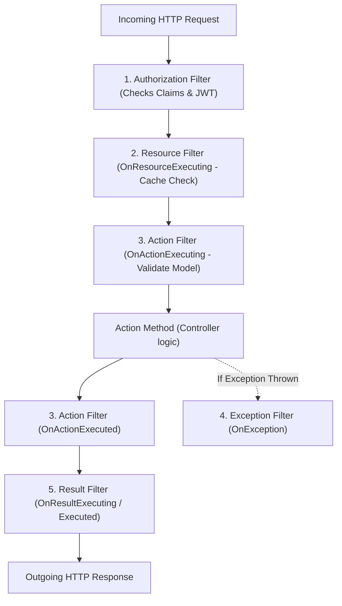

# 01. .NET Core & C# Experienced Developer (5–10+ YOE) Interview Master Guide — India Context

> **Target Audience:** Experienced Full-Stack & Backend Developers (5–10+ Years of Experience) preparing for Senior Developer, Tech Lead, and Module Lead technical rounds in India.  
> **Applicable Companies:**  
> - **Top IT Services & Global Consultancies:** TCS, Infosys, Cognizant, Wipro, Accenture, Capgemini, HCL, LTIMindtree, Tech Mahindra, Hexaware, Persistent, Nagarro, EPAM, Coforge, Virtusa, Deloitte, EY, PwC, KPMG.  
> - **Global Capability Centers (GCCs) & Tech Hubs:** Wells Fargo, Morgan Stanley, JPMorgan Chase, Barclays, Walmart Global Tech India, Lowe's India, Target India, Optum, Fidelity, Standard Chartered, HSBC.  
> - **Indian Product Firms & Unicorns:** Flipkart, Swiggy, Zomato, MakeMyTrip, Paytm, PhonePe, Zepto.  
>
> **Philosophy:** 100% grounded in real-world Indian interview rounds. Zero academic fluff, zero esoteric compiler trivia that no interviewer asks. Every question follows the **6-Part Senior Answer Architecture** (Tailored for Indian Technical Rounds):  
> 1. **⚡ 30-Second Senior Opening Pitch** (The immediate, confident opening sentence)  
> 2. **🎯 Exact Formal Definitions & Rubric Keywords Interviewers Want to Hear** (CS definitions, rubric keywords scored on evaluation sheet, & real-project delivery phrasing)  
> 3. **🧠 Intuitive Real-World Analogy** (Everyday Indian mental models for fast recall under interview pressure)  
> 4. **💻 Simple, Clean, Runnable Code Snippet (5–15 lines)** (Practical, copy-pasteable production code)  
> 5. **⚠️ Senior Trap & Cross-Question** (What the interviewer will ask next + Senior rebuttal)  
> 6. **📊 "When to Use What & What Must Be Done" Quick Decision Guide** (Actionable comparison decision tables)  
>
> *(Note: For niche, low-latency CLR engine internals like Card Tables, Tiered Compilation, and POH byte layouts, refer to [09_DotNet_CLR_Ultra_Deep_Niche_Internals.md](file:///home/ubermensch/Desktop/interview/09_DotNet_CLR_Ultra_Deep_Niche_Internals.md)).*

---

# TABLE OF CONTENTS

- [MODULE 1: C# LANGUAGE & OOPS FUNDAMENTALS (SCREENING HITLIST)](#module-1-c-language--oops-fundamentals-screening-hitlist)
  - [Q1: SOLID Principles with Real-Time Project Examples](#q1-solid-principles-with-real-time-project-examples)
  - [Q2: IEnumerable vs IQueryable vs IList vs ICollection](#q2-ienumerable-vs-iqueryable-vs-ilist-vs-icollection)
  - [Q3: String vs StringBuilder & String Immutability](#q3-string-vs-stringbuilder--string-immutability)
  - [Q4: ref vs out vs in vs params](#q4-ref-vs-out-vs-in-vs-params)
  - [Q5: throw vs throw ex vs throw new CustomException](#q5-throw-vs-throw-ex-vs-throw-new-customexception)
  - [Q6: Abstract Class vs Interface (with C# 8+ Default Methods)](#q6-abstract-class-vs-interface-with-c-8-default-methods)
  - [Q7: Boxing and Unboxing Mechanics & Performance](#q7-boxing-and-unboxing-mechanics--performance)
  - [Q8: Method Overloading vs Method Overriding vs Method Shadowing (new)](#q8-method-overloading-vs-method-overriding-vs-method-shadowing-new)
  - [Q9: const vs readonly vs static readonly](#q9-const-vs-readonly-vs-static-readonly)
  - [Q10: Delegates, Func, Action, Predicate & Lambda Expressions](#q10-delegates-func-action-predicate--lambda-expressions)
  - [Q11: Extension Methods in C#](#q11-extension-methods-in-c)
  - [Q12: Nullable Types, Null-Forgiving (!) & Null-Coalescing (??, ??=)](#q12-nullable-types-null-forgiving--null-coalescing--)
  - [Q13: class vs struct vs record (Record Class vs Record Struct)](#q13-class-vs-struct-vs-record-record-class-vs-record-struct)
  - [Q14: IDisposable Pattern & the using Statement](#q14-idisposable-pattern--the-using-statement)

- [MODULE 2: ASP.NET CORE & WEB API ARCHITECTURE](#module-2-aspnet-core--web-api-architecture)
  - [Q15: Dependency Injection Lifetimes (Transient vs Scoped vs Singleton & Captive Dependency)](#q15-dependency-injection-lifetimes-transient-vs-scoped-vs-singleton--captive-dependency)
  - [Q16: Middleware vs Action Filters (app.Use vs app.Run vs app.Map)](#q16-middleware-vs-action-filters-appuse-vs-apprun-vs-appmap)
  - [Q17: Writing Custom Middleware for Global Exception Handling](#q17-writing-custom-middleware-for-global-exception-handling)
  - [Q18: ASP.NET Core Filter Pipeline Order of Execution](#q18-aspnet-core-filter-pipeline-order-of-execution)
  - [Q19: JWT Authentication & Authorization in Web API](#q19-jwt-authentication--authorization-in-web-api)
  - [Q20: CORS (Cross-Origin Resource Sharing) Configuration](#q20-cors-cross-origin-resource-sharing-configuration)
  - [Q21: Configuration & Options Pattern (IOptions vs IOptionsSnapshot vs IOptionsMonitor)](#q21-configuration--options-pattern-ioptions-vs-ioptionssnapshot-vs-ioptionsmonitor)
  - [Q22: HTTP Status Codes & RESTful API Best Practices](#q22-http-status-codes--restful-api-best-practices)
  - [Q23: IHttpClientFactory: Typed Client vs Socket Exhaustion vs DNS Bug](#q23-ihttpclientfactory-typed-client-vs-socket-exhaustion-vs-dns-bug)

- [MODULE 3: ENTITY FRAMEWORK CORE & DATA ACCESS](#module-3-entity-framework-core--data-access)
  - [Q24: Eager Loading (.Include) vs Lazy Loading vs Explicit Loading](#q24-eager-loading-include-vs-lazy-loading-vs-explicit-loading)
  - [Q25: First vs FirstOrDefault vs Single vs SingleOrDefault vs Find](#q25-first-vs-firstordefault-vs-single-vs-singleordefault-vs-find)
  - [Q26: AsNoTracking() vs Tracked Queries](#q26-asnotracking-vs-tracked-queries)
  - [Q27: Code-First Migrations & Production CI/CD Scripts](#q27-code-first-migrations--production-cicd-scripts)
  - [Q28: EF Core vs Dapper: When to Use Which](#q28-ef-core-vs-dapper-when-to-use-which)
  - [Q29: Select() vs SelectMany() in LINQ](#q29-select-vs-selectmany-in-linq)
  - [Q30: Handling Concurrency in EF Core with RowVersion](#q30-handling-concurrency-in-ef-core-with-rowversion)

- [MODULE 4: ASYNCHRONOUS PROGRAMMING & CONCURRENCY](#module-4-asynchronous-programming--concurrency)
  - [Q31: async and await Internals: Does it Create a New Thread?](#q31-async-and-await-internals-does-it-create-a-new-thread)
  - [Q32: The Sync-over-Async Trap (.Result & .Wait Deadlocks)](#q32-the-sync-over-async-trap-result--wait-deadlocks)
  - [Q33: Task.WhenAll vs Task.WaitAll vs Task.WhenAny](#q33-taskwhenall-vs-taskwaitall-vs-taskwhenany)
  - [Q34: CancellationToken Propagation in Web APIs](#q34-cancellationtoken-propagation-in-web-apis)
  - [Q35: lock vs SemaphoreSlim in Asynchronous Code](#q35-lock-vs-semaphoreslim-in-asynchronous-code)

- [MODULE 5: DESIGN PATTERNS & ARCHITECTURE](#module-5-design-patterns--architecture)
  - [Q36: Repository Pattern & Unit of Work in EF Core Projects](#q36-repository-pattern--unit-of-work-in-ef-core-projects)
  - [Q37: Thread-Safe Singleton Pattern (Double-Check vs Lazy<T>)](#q37-thread-safe-singleton-pattern-double-check-vs-lazyt)
  - [Q38: Factory Pattern vs Abstract Factory Pattern](#q38-factory-pattern-vs-abstract-factory-pattern)
  - [Q39: CQRS & MediatR Pattern in Web APIs](#q39-cqrs--mediatr-pattern-in-web-apis)
  - [Q40: Caching Strategies: IMemoryCache vs IDistributedCache (Redis)](#q40-caching-strategies-imemorycache-vs-idistributedcache-redis)
  - [Q41: Microservices Communication: Synchronous vs Asynchronous](#q41-microservices-communication-synchronous-vs-asynchronous)

- [MODULE 6: SQL SERVER FOR .NET DEVELOPERS (MANDATORY ROUND)](#module-6-sql-server-for-net-developers-mandatory-round)
  - [Q42: Clustered vs Non-Clustered Index](#q42-clustered-vs-non-clustered-index)
  - [Q43: Finding the 2nd Highest / Nth Highest Salary](#q43-finding-the-2nd-highest--nth-highest-salary)
  - [Q44: DELETE vs TRUNCATE vs DROP](#q44-delete-vs-truncate-vs-drop)
  - [Q45: UNION vs UNION ALL](#q45-union-vs-union-all)
  - [Q46: Primary Key vs Unique Key](#q46-primary-key-vs-unique-key)
  - [Q47: Stored Procedure vs User-Defined Function (UDF)](#q47-stored-procedure-vs-user-defined-function-udf)
  - [Q48: ACID Properties Explained with a Banking Scenario](#q48-acid-properties-explained-with-a-banking-scenario)

---

# MODULE 1: C# LANGUAGE & OOPS FUNDAMENTALS (SCREENING HITLIST)

## Q1: SOLID Principles with Real-Time Project Examples
* **Asked At:** TCS, Infosys, Cognizant, Wipro, Accenture, Capgemini, Deloitte, EY, Nagarro, EPAM.
* **⚡ 10-Second Opening Hook:**  
  > "SOLID isn't academic theory—it's five practical architectural guardrails to prevent code rot. Each principle isolates a specific blast radius so adding a new feature or payment method never breaks existing, tested production code."

* **⚡ 30-Second Senior Conversational Answer:**  
  > "In our production APIs, I rely on SOLID to keep business logic maintainable and unit-testable:  
  > * **S (Single Responsibility):** A class should have only one reason to change. My `OrderService` handles workflow orchestration—not tax calculation, database persistence, or SMTP emailing.  
  > * **O (Open/Closed):** Open for extension, closed for modification. I use polymorphic strategy patterns with interfaces so adding a new provider like PhonePe or Apple Pay doesn't require touching existing checkout logic.  
  > * **L (Liskov Substitution):** Subtypes must honor base contracts. A derived class should never throw `NotImplementedException` or change expected invariants.  
  > * **I (Interface Segregation):** Keep contracts small and client-focused. Don't force clients to implement a 30-method fat interface when they only need two.  
  > * **D (Dependency Inversion):** High-level domain services depend on abstractions (`IPaymentGateway`), not concrete SQL implementations, wired cleanly via ASP.NET Core Dependency Injection."

* **🎯 Exact Formal Definitions & Rubric Keywords Interviewers Want to Hear:**
  * **S — Single Responsibility Principle (SRP):**
    * *Exact Academic Definition:* **"A class should have one, and only one, reason to change."** *(Robert C. Martin)*
    * *Keywords Interviewer Evaluates:* **High Cohesion**, **Low Coupling**, **Separation of Concerns (SoC)**, **Single Responsibility**.
    * *How to say it in your project:* "In our checkout API, `OrderService` originally handled validation, tax calculation, database persistence, invoice PDF generation, and SMTP notification. We refactored it by extracting `OrderTaxCalculator`, `OrderRepository`, `InvoicePdfGenerator`, and `EmailNotificationService`."
  * **O — Open/Closed Principle (OCP):**
    * *Exact Academic Definition:* **"Software entities (classes, modules, functions) should be open for extension, but closed for modification."** *(Bertrand Meyer)*
    * *Keywords Interviewer Evaluates:* **Polymorphism**, **Strategy Design Pattern**, **Abstract Contracts**, **Elimination of Switch/Case Anti-Patterns**.
    * *How to say it in your project:* "In our payment gateway integration, rather than maintaining a giant `switch (paymentMode)` block that required modifying existing classes for every new payment option, we created an `IPaymentGateway` interface. When PhonePe/UPI was added, we simply implemented `UpiPaymentGateway : IPaymentGateway` without altering a single line of existing checkout logic."
  * **L — Liskov Substitution Principle (LSP):**
    * *Exact Academic Definition:* **"Subtypes must be substitutable for their base types without altering the correctness of the program."** *(Barbara Liskov)*
    * *Keywords Interviewer Evaluates:* **Behavioral Subtyping**, **Design by Contract**, **No NotImplementedException in Derived Classes**, **Favoring Composition Over Inheritance**.
    * *How to say it in your project:* "A junior developer created `ReadOnlyAuditRepository` deriving from `IRepository<T>` and threw `throw new NotImplementedException()` in `Save()`. Any generic service calling `Save()` crashed at runtime. We fixed it by segregating interfaces into `IReadOnlyRepository<T>` and `IWriteRepository<T>` so substitution never breaks program invariants."
  * **I — Interface Segregation Principle (ISP):**
    * *Exact Academic Definition:* **"Clients should not be forced to depend upon interfaces that they do not use."**
    * *Keywords Interviewer Evaluates:* **Role-Based Interfaces**, **Interface Pollution**, **Fat / Monolithic Interfaces**, **Fine-Grained Contracts**.
    * *How to say it in your project:* "We broke down a fat 30-method `IUserService` (which mixed profile edits, password resets, and Excel reporting) into focused role interfaces: `IUserAuthentication`, `IUserProfileManager`, and `IUserReportGenerator`."
  * **D — Dependency Inversion Principle (DIP):**
    * *Exact Academic Definition:* **"1. High-level modules should not depend on low-level modules; both should depend on abstractions. 2. Abstractions should not depend on details; details should depend on abstractions."**
    * *Keywords Interviewer Evaluates:* **Inversion of Control (IoC)**, **Dependency Injection (DI)**, **Constructor Injection**, **Decoupling Business Policies from Persistence Details**.
    * *How to say it in your project:* "`CheckoutService` (high-level business policy) depends strictly on `IPaymentGateway` and `IOrderRepository` (abstractions). The concrete implementations (`SqlOrderRepository`, `RazorpayGateway`) are injected by ASP.NET Core's DI container at runtime."

* **🧠 Everyday Analogies (Mental Models for Fast Recall):**  
  * **S (Swiss Army Knife Anti-pattern):** A knife that also acts as scissors, flashlight, and screwdriver does everything poorly. Give each tool one job.
  * **O (Smartphone with Apps):** You don't crack open the motherboard to add WhatsApp; you install an app via a defined OS interface contract.
  * **L (Electric Auto-rickshaw vs Petrol Auto):** Both must steer and brake identically. If an electric auto throws an error whenever you press the brake, it violates Liskov substitution.
  * **I (Restaurant Menu):** A pure vegetarian shouldn't be handed a 20-page meat and seafood contract to sign just to order dal.
  * **D (Wall Power Socket):** Your laptop charger connects to a standard 3-pin wall socket interface, not soldered directly into house electrical wiring.

* **💻 Simple Code Example:**
```csharp
// S & D: Service depends on interface abstraction; handles 1 responsibility
public interface IPaymentGateway { Task PayAsync(decimal amount); }

// O: New payment methods extend IPaymentGateway without modifying existing classes
public class UpiPayment : IPaymentGateway
{
    public Task PayAsync(decimal amount) => Task.CompletedTask;
}

public class CheckoutService
{
    private readonly IPaymentGateway _gateway;
    public CheckoutService(IPaymentGateway gateway) => _gateway = gateway; // Dependency Inversion!

    public async Task ProcessOrder(decimal amount) => await _gateway.PayAsync(amount);
}
```

* **⚠️ Senior Trap & Cross-Question:**  
  * *Trap Question:* "Does Single Responsibility mean a class can only have one method?"  
  * *Senior Answer:* "No! Single Responsibility is about **cohesion and reasons to change**, not method count. A class can have 10 methods as long as they all serve a single cohesive business responsibility (e.g., `UserRepository` having `GetById`, `Add`, `Update`, `Delete`). It violates SRP only when it crosses domain boundaries—like `UserRepository` also generating PDF reports or sending SMS alerts."

* **📊 Decision Guide:**
| Principle | Classic Production Violation | What Must Be Done in Code |
| :--- | :--- | :--- |
| **SRP** | Monolithic `OrderManager` (DB + Tax + PDF + SMS) | Extract dedicated services (`TaxCalculator`, `OrderRepo`, `EmailClient`). |
| **OCP** | Giant `switch (paymentType)` requiring edits for every new type | Define `IPaymentStrategy` and register implementations in DI. |
| **LSP** | Derived subclass throws `throw new NotImplementedException()` | Split base class or use composition instead of forced inheritance. |
| **ISP** | Bloated interfaces forcing empty method stubs | Break large interfaces into small, focused interfaces (`IReadOnlyRepository`, `IWriteRepository`). |
| **DIP** | Tight coupling with `new ConcreteService()` inside constructors | Register interfaces in `Program.cs` and inject them via constructors. |

---

## Q2: IEnumerable vs IQueryable vs IList vs ICollection
* **Asked At:** Commonly asked across Indian .NET Technical Rounds.
* **⚡ 10-Second Opening Hook:**  
  > "The real architectural line in the sand is where the work happens: `IQueryable` translates expression trees into native SQL executed on the database server, while `IEnumerable` pulls all raw records into C# RAM across the network and filters them in memory."

* **⚡ 30-Second Senior Conversational Answer:**  
  > "I always watch this like a hawk in code reviews.  
  > If a repository returns `IEnumerable`, Entity Framework Core generates `SELECT * FROM Table`, pulling hundreds of thousands of records across the network and exhausting web server RAM.  
  > With `IQueryable`, your `.Where()` and `.Take()` calls append to an Abstract Syntax Tree (AST), which EF Core's `IQueryProvider` translates into a clean, parameterized `WHERE` and `TOP(10)` executed directly on SQL Server.  
  > Once data is in memory, I use `ICollection` when I just need counts and mutations (`Add`/`Remove`), or `IList` when I need direct index-based lookups (`list[i]`)."

* **🎯 Exact Formal Definitions & Rubric Keywords Interviewers Want to Hear:**
  * **Exact Formal CS Definitions:**
    * **`IEnumerable<T>`:** "A read-only, forward-only sequence. You can enumerate it many times; each pass is forward-only, no indexing. LINQ filters over it run in memory, item by item (LINQ to Objects)."
    * **`IQueryable<T>`:** "A query object that stores your LINQ as an expression tree instead of running it immediately. EF Core translates that tree into SQL, so filtering and TOP happen on the database server (LINQ to Entities)."
    * **`ICollection<T>`:** "`IEnumerable` plus the ability to change the collection - `Add`, `Remove`, `Clear` - and read its `Count`. Still no indexing."
    * **`IList<T>`:** "`ICollection` plus position-based access - you can get and set by index (`list[0]`), plus `Insert` and `RemoveAt`."
  * **Keywords Interviewer Evaluates:** **Expression Tree (`System.Linq.Expressions`)**, **Abstract Syntax Tree (AST)**, **Deferred / Lazy Execution**, **Client-Side vs Server-Side Evaluation**, **`IQueryProvider`**, **LINQ to Entities vs LINQ to Objects**, **Network Serialization Overhead**, **Forward-Only Enumeration (`IEnumerator.MoveNext()`)**.
  * **How to say it in your project:** "In our e-commerce order management module, an `IEnumerable<Order>` return type in a repository caused EF Core to issue `SELECT * FROM Orders`, pulling 500,000 records into web server RAM and spiking memory to 95%. Changing the contract to `IQueryable<Order>` allowed our filter predicates to append to the SQL Expression Tree, generating `SELECT ... WHERE Status = 'Active'`, which SQL Server executed in 14ms."

* **🧠 Everyday Analogies (Mental Models for Fast Recall):**  
  * **`IEnumerable` (Swiggy delivery guy bringing the entire restaurant kitchen):** You order 1 Biryani. The delivery person brings raw chicken, rice, pots, and the chef to your living room table, and you scoop out 1 plate. Immense waste of transport and memory.
  * **`IQueryable` (The Waiter taking your order ticket):** You tell the waiter '1 Hyderabadi Chicken Biryani, extra spicy'. The kitchen executes the cooking on the server, and the waiter brings only that 1 prepared plate to your table.
  * **`ICollection` (Shopping Cart):** You can check item count (`Count`), put in items (`Add`), or discard items (`Remove`).
  * **`IList` (Numbered Train Coach Seats):** You can walk directly to seat number 42 (`seats[42]`) without counting seats 1 to 41.

* **💻 Simple Code Example:**
```csharp
// ❌ DANGEROUS JUNIOR BUG: IEnumerable executes filtering in C# Memory!
// Generates: SELECT * FROM Orders; -> Downloads all 2,000,000 rows into RAM!
IEnumerable<Order> orders = dbContext.Orders; 
var recentOrders = orders.Where(o => o.Status == "Shipped").Take(10).ToList();

// ✅ SENIOR PATTERN: IQueryable executes filtering on SQL Server!
// Generates: SELECT TOP(10) * FROM Orders WHERE Status = 'Shipped';
IQueryable<Order> query = dbContext.Orders; 
var optimizedOrders = query.Where(o => o.Status == "Shipped").Take(10).ToList();
```

* **⚠️ Senior Trap & Cross-Question:**  
  * *Trap Question:* "What happens when you call a C# custom method (e.g., `o.CalculateTax()`) inside an `IQueryable.Where()` clause?"  
  * *Senior Answer:* "EF Core's `IQueryProvider` attempts to translate the expression tree to SQL. Since SQL Server has no definition for custom C# methods, EF Core throws an `InvalidOperationException: The LINQ expression could not be translated`. You must either compute the logic using supported SQL functions, compute it in a `.Select()` projection, or invoke `.AsEnumerable()` / `.ToList()` to intentionally switch to client-side evaluation."

* **📊 Decision Guide:**
| Interface | Where Filter Runs | Supports Index (`[i]`)? | Mutation (`Add`/`Remove`) | What Must Be Done in Code |
| :--- | :--- | :--- | :--- | :--- |
| **`IQueryable<T>`** | **Remote Database Server** | No | No | Use in Repository query layers for EF Core filtering. |
| **`IEnumerable<T>`**| In-Memory (C# RAM) | No (Forward-only cursor) | No | Use for read-only iteration over in-memory collections. |
| **`ICollection<T>`** | In-Memory (C# RAM) | No | Yes (`Add`, `Remove`) | Use when you need `.Count` and collection modifications. |
| **`IList<T>`** | In-Memory (C# RAM) | **Yes (`list[0]`)** | Yes | Use for UI binding, sorting grids, and indexed lookups. |

---

## Q3: String vs StringBuilder & String Immutability
* **Asked At:** TCS, Wipro, Infosys, Cognizant, Accenture, Mindtree, Tech Mahindra.
* **⚡ 10-Second Opening Hook:**  
  > "`string` is an immutable reference type where every concatenation allocates a brand-new heap object and discards the old one; `StringBuilder` is a mutable, chunked buffer that modifies character arrays in place."

* **⚡ 30-Second Senior Conversational Answer:**  
  > "Strings in C# are immutable for thread safety and string interning, but that creates a major GC hazard in loops. If you concatenate strings inside a loop using `+=`, you allocate thousands of temporary objects on the managed heap, hammering Gen 0 and triggering Stop-the-World GC pauses.  
  > In production, whenever I'm assembling text in loops or building dynamic queries, I reach for `StringBuilder` and always pre-allocate an estimated capacity.  
  > But for just 2 to 4 static strings, I stick with standard string interpolation `$"{a} - {b}"` because the Roslyn compiler optimizes that directly into a single `string.Concat` with zero object overhead."

* **🎯 Exact Formal Definitions & Rubric Keywords Interviewers Want to Hear:**
  * **Exact Formal CS Definitions:**
    * **String Immutability:** "A `string` is a reference type whose characters can never be changed after it's created. Any 'modification' allocates a brand-new string. That's what makes strings thread-safe and lets the CLR share identical literals in the intern pool."
    * **`StringBuilder`:** "A growable text buffer. Appends write into the same buffer instead of creating new strings; when the buffer fills up, its capacity roughly doubles."
  * **Keywords Interviewer Evaluates:** **Immutability**, **Managed Heap Allocation**, **GC Generation 0 Allocation Pressure**, **String Interning Pool (`String.Intern`)**, **Contiguous Char Array Buffer**, **Geometric Growth / Capacity Doubling**, **`string.Concat` Compiler Optimization**.
  * **How to say it in your project:** "In our ledger export microservice, generating a 50,000-line CSV via `str += line` created over 50,000 temporary heap objects, inducing continuous Gen 0 and Gen 1 GC pauses totaling 3.8 seconds. Replacing it with `new StringBuilder(capacity: 2 * 1024 * 1024)` pre-allocated the buffer, dropping GC time to 0ms and runtime from 4.5s to 120ms."

* **🧠 Everyday Analogies (Mental Models for Fast Recall):**  
  * **String (Printed Aadhaar Card):** You cannot edit the name by scratching it with a pen; if there is a spelling mistake, the government prints an entirely new physical PVC card and shreds the old one.
  * **StringBuilder (A Classroom Whiteboard):** You write words, erase a part, and append more text on the same physical board without buying a new whiteboard.

* **💻 Simple Code Example:**
```csharp
// ❌ BAD: Allocates 1,000 distinct string objects on the managed heap!
string csv = "";
for (int i = 0; i < 1000; i++)
{
    csv += i.ToString() + ","; // Allocates new string every iteration -> GC pressure!
}

// ✅ SENIOR FIX: Single mutable internal buffer allocation
var sb = new StringBuilder(5000); // Pre-allocate initial capacity to prevent buffer resizing
for (int i = 0; i < 1000; i++)
{
    sb.Append(i).Append(',');
}
string result = sb.ToString();
```

* **⚠️ Senior Trap & Cross-Question:**  
  * *Trap Question:* "Is `StringBuilder` ALWAYS faster than string concatenation? What if you only concatenate 3 strings?"  
  * *Senior Answer:* "No! For 3 or 4 strings (e.g., `string s = a + b + c;`), the C# compiler internally translates it to `string.Concat(a, b, c)`, which calculates the exact final buffer length upfront and allocates the exact heap memory once. `StringBuilder` has class instantiation overhead and internal array buffer management overhead; it should only be used inside loops or when concatenating dynamic, unknown counts of text ($\ge 7-10$ iterations)."

* **📊 Decision Guide:**
| Scenario | What to Use | Why | What Must Be Done in Code |
| :--- | :--- | :--- | :--- |
| Concatenating 2 to 5 strings | String interpolation `$"{a} - {b}"` | Compiler translates to optimized `string.Concat`. Zero object overhead. | Use `$"{firstName} {lastName}"`. |
| Concatenation in a loop | `StringBuilder` | Modifies internal character array buffer; avoids thousands of GC allocations. | Instantiate `new StringBuilder()`, loop with `.Append()`. |
| Known large size string building | `new StringBuilder(estimatedCapacity)` | Eliminates internal array doubling copies when buffer reaches capacity. | Pre-size: `new StringBuilder(1024 * 64)`. |

---

## Q4: ref vs out vs in vs params
* **Asked At:** Accenture, Capgemini, Infosys, Cognizant, Persistent, HCL.
* **⚡ 10-Second Opening Hook:**  
  > "`ref` is read-write by reference; `out` is write-only mandatory assignment; `in` is a read-only reference for zero-copy performance; and `params` bundles variable arguments into an array."

* **⚡ 30-Second Senior Conversational Answer:**  
  > "These keywords control parameter passing semantics and stack memory efficiency:  
  > By default, value types are copied onto the stack.  
  > I reach for **`out`** for the classic `Try*` pattern—like `int.TryParse`—where the caller doesn't need to initialize the variable, but the callee is legally forced by the compiler to assign it before returning.  
  > I use **`ref`** when a method needs two-way, in-place modification of existing caller state.  
  > On performance-critical hot paths, I use **`in`** with large structs ($\ge 16$ bytes) because it passes a managed pointer (`readonly T&`), giving you zero-copy performance while strictly preventing the method from modifying the data.  
  > And **`params`** is convenience syntax for variable argument lists, though we avoid it on ultra-hot paths because it allocates an array under the hood."

* **🎯 Exact Formal Definitions & Rubric Keywords Interviewers Want to Hear:**
  * **Exact Formal CS Definitions:**
    * **`ref`:** "Passes the variable itself, not a copy. The caller must initialize it first, and the method can both read and modify it."
    * **`out`:** "Also passes by reference, but the caller doesn't have to initialize the variable - instead, the method is required to assign it before returning."
    * **`in`:** "Passes a large struct by reference without copying it, and the compiler guarantees the method cannot modify it."
    * **`params`:** "Lets a method accept any number of arguments; the compiler bundles them into an array for you."
  * **Keywords Interviewer Evaluates:** **Pass-by-Reference vs Pass-by-Value**, **Managed Pointer (`T&`)**, **Definite Assignment Rule**, **Caller vs Callee Assignment Guarantee**, **Zero-Copy Performance Optimization for Large Structs**, **IL Signature Collision**, **Array Allocation Overhead of `params`**.
  * **How to say it in your project:** "In our payment processing engine, we used `bool TryAuthorize(PaymentRequest req, out TransactionResult result)` to return status while guaranteeing that `result` is assigned on exit. Additionally, for a 64-byte `struct GeoCoordinate`, we changed parameter passing to `in GeoCoordinate point`, avoiding stack copying on 20,000 calculations per second."

* **🧠 Everyday Analogies (Mental Models for Fast Recall):**  
  * **`ref` (Shared Google Doc with Edit Access):** You create a doc with notes, share the edit link with a coworker; they read what you wrote and modify the live text directly.
  * **`out` (Blank Exam Answer Sheet):** The teacher hands you a blank sheet; you don't need to bring notes, but you MUST write your answers on it before you leave the exam room.
  * **`in` (Laminated Security ID Badge):** The security officer inspects your ID up close without making a photocopy, but they are forbidden from writing on or altering your badge.
  * **`params` (Swiggy Multi-Item Cart):** Order 1 dish, 5 dishes, or none—they are all packed together into a single delivery bag.

* **💻 Simple Code Example:**
```csharp
public class ParameterDemo
{
    // 1. ref: Caller MUST initialize. Callee can read and write.
    public void UpdateScore(ref int score) => score += 10;

    // 2. out: Caller does not need to initialize. Callee MUST assign before exit.
    public bool TryParseToken(string input, out int id)
    {
        id = 42; // Mandatory assignment!
        return true;
    }

    // 3. in: Passed by reference for performance, but CALLEE CANNOT MODIFY!
    public decimal CalculateTax(in decimal totalAmount)
    {
        // totalAmount = 50; // COMPILER ERROR: Cannot assign to variable 'in decimal'
        return totalAmount * 0.18m;
    }

    // 4. params: Variable number of arguments passed as comma-separated list
    public int SumNumbers(params int[] numbers) => numbers.Sum();
}
```

* **⚠️ Senior Trap & Cross-Question:**  
  * *Trap Question:* "Can you overload two methods where one takes `ref int` and the other takes `out int`?"  
  * *Senior Answer:* "No. At the CLR Intermediate Language (IL) level, both `ref` and `out` are compiled identically as managed pointers (`int32&`). The compiler throws a compile-time duplicate signature error (CS0663). However, you *can* overload between normal by-value passing (`int`) and `ref`/`out`."

* **📊 Decision Guide:**
| Keyword | Must Be Initialized Before Passing? | Must Be Assigned Inside Method? | Can Method Mutate It? | Primary Use Case |
| :--- | :--- | :--- | :--- | :--- |
| *(default)* | Yes | No | Modifies copy only (for value types). | Normal parameter passing. |
| **`ref`** | **Yes** | No | Yes (modifies original variable). | Bidirectional state updating in-place. |
| **`out`** | No | **Yes (Mandatory)** | Yes (modifies original variable). | `Try*` pattern methods (`int.TryParse`). |
| **`in`** | **Yes** | No | **No (Read-Only reference)**. | Zero-copy performance for large structs ($\ge 16$ bytes). |
| **`params`**| Yes (or empty) | No | Modifies array elements only. | Convenience APIs (`string.Format`, `logger.Log`). |

---

## Q5: throw vs throw ex vs throw new CustomException
* **Asked At:** Frequently asked in Indian screening rounds.
* **⚡ 10-Second Opening Hook:**  
  > "`throw;` preserves the crime scene by keeping the original call stack and line numbers intact; `throw ex;` destroys the evidence by resetting the stack trace; and custom exceptions preserve business context while keeping the root cause in `InnerException`."

* **⚡ 30-Second Senior Conversational Answer:**  
  > "In our production services, writing `throw ex;` is an immediate PR blocker. It destroys the original stack trace and resets the error origin to the current catch block—so if a failure occurred on line 120 deep inside a repository, your logs will only show line 25 where the catch block sits.  
  > If you are catching an exception just to log it and let it bubble up, always use a bare `throw;` to keep the original stack trace and line numbers 100% intact.  
  > If you are at an architectural boundary—like converting a raw `SqlException` into a business-level `OrderProcessingException`—wrap it in a custom exception and pass the original exception as the `innerException`."

* **🎯 Exact Formal Definitions & Rubric Keywords Interviewers Want to Hear:**
  * **Exact Formal CS Definitions:**
    * **`throw;`:** "Re-throws the exception exactly as it was, preserving the original stack trace - you still see the real line where it first failed."
    * **`throw ex;`:** "Re-throws the same object but resets the stack trace to this line. The original failure point is lost forever - a classic production debugging trap."
    * **`throw new CustomException("...", ex);`:** "Wraps the low-level exception in a meaningful domain exception, keeping the original in `InnerException` so you don't lose the root cause and callers don't see implementation details."
  * **Keywords Interviewer Evaluates:** **Stack Unwinding**, **Call Stack Trace Preservation**, **Loss of Root-Cause Line Number**, **`ExceptionDispatchInfo.Capture`**, **InnerException Causality Chaining**, **Architectural Layering / Domain Exceptions**.
  * **How to say it in your project:** "In our payment processing worker, an unhandled exception was caught with `throw ex;`. In Datadog logs, the stack trace pointed to the catch block on line 30 instead of the real socket timeout on line 142 inside the external SDK. Refactoring to `throw;` restored the complete line-by-line stack trace."

* **🧠 Everyday Analogies (Mental Models for Fast Recall):**  
  * **`throw;` (Honest Courier):** Shows the parcel was damaged at Chennai Depot Bay 4 on Monday at 3:15 PM. Complete audit trail intact.
  * **`throw ex;` (Fraudulent Courier):** Rips off the original tracking slip, slaps a fresh label on it, and claims the parcel was damaged at Bangalore Hub today. The original blame is erased.
  * **`throw new CustomException(msg, ex)` (Secure Bank Envelope):** The bank places the torn original courier slip inside an official audit envelope labeled 'Payment Investigation #404', preserving the root proof inside.

* **💻 Simple Code Example:**
```csharp
try
{
    _paymentClient.Process(); // Exception on line 45 inside PaymentClient
}
catch (SocketException ex)
{
    // ❌ SEVERE ANTI-PATTERN: Resets stack trace! Line 45 is lost forever!
    // throw ex; 

    // ✅ SENIOR PATTERN 1: Preserves original line 45 in stack trace
    // throw; 

    // ✅ SENIOR PATTERN 2: Enterprise wrapping with InnerException preserved
    throw new PaymentGatewayException("Payment gateway unreachable during checkout", ex);
}
```

* **⚠️ Senior Trap & Cross-Question:**  
  * *Trap Question:* "When would you use an Exception Filter (`catch (HttpRequestException ex) when (ex.StatusCode == HttpStatusCode.NotFound)`)?"  
  * *Senior Answer:* "Exception filters evaluate a condition *before* the stack is unwound. If the condition is false, the CLR does not enter the catch block at all, preserving the original execution state without the performance cost of entering and re-throwing."

* **📊 Decision Guide:**
| Technique | Stack Trace Behavior | InnerException Present? | Production Recommendation |
| :--- | :--- | :--- | :--- |
| **`throw;`** | **Preserved 100% intact** | Keeps original | **Best for generic catch blocks** (logging and bubbling up). |
| **`throw ex;`** | **Overwritten / Destroyed** | No | **STRICTLY FORBIDDEN ANTI-PATTERN.** |
| **`throw new Custom(msg, ex);`**| Sets new top frame, retains root | **Yes (`ex` preserved)**| **Best for domain boundary exceptions.** |
| **Exception Filter (`when`)** | Evaluates without unwinding stack | N/A | **Best for conditional handling without re-throwing.** |

---

## Q6: Abstract Class vs Interface (with C# 8+ Default Methods)
* **Asked At:** TCS, Infosys, Cognizant, Accenture, Deloitte, Nagarro, EPAM.
* **⚡ 10-Second Opening Hook:**  
  > "The simplest way to put it: **Interfaces define what a class can *do*; Abstract classes define what a class *is*.** Interfaces give you multiple inheritance with zero state; abstract classes give you a shared biological identity that can actually hold state, fields, and constructors."

* **⚡ 30-Second Senior Conversational Answer:**  
  > "The core difference really comes down to **identity versus capability**.  
  > I reach for an **interface** when I need to define a capability—like `IPaymentGateway` or `ILoggable`—so I can inject dependencies and mock them cleanly in tests. C# lets a class implement multiple interfaces, but they **cannot hold instance fields or state**.  
  > I use an **abstract class** when classes belong to the same family and need to share **real state and plumbing**. It can have constructors, protected fields, and initialize shared dependencies like a `DbContext`—though C# limits you to single class inheritance.  
  > Even with C# 8 adding default interface methods, interfaces still can't hold instance state, so abstract classes are still king for sharing base plumbing."

* **🎯 Exact Formal Definitions & Rubric Keywords Interviewers Want to Hear:**
  * **Exact Formal CS Definitions:**
    * **Interface:** "A contract of member signatures that a type must implement; a class can implement many interfaces. Since C# 8 interfaces can have default implementations and static members, but they can never hold instance state (fields)."
    * **Abstract Class:** "An incomplete base class marked `abstract` that can't be instantiated directly and sits at the top of a single-inheritance chain. Unlike an interface, it can have fields, constructors, concrete methods, and access modifiers like `protected`."
  * **Keywords Interviewer Evaluates:** **Capability vs Identity Hierarchy**, **Multiple Interface Implementation vs Single Class Inheritance**, **Lack of Instance State / Fields in Interfaces**, **Virtual Method Table (vtable) Resolution vs Interface Dispatch (VSD)**, **Default Interface Methods (DIM)**, **Static Abstract Members (C# 11)**, **Base Constructor Injection**, **Liskov Substitution Principle**.
  * **How to say it in your project:** "In our multi-tenant SaaS backend, we declared `IRepository<T>` as an interface so services could be mocked cleanly in xUnit tests. We created an `abstract class BaseSqlRepository<T> : IRepository<T>` that held the shared `protected readonly ApplicationDbContext _db;` and constructor injection logic, avoiding boilerplate across 25 specific domain repositories."

* **🧠 Everyday Analogies (Mental Models for Fast Recall):**  
  * **Interface (Driver's License / Certifications):** Specifies what you can do (drive a car, fly a drone) regardless of who you are. You can hold 5 licenses simultaneously. None of them contain blood, lungs, or organs (zero instance state).
  * **Abstract Class (Biological DNA / Species):** You inherit from `Mammal`—you have lungs, blood, and a heart (instance state and fields). You can only have one biological parent species (single inheritance).

* **💻 Simple Code Example:**
```csharp
// Interface: Defines contract + Default Implementation (C# 8+)
public interface INotificationService
{
    Task SendAsync(string message);

    // Default interface implementation: doesn't break existing classes!
    Task SendUrgentAlertAsync(string message) => SendAsync($"[URGENT]: {message}");
}

// Abstract Class: Maintains state, constructors, and access control
public abstract class BaseRepository<T> where T : class
{
    protected readonly DbContext _context; // Holds state/fields!

    protected BaseRepository(DbContext context) => _context = context;

    public abstract Task<T?> GetByIdAsync(int id); // Derived class MUST implement

    public virtual async Task SaveAuditLogAsync(string action) // Concrete shared logic
    {
        await _context.Database.ExecuteSqlRawAsync($"INSERT INTO AuditLogs VALUES ('{action}')");
    }
}
```

* **⚠️ Senior Trap & Cross-Question:**  
  * *Trap Question 1:* "If interfaces can have default method implementations in C# 8+, why do we still need abstract classes?"  
  * *Senior Answer:* "Interfaces still **cannot have instance state (fields)**. An interface cannot have non-static fields, constructors, or `protected` variables. When you need to share constructor dependencies (like `DbContext` or `ILogger`) across a family of services, you must use an abstract class."
  * *Trap Question 2:* "Can you call a Default Interface Method directly on a class instance, like `service.SendUrgentAlertAsync(...)`?"  
  * *Senior Answer:* "No! Unless the class explicitly overrides the default method, it does not become a public member of the class. You must cast the instance to the interface: `((INotificationService)service).SendUrgentAlertAsync(...)`. This prevents naming collisions and preserves class encapsulation."
  * *Trap Question 3:* "What did C# 11 add to interfaces?"  
  * *Senior Answer:* "**Static abstract members** in interfaces. This enabled Generic Math (`INumber<T>`), allowing operators like `+` and `-` or static factory methods to be defined polymorphically on generic types."

* **📊 Decision Guide:**
| Feature | Interface | Abstract Class |
| :--- | :--- | :--- |
| **Inheritance** | Multiple (class can implement 5+ interfaces) | Single (class can only inherit 1 class) |
| **Instance Fields / State**| **No** (Cannot hold instance fields) | **Yes** (Can have `protected int _count;`) |
| **Constructors** | No | **Yes** (Initializes shared base state) |
| **Access Modifiers** | Public by default | `public`, `protected`, `internal`, `private` |
| **Primary Use Case** | Decoupling dependencies for DI (`IPaymentGateway`) | Shared base plumbing (`BaseController`, `BaseEntity`) |

---

## Q7: Boxing and Unboxing Mechanics & Performance
* **Asked At:** Frequently asked in Indian technical screening rounds (TCS, Infosys, Cognizant, Wipro).
* **⚡ 10-Second Opening Hook:**  
  > "Boxing takes a lightweight value type from the stack, wraps it in a 16-byte object header, and dumps it onto the managed heap; unboxing extracts that value back. Boxing kills high-throughput performance through GC Gen 0 churn."

* **⚡ 30-Second Senior Conversational Answer:**  
  > "Under the hood, whenever a value type like an `int` or `struct` is cast to `object` or an interface, the CLR allocates a 24-byte payload on the managed heap: an 8-byte SyncBlock index, an 8-byte MethodTable pointer, plus the data.  
  > In high-throughput microservices, if you accidentally box inside a loop processing 500,000 items—like using non-generic collections or old string formatting—you create gigabytes of ephemeral heap garbage that triggers non-stop Gen 0 collections.  
  > I prevent boxing completely by enforcing generics (`List<T>` instead of `ArrayList`), implementing `IEquatable<T>` on structs, and utilizing modern string interpolation."

* **🎯 Exact Formal Definitions & Rubric Keywords Interviewers Want to Hear:**
  * **Exact Formal CS Definitions:**
    * **Boxing:** "Wrapping a value type (like an `int`) into an `object`: the CLR allocates a new heap object, copies the value into it, and returns a reference. Conceptually simple, expensive in loops."
    * **Unboxing:** "The reverse: checking that the object really is that value type, then copying the value back out of the heap object onto the stack."
  * **Keywords Interviewer Evaluates:** **Value Type vs Reference Type**, **Stack Allocation vs Managed Heap Allocation**, **Object Header (SyncBlockIndex + MethodTable Pointer = 16 bytes on 64-bit)**, **Garbage Collection Gen 0 Pressure**, **Type Safety Verification (`InvalidCastException`)**, **Generics (`List<T>` vs `ArrayList`)**.
  * **How to say it in your project:** "In our legacy notification service, a loop processing 2,000,000 telemetry items stored integers in a non-generic `ArrayList`. Profiling with `dotnet-trace` revealed 48 MB of Gen 0 garbage per minute due to boxing. Replacing `ArrayList` with `List<int>` eliminated all boxing allocations, reducing CPU utilization by 18% and memory consumption by 65%."

* **🧠 Everyday Analogies (Mental Models for Fast Recall):**  
  * **Boxing (Amazon Packing Box):** You have a loose apple on your desk (stack value). To send it via courier, you put it inside a cardboard box with shipping labels and barcode stickers (heap object header) and store it in an Amazon warehouse (managed heap).
  * **Unboxing (Opening the Package):** You open the box, verify the barcode label matches an apple, and take the apple back out onto your desk (stack).

* **💻 Simple Code Example:**
```csharp
int val = 42; 

// 📦 BOXING: Implicitly allocates 24 bytes on Managed Heap (16-byte header + 4-byte int + 4-byte padding)
object boxedVal = val; 

// 📤 UNBOXING: Explicit cast. CLR verifies MethodTable type, then copies bits back to stack
int unboxedVal = (int)boxedVal; 

// ❌ CLASSIC JUNIOR BOXING TRAP: String.Format with value types
// In .NET Framework / unoptimized code, primitives were boxed to object!
string log = string.Format("Item ID: {0}, Quantity: {1}", val, 100); 

// ✅ SENIOR PATTERN: Modern string interpolation and Generics prevent boxing
List<int> numbers = new List<int>(); // Zero boxing!
numbers.Add(42);
```

* **⚠️ Senior Trap & Cross-Question:**  
  * *Trap Question:* "What happens if you unbox a boxed `int` into a `short` (`short s = (short)boxedInt;`)?"  
  * *Senior Answer:* "It throws an `InvalidCastException` at runtime! Unboxing strictly requires casting to the **exact identical underlying type** (`int`). You must first unbox to `int`, then cast to `short`: `short s = (short)(int)boxedInt;`."

* **📊 Decision Guide:**
| Operation | Direction | Memory Location | Performance Impact | What Must Be Done in Code |
| :--- | :--- | :--- | :--- | :--- |
| **Boxing** | Value Type → Reference Type | Stack → Heap | **High** (Allocates 16-byte header + GC pressure) | Replace `ArrayList` / `Hashtable` with `List<T>` / `Dictionary<K,V>`. |
| **Unboxing** | Reference Type → Value Type | Heap → Stack | Low (Type check + bitwise memory copy) | Cast only to the exact identical value type. |
| **Generics** | Strongly-Typed `<T>` | Pure Stack / Inline | **Zero Boxing** | Use `List<T>`, `Span<T>`, and `IEquatable<T>`. |

---

## Q8: Method Overloading vs Method Overriding vs Method Shadowing (new)
* **Asked At:** TCS, Wipro, Infosys, Cognizant, Accenture, Mindtree.
* **⚡ 10-Second Opening Hook:**  
  > "Overloading is compile-time convenience (same name, different arguments); Overriding is true runtime polymorphism via the vtable; Shadowing with `new` is brute-force hiding that breaks polymorphism."

* **⚡ 30-Second Senior Conversational Answer:**  
  > "The real architectural distinction is how the CLR resolves the method call:  
  > * **Overloading** is compile-time polymorphism (early binding). The compiler checks the parameter count and types, binding directly to the specific method overload before code ever runs.  
  > * **Overriding** is runtime polymorphism (late binding). You mark the base method `virtual` and the child `override`. The CLR consults the instance's `MethodTable` (vtable) at runtime, so even if the variable is typed as `Base`, the child's implementation executes.  
  > * **Method Shadowing (`new`)** hides the base method without touching the vtable. If you invoke it through a base class reference, the base method runs, completely violating polymorphism. In enterprise code, `new` is almost always an anti-pattern."

* **🎯 Exact Formal Definitions & Rubric Keywords Interviewers Want to Hear:**
  * **Exact Formal CS Definitions:**
    * **Method Overloading:** "Same method name in the same class, different parameter lists (type, count, or order). The compiler picks the right one at compile time (static/early binding)."
    * **Method Overriding:** "A derived class replaces a `virtual`/`abstract` base method's implementation. Which version runs is decided at runtime from the object's actual type, via the vtable (dynamic/late binding)."
    * **Method Shadowing / Hiding (`new`):** "A derived class re-declares a base member with the `new` keyword. It hides the base version but does NOT replace it in virtual dispatch - call it through a base-typed reference and the base method still runs."
  * **Keywords Interviewer Evaluates:** **Compile-Time vs Runtime Polymorphism**, **Early Binding vs Late Binding**, **Virtual Method Table (vtable)**, **Dynamic Dispatch**, **Method Hiding (`new` modifier)**, **Vtable Slot Replacement**.
  * **How to say it in your project:** "In our notification pipeline, we overloaded `Send(string msg)` and `Send(string msg, Priority p)` for developer convenience. For our payment providers, `BaseGateway` defined `virtual async Task ProcessAsync()`, which `StripeGateway` overrode. A junior developer once used `new` instead of `override` on `StripeGateway`, causing payments routed through the base interface to silently execute the empty base method."

* **🧠 Everyday Analogies (Mental Models for Fast Recall):**  
  * **Overloading (Universal Power Adapter):** Same wall plug concept, but handles a 2-pin plug, 3-pin plug, or USB-C cable (different parameter signatures).
  * **Overriding (Upgraded Smartphone Ringtone):** When someone calls, the phone plays your newly chosen ringtone instead of the default factory tune (runtime polymorphic replacement).
  * **Shadowing (Wearing a Mask):** You wear a mask over your face; if someone asks for you by your official ID card name (base type reference), the original person underneath responds, not the mask.

* **💻 Simple Code Example:**
```csharp
public class BaseService
{
    public virtual void Execute() => Console.WriteLine("Base Executing");
}

public class OverrideService : BaseService
{
    public override void Execute() => Console.WriteLine("Override Executing");
}

public class ShadowService : BaseService
{
    public new void Execute() => Console.WriteLine("Shadow Executing"); // Hides base!
}

// Runtime Polymorphism Test:
BaseService s1 = new OverrideService();
s1.Execute(); // Prints: "Override Executing" (vtable runtime dispatch!)

BaseService s2 = new ShadowService();
s2.Execute(); // Prints: "Base Executing" (Compile-time reference wins! Shadow method hidden!)
```

* **⚠️ Senior Trap & Cross-Question:**  
  * *Trap Question:* "Can you overload a method in C# purely by changing its return type (e.g., `int GetData()` vs `string GetData()`)?"  
  * *Senior Answer:* "No! The C# language specification dictates that method signatures consist only of the method name, parameter types, and parameter modifiers (`ref`/`out`). The return type is **not** part of the method signature for overload resolution. Attempting this causes compile-time error CS0111."

* **📊 Decision Guide:**
| Concept | Mechanism | Keywords | Resolution Timing | What Happens if Called via Base Type? |
| :--- | :--- | :--- | :--- | :--- |
| **Overloading** | Same method name, different parameters | None | Compile Time | Resolves based on parameter types. |
| **Overriding** | Replaces virtual base method | `virtual` + `override` | Runtime (vtable lookup) | **Derived class method executes.** |
| **Shadowing** | Hides base method without polymorphism | `new` | Compile Time | **Base class method executes!** |

---

## Q9: const vs readonly vs static readonly
* **Asked At:** Capgemini, Accenture, Cognizant, Infosys, Persistent.
* **⚡ 10-Second Opening Hook:**  
  > "`const` is hardcoded into the calling assembly's IL at compile time; `readonly` is initialized at runtime per instance; and `static readonly` is initialized once per process, when the type is first used."

* **⚡ 30-Second Senior Conversational Answer:**  
  > "In enterprise systems, declaring `public const` across shared NuGet packages or multi-assembly solutions is a common deployment trap.  
  > Because `const` is a compile-time constant, the Roslyn compiler literally inlines the raw literal value directly into the consuming assembly's IL. If you update the constant in a shared library and deploy the new DLL without recompiling consuming services, they continue running with the old hardcoded value.  
  > In production, I use `readonly` for instance dependencies injected via constructors—like `_logger` or `_dbContext`—guaranteeing immutability after construction.  
  > For cross-assembly application constants or values read from environment variables on startup, I always use `static readonly`."

* **🎯 Exact Formal Definitions & Rubric Keywords Interviewers Want to Hear:**
  * **Exact Formal CS Definitions:**
    * **`const`:** "A compile-time constant. The compiler pastes the literal value directly into every place it's used, so it's baked into callers' assemblies and needs a rebuild to propagate changes."
    * **`readonly`:** "A per-instance constant: set at declaration or inside the constructor, then write-protected for the object's lifetime."
    * **`static readonly`:** "A value shared by the whole type, computed once when the class is first loaded (static constructor). Like `const` it's one value for everyone, but it's evaluated at runtime, so it can hold objects and non-literal values."
  * **Keywords Interviewer Evaluates:** **Compile-Time Constant vs Runtime Constant**, **IL Literal Inlining**, **Cross-Assembly Versioning Brittle Dependency**, **Constructor Assignment Immutability**, **Type Initialization / Type Initializer (`.cctor`)**, **Thread Safety of Static Constructors**.
  * **How to say it in your project:** "We had a shared NuGet package `Billing.Common` with `public const int TaxRate = 18;`. When the government altered the tax rate to 20, we deployed the new package DLL without recompiling consuming services. The consuming services continued charging 18% because the literal 18 was inlined in their IL. Refactoring to `public static readonly int TaxRate` solved the multi-assembly deployment bug."

* **🧠 Everyday Analogies (Mental Models for Fast Recall):**  
  * **`const` (Permanent Tattoo):** Inked before birth; embedded permanently into the skin; cannot change without cutting the skin.
  * **`readonly` (Passport Number):** Assigned on the day you are born/registered (constructor); never changes for your entire lifetime.
  * **`static readonly` (Office Wi-Fi Password):** Configured on the router when the office opened; identical for all 500 employees, but can be loaded dynamically from configuration files.

* **💻 Simple Code Example:**
```csharp
public class AppConfig
{
    // Compile-time: Evaluated during compilation, baked into calling DLL
    public const string ApiVersion = "v1.0"; 

    // Runtime instance constant: Can be assigned inside constructor
    public readonly DateTime CreatedAt;

    // Runtime static constant: Initialized once for the entire application
    public static readonly string ConnectionString;

    public AppConfig(DateTime createdAt)
    {
        CreatedAt = createdAt; // Allowed!
    }

    static AppConfig()
    {
        ConnectionString = Environment.GetEnvironmentVariable("DB_CONN") ?? "default";
    }
}
```

* **⚠️ Senior Trap & Cross-Question (The Versioning Trap):**  
  * *Trap Question:* "Why is declaring `public const` across shared NuGet packages or multi-assembly solutions dangerous?"  
  * *Senior Answer:* "Because the compiler literally replaces the variable reference with its raw literal value inside the consumer assembly's IL. If you update the constant in Assembly A and recompile only Assembly A, Assembly B will continue running with the old hardcoded literal until Assembly B is recompiled! Therefore, public constants across assembly boundaries must always be declared as `public static readonly`."

* **📊 Decision Guide:**
| Modifier | Evaluated At | Can Be Changed In | Memory Allocation | Cross-Assembly Safety |
| :--- | :--- | :--- | :--- | :--- |
| **`const`** | Compile Time | Never (Hardcoded literal) | None (Inlined in IL) | **Unsafe** (Requires consumer recompilation) |
| **`readonly`** | Runtime | Declaration or Constructor | Per instance heap/stack | **Safe** (Resolved at runtime) |
| **`static readonly`**| Runtime | Declaration or Static Constructor | Once per process | **Safe** (Resolved at runtime) |

---

## Q10: Delegates, Func, Action, Predicate & Lambda Expressions
* **Asked At:** Frequently asked in Indian .NET rounds.
* **⚡ 10-Second Opening Hook:**  
  > "A delegate is a type-safe object-oriented function pointer in the CLR; `Action`, `Func`, and `Predicate` are built-in generic delegates that eliminate custom boilerplate; and lambdas are the anonymous syntax to write them inline."

* **⚡ 30-Second Senior Conversational Answer:**  
  > "Under the hood, a delegate is an instance of `System.MulticastDelegate` that holds two critical pointers: `_target` (the class instance) and `_methodPtr` (the native function address).  
  > In modern .NET, we almost never declare custom `delegate` keywords anymore.  
  > * I use **`Action<T>`** when the method performs work and returns `void`—like event handlers or logging dispatchers.  
  > * I use **`Func<T, TResult>`** whenever a value is returned—like LINQ projections, calculation strategies, or async factory delegates (`Func<Task<bool>>`).  
  > * I use **`Predicate<T>`** for boolean condition matching.  
  > As a senior engineer, the critical thing I watch out for is **variable closures in lambdas**: capturing outer local variables causes Roslyn to allocate a hidden display class on the heap, which can cause severe GC churn in tight loops."

* **🎯 Exact Formal Definitions & Rubric Keywords Interviewers Want to Hear:**
  * **Exact Formal CS Definitions:**
    * **Delegate:** "A type-safe function pointer: an object that holds a method (and its target instance) so you can pass behavior around like a value. Can point to one method or several (multicast)."
    * **`Action`:** "The built-in delegate for a method that takes input and returns nothing (`void`)."
    * **`Func`:** "The built-in delegate for a method that takes input and returns a value - the last generic type argument is the return type."
    * **`Predicate`:** "Just a shortcut for `Func<T, bool>` - a test that answers 'does this item match?'"
    * **Lambda Expression:** "Inline method syntax - `(parameters) => body` - the compiler turns it into a delegate or an expression tree depending on the target type."
  * **Keywords Interviewer Evaluates:** **Type-Safe Function Pointer**, **`System.MulticastDelegate`**, **Target Instance & MethodInfo (`_target`, `_methodPtr`)**, **Closure & Variable Capture (`DisplayClass`)**, **Heap Allocation of Delegate Instances**, **Event Subscriptions & Memory Leaks**.
  * **How to say it in your project:** "In our asynchronous order pipeline, we utilized `Func<OrderContext, Task<bool>>` pipeline filters to construct middleware-like validation chains. We replaced verbose custom delegate types with standard `Action<OrderCreatedEvent>` and `Predicate<Order>` across our domain events, reducing custom delegate definitions by 90%."

* **🧠 Everyday Analogies (Mental Models for Fast Recall):**  
  * **Delegate (Delivery Dispatch Slip):** A slip where you write down the address and recipient. Whoever holds the slip can execute the delivery.
  * **Action (Manager command):** "Go clean the meeting room" (returns void, no data back).
  * **Func (Inquiry to Accountant):** "What was our net tax liability?" (returns a decimal financial value).
  * **Predicate (Security Guard at Entrance):** "Does this visitor hold a valid security pass?" (returns true or false).

* **💻 Simple Code Example:**
```csharp
// 1. Action: Returns void (0 to 16 parameters)
Action<string> logMessage = msg => Console.WriteLine($"[LOG]: {msg}");
logMessage("Application Started");

// 2. Func: Last generic argument is ALWAYS the return type! Takes (int, int), returns int
Func<int, int, int> addNumbers = (a, b) => a + b;
int sum = addNumbers(10, 20); // 30

// 3. Predicate: Specialized delegate returning bool (equivalent to Func<T, bool>)
Predicate<int> isEven = x => x % 2 == 0;
bool check = isEven(4); // true
```

* **⚠️ Senior Trap & Cross-Question:**  
  * *Trap Question:* "What is a closure in lambda expressions and what performance hazard does it create?"  
  * *Senior Answer:* "A closure occurs when a lambda references an outer local variable. The compiler generates an internal hidden class (called a `<>c__DisplayClass`) on the managed heap to hold both the captured variable and the method. In tight loops or hot paths, closures allocate millions of temporary heap objects, generating severe GC Gen 0 pressure."

* **📊 Decision Guide:**
| Delegate Type | Input Parameters | Return Value | Common Enterprise Use Case |
| :--- | :--- | :--- | :--- |
| **`Action<T...>`** | 0 to 16 | `void` | Event handlers, fire-and-forget logging, dispatchers. |
| **`Func<T..., TResult>`** | 0 to 16 | `TResult` (Last generic arg) | Calculations, LINQ projections (`.Select()`), factories. |
| **`Predicate<T>`** | Exactly 1 | `bool` | In-memory filtering (`List<T>.FindAll`), condition checks. |
| **Custom Delegate** | Any | Any | When specialized `ref`/`out` parameters are strictly needed. |

---

## Q11: Extension Methods in C#
* **Asked At:** TCS, Infosys, Cognizant, Wipro, Accenture, Capgemini.
* **⚡ 10-Second Opening Hook:**  
  > "Extension methods are static compiler illusions that let you 'add' methods to existing types without modifying source code or subclassing—they execute as standard static method calls with syntactic sugar."

* **⚡ 30-Second Senior Conversational Answer:**  
  > "Extension methods allow us to augment external or sealed classes—like `string`, `IQueryable`, or `IServiceCollection`—with fluent domain logic.  
  > Under the hood, the Roslyn compiler simply translates `myObject.ToKebabCase()` into `StringExtensions.ToKebabCase(myObject)`.  
  > Because of this, an extension method can actually be called on a `null` reference without throwing a `NullReferenceException` immediately—which means you must always guard against `null` at the start of your extension method.  
  > Also, keep in mind: if an instance method and an extension method share the exact same signature, the instance method **always silently wins**, which can introduce subtle bugs if upstream libraries add matching methods later."

* **🎯 Exact Formal Definitions & Rubric Keywords Interviewers Want to Hear:**
  * **Exact Formal CS Definitions:**
    * **Extension Method:** "A static method in a static class whose first parameter is marked `this`. It lets you call it as if it were an instance method on that type, without touching the type's source."
    * **Compiler Lowering Mechanics:** "Nothing actually changes about the target type. The compiler just rewrites `x.Method()` into `StaticClass.Method(x)` - syntactic sugar over a static call."
  * **Keywords Interviewer Evaluates:** **Static Class & Static Method Requirement**, **`this` Parameter Modifier**, **Compiler Lowering / Syntactic Sugar**, **Instance Method Precedence / Shadowing**, **Invocation on Null Instances**, **Namespace Discovery via `using`**.
  * **How to say it in your project:** "We standardized our Web API Dependency Injection setup by writing extension methods on `IServiceCollection`—such as `services.AddPaymentServices(configuration)`. This kept our `Program.cs` lean and cohesive while encapsulating service registrations inside their respective feature modules."

* **🧠 Everyday Analogies (Mental Models for Fast Recall):**  
  * **Magnetic Phone Wallet:** You don't manufacture a new iPhone with a built-in leather slot; you snap a magnetic MagSafe wallet onto the back. To the user, it feels like part of the phone, but the phone's internal chassis was never opened.

* **💻 Simple Code Example:**
```csharp
public static class StringExtensions
{
    // Declared in static class, static method, with 'this' on first argument!
    public static bool IsValidEmail(this string? email)
    {
        if (string.IsNullOrWhiteSpace(email)) return false; // Safe even if email is null!
        return email.Contains("@") && email.Contains(".");
    }
}

// Usage in business logic:
string? userEmail = "dev@enterprise.com";
bool valid = userEmail.IsValidEmail(); // Fluent instance syntax!
// Compiles directly to: StringExtensions.IsValidEmail(userEmail);
```

* **⚠️ Senior Trap & Cross-Question:**  
  * *Trap Question:* "What happens if a class defines an instance method `public void Save()` and you also create an extension method `public static void Save(this MyClass obj)`?"  
  * *Senior Answer:* "The **instance method ALWAYS takes precedence and executes**. The compiler prioritizes instance methods over extension methods during overload resolution. The extension method is completely shadowed and will never be called unless invoked explicitly via static syntax (`MyExtensions.Save(obj)`)."

* **📊 Decision Guide:**
| Rule / Scenario | Behavior | Best Practice |
| :--- | :--- | :--- |
| **Instance vs Extension Collision**| Instance method silently wins | Avoid naming extension methods identically to native class methods. |
| **Calling on `null` reference**| Executes successfully | Always perform `if (input == null) return ...` inside extension method. |
| **Namespace Visibility** | Requires matching `using` statement | Place enterprise extensions in root namespace (e.g., `System` or `Company.Core`). |

---

## Q12: Nullable Types, Null-Forgiving (!) & Null-Coalescing (??, ??=)
* **Asked At:** Mindtree, Cognizant, Nagarro, EPAM, Persistent.
* **⚡ 10-Second Opening Hook:**  
  > "`Nullable<T>` allows stack-allocated value types to represent null; C# 8 Nullable Reference Types use Roslyn static analysis to eliminate `NullReferenceException`; and `??`, `??=`, and `!` provide defensive handling and compiler communication."

* **⚡ 30-Second Senior Conversational Answer:**  
  > "In our services, enabling `<Nullable>enable</Nullable>` is standard policy.  
  > For value types like `int?`, the runtime uses `System.Nullable<T>`, which is a 2-field struct holding `HasValue` and the raw `Value`.  
  > For reference types, `string?` does not change runtime CLR behavior at all—it's purely a Roslyn static analysis feature that emits compiler warnings when you risk dereferencing null.  
  > In code:  
  > * I use **`??`** to provide fallback defaults.  
  > * I use **`??=`** to lazily initialize collections or cache lookups.  
  > * And I treat the null-forgiving bang operator (**`!`**) with extreme care: it's strictly a compile-time directive telling the compiler 'trust me, I know this isn't null'. If you are wrong, the CLR will still crash with a `NullReferenceException` at runtime."

* **🎯 Exact Formal Definitions & Rubric Keywords Interviewers Want to Hear:**
  * **Exact Formal CS Definitions:**
    * **Nullable Value Types:** "A struct wrapper (`System.Nullable<T>`) that adds a `HasValue` flag so value types like `int` can represent 'no value' (`null`)."
    * **Nullable Reference Types (NRT):** "A C# 8+ compiler feature: static analysis warns you when a reference might be null, using annotations in the code. It changes compile-time warnings, not runtime behavior."
    * **Null-Coalescing (`??`) & Null-Coalescing Assignment (`??=`):** "`a ?? b` means 'use a, unless it's null, then use b'. `a ??= b` means 'only assign b to a if a is currently null'."
    * **Null-Forgiving Operator (`!`):** "'Compiler, trust me - this is not null.' It suppresses the nullable warning; it adds no runtime check, so if you're wrong you still get a NullReferenceException."
  * **Keywords Interviewer Evaluates:** **Roslyn Static Analysis**, **`System.Nullable<T>` Struct**, **`NullReferenceException` Prevention**, **Null-Forgiving / Bang Operator (`!`)**, **Null-Coalescing (`??`)**, **Short-Circuit Evaluation**, **CS8618 Warnings**.
  * **How to say it in your project:** "When migrating our 40-microservice platform to .NET 8, we enabled `<Nullable>enable</Nullable>`. By treating compiler warnings as errors, we eliminated over 80% of production `NullReferenceException` crashes. We used `??=` to lazily initialize in-memory caches and `!` only on Entity Framework navigation properties populated by `.Include()`."

* **🧠 Everyday Analogies (Mental Models for Fast Recall):**  
  * **`??` (Spare Tire in Trunk):** If your main tire is flat/missing (null), you use the spare tire.
  * **`??=` (Water Pitcher in Conference Room):** If the pitcher is empty, you fill it with water once; if it's already filled, you don't touch it.
  * **`!` (Parent's Signature on Permission Slip):** Bypasses the school's missing-document warning by having the parent say 'Trust me, I take responsibility'. If wrong, disaster strikes at runtime.

* **💻 Simple Code Example:**
```csharp
// Null-Coalescing (??): Fallback value
string? inputName = null;
string displayName = inputName ?? "Guest User"; // "Guest User"

// Null-Coalescing Assignment (??=): Assign only if current variable is null
List<string>? logs = null;
logs ??= new List<string>(); // Initializes list only because it was null!

// Null-Forgiving Operator (!): Tells Roslyn compiler "Trust me, this is not null"
[Required]
public string CustomerName { get; set; } = null!; // Prevents compiler warning CS8618
```

* **⚠️ Senior Trap & Cross-Question:**  
  * *Trap Question:* "Does the Null-Forgiving operator (`!`) prevent a `NullReferenceException` at runtime?"  
  * *Senior Answer:* "No! The null-forgiving operator is **strictly a compile-time directive** that silences Roslyn warnings. It generates zero IL code. If the variable is actually `null` at runtime, the CLR will still throw a `NullReferenceException` when dereferenced."

* **📊 Decision Guide:**
| Operator | Purpose | Runtime CLR Impact | Best Used For |
| :--- | :--- | :--- | :--- |
| **`??`** | Provide fallback if operand is null | Evaluates null check; short-circuits | Default values: `user?.Name ?? "Guest"` |
| **`??=`** | Lazy assignment if operand is null | Assigns value only if target is null | Cache/collection lazy initialization |
| **`!`** | Suppress Roslyn nullability warning | **Zero IL (Compile-time only)** | EF Core navigation properties, Unit test mocks |

---

## Q13: class vs struct vs record (Record Class vs Record Struct)
* **Asked At:** Frequently asked in Indian senior rounds.
* **⚡ 10-Second Opening Hook:**  
  > "`class` is reference identity on the heap; `struct` is value copy on the stack; and `record` gives you compiler-synthesized value equality, immutability, and non-destructive mutation via `with` expressions."

* **⚡ 30-Second Senior Conversational Answer:**  
  > "Choosing between these three is a fundamental architectural decision:  
  > * I use a **`class`** for stateful, long-lived domain entities and services—like EF Core entities, controllers, and repositories—where object reference identity matters.  
  > * I use a **`readonly struct`** strictly for small ($\le 16$ bytes), high-throughput primitives—like coordinates, timestamps, or money amounts—that live briefly on the stack and bypass GC Gen 0 entirely.  
  > * I use a **`record`** (or `record struct`) for all API DTOs, Kafka event contracts, and immutable value objects. Records give you out-of-the-box value equality, clean deconstruction, and thread-safe cloning using the `with` expression—making them ideal for clean architecture and functional programming in C#."

* **🎯 Exact Formal Definitions & Rubric Keywords Interviewers Want to Hear:**
  * **Exact Formal CS Definitions:**
    * **Class:** "A reference type on the heap identified by reference - two variables can point to the same object, and equality means 'same object', not 'same values'. Supports inheritance and mutable state."
    * **Struct:** "A value type stored on the stack (or inline inside its parent object). Assignment copies the whole value, default struct equality compares field by field via reflection unless overridden, and it can't participate in class inheritance."
    * **Record (`record class` / `record struct`):** "A type where identity IS its values. The compiler generates value-based `Equals` and `GetHashCode`, a readable `ToString`, positional constructors with deconstruction, and non-destructive mutation via `with` expressions."
  * **Keywords Interviewer Evaluates:** **Managed Heap vs Thread Execution Stack**, **Reference Equality vs Structural/Value Equality**, **Non-Destructive Mutation (`with { }`)**, **`init`-only Properties**, **Positional Deconstruction**, **Record Struct vs Record Class**, **GC Allocation Reduction**.
  * **How to say it in your project:** "In our Kafka event consumer, incoming messages were deserialized into mutable classes. Multiple consumer threads occasionally mutated message fields concurrently. We switched to `public record OrderEvent(Guid Id, decimal Amount, DateTime CreatedAt);`. Immutability eliminated race conditions, and value equality allowed xUnit tests to assert `Assert.Equal(expectedEvent, actualEvent)` in a single clean line."

* **🧠 Everyday Analogies (Mental Models for Fast Recall):**  
  * **Class (Physical Bank Locker):** Two people holding keys to the same locker see the same contents; if one takes money out, it changes for both (reference identity).
  * **Struct (₹500 Currency Note):** If you give your friend a 500-rupee note, he has his own physical copy; if he tears his note, yours remains intact (value copy).
  * **Record (Payment Receipt / Statement):** If two transaction receipts have the same transaction ID, amount, and date, they represent the identical financial record (value-based equality).

* **💻 Simple Code Example:**
```csharp
// 1. Record: Value-based equality + non-destructive mutation
public record OrderDto(int OrderId, decimal Amount, string Status);

var order1 = new OrderDto(101, 500m, "Pending");
var order2 = new OrderDto(101, 500m, "Pending");

// Value equality: Returns TRUE even though they are different objects in heap!
bool areEqual = (order1 == order2); // true!

// Non-destructive mutation using 'with' expression
var order3 = order1 with { Status = "Shipped" }; // Creates new record with modified Status!
```

* **⚠️ Senior Trap & Cross-Question:**  
  * *Trap Question:* "When would you choose a `struct` or `record struct` over a `class`?"  
  * *Senior Answer:* "When the data structure is small ($\le 16$ bytes), immutable, short-lived, and instantiated frequently (e.g., `Point`, `DateTime`, `Money`). Structs avoid heap allocation and GC Gen 0 pressure. However, passing large structs ($> 64$ bytes) repeatedly creates stack copying overhead, making `class` or `in struct` preferable."

* **📊 Decision Guide:**
| Type | Memory Location | Equality Semantics | Best Used For | What Must Be Done in Code |
| :--- | :--- | :--- | :--- | :--- |
| **`class`** | Heap (Managed) | Reference Identity (`ReferenceEquals`) | Long-lived domain entities, stateful services, repositories. | Use for EF Core entities and business services. |
| **`struct`** | Stack / Inline | Value Equality (Bitwise) | Small geometric primitives ($\le 16$ bytes: `Point`, `DateTime`). | Keep fields $\le 16$ bytes and declare `readonly struct`. |
| **`record class`**| Heap (Managed) | **Value Equality** (Generated) | API Request/Response DTOs, Event payloads, immutable messages. | Use `public record MyDto(int Id, string Name);`. |
| **`record struct`**| Stack / Inline | **Value Equality** (Generated) | Stack-allocated lightweight immutable data models (`Money`, `Coordinate`). | Use `public readonly record struct Money(decimal Amount);`. |

---

## Q14: IDisposable Pattern & the using Statement
* **Asked At:** TCS, Wipro, Infosys, Cognizant, Accenture, Deloitte.
* **⚡ 10-Second Opening Hook:**  
  > "The Garbage Collector only frees managed memory, not OS handles; `IDisposable` gives developers deterministic, immediate cleanup of unmanaged resources like file handles, database connections, and network sockets."

* **⚡ 30-Second Senior Conversational Answer:**  
  > "The Garbage Collector is phenomenal at recycling managed heap memory, but it has no idea how to close an operating system socket, release a database connection, or release a file lock.  
  > If you don't call `Dispose()`, those unmanaged OS handles remain locked until a non-deterministic GC cycle occurs—which can lead to socket exhaustion or file-lock deadlocks in high-traffic APIs.  
  > The `using` declaration ensures that `Dispose()` is invoked deterministically at the end of scope, expanding to a `try-finally` block at compile time.  
  > In classes wrapping unmanaged resources with a Finalizer, calling `GC.SuppressFinalize(this)` inside `Dispose()` is essential: it removes the object from the finalization queue, saving it from being promoted to Gen 1/2 and allowing Gen 0 to collect it immediately."

* **🎯 Exact Formal Definitions & Rubric Keywords Interviewers Want to Hear:**
  * **Exact Formal CS Definitions:**
    * **`IDisposable`:** "An interface with a single `Dispose()` method: the signal that an object holds unmanaged resources (file handles, DB connections, sockets) that must be released deterministically, without waiting for the GC."
    * **`using` Statement / Declaration:** "Syntactic sugar the compiler expands into try/finally, guaranteeing `Dispose()` is called when control leaves the scope - even if an exception is thrown."
    * **Full Dispose Pattern:** "The belt-and-braces implementation: public `Dispose()`, protected `Dispose(bool disposing)`, and a finalizer, with `GC.SuppressFinalize(this)` so the finalizer thread doesn't double-release the handle."
  * **Keywords Interviewer Evaluates:** **Deterministic Cleanup vs Non-Deterministic Finalization**, **Unmanaged Resources (OS Handles, Native Memory)**, **`GC.SuppressFinalize(this)`**, **`try-finally` IL Translation**, **`IAsyncDisposable` / `await using`**, **Finalizer Thread Starvation**.
  * **How to say it in your project:** "In our high-throughput reporting service, Excel files were generated using unmanaged GDI+ graphics contexts. Without proper disposal, the process ran out of OS GDI handles within 4 hours, crashing with `Win32Exception: Out of memory`. Implementing `IDisposable` with `using var graphics = ...` and `GC.SuppressFinalize` stabilized handle usage permanently."

* **🧠 Everyday Analogies (Mental Models for Fast Recall):**  
  * **Borrowing a Library Book:** You return the book directly to the desk when done (`Dispose`). If you forget, the library sends a recovery team to your house weeks later (Finalizer), which wastes immense resources and blocks others from borrowing the book.

* **💻 Simple Code Example:**
```csharp
// ✅ MODERN C# 8+ USING DECLARATION: Clean syntax, disposed at end of scope
public async Task ProcessFileAsync(string filePath)
{
    using var stream = new FileStream(filePath, FileMode.Open, FileAccess.Read);
    using var reader = new StreamReader(stream);

    string content = await reader.ReadToEndAsync();
    Console.WriteLine(content.Length);
} // stream and reader are automatically Disposed here, even if ReadToEndAsync throws!
```

* **⚠️ Senior Trap & Cross-Question:**  
  * *Trap Question:* "Why should a class with a finalizer always call `GC.SuppressFinalize(this)` inside its `Dispose()` method?"  
  * *Senior Answer:* "If `Dispose()` has already cleaned up the unmanaged resource, there is no need for the Finalizer to run. Objects with finalizers are promoted to GC Generation 1 or 2 and placed on the Finalization Queue, surviving initial collection and increasing memory pressure. Calling `GC.SuppressFinalize(this)` removes the object from the finalization queue, allowing the GC to collect it in Generation 0 immediately."

* **📊 Decision Guide:**
| Pattern / Feature | When to Use | Execution Timing | Impact if Omitted |
| :--- | :--- | :--- | :--- |
| **`using var x = ...`** | Standard C# managed disposables (`FileStream`, `HttpClient`) | Immediate at end of enclosing scope | File lock or connection leak until GC runs. |
| **`await using var x = ...`** | Async streams, database connections (`DbConnection`) | Asynchronous non-blocking cleanup | Blocks calling thread during network close. |
| **Full Dispose Pattern (`Dispose(bool)`)**| Classes directly wrapping raw native OS pointers (`IntPtr`) | Immediate via Dispose or delayed via Finalizer | OS resource exhaustion (File handles, GDI handles). |

---

# MODULE 2: ASP.NET CORE & WEB API ARCHITECTURE

## Q15: Dependency Injection Lifetimes (Transient vs Scoped vs Singleton & Captive Dependency)
* **Asked At:** Commonly asked across Indian .NET Technical Rounds (TCS, Infosys, Cognizant, Wipro, Accenture, Capgemini, EPAM, Nagarro).
* **⚡ 10-Second Opening Hook:**  
  > "Transient is a fresh paper cup every time; Scoped is your lunch plate tied 1:1 to an HTTP request; Singleton lives forever for the entire app. The classic senior bug is a **Captive Dependency**—when a Singleton holds onto a Scoped `DbContext`, triggering multi-threaded crashes and memory leaks."

* **⚡ 30-Second Senior Conversational Answer:**  
  > "In ASP.NET Core, the built-in IoC container governs object creation, reuse, and garbage collection timing across three service lifetimes.  
  > I reach for **Transient** (`AddTransient`) for lightweight, stateless utility services and validators—the container instantiates a brand-new instance every single time it's injected.  
  > I reach for **Scoped** (`AddScoped`) for anything holding request-specific state—most critically our Entity Framework `DbContext` and Unit of Work. The container creates exactly one instance per HTTP request scope and deterministically disposes of it when the request terminates.  
  > I reach for **Singleton** (`AddSingleton`) for expensive, application-wide resources like memory caches or background queue processors, keeping one instance alive for the entire process lifetime.  
  > The architectural landmine I always watch for during PR reviews is a **Captive Dependency**—where a Singleton accidentally injects a Scoped service, trapping that scoped instance in memory forever. In background services, I always inject `IServiceScopeFactory` to spawn explicit, short-lived scopes."

* **🎯 Exact Formal Definitions & Rubric Keywords Interviewers Want to Hear:**
  * **Exact Formal CS Definitions:**
    * **`Transient`:** "The container creates a brand-new instance every single time it's requested. Short-lived, usually stateless helpers."
    * **`Scoped`:** "One instance per dependency-resolution scope - in ASP.NET Core, one per HTTP request. Everyone in that request shares it, and it's disposed when the request ends."
    * **`Singleton`:** "One instance for the entire application lifetime, created on first use and disposed only at shutdown. Must be thread-safe."
    * **Captive Dependency:** "A bug where a longer-lived service holds a shorter-lived one (e.g., a Singleton injecting a Scoped DbContext). The scoped instance gets trapped alive for the singleton's lifetime - stale state, leaks, and thread-safety violations."
  * **Keywords Interviewer Evaluates:** **Inversion of Control (IoC) Container**, **Service Lifetime Scope (`IServiceScope`)**, **Captive Dependency Anti-Pattern**, **`IServiceScopeFactory`**, **Scope Validation (`ValidateScopes = true`)**, **Thread Safety of Singletons**, **Per-HTTP-Request Disposal**.
  * **How to say it in your project:** "In our high-volume order processing API, injecting `ApplicationDbContext` (Scoped) into an `OrderProcessingBackgroundService` (Singleton) caused concurrency crashes because multiple background threads attempted to use the same DbContext instance concurrently. We resolved this by injecting `IServiceScopeFactory`, creating an explicit scope via `using var scope = _scopeFactory.CreateScope();`, and resolving `ApplicationDbContext` per background message batch."

* **🧠 Everyday Analogies (Mental Models for Fast Recall):**  
  * **Transient (Paper Tea Cup):** Every time someone asks for chai, you give them a fresh paper cup; when finished, it goes straight to the dustbin.
  * **Scoped (Office Cafeteria Thali):** You use one thali plate for your entire 30-minute lunch; when your lunch is finished, the plate is cleared away.
  * **Singleton (The Office Water Cooler):** One single machine installed in the hallway used by all 500 employees all day long.

* **💻 Simple Code Example:**
```csharp
// Program.cs Service Registrations
builder.Services.AddTransient<IEmailSender, EmailSender>();        // Lightweight & stateless
builder.Services.AddScoped<IOrderRepository, OrderRepository>();    // DbContext is Scoped!
builder.Services.AddSingleton<ICacheManager, MemoryCacheManager>(); // App-wide cache

// ❌ CAPTIVE DEPENDENCY BUG: Singleton holding Scoped DbContext!
public class AppHealthMonitor // Registered as Singleton!
{
    // CRASH: DbContext is NOT thread-safe! Multiple threads accessing this singleton
    // will throw "InvalidOperationException: A second operation was started on this context..."
    private readonly ApplicationDbContext _context;
    public AppHealthMonitor(ApplicationDbContext context) => _context = context;
}

// ✅ SENIOR FIX: Inject IServiceScopeFactory into Singleton to create temporary scope!
public class ResilientHealthMonitor
{
    private readonly IServiceScopeFactory _scopeFactory;
    public ResilientHealthMonitor(IServiceScopeFactory scopeFactory) => _scopeFactory = scopeFactory;

    public async Task CheckDatabaseAsync()
    {
        using var scope = _scopeFactory.CreateScope();
        var db = scope.ServiceProvider.GetRequiredService<ApplicationDbContext>();
        await db.Database.CanConnectAsync();
    }
}
```

* **⚠️ Senior Trap & Cross-Question:**  
  * *Trap Question:* "Does ASP.NET Core catch Captive Dependencies automatically?"  
  * *Senior Answer:* "In **Development mode**, the default host sets `ValidateScopes = true`, throwing an `InvalidOperationException` at startup. However, in **Production (Release mode)**, scope validation is disabled by default for performance! If you don't enable `ValidateScopes` in your staging/test pipeline, captive dependencies will leak silently into production!"

* **📊 Decision Guide:**
| Lifetime | Registration | Lifetime Span | Ideal For | Danger / Trap |
| :--- | :--- | :--- | :--- | :--- |
| **`Transient`** | `AddTransient<T>` | Every injection | Lightweight, stateless helpers, validators | High allocation if instantiated thousands of times in a loop. |
| **`Scoped`** | `AddScoped<T>` | Single HTTP Request | `DbContext`, Repositories, Unit of Work | Injecting into a Singleton causes **Captive Dependency** bug! |
| **`Singleton`** | `AddSingleton<T>` | Entire Application | In-memory caches, background queue workers | **Must be completely thread-safe!** (Read-only or synchronized). |

---

## Q16: Middleware vs Action Filters (app.Use vs app.Run vs app.Map)
* **Asked At:** Cognizant, TCS, Infosys, Accenture, Capgemini, Nagarro.
* **⚡ 10-Second Opening Hook:**  
  > "Middleware is the airport security guard operating on raw `HttpContext` before routing; Action Filters are the project managers inspecting your exact action arguments and model state inside MVC. `Use` chains, `Run` terminates, and `Map` branches."

* **⚡ 30-Second Senior Conversational Answer:**  
  > "The architectural line in the sand between Middleware and Action Filters is **pipeline lifecycle and MVC awareness**.  
  > **Middleware** operates in the outer HTTP pipeline as chained `RequestDelegate` delegates. It runs for every single incoming request—including static files and health probes—operating strictly on the raw `HttpContext` before routing happens. It knows nothing about controllers, action arguments, or model validation.  
  > **Action Filters** live deep inside the MVC action execution pipeline. They only fire after endpoint routing selects a specific action method, giving you full access to `ActionArguments`, model validation state, and controller metadata.  
  > When building the pipeline in `Program.cs`, **`app.Use()`** chains execution to downstream middleware by calling `next()`, **`app.Run()`** terminates the pipeline without forwarding, and **`app.Map()`** branches the pipeline based on URL path matches."

* **🎯 Exact Formal Definitions & Rubric Keywords Interviewers Want to Hear:**
  * **Exact Formal CS Definitions:**
    * **Middleware:** "A pipeline component representing a `RequestDelegate` (`Func<HttpContext, Task>`). Runs outside MVC. Registered before `UseRouting` it can't see the endpoint; after it, it can. It never sees action arguments or ModelState."
    * **Action Filters:** "MVC-pipeline components that fire only after routing has chosen an action method, so they can inspect the controller context, the action arguments, model state, and results."
    * **`app.Use()`:** "Registers middleware that can look at the request, call `next()` to continue down the pipeline, and then look at the response coming back."
    * **`app.Run()`:** "Registers terminal middleware: it writes the response and stops the pipeline - nothing downstream ever runs."
    * **`app.Map()`:** "Creates a branch of the pipeline for requests whose path matches (e.g., `/health`), handled by a sub-pipeline."
  * **Keywords Interviewer Evaluates:** **HTTP Request Pipeline (`RequestDelegate`)**, **Middleware Chaining**, **Endpoint Routing (`EndpointRoutingMiddleware`)**, **MVC Action Invocation Pipeline**, **ActionArguments & ModelState Inspection**, **Branching Pipeline (`app.Map`)**, **Terminal Middleware (`app.Run`)**.
  * **How to say it in your project:** "In our healthcare API, we implemented request correlation ID tracking and global exception handling as Middleware because they must run for every incoming HTTP request (including static files and health checks). We used Action Filters for input model validation and fine-grained permission auditing because filters have direct access to MVC `ActionExecutingContext.ActionArguments` and controller metadata."

* **🧠 Everyday Analogies (Mental Models for Fast Recall):**  
  * **Middleware (Building Security at the Office Entrance Gate):** The security guard checks your badge before you even enter the building. He doesn't know what department you work in or what desk you sit at.
  * **Action Filter (Your Project Manager at your desk):** Inspects your specific task report and validates your input data before you start coding.

* **💻 Simple Code Example:**
```csharp
// Program.cs Middleware Chaining
var app = builder.Build();

// 1. app.Use(): Chained execution (calls next)
app.Use(async (context, next) =>
{
    Console.WriteLine("Incoming Request: " + context.Request.Path);
    await next(); // Pass control to next component!
    Console.WriteLine("Outgoing Response: " + context.Response.StatusCode);
});

// 2. app.Map(): Branches execution based on path
app.Map("/health", branchApp =>
{
    branchApp.Run(async context => await context.Response.WriteAsync("Healthy"));
});

// 3. app.Run(): Terminal middleware (does NOT call next)
app.Run();
```

* **⚠️ Senior Trap & Cross-Question:**  
  * *Trap Question:* "What happens if code after `await next()` attempts to write headers or cookies to the response when a downstream component has already started writing the response body?"  
  * *Senior Answer:* "It throws an `InvalidOperationException: Headers are read-only, response has already started`. Once the response body stream begins flushing to the client socket, the HTTP status code and response headers are frozen and cannot be mutated."

* **📊 Decision Guide:**
| Pipeline Component | Where It Executes | Has Controller Access? | Primary Use Case |
| :--- | :--- | :--- | :--- |
| **Middleware** | Outer HTTP Pipeline | **No** (Only `HttpContext`) | Authentication, CORS, Global Exception Handling, Logging. |
| **Action Filter** | Inner MVC Pipeline | **Yes** (`ActionArguments`, `ModelState`) | Model validation, Action performance profiling, Action audit logging. |
| **`app.Use`** | Chained Middleware | No | Modifying requests/responses and calling `next()`. |
| **`app.Run`** | Terminal Middleware | No | Short-circuiting terminal endpoints (e.g., `/health`). |
| **`app.Map`** | Path-branched Middleware| No | Isolated pipeline branches based on URL paths. |

---

## Q17: Writing Custom Middleware for Global Exception Handling
* **Asked At:** Deloitte, EY, PwC, Infosys, Capgemini, TCS.
* **⚡ 10-Second Opening Hook:**  
  > "Never let raw stack traces leak to users or scatter `try-catch` blocks across controllers. A custom Global Exception Middleware wraps the entire request pipeline, catches unhandled domain exceptions, logs a correlation `TraceIdentifier`, and returns a standardized RFC 7807 `ProblemDetails` JSON payload."

* **⚡ 30-Second Senior Conversational Answer:**  
  > "In our production APIs, we centralize exception handling in a single custom middleware placed at the very start of the pipeline. It invokes `await _next(context)` inside a `try-catch`.  
  > When an unhandled domain exception bubbles up, it intercepts it, logs the full exception with `context.TraceIdentifier` into Serilog, maps domain exceptions to standard HTTP status codes—like 404 for `NotFoundException` or 400 for `ValidationException`—and writes an RFC 7807 `ProblemDetails` response.  
  > A senior nuance: always check `if (context.Response.HasStarted)` before modifying headers, because if the response body stream already started flushing, attempting to write headers throws an `InvalidOperationException`."

* **🎯 Exact Formal Definitions & Rubric Keywords Interviewers Want to Hear:**
  * **Exact Formal CS Definitions:**
    * **Global Exception Middleware:** "Middleware wrapped around the whole pipeline (registered first) that catches every unhandled exception thrown downstream, so errors become consistent, structured responses instead of stack-trace leaks."
    * **ProblemDetails (RFC 7807):** "An internet standard for describing HTTP API errors in JSON with fixed fields: `type`, `title`, `status`, `detail`, and `instance`."
  * **Keywords Interviewer Evaluates:** **Global Exception Handler Middleware**, **RFC 7807 `ProblemDetails` Standard**, **Correlation ID / TraceIdentifier**, **HTTP Status Code Mapping (400, 404, 409, 500)**, **Response Already Started Check (`Response.HasStarted`)**, **`app.UseExceptionHandler()` vs Custom Middleware**.
  * **How to say it in your project:** "In our banking platform, we created `GlobalExceptionMiddleware` that catches all unhandled domain exceptions. It inspects whether the exception is `NotFoundException` (404), `ValidationException` (400), or `UnauthorizedException` (401), logs the error with `context.TraceIdentifier`, and writes an RFC 7807 compliant JSON payload, preventing raw SQL or CLR stack traces from leaking to clients."

* **🧠 Everyday Analogies (Mental Models for Fast Recall):**  
  * **Airport Lost-and-Found Desk:** Instead of passengers panicking on the airplane runway when luggage is lost, they visit a centralized desk that issues a standard tracking receipt (`ProblemDetails`) with an incident reference code (`TraceIdentifier`).

* **💻 Simple Code Example:**
```csharp
public class ExceptionHandlingMiddleware
{
    private readonly RequestDelegate _next;
    private readonly ILogger<ExceptionHandlingMiddleware> _logger;

    public ExceptionHandlingMiddleware(RequestDelegate next, ILogger<ExceptionHandlingMiddleware> logger)
    {
        _next = next;
        _logger = logger;
    }

    public async Task InvokeAsync(HttpContext context)
    {
        try
        {
            await _next(context);
        }
        catch (Exception ex)
        {
            _logger.LogError(ex, "Unhandled exception: {TraceId}", context.TraceIdentifier);
            if (context.Response.HasStarted) throw; // Guard: Cannot rewrite headers if stream flushed!
            await HandleExceptionAsync(context, ex);
        }
    }

    private static async Task HandleExceptionAsync(HttpContext context, Exception exception)
    {
        context.Response.ContentType = "application/problem+json";
        var statusCode = exception switch
        {
            KeyNotFoundException => HttpStatusCode.NotFound,
            ArgumentException => HttpStatusCode.BadRequest,
            _ => HttpStatusCode.InternalServerError
        };

        context.Response.StatusCode = (int)statusCode;
        var problem = new ProblemDetails
        {
            Status = (int)statusCode,
            Title = "An error occurred while processing your request.",
            Detail = exception.Message,
            Instance = context.Request.Path
        };
        await context.Response.WriteAsJsonAsync(problem);
    }
}
```

* **⚠️ Senior Trap & Cross-Question:**  
  * *Trap Question:* "Why should you never write raw `ex.ToString()` or CLR stack traces into the API response in production?"  
  * *Senior Answer:* "Exposing CLR stack traces leaks internal implementation details—including SQL table structures, server file system paths, and third-party library versions—creating severe security vulnerabilities (CWE-209). In production, return an RFC 7807 `ProblemDetails` response with a unique `TraceIdentifier`, while logging the full exception internally in Application Insights / Serilog."

* **📊 Decision Guide:**
| Scenario | Status Code | RFC 7807 Problem Title | Action Taken |
| :--- | :--- | :--- | :--- |
| Entity Not Found (`KeyNotFoundException`) | 404 Not Found | "Resource Not Found" | Return resource identifier in detail. |
| Input Validation Failure (`ValidationException`) | 400 Bad Request | "Validation Error" | Return field-level error dictionary. |
| Concurrency Conflict (`DbUpdateConcurrencyException`)| 409 Conflict | "Concurrency Conflict" | Instruct client to reload state. |
| Unhandled Bug / Crash (`Exception`) | 500 Internal Error | "Internal Server Error" | Log trace ID; return sanitized message. |

---

## Q18: ASP.NET Core Filter Pipeline Order of Execution
* **Asked At:** Accenture, Capgemini, Cognizant, Wipro, Infosys.
* **⚡ 10-Second Opening Hook:**  
  > "Remember the mnemonic **ARE-R**: **A**uthorization, **R**esource, **A**ction, **E**xception, **R**esult. Authorization runs first to verify identity; Result runs last to serialize the payload."

* **⚡ 30-Second Senior Conversational Answer:**  
  > "Once endpoint routing matches an action, ASP.NET Core executes filters in a strict, deterministic sequence:  
  > **1. Authorization Filters** run first—they validate claims/tokens and short-circuit immediately with 401/403.  
  > **2. Resource Filters** wrap model binding and action execution—ideal for output caching to short-circuit the pipeline early.  
  > **3. Action Filters** run immediately before and after the action method with access to `ActionArguments` and `ModelState`.  
  > **4. Exception Filters** catch unhandled exceptions thrown inside the action method.  
  > **5. Result Filters** wrap the serialization of `IActionResult` before and after it writes to the client.  
  > The senior reason I prefer Middleware over Exception Filters is that Exception Filters cannot catch errors that occur in middleware, during authentication, or during result serialization."

* **🎯 Exact Formal Definitions & Rubric Keywords Interviewers Want to Hear:**
  * **Exact Formal CS Definitions:**
    * **Authorization Filter (`IAuthorizationFilter`):** "Runs first in the filter pipeline to decide if the user is allowed in at all; short-circuits with 401/403 before anything else executes."
    * **Resource Filter (`IResourceFilter`):** "Wraps the rest of the pipeline around model binding - ideal for output caching, because a cached result here skips binding and everything after it."
    * **Action Filter (`IActionFilter`):** "Runs immediately before and after the action method; this is where you inspect or change the action arguments and `ModelState`."
    * **Exception Filter (`IExceptionFilter`):** "Runs only when an unhandled exception escapes the action or other filters - your chance to turn it into a friendly result."
    * **Result Filter (`IResultFilter`):** "Wraps the execution of the action result - lets you inspect or modify what will be sent to the client, just before serialization."
  * **Keywords Interviewer Evaluates:** **Filter Pipeline Stage Sequence**, **Authorization Filters (`IAuthorizationFilter`)**, **Resource Filters (`IResourceFilter` - short-circuiting)**, **Action Filters (`IActionFilter`)**, **Exception Filters (`IExceptionFilter`)**, **Result Filters (`IResultFilter`)**, **Short-Circuiting Mechanics**.
  * **How to say it in your project:** "We implemented an `IResourceFilter` for output caching on catalog endpoints. By checking Redis inside `OnResourceExecuting`, cached requests returned immediately without executing model binding or action filters, cutting endpoint latency from 85ms to 4ms."

* **🧠 Everyday Analogies (Mental Models for Fast Recall):**  
  * **Boarding an International Flight:**
    * 1. **Authorization Filter (Visa / Passport Control):** If no visa, turned back immediately.
    * 2. **Resource Filter (Fast-Track Priority Gate):** If you already hold a valid transit pass, bypass the general boarding queue.
    * 3. **Action Filter (Gate Attendant checking bag size):** Inspects your carry-on luggage before entering the flight.
    * 4. **Exception Filter (In-Flight Doctor):** Treats emergencies that happen in flight.
    * 5. **Result Filter (Baggage Claim Hall):** Receives the completed flight output.

* **💻 Simple Code Example:**
```csharp
// Custom Action Filter for Execution Timing & Auditing
public class ActionAuditFilter : IActionFilter
{
    private readonly Stopwatch _timer = new Stopwatch();

    public void OnActionExecuting(ActionExecutingContext context)
    {
        _timer.Start();
        // Inspect action arguments or model state before controller runs
        Console.WriteLine($"Starting Action: {context.ActionDescriptor.DisplayName}");
    }

    public void OnActionExecuted(ActionExecutedContext context)
    {
        _timer.Stop();
        Console.WriteLine($"Finished in: {_timer.ElapsedMilliseconds} ms");
    }
}
```

* **📊 Visual Execution Order Diagram:**


* **⚠️ Senior Trap & Cross-Question:**  
  * *Trap Question:* "Why do senior architects prefer Global Exception Handling Middleware over `IExceptionFilter`?"  
  * *Senior Answer:* "Exception Filters **only** catch exceptions that originate within the MVC Controller or Action Filters. They cannot catch exceptions occurring in middleware, during authentication/authorization, or during Response Result Serialization! Middleware wraps the entire HTTP pipeline, ensuring all uncaught exceptions are trapped."

* **📊 Decision Guide:**
| Filter Type | Executes When | Can Short-Circuit? | Best Used For |
| :--- | :--- | :--- | :--- |
| **`AuthorizationFilter`** | 1st (Before anything) | **Yes** (401/403) | Security checks, API key validation. |
| **`ResourceFilter`** | 2nd (Wraps model binding) | **Yes** (Cached response) | High-speed response caching, rate limiting. |
| **`ActionFilter`** | 3rd (Wraps action method) | **Yes** (Model validation) | Auditing, ModelState validation, stopwatch timers. |
| **`ExceptionFilter`** | 4th (On unhandled error) | **Yes** (Error response) | Action-specific domain exception handling. |
| **`ResultFilter`** | 5th (Wraps serialization) | No | Modifying HTTP headers on formatted responses. |

---

## Q19: JWT Authentication & Authorization in Web API
* **Asked At:** Literally 95% of Indian .NET Technical Rounds.
* **⚡ 10-Second Opening Hook:**  
  > "JWT is a stateless, cryptographically signed token with three dot-separated parts: Header, Claims Payload, and Signature. ASP.NET Core validates the cryptographic hash and unpacks it into `HttpContext.User` as a `ClaimsPrincipal`—and always set `ClockSkew = TimeSpan.Zero` to kill the 5-minute expiry loophole."

* **⚡ 30-Second Senior Conversational Answer:**  
  > "In modern APIs, JWT (RFC 7519) provides stateless identity without requiring server-side session databases.  
  > In `Program.cs`, we register `AddAuthentication().AddJwtBearer()` with `TokenValidationParameters` to verify the signing key, issuer, audience, and expiration. When valid, the runtime hydrates `HttpContext.User` with claims, which feeds our role and policy-based authorization.  
  > In production, I always emphasize two senior practices: first, set `ClockSkew = TimeSpan.Zero` because ASP.NET Core defaults to a 5-minute grace drift that allows expired tokens to work. Second, use asymmetric RS256 keys in microservices so services can verify tokens using the public key without needing the private signing secret."

* **🎯 Exact Formal Definitions & Rubric Keywords Interviewers Want to Hear:**
  * **Exact Formal CS Definitions:**
    * **JWT (RFC 7519):** "A compact, URL-safe token made of three base64url parts - Header (which algorithm), Payload (the claims: who you are, what you can do, expiry), and Signature (proves nobody tampered with it)."
    * **Authentication vs Authorization:** "Authentication proves who you are ('Who are you?'); authorization checks what you're allowed to do ('Can this identity access this resource?'). AuthN always comes first."
  * **Keywords Interviewer Evaluates:** **RFC 7519 JSON Web Token Specification**, **Header, Payload, Signature Decomposition**, **`SymmetricSecurityKey` vs `AsymmetricSecurityKey` (RSA)**, **`TokenValidationParameters`**, **`ClockSkew = TimeSpan.Zero`**, **Claims-Based Authorization (`ClaimsPrincipal`)**, **Policy-Based Authorization**.
  * **How to say it in your project:** "In our enterprise portal, we configured JWT Bearer authentication with RS256 asymmetric keys. We enforced `ClockSkew = TimeSpan.Zero` to terminate expired sessions instantly, and created custom authorization policies using `RequireClaim("TenantId")` and `RequireRole("Admin")` to enforce multi-tenant isolation across all endpoints."

* **🧠 Everyday Analogies (Mental Models for Fast Recall):**  
  * **Airport Boarding Pass:**
    * **Header:** Airline branding and barcode encryption standard.
    * **Payload:** Passenger name, flight AI-202, seat 12B, departure date (Claims).
    * **Signature:** Digital barcode seal signed with airport private key. Anyone can read your name (not encrypted), but if you tamper with seat 12B, the signature verification fails.

* **💻 Simple Code Example:**
```csharp
// 1. Program.cs - JWT Configuration
builder.Services.AddAuthentication(JwtBearerDefaults.AuthenticationScheme)
    .AddJwtBearer(options =>
    {
        options.TokenValidationParameters = new TokenValidationParameters
        {
            ValidateIssuer = true,
            ValidIssuer = builder.Configuration["Jwt:Issuer"],
            ValidateAudience = true,
            ValidAudience = builder.Configuration["Jwt:Audience"],
            ValidateLifetime = true,
            ClockSkew = TimeSpan.Zero, // Eliminate 5-minute default clock grace period!
            ValidateIssuerSigningKey = true,
            IssuerSigningKey = new SymmetricSecurityKey(
                Encoding.UTF8.GetBytes(builder.Configuration["Jwt:SecretKey"]!))
        };
    });

builder.Services.AddAuthorization(options =>
{
    // Role-based policy
    options.AddPolicy("ManagerOnly", policy => policy.RequireRole("Manager"));
});

// 2. Controller Decoration
[ApiController]
[Route("api/payroll")]
[Authorize(Policy = "ManagerOnly")] // Protects endpoint
public class PayrollController : ControllerBase
{
    [HttpGet]
    public IActionResult GetSalaries() => Ok(new { Salary = 100000 });
}
```

* **⚠️ Senior Trap & Cross-Question:**  
  * *Trap Question:* "What is `ClockSkew = TimeSpan.Zero` and why should you set it?"  
  * *Senior Answer:* "By default, ASP.NET Core allows a **5-minute clock drift grace period**. An expired token with `exp` of 12:00 PM will remain valid until 12:05 PM! In financial and banking systems, setting `ClockSkew = TimeSpan.Zero` ensures expired tokens are rejected immediately."

* **📊 Decision Guide:**
| Security Requirement | Configuration Property | Recommended Value | Why |
| :--- | :--- | :--- | :--- |
| Expiration Precision | `ClockSkew` | `TimeSpan.Zero` | Disables 5-minute grace window for instant expiration. |
| Multi-Service Trust | `ValidateIssuer` / `ValidateAudience` | `true` | Prevents tokens generated for Service A from accessing Service B. |
| Key Cryptography | `IssuerSigningKey` | RS256 (Asymmetric) or 256-bit HMAC | Asymmetric allows public key verification without sharing private secret. |

---

## Q20: CORS (Cross-Origin Resource Sharing) Configuration
* **Asked At:** TCS, Infosys, Cognizant, Wipro, Accenture.
* **⚡ 10-Second Opening Hook:**  
  > "CORS is a browser-enforced security handshake, not a backend firewall. The browser sends a preflight `OPTIONS` request, and ASP.NET Core answers with allowed origins, headers, and methods—placed strictly between `UseRouting` and `UseAuthentication`."

* **⚡ 30-Second Senior Conversational Answer:**  
  > "When a frontend on one origin calls an API on another, the browser's Same-Origin Policy blocks it unless the server explicitly grants permission via CORS headers. For non-simple requests, the browser first fires a preflight `OPTIONS` request.  
  > In ASP.NET Core, we configure policies via `AddCors()` and attach `app.UseCors()` in `Program.cs`.  
  > The two biggest senior production gotchas are pipeline placement and credentials. `app.UseCors()` must be placed strictly between `app.UseRouting()` and `app.UseAuthentication()`. And the W3C spec strictly prohibits combining `.AllowAnyOrigin()` with `.AllowCredentials()`—if you pass auth cookies or Authorization headers, you must specify explicit trusted origins."

* **🎯 Exact Formal Definitions & Rubric Keywords Interviewers Want to Hear:**
  * **Exact Formal CS Definitions:**
    * **CORS:** "A browser-enforced rule: a page can only call APIs on another origin (different scheme, domain, or port) if that server explicitly opts in via response headers like `Access-Control-Allow-Origin`."
    * **Preflight Request:** "For anything beyond a 'simple' request (custom headers, credentials, PUT/DELETE/PATCH), the browser first sends an automatic `OPTIONS` probe asking whether the real request is allowed."
  * **Keywords Interviewer Evaluates:** **Same-Origin Policy (SOP)**, **Preflight `OPTIONS` Request**, **CORS Headers (`Access-Control-Allow-Origin`, `Access-Control-Allow-Methods`, `Access-Control-Allow-Headers`)**, **Middleware Placement Ordering (`UseRouting -> UseCors -> UseAuthentication -> UseAuthorization`)**, **`AllowCredentials()` with Wildcards Security Restriction**.
  * **How to say it in your project:** "When connecting our Angular SPA (`https://app.fintech.com`) to our Web API (`https://api.fintech.com`), browsers blocked API calls with CORS errors. We configured named CORS policies in `Program.cs` with explicit origins, and placed `app.UseCors()` strictly between `app.UseRouting()` and `app.UseAuthentication()`."

* **🧠 Everyday Analogies (Mental Models for Fast Recall):**  
  * **Country Border Visa Checkpoint:** The browser is the immigration officer. Before allowing your React app to contact an external server, it asks the server: 'Do you permit visitors from domain X with method Y?'. If the server does not return `Access-Control-Allow-Origin`, the browser refuses to deliver the response.

* **💻 Simple Code Example:**
```csharp
// Program.cs
builder.Services.AddCors(options =>
{
    options.AddPolicy("AllowAngularApp", policy =>
    {
        policy.WithOrigins("https://myangularapp.com")
              .AllowAnyMethod()
              .AllowAnyHeader()
              .AllowCredentials(); // If sending cookies/auth headers
    });
});

var app = builder.Build();

app.UseRouting();

// ⚠️ SENIOR ORDERING TRAP: UseCors MUST come between UseRouting and UseAuthorization!
app.UseCors("AllowAngularApp");

app.UseAuthentication();
app.UseAuthorization();
```

* **⚠️ Senior Trap & Cross-Question:**  
  * *Trap Question:* "Can you combine `AllowAnyOrigin()` (`*`) with `AllowCredentials()`?"  
  * *Senior Answer:* "No! The browser CORS specification strictly forbids `AllowCredentials()` when `Access-Control-Allow-Origin: *` (wildcard) is specified, because it exposes user authentication cookies to any arbitrary website. If `AllowCredentials()` is required, you must explicitly specify exact origins using `.WithOrigins("https://app.com")`."

* **📊 Decision Guide:**
| Requirement | CORS Policy Configuration | Security Implication |
| :--- | :--- | :--- |
| Public Static Data | `AllowAnyOrigin().AllowAnyMethod()` | Safe for non-sensitive public read APIs. |
| Production Web App with Cookies/Auth | `.WithOrigins("https://myclient.com").AllowCredentials()` | Highly secure; restricts access to designated domain. |
| Dynamic Origins (e.g. Subdomains) | `.SetIsOriginAllowed(origin => new Uri(origin).Host.EndsWith("fintech.com"))` | Permits all validated corporate subdomains. |

---

## Q21: Configuration & Options Pattern (IOptions vs IOptionsSnapshot vs IOptionsMonitor)
* **Asked At:** Nagarro, EPAM, Deloitte, EY, Wells Fargo.
* **⚡ 10-Second Opening Hook:**  
  > "`IOptions` is a Singleton that reads config once at boot; `IOptionsSnapshot` is Scoped and re-reads config on every HTTP request; `IOptionsMonitor` is a Singleton that listens for real-time file change events via `OnChange`."

* **⚡ 30-Second Senior Conversational Answer:**  
  > "The Options pattern binds strongly-typed C# classes to configuration sections in `appsettings.json`. The three interfaces handle lifecycle and hot-reloading differently.  
  > I use **`IOptions<T>`** for static settings that never change without a process restart.  
  > I use **`IOptionsSnapshot<T>`** in Web API controllers because it's Scoped—it re-evaluates configuration per HTTP request, giving you automatic hot-reloading. But you can NEVER inject `IOptionsSnapshot` into a Singleton or `BackgroundService` because that's a Captive Dependency crash.  
  > For Singletons that need hot-reloading, I inject **`IOptionsMonitor<T>`**, which provides `.CurrentValue` and reactive `OnChange` callbacks."

* **🎯 Exact Formal Definitions & Rubric Keywords Interviewers Want to Hear:**
  * **Exact Formal CS Definitions:**
    * **Options Pattern:** "The .NET pattern of binding groups of related configuration values into strongly-typed classes, sourced from `appsettings.json`, environment variables, Key Vault, etc."
    * **`IOptions<T>`:** "Registered as a Singleton: reads config once at startup and never changes. Safe everywhere, but no hot-reload."
    * **`IOptionsSnapshot<T>`:** "Registered as Scoped: re-reads config on every request, so file changes apply without a restart - but it can't be injected into Singletons."
    * **`IOptionsMonitor<T>`:** "Registered as a Singleton: always exposes the latest value via `.CurrentValue` and raises `OnChange` callbacks when config changes."
  * **Keywords Interviewer Evaluates:** **Options Pattern**, **`IOptions<T>` (Singleton, startup read)**, **`IOptionsSnapshot<T>` (Scoped, per-request hot-reload)**, **`IOptionsMonitor<T>` (Singleton, `OnChange` listener)**, **Captive Dependency with Options in Singletons**, **Strongly-Typed Configuration Binding (`services.Configure<T>()`)**.
  * **How to say it in your project:** "In our currency conversion service, exchange rates in `appsettings.json` needed dynamic updates without pod restarts. In our Scoped controllers, we injected `IOptionsSnapshot<ExchangeRateConfig>` for automatic per-request reloading. In our Singleton background rate sync worker, we injected `IOptionsMonitor<ExchangeRateConfig>` using `_monitor.CurrentValue` and `_monitor.OnChange()`."

* **🧠 Everyday Analogies (Mental Models for Fast Recall):**  
  * **`IOptions` (Printed Employee Handbook):** Issued on your first day of joining; remains unchanged until you leave the company.
  * **`IOptionsSnapshot` (Daily Morning Memo):** Delivered to your desk every morning; updates daily, but once printed for today, doesn't change during your workday.
  * **`IOptionsMonitor` (Digital Stock Ticker):** Screen on the trading floor wall; updates continuously in real-time as prices fluctuate.

* **💻 Simple Code Example:**
```csharp
// 1. Strongly Typed Options Class
public class PaymentSettings
{
    public string GatewayUrl { get; set; } = string.Empty;
    public int TimeoutSeconds { get; set; }
}

// 2. Program.cs Registration
builder.Services.Configure<PaymentSettings>(builder.Configuration.GetSection("PaymentSettings"));

// 3. Injecting into Controller
public class CheckoutController : ControllerBase
{
    private readonly PaymentSettings _settings;
    // IOptionsSnapshot re-reads settings per HTTP request (supports hot-reload!)
    public CheckoutController(IOptionsSnapshot<PaymentSettings> options) => _settings = options.Value;
}
```

* **⚠️ Senior Trap & Cross-Question:**  
  * *Trap Question:* "Can you inject `IOptionsSnapshot<T>` into a Singleton service or a BackgroundService?"  
  * *Senior Answer:* "No! `IOptionsSnapshot<T>` is registered as Scoped. Injecting it into a Singleton service causes a **Captive Dependency** runtime exception (`InvalidOperationException: Cannot consume scoped service from singleton`). For Singleton services, you must inject `IOptionsMonitor<T>` and read `.CurrentValue`."

* **📊 Decision Guide:**
| Interface | Lifetime | Supports Hot-Reload without App Restart? | Can Be Injected in Singleton? | What Must Be Done in Code |
| :--- | :--- | :--- | :--- | :--- |
| **`IOptions<T>`** | Singleton | **No** (Reads once at startup) | **Yes** | Use for static configuration that never changes at runtime. |
| **`IOptionsSnapshot<T>`** | **Scoped** | **Yes** (Re-reads configuration per request) | **No** (Captive Dependency!) | Use in Controllers and Scoped services needing hot-reload. |
| **`IOptionsMonitor<T>`** | Singleton | **Yes** (Provides `.CurrentValue` & `OnChange`) | **Yes** | Use in Singletons and BackgroundServices needing hot-reload. |

---

## Q22: HTTP Status Codes & RESTful API Best Practices
* **Asked At:** Frequently asked in Indian Web API interviews.
* **⚡ 10-Second Opening Hook:**  
  > "A professional REST API speaks fluent HTTP: 200 for successful reads, 201 with a `Location` header for created resources, 204 for void deletes, 400 for bad payloads, 401 for unauthenticated, 403 for unauthorized, 404 for missing, and 409 for concurrency or unique key collisions."

* **⚡ 30-Second Senior Conversational Answer:**  
  > "REST is about uniform interfaces and semantic predictability.  
  > For mutations, a POST that creates an entity should return **201 Created** with a `Location` response header pointing to the new resource URL. Updates returning no body or deletes should return **204 No Content**.  
  > For errors, 401 means 'I don't know who you are' (missing or invalid token), whereas 403 means 'I know who you are, but you don't have permission'. When an entity cannot be found, return **404 Not Found**. When an operation violates a unique index or concurrency token, return **409 Conflict**.  
  > The senior rule: never return 200 OK with `{ success: false, error: '...' }`—that breaks HTTP caching, API gateways, and client circuit breakers."

* **🎯 Exact Formal Definitions & Rubric Keywords Interviewers Want to Hear:**
  * **Exact Formal CS Definitions:**
    * **REST Architectural Constraints:** "An API style built on plain HTTP: stateless requests, client/server separation, cacheable responses, a uniform interface, and resources manipulated through standard verbs (GET/POST/PUT/DELETE) and status codes."
    * **Idempotency:** "Calling the same operation N times has the same effect on the server as calling it once. GET, PUT, DELETE are idempotent; POST is not."
  * **Keywords Interviewer Evaluates:** **200 OK vs 201 Created vs 204 No Content**, **401 Unauthorized (AuthN) vs 403 Forbidden (AuthZ)**, **409 Conflict (Concurrency / Duplication)**, **Idempotency of HTTP Methods**, **`CreatedAtAction` with `Location` Header**, **Anti-Pattern: 200 OK with Internal Error Payload**.
  * **How to say it in your project:** "In our payments platform, creating a charge returns `201 Created` with a `Location: /api/charges/{id}` header. Idempotency keys in the request header prevent duplicate credit card charges if the client retries a timed-out network packet."

* **🧠 Everyday Analogies (Mental Models for Fast Recall):**  
  * **401 vs 403 (Office Security Guard):**
    * **401 Unauthorized:** You forgot your company badge at home (Guard says: 'I don't know who you are; present identification').
    * **403 Forbidden:** You are a junior developer swiping your badge on the Executive Boardroom door (Guard says: 'I know exactly who you are, but you are not allowed in this room').

* **💻 Simple Code Example:**
```csharp
[ApiController]
[Route("api/orders")]
public class OrdersController : ControllerBase
{
    [HttpPost]
    public async Task<IActionResult> CreateOrder([FromBody] CreateOrderDto dto)
    {
        if (!ModelState.IsValid) return BadRequest(ModelState); // 400

        var order = await _orderService.CreateAsync(dto);

        // ✅ Senior REST standard: 201 Created + Location Header!
        return CreatedAtAction(nameof(GetOrderById), new { id = order.Id }, order);
    }

    [HttpDelete("{id}")]
    public async Task<IActionResult> DeleteOrder(Guid id)
    {
        await _orderService.DeleteAsync(id);
        return NoContent(); // 204 No Content for successful void deletion!
    }
}
```

* **⚠️ Senior Trap & Cross-Question:**  
  * *Trap Question:* "Why is returning `HTTP 200 OK` with a JSON payload `{ \"success\": false, \"error\": \"User not found\" }` considered a severe architectural defect?"  
  * *Senior Answer:* "It destroys HTTP semantics! 1. Reverse proxies (Cloudflare, Nginx) will cache the error response as a successful 200. 2. Automated health monitors and API gateways consider the service healthy when it is failing. 3. Client resilience policies (Polly) cannot detect faults to trigger retries or open circuit breakers without manually parsing the JSON body."

* **📊 Decision Guide:**
| Status Code | Reason | Example Scenario |
| :--- | :--- | :--- |
| **`200 OK`** | Standard successful response with body | `GET /orders`, `PUT /orders/1` |
| **`201 Created`** | Resource successfully created | `POST /orders` (Must include `Location` header) |
| **`204 No Content`** | Action completed successfully, zero body returned | `DELETE /orders/1`, void `PATCH` |
| **`400 Bad Request`**| Malformed JSON or input validation failure | Missing required `Email` property |
| **`401 Unauthorized`**| Missing or invalid authentication token | Missing Bearer JWT in request header |
| **`403 Forbidden`** | Authenticated, but lacking permissions/roles | Customer attempting to access Admin endpoint |
| **`404 Not Found`** | Resource does not exist | `GET /orders/9999` (ID does not exist) |
| **`409 Conflict`** | Data conflict or optimistic concurrency violation | Duplicate email on signup, `RowVersion` mismatch |

---

## Q23: IHttpClientFactory: Typed Client vs Socket Exhaustion vs DNS Bug
* **Asked At:** Wells Fargo, Morgan Stanley, Walmart, EPAM, Nagarro, Cognizant.
* **⚡ 10-Second Opening Hook:**  
  > "`new HttpClient()` causes TCP Socket Exhaustion in `TIME_WAIT`; static singleton `HttpClient` causes the DNS Stale Cache Bug. `IHttpClientFactory` solves both by pooling and rotating `HttpMessageHandler` sockets every 2 minutes while keeping client facades lightweight."

* **⚡ 30-Second Senior Conversational Answer:**  
  > "Under production load, `new HttpClient()` creates a new OS socket for every request; when disposed, that socket lingers in `TIME_WAIT` for 2 to 4 minutes, rapidly exhausting ephemeral ports and crashing the server.  
  > But if you make `HttpClient` a static singleton, it caches the initial DNS IP resolution forever, meaning if downstream microservices rotate IP addresses during a deployment, traffic fails.  
  > `IHttpClientFactory` solves both by separating the client from the socket. It pools and rotates the underlying `HttpMessageHandler` every 2 minutes to honor DNS changes while reusing active TCP connections.  
  > In production, I exclusively use **Typed Clients** (`AddHttpClient<PaymentClient>()`) paired with Polly policies for circuit breakers and retries."

* **🎯 Exact Formal Definitions & Rubric Keywords Interviewers Want to Hear:**
  * **Exact Formal CS Definitions:**
    * **Socket Exhaustion:** "Creating `new HttpClient()` repeatedly exhausts OS TCP ports: each closed socket lingers in `TIME_WAIT` for minutes, and thousands of them pile up until new connections fail."
    * **DNS Stale Cache Bug:** "The opposite extreme: a long-lived singleton `HttpClient` caches DNS lookups indefinitely, so when a service scales or fails over to a new IP, the client keeps hammering the old address."
    * **`IHttpClientFactory`:** "The fix for both: a factory (.NET Core 2.1+) that pools and rotates the underlying `HttpMessageHandler`s (default 2-minute lifetime) while handing out cheap `HttpClient` wrappers."
  * **Keywords Interviewer Evaluates:** **Socket Exhaustion (`TIME_WAIT` Accumulation)**, **DNS Stale Cache Bug**, **`HttpMessageHandler` Pooling & Lifetime (Default 2 minutes)**, **Typed Clients vs Named Clients**, **Polly Resilience Integration (`AddTransientHttpErrorPolicy`)**, **`HttpClient` as Ephemeral Facade**.
  * **How to say it in your project:** "Under load testing at 5,000 requests/sec, our notification service crashed with `SocketException: Only one usage of each socket address is normally permitted` due to `new HttpClient()` instantiations. Switching to `builder.Services.AddHttpClient<PaymentClient>()` utilized the factory's pooled `HttpMessageHandler`, eliminating socket exhaustion while honoring DNS rotations every 2 minutes."

* **🧠 Everyday Analogies (Mental Models for Fast Recall):**  
  * **Rental Car Fleet with Central Garage:**
    * `new HttpClient()`: Buying a brand-new car for every 5-km trip, driving it once, and parking it on the street where it blocks parking spots for 4 minutes (`TIME_WAIT`).
    * Static Singleton `HttpClient`: Buying 1 car in 2005 and refusing to replace its tires or GPS even after city roads change (DNS bug).
    * `IHttpClientFactory`: A professional fleet manager that services and rotates car engines every 2 minutes while handing you keys on demand.

* **💻 Simple Code Example:**
```csharp
// 1. Define Typed Client
public class PaymentClient
{
    private readonly HttpClient _client;
    public PaymentClient(HttpClient client) => _client = client;

    public async Task<bool> ProcessAsync() => 
        (await _client.GetAsync("/health")).IsSuccessStatusCode;
}

// 2. Register in Program.cs (Handles socket pooling & DNS rotation automatically!)
builder.Services.AddHttpClient<PaymentClient>(client =>
{
    client.BaseAddress = new Uri("https://api.payments.com");
    client.Timeout = TimeSpan.FromSeconds(5);
});
```

* **⚠️ Senior Trap & Cross-Question:**  
  * *Trap Question:* "Can you register a Typed Client as a Singleton in `builder.Services.AddSingleton<PaymentClient>()`?"  
  * *Senior Answer:* "No! If you register a Typed Client as a Singleton, you recreate the **DNS Stale Cache Bug**! Because the Typed Client is never garbage collected, its underlying `HttpClient` instance is never disposed, preventing the `IHttpClientFactory` from rotating its active `HttpMessageHandler`."

* **📊 Decision Guide:**
| Approach | Sockets Reused? | Honors DNS Changes? | Recommended For Enterprise? |
| :--- | :--- | :--- | :--- |
| `using var client = new HttpClient()` | **No** (Causes Socket Exhaustion) | Yes | **Never (Anti-pattern)** |
| `static HttpClient client = new ...` | Yes | **No** (DNS Stale Cache Bug) | Desktop/Console utility apps only |
| `IHttpClientFactory.CreateClient()` | **Yes (Pooled)** | **Yes (Rotated every 2 min)**| Good for dynamic URLs |
| **Typed Client (`AddHttpClient<T>`)** | **Yes (Pooled)** | **Yes (Rotated every 2 min)**| **Best Practice for Microservices** |

---

# MODULE 3: ENTITY FRAMEWORK CORE & DATA ACCESS

## Q24: Eager Loading (.Include) vs Lazy Loading vs Explicit Loading
* **Asked At:** Commonly asked across Indian .NET Technical Rounds.
* **⚡ 10-Second Opening Hook:**  
  > "Eager loading queries everything upfront in 1 round-trip via SQL `JOIN`; Lazy loading defers child queries until touched, causing the devastating **N+1 query storm**; Explicit loading fires a manual round-trip only when you ask for it."

* **⚡ 30-Second Senior Conversational Answer:**  
  > "In EF Core, your data loading strategy dictates database performance.  
  > **Eager Loading** uses `.Include()` and `.ThenInclude()` to pull parent and child tables in a single SQL query using `LEFT JOIN`.  
  > **Lazy Loading** uses virtual navigation properties to transparently fetch children when accessed in C#—which is hazardous in Web APIs because serializing a collection of 500 customers triggers 500 individual child queries, causing the N+1 disaster.  
  > **Explicit Loading** uses `Entry(entity).Collection().LoadAsync()` to load children only after specific business conditions are validated.  
  > In our production APIs, I disable Lazy Loading entirely, use Eager Loading with `.AsNoTracking()`, and use `.AsSplitQuery()` when cartesian product joins grow too wide."

* **🎯 Exact Formal Definitions & Rubric Keywords Interviewers Want to Hear:**
  * **Exact Formal CS Definitions:**
    * **Eager Loading:** "Loading related entities up front in the same query with `.Include()` / `.ThenInclude()`, which EF translates into SQL JOINs."
    * **Lazy Loading:** "Related entities load automatically, on demand, the first time you touch the navigation property - enabled by proxies and `virtual` properties. Convenient, but easy to trigger hidden queries."
    * **Explicit Loading:** "You manually load a navigation property when you want it, via `Entry(entity).Collection(x => x.Children).Load()`."
    * **N+1 Query Problem:** "The lazy-loading disaster: 1 query fetches N parents, then looping over them fires N more queries - N+1 round trips instead of one join."
  * **Keywords Interviewer Evaluates:** **Eager Loading (`.Include()`, `.ThenInclude()`)**, **Lazy Loading (`virtual` Proxies / Castle DynamicProxy)**, **N+1 Query Explosion**, **Explicit Loading (`Entry().Load()`)**, **`.AsSplitQuery()` Optimization**, **Cartesian Explosion**.
  * **How to say it in your project:** "In our retail order API, serializing `Customers` to JSON triggered lazy loading on `Orders`, generating 1,200 SQL queries in a single HTTP request (N+1 bug) and spiking DB CPU to 98%. We rewrote the endpoint using Eager Loading (`.Include(c => c.Orders).AsNoTracking()`), reducing the execution to a single SQL query with response time dropping from 4.2 seconds to 38 milliseconds."

* **🧠 Everyday Analogies (Mental Models for Fast Recall):**  
  * **South Indian Lunch Thali vs Forgetful Waiter:**
    * **Eager Loading (Full Thali):** The waiter delivers rice, sambar, rasam, and dessert all at once on a single brass tray (1 trip).
    * **Lazy Loading (Forgetful Waiter):** The waiter brings rice. You ask for dal, he walks to the kitchen. You ask for curd, he walks to the kitchen again. 100 customers = 300 exhausting kitchen trips.
    * **Explicit Loading (A La Carte Order):** You eat your main course first, and only call the waiter to bring dessert if you decide you have room for it.

* **💻 Simple Code Example:**
```csharp
// 1. EAGER LOADING: Single query with LEFT JOIN (Production Best Practice)
var customers = await _context.Customers
    .Include(c => c.Orders)
        .ThenInclude(o => o.OrderItems)
    .AsNoTracking()
    .ToListAsync();

// 2. EXPLICIT LOADING: Load child collection only when required by business logic
var customer = await _context.Customers.FindAsync(customerId);
if (customer != null && customer.VipStatus)
{
    // Explicitly fires a SQL query to load Orders ONLY for VIPs!
    await _context.Entry(customer).Collection(c => c.Orders).LoadAsync();
}
```

* **⚠️ Senior Trap & Cross-Question:**  
  * *Trap Question:* "When does Eager Loading with multiple `.Include()` statements degrade database performance, and how do you resolve it?"  
  * *Senior Answer:* "When including multiple child collections (e.g. `Orders` and `Addresses`), SQL Server generates a **Cartesian Explosion**, multiplying rows (e.g., 10 orders × 5 addresses = 50 duplicated rows per customer). We resolve this in EF Core by applying **`.AsSplitQuery()`**, instructing EF Core to execute separate, clean SQL queries for each collection and stitching them together in memory."

* **📊 Decision Guide:**
| Loading Strategy | Number of SQL Queries | Performance | Risk / Pitfall | When to Use |
| :--- | :--- | :--- | :--- | :--- |
| **Eager Loading** | 1 (or split queries) | **Fastest for reads** | Cartesian explosion with multiple collections | Default for Web APIs & Reporting |
| **Lazy Loading** | **N + 1 Queries** | **Disastrous in loops** | Spikes DB CPU; crashes under serialization | Avoid in enterprise Web APIs |
| **Explicit Loading** | 1 + On-Demand queries | Controlled | Requires manual code calls | When children are needed conditionally |

---

## Q25: First vs FirstOrDefault vs Single vs SingleOrDefault vs Find
* **Asked At:** TCS, Infosys, Cognizant, Wipro, Accenture, Capgemini.
* **⚡ 10-Second Opening Hook:**  
  > "`First` grabs the top row or crashes; `FirstOrDefault` grabs the top row or returns null; `Single` and `SingleOrDefault` generate `SELECT TOP 2` to guarantee uniqueness and throw if there are duplicates; `Find` checks local RAM cache first and skips SQL entirely if tracked."

* **⚡ 30-Second Senior Conversational Answer:**  
  > "The choice comes down to semantic uniqueness and caching.  
  > `First()` and `FirstOrDefault()` generate `SELECT TOP 1` in SQL—fast and forgiving, ideal when order is defined and duplicates don't violate business logic.  
  > `Single()` and `SingleOrDefault()` are data integrity enforcers: they deliberately generate `SELECT TOP 2` because if two rows match, they throw an `InvalidOperationException` to alert you of corrupted uniqueness.  
  > `Find()` and `FindAsync()` are unique to `DbSet`: they search strictly by Primary Key and inspect EF Core's local `DbContext` memory cache before querying SQL. If the entity was already loaded during the current request, `Find` returns it instantly with zero database I/O."

* **🎯 Exact Formal Definitions & Rubric Keywords Interviewers Want to Hear:**
  * **Exact Formal CS Definitions:**
    * **`First()` / `FirstOrDefault()`:** "Grabs the first matching element. `First()` throws if there's no match; `FirstOrDefault()` returns null/default. Both translate to `SELECT TOP(1)`."
    * **`Single()` / `SingleOrDefault()`:** "Asserts there is exactly ONE match - it throws if there are none OR more than one (EF fetches `TOP(2)` just to verify uniqueness). Use when duplicates mean corrupt data."
    * **`Find()` / `FindAsync()`:** "Primary-key lookup: checks the DbContext's tracked entities in memory first, and only hits the database if the entity isn't already loaded."
  * **Keywords Interviewer Evaluates:** **`SELECT TOP(1)` vs `SELECT TOP(2)` Generation**, **Data Integrity & Uniqueness Enforcement**, **`InvalidOperationException` on Cardinality Violation**, **`DbSet.Find()` First-Level Cache Lookup**, **Primary Key Lookups vs Predicate Expressions**.
  * **How to say it in your project:** "When looking up users by Email, we used `SingleOrDefaultAsync(u => u.Email == email)` because emails must be strictly unique in our database. The generated `SELECT TOP 2` guaranteed that if a database corruption bug created duplicate emails, our API surfaced an immediate error rather than silently signing into the wrong account."

* **🧠 Everyday Analogies (Mental Models for Fast Recall):**  
  * **`First`:** Taking the first auto-rickshaw standing in line. If the stand is empty, you get furious (Exception).
  * **`FirstOrDefault`:** Checking the auto stand. If empty, you walk away calmly (Null).
  * **`SingleOrDefault`:** Looking up an Aadhaar Card number. If the system finds 2 people with the exact same Aadhaar, it triggers a fraud alert (Duplicate Exception).
  * **`Find`:** Checking your own pocket first for your car keys before driving all the way home to search the drawer.

* **💻 Simple Code Example:**
```csharp
// 1. FirstOrDefault: Generates SELECT TOP(1) - Fast lookup, ignores duplicates
var user = await _context.Users.FirstOrDefaultAsync(u => u.Email == email);

// 2. SingleOrDefault: Generates SELECT TOP(2) - Throws if duplicate exists!
var uniqueUser = await _context.Users.SingleOrDefaultAsync(u => u.Email == email);

// 3. FindAsync: Checks DbContext local cache first; generates 0 SQL if already loaded!
var cachedUser = await _context.Users.FindAsync(userId);
```

* **⚠️ Senior Trap & Cross-Question:**  
  * *Trap Question:* "Why is `Find()` faster than `FirstOrDefault(u => u.Id == id)` when querying by Primary Key in a loop?"  
  * *Senior Answer:* "`Find()` checks the `DbContext` change tracker memory first. If the entity was already loaded earlier in the same HTTP request, `Find()` returns the in-memory reference immediately with **zero SQL round-trips**. `FirstOrDefault(u => u.Id == id)` always executes a SQL query against the database engine, ignoring local cache."

* **📊 Decision Guide:**
| LINQ Method | SQL Generated | Behavior if 0 Matches | Behavior if >1 Match | Best Used For |
| :--- | :--- | :--- | :--- | :--- |
| **`First`** | `SELECT TOP(1)` | **Throws Exception** | Returns first record | When record MUST exist. |
| **`FirstOrDefault`** | `SELECT TOP(1)` | Returns `null` | Returns first record | General lookups where record may not exist. |
| **`Single`** | `SELECT TOP(2)` | **Throws Exception** | **Throws Exception** | When strictly 1 record must exist. |
| **`SingleOrDefault`**| `SELECT TOP(2)` | Returns `null` | **Throws Exception** | Uniqueness verification (Unique email/SSN). |
| **`Find` / `FindAsync`**| `SELECT TOP(1)` | Returns `null` | N/A (Searches PK) | Primary Key lookups utilizing RAM cache. |

---

## Q26: AsNoTracking() vs Tracked Queries
* **Asked At:** Cognizant, Wipro, Accenture, Capgemini, Infosys, Nagarro.
* **⚡ 10-Second Opening Hook:**  
  > "Tracked queries clone in-memory snapshots of every property so `SaveChanges` can detect updates; `.AsNoTracking()` bypasses change tracking entirely, slashing memory allocations by 50% and boosting read query throughput by 35%."

* **⚡ 30-Second Senior Conversational Answer:**  
  > "By default, EF Core acts as a Unit of Work. Whenever you query an entity, its `ChangeTracker` creates an internal snapshot clone of every column. When you call `SaveChangesAsync()`, EF Core runs snapshot diffing to see what changed and generates SQL `UPDATE` statements.  
  > For read-only GET endpoints, that snapshot cloning is completely wasted RAM and CPU cycles.  
  > Adding `.AsNoTracking()` tells EF Core to materialize the objects and immediately detach them. In our production systems, applying `.AsNoTracking()` across all read queries cut GC pressure and memory usage in half. If you need navigation graph identity deduplication without tracking, use `.AsNoTrackingWithIdentityResolution()`."

* **🎯 Exact Formal Definitions & Rubric Keywords Interviewers Want to Hear:**
  * **Exact Formal CS Definitions:**
    * **Change Tracking:** "When EF loads an entity, the ChangeTracker stores a snapshot of its original values. On `SaveChanges()` it diffs current vs. snapshot to generate exactly the needed INSERT/UPDATE/DELETE statements."
    * **`AsNoTracking()`:** "Tells EF to skip the ChangeTracker entirely: no snapshots, no diffing - less memory and CPU for read-only queries. Just remember updates to such entities won't be saved."
  * **Keywords Interviewer Evaluates:** **EF Core `ChangeTracker`**, **In-Memory Property Snapshot Cloning**, **Snapshot Diffing Algorithm**, **Read-Only Query Optimization**, **Allocation Reduction & GC Pressure Relief**, **`AsNoTrackingWithIdentityResolution()`**.
  * **How to say it in your project:** "In our reporting portal, querying 25,000 transaction records crashed the container with OutOfMemoryException due to ChangeTracker snapshot allocations. Appending `.AsNoTracking()` reduced peak heap allocation from 240MB to 42MB and cut API latency by 45%."

* **🧠 Everyday Analogies (Mental Models for Fast Recall):**  
  * **Tracked Query (5-Star Hotel Check-In):** Your passport is photocopied, bags cataloged, credit card authorized, and front desk tracks your every movement until checkout.
  * **`AsNoTracking` (Lobby Cafe Customer):** You step in, buy a cup of coffee, sit for 10 minutes, and leave. Zero registration forms, zero administrative baggage.

* **💻 Simple Code Example:**
```csharp
[HttpGet("catalog")]
public async Task<IActionResult> GetProductCatalog()
{
    // Production Senior Standard: Zero tracking snapshots in RAM!
    var products = await _context.Products
        .AsNoTracking()
        .Where(p => p.IsActive)
        .OrderBy(p => p.Name)
        .ToListAsync();

    return Ok(products);
}
```

* **⚠️ Senior Trap & Cross-Question:**  
  * *Trap Question:* "What happens if you modify a property on an entity loaded with `.AsNoTracking()` and call `_context.SaveChangesAsync()`?"  
  * *Senior Answer:* "Nothing will be saved to the database! Because the entity is not tracked, EF Core's ChangeTracker has no record of it. To persist updates to an untracked entity, you must explicitly attach it and mark it modified: `_context.Products.Update(product)`."

* **📊 Decision Guide:**
| Query Type | Snapshot Stored in RAM? | Updates Auto-Detected? | Ideal For |
| :--- | :--- | :--- | :--- |
| **Tracked (Default)** | **Yes** (Clones all properties) | **Yes** (via `SaveChanges()`) | Transactional updates, domain mutations. |
| **`AsNoTracking()`** | **No** (50% less RAM) | **No** | Read-only GET APIs, reporting, exports. |
| **`AsNoTrackingWithIdentityResolution()`** | No snapshots, tracks IDs | No | Read-only queries with repeated parent-child navigation joins. |

---

## Q27: Code-First Migrations & Production CI/CD Scripts
* **Asked At:** Infosys, Wipro, TCS, Capgemini, Deloitte, EY.
* **⚡ 10-Second Opening Hook:**  
  > "`context.Database.Migrate()` at startup is a dangerous production anti-pattern that causes multi-pod concurrency crashes. In production CI/CD, always generate an idempotent SQL script with `dotnet ef migrations script --idempotent` and run it via DBA release pipelines."

* **⚡ 30-Second Senior Conversational Answer:**  
  > "Code-First migrations track database evolution through C# migration classes and the `__EFMigrationsHistory` table. During local development, developers use `dotnet ef database update`.  
  > But in production Kubernetes or multi-instance environments, calling `Database.Migrate()` in `Program.cs` is a critical flaw: when multiple pods launch concurrently, they race to run DDL statements, causing migration table corruption and deadlocks.  
  > Furthermore, API connection strings should adhere to least privilege and never have DDL permissions like `ALTER TABLE`.  
  > Our production pipeline runs `dotnet ef migrations script --idempotent` during build, which produces a SQL script wrapped in conditional checks that a DBA pipeline executes safely before rolling out new containers."

* **🎯 Exact Formal Definitions & Rubric Keywords Interviewers Want to Hear:**
  * **Exact Formal CS Definitions:**
    * **Code-First Migrations:** "The tooling that turns model changes into versioned C# migration files and applies the resulting DDL to the database, recording what ran in the `__EFMigrationsHistory` table."
    * **Idempotent Migration Script:** "A generated SQL script (`--idempotent`) that checks `__EFMigrationsHistory` before each step, so it's safe to run against databases at different schema versions - great for CI/CD across environments."
  * **Keywords Interviewer Evaluates:** **EF Core Migrations Architecture**, **`__EFMigrationsHistory` Table**, **`dotnet ef migrations script --idempotent`**, **Production Anti-Pattern: `context.Database.Migrate()` at Startup**, **Multi-Pod Concurrency Locks & Deadlocks**, **DBA Governance & Zero-Downtime Rollbacks**.
  * **How to say it in your project:** "Running `Database.Migrate()` at startup in Kubernetes caused race conditions when 10 pods launched simultaneously, crashing pods with `SqlException: Object already exists`. We modified our Azure DevOps CI/CD pipeline to generate idempotent migration scripts using `dotnet ef migrations script --idempotent` and executed them as a pre-deployment DBA release step."

* **🧠 Everyday Analogies (Mental Models for Fast Recall):**  
  * **Architectural Blueprint vs Construction Site:**
    * Migration files: The architectural drawings and blueprints created on the designer's laptop.
    * Idempotent SQL script: The verified construction checklist used by civil engineers before pouring concrete.
    * Running `Database.Migrate()` on 10 pods at startup: 10 different construction contractors simultaneously pouring concrete into the same foundation hole without coordinating.

* **💻 Simple Code Example:**
```bash
# 1. Developer machine: Add migration when C# models change
dotnet ef migrations add AddCustomerLoyaltyTier

# 2. Local dev testing: Apply to local SQL Server
dotnet ef database update

# 3. Production CI/CD Build Pipeline: Generate Idempotent SQL Script
# Checks __EFMigrationsHistory table before applying each migration!
dotnet ef migrations script --idempotent --output deploy_migrations.sql
```

* **⚠️ Senior Trap & Cross-Question:**  
  * *Trap Question:* "Why is running `context.Database.Migrate()` in `Program.cs` considered a critical anti-pattern in production Kubernetes / ECS clusters?"  
  * *Senior Answer:* "1. If multiple API pods scale up simultaneously, they will race to run DDL migrations, causing SQL Deadlocks or corrupted migration history tables. 2. Web API process credentials should follow the Principle of Least Privilege (DML: `SELECT`, `INSERT`, `UPDATE`); they should **never** possess DDL permissions (`CREATE TABLE`, `ALTER TABLE`) in production."

* **📊 Decision Guide:**
| Environment | Execution Mechanism | Executed By | DDL Permissions Required? |
| :--- | :--- | :--- | :--- |
| **Local Development** | `dotnet ef database update` | Developer CLI | Yes (Local DB) |
| **CI/CD Staging / Prod** | `dotnet ef migrations script --idempotent` | DevOps Pipeline / DBA | Yes (Executed via elevated release agent) |
| **App Runtime Startup**| `context.Database.Migrate()` | **Forbidden in Prod!** | **No (Violates security least-privilege)** |

---

## Q28: EF Core vs Dapper: When to Use Which
* **Asked At:** Persistent, EPAM, Nagarro, Wells Fargo, Morgan Stanley.
* **⚡ 10-Second Opening Hook:**  
  > "EF Core is a full ORM built for transactional domain models and change-tracked mutations; Dapper is a lightweight micro-ORM built on raw ADO.NET for maximum SQL query speed and high-throughput read reporting."

* **⚡ 30-Second Senior Conversational Answer:**  
  > "I don't treat this as an either/or debate—in senior enterprise architecture, we pair them together using CQRS.  
  > EF Core handles the Write/Command side: it manages entity state, complex business graphs, optimistic concurrency tokens, and Unit of Work transactions with `SaveChangesAsync()`.  
  > Dapper handles the Read/Query side: it maps raw SQL directly to C# DTOs with virtually zero overhead, bypassing LINQ parsing, expression tree compilation, and tracking snapshots. Dapper gives you 99% raw ADO.NET throughput for complex joins, analytical reports, and bulk reads.  
  > The trade-off is maintenance: Dapper lacks compile-time type safety for SQL strings, whereas EF Core catches model breaking changes at compile time."

* **🎯 Exact Formal Definitions & Rubric Keywords Interviewers Want to Hear:**
  * **Exact Formal CS Definitions:**
    * **Entity Framework Core:** "A full ORM: LINQ-to-SQL translation, change tracking, unit of work, migrations, concurrency handling. Rich features, some overhead."
    * **Dapper:** "A micro-ORM over raw ADO.NET: you write the SQL, it maps result rows to objects with near-native speed. Minimal magic, maximum control."
  * **Keywords Interviewer Evaluates:** **Full ORM vs Micro-ORM**, **Change Tracking & Unit of Work vs Raw ADO.NET Mapping**, **LINQ-to-SQL Translation Overhead**, **CQRS Read/Write Separation (EF Core Writes + Dapper Reads)**, **Bulk Insert / Batch Processing Throughput**, **Dynamic Query Composition**.
  * **How to say it in your project:** "In our financial banking application, we implemented a hybrid CQRS architecture: Entity Framework Core handles transactional writes, domain entity state transitions, and audit tracking. Dapper handles high-throughput reporting queries and analytical dashboards with hand-tuned SQL queries, reducing dashboard query latency by 68%."

* **🧠 Everyday Analogies (Mental Models for Fast Recall):**  
  * **Commercial Airliner vs Fighter Jet:**
    * **EF Core (Airliner):** Has flight attendants, autopilot, luggage tracking, climate control, and safety features. Heavier, but handles complex journeys safely.
    * **Dapper (Fighter Jet):** Stripped of all luxury and heavy luggage; built purely for raw speed and direct pilot control.

* **💻 Simple Code Example:**
```csharp
// 1. EF Core: Great for transactional domain updates (Change Tracking)
var account = await _dbContext.Accounts.FindAsync(accountId);
account.Balance += 1000m;
await _dbContext.SaveChangesAsync(); // Auto-tracks state mutation!

// 2. Dapper: Great for high-throughput reporting queries (Raw SQL Speed)
using var connection = new SqlConnection(_connectionString);
var summary = await connection.QueryAsync<AccountSummaryDto>(
    "SELECT AccountId, SUM(Amount) AS Total FROM Transactions WHERE Year = @Year GROUP BY AccountId",
    new { Year = 2026 }
);
```

* **⚠️ Senior Trap & Cross-Question:**  
  * *Trap Question:* "What is the primary maintenance drawback of using Dapper extensively across an enterprise codebase?"  
  * *Senior Answer:* "Dapper uses raw SQL strings; there is **no compile-time type checking**. If a column in the database table is renamed from `CustomerId` to `ClientIdentifier`, the C# compiler will not detect the error. EF Core provides strongly typed compile-time LINQ expressions that catch schema mismatches during compilation."

* **📊 Decision Guide:**
| Requirement | Recommended Tool | Why |
| :--- | :--- | :--- |
| Complex CRUD, Business Logic, Migrations | **Entity Framework Core** | Change tracking, transaction coordination, entity validation. |
| High-Throughput Read APIs & Complex Reporting | **Dapper** | Zero LINQ parsing overhead; writes raw hand-tuned SQL. |
| Hybrid Enterprise Architecture | **EF Core (Writes) + Dapper (Reads)** | CQRS pattern: EF Core for commands, Dapper for fast query views. |

---

## Q29: Select() vs SelectMany() in LINQ
* **Asked At:** TCS, Infosys, Cognizant, Wipro, Accenture.
* **⚡ 10-Second Opening Hook:**  
  > "`Select()` is a 1-to-1 transform that keeps collections nested; `SelectMany()` is a 1-to-many projection that flattens nested lists of lists into a single consolidated sequence—translating to `CROSS APPLY` or `INNER JOIN` in SQL."

* **⚡ 30-Second Senior Conversational Answer:**  
  > "In LINQ, `Select()` performs a one-to-one projection, mapping each source item to an output item. If each customer has a `List<Order>`, calling `customers.Select(c => c.Orders)` returns an `IEnumerable<List<Order>>`—a list of lists.  
  > `SelectMany()` is the flattening operator: it unwraps each child collection and merges all items into a single flat `IEnumerable<Order>`.  
  > In database terms, EF Core translates `SelectMany()` into a SQL `CROSS APPLY` or `INNER JOIN`, pulling child rows alongside parents without returning disconnected sub-arrays. I use `Select` for scalar transforms and DTO projections, and `SelectMany` for collection flattening and cross-collection joins."

* **🎯 Exact Formal Definitions & Rubric Keywords Interviewers Want to Hear:**
  * **Exact Formal CS Definitions:**
    * **`Select()`:** "One-to-one projection: transforms each element into exactly one new element (order -> order DTO)."
    * **`SelectMany()`:** "One-to-many flattening: each element produces a sequence, and all those sequences merge into one flat sequence (every customer -> all their orders, one list)."
  * **Keywords Interviewer Evaluates:** **One-to-One Projection (`Select`)**, **One-to-Many Flattening Projection (`SelectMany`)**, **`IEnumerable<List<T>>` vs `IEnumerable<T>`**, **SQL Translation to `CROSS APPLY` / `INNER JOIN`**, **Monadic Bind (`flatMap`) Concept**.
  * **How to say it in your project:** "In our messaging service, each `Conversation` had a `List<Message>`. Calling `conversations.Select(c => c.Messages)` returned nested collections. Switching to `conversations.SelectMany(c => c.Messages).OrderByDescending(m => m.SentAt)` flattened all messages across all conversations into a single chronological feed."

* **🧠 Everyday Analogies (Mental Models for Fast Recall):**  
  * **Select vs SelectMany (Packing Luggage):**
    * **`Select`:** You ask 3 travelers for their bags. You receive 3 luggage bags (`List<Luggage>`).
    * **`SelectMany`:** You open all 3 bags, dump all shirts out on the bed into one single pile. You now have a flattened list of shirts (`List<Shirt>`).

* **💻 Simple Code Example:**
```csharp
var customers = new List<Customer>
{
    new Customer { Name = "Alice", PhoneNumbers = new List<string> { "111", "222" } },
    new Customer { Name = "Bob", PhoneNumbers = new List<string> { "333" } }
};

// 1. Select: Returns List of Lists (IEnumerable<List<string>>)
var nested = customers.Select(c => c.PhoneNumbers).ToList();

// 2. SelectMany: Flattens into a single list (IEnumerable<string> -> ["111", "222", "333"])
var flattened = customers.SelectMany(c => c.PhoneNumbers).ToList();
```

* **⚠️ Senior Trap & Cross-Question:**  
  * *Trap Question:* "How does EF Core translate `SelectMany()` into SQL?"  
  * *Senior Answer:* "EF Core translates LINQ `SelectMany()` into a SQL **`CROSS APPLY`** (or `OUTER APPLY` if using `DefaultIfEmpty()`), or into an **`INNER JOIN`** depending on the database provider and navigation relationship."

* **📊 Decision Guide:**
| Method | Projection Type | Output Return Type | SQL Equivalent |
| :--- | :--- | :--- | :--- |
| **`Select`** | One-to-One | `IEnumerable<TResult>` | `SELECT col1, col2` |
| **`SelectMany`** | One-to-Many (Flattening) | `IEnumerable<TSubItem>` | `CROSS APPLY` or `JOIN` |

---

## Q30: Handling Concurrency in EF Core with RowVersion
* **Asked At:** Wells Fargo, Morgan Stanley, Barclays, Nagarro.
* **⚡ 10-Second Opening Hook:**  
  > "Prevent the Last-Write-Wins bug using Optimistic Concurrency with a `[Timestamp]` `RowVersion` byte array. EF Core adds `WHERE RowVersion = @original` to updates; if another user updated first, affected rows is 0, and EF Core throws `DbUpdateConcurrencyException`."

* **⚡ 30-Second Senior Conversational Answer:**  
  > "In high-concurrency applications, two users reading the same record at the same time can overwrite each other's changes if you don't control concurrency.  
  > Rather than locking rows with pessimistic locks, we implement Optimistic Concurrency Control using a `[Timestamp]` byte array property in SQL Server (`RowVersion`). SQL Server automatically increments this 8-byte binary counter on every row update.  
  > When saving, EF Core appends `AND RowVersion = @originalVersion` to the `UPDATE` statement. If another transaction touched the row first, the version doesn't match, zero rows are updated, and EF Core throws `DbUpdateConcurrencyException`.  
  > We catch that in the API layer, reload fresh data, and return a 409 Conflict to the user."

* **🎯 Exact Formal Definitions & Rubric Keywords Interviewers Want to Hear:**
  * **Exact Formal CS Definitions:**
    * **Optimistic Concurrency Control:** "Assume conflicts are rare: let everyone read and write freely, then check a version token at commit time to detect collisions - instead of locking rows."
    * **RowVersion / Timestamp:** "SQL Server's auto-updated binary version stamp on each row, mapped in EF with `[Timestamp]` or `.IsRowVersion()`. EF puts it in the UPDATE's WHERE clause, so a stale write affects zero rows."
    * **`DbUpdateConcurrencyException`:** "What EF throws when an UPDATE/DELETE affected 0 rows because someone else changed the row first - your cue to reload, merge, and retry."
  * **Keywords Interviewer Evaluates:** **Optimistic Concurrency Control vs Pessimistic Locking**, **`[Timestamp]` / `IsRowVersion()` Concurrency Token**, **`DbUpdateConcurrencyException`**, **Last-Write-Wins Anomaly Prevention**, **Automatic Byte Array Increment in SQL Server**, **Conflict Resolution Strategies (Database Wins vs Client Wins)**.
  * **How to say it in your project:** "In our inventory reservation service, two customers buying the last item at the exact same second caused inventory to go negative (overselling). Adding a `[Timestamp] public byte[] RowVersion` property converted updates to `UPDATE ... WHERE Id = @id AND RowVersion = @originalVersion`. When the second transaction clashed, EF Core threw `DbUpdateConcurrencyException`, allowing us to gracefully notify the user that stock was depleted."

* **🧠 Everyday Analogies (Mental Models for Fast Recall):**  
  * **Booking Movie Seat on BookMyShow:** Two users click 'Seat D12' at the same millisecond; the system uses a version token so the first user secures the seat, and the second user is immediately told 'Seat already reserved, please select another' instead of double-booking.

* **💻 Simple Code Example:**
```csharp
public class BankAccount
{
    public int Id { get; set; }
    public decimal Balance { get; set; }

    [Timestamp] // Concurrency token automatically incremented by SQL Server on mutation
    public byte[] RowVersion { get; set; } = null!;
}

// Handling in Controller:
try
{
    account.Balance -= 500;
    await _context.SaveChangesAsync();
}
catch (DbUpdateConcurrencyException)
{
    // Graceful recovery: Reload fresh record and notify user of conflict
    return Conflict("Record was modified by another user. Please reload.");
}
```

* **⚠️ Senior Trap & Cross-Question:**  
  * *Trap Question:* "How do you implement concurrency control if your database is PostgreSQL or MySQL which do not have a native SQL Server `rowversion` type?"  
  * *Senior Answer:* "In PostgreSQL or MySQL, we use a `Guid` property decorated with `[ConcurrencyCheck]`. In the application layer, before saving, we manually assign a new `Guid.NewGuid()` to the property, which produces the identical `WHERE ConcurrencyToken = @original` query behavior."

* **📊 Decision Guide:**
| Concurrency Strategy | Mechanism | Pros | Cons |
| :--- | :--- | :--- | :--- |
| **Optimistic Concurrency (`RowVersion`)**| `WHERE RowVersion = @version` | High throughput, no DB locks held | Must handle `DbUpdateConcurrencyException` in code. |
| **Pessimistic Concurrency (`UPDLOCK`)** | `SELECT ... WITH (UPDLOCK)` | Guarantees exclusive lock | Reduces DB throughput, risk of deadlocks. |

---

# MODULE 4: ASYNCHRONOUS PROGRAMMING & CONCURRENCY

## Q31: async and await Internals: Does it Create a New Thread?
* **Asked At:** TCS, Infosys, Cognizant, Wipro, Accenture, Wells Fargo, Walmart, EPAM.
* **⚡ 10-Second Opening Hook:**  
  > "There is literally **zero thread running** while your database query or HTTP call is in flight. `async/await` doesn't spawn threads; it frees them up using OS kernel interrupts (IOCP) and turns your method into a state machine."

* **⚡ 30-Second Senior Conversational Answer:**  
  > "In our production APIs, the biggest misconception I see is developers thinking `await` spawns a background thread. It actually does the exact opposite: it yields the executing thread back to the ThreadPool so it can service other incoming HTTP requests.  
  >  
  > Under the hood, the runtime relies on OS **I/O Completion Ports (IOCP)** to track network sockets and disk packets at the hardware driver level without consuming any CPU threads. When the database packet finally arrives, the OS raises a hardware interrupt, and the ThreadPool grabs any available worker thread to resume execution inside a compiler-generated **state machine struct**. That is why an ASP.NET Core API can effortlessly handle 10,000 concurrent database queries using just 20 ThreadPool threads."

* **🎯 Exact Formal Definitions & Rubric Keywords Interviewers Want to Hear:**
  * **Exact Formal CS Definitions:**
    * **Async State Machine:** "The compiler rewrites an `async` method into a struct implementing `IAsyncStateMachine` with a state field and `MoveNext()`. Each `await` is a checkpoint: the method suspends and resumes later - no thread is parked while waiting."
    * **I/O Completion Ports (IOCP):** "The OS mechanism behind async I/O: completion notifications queue up for the app to pick up, so no thread has to sit and poll or block while the operation runs."
  * **Keywords Interviewer Evaluates:** **Asynchronous State Machine (`IAsyncStateMachine`)**, **Thread Yielding vs Thread Creation**, **I/O Completion Ports (IOCP)**, **Non-Blocking OS Device Drivers**, **ThreadPool Thread Reassignment**, **`SynchronizationContext` in ASP.NET Core (Removed in .NET Core)**.
  * **How to say it in your project:** "Under a stress test of 10,000 concurrent database queries, our ASP.NET Core API maintained low CPU and zero thread pool starvation because `await _db.SaveChangesAsync()` yielded worker threads back to the ThreadPool. The OS kernel tracked the socket I/O via IOCP, allowing 20 ThreadPool threads to service 10,000 concurrent requests without spawning 10,000 OS threads."

* **🧠 Everyday Analogies (Mental Models for Fast Recall):**  
  * **Dominos Token Buzzer:**
    * **Synchronous (Standing frozen at counter):** You order pizza and stand frozen at the cashier counter for 20 minutes blocking the queue until the pizza bakes.
    * **Asynchronous (Token Buzzer):** You order pizza, the cashier hands you a buzzer and you sit down (thread released!). The counter immediately serves the next 50 customers. When your pizza is ready, the buzzer vibrates, and any available employee hands you the box.

* **💻 Simple Code Example:**
```csharp
[HttpGet("rates")]
public async Task<IActionResult> GetExchangeRatesAsync()
{
    // Running on ThreadPool worker (e.g. Thread #4)
    var threadBefore = Environment.CurrentManagedThreadId;

    // Yields Thread #4 immediately back to ThreadPool! Zero threads blocked during network call!
    var json = await _httpClient.GetStringAsync("https://api.exchangerate.com/latest");

    // Resumes on ANY available ThreadPool worker (e.g. Thread #9) via IAsyncStateMachine
    var threadAfter = Environment.CurrentManagedThreadId;

    return Ok(new { threadBefore, threadAfter });
}
```

* **⚠️ Senior Trap & Cross-Question:**  
  * *Trap Question:* "Does `await` always guarantee that execution resumes on a different thread?"  
  * *Senior Answer:* "No! If the awaited operation has already completed synchronously—such as reading from an in-memory cache, returning `Task.FromResult()`, or completing instantly—the runtime continues execution immediately on the **same thread** without yielding to the ThreadPool or invoking the state machine's suspension machinery."

* **📊 Decision Guide:**
| Operation Type | Uses Extra Thread? | Mechanism | Production Example |
| :--- | :--- | :--- | :--- |
| **I/O-Bound (`await db / http`)** | **No** (Zero threads during wait) | OS Hardware IOCP Interrupt | `_context.SaveChangesAsync(ct)` |
| **CPU-Bound (`Task.Run`)** | **Yes** (Consumes ThreadPool thread)| Background ThreadPool Queue | `Task.Run(() => ComputeSha256Hash(fileBytes))` |

---

## Q32: The Sync-over-Async Trap (.Result & .Wait Deadlocks)
* **Asked At:** Morgan Stanley, Wells Fargo, Cognizant, Nagarro, EPAM, Walmart.
* **⚡ 10-Second Opening Hook:**  
  > "Calling `.Result` or `.Wait()` on an async task is an architectural crime—it holds a ThreadPool thread hostage doing nothing, which rapidly starves the ThreadPool and sends API latency from 20 milliseconds to 45 seconds."

* **⚡ 30-Second Senior Conversational Answer:**  
  > "In our production architecture, I enforce a strict rule: **async all the way down**. When developers call `.Result`, `.Wait()`, or `.GetAwaiter().GetResult()`, they execute the **Sync-Over-Async anti-pattern**.  
  >  
  > In legacy ASP.NET, this caused hard deadlocks because of the single-threaded `SynchronizationContext`. In modern ASP.NET Core, there is no `SynchronizationContext`, so people think it's safe. It's not! Under peak traffic, blocking those worker threads causes **ThreadPool Starvation**. The ThreadPool can only inject new replacement threads at a sluggish rate of 1 to 2 threads per second. Incoming HTTP requests queue up unbounded, response times spike to 30 seconds, and the service becomes completely unresponsive."

* **🎯 Exact Formal Definitions & Rubric Keywords Interviewers Want to Hear:**
  * **Exact Formal CS Definitions:**
    * **Sync-over-Async:** "Blocking on unfinished async work with `.Result`, `.Wait()`, or `.GetAwaiter().GetResult()`. The thread sits frozen waiting, and where there's context affinity the continuation can't even run - deadlock."
    * **ThreadPool Starvation:** "When blocked threads pile up faster than the ThreadPool can add new ones, requests queue endlessly, latency spikes, and the app grinds to a halt."
  * **Keywords Interviewer Evaluates:** **Sync-over-Async Anti-Pattern**, **ThreadPool Starvation**, **`.Result` / `.Wait()` / `.GetAwaiter().GetResult()`**, **Thread Inversion & High Latency Spiral**, **Legacy ASP.NET Framework `SynchronizationContext` Deadlock vs .NET Core ThreadPool Exhaustion**.
  * **How to say it in your project:** "A third-party library called `client.GetAsync().Result` inside a synchronous utility method. Under production peak load (800 req/sec), all 100 ThreadPool worker threads became blocked waiting on async sub-tasks, queuing 4,000 incoming requests and driving API latency to 45 seconds. Refactoring the entire call hierarchy to asynchronous `await client.GetAsync()` restored 15ms response times."

* **🧠 Everyday Analogies (Mental Models for Fast Recall):**  
  * **Bank Teller Ordering Tea:**
    * **Sync-over-Async:** A teller walks into the kitchen and stands staring at the kettle for 10 minutes, freezing the counter while 200 customers wait outside in line.
    * **Async-All-The-Way:** The teller submits a tea slip, serves 10 customers, and drinks the tea when the pantry worker brings it to the desk.

* **💻 Simple Code Example:**
```csharp
// ❌ DEADLY JUNIOR ANTI-PATTERN: Blocks ThreadPool worker thread!
[HttpGet("bad")]
public IActionResult GetDataBad()
{
    var data = _paymentService.GetStatusAsync().Result; // ThreadPool starvation!
    return Ok(data);
}

// ✅ SENIOR PRODUCTION PATTERN: Non-blocking async all the way down
[HttpGet("good")]
public async Task<IActionResult> GetDataGood()
{
    var data = await _paymentService.GetStatusAsync(); // Thread safely yielded!
    return Ok(data);
}
```

* **⚠️ Senior Trap & Cross-Question:**  
  * *Trap Question:* "Why did `.Result` cause complete deadlocks in legacy .NET Framework ASP.NET, but causes ThreadPool Starvation in modern .NET Core?"  
  * *Senior Answer:* "Legacy ASP.NET had a **`SynchronizationContext`** that restricted request continuations to a single thread at a time. The outer `.Result` blocked that thread, and the inner continuation waited for the same thread to free up, producing a classic mutual deadlock. Modern .NET Core **removed `SynchronizationContext`**, so deadlocks are rare, but threads are still blocked, exhausting the ThreadPool under load!"

* **📊 Decision Guide:**
| Method | Blocks Thread? | Throws | Recommended In Production? |
| :--- | :--- | :--- | :--- |
| **`await task`** | **No** (Yields thread) | Unwrapped original Exception | **Yes (Recommended Standard)** |
| **`task.Result`** | **Yes** (Blocks thread) | `AggregateException` | **Strictly Forbidden** |
| **`task.Wait()`** | **Yes** (Blocks thread) | `AggregateException` | **Strictly Forbidden** |
| **`task.GetAwaiter().GetResult()`**| **Yes** (Blocks thread) | Unwrapped original Exception | Only in `Main()` or console entrypoints |

---

## Q33: Task.WhenAll vs Task.WaitAll vs Task.WhenAny
* **Asked At:** TCS, Infosys, Cognizant, Wipro, Accenture, Capgemini, HCL.
* **⚡ 10-Second Opening Hook:**  
  > "`Task.WhenAll` lets you run multiple async operations in parallel and await them together non-blockingly, cutting total latency down to the **single slowest task** instead of the sum of all tasks."

* **⚡ 30-Second Senior Conversational Answer:**  
  > "In our aggregator endpoints, whenever I need to fetch independent data—say User Profile, Order History, and Loyalty Points—I trigger all three tasks without `await`ing them sequentially. Then I use `await Task.WhenAll(...)`.  
  >  
  > This runs them concurrently without blocking a single thread, and latency drops from 650ms down to 300ms—the time of the single slowest call. `Task.WaitAll` is synchronous and freezes the current thread, which is strictly forbidden in Web APIs. `Task.WhenAny` returns as soon as the **first** task completes, which is our go-to pattern for implementing request timeouts or racing duplicate third-party payment gateways."

* **🎯 Exact Formal Definitions & Rubric Keywords Interviewers Want to Hear:**
  * **Exact Formal CS Definitions:**
    * **`Task.WhenAll`:** "Non-blocking combination: returns a task that completes when ALL inputs complete. One failure doesn't cancel the others; the aggregate exception carries every failure."
    * **`Task.WaitAll`:** "The blocking version: parks the current thread until everything finishes. Same result, wasted thread - avoid in async code."
    * **`Task.WhenAny`:** "Returns as soon as ANY one of the supplied tasks completes - useful for timeouts and racing operations. Note: you get the winning Task, not its result, and the losers keep running."
  * **Keywords Interviewer Evaluates:** **Asynchronous Concurrency (`Task.WhenAll`)**, **Synchronous Blocking (`Task.WaitAll`)**, **First-Completion Racing (`Task.WhenAny`)**, **AggregateException & Exception Unwrapping**, **Total Latency = Max(Tasks) vs Sum(Tasks)**.
  * **How to say it in your project:** "In our dashboard aggregator API, we needed to query User Profile, Account Balance, and Recent Orders. Executing sequentially took 650ms ($150 + 200 + 300$). By triggering all three async tasks and awaiting them together with `await Task.WhenAll(userTask, balanceTask, ordersTask)`, response time dropped to 305ms (the longest single task)."

* **🧠 Everyday Analogies (Mental Models for Fast Recall):**  
  * **Food Court Orders:**
    * **Sequential:** Wait for Dosa (5 min), then wait for Pizza (10 min), then wait for Burger (5 min). Total = 20 minutes.
    * **`Task.WhenAll`:** Order all three simultaneously; sit down. Food is ready when the slowest dish (Pizza, 10 min) finishes. Total = 10 minutes.
    * **`Task.WhenAny`:** Order from 3 different fast-food counters; eat the first one that arrives and cancel/ignore the others.

* **💻 Simple Code Example:**
```csharp
// Fire all 3 independent async operations concurrently:
var userTask = _userService.GetProfileAsync(userId);
var balanceTask = _walletService.GetBalanceAsync(userId);
var ordersTask = _orderService.GetRecentOrdersAsync(userId);

// Total execution time = Max(TaskA, TaskB, TaskC), NOT the sum!
await Task.WhenAll(userTask, balanceTask, ordersTask);

var dashboard = new UserDashboardDto(
    User: await userTask,
    Balance: await balanceTask,
    Orders: await ordersTask
);
```

* **⚠️ Senior Trap & Cross-Question:**  
  * *Trap Question:* "If 3 tasks inside `Task.WhenAll` throw exceptions, how many exceptions does `await Task.WhenAll(...)` throw?"  
  * *Senior Answer:* "The `await` keyword only unwraps and surfaces the **very first exception**! The other 2 exceptions remain hidden inside the completed Task's `AggregateException`. To capture all exceptions, inspect `task.Exception.InnerExceptions`."

* **📊 Decision Guide:**
| Method | Non-blocking? | Returns | Primary Use Case |
| :--- | :--- | :--- | :--- |
| **`Task.WhenAll`** | **Yes** (`awaitable`) | `Task` or `Task<T[]>` | Aggregating multiple independent async microservice queries. |
| **`Task.WaitAll`** | **No** (Blocks thread) | `void` | Legacy console apps only; forbidden in Web APIs. |
| **`Task.WhenAny`** | **Yes** (`awaitable`) | `Task<Task>` | Implementing timeouts or racing multiple replicate servers. |

---

## Q34: CancellationToken Propagation in Web APIs
* **Asked At:** Wells Fargo, Walmart, EPAM, Nagarro, Persistent, Cognizant.
* **⚡ 10-Second Opening Hook:**  
  > "If a user closes their browser or app, why waste 15 seconds of database CPU on an abandoned query? Passing `CancellationToken` lets the entire pipeline cooperatively abort instantly."

* **⚡ 30-Second Senior Conversational Answer:**  
  > "In high-scale Web APIs, every controller action should accept a `CancellationToken ct` and pass it down to every EF Core call and `HttpClient`.  
  >  
  > If the client navigates away or disconnects, Kestrel fires `HttpContext.RequestAborted`. The runtime triggers an `OperationCanceledException`, EF Core cancels the active database query at the SQL Server socket level, and we immediately free up database connection pools, memory, and CPU from serving phantom requests. The only exception: never pass cancellation tokens to critical financial writes or debit transactions, because an abort could leave your system in a corrupt, half-committed state."

* **🎯 Exact Formal Definitions & Rubric Keywords Interviewers Want to Hear:**
  * **Exact Formal CS Definitions:**
    * **Cooperative Cancellation:** ".NET cancellation is polite, not forced: long-running code periodically checks a `CancellationToken` and stops itself by throwing `OperationCanceledException` when cancellation is requested."
    * **RequestAborted:** "Kestrel's token (`HttpContext.RequestAborted`) that fires when the client disconnects mid-request. Propagate it into EF/HTTP calls and you stop burning server and database work on a response nobody is waiting for."
  * **Keywords Interviewer Evaluates:** **Cooperative Cancellation Pattern**, **`CancellationToken` Propagation**, **`HttpContext.RequestAborted`**, **Aborting SQL Server Queries via Socket Reset**, **Saving DB Pool Connections from Orphaned Queries**, **`OperationCanceledException` Handling**.
  * **How to say it in your project:** "During high-traffic flash sales, impatient users frequently refreshed search pages. Without `CancellationToken`, orphaned queries continued running on SQL Server, spiking CPU to 90%. We wired `CancellationToken` from controller parameters into `ToListAsync(ct)`. When a user refreshed, SQL Server immediately cancelled the orphaned query, dropping database CPU from 90% down to 35%."

* **🧠 Everyday Analogies (Mental Models for Fast Recall):**  
  * **Cab Booking Cancellation:** You order an Uber; 10 seconds later, you cancel the ride on your phone.
    * **Without CancellationToken:** The driver continues driving 15 km to your house, wastes fuel, and knocks on an empty door.
    * **With CancellationToken:** The driver's phone immediately chimes 'Trip Cancelled', stops driving, and accepts the next passenger immediately.

* **💻 Simple Code Example:**
```csharp
[HttpGet("heavy-report")]
public async Task<IActionResult> GenerateReportAsync([FromQuery] int deptId, CancellationToken ct)
{
    // CancellationToken automatically binds to HttpContext.RequestAborted
    // Passes cancellation down to EF Core socket driver:
    var report = await _dbContext.Reports
        .Where(r => r.DepartmentId == deptId)
        .ToListAsync(ct); // If client disconnects, SQL Server query aborts instantly!

    return Ok(report);
}
```

* **⚠️ Senior Trap & Cross-Question:**  
  * *Trap Question:* "Should you pass `CancellationToken` into critical financial debit or order submission methods?"  
  * *Senior Answer:* "No! For critical transactions—such as deducting wallet balance or finalizing a payment—passing a client cancellation token is dangerous. If the user disconnects mid-flight, the transaction could abort midway through, leaving money debited from the customer's bank account while failing to record the order in our database. Critical transactional writes should use `CancellationToken.None` or detached background tasks."

* **📊 Decision Guide:**
| Operation Type | Pass CancellationToken? | Why |
| :--- | :--- | :--- |
| **Heavy GET Queries & Reports** | **Yes (Mandatory)** | Aborts expensive database reads and frees connection pools. |
| **Downstream HTTP API Calls** | **Yes** | Terminates outgoing TCP connections immediately. |
| **Financial Debits / Critical Writes** | **No (`CancellationToken.None`)** | Guarantees critical transactional balance updates finish. |

---

## Q35: lock vs SemaphoreSlim in Asynchronous Code
* **Asked At:** TCS, Infosys, Cognizant, Wipro, Accenture, EPAM.
* **⚡ 10-Second Opening Hook:**  
  > "You cannot put an `await` inside a C# `lock`—it's a hard compiler error because `lock` requires the exact same thread to exit. To synchronize async code, we use **`SemaphoreSlim.WaitAsync()`**."

* **⚡ 30-Second Senior Conversational Answer:**  
  > "The C# `lock` statement compiles down to `Monitor.Enter` and `Monitor.Exit`, which rely on **thread affinity**—meaning the exact same OS thread that acquires the lock must be the one that releases it. But in async code, an `await` yields the thread back to the ThreadPool. When the operation resumes, it could be on a completely different thread, which would corrupt `Monitor` state. That's why the compiler flags `await` inside `lock` with error CS1996.  
  >  
  > To synchronize asynchronous code—like preventing a cache stampede or throttling API calls—I reach for **`SemaphoreSlim(1, 1)`**. It has an asynchronous `WaitAsync()` method, doesn't enforce thread affinity, and must always be paired with a `finally { _semaphore.Release(); }` block."

* **🎯 Exact Formal Definitions & Rubric Keywords Interviewers Want to Hear:**
  * **Exact Formal CS Definitions:**
    * **`lock`:** "Simple mutual exclusion compiling to `Monitor.Enter/Exit`. Two limits: it blocks the thread, and it demands thread affinity - the same OS thread that takes the lock must release it, so you cannot `await` inside it."
    * **`SemaphoreSlim`:** "A counter-based gate limiting how many tasks may enter a section at once (1 = a lock). No thread affinity, and it offers `await semaphore.WaitAsync()` - the correct way to serialize critical sections in async code."
  * **Keywords Interviewer Evaluates:** **Thread Affinity of `lock` (`Monitor.Enter/Exit`)**, **Compiler Error CS1996 (`cannot await inside lock`)**, **`SemaphoreSlim.WaitAsync()`**, **Async Re-entrancy & Thread Switching**, **Mutual Exclusion in Async Pipelines**, **`try-finally` Release Pattern**.
  * **How to say it in your project:** "To prevent cache stampede when refreshing a Redis access token, multiple async requests needed mutual exclusion. Since `lock` cannot be used with `await`, we instantiated `SemaphoreSlim(1, 1)` and guarded the token refresh with `await _semaphore.WaitAsync(); try { ... } finally { _semaphore.Release(); }`, ensuring only one thread refreshed the token while other callers waited asynchronously without blocking OS threads."

* **🧠 Everyday Analogies (Mental Models for Fast Recall):**  
  * **Biometric Lock vs RFID Keycard Slot:**
    * `lock`: A door lock that requires the exact same person's thumbprint to exit. If another employee tries to exit, the door remains permanently locked.
    * `SemaphoreSlim(1,1)`: An electronic turnstile with a single green token. Any authorized worker can enter, do work, and return the token when exiting.

* **💻 Simple Code Example:**
```csharp
public class TokenService
{
    private readonly SemaphoreSlim _semaphore = new SemaphoreSlim(1, 1);
    private string _cachedToken = "";

    public async Task<string> GetTokenAsync()
    {
        // ❌ lock(obj) { await FetchTokenAsync(); } -> COMPILER ERROR CS1996!

        // ✅ SENIOR PATTERN: Asynchronous mutual exclusion
        await _semaphore.WaitAsync(); // Non-blocking async acquisition
        try
        {
            if (string.IsNullOrEmpty(_cachedToken))
            {
                _cachedToken = await RefreshTokenFromIdentityServerAsync();
            }
            return _cachedToken;
        }
        finally
        {
            _semaphore.Release(); // Mandatory to prevent deadlocks!
        }
    }
}
```

* **⚠️ Senior Trap & Cross-Question:**  
  * *Trap Question:* "What happens if an unhandled exception occurs inside a `SemaphoreSlim` block and you omitted the `finally { _semaphore.Release(); }` block?"  
  * *Senior Answer:* "The semaphore count remains at 0 forever! Every subsequent request calling `WaitAsync()` will hang indefinitely waiting for the lock, completely freezing the component and causing an application deadlock."

* **📊 Decision Guide:**
| Synchronization Tool | Works with `await`? | Requires Same Thread to Exit? | Primary Use Case |
| :--- | :--- | :--- | :--- |
| **`lock(obj)`** | **NO (Compiler Error CS1996)** | **Yes** (Thread Affinity) | Synchronizing pure synchronous in-memory operations. |
| **`SemaphoreSlim(1,1)`**| **YES (`WaitAsync()`)** | **No** (Any thread can release)| Asynchronous mutual exclusion (cache refresh, throttles). |
| **`ReaderWriterLockSlim`** | No | Yes | Multi-threaded read-heavy in-memory dictionaries. |

---

# MODULE 5: DESIGN PATTERNS & ARCHITECTURE

## Q36: Repository Pattern & Unit of Work in EF Core Projects
* **Asked At:** TCS, Infosys, Cognizant, Wipro, Accenture, Capgemini, Deloitte, Nagarro.
* **⚡ 10-Second Opening Hook:**  
  > "A generic repository over EF Core is often redundant because `DbSet` is already a repository. But **Specific Domain Repositories** combined with **Unit of Work** are essential to stop raw LINQ queries from bleeding into business logic and to guarantee multi-table atomic commits."

* **⚡ 30-Second Senior Conversational Answer:**  
  > "In production architecture, I avoid generic repositories like `IRepository<T>` with plain CRUD because EF Core's `DbSet<T>` already provides that abstraction.  
  >  
  > Where the Repository Pattern genuinely shines is **Specific Domain Repositories**—like `IOrderRepository`—to encapsulate complex multi-table queries with `.Include()`, projections, and business filters in one place. The **Unit of Work** wraps these repositories so that operations across orders, inventory, and ledger updates commit in a single `await _unitOfWork.CommitAsync()` transaction. This keeps domain handlers clean, enables unit testing with mock repositories, and ensures atomic database transactions."

* **🎯 Exact Formal Definitions & Rubric Keywords Interviewers Want to Hear:**
  * **Exact Formal CS Definitions:**
    * **Repository Pattern:** "A class that mediates between the domain and the data layer, exposing collection-like methods (`GetById`, `Add`) so business code never references EF Core directly."
    * **Unit of Work Pattern:** "Coordinates a batch of operations across repositories, tracks them together, and commits them atomically in one `SaveChanges()` - one transaction, all-or-nothing."
  * **Keywords Interviewer Evaluates:** **Data Access Abstraction**, **Decoupling Domain Logic from Persistence**, **Testability via Mocking (`Moq`)**, **Unit of Work Transaction Coordination**, **EF Core `DbSet` as Repository & `DbContext` as Unit of Work**, **Generic vs Specific Domain Repositories**.
  * **How to say it in your project:** "In our enterprise core banking application, we wrapped multi-aggregate checkout operations in a Unit of Work interface `IUnitOfWork`. When an order was created, `_uow.Orders.Add(order)` and `_uow.Inventory.Deduct(items)` were committed atomically with `await _uow.CommitAsync()`, guaranteeing all database writes succeeded or rolled back together while allowing unit testing with mocks."

* **🧠 Everyday Analogies (Mental Models for Fast Recall):**  
  * **Bank Teller & Head Auditor:**
    * **Repository (Teller Counter):** Deposit counter, Withdrawal counter, Forex counter. Each handles a specific financial domain.
    * **Unit of Work (Head Auditor):** Coordinates all counters at the end of the day; signs off the final batch atomically so all ledger debits and credits balance to zero.

* **💻 Simple Code Example:**
```csharp
public interface IOrderRepository
{
    Task<Order?> GetOrderWithItemsAsync(int orderId); // Encapsulates complex LINQ
    Task AddAsync(Order order);
}

public interface IUnitOfWork : IDisposable
{
    IOrderRepository Orders { get; }
    IInventoryRepository Inventory { get; }
    Task<int> CommitAsync(); // Atomic SaveChangesAsync
}

// Enterprise Service:
public class CheckoutService
{
    private readonly IUnitOfWork _uow;
    public CheckoutService(IUnitOfWork uow) => _uow = uow;

    public async Task ProcessOrderAsync(Order order)
    {
        await _uow.Orders.AddAsync(order);
        await _uow.CommitAsync(); // Single atomic database transaction!
    }
}
```

* **⚠️ Senior Trap & Cross-Question:**  
  * *Trap Question:* "Is adding a Generic Repository on top of EF Core an anti-pattern?"  
  * *Senior Answer:* "A generic repository (`IRepository<T>` with simple CRUD `GetById`, `Add`, `Delete`) is often considered an redundant anti-pattern because EF Core's `DbSet<T>` already provides that abstraction. However, **Specific Domain Repositories** (`IOrderRepository` with `GetOverdueOrdersWithCustomerDetails()`) are highly valuable because they encapsulate complex queries and prevent raw LINQ queries from leaking into business logic services."

* **📊 Decision Guide:**
| Approach | Testability | Query Encapsulation | Code Overhead | Recommended For |
| :--- | :--- | :--- | :--- | :--- |
| **Direct DbContext in Services** | Lower (Requires in-memory DB)| Leaks LINQ queries everywhere | Low | Small microservices, simple CRUD APIs. |
| **Generic Repository** | Medium | Low (Generic CRUD only) | High | Legacy codebases. |
| **Specific Domain Repositories** | **High (Easily mocked)** | **High (Centralized LINQ)** | Balanced | **Large enterprise systems & Domain-Driven Design.** |

---

## Q37: Thread-Safe Singleton Pattern (Double-Check vs Lazy<T>)
* **Asked At:** Frequently asked in Indian senior rounds (Wells Fargo, Walmart, TCS, Infosys, Nagarro, EPAM).
* **⚡ 10-Second Opening Hook:**  
  > "Forget manually writing double-check locking with `volatile` flags like it's 2005. The recommended standard in modern C# is **`Lazy<T>`**—it's CLR-guaranteed thread-safe, initialized only on first use, and takes two lines of code."

* **⚡ 30-Second Senior Conversational Answer:**  
  > "When I need a thread-safe singleton in C#—like a shared connection multiplexer for Redis or RabbitMQ—I reach for **`Lazy<T>`**.  
  >  
  > Under the hood, `Lazy<T>` defaults to `LazyThreadSafetyMode.ExecutionAndPublication`. That guarantees that even if 50 threads access the `.Value` property at the exact same millisecond, exactly one thread executes the initialization factory while the other 49 safely wait and receive the published instance. The older double-checked locking required a `volatile` keyword to enforce a memory barrier and prevent CPU instruction reordering, but `Lazy<T>` eliminates all that error-prone boilerplate."

* **🎯 Exact Formal Definitions & Rubric Keywords Interviewers Want to Hear:**
  * **Exact Formal CS Definitions:**
    * **Singleton Pattern:** "Restrict a class to exactly one instance with a single global access point."
    * **`Lazy<T>` Thread Safety:** "The modern way: `Lazy<T>` defers creation until first access and, in its default mode, guarantees the factory runs exactly once even under race conditions - cleaner and safer than hand-written double-checked locking."
  * **Keywords Interviewer Evaluates:** **`Lazy<T>` (`LazyThreadSafetyMode.ExecutionAndPublication`)**, **Double-Checked Locking with `volatile`**, **Static Initializer Thread Safety (CLR guarantee)**, **Single Responsibility Principle Consideration**.
  * **How to say it in your project:** "In our message broker client wrapper, we needed a single shared instance of `RabbitMqConnectionManager`. We implemented thread-safe initialization using `private static readonly Lazy<RabbitMqConnectionManager> _instance = new Lazy<RabbitMqConnectionManager>(() => new RabbitMqConnectionManager());`. This guaranteed thread safety, lazy evaluation on first access, and eliminated verbose double-check locking code."

* **🧠 Everyday Analogies (Mental Models for Fast Recall):**  
  * **High Court Chief Justice:** Only one person holds the office at any time. When citizens or lawyers require a high court ruling, they consult the existing Chief Justice; they never inaugurate a second concurrent Chief Justice.

* **💻 Simple Code Example:**
```csharp
public sealed class RedisConnectionManager
{
    // Lazy<T> is completely thread-safe by default (ExecutionAndPublication mode)
    private static readonly Lazy<RedisConnectionManager> _instance = 
        new Lazy<RedisConnectionManager>(() => new RedisConnectionManager());

    public static RedisConnectionManager Instance => _instance.Value;

    private RedisConnectionManager() 
    { 
        // Expensive connection setup logic here
    }
}
```

* **⚠️ Senior Trap & Cross-Question:**  
  * *Trap Question:* "Why did double-checked locking require the `volatile` keyword in older C# implementations?"  
  * *Senior Answer:* "Without `volatile`, the CPU or JIT compiler could reorder memory instructions: memory could be allocated and the variable reference assigned *before* the constructor finished executing! Another thread entering the check would see a non-null instance and attempt to use an uninitialized object. `volatile` enforces a memory barrier preventing instruction reordering."

* **📊 Decision Guide:**
| Singleton Implementation | Thread Safe? | Lazy Initialized? | Boilerplate | Recommended? |
| :--- | :--- | :--- | :--- | :--- |
| Non-Thread Safe `if (inst == null)` | **NO** | Yes | Low | **Dangerous bug** |
| Double-Checked Locking (`volatile`) | Yes | Yes | High | Legacy only |
| Static Constructor / Field Initializer| Yes | When type loaded | Minimal | Good for simple types |
| **`Lazy<T>`** | **Yes (CLR guaranteed)**| **Yes (On first use)** | **Minimal** | **Recommended Standard for C#** |

---

## Q38: Factory Pattern vs Abstract Factory Pattern
* **Asked At:** Accenture, Capgemini, Infosys, Cognizant, Nagarro, EPAM.
* **⚡ 10-Second Opening Hook:**  
  > "**Factory Method creates one product**; **Abstract Factory creates an entire family of coordinated products** without exposing concrete classes."

* **⚡ 30-Second Senior Conversational Answer:**  
  > "The architectural line in the sand is product cardinality and coupling.  
  >  
  > I reach for **Factory Method** when I need to instantiate a single product based on input—for example, passing `'UPI'` or `'Card'` to a `PaymentGatewayFactory` and returning an `IPaymentGateway`.  
  >  
  > I step up to **Abstract Factory** when I need to create a whole family of related objects that must work together. For instance, a `CloudStorageFactory`: the AWS factory returns an `S3Client` and an `SqsQueue`, while the Azure factory returns an `AzureBlobClient` and a `ServiceBusQueue`. You can't mix and match an AWS queue with Azure blob logic; the Abstract Factory enforces family consistency."

* **🎯 Exact Formal Definitions & Rubric Keywords Interviewers Want to Hear:**
  * **Exact Formal CS Definitions:**
    * **Factory Method Pattern:** "Decides WHICH concrete class to create in one place - a method or class with a simple creation interface, chosen by parameters or type."
    * **Abstract Factory Pattern:** "A factory for FAMILIES: an interface that produces related objects together (e.g., a dark-theme factory making matching buttons + menus) without naming concrete classes anywhere."
  * **Keywords Interviewer Evaluates:** **Creational Design Patterns**, **Factory Method Pattern (Single Product Creation)**, **Abstract Factory Pattern (Family of Related/Dependent Products)**, **Decoupling Instantiation from Consumption**, **Open/Closed Principle Compliance**, **Dynamic Resolution via DI Keyed Services (.NET 8+)**.
  * **How to say it in your project:** "For payment gateway selection, we used a Factory Method `IPaymentGatewayFactory.GetGateway(PaymentMode mode)` to return `RazorpayGateway` or `PaytmGateway`. For cloud infrastructure abstraction across AWS and Azure, we used an Abstract Factory `ICloudStorageFactory` which created matching families: `AwsStorageFactory` returned `S3BlobClient` and `SqsQueueClient`, whereas `AzureStorageFactory` returned `AzureBlobClient` and `ServiceBusClient`."

* **🧠 Everyday Analogies (Mental Models for Fast Recall):**  
  * **Coffee Vending Machine vs Coordinated Furniture Suite:**
    * **Factory Method:** Coffee machine. Press 'Cappuccino' -> creates 1 Cappuccino; press 'Latte' -> creates 1 Latte. Single product output.
    * **Abstract Factory:** Furniture Manufacturer. Modern Style Factory creates Modern Chair + Modern Table. Antique Style Factory creates Victorian Chair + Victorian Table. Full coordinated families of objects.

* **💻 Simple Code Example:**
```csharp
// Factory Method: Creates a SINGLE product
public interface IPaymentGatewayFactory
{
    IPaymentGateway GetGateway(string provider); // Returns Razorpay or Stripe
}

// Abstract Factory: Creates a FAMILY of related products
public interface ICloudServiceFactory
{
    IBlobStorage CreateBlobStorage();
    IMessageQueue CreateMessageQueue();
}

public class AwsCloudFactory : ICloudServiceFactory
{
    public IBlobStorage CreateBlobStorage() => new S3Storage();
    public IMessageQueue CreateMessageQueue() => new SqsQueue();
}
```

* **⚠️ Senior Trap & Cross-Question:**  
  * *Trap Question:* "How do you avoid writing bulky Factory classes in modern .NET 8+?"  
  * *Senior Answer:* "In .NET 8, we often replace custom Factory Method classes by using **Keyed Services** in the built-in DI container: `builder.Services.AddKeyedScoped<IPaymentGateway, RazorpayGateway>("Razorpay");`. In the consumer, we inject `[FromKeyedServices("Razorpay")] IPaymentGateway gateway` or resolve dynamically using `sp.GetRequiredKeyedService<IPaymentGateway>(type)`."

* **📊 Decision Guide:**
| Pattern | What It Creates | Number of Products | Real-World Scenario |
| :--- | :--- | :--- | :--- |
| **Factory Method** | **Single Product** | 1 | Resolving `IPaymentGateway` (Stripe vs PayPal). |
| **Abstract Factory**| **Family of Related Products** | Multiple related | Cross-cloud abstraction (AWS vs Azure services). |
| **Keyed Services (.NET 8)**| Single Product via DI key | 1 | Modern .NET replacement for simple factories. |

---

## Q39: CQRS & MediatR Pattern in Web APIs
* **Asked At:** Wells Fargo, Morgan Stanley, Walmart, EPAM, Nagarro, Persistent, Cognizant.
* **⚡ 10-Second Opening Hook:**  
  > "**CQRS** splits your application into **Commands** that mutate state and **Queries** that read state. **MediatR** turns your controllers into thin 2-line dispatchers, moving business logic into isolated handlers with pipeline behaviors."

* **⚡ 30-Second Senior Conversational Answer:**  
  > "In enterprise Web APIs, fat controllers and bloated 2,000-line service classes are maintenance nightmares. We solve that using CQRS with MediatR.  
  >  
  > **Queries** are side-effect-free reads returning DTOs—often optimized with Dapper or EF Core `AsNoTracking()`. **Commands** mutate state and enforce domain invariants. Controllers become ultra-thin: they just accept the HTTP body and call `await _mediator.Send(command)`.  
  >  
  > The real superpower is **MediatR Pipeline Behaviors**: we write cross-cutting concerns like validation (via FluentValidation), logging, and metric timing once as a pipeline behavior, and it automatically intercepts every command and query in the system."

* **🎯 Exact Formal Definitions & Rubric Keywords Interviewers Want to Hear:**
  * **Exact Formal CS Definitions:**
    * **CQRS (Command Query Responsibility Segregation):** "Split reads (Queries) and writes (Commands) into separate models and pipelines, so each side optimizes for its job - sometimes even separate databases."
    * **Mediator Pattern / MediatR:** "Objects communicate through an in-process mediator instead of direct references: `await _mediator.Send(command)` routes to exactly one handler, decoupling senders from handlers and enabling pipeline behaviors (logging, validation) around every request."
  * **Keywords Interviewer Evaluates:** **Command Query Responsibility Segregation (CQRS)**, **In-Process Mediator Pattern**, **`IRequest<T>` & `IRequestHandler<T>`**, **Pipeline Behaviors (`IPipelineBehavior` for Validation, Logging, Metrics)**, **Decoupling Controllers from Domain Services**, **Thin Controllers Architecture**.
  * **How to say it in your project:** "Our API controllers had grown bloated with business logic, validation, and database calls. We refactored to CQRS with MediatR: controllers became 2-line actions dispatching `await _mediator.Send(command)`. We attached a `ValidationBehavior<TRequest, TResponse>` pipeline behavior using FluentValidation, automatically rejecting invalid requests before handlers ever executed."

* **🧠 Everyday Analogies (Mental Models for Fast Recall):**  
  * **Air Traffic Control (ATC) Tower:**
    * Without Mediator: 50 airplanes talk directly to each other via radio, causing communication chaos and high coupling.
    * With Mediator: Every airplane communicates exclusively with the central ATC tower. The tower routes instructions, applies safety policies (pipeline behaviors), and coordinates runways cleanly.

* **💻 Simple Code Example:**
```csharp
// 1. Command DTO: Modifies state
public record CreateOrderCommand(int CustomerId, decimal TotalAmount) : IRequest<int>;

// 2. Isolated Command Handler: Injects only what it needs
public class CreateOrderHandler : IRequestHandler<CreateOrderCommand, int>
{
    private readonly ApplicationDbContext _db;
    public CreateOrderHandler(ApplicationDbContext db) => _db = db;

    public async Task<int> Handle(CreateOrderCommand request, CancellationToken ct)
    {
        var order = new Order { CustomerId = request.CustomerId, Total = request.TotalAmount };
        _db.Orders.Add(order);
        await _db.SaveChangesAsync(ct);
        return order.Id;
    }
}

// 3. Ultra-Clean 2-Line Controller:
[HttpPost]
public async Task<IActionResult> Create([FromBody] CreateOrderCommand cmd) =>
    Ok(await _mediator.Send(cmd));
```

* **⚠️ Senior Trap & Cross-Question:**  
  * *Trap Question:* "When is MediatR an anti-pattern in modern .NET?"  
  * *Senior Answer:* "In small, simple CRUD microservices, MediatR can add unnecessary indirection, make 'Go to Implementation' in IDEs painful, and introduce reflection dispatch overhead. In modern .NET 8, many teams prefer Minimal APIs with direct method invocation or Clean Architecture feature slices unless pipeline behaviors are heavily utilized."

* **📊 Decision Guide:**
| Operation Type | Interface | Modifies Database? | Return Value |
| :--- | :--- | :--- | :--- |
| **Command** | `IRequest<Result>` | **Yes** (INSERT, UPDATE, DELETE) | Success status, ID, or void. |
| **Query** | `IRequest<ProductDto>` | **No (Side-effect free read)** | Strongly typed DTO / View Model. |
| **Pipeline Behavior**| `IPipelineBehavior<TReq, TResp>`| Cross-cutting | Validation, Logging, Performance Timing. |

---

## Q40: Caching Strategies: IMemoryCache vs IDistributedCache (Redis)
* **Asked At:** Frequently asked in Indian senior rounds (TCS, Infosys, Cognizant, Wipro, Walmart, Wells Fargo).
* **⚡ 10-Second Opening Hook:**  
  > "**`IMemoryCache` lives in your API's process RAM** (sub-microsecond, but isolated per container pod). **`IDistributedCache` (Redis) is shared across all pods** (1–3ms, survives pod restarts and auto-scaling)."

* **⚡ 30-Second Senior Conversational Answer:**  
  > "In production containerized Kubernetes environments, choosing a cache is an architectural tradeoff between **raw speed** and **data consistency across auto-scaled pods**.  
  >  
  > `IMemoryCache` is local to the container's process RAM. It has sub-microsecond access, but if Pod A updates a cached item, Pod B has no idea, leading to dirty reads across users. I reserve `IMemoryCache` strictly for static reference data like country codes or tax brackets.  
  >  
  > For dynamic business data—like user sessions, shopping carts, or product catalog prices—I always use `IDistributedCache` backed by Redis. All 10 pods query and invalidate the exact same Redis cluster, ensuring zero state desynchronization."

* **🎯 Exact Formal Definitions & Rubric Keywords Interviewers Want to Hear:**
  * **Exact Formal CS Definitions:**
    * **`IMemoryCache`:** "In-process caching: items live in this app's own RAM - fastest option, but per-server, so instances don't share entries and everything is lost on restart or scale-down."
    * **`IDistributedCache`:** "An abstraction over an external store shared by all servers (Redis, SQL Server): slower than memory, but consistent across nodes and survives individual app restarts."
  * **Keywords Interviewer Evaluates:** **In-Process vs Distributed Caching**, **Cache Consistency Across Kubernetes Pods**, **Cache Eviction Policies (Sliding vs Absolute Expiration)**, **Cache Stampede / Thundering Herd Problem**, **Cache-Aside Pattern**, **`HybridCache` in .NET 9**.
  * **How to say it in your project:** "In our auto-scaled order API running 8 Kubernetes pods, using `IMemoryCache` caused users to see outdated product stock because inventory updates on Pod 1 never reached Pod 2. We migrated to `IDistributedCache` with Redis using the Cache-Aside pattern. All pods shared a single Redis instance, eliminating inconsistent stock views while keeping query latency under 2ms."

* **🧠 Everyday Analogies (Mental Models for Fast Recall):**  
  * **Sticky Note vs Central Whiteboard:**
    * **`IMemoryCache` (Sticky Note):** You write a phone number on a sticky note stuck to your personal monitor. Ultra-fast for you to read, but your colleague sitting next to you cannot see it.
    * **`IDistributedCache` (Central Whiteboard):** Written on the team conference room whiteboard. Takes 5 seconds to walk over and look, but the entire department sees the exact same updated information.

* **💻 Simple Code Example:**
```csharp
public async Task<ProductDto?> GetProductAsync(int id, CancellationToken ct)
{
    string cacheKey = $"product:{id}";

    // 1. Check Redis Distributed Cache first
    var cachedJson = await _distributedCache.GetStringAsync(cacheKey, ct);
    if (!string.IsNullOrEmpty(cachedJson))
        return JsonSerializer.Deserialize<ProductDto>(cachedJson);

    // 2. Cache Miss: Fetch from SQL Server
    var product = await _dbContext.Products.FindAsync(new object[] { id }, ct);
    if (product == null) return null;

    var dto = new ProductDto(product.Id, product.Name, product.Price);

    // 3. Cache-Aside: Save in Redis with sliding + absolute expiration
    var options = new DistributedCacheEntryOptions()
        .SetSlidingExpiration(TimeSpan.FromMinutes(10))
        .SetAbsoluteExpiration(TimeSpan.FromHours(1));

    await _distributedCache.SetStringAsync(cacheKey, JsonSerializer.Serialize(dto), options, ct);
    return dto;
}
```

* **⚠️ Senior Trap & Cross-Question:**  
  * *Trap Question:* "What is Cache Stampede (Thundering Herd) and how do you prevent it?"  
  * *Senior Answer:* "When a hot cache key expires under heavy load (say, 5,000 requests per second), all 5,000 requests experience a cache miss simultaneously and hammer the database together, causing a DB crash. We prevent this using **mutual exclusion locking** (`SemaphoreSlim` or Redis distributed locks), or by using **HybridCache (.NET 9+)**, which guarantees that only one request queries the database while other requests wait."

* **📊 Decision Guide:**
| Cache Type | Latency | Shared Across Pods? | Survives Pod Restart? | Best Used For |
| :--- | :--- | :--- | :--- | :--- |
| **`IMemoryCache`** | Sub-microsecond | **No** (Local process RAM) | No | Static dropdowns, zip codes, config values. |
| **`IDistributedCache` (Redis)**| 1–3 ms | **Yes** (Shared by all pods) | **Yes** | User sessions, shopping carts, volatile API models. |
| **`HybridCache` (.NET 9)**| Sub-microsecond (L1) + 2ms (L2)| Yes (L1 local + L2 Redis)| Yes | Modern .NET recommended standard for high traffic. |

---

## Q41: Microservices Communication: Synchronous vs Asynchronous
* **Asked At:** Capgemini, Accenture, Cognizant, Wipro, Infosys, Nagarro, Walmart, Wells Fargo.
* **⚡ 10-Second Opening Hook:**  
  > "**Synchronous HTTP/gRPC** couples services temporally—if downstream is down or slow, your whole checkout crashes. **Asynchronous messaging (RabbitMQ/Kafka)** decouples them completely: you publish an event and walk away, guaranteeing eventual consistency."

* **⚡ 30-Second Senior Conversational Answer:**  
  > "In microservices architecture, chain-calling HTTP services is an anti-pattern because of **temporal coupling and cascading failures**. If Order Service calls Payment, Inventory, and Notification synchronously via REST, any latency in Notification blocks the checkout and cascades back to the customer.  
  >  
  > In our production system, we use synchronous REST or gRPC *only* for immediate reads or mandatory checkout payment authorization. Everything else is asynchronous event-driven using RabbitMQ or Kafka. To guarantee that we never lose an event if the broker is momentarily down, we implement the **Transactional Outbox Pattern**: the order and the domain event are written to the database in the exact same atomic SQL transaction, and a background worker publishes the event to the queue."

* **🎯 Exact Formal Definitions & Rubric Keywords Interviewers Want to Hear:**
  * **Exact Formal CS Definitions:**
    * **Synchronous Communication:** "Request/response (REST, gRPC): the caller waits for the answer. Simple and immediate, but couples availability - if the callee is down, the caller stalls."
    * **Asynchronous Event-Driven Messaging:** "Publish/subscribe through a broker (RabbitMQ, Kafka, Azure Service Bus): the sender posts an event and moves on. Consumers process on their own schedule - loose coupling and buffering, at the cost of eventual consistency."
  * **Keywords Interviewer Evaluates:** **Synchronous HTTP/REST / gRPC vs Asynchronous Event-Driven Messaging**, **Temporal Coupling & Cascading Failures**, **Circuit Breaker Pattern (Polly)**, **Message Brokers (RabbitMQ / Apache Kafka / Azure Service Bus)**, **Outbox Pattern for Reliable Event Publishing**, **Eventual Consistency**.
  * **How to say it in your project:** "Originally, our Order Service called the Inventory, Payment, and Notification services synchronously via HTTP. If Notification was slow, orders failed and timed out (cascading failure). We refactored to asynchronous messaging: Order Service saves the order and publishes an `OrderPlacedEvent` to RabbitMQ via the Outbox Pattern. Inventory and Notification consume the event asynchronously, decoupling services and increasing checkout uptime to 99.99%."

* **🧠 Everyday Analogies (Mental Models for Fast Recall):**  
  * **Phone Call vs WhatsApp Message:**
    * **Synchronous (Phone Call):** You call a friend; you must wait until they pick up. If their phone is switched off or busy, communication fails.
    * **Asynchronous (WhatsApp Message):** You send the message and get on with your day. The message waits reliably on the server, and your friend reads and responds when available.

* **💻 Simple Code Example:**
```csharp
// Transactional Outbox Pattern: Save Order and Event in same DB Transaction!
using var transaction = await _dbContext.Database.BeginTransactionAsync();

var order = new Order { CustomerId = dto.CustomerId, Total = dto.Total };
_dbContext.Orders.Add(order);

var outboxMessage = new OutboxMessage
{
    EventType = "OrderPlaced",
    Payload = JsonSerializer.Serialize(new OrderPlacedEvent(order.Id, order.Total)),
    OccurredOnUtc = DateTime.UtcNow
};
_dbContext.OutboxMessages.Add(outboxMessage);

await _dbContext.SaveChangesAsync();
await transaction.CommitAsync(); // Order + Event committed atomically!
```

* **⚠️ Senior Trap & Cross-Question:**  
  * *Trap Question:* "What is the Dual-Write Problem and how does the Outbox Pattern solve it?"  
  * *Senior Answer:* "The Dual-Write problem happens when an API writes to a database and then publishes to a message broker. If the broker is down, the DB commit succeeded but the message was lost. If you swap order and the DB fails, messages were sent for orders that don't exist! The **Transactional Outbox Pattern** writes the message into an `OutboxMessages` SQL table inside the exact same atomic database transaction as the business entity, and a background worker publishes it reliably to RabbitMQ."

* **📊 Decision Guide:**
| Communication Style | Protocol | Coupling | Resilient to Outages? | Primary Use Case |
| :--- | :--- | :--- | :--- | :--- |
| **Synchronous** | HTTP REST, gRPC | High (Temporal & Availability) | Low (Cascading failure risk)| Immediate query reads, checkout payment auth. |
| **Asynchronous** | RabbitMQ, Kafka, Service Bus | **Low (Decoupled)** | **High (Queue buffering)** | Order fulfillment, invoice generation, notifications. |

---

# MODULE 6: SQL SERVER FOR .NET DEVELOPERS (MANDATORY ROUND)

## Q42: Clustered vs Non-Clustered Index
* **Asked At:** Commonly asked across Indian .NET Technical Rounds (TCS, Infosys, Cognizant, Wipro, Accenture, EPAM, Walmart, Wells Fargo).
* **⚡ 10-Second Opening Hook:**  
  > "A **Clustered Index *is* the table**—its leaf nodes are the physical data pages (strictly 1 per table). A **Non-Clustered Index is an external cheat sheet** pointing back to the data. We use `INCLUDE` to create a Covering Index and kill Key Lookups."

* **⚡ 30-Second Senior Conversational Answer:**  
  > "Whenever I design tables in SQL Server, I treat the Clustered Index as the physical arrangement of data on disk. Since physical records can only be sorted one way, you get strictly **one** Clustered Index per table—typically the Primary Key.  
  >  
  > A Non-Clustered Index is a separate B-Tree structure containing index keys and row pointers (pointing back to the clustered key or heap RID).  
  >  
  > In production, the #1 performance killer is a **Key Lookup**: SQL finds a row in a non-clustered index, but has to jump into the clustered index to fetch extra columns. We fix that by creating a **Covering Index** using the `INCLUDE` clause, allowing SQL Server to fulfill the entire query from leaf pages with zero extra disk I/O."

* **🎯 Exact Formal Definitions & Rubric Keywords Interviewers Want to Hear:**
  * **Exact Formal CS Definitions:**
    * **Clustered Index:** "Defines the physical sort order of the table's data rows - the leaf level IS the data. Only one per table (typically the primary key). Looking up by this key means no extra hop."
    * **Non-Clustered Index:** "A separate B-tree: leaf entries hold the indexed keys plus a pointer back to the clustered key (or row ID). Many per table; reading columns not in the index costs a 'Key Lookup' back to the data."
    * **Covering Index:** "A non-clustered index extended with `INCLUDE` columns so the query gets every column it needs from the index alone - zero key lookups."
  * **Keywords Interviewer Evaluates:** **B-Tree Index Structure**, **Clustered Index (Physical Data Row Ordering, Leaf Nodes = Data Pages, 1 per table)**, **Non-Clustered Index (Separate B-Tree, Leaf Nodes = Row Locator / Clustered Key)**, **Covering Index (`INCLUDE` clause)**, **Key Lookup / RID Lookup Overhead**, **Index Fragmentation**.
  * **How to say it in your project:** "In our SQL database, a query filtering by `CustomerId` and `Status` was performing expensive Key Lookups to fetch `TotalAmount` and `OrderDate`, causing high disk I/O. We created a Non-Clustered Index on `(CustomerId, Status)` with `INCLUDE (TotalAmount, OrderDate)`. This turned the query into a pure Covering Index Seek, reducing execution duration from 1,200ms to 4ms."

* **🧠 Everyday Analogies (Mental Models for Fast Recall):**  
  * **English Dictionary vs Textbook Index:**
    * **Clustered Index (English Dictionary):** The words themselves are physically organized from A to Z. The content *is* the index.
    * **Non-Clustered Index (Index at the back of a Textbook):** A list of keywords at the back with page numbers. You find the term in the back (Index Seek), then flip to page 142 to read the full paragraph (Key Lookup).
    * **Covering Index (Cheat Sheet):** The index entry at the back has the definition printed right next to the page number, so you never need to flip pages.

* **💻 Simple T-SQL Example:**
```sql
-- 1. Clustered Index: Physical order on disk (automatically created by PK)
CREATE TABLE Orders (
    OrderId INT IDENTITY(1,1) PRIMARY KEY, -- Clustered Index
    CustomerId INT NOT NULL,
    Status VARCHAR(20) NOT NULL,
    TotalAmount DECIMAL(18,2) NOT NULL,
    OrderDate DATETIME NOT NULL
);

-- 2. Senior Covering Non-Clustered Index: Eliminates Key Lookups!
CREATE NONCLUSTERED INDEX NIX_Orders_CustomerId_Status 
ON Orders(CustomerId, Status) 
INCLUDE (TotalAmount, OrderDate);
```

* **⚠️ Senior Trap & Cross-Question:**  
  * *Trap Question:* "Why not just put `TotalAmount` and `OrderDate` in the index key columns instead of using `INCLUDE`?"  
  * *Senior Answer:* "Key columns are stored at **all levels** of the B-Tree (root, intermediate, leaf) and are used for index sorting, increasing index size and making `INSERT`/`UPDATE` operations much slower. Columns in the `INCLUDE` clause are stored **only at the leaf level** and are not sorted, minimizing index size and maintenance overhead."

* **📊 Decision Guide:**
| Feature | Clustered Index | Non-Clustered Index |
| :--- | :--- | :--- |
| **Physical Data Order** | Dictates physical row order on disk | Separate structure; independent of physical order |
| **Leaf Node Content** | **Actual Data Rows (Pages)** | Index Key + Row Locator (Clustered Key/RID) |
| **Limit per Table** | Strictly **1** | Up to **999** per table |
| **Default Creation** | Created on `PRIMARY KEY` | Created on `UNIQUE` constraints |
| **Lookup Penalty** | Zero lookup (Data is right there) | Key Lookup / Bookmark Lookup if non-covering |

---

## Q43: Finding the 2nd Highest / Nth Highest Salary
* **Asked At:** TCS, Infosys, Cognizant, Wipro, Accenture, Capgemini (The #1 SQL live coding challenge).
* **⚡ 10-Second Opening Hook:**  
  > "Use `DENSE_RANK()` inside a CTE for the general case. `WHERE Salary < (SELECT MAX(Salary))` handles ties fine for 2nd-highest; `DENSE_RANK()` generalizes cleanly to any Nth highest."

* **⚡ 30-Second Senior Conversational Answer:**  
  > "In technical rounds, the recommended standard for finding the Nth highest value is a **Common Table Expression (CTE) with `DENSE_RANK()`**.  
  >  
  > `WHERE Salary < (SELECT MAX(Salary))` handles ties fine for 2nd-highest; `DENSE_RANK()` generalizes cleanly to any Nth highest. If two employees tie for 1st highest, `RANK()` gives both Rank 1 and skips Rank 2, giving the next person Rank 3—so querying `RankNum = 2` returns zero rows! `DENSE_RANK()` handles ties properly: both top earners get Rank 1, and the next highest salary consecutively receives Rank 2. For modern SQL Server 2012+, we can also use `OFFSET 1 ROWS FETCH NEXT 1 ROWS ONLY`, but `DENSE_RANK()` remains the universal enterprise answer."

* **🎯 Exact Formal Definitions & Rubric Keywords Interviewers Want to Hear:**
  * **Exact Formal CS Definitions:**
    * **`DENSE_RANK()`:** "Rank without gaps: tied rows share a rank, next rank increments by one (1, 1, 2). This is the clean way to get the 'Nth highest salary'."
    * **`RANK()`:** "Rank with gaps: tied rows share a rank, then the next rank jumps (1, 1, 3)."
  * **Keywords Interviewer Evaluates:** **Common Table Expression (CTE)**, **Ranking Window Functions (`DENSE_RANK()` vs `RANK()` vs `ROW_NUMBER()`)**, **Handling Duplicate/Tie Values without Gaps**, **`OFFSET ... FETCH` Pagination (SQL Server 2012+)**, **`PARTITION BY` for Department-Level Nth Highest**.
  * **How to say it in your project:** "To determine the 2nd highest paid consultant per department in our billing platform, we wrote a CTE using `DENSE_RANK() OVER (PARTITION BY DepartmentId ORDER BY Salary DESC)`. When two senior leads shared the top salary, `DENSE_RANK()` assigned them both Rank 1 and correctly labeled the actual 2nd tier compensation as Rank 2, preventing data omissions."

* **🧠 Everyday Analogies (Mental Models for Fast Recall):**  
  * **Olympic Podium Ties:**
    * **`DENSE_RANK()`:** Two athletes tie for Gold (Rank 1). The next fastest runner receives Silver (Rank 2). Consecutive, fair podium.
    * **`RANK()`:** Two athletes tie for Gold (Rank 1). The committee skips Silver completely and hands the next runner Bronze (Rank 3).
    * **`ROW_NUMBER()`:** Flips a coin and randomly hands one runner Gold and the other Silver based on arbitrary order.

* **💻 Simple T-SQL Example:**
```sql
-- Recommended Standard Solution: Handles ties cleanly for ANY Nth Highest!
WITH SalaryRankingCTE AS
(
    SELECT EmployeeId, Name, Salary, DepartmentId,
           DENSE_RANK() OVER (ORDER BY Salary DESC) AS RankNum
    FROM Employees
)
SELECT EmployeeId, Name, Salary
FROM SalaryRankingCTE
WHERE RankNum = 2; -- Simply replace 2 with N for Nth highest!
```

* **⚠️ Senior Trap & Cross-Question:**  
  * *Trap Question:* "How would you modify this query to find the 2nd highest salary *per department*?"  
  * *Senior Answer:* "Simply add `PARTITION BY DepartmentId` inside the window specification: `DENSE_RANK() OVER (PARTITION BY DepartmentId ORDER BY Salary DESC)`. The ranking resets back to 1 for each department partition."

* **📊 Decision Guide:**
| Function | On Ties (e.g. 100k, 100k, 90k) | Next Rank Assigned | Best Used For |
| :--- | :--- | :--- | :--- |
| **`ROW_NUMBER()`** | 1, 2, 3 (Arbitrary tie break) | Consecutive | UI Pagination, removing exact duplicates. |
| **`RANK()`** | 1, 1, 3 (**Skips Rank 2!**) | Has gaps | Leaderboards where ties share points. |
| **`DENSE_RANK()`** | **1, 1, 2 (No gaps!)** | **Consecutive** | **Finding Nth Highest values with ties.** |

---

## Q44: DELETE vs TRUNCATE vs DROP
* **Asked At:** TCS, Infosys, Cognizant, Wipro, Accenture, Nagarro, EPAM.
* **⚡ 10-Second Opening Hook:**  
  > "`DELETE` is a row-by-row pencil eraser with full logging and triggers. `TRUNCATE` unclips all pages at once with minimal logging and resets identity. And contrary to the popular interview myth, **`TRUNCATE` CAN be rolled back** inside a transaction."

* **⚡ 30-Second Senior Conversational Answer:**  
  > "`DELETE` is a DML operation: it inspects rows one by one, supports `WHERE` conditions, logs every deleted row in the LDF log file, and fires `AFTER DELETE` triggers. That makes it slow for millions of rows.  
  >  
  > `TRUNCATE` is a DDL operation: it deallocates entire 8KB data page extents at once, logs only page deallocations, resets the identity seed back to 1, and runs in milliseconds. However, `TRUNCATE` is blocked if the table is referenced by a Foreign Key constraint.  
  >  
  > `DROP` removes the entire table definition, schema metadata, and data permanently.  
  >  
  > And if an interviewer asks: yes, **`TRUNCATE` is fully transactional and can be rolled back** with `ROLLBACK`."

* **🎯 Exact Formal Definitions & Rubric Keywords Interviewers Want to Hear:**
  * **Exact Formal CS Definitions:**
    * **`DELETE`:** "DML row-by-row removal, fully logged per row, fires triggers, supports WHERE, and rolls back easily. Slower on huge tables."
    * **`TRUNCATE`:** "DDL that deallocates whole pages/extents with minimal logging, resets IDENTITY to seed, and skips triggers. Much faster, but all-or-nothing - no WHERE."
    * **`DROP`:** "Removes the table entirely - data, schema, indexes, triggers, constraints - gone from the database catalog."
  * **Keywords Interviewer Evaluates:** **Data Manipulation Language (DML) vs Data Definition Language (DDL)**, **Row-by-Row Logging vs Page Deallocation (Extent Deallocation)**, **Transaction Rollback Capability in Both**, **Foreign Key Constraint Restrictions**, **Identity Seed Reset Mechanics**, **`AFTER DELETE` Trigger Execution**.
  * **How to say it in your project:** "In our end-of-day staging data cleanup job, running `DELETE FROM StagingTransactions` logged 5,000,000 individual row deletions in the LDF transaction log, taking 8 minutes and filling disk space. Switching to `TRUNCATE TABLE StagingTransactions` deallocated the underlying data pages in 200ms with minimal logging and automatically reset the identity seed for the next day's run."

* **🧠 Everyday Analogies (Mental Models for Fast Recall):**  
  * **Pencil Eraser vs Binder Clear vs Bulldozer:**
    * **`DELETE` (Pencil Eraser):** Erasing each word on a notepad line by line. Takes long, leaves eraser dust in the log.
    * **`TRUNCATE` (Ripping out all pages):** Unclipping all written pages from the ring binder. The binder and cover remain clean and empty, ready for page 1.
    * **`DROP` (Bulldozer):** Burning the entire binder and throwing the desk out the window. Table no longer exists.

* **💻 Simple T-SQL Example:**
```sql
-- 1. DELETE: Row-by-row, supports WHERE, fires triggers
DELETE FROM Orders WHERE Status = 'Cancelled';

-- 2. TRUNCATE: Instant page deallocation, resets identity
TRUNCATE TABLE StagingOrders;

-- 3. PROVING TRUNCATE CAN BE ROLLED BACK (Contrary to interview myth!):
BEGIN TRANSACTION;
TRUNCATE TABLE TempOrders;
ROLLBACK TRANSACTION; -- Data is 100% recovered!
```

* **⚠️ Senior Trap & Cross-Question:**  
  * *Trap Question:* "Is it true that TRUNCATE cannot be rolled back?"  
  * *Senior Answer:* "That is a **false interview myth**! `TRUNCATE` operations are fully transactional in SQL Server. If executed inside an explicit `BEGIN TRANSACTION; TRUNCATE TABLE MyTable; ROLLBACK TRANSACTION;`, the deallocated extents are reinstated, and all data is completely recovered."

* **📊 Decision Guide:**
| Feature | `DELETE` | `TRUNCATE` | `DROP` |
| :--- | :--- | :--- | :--- |
| **Command Category** | DML | **DDL** | **DDL** |
| **WHERE Clause?** | **Yes** (`DELETE FROM T WHERE Id = 1`) | **No** (Empties entire table) | No |
| **Transaction Rollback?** | **Yes** (Fully logged) | **Yes (Contrary to popular myth!)** | **Yes** (Inside active transaction) |
| **Identity Reset?** | No (Retains current seed) | **Yes** (Resets to seed value 1) | Deletes table completely |
| **Triggers Fired?** | **Yes** (`AFTER DELETE` triggers run) | **No** (Bypasses triggers) | No |
| **Foreign Key Block?** | Can delete if child rows deleted | **Blocked if FK reference exists**| Drops if no FK dependencies |

---

## Q45: UNION vs UNION ALL
* **Asked At:** TCS, Infosys, Cognizant, Wipro, Accenture, Capgemini, HCL.
* **⚡ 10-Second Opening Hook:**  
  > "Default to `UNION ALL` in production. UNION adds dedup — usually a Distinct Sort or Hash Aggregate. It uses a memory grant and spills to TempDB only if memory runs short."

* **⚡ 30-Second Senior Conversational Answer:**  
  > "Both operators combine result sets from multiple queries with matching column counts, but their execution plans are night and day.  
  >  
  > `UNION` performs an explicit deduplication step—it pushes rows into TempDB and executes a **Distinct Sort**, which causes high memory grants and disk spills. `UNION ALL` simply concatenates both result sets directly with zero sorting overhead.  
  >  
  > In production code reviews, I flag every `UNION`: unless there is an explicit business requirement to eliminate duplicate rows between queries, `UNION ALL` is the recommended default."

* **🎯 Exact Formal Definitions & Rubric Keywords Interviewers Want to Hear:**
  * **Exact Formal CS Definitions:**
    * **`UNION`:** "Combines result sets vertically and removes duplicate rows. UNION adds dedup — usually a Distinct Sort or Hash Aggregate. It uses a memory grant and spills to TempDB only if memory runs short."
    * **`UNION ALL`:** "Stacks the result sets as-is - no deduplication, no sorting. Always faster; prefer it unless you truly need duplicates removed."
  * **Keywords Interviewer Evaluates:** **Set Operators in Relational Databases**, **Duplicate Elimination Overhead**, **TempDB Distinct Sort Operator**, **Execution Plan Cost**, **When `UNION ALL` is Preferred**.
  * **How to say it in your project:** "In our reporting query merging historical orders and active orders, using `UNION` caused a heavy Distinct Sort operator in the execution plan, spilling 250 MB into TempDB and taking 9 seconds. Because the two tables had non-overlapping primary keys, duplicate records were impossible; changing to `UNION ALL` eliminated the sort completely, returning results in 180ms."

* **🧠 Everyday Analogies (Mental Models for Fast Recall):**  
  * **Merging Two Attendee Lists:**
    * **`UNION`:** You take List A and List B, read every single name, cross off duplicates with a red pen, alphabetize the list, and write a new sheet.
    * **`UNION ALL`:** You staple List A and List B together with a paper clip in 1 second.

* **💻 Simple T-SQL Example:**
```sql
-- ❌ AVOID IN PRODUCTION IF RECORDS ARE ALREADY UNIQUE:
-- Generates expensive Distinct Sort operator in Execution Plan!
SELECT CustomerId, City FROM RetailCustomers
UNION
SELECT CustomerId, City FROM CorporateCustomers;

-- ✅ SENIOR BEST PRACTICE: Direct concatenation with zero TempDB sorting
SELECT CustomerId, City FROM RetailCustomers
UNION ALL
SELECT CustomerId, City FROM CorporateCustomers;
```

* **⚠️ Senior Trap & Cross-Question:**  
  * *Trap Question:* "What requirements must be met by both queries when using UNION or UNION ALL?"  
  * *Senior Answer:* "1. Both queries must have the exact same number of columns in the `SELECT` list. 2. The data types of corresponding columns must be compatible or implicitly convertible. The column names of the final result set are determined by the first query."

* **📊 Decision Guide:**
| Operator | Removes Duplicates? | Performs Sort in TempDB? | Performance | Senior Recommendation |
| :--- | :--- | :--- | :--- | :--- |
| **`UNION`** | **Yes** | **Yes (Distinct Sort)** | Slower, high memory/CPU | Use only when deduplication is strictly needed. |
| **`UNION ALL`**| **No** | **No (Zero sorting)** | **Ultra-fast** | **Always use as default in production.** |

---

## Q46: Primary Key vs Unique Key
* **Asked At:** Capgemini, Accenture, Cognizant, Wipro, Infosys, Deloitte, Nagarro.
* **⚡ 10-Second Opening Hook:**  
  > "A **Primary Key** is the core identity of a table—no NULLs allowed, strictly 1 per table, and creates a Clustered Index by default. A **Unique Key** enforces uniqueness on alternate fields—allows **one NULL** in SQL Server, and you can have multiple per table."

* **⚡ 30-Second Senior Conversational Answer:**  
  > "In relational database modeling, a Primary Key defines the core entity integrity. It strictly rejects `NULL` values, defaults to creating a Clustered Index, and a table can have only one Primary Key.  
  >  
  > A Unique Key constraint is an alternate key: you can have multiple Unique Keys on a single table (e.g. Email, PAN Card, Mobile Number), it defaults to creating a Non-Clustered Index, and specifically in SQL Server, it permits exactly **one NULL value** (unlike PostgreSQL or Oracle which allow multiple NULLs). Both constraints can be referenced as targets by Foreign Keys."

* **🎯 Exact Formal Definitions & Rubric Keywords Interviewers Want to Hear:**
  * **Exact Formal CS Definitions:**
    * **Primary Key:** "Uniquely identifies each row. Never NULL, exactly one per table, and by default builds the clustered index."
    * **Unique Key:** "A uniqueness constraint on non-PK columns. Allows one NULL in SQL Server, defaults to a non-clustered index, and you can have many per table."
  * **Keywords Interviewer Evaluates:** **Entity Integrity Constraints**, **Nullability (PK rejects all NULLs, Unique allows 1 NULL in SQL Server)**, **Default Index Type (PK = Clustered Index, Unique = Non-Clustered Index)**, **Cardinality per Table (Strictly 1 PK vs Multiple Unique Constraints)**, **Foreign Key Target Validity**.
  * **How to say it in your project:** "On our `Users` table, `Id` (GUID / INT) was configured as the Primary Key enforcing identity and physical clustering. `Email` and `PanCardNumber` were configured as Unique Key constraints to enforce business uniqueness while allowing nullable values during partial customer onboarding."

* **🧠 Everyday Analogies (Mental Models for Fast Recall):**  
  * **Aadhaar Number vs Passport / PAN Number:**
    * **Primary Key (Aadhaar):** Mandatory for every citizen. Cannot be null; strictly 1 per citizen; acts as your core primary citizen identifier.
    * **Unique Key (Passport / PAN):** Must be unique if present, but some citizens might not own one yet (allows NULL). A citizen can possess multiple unique cards.

* **💻 Simple T-SQL Example:**
```sql
CREATE TABLE Customers (
    CustomerId INT IDENTITY(1,1) PRIMARY KEY, -- Primary Key: No NULLs, Clustered Index
    Email VARCHAR(255) NOT NULL UNIQUE,       -- Unique Key 1: Unique, Non-Clustered
    PanCard VARCHAR(10) NULL UNIQUE           -- Unique Key 2: Allows exactly 1 NULL in SQL Server!
);
```

* **⚠️ Senior Trap & Cross-Question:**  
  * *Trap Question:* "How many NULL values does a Unique constraint allow in SQL Server vs PostgreSQL or Oracle?"  
  * *Senior Answer:* "In SQL Server, a Unique Key constraint allows **strictly ONE NULL** value because SQL Server evaluates `NULL = NULL` for uniqueness constraints. In PostgreSQL, Oracle, and the ANSI SQL standard, a Unique constraint allows **multiple NULLs** because ANSI treats `NULL` as an unknown value that never equals another `NULL`."

* **📊 Decision Guide:**
| Feature | Primary Key | Unique Key |
| :--- | :--- | :--- |
| **Nullability** | **Rejects all NULLs** (`NOT NULL` enforced) | Allows **strictly 1 NULL** in SQL Server |
| **Default Index Created** | **Clustered Index** | **Non-Clustered Index** |
| **Count per Table** | Strictly **1** | **Multiple** (up to 999) |
| **Referenced by FK?** | Yes | Yes |

---

## Q47: Stored Procedure vs User-Defined Function (UDF)
* **Asked At:** TCS, Infosys, Cognizant, Wipro, Accenture, Nagarro, EPAM.
* **⚡ 10-Second Opening Hook:**  
  > "Use a **Stored Procedure** to execute business transactions and modify data (`INSERT/UPDATE`). Use an **Inline Table-Valued Function** for reusable calculations and filters you can embed directly inside `SELECT` and `JOIN` statements."

* **⚡ 30-Second Senior Conversational Answer:**  
  > "The architectural split between SPs and Functions is about **side-effects and query composability**.  
  >  
  > A Stored Procedure is procedural: it can execute DML operations, manage transactions with `BEGIN TRAN` and `COMMIT`, return multiple result sets, and use output parameters, but you cannot embed it directly inside a `SELECT` statement.  
  >  
  > A Function must be side-effect-free (no DML, no transactions) and return a value or table; it does not have to be deterministic (GETDATE() is allowed). Crucially, in production, I avoid Scalar UDFs on large tables because they run row-by-row (RBAR) and destroy parallelism; I always use **Inline Table-Valued Functions (iTVF)** because SQL Server inlines them directly into the parent execution plan."

* **🎯 Exact Formal Definitions & Rubric Keywords Interviewers Want to Hear:**
  * **Exact Formal CS Definitions:**
    * **Stored Procedure:** "A named batch of precompiled T-SQL with input/output parameters. Can do DML, DDL, transactions, and return multiple result sets - but cannot be called inline inside a SELECT."
    * **User-Defined Function (UDF):** "A routine that computes and returns a scalar value or a table. It must be side-effect free (no DML, no transactions) and can be embedded directly in SELECT/WHERE/JOIN clauses."
  * **Keywords Interviewer Evaluates:** **Procedural vs Functional (Side-Effect-Free)**, **DML Operations Allowed in SPs / Disallowed in UDFs**, **Transaction Management (`BEGIN TRAN`)**, **Query Embeddability (`SELECT dbo.fn()`)**, **Execution Plan Caching**, **Scalar UDF RBAR Performance Trap vs Inline Table-Valued Functions (iTVF)**.
  * **How to say it in your project:** "In our funds transfer module, we used a Stored Procedure `sp_TransferFunds` because it required an explicit `BEGIN TRANSACTION` to debit and credit accounts atomically. In contrast, for reusable tax calculations across reporting queries, we wrote an Inline Table-Valued Function `fn_CalculateTax()` so reports could join directly against it without the RBAR performance penalties of scalar functions."

* **🧠 Everyday Analogies (Mental Models for Fast Recall):**  
  * **Factory Assembly Line vs Pocket Calculator:**
    * **Stored Procedure (Factory Robot):** Can stamp parts, paint doors, package boxes, and manage inventory (DML + Transactions).
    * **Function (Pocket Calculator):** You punch in 2 numbers and get a result. It cannot paint cars or modify factory inventory (Pure calculation, zero side-effects).

* **💻 Simple T-SQL Example:**
```sql
-- 1. Stored Procedure: Can perform DML and manage transactions
CREATE PROCEDURE sp_TransferFunds @From INT, @To INT, @Amt DECIMAL(18,2)
AS
BEGIN
    BEGIN TRANSACTION;
    UPDATE Accounts SET Balance = Balance - @Amt WHERE Id = @From;
    UPDATE Accounts SET Balance = Balance + @Amt WHERE Id = @To;
    COMMIT TRANSACTION;
END;

-- 2. Inline Table-Valued Function: Reusable in SELECT & JOINs
CREATE FUNCTION fn_GetActiveOrders (@CustomerId INT)
RETURNS TABLE
AS
RETURN (
    SELECT OrderId, TotalAmount, OrderDate 
    FROM Orders 
    WHERE CustomerId = @CustomerId AND Status = 'Active'
);

-- Usage directly in SELECT:
SELECT * FROM fn_GetActiveOrders(101);
```

* **⚠️ Senior Trap & Cross-Question:**  
  * *Trap Question:* "Why are Scalar Functions considered dangerous in large SQL Server queries?"  
  * *Senior Answer:* "Prior to SQL Server 2019 Scalar UDF Inlining, Scalar Functions execute **row-by-row (RBAR - Row By Agonizing Row)**. If your query returns 1,000,000 rows, the function is invoked 1,000,000 times sequentially, forcing the execution plan to run single-threaded and destroying CPU performance. Always replace Scalar UDFs with **Inline Table-Valued Functions (iTVF)**."

* **📊 Decision Guide:**
| Feature | Stored Procedure | User-Defined Function (UDF) |
| :--- | :--- | :--- |
| **DML (`INSERT`, `UPDATE`, `DELETE`)** | **Yes** (Allowed) | **No** (Strictly forbidden) |
| **Transaction Management (`BEGIN TRAN`)**| **Yes** | **No** |
| **Used inside `SELECT` / `WHERE`?** | **No** | **Yes** (`SELECT dbo.fn_Tax(Salary)`) |
| **Return Type** | 0 or more result sets + return code| Strictly 1 (Scalar or Table) |
| **Performance Best Practice** | Excellent for business transactions | Use **Inline TVF** to avoid RBAR penalties |

---

## Q48: ACID Properties Explained with a Banking Scenario
* **Asked At:** TCS, Infosys, Cognizant, Wipro, Accenture, Walmart, Wells Fargo, EPAM.
* **⚡ 10-Second Opening Hook:**  
  > "**ACID is the bedrock of database reliability**: Atomicity means all-or-nothing; Consistency means rules are never broken; Isolation means concurrent users don't see half-baked data; Durability means committed data survives a power outage."

* **⚡ 30-Second Senior Conversational Answer:**  
  > "Whenever money moves in a banking system, ACID guarantees safety. If ₹10,000 is transferred from Account A to Account B:  
  >  
  > **Atomicity** ensures that if debiting A succeeds but crediting B fails, the debit is rolled back completely—no money vanishes into thin air.  
  >  
  > **Consistency** guarantees bank invariants—balances cannot drop below minimum balance constraints.  
  >  
  > **Isolation** ensures that while the transfer is executing, a concurrent ATM withdrawal or mobile app query sees either the pre-transfer or post-transfer state, never an uncommitted phantom balance.  
  >  
  > **Durability** guarantees that once the transaction commits, changes are written to the Write-Ahead Log (`LDF`) on disk, surviving any sudden server crash or power failure."

* **🎯 Exact Formal Definitions & Rubric Keywords Interviewers Want to Hear:**
  * **Exact Formal CS Definitions:**
    * **Atomicity:** "The transaction is all-or-nothing: every operation succeeds, or the whole thing rolls back (debit and credit together, or neither)."
    * **Consistency:** "A transaction moves the database from one valid state to another - all constraints, foreign keys, and business rules still hold when it commits (total money unchanged)."
    * **Isolation:** "Concurrent transactions produce the same result as if they ran one after another - no dirty reads, non-repeatable reads, or phantoms bleeding between them."
    * **Durability:** "Once committed, changes survive power cuts and crashes - guaranteed by writing to the transaction log before acknowledging."
  * **Keywords Interviewer Evaluates:** **ACID Transaction Guarantees**, **Atomicity (All-or-Nothing, Transaction Rollback)**, **Consistency (Schema Constraints, Foreign Keys, Business Invariants)**, **Isolation (Transaction Isolation Levels: Read Uncommitted, Read Committed, Repeatable Read, Serializable, Snapshot)**, **Durability (Write-Ahead Logging / WAL, LDF Flush to Disk)**.
  * **How to say it in your project:** "In our funds transfer service, transferring ₹10,000 from Account A to Account B requires debiting A and crediting B. Wrapping both in a database transaction guarantees Atomicity (if B's credit fails, A's debit rolls back), Consistency (neither balance can drop below minimum balance constraints), Isolation (concurrent balance checks cannot read uncommitted interim states), and Durability (once committed, the transfer is written to the transaction log and guaranteed against power crashes)."

* **🧠 Everyday Analogies (Mental Models for Fast Recall):**  
  * **ATM Cash Withdrawal Scenario (₹5,000):**
    * **A (Atomicity):** Either you get ₹5,000 in your hand and account is debited ₹5,000, OR cash machine jams and your bank account is immediately refunded ₹5,000. Never half-done.
    * **C (Consistency):** Your account balance cannot become negative if you have no overdraft facility (database constraint prevents violation).
    * **I (Isolation):** While the ATM is debiting your account, your mobile app checking the balance at that exact millisecond sees either the pre-transfer or post-transfer balance, never an uncommitted corrupted number.
    * **D (Durability):** Once the ATM prints your success receipt, even if the city's power grid fails 1 millisecond later, the transaction is written to disk and will not vanish.

* **💻 Simple T-SQL Example:**
```sql
BEGIN TRANSACTION;
BEGIN TRY
    -- 1. Atomicity: Debit Account A (Must have sufficient balance)
    UPDATE BankAccounts 
    SET Balance = Balance - 10000 
    WHERE AccountNumber = 101 AND Balance >= 10000;

    -- 2. Consistency: Credit Account B
    UPDATE BankAccounts 
    SET Balance = Balance + 10000 
    WHERE AccountNumber = 202;

    -- 3. Durability: Commit to Write-Ahead Log
    COMMIT TRANSACTION;
END TRY
BEGIN CATCH
    -- On any failure, undo everything! (Atomicity preserved)
    ROLLBACK TRANSACTION;
    THROW;
END CATCH;
```

* **⚠️ Senior Trap & Cross-Question:**  
  * *Trap Question:* "What is the default isolation level in SQL Server and what concurrency anomaly does it allow?"  
  * *Senior Answer:* "The default isolation level is **Read Committed**. It prevents **Dirty Reads** (reading uncommitted changes), but still allows **Non-Repeatable Reads** (another transaction modifies a row between your two reads) and **Phantom Reads** (another transaction inserts new rows matching your query criteria between your reads). To prevent phantoms, you need **Serializable** or **Snapshot Isolation**."

* **📊 Decision Guide:**
| ACID Property | What It Guarantees | What Happens on Failure | SQL Mechanism |
| :--- | :--- | :--- | :--- |
| **Atomicity** | All or Nothing | Complete transaction rollback | `ROLLBACK TRANSACTION` |
| **Consistency**| Schema constraints honored | Transaction rejected if constraints violated | Foreign keys, Check constraints |
| **Isolation** | Concurrency safety | Lock queuing or Snapshot row versioning | Isolation Levels (`SET TRANSACTION ISOLATION LEVEL`) |
| **Durability** | Committed data is permanent | Survived via Write-Ahead Log (`LDF`) | Checkpoint & Write-Ahead Logging (WAL) |
