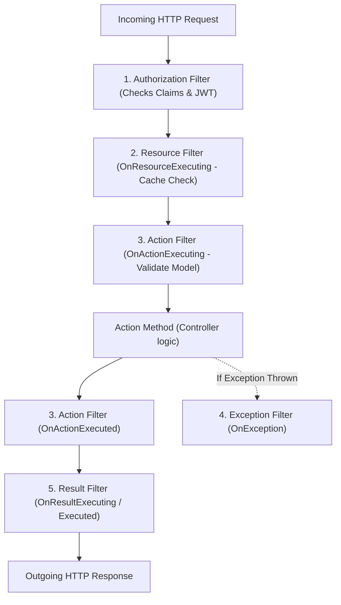

# 01. .NET Core & C# Experienced Developer (5–10+ YOE) Interview Master Guide — India Context

> **Target Audience:** Experienced Full-Stack & Backend Developers (5–10+ Years of Experience) preparing for Senior Developer, Tech Lead, and Module Lead technical rounds in India.  
> **Applicable Companies:**  
> - **Top IT Services & Global Consultancies:** TCS, Infosys, Cognizant, Wipro, Accenture, Capgemini, HCL, LTIMindtree, Tech Mahindra, Hexaware, Persistent, Nagarro, EPAM, Coforge, Virtusa, Deloitte, EY, PwC, KPMG.  
> - **Global Capability Centers (GCCs) & Tech Hubs:** Wells Fargo, Morgan Stanley, JPMorgan Chase, Barclays, Walmart Global Tech India, Lowe's India, Target India, Optum, Fidelity, Standard Chartered, HSBC.  
> - **Indian Product Firms & Unicorns:** Flipkart, Swiggy, Zomato, MakeMyTrip, Paytm, PhonePe, Zepto.  
>
> **Standard:** Speakable Senior English v1 (SSE-1) — concise, spoken-first, rubric-aligned interview answers. Every question follows the **7-Part Senior Rubric Architecture**:  
> 1. **⚡ One-line answer** (Immediate, speakable core answer)  
> 2. **🗣️ Spoken answer (30–45 seconds)** (Natural spoken response for interview pressure)  
> 3. **🎯 Terms the interviewer listens for** (Scored technical terms & formal definitions)  
> 4. **🧠 Memory hook** (Everyday mental models for fast recall)  
> 5. **💻 Code** (Clean, runnable production snippet)  
> 6. **⚠️ Likely follow-up** (Senior trap & cross-question rebuttal)  
> 7. **📊 Quick comparison** (Actionable comparison decision table)  
>
> *(Note: For niche, low-latency CLR engine internals like Card Tables, Tiered Compilation, and POH byte layouts, refer to [09_DotNet_CLR_Ultra_Deep_Niche_Internals.md](file:///home/ubermensch/Desktop/interview/09_DotNet_CLR_Ultra_Deep_Niche_Internals.md)).*

---

# TABLE OF CONTENTS

- [MODULE 1: C# LANGUAGE & OOPS FUNDAMENTALS (SCREENING HITLIST)](#module-1-c-language--oops-fundamentals-screening-hitlist)
  - [Q1: SOLID Principles with Real-Time Project Examples](#q1-solid-principles-with-real-time-project-examples)
  - [Q2: IEnumerable vs IQueryable vs IList vs ICollection](#q2-ienumerable-vs-iqueryable-vs-ilist-vs-icollection)
  - [Q3: String vs StringBuilder & String Immutability](#q3-string-vs-stringbuilder--string-immutability)
  - [Q4: ref vs out vs in vs params](#q4-ref-vs-out-vs-in-vs-params)
  - [Q5: throw vs throw ex vs throw new CustomException](#q5-throw-vs-throw-ex-vs-throw-new-customexception)
  - [Q6: Abstract Class vs Interface (with C# 8+ Default Methods)](#q6-abstract-class-vs-interface-with-c-8-default-methods)
  - [Q7: Boxing and Unboxing Mechanics & Performance](#q7-boxing-and-unboxing-mechanics--performance)
  - [Q8: Method Overloading vs Method Overriding vs Method Shadowing (new)](#q8-method-overloading-vs-method-overriding-vs-method-shadowing-new)
  - [Q9: const vs readonly vs static readonly](#q9-const-vs-readonly-vs-static-readonly)
  - [Q10: Delegates, Func, Action, Predicate & Lambda Expressions](#q10-delegates-func-action-predicate--lambda-expressions)
  - [Q11: Extension Methods in C#](#q11-extension-methods-in-c)
  - [Q12: Nullable Types, Null-Forgiving (!) & Null-Coalescing (??, ??=)](#q12-nullable-types-null-forgiving--null-coalescing--)
  - [Q13: class vs struct vs record (Record Class vs Record Struct)](#q13-class-vs-struct-vs-record-record-class-vs-record-struct)
  - [Q14: IDisposable Pattern & the using Statement](#q14-idisposable-pattern--the-using-statement)

- [MODULE 2: ASP.NET CORE & WEB API ARCHITECTURE](#module-2-aspnet-core--web-api-architecture)
  - [Q15: Dependency Injection Lifetimes (Transient vs Scoped vs Singleton & Captive Dependency)](#q15-dependency-injection-lifetimes-transient-vs-scoped-vs-singleton--captive-dependency)
  - [Q16: Middleware vs Action Filters (app.Use vs app.Run vs app.Map)](#q16-middleware-vs-action-filters-appuse-vs-apprun-vs-appmap)
  - [Q17: Writing Custom Middleware for Global Exception Handling](#q17-writing-custom-middleware-for-global-exception-handling)
  - [Q18: ASP.NET Core Filter Pipeline Order of Execution](#q18-aspnet-core-filter-pipeline-order-of-execution)
  - [Q19: JWT Authentication & Authorization in Web API](#q19-jwt-authentication--authorization-in-web-api)
  - [Q20: CORS (Cross-Origin Resource Sharing) Configuration](#q20-cors-cross-origin-resource-sharing-configuration)
  - [Q21: Configuration & Options Pattern (IOptions vs IOptionsSnapshot vs IOptionsMonitor)](#q21-configuration--options-pattern-ioptions-vs-ioptionssnapshot-vs-ioptionsmonitor)
  - [Q22: HTTP Status Codes & RESTful API Best Practices](#q22-http-status-codes--restful-api-best-practices)
  - [Q23: IHttpClientFactory: Typed Client vs Socket Exhaustion vs DNS Bug](#q23-ihttpclientfactory-typed-client-vs-socket-exhaustion-vs-dns-bug)

- [MODULE 3: ENTITY FRAMEWORK CORE & DATA ACCESS](#module-3-entity-framework-core--data-access)
  - [Q24: Eager Loading (.Include) vs Lazy Loading vs Explicit Loading](#q24-eager-loading-include-vs-lazy-loading-vs-explicit-loading)
  - [Q25: First vs FirstOrDefault vs Single vs SingleOrDefault vs Find](#q25-first-vs-firstordefault-vs-single-vs-singleordefault-vs-find)
  - [Q26: AsNoTracking() vs Tracked Queries](#q26-asnotracking-vs-tracked-queries)
  - [Q27: Code-First Migrations & Production CI/CD Scripts](#q27-code-first-migrations--production-cicd-scripts)
  - [Q28: EF Core vs Dapper: When to Use Which](#q28-ef-core-vs-dapper-when-to-use-which)
  - [Q29: Select() vs SelectMany() in LINQ](#q29-select-vs-selectmany-in-linq)
  - [Q30: Handling Concurrency in EF Core with RowVersion](#q30-handling-concurrency-in-ef-core-with-rowversion)

- [MODULE 4: ASYNCHRONOUS PROGRAMMING & CONCURRENCY](#module-4-asynchronous-programming--concurrency)
  - [Q31: async and await Internals: Does it Create a New Thread?](#q31-async-and-await-internals-does-it-create-a-new-thread)
  - [Q32: The Sync-over-Async Trap (.Result & .Wait Deadlocks)](#q32-the-sync-over-async-trap-result--wait-deadlocks)
  - [Q33: Task.WhenAll vs Task.WaitAll vs Task.WhenAny](#q33-taskwhenall-vs-taskwaitall-vs-taskwhenany)
  - [Q34: CancellationToken Propagation in Web APIs](#q34-cancellationtoken-propagation-in-web-apis)
  - [Q35: lock vs SemaphoreSlim in Asynchronous Code](#q35-lock-vs-semaphoreslim-in-asynchronous-code)

- [MODULE 5: DESIGN PATTERNS & ARCHITECTURE](#module-5-design-patterns--architecture)
  - [Q36: Repository Pattern & Unit of Work in EF Core Projects](#q36-repository-pattern--unit-of-work-in-ef-core-projects)
  - [Q37: Thread-Safe Singleton Pattern (Double-Check vs Lazy<T>)](#q37-thread-safe-singleton-pattern-double-check-vs-lazyt)
  - [Q38: Factory Pattern vs Abstract Factory Pattern](#q38-factory-pattern-vs-abstract-factory-pattern)
  - [Q39: CQRS & MediatR Pattern in Web APIs](#q39-cqrs--mediatr-pattern-in-web-apis)
  - [Q40: Caching Strategies: IMemoryCache vs IDistributedCache (Redis)](#q40-caching-strategies-imemorycache-vs-idistributedcache-redis)
  - [Q41: Microservices Communication: Synchronous vs Asynchronous](#q41-microservices-communication-synchronous-vs-asynchronous)

- [MODULE 6: SQL SERVER FOR .NET DEVELOPERS (MANDATORY ROUND)](#module-6-sql-server-for-net-developers-mandatory-round)
  - [Q42: Clustered vs Non-Clustered Index](#q42-clustered-vs-non-clustered-index)
  - [Q43: Finding the 2nd Highest / Nth Highest Salary](#q43-finding-the-2nd-highest--nth-highest-salary)
  - [Q44: DELETE vs TRUNCATE vs DROP](#q44-delete-vs-truncate-vs-drop)
  - [Q45: UNION vs UNION ALL](#q45-union-vs-union-all)
  - [Q46: Primary Key vs Unique Key](#q46-primary-key-vs-unique-key)
  - [Q47: Stored Procedure vs User-Defined Function (UDF)](#q47-stored-procedure-vs-user-defined-function-udf)
  - [Q48: ACID Properties Explained with a Banking Scenario](#q48-acid-properties-explained-with-a-banking-scenario)

---

# MODULE 1: C# LANGUAGE & OOPS FUNDAMENTALS (SCREENING HITLIST)

## Q1: SOLID Principles with Real-Time Project Examples
*Commonly asked at: TCS, Infosys, Cognizant, Wipro, Accenture, Capgemini, Deloitte, EY, Nagarro, EPAM.*
**⚡ One-line answer**
**SOLID principles** is five architectural design guidelines keeping object-oriented code maintainable, testable, and resilient to business changes.
**🗣️ Spoken answer (30–45 seconds)**
  > "I apply **SOLID principles**—rules keeping code maintainable and extensible. **Single Responsibility** means a class has one reason to change, so my OrderService orchestrates workflows without touching persistence or email formatting. **Open/Closed** means open for extension but closed for modification, where I register new payment providers via strategy interfaces without editing checkout code. **Dependency Inversion** means depending on abstractions rather than concrete classes, so controllers inject IPaymentGateway via container registration. These patterns isolate changes, ensuring zero regression bugs."

**🎯 Terms the interviewer listens for**
- ⭐ **Single Responsibility** — a class has only one reason to change
- ⭐ **Open/Closed** — open for extension, closed for source modification
- ⭐ **Dependency Inversion** — high-level modules depend on abstractions, not concretes
- **Liskov Substitution** — derived classes honor base class contracts safely
- **Interface Segregation** — clients depend only on fine-grained focused interfaces

**🧠 Memory hook**  
  * **S (Swiss Army Knife Anti-pattern):** A knife that also acts as scissors, flashlight, and screwdriver does everything poorly. Give each tool one job.
  * **O (Smartphone with Apps):** You don't crack open the motherboard to add WhatsApp; you install an app via a defined OS interface contract.
  * **L (Electric Auto-rickshaw vs Petrol Auto):** Both must steer and brake identically. If an electric auto throws an error whenever you press the brake, it violates Liskov substitution.
  * **I (Restaurant Menu):** A pure vegetarian shouldn't be handed a 20-page meat and seafood contract to sign just to order dal.
  * **D (Wall Power Socket):** Your laptop charger connects to a standard 3-pin wall socket interface, not soldered directly into house electrical wiring.

**💻 Code**
```csharp
// S & D: Service depends on interface abstraction; handles 1 responsibility
public interface IPaymentGateway { Task PayAsync(decimal amount); }

// O: New payment methods extend IPaymentGateway without modifying existing classes
public class UpiPayment : IPaymentGateway
{
    public Task PayAsync(decimal amount) => Task.CompletedTask;
}

public class CheckoutService
{
    private readonly IPaymentGateway _gateway;
    public CheckoutService(IPaymentGateway gateway) => _gateway = gateway; // Dependency Inversion!

    public async Task ProcessOrder(decimal amount) => await _gateway.PayAsync(amount);
}
```

**⚠️ Likely follow-up**  
  * *Trap Question:* "Does Single Responsibility mean a class can only have one method?"  
  * *Senior Answer:* "No! Single Responsibility is about **cohesion and reasons to change**, not method count. A class can have 10 methods as long as they all serve a single cohesive business responsibility (e.g., `UserRepository` having `GetById`, `Add`, `Update`, `Delete`). It violates SRP only when it crosses domain boundaries—like `UserRepository` also generating PDF reports or sending SMS alerts."

**📊 Quick comparison**
| Principle | Classic Production Violation | What Must Be Done in Code |
| :--- | :--- | :--- |
| **SRP** | Monolithic `OrderManager` (DB + Tax + PDF + SMS) | Extract dedicated services (`TaxCalculator`, `OrderRepo`, `EmailClient`). |
| **OCP** | Giant `switch (paymentType)` requiring edits for every new type | Define `IPaymentStrategy` and register implementations in DI. |
| **LSP** | Derived subclass throws `throw new NotImplementedException()` | Split base class or use composition instead of forced inheritance. |
| **ISP** | Bloated interfaces forcing empty method stubs | Break large interfaces into small, focused interfaces (`IReadOnlyRepository`, `IWriteRepository`). |
| **DIP** | Tight coupling with `new ConcreteService()` inside constructors | Register interfaces in `Program.cs` and inject them via constructors. |

---

## Q2: IEnumerable vs IQueryable vs IList vs ICollection
*Commonly asked at: Commonly asked across Indian .NET Technical Rounds.*
**⚡ One-line answer**
**IQueryable** is a query definition evaluated on the database server using expression trees rather than memory.
**🗣️ Spoken answer (30–45 seconds)**
  > "**IQueryable** stores a query as an **expression tree**—a data structure EF translates into SQL. This provides **server-side evaluation**: filtering executes in the database, not in memory. **Deferred execution** means the database query runs only when you **materialize** it with ToListAsync, turning chained Where calls into one SQL statement. In contrast, **IEnumerable** forces in-memory filtering by streaming all rows into application RAM. For in-memory data, **IList** adds direct index-based lookups, while ICollection provides basic mutations."

**🎯 Terms the interviewer listens for**
- ⭐ **Expression tree** — query stored as data translated into SQL
- ⭐ **Server-side evaluation** — filtering executed directly on the remote database
- ⭐ **Deferred execution** — query execution delayed until materialization occurs
- **Materialize** — running query and loading rows into RAM
- **IEnumerable** — forward-only sequence evaluated in-memory inside C#
- **IList** — in-memory collection supporting position-based index access

**🧠 Memory hook**  
  * **`IEnumerable` (Swiggy delivery guy bringing the entire restaurant kitchen):** You order 1 Biryani. The delivery person brings raw chicken, rice, pots, and the chef to your living room table, and you scoop out 1 plate. Immense waste of transport and memory.
  * **`IQueryable` (The Waiter taking your order ticket):** You tell the waiter '1 Hyderabadi Chicken Biryani, extra spicy'. The kitchen executes the cooking on the server, and the waiter brings only that 1 prepared plate to your table.
  * **`ICollection` (Shopping Cart):** You can check item count (`Count`), put in items (`Add`), or discard items (`Remove`).
  * **`IList` (Numbered Train Coach Seats):** You can walk directly to seat number 42 (`seats[42]`) without counting seats 1 to 41.

**💻 Code**
```csharp
// ❌ DANGEROUS JUNIOR BUG: IEnumerable executes filtering in C# Memory!
// Generates: SELECT * FROM Orders; -> Downloads all 2,000,000 rows into RAM!
IEnumerable<Order> orders = dbContext.Orders; 
var recentOrders = orders.Where(o => o.Status == "Shipped").Take(10).ToList();

// ✅ SENIOR PATTERN: IQueryable executes filtering on SQL Server!
// Generates: SELECT TOP(10) * FROM Orders WHERE Status = 'Shipped';
IQueryable<Order> query = dbContext.Orders; 
var optimizedOrders = query.Where(o => o.Status == "Shipped").Take(10).ToList();
```

**⚠️ Likely follow-up**  
  * *Trap Question:* "What happens when you call a C# custom method (e.g., `o.CalculateTax()`) inside an `IQueryable.Where()` clause?"  
  * *Senior Answer:* "EF Core's `IQueryProvider` attempts to translate the expression tree to SQL. Since SQL Server has no definition for custom C# methods, EF Core throws an `InvalidOperationException: The LINQ expression could not be translated`. You must either compute the logic using supported SQL functions, compute it in a `.Select()` projection, or invoke `.AsEnumerable()` / `.ToList()` to intentionally switch to client-side evaluation."

**📊 Quick comparison**
| Interface | Where Filter Runs | Supports Index (`[i]`)? | Mutation (`Add`/`Remove`) | What Must Be Done in Code |
| :--- | :--- | :--- | :--- | :--- |
| **`IQueryable<T>`** | **Remote Database Server** | No | No | Use in Repository query layers for EF Core filtering. |
| **`IEnumerable<T>`**| In-Memory (C# RAM) | No (Forward-only cursor) | No | Use for read-only iteration over in-memory collections. |
| **`ICollection<T>`** | In-Memory (C# RAM) | No | Yes (`Add`, `Remove`) | Use when you need `.Count` and collection modifications. |
| **`IList<T>`** | In-Memory (C# RAM) | **Yes (`list[0]`)** | Yes | Use for UI binding, sorting grids, and indexed lookups. |

---

## Q3: String vs StringBuilder & String Immutability
*Commonly asked at: TCS, Wipro, Infosys, Cognizant, Accenture, Mindtree, Tech Mahindra.*
**⚡ One-line answer**
**String immutability** means string objects cannot be modified in memory after initial allocation on the heap.
**🗣️ Spoken answer (30–45 seconds)**
  > "In C#, **immutability** means a string cannot be modified after allocation, so concatenating with plus creates a new heap object each time. Doing this in loops creates severe **GC pressure**—a flood of short-lived garbage triggering Generation 0 collections. To solve this, I use **StringBuilder**—a mutable character buffer that resizes internally without allocating new strings. The runtime also uses **string interning**—a shared literal pool reusing identical string instances across the application process."

**🎯 Terms the interviewer listens for**
- ⭐ **Immutability** — object state cannot change after heap allocation
- ⭐ **StringBuilder** — mutable character buffer modified in place without allocations
- ⭐ **GC pressure** — excessive short-lived objects triggering frequent garbage collections
- **String interning** — runtime sharing of identical string literals in pool
- **Gen 0** — generation holding short-lived objects collected frequently

**🧠 Memory hook**  
  * **String (Printed Aadhaar Card):** You cannot edit the name by scratching it with a pen; if there is a spelling mistake, the government prints an entirely new physical PVC card and shreds the old one.
  * **StringBuilder (A Classroom Whiteboard):** You write words, erase a part, and append more text on the same physical board without buying a new whiteboard.

**💻 Code**
```csharp
// ❌ BAD: Allocates 1,000 distinct string objects on the managed heap!
string csv = "";
for (int i = 0; i < 1000; i++)
{
    csv += i.ToString() + ","; // Allocates new string every iteration -> GC pressure!
}

// ✅ SENIOR FIX: Single mutable internal buffer allocation
var sb = new StringBuilder(5000); // Pre-allocate initial capacity to prevent buffer resizing
for (int i = 0; i < 1000; i++)
{
    sb.Append(i).Append(',');
}
string result = sb.ToString();
```

**⚠️ Likely follow-up**  
  * *Trap Question:* "Is `StringBuilder` ALWAYS faster than string concatenation? What if you only concatenate 3 strings?"  
  * *Senior Answer:* "No! For 3 or 4 strings (e.g., `string s = a + b + c;`), the C# compiler internally translates it to `string.Concat(a, b, c)`, which calculates the exact final buffer length upfront and allocates the exact heap memory once. `StringBuilder` has class instantiation overhead and internal array buffer management overhead; it should only be used inside loops or when concatenating dynamic, unknown counts of text ($\ge 7-10$ iterations)."

**📊 Quick comparison**
| Scenario | What to Use | Why | What Must Be Done in Code |
| :--- | :--- | :--- | :--- |
| Concatenating 2 to 5 strings | String interpolation `$"{a} - {b}"` | Compiler translates to optimized `string.Concat`. Zero object overhead. | Use `$"{firstName} {lastName}"`. |
| Concatenation in a loop | `StringBuilder` | Modifies internal character array buffer; avoids thousands of GC allocations. | Instantiate `new StringBuilder()`, loop with `.Append()`. |
| Known large size string building | `new StringBuilder(estimatedCapacity)` | Eliminates internal array doubling copies when buffer reaches capacity. | Pre-size: `new StringBuilder(1024 * 64)`. |

---

## Q4: ref vs out vs in vs params
*Commonly asked at: Accenture, Capgemini, Infosys, Cognizant, Persistent, HCL.*
**⚡ One-line answer**
**Pass-by-reference** means passing a variable's memory address so the callee accesses caller storage directly.
**🗣️ Spoken answer (30–45 seconds)**
  > "C# parameter modifiers control memory mechanics. **Pass-by-reference** means passing a managed memory pointer instead of copying values onto the stack. I use **out** for methods returning extra values, enforcing **definite assignment**—a compiler guarantee that the method assigns the variable before returning. For performance-critical code, I pass structs with **in** to achieve **zero-copy**—passing a pointer to avoid copying sixty-four bytes while guaranteeing read-only protection. Meanwhile, **ref** enables bidirectional read-write mutation of the caller's variable."

**🎯 Terms the interviewer listens for**
- ⭐ **Pass-by-reference** — passing variable memory address rather than copying value
- ⭐ **Definite assignment** — compiler rule requiring variables assigned before return
- ⭐ **Zero-copy** — passing large structs without stack memory copying
- **ref** — bidirectional read-write parameter passing by reference
- **out** — output-only parameter requiring callee initialization before exit
- **in** — read-only reference parameter preventing caller data mutation

**🧠 Memory hook**  
  * **`ref` (Shared Google Doc with Edit Access):** You create a doc with notes, share the edit link with a coworker; they read what you wrote and modify the live text directly.
  * **`out` (Blank Exam Answer Sheet):** The teacher hands you a blank sheet; you don't need to bring notes, but you MUST write your answers on it before you leave the exam room.
  * **`in` (Laminated Security ID Badge):** The security officer inspects your ID up close without making a photocopy, but they are forbidden from writing on or altering your badge.
  * **`params` (Swiggy Multi-Item Cart):** Order 1 dish, 5 dishes, or none—they are all packed together into a single delivery bag.

**💻 Code**
```csharp
public class ParameterDemo
{
    // 1. ref: Caller MUST initialize. Callee can read and write.
    public void UpdateScore(ref int score) => score += 10;

    // 2. out: Caller does not need to initialize. Callee MUST assign before exit.
    public bool TryParseToken(string input, out int id)
    {
        id = 42; // Mandatory assignment!
        return true;
    }

    // 3. in: Passed by reference for performance, but CALLEE CANNOT MODIFY!
    public decimal CalculateTax(in decimal totalAmount)
    {
        // totalAmount = 50; // COMPILER ERROR: Cannot assign to variable 'in decimal'
        return totalAmount * 0.18m;
    }

    // 4. params: Variable number of arguments passed as comma-separated list
    public int SumNumbers(params int[] numbers) => numbers.Sum();
}
```

**⚠️ Likely follow-up**  
  * *Trap Question:* "Can you overload two methods where one takes `ref int` and the other takes `out int`?"  
  * *Senior Answer:* "No. At the CLR Intermediate Language (IL) level, both `ref` and `out` are compiled identically as managed pointers (`int32&`). The compiler throws a compile-time duplicate signature error (CS0663). However, you *can* overload between normal by-value passing (`int`) and `ref`/`out`."

**📊 Quick comparison**
| Keyword | Must Be Initialized Before Passing? | Must Be Assigned Inside Method? | Can Method Mutate It? | Primary Use Case |
| :--- | :--- | :--- | :--- | :--- |
| *(default)* | Yes | No | Modifies copy only (for value types). | Normal parameter passing. |
| **`ref`** | **Yes** | No | Yes (modifies original variable). | Bidirectional state updating in-place. |
| **`out`** | No | **Yes (Mandatory)** | Yes (modifies original variable). | `Try*` pattern methods (`int.TryParse`). |
| **`in`** | **Yes** | No | **No (Read-Only reference)**. | Zero-copy performance for large structs ($\ge 16$ bytes). |
| **`params`**| Yes (or empty) | No | Modifies array elements only. | Convenience APIs (`string.Format`, `logger.Log`). |

---

## Q5: throw vs throw ex vs throw new CustomException
*Commonly asked at: Frequently asked in Indian screening rounds.*
**⚡ One-line answer**
**Stack trace preservation** is keeping the full line-numbered exception call stack intact using bare throw.
**🗣️ Spoken answer (30–45 seconds)**
  > "Exception handling demands strict **stack trace preservation**—keeping original file lines and method frames intact for debugging. Using a bare **throw;** re-throws the current exception without resetting the trace, ensuring production logs point to the real point of failure. Writing throw ex is forbidden because it resets the stack origin to the catch block. When crossing architectural boundaries, I use **InnerException chaining**—nesting the original low-level error inside a custom domain exception so root causes remain fully visible."

**🎯 Terms the interviewer listens for**
- ⭐ **Stack trace preservation** — maintaining original call stack frames and line numbers
- ⭐ **throw;** — re-throwing the active exception without resetting trace
- ⭐ **InnerException chaining** — wrapping original root-cause exceptions inside domain errors
- **throw ex;** — anti-pattern resetting stack trace to current line
- **Custom exception** — domain-specific exception providing meaningful context to callers

**🧠 Memory hook**  
  * **`throw;` (Honest Courier):** Shows the parcel was damaged at Chennai Depot Bay 4 on Monday at 3:15 PM. Complete audit trail intact.
  * **`throw ex;` (Fraudulent Courier):** Rips off the original tracking slip, slaps a fresh label on it, and claims the parcel was damaged at Bangalore Hub today. The original blame is erased.
  * **`throw new CustomException(msg, ex)` (Secure Bank Envelope):** The bank places the torn original courier slip inside an official audit envelope labeled 'Payment Investigation #404', preserving the root proof inside.

**💻 Code**
```csharp
try
{
    _paymentClient.Process(); // Exception on line 45 inside PaymentClient
}
catch (SocketException ex)
{
    // ❌ SEVERE ANTI-PATTERN: Resets stack trace! Line 45 is lost forever!
    // throw ex; 

    // ✅ SENIOR PATTERN 1: Preserves original line 45 in stack trace
    // throw; 

    // ✅ SENIOR PATTERN 2: Enterprise wrapping with InnerException preserved
    throw new PaymentGatewayException("Payment gateway unreachable during checkout", ex);
}
```

**⚠️ Likely follow-up**  
  * *Trap Question:* "When would you use an Exception Filter (`catch (HttpRequestException ex) when (ex.StatusCode == HttpStatusCode.NotFound)`)?"  
  * *Senior Answer:* "Exception filters evaluate a condition *before* the stack is unwound. If the condition is false, the CLR does not enter the catch block at all, preserving the original execution state without the performance cost of entering and re-throwing."

**📊 Quick comparison**
| Technique | Stack Trace Behavior | InnerException Present? | Production Recommendation |
| :--- | :--- | :--- | :--- |
| **`throw;`** | **Preserved 100% intact** | Keeps original | **Best for generic catch blocks** (logging and bubbling up). |
| **`throw ex;`** | **Overwritten / Destroyed** | No | **STRICTLY FORBIDDEN ANTI-PATTERN.** |
| **`throw new Custom(msg, ex);`**| Sets new top frame, retains root | **Yes (`ex` preserved)**| **Best for domain boundary exceptions.** |
| **Exception Filter (`when`)** | Evaluates without unwinding stack | N/A | **Best for conditional handling without re-throwing.** |

---

## Q6: Abstract Class vs Interface (with C# 8+ Default Methods)
*Commonly asked at: TCS, Infosys, Cognizant, Accenture, Deloitte, Nagarro, EPAM.*
**⚡ One-line answer**
**Interface contract** is a pure capability specification that classes implement without inheriting instance state.
**🗣️ Spoken answer (30–45 seconds)**
  > "An **interface contract** defines a pure capability—specifying what a class can do without holding instance state. C# allows multiple interface implementation, letting one class satisfy many contracts for dependency injection. Conversely, C# enforces **single inheritance**—permitting a class to inherit from only one base class. I choose an abstract class when subclasses must share constructors, protected fields, and base plumbing. While C# 8 introduced **default interface methods**—interface methods providing fallback implementations—interfaces still cannot hold non-static instance fields."

**🎯 Terms the interviewer listens for**
- ⭐ **Interface contract** — capability contract without holding any instance state
- ⭐ **Single inheritance** — class restriction allowing only one base class
- ⭐ **Default interface methods** — interface methods providing fallback implementations since C# 8
- **Abstract class** — incomplete base class holding fields, state, and constructors
- **Multiple implementation** — class ability to implement multiple independent interfaces

**🧠 Memory hook**  
  * **Interface (Driver's License / Certifications):** Specifies what you can do (drive a car, fly a drone) regardless of who you are. You can hold 5 licenses simultaneously. None of them contain blood, lungs, or organs (zero instance state).
  * **Abstract Class (Biological DNA / Species):** You inherit from `Mammal`—you have lungs, blood, and a heart (instance state and fields). You can only have one biological parent species (single inheritance).

**💻 Code**
```csharp
// Interface: Defines contract + Default Implementation (C# 8+)
public interface INotificationService
{
    Task SendAsync(string message);

    // Default interface implementation: doesn't break existing classes!
    Task SendUrgentAlertAsync(string message) => SendAsync($"[URGENT]: {message}");
}

// Abstract Class: Maintains state, constructors, and access control
public abstract class BaseRepository<T> where T : class
{
    protected readonly DbContext _context; // Holds state/fields!

    protected BaseRepository(DbContext context) => _context = context;

    public abstract Task<T?> GetByIdAsync(int id); // Derived class MUST implement

    public virtual async Task SaveAuditLogAsync(string action) // Concrete shared logic
    {
        await _context.Database.ExecuteSqlRawAsync($"INSERT INTO AuditLogs VALUES ('{action}')");
    }
}
```

**⚠️ Likely follow-up**  
  * *Trap Question 1:* "If interfaces can have default method implementations in C# 8+, why do we still need abstract classes?"  
  * *Senior Answer:* "Interfaces still **cannot have instance state (fields)**. An interface cannot have non-static fields, constructors, or `protected` variables. When you need to share constructor dependencies (like `DbContext` or `ILogger`) across a family of services, you must use an abstract class."
  * *Trap Question 2:* "Can you call a Default Interface Method directly on a class instance, like `service.SendUrgentAlertAsync(...)`?"  
  * *Senior Answer:* "No! Unless the class explicitly overrides the default method, it does not become a public member of the class. You must cast the instance to the interface: `((INotificationService)service).SendUrgentAlertAsync(...)`. This prevents naming collisions and preserves class encapsulation."
  * *Trap Question 3:* "What did C# 11 add to interfaces?"  
  * *Senior Answer:* "**Static abstract members** in interfaces. This enabled Generic Math (`INumber<T>`), allowing operators like `+` and `-` or static factory methods to be defined polymorphically on generic types."

**📊 Quick comparison**
| Feature | Interface | Abstract Class |
| :--- | :--- | :--- |
| **Inheritance** | Multiple (class can implement 5+ interfaces) | Single (class can only inherit 1 class) |
| **Instance Fields / State**| **No** (Cannot hold instance fields) | **Yes** (Can have `protected int _count;`) |
| **Constructors** | No | **Yes** (Initializes shared base state) |
| **Access Modifiers** | Public by default | `public`, `protected`, `internal`, `private` |
| **Primary Use Case** | Decoupling dependencies for DI (`IPaymentGateway`) | Shared base plumbing (`BaseController`, `BaseEntity`) |

---

## Q7: Boxing and Unboxing Mechanics & Performance
*Commonly asked at: Frequently asked in Indian technical screening rounds (TCS, Infosys, Cognizant, Wipro).*
**⚡ One-line answer**
**Boxing** is wrapping a stack-allocated value type inside a managed heap object.
**🗣️ Spoken answer (30–45 seconds)**
  > "**Boxing** means converting a value type into an object, allocating memory on the managed heap. Every boxed instance adds an **object header**—a sixteen-byte prefix storing the SyncBlock and MethodTable pointer. This creates unnecessary garbage collection churn when primitive values are stored in non-generic collections. To prevent this, I enforce **generics**—strongly-typed collections like List of T that operate directly on value types without heap allocations. **Unboxing** then copies the value back to the stack after verifying exact type identity."

**🎯 Terms the interviewer listens for**
- ⭐ **Boxing** — allocating a heap object wrapping a value type
- ⭐ **Object header** — sixteen-byte heap overhead containing syncblock and methodtable
- ⭐ **Generics** — strongly typed structures eliminating boxing allocations completely
- **Unboxing** — extracting the value type from the heap instance
- **GC pressure** — high memory allocation triggering frequent garbage collections

**🧠 Memory hook**  
  * **Boxing (Amazon Packing Box):** You have a loose apple on your desk (stack value). To send it via courier, you put it inside a cardboard box with shipping labels and barcode stickers (heap object header) and store it in an Amazon warehouse (managed heap).
  * **Unboxing (Opening the Package):** You open the box, verify the barcode label matches an apple, and take the apple back out onto your desk (stack).

**💻 Code**
```csharp
int val = 42; 

// 📦 BOXING: Implicitly allocates 24 bytes on Managed Heap (16-byte header + 4-byte int + 4-byte padding)
object boxedVal = val; 

// 📤 UNBOXING: Explicit cast. CLR verifies MethodTable type, then copies bits back to stack
int unboxedVal = (int)boxedVal; 

// ❌ CLASSIC JUNIOR BOXING TRAP: String.Format with value types
// In .NET Framework / unoptimized code, primitives were boxed to object!
string log = string.Format("Item ID: {0}, Quantity: {1}", val, 100); 

// ✅ SENIOR PATTERN: Modern string interpolation and Generics prevent boxing
List<int> numbers = new List<int>(); // Zero boxing!
numbers.Add(42);
```

**⚠️ Likely follow-up**  
  * *Trap Question:* "What happens if you unbox a boxed `int` into a `short` (`short s = (short)boxedInt;`)?"  
  * *Senior Answer:* "It throws an `InvalidCastException` at runtime! Unboxing strictly requires casting to the **exact identical underlying type** (`int`). You must first unbox to `int`, then cast to `short`: `short s = (short)(int)boxedInt;`."

**📊 Quick comparison**
| Operation | Direction | Memory Location | Performance Impact | What Must Be Done in Code |
| :--- | :--- | :--- | :--- | :--- |
| **Boxing** | Value Type → Reference Type | Stack → Heap | **High** (Allocates 16-byte header + GC pressure) | Replace `ArrayList` / `Hashtable` with `List<T>` / `Dictionary<K,V>`. |
| **Unboxing** | Reference Type → Value Type | Heap → Stack | Low (Type check + bitwise memory copy) | Cast only to the exact identical value type. |
| **Generics** | Strongly-Typed `<T>` | Pure Stack / Inline | **Zero Boxing** | Use `List<T>`, `Span<T>`, and `IEquatable<T>`. |

---

## Q8: Method Overloading vs Method Overriding vs Method Shadowing (new)
*Commonly asked at: TCS, Wipro, Infosys, Cognizant, Accenture, Mindtree.*
**⚡ One-line answer**
**Compile-time polymorphism** is static method resolution where the compiler selects the overload by argument signature.
**🗣️ Spoken answer (30–45 seconds)**
  > "Method resolution differs by binding time. Method overloading demonstrates **compile-time polymorphism**—static binding where the compiler matches parameter types and counts before code executes. In contrast, method overriding uses a **vtable**—an internal virtual method table resolved at runtime. This enables **dynamic dispatch**: the CLR inspects the object's actual runtime type and invokes the derived override even through base references. Conversely, method shadowing with the new keyword merely hides the base method at compile time, bypassing virtual dispatch entirely."

**🎯 Terms the interviewer listens for**
- ⭐ **Compile-time polymorphism** — method overload resolution determined statically during compilation
- ⭐ **vtable** — virtual method table used for dynamic dispatch
- ⭐ **Dynamic dispatch** — runtime mechanism resolving the overridden derived implementation
- **Method overriding** — replacing a virtual base method in derived classes
- **Method shadowing** — hiding a base method with the new keyword

**🧠 Memory hook**  
  * **Overloading (Universal Power Adapter):** Same wall plug concept, but handles a 2-pin plug, 3-pin plug, or USB-C cable (different parameter signatures).
  * **Overriding (Upgraded Smartphone Ringtone):** When someone calls, the phone plays your newly chosen ringtone instead of the default factory tune (runtime polymorphic replacement).
  * **Shadowing (Wearing a Mask):** You wear a mask over your face; if someone asks for you by your official ID card name (base type reference), the original person underneath responds, not the mask.

**💻 Code**
```csharp
public class BaseService
{
    public virtual void Execute() => Console.WriteLine("Base Executing");
}

public class OverrideService : BaseService
{
    public override void Execute() => Console.WriteLine("Override Executing");
}

public class ShadowService : BaseService
{
    public new void Execute() => Console.WriteLine("Shadow Executing"); // Hides base!
}

// Runtime Polymorphism Test:
BaseService s1 = new OverrideService();
s1.Execute(); // Prints: "Override Executing" (vtable runtime dispatch!)

BaseService s2 = new ShadowService();
s2.Execute(); // Prints: "Base Executing" (Compile-time reference wins! Shadow method hidden!)
```

**⚠️ Likely follow-up**  
  * *Trap Question:* "Can you overload a method in C# purely by changing its return type (e.g., `int GetData()` vs `string GetData()`)?"  
  * *Senior Answer:* "No! The C# language specification dictates that method signatures consist only of the method name, parameter types, and parameter modifiers (`ref`/`out`). The return type is **not** part of the method signature for overload resolution. Attempting this causes compile-time error CS0111."

**📊 Quick comparison**
| Concept | Mechanism | Keywords | Resolution Timing | What Happens if Called via Base Type? |
| :--- | :--- | :--- | :--- | :--- |
| **Overloading** | Same method name, different parameters | None | Compile Time | Resolves based on parameter types. |
| **Overriding** | Replaces virtual base method | `virtual` + `override` | Runtime (vtable lookup) | **Derived class method executes.** |
| **Shadowing** | Hides base method without polymorphism | `new` | Compile Time | **Base class method executes!** |

---

## Q9: const vs readonly vs static readonly
*Commonly asked at: Capgemini, Accenture, Cognizant, Infosys, Persistent.*
**⚡ One-line answer**
**Compile-time constant** means a value baked directly into calling assembly IL during compilation.
**🗣️ Spoken answer (30–45 seconds)**
  > "Declaring const creates a **compile-time constant**—an immutable literal resolved entirely during compilation. The compiler performs **IL inlining**: baking the raw literal value directly into every consuming assembly call site, meaning external package updates require recompiling callers. For runtime immutability, I use readonly for constructor-injected dependencies. For application-wide constants loaded at runtime, I use static readonly fields initialized by a **static constructor**—a type initializer running once when the class is first accessed, ensuring thread-safe, dynamic configuration loading."

**🎯 Terms the interviewer listens for**
- ⭐ **Compile-time constant** — literal value inlined into caller IL during compilation
- ⭐ **IL inlining** — compiler embedding literal values directly into call sites
- ⭐ **Static constructor** — type initializer executing once when class loads
- **readonly** — instance field assigned at declaration or within constructors
- **static readonly** — runtime constant initialized once per application domain

**🧠 Memory hook**  
  * **`const` (Permanent Tattoo):** Inked before birth; embedded permanently into the skin; cannot change without cutting the skin.
  * **`readonly` (Passport Number):** Assigned on the day you are born/registered (constructor); never changes for your entire lifetime.
  * **`static readonly` (Office Wi-Fi Password):** Configured on the router when the office opened; identical for all 500 employees, but can be loaded dynamically from configuration files.

**💻 Code**
```csharp
public class AppConfig
{
    // Compile-time: Evaluated during compilation, baked into calling DLL
    public const string ApiVersion = "v1.0"; 

    // Runtime instance constant: Can be assigned inside constructor
    public readonly DateTime CreatedAt;

    // Runtime static constant: Initialized once for the entire application
    public static readonly string ConnectionString;

    public AppConfig(DateTime createdAt)
    {
        CreatedAt = createdAt; // Allowed!
    }

    static AppConfig()
    {
        ConnectionString = Environment.GetEnvironmentVariable("DB_CONN") ?? "default";
    }
}
```

**⚠️ Likely follow-up**  
  * *Trap Question:* "Why is declaring `public const` across shared NuGet packages or multi-assembly solutions dangerous?"  
  * *Senior Answer:* "Because the compiler literally replaces the variable reference with its raw literal value inside the consumer assembly's IL. If you update the constant in Assembly A and recompile only Assembly A, Assembly B will continue running with the old hardcoded literal until Assembly B is recompiled! Therefore, public constants across assembly boundaries must always be declared as `public static readonly`."

**📊 Quick comparison**
| Modifier | Evaluated At | Can Be Changed In | Memory Allocation | Cross-Assembly Safety |
| :--- | :--- | :--- | :--- | :--- |
| **`const`** | Compile Time | Never (Hardcoded literal) | None (Inlined in IL) | **Unsafe** (Requires consumer recompilation) |
| **`readonly`** | Runtime | Declaration or Constructor | Per instance heap/stack | **Safe** (Resolved at runtime) |
| **`static readonly`**| Runtime | Declaration or Static Constructor | Once per process | **Safe** (Resolved at runtime) |

---

## Q10: Delegates, Func, Action, Predicate & Lambda Expressions
*Commonly asked at: Frequently asked in Indian .NET rounds.*
**⚡ One-line answer**
**Delegate** means a type-safe object-oriented function pointer holding a method and target instance.
**🗣️ Spoken answer (30–45 seconds)**
  > "A **delegate** is a type-safe function pointer—an object holding method pointers alongside target instances for safe invocation. In modern C#, we use built-in generic delegates like **Func**—a delegate taking parameters and returning a calculated result—and Action for void methods. When writing inline lambda expressions, beware of a **closure**: a compiler-generated heap class capturing outer local variables. Capturing variables inside tight loops allocates memory continuously, generating garbage collection overhead that degrades high-throughput Web API pipelines."

**🎯 Terms the interviewer listens for**
- ⭐ **Delegate** — type-safe object reference pointing to executable methods
- ⭐ **Closure** — compiler-generated class capturing outer variables inside lambdas
- ⭐ **Func** — built-in generic delegate returning a typed value
- **Action** — built-in generic delegate returning void
- **Predicate** — specialized delegate evaluating conditions and returning boolean
- **MulticastDelegate** — delegate holding an invocation list of multiple handlers

**🧠 Memory hook**  
  * **Delegate (Delivery Dispatch Slip):** A slip where you write down the address and recipient. Whoever holds the slip can execute the delivery.
  * **Action (Manager command):** "Go clean the meeting room" (returns void, no data back).
  * **Func (Inquiry to Accountant):** "What was our net tax liability?" (returns a decimal financial value).
  * **Predicate (Security Guard at Entrance):** "Does this visitor hold a valid security pass?" (returns true or false).

**💻 Code**
```csharp
// 1. Action: Returns void (0 to 16 parameters)
Action<string> logMessage = msg => Console.WriteLine($"[LOG]: {msg}");
logMessage("Application Started");

// 2. Func: Last generic argument is ALWAYS the return type! Takes (int, int), returns int
Func<int, int, int> addNumbers = (a, b) => a + b;
int sum = addNumbers(10, 20); // 30

// 3. Predicate: Specialized delegate returning bool (equivalent to Func<T, bool>)
Predicate<int> isEven = x => x % 2 == 0;
bool check = isEven(4); // true
```

**⚠️ Likely follow-up**  
  * *Trap Question:* "What is a closure in lambda expressions and what performance hazard does it create?"  
  * *Senior Answer:* "A closure occurs when a lambda references an outer local variable. The compiler generates an internal hidden class (called a `<>c__DisplayClass`) on the managed heap to hold both the captured variable and the method. In tight loops or hot paths, closures allocate millions of temporary heap objects, generating severe GC Gen 0 pressure."

**📊 Quick comparison**
| Delegate Type | Input Parameters | Return Value | Common Enterprise Use Case |
| :--- | :--- | :--- | :--- |
| **`Action<T...>`** | 0 to 16 | `void` | Event handlers, fire-and-forget logging, dispatchers. |
| **`Func<T..., TResult>`** | 0 to 16 | `TResult` (Last generic arg) | Calculations, LINQ projections (`.Select()`), factories. |
| **`Predicate<T>`** | Exactly 1 | `bool` | In-memory filtering (`List<T>.FindAll`), condition checks. |
| **Custom Delegate** | Any | Any | When specialized `ref`/`out` parameters are strictly needed. |

---

## Q11: Extension Methods in C#
*Commonly asked at: TCS, Infosys, Cognizant, Wipro, Accenture, Capgemini.*
**⚡ One-line answer**
**Extension method** is a static method callable with instance syntax using this modifier.
**🗣️ Spoken answer (30–45 seconds)**
  > "An **extension method** is a static method providing **syntactic sugar**—allowing developers to call external utilities using fluent instance syntax. You declare them in a static class, marking the first argument with the **this modifier**—the keyword specifying which type the method extends. Because the compiler rewrites calls to standard static invocations, an extension method can be executed on null references without crashing. However, compiler **instance precedence** ensures that if an instance method shares the same signature, the instance method always executes."

**🎯 Terms the interviewer listens for**
- ⭐ **Extension method** — static method invoked with instance syntax via syntactic sugar
- ⭐ **this modifier** — keyword designating the extended target type on parameters
- ⭐ **Instance precedence** — compiler rule giving instance methods priority over extensions
- **Static class** — non-instantiable class required to house extension methods
- **Null invocation** — calling extension methods safely on null reference instances

**🧠 Memory hook**  
  * **Magnetic Phone Wallet:** You don't manufacture a new iPhone with a built-in leather slot; you snap a magnetic MagSafe wallet onto the back. To the user, it feels like part of the phone, but the phone's internal chassis was never opened.

**💻 Code**
```csharp
public static class StringExtensions
{
    // Declared in static class, static method, with 'this' on first argument!
    public static bool IsValidEmail(this string? email)
    {
        if (string.IsNullOrWhiteSpace(email)) return false; // Safe even if email is null!
        return email.Contains("@") && email.Contains(".");
    }
}

// Usage in business logic:
string? userEmail = "dev@enterprise.com";
bool valid = userEmail.IsValidEmail(); // Fluent instance syntax!
// Compiles directly to: StringExtensions.IsValidEmail(userEmail);
```

**⚠️ Likely follow-up**  
  * *Trap Question:* "What happens if a class defines an instance method `public void Save()` and you also create an extension method `public static void Save(this MyClass obj)`?"  
  * *Senior Answer:* "The **instance method ALWAYS takes precedence and executes**. The compiler prioritizes instance methods over extension methods during overload resolution. The extension method is completely shadowed and will never be called unless invoked explicitly via static syntax (`MyExtensions.Save(obj)`)."

**📊 Quick comparison**
| Rule / Scenario | Behavior | Best Practice |
| :--- | :--- | :--- |
| **Instance vs Extension Collision**| Instance method silently wins | Avoid naming extension methods identically to native class methods. |
| **Calling on `null` reference**| Executes successfully | Always perform `if (input == null) return ...` inside extension method. |
| **Namespace Visibility** | Requires matching `using` statement | Place enterprise extensions in root namespace (e.g., `System` or `Company.Core`). |

---

## Q12: Nullable Types, Null-Forgiving (!) & Null-Coalescing (??, ??=)
*Commonly asked at: Mindtree, Cognizant, Nagarro, EPAM, Persistent.*
**⚡ One-line answer**
**Nullable value type** is a struct wrapper allowing primitive types to represent null.
**🗣️ Spoken answer (30–45 seconds)**
  > "C# handles nullability across both memory models. A **nullable value type** wraps a primitive in a struct holding HasValue and Value flags. In C# 8, **nullable reference types** introduce **Roslyn static analysis**—compiler checks warning developers about potential null dereferences without changing runtime behavior. In code, **null-coalescing** using double question marks supplies fallback defaults when an expression is null. Finally, the null-forgiving operator tells the compiler to silence null warnings, but it emits zero runtime checks and won't prevent exceptions."

**🎯 Terms the interviewer listens for**
- ⭐ **Nullable value type** — struct wrapping primitives to represent absent values safely
- ⭐ **Nullable reference types** — Roslyn static analysis feature detecting potential null dereferences
- ⭐ **Null-coalescing** — operator providing fallback values when operands evaluate null
- **Null-forgiving operator** — compile-time exclamation suppressing nullability warnings without checks
- **Null-coalescing assignment** — operator assigning values only when target variable is null

**🧠 Memory hook**  
  * **`??` (Spare Tire in Trunk):** If your main tire is flat/missing (null), you use the spare tire.
  * **`??=` (Water Pitcher in Conference Room):** If the pitcher is empty, you fill it with water once; if it's already filled, you don't touch it.
  * **`!` (Parent's Signature on Permission Slip):** Bypasses the school's missing-document warning by having the parent say 'Trust me, I take responsibility'. If wrong, disaster strikes at runtime.

**💻 Code**
```csharp
// Null-Coalescing (??): Fallback value
string? inputName = null;
string displayName = inputName ?? "Guest User"; // "Guest User"

// Null-Coalescing Assignment (??=): Assign only if current variable is null
List<string>? logs = null;
logs ??= new List<string>(); // Initializes list only because it was null!

// Null-Forgiving Operator (!): Tells Roslyn compiler "Trust me, this is not null"
[Required]
public string CustomerName { get; set; } = null!; // Prevents compiler warning CS8618
```

**⚠️ Likely follow-up**  
  * *Trap Question:* "Does the Null-Forgiving operator (`!`) prevent a `NullReferenceException` at runtime?"  
  * *Senior Answer:* "No! The null-forgiving operator is **strictly a compile-time directive** that silences Roslyn warnings. It generates zero IL code. If the variable is actually `null` at runtime, the CLR will still throw a `NullReferenceException` when dereferenced."

**📊 Quick comparison**
| Operator | Purpose | Runtime CLR Impact | Best Used For |
| :--- | :--- | :--- | :--- |
| **`??`** | Provide fallback if operand is null | Evaluates null check; short-circuits | Default values: `user?.Name ?? "Guest"` |
| **`??=`** | Lazy assignment if operand is null | Assigns value only if target is null | Cache/collection lazy initialization |
| **`!`** | Suppress Roslyn nullability warning | **Zero IL (Compile-time only)** | EF Core navigation properties, Unit test mocks |

---

## Q13: class vs struct vs record (Record Class vs Record Struct)
*Commonly asked at: Frequently asked in Indian senior rounds.*
**⚡ One-line answer**
**Record** is a C# type providing compiler-synthesized value equality and non-destructive mutation.
**🗣️ Spoken answer (30–45 seconds)**
  > "Type choice dictates memory allocation and equality semantics. A class is a reference type on the heap, while a struct is a value type on the stack. A **record** is a specialized type providing **value equality**—evaluating equality by comparing internal property values rather than memory addresses. Records support **non-destructive mutation**: using the with expression to clone an object with modified properties while preserving immutability. I use classes for stateful services, structs for tiny primitives, and records for API DTOs."

**🎯 Terms the interviewer listens for**
- ⭐ **Record** — type featuring compiler-synthesized value equality and formatted printing
- ⭐ **Value equality** — equality evaluation comparing internal field values instead of references
- ⭐ **Non-destructive mutation** — creating modified copies using the with expression keyword
- **Reference type** — object stored on heap identified by memory address
- **Value type** — data structure stored directly on stack or inline

**🧠 Memory hook**  
  * **Class (Physical Bank Locker):** Two people holding keys to the same locker see the same contents; if one takes money out, it changes for both (reference identity).
  * **Struct (₹500 Currency Note):** If you give your friend a 500-rupee note, he has his own physical copy; if he tears his note, yours remains intact (value copy).
  * **Record (Payment Receipt / Statement):** If two transaction receipts have the same transaction ID, amount, and date, they represent the identical financial record (value-based equality).

**💻 Code**
```csharp
// 1. Record: Value-based equality + non-destructive mutation
public record OrderDto(int OrderId, decimal Amount, string Status);

var order1 = new OrderDto(101, 500m, "Pending");
var order2 = new OrderDto(101, 500m, "Pending");

// Value equality: Returns TRUE even though they are different objects in heap!
bool areEqual = (order1 == order2); // true!

// Non-destructive mutation using 'with' expression
var order3 = order1 with { Status = "Shipped" }; // Creates new record with modified Status!
```

**⚠️ Likely follow-up**  
  * *Trap Question:* "When would you choose a `struct` or `record struct` over a `class`?"  
  * *Senior Answer:* "When the data structure is small ($\le 16$ bytes), immutable, short-lived, and instantiated frequently (e.g., `Point`, `DateTime`, `Money`). Structs avoid heap allocation and GC Gen 0 pressure. However, passing large structs ($> 64$ bytes) repeatedly creates stack copying overhead, making `class` or `in struct` preferable."

**📊 Quick comparison**
| Type | Memory Location | Equality Semantics | Best Used For | What Must Be Done in Code |
| :--- | :--- | :--- | :--- | :--- |
| **`class`** | Heap (Managed) | Reference Identity (`ReferenceEquals`) | Long-lived domain entities, stateful services, repositories. | Use for EF Core entities and business services. |
| **`struct`** | Stack / Inline | Value Equality (Bitwise) | Small geometric primitives ($\le 16$ bytes: `Point`, `DateTime`). | Keep fields $\le 16$ bytes and declare `readonly struct`. |
| **`record class`**| Heap (Managed) | **Value Equality** (Generated) | API Request/Response DTOs, Event payloads, immutable messages. | Use `public record MyDto(int Id, string Name);`. |
| **`record struct`**| Stack / Inline | **Value Equality** (Generated) | Stack-allocated lightweight immutable data models (`Money`, `Coordinate`). | Use `public readonly record struct Money(decimal Amount);`. |

---

## Q14: IDisposable Pattern & the using Statement
*Commonly asked at: TCS, Wipro, Infosys, Cognizant, Accenture, Deloitte.*
**⚡ One-line answer**
**IDisposable** is an interface providing deterministic cleanup of unmanaged operating system resources.
**🗣️ Spoken answer (30–45 seconds)**
  > "The garbage collector manages memory, but it cannot release **unmanaged resources**—operating system handles like file streams, database sockets, and network ports. Implementing IDisposable ensures **deterministic cleanup**—guaranteeing immediate resource release when work completes rather than waiting for non-deterministic finalizer runs. The using statement expands into a try-finally block, ensuring Dispose executes even during exceptions. Inside Dispose, invoking **GC.SuppressFinalize** informs the runtime to bypass the finalizer, preventing the object from promoting to Gen 1 and sparing garbage collector resources."

**🎯 Terms the interviewer listens for**
- ⭐ **Deterministic cleanup** — developer-controlled immediate resource release bypassing garbage collection
- ⭐ **Unmanaged resources** — operating system handles the garbage collector cannot free
- ⭐ **GC.SuppressFinalize** — runtime call removing disposed objects from the finalization queue
- **using statement** — syntactic sugar expanding into try-finally disposal blocks
- **Finalizer** — non-deterministic fallback method invoked by garbage collection threads

**🧠 Memory hook**  
  * **Borrowing a Library Book:** You return the book directly to the desk when done (`Dispose`). If you forget, the library sends a recovery team to your house weeks later (Finalizer), which wastes immense resources and blocks others from borrowing the book.

**💻 Code**
```csharp
// ✅ MODERN C# 8+ USING DECLARATION: Clean syntax, disposed at end of scope
public async Task ProcessFileAsync(string filePath)
{
    using var stream = new FileStream(filePath, FileMode.Open, FileAccess.Read);
    using var reader = new StreamReader(stream);

    string content = await reader.ReadToEndAsync();
    Console.WriteLine(content.Length);
} // stream and reader are automatically Disposed here, even if ReadToEndAsync throws!
```

**⚠️ Likely follow-up**  
  * *Trap Question:* "Why should a class with a finalizer always call `GC.SuppressFinalize(this)` inside its `Dispose()` method?"  
  * *Senior Answer:* "If `Dispose()` has already cleaned up the unmanaged resource, there is no need for the Finalizer to run. Objects with finalizers are promoted to GC Generation 1 or 2 and placed on the Finalization Queue, surviving initial collection and increasing memory pressure. Calling `GC.SuppressFinalize(this)` removes the object from the finalization queue, allowing the GC to collect it in Generation 0 immediately."

**📊 Quick comparison**
| Pattern / Feature | When to Use | Execution Timing | Impact if Omitted |
| :--- | :--- | :--- | :--- |
| **`using var x = ...`** | Standard C# managed disposables (`FileStream`, `HttpClient`) | Immediate at end of enclosing scope | File lock or connection leak until GC runs. |
| **`await using var x = ...`** | Async streams, database connections (`DbConnection`) | Asynchronous non-blocking cleanup | Blocks calling thread during network close. |
| **Full Dispose Pattern (`Dispose(bool)`)**| Classes directly wrapping raw native OS pointers (`IntPtr`) | Immediate via Dispose or delayed via Finalizer | OS resource exhaustion (File handles, GDI handles). |

---

# MODULE 2: ASP.NET CORE & WEB API ARCHITECTURE

## Q15: Dependency Injection Lifetimes (Transient vs Scoped vs Singleton & Captive Dependency)
*Commonly asked at: Commonly asked across Indian .NET Technical Rounds (TCS, Infosys, Cognizant, Wipro, Accenture, Capgemini, EPAM, Nagarro).*
**⚡ One-line answer**
**Dependency injection lifetimes** is the mechanism controlling instance creation, reuse, and disposal across service containers.
**🗣️ Spoken answer (30–45 seconds)**
  > "ASP.NET Core manages service lifecycles through three distinct lifetimes. **Transient** means creating a brand-new instance every time a dependency is requested, perfect for lightweight stateless validators. **Scoped** means reusing a single instance per HTTP request, which is mandatory for DbContext to ensure transactional consistency. Singleton keeps one instance for the entire application. A dangerous architectural flaw is a **captive dependency**—a Singleton service trapping a Scoped dependency inside its constructor, causing thread safety violations and memory leaks across concurrent requests."

**🎯 Terms the interviewer listens for**
- ⭐ **Transient** — creating a fresh instance every time service is requested
- ⭐ **Scoped** — reusing a single instance throughout one HTTP request scope
- ⭐ **Captive dependency** — longer-lived service improperly holding and trapping shorter-lived instances
- **Singleton** — maintaining one shared instance across the entire application lifetime
- **IServiceScopeFactory** — factory interface used to spawn explicit service scopes manually

**🧠 Memory hook**  
  * **Transient (Paper Tea Cup):** Every time someone asks for chai, you give them a fresh paper cup; when finished, it goes straight to the dustbin.
  * **Scoped (Office Cafeteria Thali):** You use one thali plate for your entire 30-minute lunch; when your lunch is finished, the plate is cleared away.
  * **Singleton (The Office Water Cooler):** One single machine installed in the hallway used by all 500 employees all day long.

**💻 Code**
```csharp
// Program.cs Service Registrations
builder.Services.AddTransient<IEmailSender, EmailSender>();        // Lightweight & stateless
builder.Services.AddScoped<IOrderRepository, OrderRepository>();    // DbContext is Scoped!
builder.Services.AddSingleton<ICacheManager, MemoryCacheManager>(); // App-wide cache

// ❌ CAPTIVE DEPENDENCY BUG: Singleton holding Scoped DbContext!
public class AppHealthMonitor // Registered as Singleton!
{
    // CRASH: DbContext is NOT thread-safe! Multiple threads accessing this singleton
    // will throw "InvalidOperationException: A second operation was started on this context..."
    private readonly ApplicationDbContext _context;
    public AppHealthMonitor(ApplicationDbContext context) => _context = context;
}

// ✅ SENIOR FIX: Inject IServiceScopeFactory into Singleton to create temporary scope!
public class ResilientHealthMonitor
{
    private readonly IServiceScopeFactory _scopeFactory;
    public ResilientHealthMonitor(IServiceScopeFactory scopeFactory) => _scopeFactory = scopeFactory;

    public async Task CheckDatabaseAsync()
    {
        using var scope = _scopeFactory.CreateScope();
        var db = scope.ServiceProvider.GetRequiredService<ApplicationDbContext>();
        await db.Database.CanConnectAsync();
    }
}
```

**⚠️ Likely follow-up**  
  * *Trap Question:* "Does ASP.NET Core catch Captive Dependencies automatically?"  
  * *Senior Answer:* "In **Development mode**, the default host sets `ValidateScopes = true`, throwing an `InvalidOperationException` at startup. However, in **Production (Release mode)**, scope validation is disabled by default for performance! If you don't enable `ValidateScopes` in your staging/test pipeline, captive dependencies will leak silently into production!"

**📊 Quick comparison**
| Lifetime | Registration | Lifetime Span | Ideal For | Danger / Trap |
| :--- | :--- | :--- | :--- | :--- |
| **`Transient`** | `AddTransient<T>` | Every injection | Lightweight, stateless helpers, validators | High allocation if instantiated thousands of times in a loop. |
| **`Scoped`** | `AddScoped<T>` | Single HTTP Request | `DbContext`, Repositories, Unit of Work | Injecting into a Singleton causes **Captive Dependency** bug! |
| **`Singleton`** | `AddSingleton<T>` | Entire Application | In-memory caches, background queue workers | **Must be completely thread-safe!** (Read-only or synchronized). |

---

## Q16: Middleware vs Action Filters (app.Use vs app.Run vs app.Map)
*Commonly asked at: Cognizant, TCS, Infosys, Accenture, Capgemini, Nagarro.*
**⚡ One-line answer**
**Middleware** is a pipeline component processing raw HttpContext before endpoint routing executes.
**🗣️ Spoken answer (30–45 seconds)**
  > "**Middleware** operates as a chained **RequestDelegate**—a function receiving HttpContext to handle concerns like logging, authentication, and CORS for every incoming request. Middleware executes before the **endpoint routing boundary**—the stage where routing matches requests to specific controllers. Once routing selects an action, an **action filter** runs within the MVC pipeline, gaining access to action parameters, model state, and controller context. In pipeline setup, app.Use chains delegates, app.Run acts as terminal middleware, and app.Map branches requests by URL path."

**🎯 Terms the interviewer listens for**
- ⭐ **RequestDelegate** — function delegate processing HttpContext in the middleware pipeline
- ⭐ **Endpoint routing boundary** — pipeline stage where route matching determines the target action
- ⭐ **Action filter** — MVC filter executing before and after controller action methods
- **Short-circuit** — terminating pipeline execution early without invoking subsequent delegates
- **Terminal middleware** — middleware registered via app.Run that halts further pipeline forwarding

**🧠 Memory hook**  
  * **Middleware (Building Security at the Office Entrance Gate):** The security guard checks your badge before you even enter the building. He doesn't know what department you work in or what desk you sit at.
  * **Action Filter (Your Project Manager at your desk):** Inspects your specific task report and validates your input data before you start coding.

**💻 Code**
```csharp
// Program.cs Middleware Chaining
var app = builder.Build();

// 1. app.Use(): Chained execution (calls next)
app.Use(async (context, next) =>
{
    Console.WriteLine("Incoming Request: " + context.Request.Path);
    await next(); // Pass control to next component!
    Console.WriteLine("Outgoing Response: " + context.Response.StatusCode);
});

// 2. app.Map(): Branches execution based on path
app.Map("/health", branchApp =>
{
    branchApp.Run(async context => await context.Response.WriteAsync("Healthy"));
});

// 3. app.Run(): Terminal middleware (does NOT call next)
app.Run();
```

**⚠️ Likely follow-up**  
  * *Trap Question:* "What happens if code after `await next()` attempts to write headers or cookies to the response when a downstream component has already started writing the response body?"  
  * *Senior Answer:* "It throws an `InvalidOperationException: Headers are read-only, response has already started`. Once the response body stream begins flushing to the client socket, the HTTP status code and response headers are frozen and cannot be mutated."

**📊 Quick comparison**
| Pipeline Component | Where It Executes | Has Controller Access? | Primary Use Case |
| :--- | :--- | :--- | :--- |
| **Middleware** | Outer HTTP Pipeline | **No** (Only `HttpContext`) | Authentication, CORS, Global Exception Handling, Logging. |
| **Action Filter** | Inner MVC Pipeline | **Yes** (`ActionArguments`, `ModelState`) | Model validation, Action performance profiling, Action audit logging. |
| **`app.Use`** | Chained Middleware | No | Modifying requests/responses and calling `next()`. |
| **`app.Run`** | Terminal Middleware | No | Short-circuiting terminal endpoints (e.g., `/health`). |
| **`app.Map`** | Path-branched Middleware| No | Isolated pipeline branches based on URL paths. |

---

## Q17: Writing Custom Middleware for Global Exception Handling
*Commonly asked at: Deloitte, EY, PwC, Infosys, Capgemini, TCS.*
**⚡ One-line answer**
**Global exception middleware** is pipeline middleware catching unhandled exceptions and returning standard responses.
**🗣️ Spoken answer (30–45 seconds)**
  > "In production APIs, I centralize error handling using **global exception middleware**—a pipeline component wrapping request execution in a try-catch block to intercept uncaught exceptions. It maps domain exceptions to appropriate status codes, logs the error with **TraceIdentifier**—a unique correlation ID tying request traces together—and returns a standardized **ProblemDetails** response: an RFC 7807 JSON error format describing failures without leaking internal stack traces. I always check Response.HasStarted to avoid trying to modify response headers after body streaming begins."

**🎯 Terms the interviewer listens for**
- ⭐ **Global exception middleware** — centralized pipeline component catching all uncaught downstream exceptions
- ⭐ **TraceIdentifier** — unique correlation identifier tracking requests through server logs
- ⭐ **ProblemDetails** — RFC 7807 machine-readable specification for structured HTTP errors
- **Response.HasStarted** — boolean property verifying if response headers have flushed
- **Status code mapping** — translating domain exceptions to appropriate HTTP response codes

**🧠 Memory hook**  
  * **Airport Lost-and-Found Desk:** Instead of passengers panicking on the airplane runway when luggage is lost, they visit a centralized desk that issues a standard tracking receipt (`ProblemDetails`) with an incident reference code (`TraceIdentifier`).

**💻 Code**
```csharp
public class ExceptionHandlingMiddleware
{
    private readonly RequestDelegate _next;
    private readonly ILogger<ExceptionHandlingMiddleware> _logger;

    public ExceptionHandlingMiddleware(RequestDelegate next, ILogger<ExceptionHandlingMiddleware> logger)
    {
        _next = next;
        _logger = logger;
    }

    public async Task InvokeAsync(HttpContext context)
    {
        try
        {
            await _next(context);
        }
        catch (Exception ex)
        {
            _logger.LogError(ex, "Unhandled exception: {TraceId}", context.TraceIdentifier);
            if (context.Response.HasStarted) throw; // Guard: Cannot rewrite headers if stream flushed!
            await HandleExceptionAsync(context, ex);
        }
    }

    private static async Task HandleExceptionAsync(HttpContext context, Exception exception)
    {
        context.Response.ContentType = "application/problem+json";
        var statusCode = exception switch
        {
            KeyNotFoundException => HttpStatusCode.NotFound,
            ArgumentException => HttpStatusCode.BadRequest,
            _ => HttpStatusCode.InternalServerError
        };

        context.Response.StatusCode = (int)statusCode;
        var problem = new ProblemDetails
        {
            Status = (int)statusCode,
            Title = "An error occurred while processing your request.",
            Detail = exception.Message,
            Instance = context.Request.Path
        };
        await context.Response.WriteAsJsonAsync(problem);
    }
}
```

**⚠️ Likely follow-up**  
  * *Trap Question:* "Why should you never write raw `ex.ToString()` or CLR stack traces into the API response in production?"  
  * *Senior Answer:* "Exposing CLR stack traces leaks internal implementation details—including SQL table structures, server file system paths, and third-party library versions—creating severe security vulnerabilities (CWE-209). In production, return an RFC 7807 `ProblemDetails` response with a unique `TraceIdentifier`, while logging the full exception internally in Application Insights / Serilog."

**📊 Quick comparison**
| Scenario | Status Code | RFC 7807 Problem Title | Action Taken |
| :--- | :--- | :--- | :--- |
| Entity Not Found (`KeyNotFoundException`) | 404 Not Found | "Resource Not Found" | Return resource identifier in detail. |
| Input Validation Failure (`ValidationException`) | 400 Bad Request | "Validation Error" | Return field-level error dictionary. |
| Concurrency Conflict (`DbUpdateConcurrencyException`)| 409 Conflict | "Concurrency Conflict" | Instruct client to reload state. |
| Unhandled Bug / Crash (`Exception`) | 500 Internal Error | "Internal Server Error" | Log trace ID; return sanitized message. |

---

## Q18: ASP.NET Core Filter Pipeline Order of Execution
*Commonly asked at: Accenture, Capgemini, Cognizant, Wipro, Infosys.*
**⚡ One-line answer**
**Filter pipeline** is the deterministic sequence executing authorization, resource, action, exception, and result filters.
**🗣️ Spoken answer (30–45 seconds)**
  > "ASP.NET Core executes filters in a deterministic order remembered as TR-AER. First, an **authorization filter** verifies user identity and permissions, short-circuiting unauthorized requests with 401 or 403 status codes. Next, a **resource filter** wraps model binding, enabling high-speed response caching that bypasses subsequent stages entirely on cache hits. Then, an **action filter** runs immediately before and after the action method, validating model state and arguments. Finally, exception filters handle action errors, and result filters wrap the serialization of action results."

**🎯 Terms the interviewer listens for**
- ⭐ **Authorization filter** — first executing filter verifying user credentials and permissions
- ⭐ **Resource filter** — filter wrapping model binding used for early cache short-circuiting
- ⭐ **Action filter** — filter surrounding action execution with access to action arguments
- **Exception filter** — filter handling unhandled errors thrown inside controller actions
- **Result filter** — filter wrapping the execution and serialization of action results

**🧠 Memory hook**  
  * **Boarding an International Flight:**
    * 1. **Authorization Filter (Visa / Passport Control):** If no visa, turned back immediately.
    * 2. **Resource Filter (Fast-Track Priority Gate):** If you already hold a valid transit pass, bypass the general boarding queue.
    * 3. **Action Filter (Gate Attendant checking bag size):** Inspects your carry-on luggage before entering the flight.
    * 4. **Exception Filter (In-Flight Doctor):** Treats emergencies that happen in flight.
    * 5. **Result Filter (Baggage Claim Hall):** Receives the completed flight output.

**💻 Code**
```csharp
// Custom Action Filter for Execution Timing & Auditing
public class ActionAuditFilter : IActionFilter
{
    private readonly Stopwatch _timer = new Stopwatch();

    public void OnActionExecuting(ActionExecutingContext context)
    {
        _timer.Start();
        // Inspect action arguments or model state before controller runs
        Console.WriteLine($"Starting Action: {context.ActionDescriptor.DisplayName}");
    }

    public void OnActionExecuted(ActionExecutedContext context)
    {
        _timer.Stop();
        Console.WriteLine($"Finished in: {_timer.ElapsedMilliseconds} ms");
    }
}
```

* **📊 Visual Execution Order Diagram:**


**⚠️ Likely follow-up**  
  * *Trap Question:* "Why do senior architects prefer Global Exception Handling Middleware over `IExceptionFilter`?"  
  * *Senior Answer:* "Exception Filters **only** catch exceptions that originate within the MVC Controller or Action Filters. They cannot catch exceptions occurring in middleware, during authentication/authorization, or during Response Result Serialization! Middleware wraps the entire HTTP pipeline, ensuring all uncaught exceptions are trapped."

**📊 Quick comparison**
| Filter Type | Executes When | Can Short-Circuit? | Best Used For |
| :--- | :--- | :--- | :--- |
| **`AuthorizationFilter`** | 1st (Before anything) | **Yes** (401/403) | Security checks, API key validation. |
| **`ResourceFilter`** | 2nd (Wraps model binding) | **Yes** (Cached response) | High-speed response caching, rate limiting. |
| **`ActionFilter`** | 3rd (Wraps action method) | **Yes** (Model validation) | Auditing, ModelState validation, stopwatch timers. |
| **`ExceptionFilter`** | 4th (On unhandled error) | **Yes** (Error response) | Action-specific domain exception handling. |
| **`ResultFilter`** | 5th (Wraps serialization) | No | Modifying HTTP headers on formatted responses. |

---

## Q19: JWT Authentication & Authorization in Web API
*Commonly asked at: Literally 95% of Indian .NET Technical Rounds.*
**⚡ One-line answer**
**JWT authentication** is stateless identity verification using cryptographically signed JSON Web Tokens.
**🗣️ Spoken answer (30–45 seconds)**
  > "We implement stateless security using a **Bearer token**—an encoded JSON string containing a header, claims payload, and cryptographic signature. During authentication, the runtime validates the signature, populating HttpContext.User with a **ClaimsPrincipal**—an identity object holding user roles, tenant identifiers, and custom permissions for policy authorization. In production, I always set **ClockSkew** to zero—disabling the five-minute token expiration grace period to enforce immediate session termination. For distributed microservices, I use asymmetric RS256 keys so services verify signatures using public keys."

**🎯 Terms the interviewer listens for**
- ⭐ **Bearer token** — security token passed in the HTTP Authorization request header
- ⭐ **ClaimsPrincipal** — security context populated with user claims from the token
- ⭐ **ClockSkew** — token validation grace period defaulting to five minutes
- **Symmetric key** — shared secret key used for signing and validating tokens
- **Asymmetric key** — public-private key pair separating signing from token validation

**🧠 Memory hook**  
  * **Airport Boarding Pass:**
    * **Header:** Airline branding and barcode encryption standard.
    * **Payload:** Passenger name, flight AI-202, seat 12B, departure date (Claims).
    * **Signature:** Digital barcode seal signed with airport private key. Anyone can read your name (not encrypted), but if you tamper with seat 12B, the signature verification fails.

**💻 Code**
```csharp
// 1. Program.cs - JWT Configuration
builder.Services.AddAuthentication(JwtBearerDefaults.AuthenticationScheme)
    .AddJwtBearer(options =>
    {
        options.TokenValidationParameters = new TokenValidationParameters
        {
            ValidateIssuer = true,
            ValidIssuer = builder.Configuration["Jwt:Issuer"],
            ValidateAudience = true,
            ValidAudience = builder.Configuration["Jwt:Audience"],
            ValidateLifetime = true,
            ClockSkew = TimeSpan.Zero, // Eliminate 5-minute default clock grace period!
            ValidateIssuerSigningKey = true,
            IssuerSigningKey = new SymmetricSecurityKey(
                Encoding.UTF8.GetBytes(builder.Configuration["Jwt:SecretKey"]!))
        };
    });

builder.Services.AddAuthorization(options =>
{
    // Role-based policy
    options.AddPolicy("ManagerOnly", policy => policy.RequireRole("Manager"));
});

// 2. Controller Decoration
[ApiController]
[Route("api/payroll")]
[Authorize(Policy = "ManagerOnly")] // Protects endpoint
public class PayrollController : ControllerBase
{
    [HttpGet]
    public IActionResult GetSalaries() => Ok(new { Salary = 100000 });
}
```

**⚠️ Likely follow-up**  
  * *Trap Question:* "What is `ClockSkew = TimeSpan.Zero` and why should you set it?"  
  * *Senior Answer:* "By default, ASP.NET Core allows a **5-minute clock drift grace period**. An expired token with `exp` of 12:00 PM will remain valid until 12:05 PM! In financial and banking systems, setting `ClockSkew = TimeSpan.Zero` ensures expired tokens are rejected immediately."

**📊 Quick comparison**
| Security Requirement | Configuration Property | Recommended Value | Why |
| :--- | :--- | :--- | :--- |
| Expiration Precision | `ClockSkew` | `TimeSpan.Zero` | Disables 5-minute grace window for instant expiration. |
| Multi-Service Trust | `ValidateIssuer` / `ValidateAudience` | `true` | Prevents tokens generated for Service A from accessing Service B. |
| Key Cryptography | `IssuerSigningKey` | RS256 (Asymmetric) or 256-bit HMAC | Asymmetric allows public key verification without sharing private secret. |

---

## Q20: CORS (Cross-Origin Resource Sharing) Configuration
*Commonly asked at: TCS, Infosys, Cognizant, Wipro, Accenture.*
**⚡ One-line answer**
**CORS** is a browser security mechanism governing cross-origin HTTP requests via server-approved headers.
**🗣️ Spoken answer (30–45 seconds)**
  > "Browsers enforce the **Same-Origin Policy**—a core security rule preventing web pages from making requests to different domains, ports, or protocols. To allow frontend access, we configure CORS headers on the server. For complex requests, browsers dispatch a **preflight OPTIONS** request—an automatic probe asking whether the server permits specific methods and headers. The server answers with **Access-Control-Allow-Origin**—the header identifying trusted client domains. In Program.cs, UseCors must be placed strictly between UseRouting and UseAuthentication, and wildcard origins cannot be combined with credentials."

**🎯 Terms the interviewer listens for**
- ⭐ **Same-Origin Policy** — browser security restriction blocking scripts from calling different origins
- ⭐ **Preflight OPTIONS** — preliminary HTTP probe verifying permitted methods and headers
- ⭐ **Access-Control-Allow-Origin** — response header specifying origins allowed to read API responses
- **AllowCredentials** — policy setting permitting cookies and authorization headers cross-origin
- **Middleware ordering** — placing UseCors strictly between UseRouting and UseAuthentication

**🧠 Memory hook**  
  * **Country Border Visa Checkpoint:** The browser is the immigration officer. Before allowing your React app to contact an external server, it asks the server: 'Do you permit visitors from domain X with method Y?'. If the server does not return `Access-Control-Allow-Origin`, the browser refuses to deliver the response.

**💻 Code**
```csharp
// Program.cs
builder.Services.AddCors(options =>
{
    options.AddPolicy("AllowAngularApp", policy =>
    {
        policy.WithOrigins("https://myangularapp.com")
              .AllowAnyMethod()
              .AllowAnyHeader()
              .AllowCredentials(); // If sending cookies/auth headers
    });
});

var app = builder.Build();

app.UseRouting();

// ⚠️ SENIOR ORDERING TRAP: UseCors MUST come between UseRouting and UseAuthorization!
app.UseCors("AllowAngularApp");

app.UseAuthentication();
app.UseAuthorization();
```

**⚠️ Likely follow-up**  
  * *Trap Question:* "Can you combine `AllowAnyOrigin()` (`*`) with `AllowCredentials()`?"  
  * *Senior Answer:* "No! The browser CORS specification strictly forbids `AllowCredentials()` when `Access-Control-Allow-Origin: *` (wildcard) is specified, because it exposes user authentication cookies to any arbitrary website. If `AllowCredentials()` is required, you must explicitly specify exact origins using `.WithOrigins("https://app.com")`."

**📊 Quick comparison**
| Requirement | CORS Policy Configuration | Security Implication |
| :--- | :--- | :--- |
| Public Static Data | `AllowAnyOrigin().AllowAnyMethod()` | Safe for non-sensitive public read APIs. |
| Production Web App with Cookies/Auth | `.WithOrigins("https://myclient.com").AllowCredentials()` | Highly secure; restricts access to designated domain. |
| Dynamic Origins (e.g. Subdomains) | `.SetIsOriginAllowed(origin => new Uri(origin).Host.EndsWith("fintech.com"))` | Permits all validated corporate subdomains. |

---

## Q21: Configuration & Options Pattern (IOptions vs IOptionsSnapshot vs IOptionsMonitor)
*Commonly asked at: Nagarro, EPAM, Deloitte, EY, Wells Fargo.*
**⚡ One-line answer**
**Options pattern** is binding configuration sections into strongly typed classes for dependency injection.
**🗣️ Spoken answer (30–45 seconds)**
  > "The **options pattern** provides strongly typed configuration classes bound to appsettings.json sections. IOptions is registered as a Singleton, reading values once at startup without supporting hot reloading. For web controllers, I inject **IOptionsSnapshot**—a Scoped service re-evaluating configuration values on every HTTP request to reflect real-time updates. However, injecting IOptionsSnapshot into Singletons triggers captive dependency exceptions. For background workers and Singletons, I inject **IOptionsMonitor**—a Singleton exposing CurrentValue alongside an OnChange listener, enabling dynamic updates without restarting the application process."

**🎯 Terms the interviewer listens for**
- ⭐ **Options pattern** — binding configuration sections into strongly typed dependency-injected classes
- ⭐ **IOptionsSnapshot** — scoped options reloading configuration changes on every HTTP request
- ⭐ **IOptionsMonitor** — singleton options listening for real-time file updates via OnChange
- **IOptions** — singleton options reading configuration once at application startup
- **Captive dependency** — runtime error caused by injecting scoped options into singletons

**🧠 Memory hook**  
  * **`IOptions` (Printed Employee Handbook):** Issued on your first day of joining; remains unchanged until you leave the company.
  * **`IOptionsSnapshot` (Daily Morning Memo):** Delivered to your desk every morning; updates daily, but once printed for today, doesn't change during your workday.
  * **`IOptionsMonitor` (Digital Stock Ticker):** Screen on the trading floor wall; updates continuously in real-time as prices fluctuate.

**💻 Code**
```csharp
// 1. Strongly Typed Options Class
public class PaymentSettings
{
    public string GatewayUrl { get; set; } = string.Empty;
    public int TimeoutSeconds { get; set; }
}

// 2. Program.cs Registration
builder.Services.Configure<PaymentSettings>(builder.Configuration.GetSection("PaymentSettings"));

// 3. Injecting into Controller
public class CheckoutController : ControllerBase
{
    private readonly PaymentSettings _settings;
    // IOptionsSnapshot re-reads settings per HTTP request (supports hot-reload!)
    public CheckoutController(IOptionsSnapshot<PaymentSettings> options) => _settings = options.Value;
}
```

**⚠️ Likely follow-up**  
  * *Trap Question:* "Can you inject `IOptionsSnapshot<T>` into a Singleton service or a BackgroundService?"  
  * *Senior Answer:* "No! `IOptionsSnapshot<T>` is registered as Scoped. Injecting it into a Singleton service causes a **Captive Dependency** runtime exception (`InvalidOperationException: Cannot consume scoped service from singleton`). For Singleton services, you must inject `IOptionsMonitor<T>` and read `.CurrentValue`."

**📊 Quick comparison**
| Interface | Lifetime | Supports Hot-Reload without App Restart? | Can Be Injected in Singleton? | What Must Be Done in Code |
| :--- | :--- | :--- | :--- | :--- |
| **`IOptions<T>`** | Singleton | **No** (Reads once at startup) | **Yes** | Use for static configuration that never changes at runtime. |
| **`IOptionsSnapshot<T>`** | **Scoped** | **Yes** (Re-reads configuration per request) | **No** (Captive Dependency!) | Use in Controllers and Scoped services needing hot-reload. |
| **`IOptionsMonitor<T>`** | Singleton | **Yes** (Provides `.CurrentValue` & `OnChange`) | **Yes** | Use in Singletons and BackgroundServices needing hot-reload. |

---

## Q22: HTTP Status Codes & RESTful API Best Practices
*Commonly asked at: Frequently asked in Indian Web API interviews.*
**⚡ One-line answer**
**REST** is an architectural style utilizing standard HTTP verbs and status codes for resources.
**🗣️ Spoken answer (30–45 seconds)**
  > "Building clean APIs requires honoring **REST**—an architectural standard using semantic HTTP verbs and predictable status codes. Safe reads return 200, resource creation returns 201 Created with a Location header, and deletions return 204 No Content. We enforce **idempotency**—the guarantee that executing PUT or DELETE multiple times leaves the system in the same state. Client errors use 400 for validation errors, 401 for unauthenticated calls, 403 for forbidden permissions, and 409 for concurrency conflicts, returning errors formatted as **ProblemDetails** rather than misleading 200 OK responses."

**🎯 Terms the interviewer listens for**
- ⭐ **REST** — architectural style using HTTP verbs, resources, and semantic status codes
- ⭐ **Idempotency** — property where repeating a request produces identical server state
- ⭐ **ProblemDetails** — RFC 7807 standard format describing API errors in JSON
- **201 Created** — status code indicating resource creation accompanied by Location header
- **204 No Content** — status code indicating successful processing with an empty body

**🧠 Memory hook**  
  * **401 vs 403 (Office Security Guard):**
    * **401 Unauthorized:** You forgot your company badge at home (Guard says: 'I don't know who you are; present identification').
    * **403 Forbidden:** You are a junior developer swiping your badge on the Executive Boardroom door (Guard says: 'I know exactly who you are, but you are not allowed in this room').

**💻 Code**
```csharp
[ApiController]
[Route("api/orders")]
public class OrdersController : ControllerBase
{
    [HttpPost]
    public async Task<IActionResult> CreateOrder([FromBody] CreateOrderDto dto)
    {
        if (!ModelState.IsValid) return BadRequest(ModelState); // 400

        var order = await _orderService.CreateAsync(dto);

        // ✅ Senior REST standard: 201 Created + Location Header!
        return CreatedAtAction(nameof(GetOrderById), new { id = order.Id }, order);
    }

    [HttpDelete("{id}")]
    public async Task<IActionResult> DeleteOrder(Guid id)
    {
        await _orderService.DeleteAsync(id);
        return NoContent(); // 204 No Content for successful void deletion!
    }
}
```

**⚠️ Likely follow-up**  
  * *Trap Question:* "Why is returning `HTTP 200 OK` with a JSON payload `{ \"success\": false, \"error\": \"User not found\" }` considered a severe architectural defect?"  
  * *Senior Answer:* "It destroys HTTP semantics! 1. Reverse proxies (Cloudflare, Nginx) will cache the error response as a successful 200. 2. Automated health monitors and API gateways consider the service healthy when it is failing. 3. Client resilience policies (Polly) cannot detect faults to trigger retries or open circuit breakers without manually parsing the JSON body."

**📊 Quick comparison**
| Status Code | Reason | Example Scenario |
| :--- | :--- | :--- |
| **`200 OK`** | Standard successful response with body | `GET /orders`, `PUT /orders/1` |
| **`201 Created`** | Resource successfully created | `POST /orders` (Must include `Location` header) |
| **`204 No Content`** | Action completed successfully, zero body returned | `DELETE /orders/1`, void `PATCH` |
| **`400 Bad Request`**| Malformed JSON or input validation failure | Missing required `Email` property |
| **`401 Unauthorized`**| Missing or invalid authentication token | Missing Bearer JWT in request header |
| **`403 Forbidden`** | Authenticated, but lacking permissions/roles | Customer attempting to access Admin endpoint |
| **`404 Not Found`** | Resource does not exist | `GET /orders/9999` (ID does not exist) |
| **`409 Conflict`** | Data conflict or optimistic concurrency violation | Duplicate email on signup, `RowVersion` mismatch |

---

## Q23: IHttpClientFactory: Typed Client vs Socket Exhaustion vs DNS Bug
*Commonly asked at: Wells Fargo, Morgan Stanley, Walmart, EPAM, Nagarro, Cognizant.*
**⚡ One-line answer**
**IHttpClientFactory** is a factory pattern managing and pooling HttpMessageHandler sockets across HTTP clients.
**🗣️ Spoken answer (30–45 seconds)**
  > "Creating HttpClient instances directly causes **socket exhaustion**—depleting operating system ports because closed TCP connections linger in TIME_WAIT for minutes. Conversely, making HttpClient a static singleton causes the **DNS stale cache bug**—caching server IP addresses forever so the client ignores DNS rotations when services redeploy. We solve both using **IHttpClientFactory**—a runtime factory pooling and rotating HttpMessageHandler instances every two minutes while reusing TCP sockets. In microservices, I configure typed clients via AddHttpClient, attaching Polly resilience policies for timeouts and retries."

**🎯 Terms the interviewer listens for**
- ⭐ **Socket exhaustion** — operating system port starvation caused by lingering TIME_WAIT sockets
- ⭐ **DNS stale cache bug** — long-lived clients failing to detect updated remote IP addresses
- ⭐ **IHttpClientFactory** — framework factory pooling handlers to resolve socket and DNS issues
- **HttpMessageHandler** — underlying handler managing active TCP socket connections
- **Typed client** — strongly typed service class encapsulating an injected HttpClient

**🧠 Memory hook**  
  * **Rental Car Fleet with Central Garage:**
    * `new HttpClient()`: Buying a brand-new car for every 5-km trip, driving it once, and parking it on the street where it blocks parking spots for 4 minutes (`TIME_WAIT`).
    * Static Singleton `HttpClient`: Buying 1 car in 2005 and refusing to replace its tires or GPS even after city roads change (DNS bug).
    * `IHttpClientFactory`: A professional fleet manager that services and rotates car engines every 2 minutes while handing you keys on demand.

**💻 Code**
```csharp
// 1. Define Typed Client
public class PaymentClient
{
    private readonly HttpClient _client;
    public PaymentClient(HttpClient client) => _client = client;

    public async Task<bool> ProcessAsync() => 
        (await _client.GetAsync("/health")).IsSuccessStatusCode;
}

// 2. Register in Program.cs (Handles socket pooling & DNS rotation automatically!)
builder.Services.AddHttpClient<PaymentClient>(client =>
{
    client.BaseAddress = new Uri("https://api.payments.com");
    client.Timeout = TimeSpan.FromSeconds(5);
});
```

**⚠️ Likely follow-up**  
  * *Trap Question:* "Can you register a Typed Client as a Singleton in `builder.Services.AddSingleton<PaymentClient>()`?"  
  * *Senior Answer:* "No! If you register a Typed Client as a Singleton, you recreate the **DNS Stale Cache Bug**! Because the Typed Client is never garbage collected, its underlying `HttpClient` instance is never disposed, preventing the `IHttpClientFactory` from rotating its active `HttpMessageHandler`."

**📊 Quick comparison**
| Approach | Sockets Reused? | Honors DNS Changes? | Recommended For Enterprise? |
| :--- | :--- | :--- | :--- |
| `using var client = new HttpClient()` | **No** (Causes Socket Exhaustion) | Yes | **Never (Anti-pattern)** |
| `static HttpClient client = new ...` | Yes | **No** (DNS Stale Cache Bug) | Desktop/Console utility apps only |
| `IHttpClientFactory.CreateClient()` | **Yes (Pooled)** | **Yes (Rotated every 2 min)**| Good for dynamic URLs |
| **Typed Client (`AddHttpClient<T>`)** | **Yes (Pooled)** | **Yes (Rotated every 2 min)**| **Best Practice for Microservices** |

---

# MODULE 3: ENTITY FRAMEWORK CORE & DATA ACCESS

## Q24: Eager Loading (.Include) vs Lazy Loading vs Explicit Loading
*Commonly asked at: Commonly asked across Indian .NET Technical Rounds.*
**⚡ One-line answer**
**Eager loading** is fetching parent and child entities together upfront using SQL JOINs.
**🗣️ Spoken answer (30–45 seconds)**
  > "In EF Core, **eager loading** fetches parent and child entities upfront via Include, translating into SQL JOINs for fast retrieval. In contrast, lazy loading fetches children on property access, triggering the **N+1 problem**—a severe defect where loading fifty customers executes fifty-one separate database queries. However, chaining multiple Include statements risks a **Cartesian explosion**—a massive row multiplication causing excessive memory consumption. To eliminate this issue, I append AsSplitQuery to generate separate queries, and apply explicit loading when child data is only needed conditionally."

**🎯 Terms the interviewer listens for**
- ⭐ **Eager loading** — fetching related entities upfront in a single SQL JOIN query
- ⭐ **N+1 problem** — performance anti-pattern firing one parent query and N child queries
- ⭐ **Cartesian explosion** — massive row duplication caused by joining multiple independent child collections
- **Lazy loading** — transparently fetching related entities upon property access using proxies
- **Explicit loading** — loading navigation properties manually on demand via Entry API
- **AsSplitQuery** — splitting complex queries into separate SQL statements to prevent duplication

**🧠 Memory hook**  
  * **South Indian Lunch Thali vs Forgetful Waiter:**
    * **Eager Loading (Full Thali):** The waiter delivers rice, sambar, rasam, and dessert all at once on a single brass tray (1 trip).
    * **Lazy Loading (Forgetful Waiter):** The waiter brings rice. You ask for dal, he walks to the kitchen. You ask for curd, he walks to the kitchen again. 100 customers = 300 exhausting kitchen trips.
    * **Explicit Loading (A La Carte Order):** You eat your main course first, and only call the waiter to bring dessert if you decide you have room for it.

**💻 Code**
```csharp
// 1. EAGER LOADING: Single query with LEFT JOIN (Production Best Practice)
var customers = await _context.Customers
    .Include(c => c.Orders)
        .ThenInclude(o => o.OrderItems)
    .AsNoTracking()
    .ToListAsync();

// 2. EXPLICIT LOADING: Load child collection only when required by business logic
var customer = await _context.Customers.FindAsync(customerId);
if (customer != null && customer.VipStatus)
{
    // Explicitly fires a SQL query to load Orders ONLY for VIPs!
    await _context.Entry(customer).Collection(c => c.Orders).LoadAsync();
}
```

**⚠️ Likely follow-up**  
  * *Trap Question:* "When does Eager Loading with multiple `.Include()` statements degrade database performance, and how do you resolve it?"  
  * *Senior Answer:* "When including multiple child collections (e.g. `Orders` and `Addresses`), SQL Server generates a **Cartesian Explosion**, multiplying rows (e.g., 10 orders × 5 addresses = 50 duplicated rows per customer). We resolve this in EF Core by applying **`.AsSplitQuery()`**, instructing EF Core to execute separate, clean SQL queries for each collection and stitching them together in memory."

**📊 Quick comparison**
| Loading Strategy | Number of SQL Queries | Performance | Risk / Pitfall | When to Use |
| :--- | :--- | :--- | :--- | :--- |
| **Eager Loading** | 1 (or split queries) | **Fastest for reads** | Cartesian explosion with multiple collections | Default for Web APIs & Reporting |
| **Lazy Loading** | **N + 1 Queries** | **Disastrous in loops** | Spikes DB CPU; crashes under serialization | Avoid in enterprise Web APIs |
| **Explicit Loading** | 1 + On-Demand queries | Controlled | Requires manual code calls | When children are needed conditionally |

---

## Q25: First vs FirstOrDefault vs Single vs SingleOrDefault vs Find
*Commonly asked at: TCS, Infosys, Cognizant, Wipro, Accenture, Capgemini.*
**⚡ One-line answer**
**FirstOrDefault** is a LINQ operator returning the first matching element or default.
**🗣️ Spoken answer (30–45 seconds)**
  > "Choosing between query methods balances performance and uniqueness enforcement. **FirstOrDefault** translates into SELECT TOP 1 in SQL, returning the first record or null without checking for duplicates. When business rules demand strict uniqueness, I use **SingleOrDefault**—generating SELECT TOP 2 in SQL to throw an exception if multiple rows match, preventing duplicate records from remaining undetected. Meanwhile, **Find** performs primary-key lookups against the local ChangeTracker cache first, returning tracked entities immediately with zero database round-trips if already loaded during the current request."

**🎯 Terms the interviewer listens for**
- ⭐ **FirstOrDefault** — querying first matching record or null via SELECT TOP 1
- ⭐ **SingleOrDefault** — enforcing strict uniqueness by generating SELECT TOP 2 in SQL
- ⭐ **Find** — primary-key lookup checking DbContext local cache before querying database
- **First** — returning the first element or throwing an exception if empty
- **Single** — returning one element or throwing on duplicates or empty

**🧠 Memory hook**  
  * **`First`:** Taking the first auto-rickshaw standing in line. If the stand is empty, you get furious (Exception).
  * **`FirstOrDefault`:** Checking the auto stand. If empty, you walk away calmly (Null).
  * **`SingleOrDefault`:** Looking up an Aadhaar Card number. If the system finds 2 people with the exact same Aadhaar, it triggers a fraud alert (Duplicate Exception).
  * **`Find`:** Checking your own pocket first for your car keys before driving all the way home to search the drawer.

**💻 Code**
```csharp
// 1. FirstOrDefault: Generates SELECT TOP(1) - Fast lookup, ignores duplicates
var user = await _context.Users.FirstOrDefaultAsync(u => u.Email == email);

// 2. SingleOrDefault: Generates SELECT TOP(2) - Throws if duplicate exists!
var uniqueUser = await _context.Users.SingleOrDefaultAsync(u => u.Email == email);

// 3. FindAsync: Checks DbContext local cache first; generates 0 SQL if already loaded!
var cachedUser = await _context.Users.FindAsync(userId);
```

**⚠️ Likely follow-up**  
  * *Trap Question:* "Why is `Find()` faster than `FirstOrDefault(u => u.Id == id)` when querying by Primary Key in a loop?"  
  * *Senior Answer:* "`Find()` checks the `DbContext` change tracker memory first. If the entity was already loaded earlier in the same HTTP request, `Find()` returns the in-memory reference immediately with **zero SQL round-trips**. `FirstOrDefault(u => u.Id == id)` always executes a SQL query against the database engine, ignoring local cache."

**📊 Quick comparison**
| LINQ Method | SQL Generated | Behavior if 0 Matches | Behavior if >1 Match | Best Used For |
| :--- | :--- | :--- | :--- | :--- |
| **`First`** | `SELECT TOP(1)` | **Throws Exception** | Returns first record | When record MUST exist. |
| **`FirstOrDefault`** | `SELECT TOP(1)` | Returns `null` | Returns first record | General lookups where record may not exist. |
| **`Single`** | `SELECT TOP(2)` | **Throws Exception** | **Throws Exception** | When strictly 1 record must exist. |
| **`SingleOrDefault`**| `SELECT TOP(2)` | Returns `null` | **Throws Exception** | Uniqueness verification (Unique email/SSN). |
| **`Find` / `FindAsync`**| `SELECT TOP(1)` | Returns `null` | N/A (Searches PK) | Primary Key lookups utilizing RAM cache. |

---

## Q26: AsNoTracking() vs Tracked Queries
*Commonly asked at: Cognizant, Wipro, Accenture, Capgemini, Infosys, Nagarro.*
**⚡ One-line answer**
**AsNoTracking** is a query modifier disabling entity snapshot tracking for read-only performance.
**🗣️ Spoken answer (30–45 seconds)**
  > "By default, EF Core utilizes its **ChangeTracker**—the runtime engine monitoring entity state to generate update statements during SaveChanges. Tracking entities requires **snapshot cloning**—duplicating entity properties in memory, which consumes CPU and RAM on read-heavy operations. Appending **AsNoTracking** informs EF Core to skip tracking snapshots, cutting memory usage in half and speeding up query execution for read-only GET requests. When reading graphs with shared child references without change tracking, I use AsNoTrackingWithIdentityResolution to ensure navigation properties point to identical object instances in memory."

**🎯 Terms the interviewer listens for**
- ⭐ **ChangeTracker** — EF Core context engine monitoring entity property modifications
- ⭐ **Snapshot cloning** — copying entity property values into memory to detect future changes
- ⭐ **AsNoTracking** — query modifier bypassing ChangeTracker snapshots to optimize read queries
- **Identity resolution** — maintaining unique object instances for repeated primary keys in queries
- **GC pressure** — heap allocation reduction achieved by eliminating change-tracking snapshots

**🧠 Memory hook**  
  * **Tracked Query (5-Star Hotel Check-In):** Your passport is photocopied, bags cataloged, credit card authorized, and front desk tracks your every movement until checkout.
  * **`AsNoTracking` (Lobby Cafe Customer):** You step in, buy a cup of coffee, sit for 10 minutes, and leave. Zero registration forms, zero administrative baggage.

**💻 Code**
```csharp
[HttpGet("catalog")]
public async Task<IActionResult> GetProductCatalog()
{
    // Production Senior Standard: Zero tracking snapshots in RAM!
    var products = await _context.Products
        .AsNoTracking()
        .Where(p => p.IsActive)
        .OrderBy(p => p.Name)
        .ToListAsync();

    return Ok(products);
}
```

**⚠️ Likely follow-up**  
  * *Trap Question:* "What happens if you modify a property on an entity loaded with `.AsNoTracking()` and call `_context.SaveChangesAsync()`?"  
  * *Senior Answer:* "Nothing will be saved to the database! Because the entity is not tracked, EF Core's ChangeTracker has no record of it. To persist updates to an untracked entity, you must explicitly attach it and mark it modified: `_context.Products.Update(product)`."

**📊 Quick comparison**
| Query Type | Snapshot Stored in RAM? | Updates Auto-Detected? | Ideal For |
| :--- | :--- | :--- | :--- |
| **Tracked (Default)** | **Yes** (Clones all properties) | **Yes** (via `SaveChanges()`) | Transactional updates, domain mutations. |
| **`AsNoTracking()`** | **No** (50% less RAM) | **No** | Read-only GET APIs, reporting, exports. |
| **`AsNoTrackingWithIdentityResolution()`** | No snapshots, tracks IDs | No | Read-only queries with repeated parent-child navigation joins. |

---

## Q27: Code-First Migrations & Production CI/CD Scripts
*Commonly asked at: Infosys, Wipro, TCS, Capgemini, Deloitte, EY.*
**⚡ One-line answer**
**Code-first migrations** means evolving database schemas through C# migration classes and history tables.
**🗣️ Spoken answer (30–45 seconds)**
  > "In EF Core, **code-first migrations** translate model updates into versioned C# migration classes, tracking applied changes in the **__EFMigrationsHistory** table. While developers use dotnet ef database update locally, calling Database.Migrate at application startup in production is dangerous because concurrent container pods race to execute DDL, causing deadlocks. Instead, our CI/CD pipeline generates an **idempotent script**—a SQL deployment script wrapped in conditional checks that applies only unexecuted migrations. This honors least privilege, allowing DBAs to review schema changes before production release."

**🎯 Terms the interviewer listens for**
- ⭐ **Code-first migrations** — versioning database schema changes through C# classes and tools
- ⭐ **__EFMigrationsHistory** — database metadata table tracking applied migrations and execution order
- ⭐ **Idempotent script** — SQL script applying only pending migrations safely without schema conflicts
- **Least privilege** — security principle restricting runtime application accounts from DDL permissions
- **Database.Migrate** — runtime migration method dangerous in multi-pod production environments

**🧠 Memory hook**  
  * **Architectural Blueprint vs Construction Site:**
    * Migration files: The architectural drawings and blueprints created on the designer's laptop.
    * Idempotent SQL script: The verified construction checklist used by civil engineers before pouring concrete.
    * Running `Database.Migrate()` on 10 pods at startup: 10 different construction contractors simultaneously pouring concrete into the same foundation hole without coordinating.

**💻 Code**
```bash
# 1. Developer machine: Add migration when C# models change
dotnet ef migrations add AddCustomerLoyaltyTier

# 2. Local dev testing: Apply to local SQL Server
dotnet ef database update

# 3. Production CI/CD Build Pipeline: Generate Idempotent SQL Script
# Checks __EFMigrationsHistory table before applying each migration!
dotnet ef migrations script --idempotent --output deploy_migrations.sql
```

**⚠️ Likely follow-up**  
  * *Trap Question:* "Why is running `context.Database.Migrate()` in `Program.cs` considered a critical anti-pattern in production Kubernetes / ECS clusters?"  
  * *Senior Answer:* "1. If multiple API pods scale up simultaneously, they will race to run DDL migrations, causing SQL Deadlocks or corrupted migration history tables. 2. Web API process credentials should follow the Principle of Least Privilege (DML: `SELECT`, `INSERT`, `UPDATE`); they should **never** possess DDL permissions (`CREATE TABLE`, `ALTER TABLE`) in production."

**📊 Quick comparison**
| Environment | Execution Mechanism | Executed By | DDL Permissions Required? |
| :--- | :--- | :--- | :--- |
| **Local Development** | `dotnet ef database update` | Developer CLI | Yes (Local DB) |
| **CI/CD Staging / Prod** | `dotnet ef migrations script --idempotent` | DevOps Pipeline / DBA | Yes (Executed via elevated release agent) |
| **App Runtime Startup**| `context.Database.Migrate()` | **Forbidden in Prod!** | **No (Violates security least-privilege)** |

---

## Q28: EF Core vs Dapper: When to Use Which
*Commonly asked at: Persistent, EPAM, Nagarro, Wells Fargo, Morgan Stanley.*
**⚡ One-line answer**
**Full ORM** means a comprehensive data framework offering change tracking and LINQ-to-SQL translation.
**🗣️ Spoken answer (30–45 seconds)**
  > "Rather than choosing between them, enterprise systems combine them. EF Core is a **full ORM**—providing change tracking, migration tools, and relational mapping suited for transactional domain writes. Dapper is a **micro-ORM**—a lightweight mapping library executing raw SQL over ADO.NET with near-native speed, ideal for high-throughput reporting queries. We pair them using **CQRS**: EF Core handles the command side to enforce business invariants and transactional updates, while Dapper executes hand-tuned SQL queries on the read side to bypass LINQ compilation overhead."

**🎯 Terms the interviewer listens for**
- ⭐ **Full ORM** — feature-rich object-relational mapper managing change tracking and relational graphs
- ⭐ **Micro-ORM** — lightweight library mapping SQL query results directly to objects
- ⭐ **CQRS** — architectural pattern separating command write operations from query read models
- **Dapper** — high-performance micro-ORM running raw SQL over ADO.NET connections
- **Change tracking** — tracking entity modifications to generate atomic SQL updates automatically

**🧠 Memory hook**  
  * **Commercial Airliner vs Fighter Jet:**
    * **EF Core (Airliner):** Has flight attendants, autopilot, luggage tracking, climate control, and safety features. Heavier, but handles complex journeys safely.
    * **Dapper (Fighter Jet):** Stripped of all luxury and heavy luggage; built purely for raw speed and direct pilot control.

**💻 Code**
```csharp
// 1. EF Core: Great for transactional domain updates (Change Tracking)
var account = await _dbContext.Accounts.FindAsync(accountId);
account.Balance += 1000m;
await _dbContext.SaveChangesAsync(); // Auto-tracks state mutation!

// 2. Dapper: Great for high-throughput reporting queries (Raw SQL Speed)
using var connection = new SqlConnection(_connectionString);
var summary = await connection.QueryAsync<AccountSummaryDto>(
    "SELECT AccountId, SUM(Amount) AS Total FROM Transactions WHERE Year = @Year GROUP BY AccountId",
    new { Year = 2026 }
);
```

**⚠️ Likely follow-up**  
  * *Trap Question:* "What is the primary maintenance drawback of using Dapper extensively across an enterprise codebase?"  
  * *Senior Answer:* "Dapper uses raw SQL strings; there is **no compile-time type checking**. If a column in the database table is renamed from `CustomerId` to `ClientIdentifier`, the C# compiler will not detect the error. EF Core provides strongly typed compile-time LINQ expressions that catch schema mismatches during compilation."

**📊 Quick comparison**
| Requirement | Recommended Tool | Why |
| :--- | :--- | :--- |
| Complex CRUD, Business Logic, Migrations | **Entity Framework Core** | Change tracking, transaction coordination, entity validation. |
| High-Throughput Read APIs & Complex Reporting | **Dapper** | Zero LINQ parsing overhead; writes raw hand-tuned SQL. |
| Hybrid Enterprise Architecture | **EF Core (Writes) + Dapper (Reads)** | CQRS pattern: EF Core for commands, Dapper for fast query views. |

---

## Q29: Select() vs SelectMany() in LINQ
*Commonly asked at: TCS, Infosys, Cognizant, Wipro, Accenture.*
**⚡ One-line answer**
**SelectMany** is a LINQ projection operator that flattens nested collections into one sequence.
**🗣️ Spoken answer (30–45 seconds)**
  > "LINQ projection depends on source hierarchy. **Select** performs a one-to-one projection, mapping each element to a single transformed value; calling it on child collections returns a list of lists. In contrast, **SelectMany** performs a one-to-many projection, flattening nested sequences so that all child elements combine into a single collection. In EF Core, SelectMany translates into a SQL **CROSS APPLY** or inner join, streaming parent-child records without returning nested arrays. I use Select for DTO projections and SelectMany to flatten sub-items like order lines."

**🎯 Terms the interviewer listens for**
- ⭐ **Select** — LINQ operator projecting elements one-to-one into transformed output values
- ⭐ **SelectMany** — LINQ operator flattening multiple nested child collections into one sequence
- ⭐ **CROSS APPLY** — SQL Server operator evaluating table-valued expressions per outer row
- **Flattening** — collapsing sequences of collections into a single continuous stream
- **One-to-many projection** — transforming each source item into an enumerable of target items

**🧠 Memory hook**  
  * **Select vs SelectMany (Packing Luggage):**
    * **`Select`:** You ask 3 travelers for their bags. You receive 3 luggage bags (`List<Luggage>`).
    * **`SelectMany`:** You open all 3 bags, dump all shirts out on the bed into one single pile. You now have a flattened list of shirts (`List<Shirt>`).

**💻 Code**
```csharp
var customers = new List<Customer>
{
    new Customer { Name = "Alice", PhoneNumbers = new List<string> { "111", "222" } },
    new Customer { Name = "Bob", PhoneNumbers = new List<string> { "333" } }
};

// 1. Select: Returns List of Lists (IEnumerable<List<string>>)
var nested = customers.Select(c => c.PhoneNumbers).ToList();

// 2. SelectMany: Flattens into a single list (IEnumerable<string> -> ["111", "222", "333"])
var flattened = customers.SelectMany(c => c.PhoneNumbers).ToList();
```

**⚠️ Likely follow-up**  
  * *Trap Question:* "How does EF Core translate `SelectMany()` into SQL?"  
  * *Senior Answer:* "EF Core translates LINQ `SelectMany()` into a SQL **`CROSS APPLY`** (or `OUTER APPLY` if using `DefaultIfEmpty()`), or into an **`INNER JOIN`** depending on the database provider and navigation relationship."

**📊 Quick comparison**
| Method | Projection Type | Output Return Type | SQL Equivalent |
| :--- | :--- | :--- | :--- |
| **`Select`** | One-to-One | `IEnumerable<TResult>` | `SELECT col1, col2` |
| **`SelectMany`** | One-to-Many (Flattening) | `IEnumerable<TSubItem>` | `CROSS APPLY` or `JOIN` |

---

## Q30: Handling Concurrency in EF Core with RowVersion
*Commonly asked at: Wells Fargo, Morgan Stanley, Barclays, Nagarro.*
**⚡ One-line answer**
**Optimistic concurrency** means validating version tokens during updates to prevent overwriting concurrent changes.
**🗣️ Spoken answer (30–45 seconds)**
  > "To prevent the last-write-wins bug, we implement **optimistic concurrency**—a non-locking technique checking that a record was not modified between read and write. In SQL Server, we add a **rowversion** property—an eight-byte binary column that automatically increments whenever a row updates. EF Core appends this token to the SQL WHERE clause; if another user updated the row first, affected rows is zero, throwing a **DbUpdateConcurrencyException**. We catch this exception in our API controller, reload the fresh state, and return a 409 Conflict."

**🎯 Terms the interviewer listens for**
- ⭐ **Optimistic concurrency** — conflict detection pattern verifying version columns without acquiring database locks
- ⭐ **Rowversion** — auto-incrementing binary timestamp column maintained by SQL Server per row
- ⭐ **DbUpdateConcurrencyException** — EF Core exception thrown when zero rows match version
- **Timestamp** — data annotation configuring byte arrays as concurrency tokens in models
- **Pessimistic locking** — acquiring explicit database locks on records to prevent concurrent reads

**🧠 Memory hook**  
  * **Booking Movie Seat on BookMyShow:** Two users click 'Seat D12' at the same millisecond; the system uses a version token so the first user secures the seat, and the second user is immediately told 'Seat already reserved, please select another' instead of double-booking.

**💻 Code**
```csharp
public class BankAccount
{
    public int Id { get; set; }
    public decimal Balance { get; set; }

    [Timestamp] // Concurrency token automatically incremented by SQL Server on mutation
    public byte[] RowVersion { get; set; } = null!;
}

// Handling in Controller:
try
{
    account.Balance -= 500;
    await _context.SaveChangesAsync();
}
catch (DbUpdateConcurrencyException)
{
    // Graceful recovery: Reload fresh record and notify user of conflict
    return Conflict("Record was modified by another user. Please reload.");
}
```

**⚠️ Likely follow-up**  
  * *Trap Question:* "How do you implement concurrency control if your database is PostgreSQL or MySQL which do not have a native SQL Server `rowversion` type?"  
  * *Senior Answer:* "In PostgreSQL or MySQL, we use a `Guid` property decorated with `[ConcurrencyCheck]`. In the application layer, before saving, we manually assign a new `Guid.NewGuid()` to the property, which produces the identical `WHERE ConcurrencyToken = @original` query behavior."

**📊 Quick comparison**
| Concurrency Strategy | Mechanism | Pros | Cons |
| :--- | :--- | :--- | :--- |
| **Optimistic Concurrency (`RowVersion`)**| `WHERE RowVersion = @version` | High throughput, no DB locks held | Must handle `DbUpdateConcurrencyException` in code. |
| **Pessimistic Concurrency (`UPDLOCK`)** | `SELECT ... WITH (UPDLOCK)` | Guarantees exclusive lock | Reduces DB throughput, risk of deadlocks. |

---

# MODULE 4: ASYNCHRONOUS PROGRAMMING & CONCURRENCY

## Q31: async and await Internals: Does it Create a New Thread?
*Commonly asked at: TCS, Infosys, Cognizant, Wipro, Accenture, Wells Fargo, Walmart, EPAM.*
**⚡ One-line answer**
**Async state machine** is a compiler-generated struct managing asynchronous method pausing and resuming.
**🗣️ Spoken answer (30–45 seconds)**
  > "A common myth is that await creates threads. Instead, await executes **non-blocking I/O**—yielding worker threads back to the ThreadPool during I/O wait. The compiler transforms methods into an **IAsyncStateMachine**—a **state machine** tracking progress across execution checkpoints. While waiting for network or disk, zero threads are blocked. When data arrives, the operating system uses **IOCP**—I/O Completion Ports—to signal completion via hardware interrupts, signaling the ThreadPool to assign an available worker to resume execution."

**🎯 Terms the interviewer listens for**
- ⭐ **Non-blocking I/O** — asynchronous operations yielding threads back to ThreadPool during execution
- ⭐ **State machine** — compiler-generated IAsyncStateMachine struct managing execution checkpoints across awaits
- ⭐ **IOCP** — OS notification mechanism for completed hardware I/O packets
- **Thread yielding** — freeing worker threads to handle other requests while waiting
- **ThreadPool** — managed pool of worker threads servicing background tasks and continuations

**🧠 Memory hook**  
  * **Dominos Token Buzzer:**
    * **Synchronous (Standing frozen at counter):** You order pizza and stand frozen at the cashier counter for 20 minutes blocking the queue until the pizza bakes.
    * **Asynchronous (Token Buzzer):** You order pizza, the cashier hands you a buzzer and you sit down (thread released!). The counter immediately serves the next 50 customers. When your pizza is ready, the buzzer vibrates, and any available employee hands you the box.

**💻 Code**
```csharp
[HttpGet("rates")]
public async Task<IActionResult> GetExchangeRatesAsync()
{
    // Running on ThreadPool worker (e.g. Thread #4)
    var threadBefore = Environment.CurrentManagedThreadId;

    // Yields Thread #4 immediately back to ThreadPool! Zero threads blocked during network call!
    var json = await _httpClient.GetStringAsync("https://api.exchangerate.com/latest");

    // Resumes on ANY available ThreadPool worker (e.g. Thread #9) via IAsyncStateMachine
    var threadAfter = Environment.CurrentManagedThreadId;

    return Ok(new { threadBefore, threadAfter });
}
```

**⚠️ Likely follow-up**  
  * *Trap Question:* "Does `await` always guarantee that execution resumes on a different thread?"  
  * *Senior Answer:* "No! If the awaited operation has already completed synchronously—such as reading from an in-memory cache, returning `Task.FromResult()`, or completing instantly—the runtime continues execution immediately on the **same thread** without yielding to the ThreadPool or invoking the state machine's suspension machinery."

**📊 Quick comparison**
| Operation Type | Uses Extra Thread? | Mechanism | Production Example |
| :--- | :--- | :--- | :--- |
| **I/O-Bound (`await db / http`)** | **No** (Zero threads during wait) | OS Hardware IOCP Interrupt | `_context.SaveChangesAsync(ct)` |
| **CPU-Bound (`Task.Run`)** | **Yes** (Consumes ThreadPool thread)| Background ThreadPool Queue | `Task.Run(() => ComputeSha256Hash(fileBytes))` |

---

## Q32: The Sync-over-Async Trap (.Result & .Wait Deadlocks)
*Commonly asked at: Morgan Stanley, Wells Fargo, Cognizant, Nagarro, EPAM, Walmart.*
**⚡ One-line answer**
**Sync-over-async** means blocking synchronous threads on unfinished asynchronous tasks via Result or Wait.
**🗣️ Spoken answer (30–45 seconds)**
  > "Blocking on async operations using .Result or .Wait triggers the **sync-over-async** anti-pattern. In legacy ASP.NET, this caused deadlocks because the **SynchronizationContext** restricted continuations to the blocked request thread. In modern ASP.NET Core without a synchronization context, it causes **ThreadPool starvation**—exhausting available worker threads as incoming requests block waiting on sub-tasks. Because the ThreadPool injects new threads slowly at one to two per second, queuing explodes and response times spike into timeouts. The architectural rule is always async all the way down."

**🎯 Terms the interviewer listens for**
- ⭐ **Sync-over-async** — anti-pattern blocking synchronous threads on unfinished asynchronous tasks
- ⭐ **SynchronizationContext** — context marshaling continuations back to dedicated request threads
- ⭐ **ThreadPool starvation** — worker thread depletion preventing the pool from processing requests
- **Task.Result** — property blocking the calling thread until a task finishes
- **GetAwaiter().GetResult()** — blocking method unwrapping aggregate exceptions synchronously

**🧠 Memory hook**  
  * **Bank Teller Ordering Tea:**
    * **Sync-over-Async:** A teller walks into the kitchen and stands staring at the kettle for 10 minutes, freezing the counter while 200 customers wait outside in line.
    * **Async-All-The-Way:** The teller submits a tea slip, serves 10 customers, and drinks the tea when the pantry worker brings it to the desk.

**💻 Code**
```csharp
// ❌ DEADLY JUNIOR ANTI-PATTERN: Blocks ThreadPool worker thread!
[HttpGet("bad")]
public IActionResult GetDataBad()
{
    var data = _paymentService.GetStatusAsync().Result; // ThreadPool starvation!
    return Ok(data);
}

// ✅ SENIOR PRODUCTION PATTERN: Non-blocking async all the way down
[HttpGet("good")]
public async Task<IActionResult> GetDataGood()
{
    var data = await _paymentService.GetStatusAsync(); // Thread safely yielded!
    return Ok(data);
}
```

**⚠️ Likely follow-up**  
  * *Trap Question:* "Why did `.Result` cause complete deadlocks in legacy .NET Framework ASP.NET, but causes ThreadPool Starvation in modern .NET Core?"  
  * *Senior Answer:* "Legacy ASP.NET had a **`SynchronizationContext`** that restricted request continuations to a single thread at a time. The outer `.Result` blocked that thread, and the inner continuation waited for the same thread to free up, producing a classic mutual deadlock. Modern .NET Core **removed `SynchronizationContext`**, so deadlocks are rare, but threads are still blocked, exhausting the ThreadPool under load!"

**📊 Quick comparison**
| Method | Blocks Thread? | Throws | Recommended In Production? |
| :--- | :--- | :--- | :--- |
| **`await task`** | **No** (Yields thread) | Unwrapped original Exception | **Yes (Recommended Standard)** |
| **`task.Result`** | **Yes** (Blocks thread) | `AggregateException` | **Strictly Forbidden** |
| **`task.Wait()`** | **Yes** (Blocks thread) | `AggregateException` | **Strictly Forbidden** |
| **`task.GetAwaiter().GetResult()`**| **Yes** (Blocks thread) | Unwrapped original Exception | Only in `Main()` or console entrypoints |

---

## Q33: Task.WhenAll vs Task.WaitAll vs Task.WhenAny
*Commonly asked at: TCS, Infosys, Cognizant, Wipro, Accenture, Capgemini, HCL.*
**⚡ One-line answer**
**Task.WhenAll** is a non-blocking combinator completing when all supplied asynchronous tasks finish.
**🗣️ Spoken answer (30–45 seconds)**
  > "When querying independent services, we dispatch operations concurrently rather than sequentially. **Task.WhenAll** is an asynchronous combinator awaiting multiple tasks simultaneously without blocking threads, capping total latency at the single slowest task. Conversely, **Task.WaitAll** is a synchronous blocking call that freezes the calling thread, causing thread pool starvation in web services. I use **Task.WhenAny**—a combinator completing when the fastest task finishes—for racing redundant third-party payment gateways or implementing custom timeouts. If multiple tasks fail in WhenAll, inspect the AggregateException to review all failures."

**🎯 Terms the interviewer listens for**
- ⭐ **Task.WhenAll** — asynchronous combinator completing when all supplied tasks finish
- ⭐ **Task.WaitAll** — synchronous blocking method waiting for all tasks to complete
- ⭐ **Task.WhenAny** — asynchronous combinator completing immediately when the first supplied task finishes
- **AggregateException** — exception container encapsulating errors thrown across concurrent tasks
- **Concurrent fan-out** — dispatching independent async operations simultaneously to minimize total latency

**🧠 Memory hook**  
  * **Food Court Orders:**
    * **Sequential:** Wait for Dosa (5 min), then wait for Pizza (10 min), then wait for Burger (5 min). Total = 20 minutes.
    * **`Task.WhenAll`:** Order all three simultaneously; sit down. Food is ready when the slowest dish (Pizza, 10 min) finishes. Total = 10 minutes.
    * **`Task.WhenAny`:** Order from 3 different fast-food counters; eat the first one that arrives and cancel/ignore the others.

**💻 Code**
```csharp
// Fire all 3 independent async operations concurrently:
var userTask = _userService.GetProfileAsync(userId);
var balanceTask = _walletService.GetBalanceAsync(userId);
var ordersTask = _orderService.GetRecentOrdersAsync(userId);

// Total execution time = Max(TaskA, TaskB, TaskC), NOT the sum!
await Task.WhenAll(userTask, balanceTask, ordersTask);

var dashboard = new UserDashboardDto(
    User: await userTask,
    Balance: await balanceTask,
    Orders: await ordersTask
);
```

**⚠️ Likely follow-up**  
  * *Trap Question:* "If 3 tasks inside `Task.WhenAll` throw exceptions, how many exceptions does `await Task.WhenAll(...)` throw?"  
  * *Senior Answer:* "The `await` keyword only unwraps and surfaces the **very first exception**! The other 2 exceptions remain hidden inside the completed Task's `AggregateException`. To capture all exceptions, inspect `task.Exception.InnerExceptions`."

**📊 Quick comparison**
| Method | Non-blocking? | Returns | Primary Use Case |
| :--- | :--- | :--- | :--- |
| **`Task.WhenAll`** | **Yes** (`awaitable`) | `Task` or `Task<T[]>` | Aggregating multiple independent async microservice queries. |
| **`Task.WaitAll`** | **No** (Blocks thread) | `void` | Legacy console apps only; forbidden in Web APIs. |
| **`Task.WhenAny`** | **Yes** (`awaitable`) | `Task<Task>` | Implementing timeouts or racing multiple replicate servers. |

---

## Q34: CancellationToken Propagation in Web APIs
*Commonly asked at: Wells Fargo, Walmart, EPAM, Nagarro, Persistent, Cognizant.*
**⚡ One-line answer**
**CancellationToken** is a struct propagating cooperative cancellation signals across asynchronous call hierarchies.
**🗣️ Spoken answer (30–45 seconds)**
  > "In ASP.NET Core, controllers should accept a **CancellationToken**—a lightweight struct enabling **cooperative cancellation** across asynchronous methods. When an impatient user abandons a request or refreshes their browser, Kestrel triggers **RequestAborted**—the cancellation token signaling client disconnection. Propagating this token into EF Core queries and HTTP calls cancels operations at the database socket level, freeing connection pools and CPU threads from serving phantom requests. However, avoid passing cancellation tokens to critical financial debits where half-completed writes could leave transactional balances inconsistent."

**🎯 Terms the interviewer listens for**
- ⭐ **CancellationToken** — struct propagating cooperative cancellation requests across asynchronous operations
- ⭐ **Cooperative cancellation** — design pattern where tasks voluntarily check cancellation tokens and abort
- ⭐ **RequestAborted** — CancellationToken triggered by Kestrel when HTTP clients disconnect
- **OperationCanceledException** — exception thrown when asynchronous methods cancel execution
- **Socket cancellation** — aborting database queries at the socket layer on disconnect

**🧠 Memory hook**  
  * **Cab Booking Cancellation:** You order an Uber; 10 seconds later, you cancel the ride on your phone.
    * **Without CancellationToken:** The driver continues driving 15 km to your house, wastes fuel, and knocks on an empty door.
    * **With CancellationToken:** The driver's phone immediately chimes 'Trip Cancelled', stops driving, and accepts the next passenger immediately.

**💻 Code**
```csharp
[HttpGet("heavy-report")]
public async Task<IActionResult> GenerateReportAsync([FromQuery] int deptId, CancellationToken ct)
{
    // CancellationToken automatically binds to HttpContext.RequestAborted
    // Passes cancellation down to EF Core socket driver:
    var report = await _dbContext.Reports
        .Where(r => r.DepartmentId == deptId)
        .ToListAsync(ct); // If client disconnects, SQL Server query aborts instantly!

    return Ok(report);
}
```

**⚠️ Likely follow-up**  
  * *Trap Question:* "Should you pass `CancellationToken` into critical financial debit or order submission methods?"  
  * *Senior Answer:* "No! For critical transactions—such as deducting wallet balance or finalizing a payment—passing a client cancellation token is dangerous. If the user disconnects mid-flight, the transaction could abort midway through, leaving money debited from the customer's bank account while failing to record the order in our database. Critical transactional writes should use `CancellationToken.None` or detached background tasks."

**📊 Quick comparison**
| Operation Type | Pass CancellationToken? | Why |
| :--- | :--- | :--- |
| **Heavy GET Queries & Reports** | **Yes (Mandatory)** | Aborts expensive database reads and frees connection pools. |
| **Downstream HTTP API Calls** | **Yes** | Terminates outgoing TCP connections immediately. |
| **Financial Debits / Critical Writes** | **No (`CancellationToken.None`)** | Guarantees critical transactional balance updates finish. |

---

## Q35: lock vs SemaphoreSlim in Asynchronous Code
*Commonly asked at: TCS, Infosys, Cognizant, Wipro, Accenture, EPAM.*
**⚡ One-line answer**
**SemaphoreSlim** is a lightweight synchronization primitive supporting non-blocking asynchronous waiting via WaitAsync.
**🗣️ Spoken answer (30–45 seconds)**
  > "The standard C# lock compiles into Monitor.Enter and Monitor.Exit, which enforce **thread affinity**—the rule that the exact thread entering a lock must release it. Because awaiting an asynchronous task can resume on an entirely different thread, using await inside lock triggers compiler error **CS1996**. To synchronize asynchronous pipelines, I use **SemaphoreSlim**—a synchronization primitive offering an asynchronous WaitAsync method without thread affinity constraints. I always wrap execution in a try-finally block, ensuring Release executes in the finally block to prevent permanent application deadlocks."

**🎯 Terms the interviewer listens for**
- ⭐ **Thread affinity** — rule requiring the acquiring thread to release the lock
- ⭐ **CS1996** — compiler error forbidding await expressions inside lock statement blocks
- ⭐ **SemaphoreSlim** — synchronization primitive supporting non-blocking asynchronous waiting via WaitAsync
- **Monitor** — underlying CLR synchronization mechanism powering synchronous lock statements
- **try-finally pattern** — mandatory structure ensuring semaphore releases occur even during exceptions

**🧠 Memory hook**  
  * **Biometric Lock vs RFID Keycard Slot:**
    * `lock`: A door lock that requires the exact same person's thumbprint to exit. If another employee tries to exit, the door remains permanently locked.
    * `SemaphoreSlim(1,1)`: An electronic turnstile with a single green token. Any authorized worker can enter, do work, and return the token when exiting.

**💻 Code**
```csharp
public class TokenService
{
    private readonly SemaphoreSlim _semaphore = new SemaphoreSlim(1, 1);
    private string _cachedToken = "";

    public async Task<string> GetTokenAsync()
    {
        // ❌ lock(obj) { await FetchTokenAsync(); } -> COMPILER ERROR CS1996!

        // ✅ SENIOR PATTERN: Asynchronous mutual exclusion
        await _semaphore.WaitAsync(); // Non-blocking async acquisition
        try
        {
            if (string.IsNullOrEmpty(_cachedToken))
            {
                _cachedToken = await RefreshTokenFromIdentityServerAsync();
            }
            return _cachedToken;
        }
        finally
        {
            _semaphore.Release(); // Mandatory to prevent deadlocks!
        }
    }
}
```

**⚠️ Likely follow-up**  
  * *Trap Question:* "What happens if an unhandled exception occurs inside a `SemaphoreSlim` block and you omitted the `finally { _semaphore.Release(); }` block?"  
  * *Senior Answer:* "The semaphore count remains at 0 forever! Every subsequent request calling `WaitAsync()` will hang indefinitely waiting for the lock, completely freezing the component and causing an application deadlock."

**📊 Quick comparison**
| Synchronization Tool | Works with `await`? | Requires Same Thread to Exit? | Primary Use Case |
| :--- | :--- | :--- | :--- |
| **`lock(obj)`** | **NO (Compiler Error CS1996)** | **Yes** (Thread Affinity) | Synchronizing pure synchronous in-memory operations. |
| **`SemaphoreSlim(1,1)`**| **YES (`WaitAsync()`)** | **No** (Any thread can release)| Asynchronous mutual exclusion (cache refresh, throttles). |
| **`ReaderWriterLockSlim`** | No | Yes | Multi-threaded read-heavy in-memory dictionaries. |

---

# MODULE 5: DESIGN PATTERNS & ARCHITECTURE

## Q36: Repository Pattern & Unit of Work in EF Core Projects
*Commonly asked at: TCS, Infosys, Cognizant, Wipro, Accenture, Capgemini, Deloitte, Nagarro.*
**⚡ One-line answer**
**Repository pattern** is an abstraction mediating between domain logic and data mapping layers.
**🗣️ Spoken answer (30–45 seconds)**
  > "While generic repositories over EF Core can be redundant because DbSet already acts as a repository, specific domain repositories provide valuable **data access abstraction**—decoupling domain services from Entity Framework LINQ queries. The **repository pattern** encapsulates complex multi-table joins, navigation includes, and query filters behind clean interfaces. Meanwhile, a **unit of work** coordinates multiple repository operations across orders, inventory, and billing, committing all changes in one single atomic transaction via SaveChangesAsync. This architecture centralizes persistence logic, ensures atomic data consistency, and enables easy mocking in unit tests."

**🎯 Terms the interviewer listens for**
- ⭐ **Data access abstraction** — decoupling business logic from specific persistence frameworks like EF Core
- ⭐ **Repository pattern** — abstraction layer encapsulating data access logic behind collection-like interfaces
- ⭐ **Unit of work** — design pattern coordinating multiple repository operations into one atomic commit
- **DbSet as repository** — built-in EF Core collection class providing inherent repository capabilities
- **Atomic transaction** — ensuring multi-table operations commit together or roll back entirely

**🧠 Memory hook**  
  * **Bank Teller & Head Auditor:**
    * **Repository (Teller Counter):** Deposit counter, Withdrawal counter, Forex counter. Each handles a specific financial domain.
    * **Unit of Work (Head Auditor):** Coordinates all counters at the end of the day; signs off the final batch atomically so all ledger debits and credits balance to zero.

**💻 Code**
```csharp
public interface IOrderRepository
{
    Task<Order?> GetOrderWithItemsAsync(int orderId); // Encapsulates complex LINQ
    Task AddAsync(Order order);
}

public interface IUnitOfWork : IDisposable
{
    IOrderRepository Orders { get; }
    IInventoryRepository Inventory { get; }
    Task<int> CommitAsync(); // Atomic SaveChangesAsync
}

// Enterprise Service:
public class CheckoutService
{
    private readonly IUnitOfWork _uow;
    public CheckoutService(IUnitOfWork uow) => _uow = uow;

    public async Task ProcessOrderAsync(Order order)
    {
        await _uow.Orders.AddAsync(order);
        await _uow.CommitAsync(); // Single atomic database transaction!
    }
}
```

**⚠️ Likely follow-up**  
  * *Trap Question:* "Is adding a Generic Repository on top of EF Core an anti-pattern?"  
  * *Senior Answer:* "A generic repository (`IRepository<T>` with simple CRUD `GetById`, `Add`, `Delete`) is often considered an redundant anti-pattern because EF Core's `DbSet<T>` already provides that abstraction. However, **Specific Domain Repositories** (`IOrderRepository` with `GetOverdueOrdersWithCustomerDetails()`) are highly valuable because they encapsulate complex queries and prevent raw LINQ queries from leaking into business logic services."

**📊 Quick comparison**
| Approach | Testability | Query Encapsulation | Code Overhead | Recommended For |
| :--- | :--- | :--- | :--- | :--- |
| **Direct DbContext in Services** | Lower (Requires in-memory DB)| Leaks LINQ queries everywhere | Low | Small microservices, simple CRUD APIs. |
| **Generic Repository** | Medium | Low (Generic CRUD only) | High | Legacy codebases. |
| **Specific Domain Repositories** | **High (Easily mocked)** | **High (Centralized LINQ)** | Balanced | **Large enterprise systems & Domain-Driven Design.** |

---

## Q37: Thread-Safe Singleton Pattern (Double-Check vs Lazy<T>)
*Commonly asked at: Frequently asked in Indian senior rounds (Wells Fargo, Walmart, TCS, Infosys, Nagarro, EPAM).*
**⚡ One-line answer**
**Lazy<T>** is a thread-safe wrapper providing deferred initialization on first property access.
**🗣️ Spoken answer (30–45 seconds)**
  > "The singleton pattern ensures a class has only one instance with a global access point. Historically, developers implemented **double-checked locking**—checking for null, acquiring a lock, and checking again with a **volatile** variable—a modifier preventing CPU instruction reordering bugs. In modern C#, the recommended standard is **Lazy<T>**—a framework class providing thread-safe deferred initialization upon first access. In its default mode, Lazy guarantees that even if concurrent threads access the instance simultaneously, the factory executes exactly once while others receive the initialized reference."

**🎯 Terms the interviewer listens for**
- ⭐ **Lazy<T>** — framework class providing thread-safe deferred initialization upon first access
- ⭐ **Double-checked locking** — checking null before and after locking for single instantiation
- ⭐ **volatile** — keyword preventing compiler and CPU instruction reordering across threads
- **Singleton pattern** — creational pattern restricting a class to a single global instance
- **ExecutionAndPublication** — default LazyThreadSafetyMode ensuring exactly one thread runs the factory

**🧠 Memory hook**  
  * **High Court Chief Justice:** Only one person holds the office at any time. When citizens or lawyers require a high court ruling, they consult the existing Chief Justice; they never inaugurate a second concurrent Chief Justice.

**💻 Code**
```csharp
public sealed class RedisConnectionManager
{
    // Lazy<T> is completely thread-safe by default (ExecutionAndPublication mode)
    private static readonly Lazy<RedisConnectionManager> _instance = 
        new Lazy<RedisConnectionManager>(() => new RedisConnectionManager());

    public static RedisConnectionManager Instance => _instance.Value;

    private RedisConnectionManager() 
    { 
        // Expensive connection setup logic here
    }
}
```

**⚠️ Likely follow-up**  
  * *Trap Question:* "Why did double-checked locking require the `volatile` keyword in older C# implementations?"  
  * *Senior Answer:* "Without `volatile`, the CPU or JIT compiler could reorder memory instructions: memory could be allocated and the variable reference assigned *before* the constructor finished executing! Another thread entering the check would see a non-null instance and attempt to use an uninitialized object. `volatile` enforces a memory barrier preventing instruction reordering."

**📊 Quick comparison**
| Singleton Implementation | Thread Safe? | Lazy Initialized? | Boilerplate | Recommended? |
| :--- | :--- | :--- | :--- | :--- |
| Non-Thread Safe `if (inst == null)` | **NO** | Yes | Low | **Dangerous bug** |
| Double-Checked Locking (`volatile`) | Yes | Yes | High | Legacy only |
| Static Constructor / Field Initializer| Yes | When type loaded | Minimal | Good for simple types |
| **`Lazy<T>`** | **Yes (CLR guaranteed)**| **Yes (On first use)** | **Minimal** | **Recommended Standard for C#** |

---

## Q38: Factory Pattern vs Abstract Factory Pattern
*Commonly asked at: Accenture, Capgemini, Infosys, Cognizant, Nagarro, EPAM.*
**⚡ One-line answer**
**Factory Method** is a creational pattern producing one product, while Abstract Factory creates related product families.
**🗣️ Spoken answer (30–45 seconds)**
  > "The distinction between these patterns lies in product cardinality. **Factory Method** creates a single object—such as an IPaymentGateway based on a mode parameter like Razorpay or Stripe. **Abstract Factory** creates a family of related products—such as an ICloudFactory returning matching blob storage and message queue clients for AWS or Azure without mixing components. In .NET 8, we often replace boilerplate factories using **keyed services**—registering named implementations in dependency injection with AddKeyedScoped and resolving them dynamically, keeping code modular and honoring the Open/Closed principle."

**🎯 Terms the interviewer listens for**
- ⭐ **Factory Method** — creational pattern encapsulating the instantiation of a single product interface
- ⭐ **Abstract Factory** — creational pattern producing families of related objects without classes
- ⭐ **Keyed services** — .NET 8 DI feature resolving named service implementations dynamically
- **Creational pattern** — design pattern abstracting object instantiation mechanisms
- **Open/Closed principle** — enabling new product additions without modifying existing client code

**🧠 Memory hook**  
  * **Coffee Vending Machine vs Coordinated Furniture Suite:**
    * **Factory Method:** Coffee machine. Press 'Cappuccino' -> creates 1 Cappuccino; press 'Latte' -> creates 1 Latte. Single product output.
    * **Abstract Factory:** Furniture Manufacturer. Modern Style Factory creates Modern Chair + Modern Table. Antique Style Factory creates Victorian Chair + Victorian Table. Full coordinated families of objects.

**💻 Code**
```csharp
// Factory Method: Creates a SINGLE product
public interface IPaymentGatewayFactory
{
    IPaymentGateway GetGateway(string provider); // Returns Razorpay or Stripe
}

// Abstract Factory: Creates a FAMILY of related products
public interface ICloudServiceFactory
{
    IBlobStorage CreateBlobStorage();
    IMessageQueue CreateMessageQueue();
}

public class AwsCloudFactory : ICloudServiceFactory
{
    public IBlobStorage CreateBlobStorage() => new S3Storage();
    public IMessageQueue CreateMessageQueue() => new SqsQueue();
}
```

**⚠️ Likely follow-up**  
  * *Trap Question:* "How do you avoid writing bulky Factory classes in modern .NET 8+?"  
  * *Senior Answer:* "In .NET 8, we often replace custom Factory Method classes by using **Keyed Services** in the built-in DI container: `builder.Services.AddKeyedScoped<IPaymentGateway, RazorpayGateway>("Razorpay");`. In the consumer, we inject `[FromKeyedServices("Razorpay")] IPaymentGateway gateway` or resolve dynamically using `sp.GetRequiredKeyedService<IPaymentGateway>(type)`."

**📊 Quick comparison**
| Pattern | What It Creates | Number of Products | Real-World Scenario |
| :--- | :--- | :--- | :--- |
| **Factory Method** | **Single Product** | 1 | Resolving `IPaymentGateway` (Stripe vs PayPal). |
| **Abstract Factory**| **Family of Related Products** | Multiple related | Cross-cloud abstraction (AWS vs Azure services). |
| **Keyed Services (.NET 8)**| Single Product via DI key | 1 | Modern .NET replacement for simple factories. |

---

## Q39: CQRS & MediatR Pattern in Web APIs
*Commonly asked at: Wells Fargo, Morgan Stanley, Walmart, EPAM, Nagarro, Persistent, Cognizant.*
**⚡ One-line answer**
**CQRS** is an architectural pattern separating read queries from state-mutating command operations.
**🗣️ Spoken answer (30–45 seconds)**
  > "To prevent bloated controllers, we implement **CQRS**—an architectural pattern separating write operations into commands and read operations into queries. Commands mutate data and enforce domain rules, while queries return read-only DTOs optimized via AsNoTracking or Dapper. We decouple dispatching using MediatR, which implements the **mediator pattern**—an in-process message hub routing commands and queries directly to isolated handlers. MediatR's greatest strength is its **pipeline behavior**—a cross-cutting interceptor applying validation, logging, and performance metrics automatically across every request entering the system."

**🎯 Terms the interviewer listens for**
- ⭐ **CQRS** — architectural pattern segregating state mutations from read-only data queries
- ⭐ **Mediator pattern** — behavioral pattern routing requests through an intermediary to decouple callers
- ⭐ **Pipeline behavior** — MediatR middleware intercepting requests for validation, logging, and metrics
- **Command** — message requesting a state mutation that enforces domain invariants
- **Query** — side-effect-free message fetching read-only data models

**🧠 Memory hook**  
  * **Air Traffic Control (ATC) Tower:**
    * Without Mediator: 50 airplanes talk directly to each other via radio, causing communication chaos and high coupling.
    * With Mediator: Every airplane communicates exclusively with the central ATC tower. The tower routes instructions, applies safety policies (pipeline behaviors), and coordinates runways cleanly.

**💻 Code**
```csharp
// 1. Command DTO: Modifies state
public record CreateOrderCommand(int CustomerId, decimal TotalAmount) : IRequest<int>;

// 2. Isolated Command Handler: Injects only what it needs
public class CreateOrderHandler : IRequestHandler<CreateOrderCommand, int>
{
    private readonly ApplicationDbContext _db;
    public CreateOrderHandler(ApplicationDbContext db) => _db = db;

    public async Task<int> Handle(CreateOrderCommand request, CancellationToken ct)
    {
        var order = new Order { CustomerId = request.CustomerId, Total = request.TotalAmount };
        _db.Orders.Add(order);
        await _db.SaveChangesAsync(ct);
        return order.Id;
    }
}

// 3. Ultra-Clean 2-Line Controller:
[HttpPost]
public async Task<IActionResult> Create([FromBody] CreateOrderCommand cmd) =>
    Ok(await _mediator.Send(cmd));
```

**⚠️ Likely follow-up**  
  * *Trap Question:* "When is MediatR an anti-pattern in modern .NET?"  
  * *Senior Answer:* "In small, simple CRUD microservices, MediatR can add unnecessary indirection, make 'Go to Implementation' in IDEs painful, and introduce reflection dispatch overhead. In modern .NET 8, many teams prefer Minimal APIs with direct method invocation or Clean Architecture feature slices unless pipeline behaviors are heavily utilized."

**📊 Quick comparison**
| Operation Type | Interface | Modifies Database? | Return Value |
| :--- | :--- | :--- | :--- |
| **Command** | `IRequest<Result>` | **Yes** (INSERT, UPDATE, DELETE) | Success status, ID, or void. |
| **Query** | `IRequest<ProductDto>` | **No (Side-effect free read)** | Strongly typed DTO / View Model. |
| **Pipeline Behavior**| `IPipelineBehavior<TReq, TResp>`| Cross-cutting | Validation, Logging, Performance Timing. |

---

## Q40: Caching Strategies: IMemoryCache vs IDistributedCache (Redis)
*Commonly asked at: Frequently asked in Indian senior rounds (TCS, Infosys, Cognizant, Wipro, Walmart, Wells Fargo).*
**⚡ One-line answer**
**IDistributedCache** is an external shared cache maintaining data consistency across auto-scaled application pods.
**🗣️ Spoken answer (30–45 seconds)**
  > "Cache selection balances access latency against multi-server consistency. **IMemoryCache** provides in-process caching—storing items in local RAM with sub-microsecond latency, but cache entries are isolated per container and disappear during restarts. For auto-scaled Kubernetes pods, I use **IDistributedCache**—an external cache abstraction backed by Redis, ensuring all instances share identical session and catalog data. Under heavy load, we protect against a **cache stampede**—thousands of simultaneous requests hammering the database upon key expiration—by using distributed locks, SemaphoreSlim, or .NET 9's HybridCache to serialize database reloads."

**🎯 Terms the interviewer listens for**
- ⭐ **IMemoryCache** — in-process cache storing items in local server process RAM
- ⭐ **IDistributedCache** — centralized cache abstraction sharing data across multiple server instances
- ⭐ **Cache stampede** — simultaneous cache misses causing high-concurrency database request spikes
- **Cache-aside** — pattern checking cache before loading from database and updating cache
- **HybridCache** — .NET 9 library combining in-process speed with distributed consistency

**🧠 Memory hook**  
  * **Sticky Note vs Central Whiteboard:**
    * **`IMemoryCache` (Sticky Note):** You write a phone number on a sticky note stuck to your personal monitor. Ultra-fast for you to read, but your colleague sitting next to you cannot see it.
    * **`IDistributedCache` (Central Whiteboard):** Written on the team conference room whiteboard. Takes 5 seconds to walk over and look, but the entire department sees the exact same updated information.

**💻 Code**
```csharp
public async Task<ProductDto?> GetProductAsync(int id, CancellationToken ct)
{
    string cacheKey = $"product:{id}";

    // 1. Check Redis Distributed Cache first
    var cachedJson = await _distributedCache.GetStringAsync(cacheKey, ct);
    if (!string.IsNullOrEmpty(cachedJson))
        return JsonSerializer.Deserialize<ProductDto>(cachedJson);

    // 2. Cache Miss: Fetch from SQL Server
    var product = await _dbContext.Products.FindAsync(new object[] { id }, ct);
    if (product == null) return null;

    var dto = new ProductDto(product.Id, product.Name, product.Price);

    // 3. Cache-Aside: Save in Redis with sliding + absolute expiration
    var options = new DistributedCacheEntryOptions()
        .SetSlidingExpiration(TimeSpan.FromMinutes(10))
        .SetAbsoluteExpiration(TimeSpan.FromHours(1));

    await _distributedCache.SetStringAsync(cacheKey, JsonSerializer.Serialize(dto), options, ct);
    return dto;
}
```

**⚠️ Likely follow-up**  
  * *Trap Question:* "What is Cache Stampede (Thundering Herd) and how do you prevent it?"  
  * *Senior Answer:* "When a hot cache key expires under heavy load (say, 5,000 requests per second), all 5,000 requests experience a cache miss simultaneously and hammer the database together, causing a DB crash. We prevent this using **mutual exclusion locking** (`SemaphoreSlim` or Redis distributed locks), or by using **HybridCache (.NET 9+)**, which guarantees that only one request queries the database while other requests wait."

**📊 Quick comparison**
| Cache Type | Latency | Shared Across Pods? | Survives Pod Restart? | Best Used For |
| :--- | :--- | :--- | :--- | :--- |
| **`IMemoryCache`** | Sub-microsecond | **No** (Local process RAM) | No | Static dropdowns, zip codes, config values. |
| **`IDistributedCache` (Redis)**| 1–3 ms | **Yes** (Shared by all pods) | **Yes** | User sessions, shopping carts, volatile API models. |
| **`HybridCache` (.NET 9)**| Sub-microsecond (L1) + 2ms (L2)| Yes (L1 local + L2 Redis)| Yes | Modern .NET recommended standard for high traffic. |

---

## Q41: Microservices Communication: Synchronous vs Asynchronous
*Commonly asked at: Capgemini, Accenture, Cognizant, Wipro, Infosys, Nagarro, Walmart, Wells Fargo.*
**⚡ One-line answer**
**Asynchronous messaging** is decoupled event-driven communication buffering messages through brokers like RabbitMQ.
**🗣️ Spoken answer (30–45 seconds)**
  > "Calling microservices synchronously over HTTP creates **temporal coupling**—a tight dependency where downstream slowdowns cascade into client timeouts. I reserve synchronous REST or gRPC strictly for queries or immediate payment authorization. For business workflows, I use **asynchronous messaging**—an event-driven pattern publishing messages to RabbitMQ or Kafka, decoupling service lifecycles and enabling independent scaling. To guarantee message delivery if the broker fails, I implement the **transactional outbox**—persisting business entities and event records in one atomic database transaction before background workers dispatch them to queues."

**🎯 Terms the interviewer listens for**
- ⭐ **Temporal coupling** — dependency requiring caller and callee to be available simultaneously
- ⭐ **Asynchronous messaging** — event-driven communication buffering messages through message brokers
- ⭐ **Transactional outbox** — saving domain entities and events in one database transaction
- **Cascading failure** — outage propagating across services due to synchronous blocking calls
- **Eventual consistency** — data state becoming consistent across services over time

**🧠 Memory hook**  
  * **Phone Call vs WhatsApp Message:**
    * **Synchronous (Phone Call):** You call a friend; you must wait until they pick up. If their phone is switched off or busy, communication fails.
    * **Asynchronous (WhatsApp Message):** You send the message and get on with your day. The message waits reliably on the server, and your friend reads and responds when available.

**💻 Code**
```csharp
// Transactional Outbox Pattern: Save Order and Event in same DB Transaction!
using var transaction = await _dbContext.Database.BeginTransactionAsync();

var order = new Order { CustomerId = dto.CustomerId, Total = dto.Total };
_dbContext.Orders.Add(order);

var outboxMessage = new OutboxMessage
{
    EventType = "OrderPlaced",
    Payload = JsonSerializer.Serialize(new OrderPlacedEvent(order.Id, order.Total)),
    OccurredOnUtc = DateTime.UtcNow
};
_dbContext.OutboxMessages.Add(outboxMessage);

await _dbContext.SaveChangesAsync();
await transaction.CommitAsync(); // Order + Event committed atomically!
```

**⚠️ Likely follow-up**  
  * *Trap Question:* "What is the Dual-Write Problem and how does the Outbox Pattern solve it?"  
  * *Senior Answer:* "The Dual-Write problem happens when an API writes to a database and then publishes to a message broker. If the broker is down, the DB commit succeeded but the message was lost. If you swap order and the DB fails, messages were sent for orders that don't exist! The **Transactional Outbox Pattern** writes the message into an `OutboxMessages` SQL table inside the exact same atomic database transaction as the business entity, and a background worker publishes it reliably to RabbitMQ."

**📊 Quick comparison**
| Communication Style | Protocol | Coupling | Resilient to Outages? | Primary Use Case |
| :--- | :--- | :--- | :--- | :--- |
| **Synchronous** | HTTP REST, gRPC | High (Temporal & Availability) | Low (Cascading failure risk)| Immediate query reads, checkout payment auth. |
| **Asynchronous** | RabbitMQ, Kafka, Service Bus | **Low (Decoupled)** | **High (Queue buffering)** | Order fulfillment, invoice generation, notifications. |

---

# MODULE 6: SQL SERVER FOR .NET DEVELOPERS (MANDATORY ROUND)

## Q42: Clustered vs Non-Clustered Index
*Commonly asked at: Commonly asked across Indian .NET Technical Rounds (TCS, Infosys, Cognizant, Wipro, Accenture, EPAM, Walmart, Wells Fargo).*
**⚡ One-line answer**
**Clustered index** means the table's physical row order stored as a B-tree, one per table.
**🗣️ Spoken answer (30–45 seconds)**
  > "A **clustered index** dictates the physical order of table rows on disk: its leaf pages are the actual data rows, allowing strictly one clustered index per table. A **non-clustered index** is a separate B-tree containing sorted key columns and row locators pointing back to the data. When queries request columns not present in the index, SQL Server performs a key lookup—an expensive secondary disk seek. We eliminate lookups by creating a **covering index**—adding non-key columns using the INCLUDE clause to satisfy queries directly from index leaves."

**🎯 Terms the interviewer listens for**
- ⭐ **Clustered index** — index sorting and storing physical data rows at leaf level
- ⭐ **Non-clustered index** — separate B-tree holding index keys with row pointers
- ⭐ **Covering index** — non-clustered index extended with INCLUDE columns to eliminate key lookups
- **Key lookup** — expensive secondary disk hop from index back to data
- **B-tree** — self-balancing tree structure used by relational database indexes

**🧠 Memory hook**  
  * **English Dictionary vs Textbook Index:**
    * **Clustered Index (English Dictionary):** The words themselves are physically organized from A to Z. The content *is* the index.
    * **Non-Clustered Index (Index at the back of a Textbook):** A list of keywords at the back with page numbers. You find the term in the back (Index Seek), then flip to page 142 to read the full paragraph (Key Lookup).
    * **Covering Index (Cheat Sheet):** The index entry at the back has the definition printed right next to the page number, so you never need to flip pages.

**💻 Code**
```sql
-- 1. Clustered Index: Physical order on disk (automatically created by PK)
CREATE TABLE Orders (
    OrderId INT IDENTITY(1,1) PRIMARY KEY, -- Clustered Index
    CustomerId INT NOT NULL,
    Status VARCHAR(20) NOT NULL,
    TotalAmount DECIMAL(18,2) NOT NULL,
    OrderDate DATETIME NOT NULL
);

-- 2. Senior Covering Non-Clustered Index: Eliminates Key Lookups!
CREATE NONCLUSTERED INDEX NIX_Orders_CustomerId_Status 
ON Orders(CustomerId, Status) 
INCLUDE (TotalAmount, OrderDate);
```

**⚠️ Likely follow-up**  
  * *Trap Question:* "Why not just put `TotalAmount` and `OrderDate` in the index key columns instead of using `INCLUDE`?"  
  * *Senior Answer:* "Key columns are stored at **all levels** of the B-Tree (root, intermediate, leaf) and are used for index sorting, increasing index size and making `INSERT`/`UPDATE` operations much slower. Columns in the `INCLUDE` clause are stored **only at the leaf level** and are not sorted, minimizing index size and maintenance overhead."

**📊 Quick comparison**
| Feature | Clustered Index | Non-Clustered Index |
| :--- | :--- | :--- |
| **Physical Data Order** | Dictates physical row order on disk | Separate structure; independent of physical order |
| **Leaf Node Content** | **Actual Data Rows (Pages)** | Index Key + Row Locator (Clustered Key/RID) |
| **Limit per Table** | Strictly **1** | Up to **999** per table |
| **Default Creation** | Created on `PRIMARY KEY` | Created on `UNIQUE` constraints |
| **Lookup Penalty** | Zero lookup (Data is right there) | Key Lookup / Bookmark Lookup if non-covering |

---

## Q43: Finding the 2nd Highest / Nth Highest Salary
*Commonly asked at: TCS, Infosys, Cognizant, Wipro, Accenture, Capgemini (The #1 SQL live coding challenge).*
**⚡ One-line answer**
**DENSE_RANK** is a window function assigning consecutive rank numbers without skipping ranks on ties.
**🗣️ Spoken answer (30–45 seconds)**
  > "The standard method for finding the Nth highest value uses a **CTE**—a Common Table Expression defining a temporary named query. Inside the CTE, I invoke **DENSE_RANK**—a specialized **window function** assigning sequential rankings across ordered salary rows. Unlike RANK which introduces gaps after tied salaries, DENSE_RANK assigns identical ranks to matching values and increments consecutively, ensuring Rank 2 always exists. Filtering the CTE with WHERE RankNum equals N returns the exact salary tier. Adding PARTITION BY calculates the Nth highest value per department."

**🎯 Terms the interviewer listens for**
- ⭐ **CTE** — Common Table Expression defining a temporary named result set
- ⭐ **DENSE_RANK** — ranking window function handling ties without skipping subsequent rank numbers
- ⭐ **Window function** — SQL function computing values across related row partitions
- **PARTITION BY** — clause resetting window function ranking per designated group
- **RANK** — ranking function producing gaps in sequence when ties occur

**🧠 Memory hook**  
  * **Olympic Podium Ties:**
    * **`DENSE_RANK()`:** Two athletes tie for Gold (Rank 1). The next fastest runner receives Silver (Rank 2). Consecutive, fair podium.
    * **`RANK()`:** Two athletes tie for Gold (Rank 1). The committee skips Silver completely and hands the next runner Bronze (Rank 3).
    * **`ROW_NUMBER()`:** Flips a coin and randomly hands one runner Gold and the other Silver based on arbitrary order.

**💻 Code**
```sql
-- Recommended Standard Solution: Handles ties cleanly for ANY Nth Highest!
WITH SalaryRankingCTE AS
(
    SELECT EmployeeId, Name, Salary, DepartmentId,
           DENSE_RANK() OVER (ORDER BY Salary DESC) AS RankNum
    FROM Employees
)
SELECT EmployeeId, Name, Salary
FROM SalaryRankingCTE
WHERE RankNum = 2; -- Simply replace 2 with N for Nth highest!
```

**⚠️ Likely follow-up**  
  * *Trap Question:* "How would you modify this query to find the 2nd highest salary *per department*?"  
  * *Senior Answer:* "Simply add `PARTITION BY DepartmentId` inside the window specification: `DENSE_RANK() OVER (PARTITION BY DepartmentId ORDER BY Salary DESC)`. The ranking resets back to 1 for each department partition."

**📊 Quick comparison**
| Function | On Ties (e.g. 100k, 100k, 90k) | Next Rank Assigned | Best Used For |
| :--- | :--- | :--- | :--- |
| **`ROW_NUMBER()`** | 1, 2, 3 (Arbitrary tie break) | Consecutive | UI Pagination, removing exact duplicates. |
| **`RANK()`** | 1, 1, 3 (**Skips Rank 2!**) | Has gaps | Leaderboards where ties share points. |
| **`DENSE_RANK()`** | **1, 1, 2 (No gaps!)** | **Consecutive** | **Finding Nth Highest values with ties.** |

---

## Q44: DELETE vs TRUNCATE vs DROP
*Commonly asked at: TCS, Infosys, Cognizant, Wipro, Accenture, Nagarro, EPAM.*
**⚡ One-line answer**
**Page extent deallocation** is TRUNCATE's mechanism freeing entire data pages with minimal logging.
**🗣️ Spoken answer (30–45 seconds)**
  > "DELETE is a DML statement removing records row-by-row, recording full changes in the transaction log and firing triggers. In contrast, TRUNCATE is a DDL operation utilizing **page extent deallocation**—unclipping whole eight-kilobyte data pages rather than deleting rows individually. TRUNCATE benefits from **minimal logging**—writing only page allocation markers to transaction logs, making it execute in milliseconds. It also performs an **identity seed reset**—restoring identity column counters to their original seed value. Contrary to popular interview myths, TRUNCATE is fully transactional and can be rolled back."

**🎯 Terms the interviewer listens for**
- ⭐ **Page extent deallocation** — fast bulk page removal deallocating storage extents instead of rows
- ⭐ **Minimal logging** — recording only page allocation changes in the transaction log
- ⭐ **Identity seed reset** — resetting auto-increment counters back to their original definition seed
- **DELETE** — DML command removing rows individually with full transaction logging
- **DROP** — DDL statement removing table data, constraints, and metadata permanently

**🧠 Memory hook**  
  * **Pencil Eraser vs Binder Clear vs Bulldozer:**
    * **`DELETE` (Pencil Eraser):** Erasing each word on a notepad line by line. Takes long, leaves eraser dust in the log.
    * **`TRUNCATE` (Ripping out all pages):** Unclipping all written pages from the ring binder. The binder and cover remain clean and empty, ready for page 1.
    * **`DROP` (Bulldozer):** Burning the entire binder and throwing the desk out the window. Table no longer exists.

**💻 Code**
```sql
-- 1. DELETE: Row-by-row, supports WHERE, fires triggers
DELETE FROM Orders WHERE Status = 'Cancelled';

-- 2. TRUNCATE: Instant page deallocation, resets identity
TRUNCATE TABLE StagingOrders;

-- 3. PROVING TRUNCATE CAN BE ROLLED BACK (Contrary to interview myth!):
BEGIN TRANSACTION;
TRUNCATE TABLE TempOrders;
ROLLBACK TRANSACTION; -- Data is 100% recovered!
```

**⚠️ Likely follow-up**  
  * *Trap Question:* "Is it true that TRUNCATE cannot be rolled back?"  
  * *Senior Answer:* "That is a **false interview myth**! `TRUNCATE` operations are fully transactional in SQL Server. If executed inside an explicit `BEGIN TRANSACTION; TRUNCATE TABLE MyTable; ROLLBACK TRANSACTION;`, the deallocated extents are reinstated, and all data is completely recovered."

**📊 Quick comparison**
| Feature | `DELETE` | `TRUNCATE` | `DROP` |
| :--- | :--- | :--- | :--- |
| **Command Category** | DML | **DDL** | **DDL** |
| **WHERE Clause?** | **Yes** (`DELETE FROM T WHERE Id = 1`) | **No** (Empties entire table) | No |
| **Transaction Rollback?** | **Yes** (Fully logged) | **Yes (Contrary to popular myth!)** | **Yes** (Inside active transaction) |
| **Identity Reset?** | No (Retains current seed) | **Yes** (Resets to seed value 1) | Deletes table completely |
| **Triggers Fired?** | **Yes** (`AFTER DELETE` triggers run) | **No** (Bypasses triggers) | No |
| **Foreign Key Block?** | Can delete if child rows deleted | **Blocked if FK reference exists**| Drops if no FK dependencies |

---

## Q45: UNION vs UNION ALL
*Commonly asked at: TCS, Infosys, Cognizant, Wipro, Accenture, Capgemini, HCL.*
**⚡ One-line answer**
**UNION ALL** is a set operator concatenating query results directly without sorting or deduplication.
**🗣️ Spoken answer (30–45 seconds)**
  > "Both commands combine query results with matching columns, but their performance profiles differ dramatically. UNION removes duplicate records by executing a **distinct sort**—an expensive execution plan operation sorting rows in memory to eliminate duplicates. Under large datasets, sorting causes a **TempDB spill**—exhausting memory grants and thrashing disk storage. In contrast, **UNION ALL** concatenates result sets directly with zero sorting overhead. In production code reviews, I mandate UNION ALL as the default unless business requirements explicitly dictate deduplication across queries."

**🎯 Terms the interviewer listens for**
- ⭐ **Distinct sort** — execution plan operator sorting rows to eliminate duplicates
- ⭐ **TempDB spill** — query execution overflow spilling sorting operations from memory to disk
- ⭐ **UNION ALL** — set operator combining result sets directly without sorting or deduplication
- **Set operator** — SQL operator combining result sets from multiple SELECT queries
- **UNION** — set operator removing duplicate records across queries via sorting

**🧠 Memory hook**  
  * **Merging Two Attendee Lists:**
    * **`UNION`:** You take List A and List B, read every single name, cross off duplicates with a red pen, alphabetize the list, and write a new sheet.
    * **`UNION ALL`:** You staple List A and List B together with a paper clip in 1 second.

**💻 Code**
```sql
-- ❌ AVOID IN PRODUCTION IF RECORDS ARE ALREADY UNIQUE:
-- Generates expensive Distinct Sort operator in Execution Plan!
SELECT CustomerId, City FROM RetailCustomers
UNION
SELECT CustomerId, City FROM CorporateCustomers;

-- ✅ SENIOR BEST PRACTICE: Direct concatenation with zero TempDB sorting
SELECT CustomerId, City FROM RetailCustomers
UNION ALL
SELECT CustomerId, City FROM CorporateCustomers;
```

**⚠️ Likely follow-up**  
  * *Trap Question:* "What requirements must be met by both queries when using UNION or UNION ALL?"  
  * *Senior Answer:* "1. Both queries must have the exact same number of columns in the `SELECT` list. 2. The data types of corresponding columns must be compatible or implicitly convertible. The column names of the final result set are determined by the first query."

**📊 Quick comparison**
| Operator | Removes Duplicates? | Performs Sort in TempDB? | Performance | Senior Recommendation |
| :--- | :--- | :--- | :--- | :--- |
| **`UNION`** | **Yes** | **Yes (Distinct Sort)** | Slower, high memory/CPU | Use only when deduplication is strictly needed. |
| **`UNION ALL`**| **No** | **No (Zero sorting)** | **Ultra-fast** | **Always use as default in production.** |

---

## Q46: Primary Key vs Unique Key
*Commonly asked at: Capgemini, Accenture, Cognizant, Wipro, Infosys, Deloitte, Nagarro.*
**⚡ One-line answer**
**Primary key** is a constraint uniquely identifying table rows while strictly rejecting null values.
**🗣️ Spoken answer (30–45 seconds)**
  > "In database design, a **primary key** enforces entity identity: a table has strictly one primary key, it rejects all nulls, and it creates a **clustered index** by default to determine physical row order. A **unique key** enforces business uniqueness on alternate columns: a table can hold multiple unique constraints, it builds a non-clustered index by default, and in SQL Server, it permits exactly one null value. Both constraints enforce relational integrity and can serve as valid targets for foreign key references from child tables."

**🎯 Terms the interviewer listens for**
- ⭐ **Primary key** — constraint uniquely identifying table rows while strictly rejecting nulls
- ⭐ **Clustered index** — default physical storage structure created automatically by primary keys
- ⭐ **Unique key** — constraint enforcing column uniqueness permitting one null in SQL
- **Non-clustered index** — default index structure created automatically by unique key constraints
- **Foreign key target** — relational constraint referencing either primary key or unique key columns

**🧠 Memory hook**  
  * **Aadhaar Number vs Passport / PAN Number:**
    * **Primary Key (Aadhaar):** Mandatory for every citizen. Cannot be null; strictly 1 per citizen; acts as your core primary citizen identifier.
    * **Unique Key (Passport / PAN):** Must be unique if present, but some citizens might not own one yet (allows NULL). A citizen can possess multiple unique cards.

**💻 Code**
```sql
CREATE TABLE Customers (
    CustomerId INT IDENTITY(1,1) PRIMARY KEY, -- Primary Key: No NULLs, Clustered Index
    Email VARCHAR(255) NOT NULL UNIQUE,       -- Unique Key 1: Unique, Non-Clustered
    PanCard VARCHAR(10) NULL UNIQUE           -- Unique Key 2: Allows exactly 1 NULL in SQL Server!
);
```

**⚠️ Likely follow-up**  
  * *Trap Question:* "How many NULL values does a Unique constraint allow in SQL Server vs PostgreSQL or Oracle?"  
  * *Senior Answer:* "In SQL Server, a Unique Key constraint allows **strictly ONE NULL** value because SQL Server evaluates `NULL = NULL` for uniqueness constraints. In PostgreSQL, Oracle, and the ANSI SQL standard, a Unique constraint allows **multiple NULLs** because ANSI treats `NULL` as an unknown value that never equals another `NULL`."

**📊 Quick comparison**
| Feature | Primary Key | Unique Key |
| :--- | :--- | :--- |
| **Nullability** | **Rejects all NULLs** (`NOT NULL` enforced) | Allows **strictly 1 NULL** in SQL Server |
| **Default Index Created** | **Clustered Index** | **Non-Clustered Index** |
| **Count per Table** | Strictly **1** | **Multiple** (up to 999) |
| **Referenced by FK?** | Yes | Yes |

---

## Q47: Stored Procedure vs User-Defined Function (UDF)
*Commonly asked at: TCS, Infosys, Cognizant, Wipro, Accenture, Nagarro, EPAM.*
**⚡ One-line answer**
**Stored procedure** is a precompiled procedural T-SQL batch supporting transactions and data modifications.
**🗣️ Spoken answer (30–45 seconds)**
  > "A **stored procedure** is procedural code supporting data modifications, output parameters, and explicit transaction management using BEGIN and COMMIT, but it cannot be embedded inside SELECT statements. Conversely, a user-defined function must be side-effect-free, returning a scalar or table. However, scalar functions cause **RBAR**—Row By Agonizing Row execution—evaluating line-by-line and killing parallelism. In production, I always use an **inline TVF**—an inline table-valued function that the SQL Server query optimizer inlines directly into the outer query execution plan."

**🎯 Terms the interviewer listens for**
- ⭐ **Stored procedure** — precompiled procedural routine supporting DML operations, parameters, and transactions
- ⭐ **RBAR** — Row By Agonizing Row execution pattern degrading scalar function performance
- ⭐ **Inline TVF** — table-valued function inlined by optimizer into parent query
- **User-defined function** — side-effect-free routine returning scalar values or tables in queries
- **Transaction management** — executing BEGIN TRAN and COMMIT to ensure atomic data changes

**🧠 Memory hook**  
  * **Factory Assembly Line vs Pocket Calculator:**
    * **Stored Procedure (Factory Robot):** Can stamp parts, paint doors, package boxes, and manage inventory (DML + Transactions).
    * **Function (Pocket Calculator):** You punch in 2 numbers and get a result. It cannot paint cars or modify factory inventory (Pure calculation, zero side-effects).

**💻 Code**
```sql
-- 1. Stored Procedure: Can perform DML and manage transactions
CREATE PROCEDURE sp_TransferFunds @From INT, @To INT, @Amt DECIMAL(18,2)
AS
BEGIN
    BEGIN TRANSACTION;
    UPDATE Accounts SET Balance = Balance - @Amt WHERE Id = @From;
    UPDATE Accounts SET Balance = Balance + @Amt WHERE Id = @To;
    COMMIT TRANSACTION;
END;

-- 2. Inline Table-Valued Function: Reusable in SELECT & JOINs
CREATE FUNCTION fn_GetActiveOrders (@CustomerId INT)
RETURNS TABLE
AS
RETURN (
    SELECT OrderId, TotalAmount, OrderDate 
    FROM Orders 
    WHERE CustomerId = @CustomerId AND Status = 'Active'
);

-- Usage directly in SELECT:
SELECT * FROM fn_GetActiveOrders(101);
```

**⚠️ Likely follow-up**  
  * *Trap Question:* "Why are Scalar Functions considered dangerous in large SQL Server queries?"  
  * *Senior Answer:* "Prior to SQL Server 2019 Scalar UDF Inlining, Scalar Functions execute **row-by-row (RBAR - Row By Agonizing Row)**. If your query returns 1,000,000 rows, the function is invoked 1,000,000 times sequentially, forcing the execution plan to run single-threaded and destroying CPU performance. Always replace Scalar UDFs with **Inline Table-Valued Functions (iTVF)**."

**📊 Quick comparison**
| Feature | Stored Procedure | User-Defined Function (UDF) |
| :--- | :--- | :--- |
| **DML (`INSERT`, `UPDATE`, `DELETE`)** | **Yes** (Allowed) | **No** (Strictly forbidden) |
| **Transaction Management (`BEGIN TRAN`)**| **Yes** | **No** |
| **Used inside `SELECT` / `WHERE`?** | **No** | **Yes** (`SELECT dbo.fn_Tax(Salary)`) |
| **Return Type** | 0 or more result sets + return code| Strictly 1 (Scalar or Table) |
| **Performance Best Practice** | Excellent for business transactions | Use **Inline TVF** to avoid RBAR penalties |

---

## Q48: ACID Properties Explained with a Banking Scenario
*Commonly asked at: TCS, Infosys, Cognizant, Wipro, Accenture, Walmart, Wells Fargo, EPAM.*
**⚡ One-line answer**
**ACID properties** is database transaction guarantees ensuring atomicity, consistency, isolation, and durability.
**🗣️ Spoken answer (30–45 seconds)**
  > "In banking transfers, ACID guarantees financial safety. **Atomicity** provides all-or-nothing execution: if debiting Account A succeeds but crediting Account B fails, the debit rolls back completely. Consistency ensures database rules—such as minimum balance constraints—are never violated. **Isolation** guarantees that concurrent transactions cannot see uncommitted, half-processed transfers, preventing dirty reads across ATM and web channels. Finally, Durability guarantees that once committed, records flush to the **write-ahead log** on disk, ensuring customer balances survive unexpected server crashes or total power grid failures."

**🎯 Terms the interviewer listens for**
- ⭐ **Atomicity** — all-or-nothing guarantee ensuring complete success or full rollback
- ⭐ **Isolation** — concurrency property ensuring simultaneous transactions do not observe intermediate states
- ⭐ **Write-ahead log** — transaction logging mechanism ensuring committed transactions survive system failures
- **Consistency** — constraint validation ensuring database rules and invariants remain unbroken
- **Durability** — persistence guarantee ensuring committed transactions survive crashes and power loss

**🧠 Memory hook**  
  * **ATM Cash Withdrawal Scenario (₹5,000):**
    * **A (Atomicity):** Either you get ₹5,000 in your hand and account is debited ₹5,000, OR cash machine jams and your bank account is immediately refunded ₹5,000. Never half-done.
    * **C (Consistency):** Your account balance cannot become negative if you have no overdraft facility (database constraint prevents violation).
    * **I (Isolation):** While the ATM is debiting your account, your mobile app checking the balance at that exact millisecond sees either the pre-transfer or post-transfer balance, never an uncommitted corrupted number.
    * **D (Durability):** Once the ATM prints your success receipt, even if the city's power grid fails 1 millisecond later, the transaction is written to disk and will not vanish.

**💻 Code**
```sql
BEGIN TRANSACTION;
BEGIN TRY
    -- 1. Atomicity: Debit Account A (Must have sufficient balance)
    UPDATE BankAccounts 
    SET Balance = Balance - 10000 
    WHERE AccountNumber = 101 AND Balance >= 10000;

    -- 2. Consistency: Credit Account B
    UPDATE BankAccounts 
    SET Balance = Balance + 10000 
    WHERE AccountNumber = 202;

    -- 3. Durability: Commit to Write-Ahead Log
    COMMIT TRANSACTION;
END TRY
BEGIN CATCH
    -- On any failure, undo everything! (Atomicity preserved)
    ROLLBACK TRANSACTION;
    THROW;
END CATCH;
```

**⚠️ Likely follow-up**  
  * *Trap Question:* "What is the default isolation level in SQL Server and what concurrency anomaly does it allow?"  
  * *Senior Answer:* "The default isolation level is **Read Committed**. It prevents **Dirty Reads** (reading uncommitted changes), but still allows **Non-Repeatable Reads** (another transaction modifies a row between your two reads) and **Phantom Reads** (another transaction inserts new rows matching your query criteria between your reads). To prevent phantoms, you need **Serializable** or **Snapshot Isolation**."

**📊 Quick comparison**
| ACID Property | What It Guarantees | What Happens on Failure | SQL Mechanism |
| :--- | :--- | :--- | :--- |
| **Atomicity** | All or Nothing | Complete transaction rollback | `ROLLBACK TRANSACTION` |
| **Consistency**| Schema constraints honored | Transaction rejected if constraints violated | Foreign keys, Check constraints |
| **Isolation** | Concurrency safety | Lock queuing or Snapshot row versioning | Isolation Levels (`SET TRANSACTION ISOLATION LEVEL`) |
| **Durability** | Committed data is permanent | Survived via Write-Ahead Log (`LDF`) | Checkpoint & Write-Ahead Logging (WAL) |
