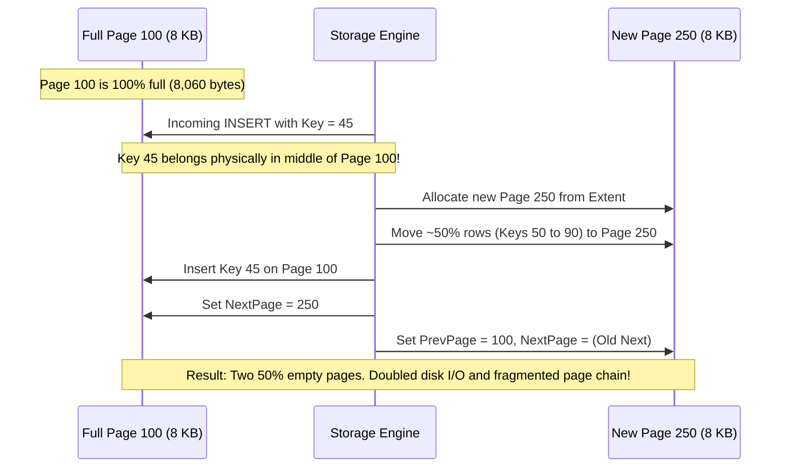

# 02. SQL Server Performance & T-SQL Experienced Developer (5–10+ YOE) Interview Master Guide — India Context

> **Target Audience:** Mid-to-Senior Engineering Interviews (5–10+ YOE), Technical Lead Assessments, System Architect Evaluations, and Advanced Screening across Tier-1 Indian GCCs, Tier-1 Product Companies, and High-Bar Tech Consultancies.
> **Standard:** Speakable Senior English v1 (SSE-1) Standard. Crisp one-line answers, 30–45 second spoken responses (direct answer → plain explanation → production consequence), formal terms with plain glosses, intuitive analogies, 5–15 line runnable code snippets, likely follow-ups, and comparison matrices.

---

# TABLE OF CONTENTS

- [MODULE 1: CORE T-SQL PROGRAMMING & DATA QUERYING (SCREENING & LIVE CODING HITLIST)](#module-1-core-t-sql-programming--data-querying-screening--live-coding-hitlist)
  - [Q1: How do you find the second highest or Nth highest salary in SQL?](#q1-how-do-you-find-the-second-highest-or-nth-highest-salary-in-sql)
  - [Q2: How do you find and delete duplicate records in a table?](#q2-how-do-you-find-and-delete-duplicate-records-in-a-table)
  - [Q3: How do SQL Server joins work and how do they handle NULL values?](#q3-how-do-sql-server-joins-work-and-how-do-they-handle-null-values)
  - [Q4: What is the difference between UNION and UNION ALL?](#q4-what-is-the-difference-between-union-and-union-all)
  - [Q5: What is the difference between a Stored Procedure and a User-Defined Function?](#q5-what-is-the-difference-between-a-stored-procedure-and-a-user-defined-function)
  - [Q6: How do you choose between a CTE, Temp Table, and Table Variable?](#q6-how-do-you-choose-between-a-cte-temp-table-and-table-variable)
- [MODULE 2: DATABASE DESIGN, INTEGRITY & RELATIONAL MODELING](#module-2-database-design-integrity--relational-modeling)
  - [Q7: What is the difference between a Primary Key and a Unique Key constraint?](#q7-what-is-the-difference-between-a-primary-key-and-a-unique-key-constraint)
  - [Q8: What is the difference between DELETE, TRUNCATE, and DROP?](#q8-what-is-the-difference-between-delete-truncate-and-drop)
  - [Q9: What are database normalization normal forms from 1NF through BCNF?](#q9-what-are-database-normalization-normal-forms-from-1nf-through-bcnf)
  - [Q10: What is the difference between AFTER and INSTEAD OF triggers?](#q10-what-is-the-difference-between-after-and-instead-of-triggers)
- [MODULE 3: INDEXING INTERNALS & PHYSICAL ARCHITECTURE](#module-3-indexing-internals--physical-architecture)
  - [Q11: What is the difference between a clustered and a non-clustered index?](#q11-what-is-the-difference-between-a-clustered-and-a-non-clustered-index)
  - [Q12: What is the difference between Index Seek, Index Scan, Table Scan, and Key Lookup?](#q12-what-is-the-difference-between-index-seek-index-scan-table-scan-and-key-lookup)
  - [Q13: How do covering indexes with INCLUDE columns eliminate costly key lookups?](#q13-how-do-covering-indexes-with-include-columns-eliminate-costly-key-lookups)
  - [Q14: What makes a query SARGable and why do functions on indexed columns hurt performance?](#q14-what-makes-a-query-sargable-and-why-do-functions-on-indexed-columns-hurt-performance)
- [MODULE 4: PERFORMANCE TUNING, PARAMETER SNIFFING & QUERY OPTIMIZER](#module-4-performance-tuning-parameter-sniffing--query-optimizer)
  - [Q15: What is parameter sniffing and how do you diagnose and fix it in production?](#q15-what-is-parameter-sniffing-and-how-do-you-diagnose-and-fix-it-in-production)
  - [Q16: What are the differences between Nested Loops, Hash Match, and Merge Join operators?](#q16-what-are-the-differences-between-nested-loops-hash-match-and-merge-join-operators)
  - [Q17: How does SQL Server maintain statistics and when do cardinality estimation errors occur?](#q17-how-does-sql-server-maintain-statistics-and-when-do-cardinality-estimation-errors-occur)
- [MODULE 5: TRANSACTIONS, CONCURRENCY, LOCKS & DEADLOCKS](#module-5-transactions-concurrency-locks--deadlocks)
  - [Q18: What are ACID properties and how do they ensure transactional integrity?](#q18-what-are-acid-properties-and-how-do-they-ensure-transactional-integrity)
  - [Q19: What are transaction isolation levels and what concurrency anomalies do they prevent?](#q19-what-are-transaction-isolation-levels-and-what-concurrency-anomalies-do-they-prevent)
  - [Q20: What causes deadlocks in SQL Server and how do you diagnose and prevent them?](#q20-what-causes-deadlocks-in-sql-server-and-how-do-you-diagnose-and-prevent-them)
  - [Q21: What are SQL Server lock modes and what triggers lock escalation to a table lock?](#q21-what-are-sql-server-lock-modes-and-what-triggers-lock-escalation-to-a-table-lock)
- [APPENDIX: ADVANCED ENGINE INTERNALS, DMV PLAYBOOK & ARCHITECTURAL REFERENCE](#appendix-advanced-engine-internals-dmv-playbook--architectural-reference)
  - [Appendix A: Storage Engine Deep Physics (8 KB Pages, Page Headers, Slot Arrays, Extents, Row-Overflow & LOB Pages)](#appendix-a-storage-engine-deep-physics-8-kb-pages-page-headers-slot-arrays-extents-row-overflow--lob-pages)
  - [Appendix B: Physical Page Splits & Fill Factor Mechanics (50-50 Splits, Fragmentation, NEWID vs NEWSEQUENTIALID)](#appendix-b-physical-page-splits--fill-factor-mechanics-50-50-splits-fragmentation-newid-vs-newsequentialid)
  - [Appendix C: TempDB Allocation Contention (GAM, SGAM, PFS Latches & Multi-File Configuration)](#appendix-c-tempdb-allocation-contention-gam-sgam-pfs-latches--multi-file-configuration)
  - [Appendix D: Production DMV Troubleshooting Playbook (Top CPU Queries, Real-Time Blocking Tree, Missing Indexes, Log Reuse Wait, Rebuild vs Reorganize)](#appendix-d-production-dmv-troubleshooting-playbook-top-cpu-queries-real-time-blocking-tree-missing-indexes-log-reuse-wait-rebuild-vs-reorganize)
  - [Appendix E: Curated Senior Architectural Q&A Hitlist](#appendix-e-curated-senior-architectural-qa-hitlist-cxpacket-pagelatch-vs-pageiolatch-memory-grants-filtered-indexes-datetime-vs-datetime2-adaptive-joins)
  - [Appendix F: Real-World Anti-Pattern vs Senior Architecture Showcase](#appendix-f-real-world-anti-pattern-vs-senior-architecture-showcase-paged-order-history-lookup-with-dynamic-filtering)

---

# MODULE 1: CORE T-SQL PROGRAMMING & DATA QUERYING (SCREENING & LIVE CODING HITLIST)

## Q1: How do you find the second highest or Nth highest salary in SQL?
*Commonly asked at: Amazon, Microsoft, TCS, Cognizant*

**⚡ One-line answer**
For the second highest salary, a subquery filtering below the maximum works simply, while DENSE_RANK generalizes cleanly to the Nth salary.

**🗣️ Spoken answer (30–45 seconds)**
To find the second highest salary, filtering with WHERE Salary < (SELECT MAX(Salary)) handles ties cleanly. For any arbitrary Nth highest salary, we use DENSE_RANK inside a common table expression. Unlike the RANK function, DENSE_RANK never skips rank positions when duplicate salaries occur. In one of my projects, junior developers used RANK, which returned empty sets when duplicate top salaries existed. DENSE_RANK provides predictable ranking regardless of duplicate values.

**🎯 Terms the interviewer listens for**
- Ranking function [DENSE_RANK] ⭐: Window function assigning consecutive ranks without gaps.
- Common table expression [CTE] ⭐: Named temporary result set used for readability.
- Rank gap [RANK vs DENSE_RANK] ⭐: RANK skips numbers after ties; DENSE_RANK does not.
- Subquery filter: Inner query selecting the maximum scalar value.
- Offset paging [OFFSET-FETCH]: ANSI syntax skipping rows and fetching next.

**🧠 Memory hook**
Olympic medals with ties: DENSE_RANK awards Silver after tied Golds. RANK skips Silver and awards Bronze directly.

**💻 Code**
```sql
-- ❌ RANK skips rank numbers when ties occur
SELECT Salary, RANK() OVER (ORDER BY Salary DESC) AS Rnk FROM dbo.Employees;

-- ✅ DENSE_RANK guarantees consecutive ranks without gaps
WITH RankedSalaries AS (
    SELECT Salary, DENSE_RANK() OVER (ORDER BY Salary DESC) AS Rnk
    FROM dbo.Employees
)
SELECT Salary FROM RankedSalaries WHERE Rnk = 2;
```

**⚠️ Likely follow-up**
- **Q:** How does OFFSET-FETCH compare for finding the Nth highest salary?
- **A:** OFFSET 1 ROWS FETCH NEXT 1 ROWS ONLY works if you select DISTINCT Salary, but DENSE_RANK is preferred because it can return full employee rows alongside the salary.

**📊 Quick comparison**
| Approach | Handles Ties | Scales to Nth | Complexity |
| --- | --- | --- | --- |
| Subquery with MAX | Yes for second only | Requires nested subqueries | Simple for N=2 |
| DENSE_RANK with CTE | Yes consecutive ranks | Yes change filter to N | Standard senior pattern |
| RANK with CTE | No skips ranks | Unreliable on ties | Prone to bugs |
| DISTINCT OFFSET-FETCH | Yes with DISTINCT | Yes modify OFFSET value | Modern clean syntax |

**🔬 Under the hood (optional)**
DENSE_RANK evaluates over the window specification using a Segment and Sequence Project operator in the execution plan, consuming minimal memory grant.

---

## Q2: How do you find and delete duplicate records in a table?
*Commonly asked at: Cognizant, Wipro, Accenture, Capgemini*

**⚡ One-line answer**
Partitioning rows by business keys using ROW_NUMBER inside a CTE allows safe identification and deletion of duplicate rows exceeding rank 1.

**🗣️ Spoken answer (30–45 seconds)**
The standard approach partitions records across duplicate business columns using the ROW_NUMBER window function inside a common table expression. Each duplicate group receives sequential numbering ordered by identity or timestamp. The outer DELETE statement targets rows where the row number is greater than 1, preserving the initial record. In one of my projects, running this within a batch loop prevented excessive transaction log growth. It cleanly eliminates duplicates without creating temporary staging tables.

**🎯 Terms the interviewer listens for**
- Window partitioning [PARTITION BY] ⭐: Divides result set into distinct partitions for ranking.
- Sequential ranking [ROW_NUMBER] ⭐: Assigns unique incrementing numbers within each partitioned group.
- CTE deletion target ⭐: Deletes directly from CTE view targeting underlying table.
- Idempotent cleanup: Script safely reruns without altering unique surviving records.
- Log batching: Chunking delete statements to avoid log file exhaustion.

**🧠 Memory hook**
Finding duplicates with ROW_NUMBER is like giving queue tokens to people with the same name. You serve token 1 and send the others home.

**💻 Code**
```sql
-- ❌ Self-join deletion causing high logical reads
DELETE e1 FROM dbo.Employees e1
INNER JOIN dbo.Employees e2 ON e1.Email = e2.Email AND e1.Id > e2.Id;

-- ✅ Window partitioning with direct CTE deletion
WITH DupeCTE AS (
    SELECT Id, ROW_NUMBER() OVER (PARTITION BY Email ORDER BY Id) AS Rn
    FROM dbo.Employees
)
DELETE FROM DupeCTE WHERE Rn > 1;
```

**⚠️ Likely follow-up**
- **Q:** How do you prevent duplicate records from recurring?
- **A:** After cleaning duplicate records, create a unique constraint or unique non-clustered index on the business key columns to enforce uniqueness at the storage engine level.

**📊 Quick comparison**
| Method | Performance | Code Simplicity | Handles Multi-Columns |
| --- | --- | --- | --- |
| CTE with ROW_NUMBER | Fast single scan | Very high and readable | Yes via PARTITION BY |
| Self-Join DELETE | Slow quadratic reads | Moderate complexity | Requires complex joins |
| GROUP BY HAVING | Identification only | Needs extra delete query | Yes via grouping |
| Distinct Temp Table | High I/O overhead | Multi-step workflow | Yes but duplicates memory |

**🔬 Under the hood (optional)**
A CTE update or delete operates directly on the underlying base table. The optimizer builds a plan combining a Segment operator with a Top or Filter operator.

---

## Q3: How do SQL Server joins work and how do they handle NULL values?
*Commonly asked at: Microsoft, Amazon, TCS, Infosys*

**⚡ One-line answer**
Joins combine tables based on matching predicates, and SQL Server evaluates NULL comparisons to UNKNOWN, meaning NULL never joins with NULL.

**🗣️ Spoken answer (30–45 seconds)**
SQL Server joins correlate records across tables using equality predicates. INNER JOIN returns matching rows only. OUTER joins preserve unmatched rows by supplying NULL attributes. In SQL Server, equality comparisons with NULL yield UNKNOWN rather than TRUE. Therefore, NULL values never match each other in joins. In one of my projects, using COALESCE in join logic prevented dropped financial records during billing runs.

**🎯 Terms the interviewer listens for**
- Relational equality predicate ⭐: Join criteria evaluating matching columns between tables.
- Three-valued logic [UNKNOWN] ⭐: Boolean state where NULL comparisons produce neither TRUE nor FALSE.
- Outer preservation [OUTER JOIN] ⭐: Preserves rows from designated table when no match exists.
- Cartesian product [CROSS JOIN]: Produces all possible combinations between two relation streams.
- Physical join operators: Engine operators: Nested Loops, Hash Match, and Merge Join.

**🧠 Memory hook**
Joining on NULL is like matching two envelopes with missing addresses. The post office cannot assume two blank envelopes belong to the same recipient.

**💻 Code**
```sql
-- ❌ Direct NULL comparison drops rows in join
SELECT a.AccId, b.Status FROM dbo.TableA a 
INNER JOIN dbo.TableB b ON a.Code = b.Code;

-- ✅ Explicit handling ensures matching for missing codes
SELECT a.AccId, b.Status FROM dbo.TableA a 
INNER JOIN dbo.TableB b ON ISNULL(a.Code, '') = ISNULL(b.Code, '');
```

**⚠️ Likely follow-up**
- **Q:** What physical join operators does SQL Server execute?
- **A:** SQL Server chooses Nested Loops for small indexed lookups, Merge Join for pre-sorted inputs, and Hash Match for large unsorted datasets requiring memory grants.

**📊 Quick comparison**
| Join Type | Matched Rows | Unmatched Left | Unmatched Right |
| --- | --- | --- | --- |
| INNER JOIN | Returned | Excluded | Excluded |
| LEFT JOIN | Returned | Padded with NULL | Excluded |
| RIGHT JOIN | Returned | Excluded | Padded with NULL |
| FULL OUTER | Returned | Padded with NULL | Padded with NULL |
| CROSS JOIN | All combinations | All combinations | All combinations |

**🔬 Under the hood (optional)**
SQL Server join evaluation adheres to ANSI SQL-92 standards. When ANSI_NULLS is ON, NULL = NULL yields UNKNOWN, requiring IS NULL for presence checks.

---

## Q4: What is the difference between UNION and UNION ALL?
*Commonly asked at: Amazon, TCS, Cognizant, Barclays*

**⚡ One-line answer**
UNION ALL concatenates result sets directly without sorting, while UNION removes duplicates using an expensive distinct sort or hash aggregate.

**🗣️ Spoken answer (30–45 seconds)**
UNION ALL stacks rows with no deduplication or sort operations. In contrast, UNION adds deduplication through a distinct sort or hash aggregate operator. If the query memory grant runs short, that sort operation spills directly into TempDB disk. In one of my projects, replacing unnecessary UNION operators with UNION ALL cut query latency significantly. We reserve UNION strictly for cases where business logic demands eliminating duplicate records.

**🎯 Terms the interviewer listens for**
- Stream concatenation [UNION ALL] ⭐: Combines rows directly with zero sorting overhead.
- Distinct sort [UNION] ⭐: Execution plan operator sorting rows to eliminate duplicates.
- TempDB spill [Sort Warning] ⭐: Disk spill occurring when memory grant is insufficient.
- Memory grant [Workspace Memory]: RAM allocated before query execution for sort operations.
- Hash aggregate: Alternative operator hashing rows to deduplicate streams.

**🧠 Memory hook**
UNION ALL is stapling two printed documents together. UNION is reading both documents word for word and crossing out duplicate paragraphs.

**💻 Code**
```sql
-- ❌ Inefficient distinct sort across streams
SELECT CustomerId, City FROM dbo.RetailCustomers
UNION
SELECT CustomerId, City FROM dbo.CorporateCustomers;

-- ✅ Direct concatenation with zero sorting
SELECT CustomerId, City FROM dbo.RetailCustomers
UNION ALL
SELECT CustomerId, City FROM dbo.CorporateCustomers;
```

**⚠️ Likely follow-up**
- **Q:** When does UNION spill rows into TempDB?
- **A:** When the query optimizer underestimates row counts and requests an inadequate memory grant, the distinct sort cannot complete in RAM and spills intermediate rows to TempDB.

**📊 Quick comparison**
| Feature | UNION | UNION ALL |
| --- | --- | --- |
| Duplicates | Removes duplicate rows | Preserves all rows |
| Sort operator | Requires distinct sort | Zero sort overhead |
| Memory grant | Requires workspace memory | No memory grant needed |
| Performance | Slower on large streams | Significantly faster |
| TempDB usage | Spills if memory tight | Zero TempDB usage |

**🔬 Under the hood (optional)**
UNION uses either a Sort (Distinct Sort) or Aggregate (Hash Aggregate) physical operator. UNION ALL uses a Concatenation operator that streams rows immediately.

---

## Q5: What is the difference between a Stored Procedure and a User-Defined Function?
*Commonly asked at: TCS, Accenture, HCL, LTIMindtree*

**⚡ One-line answer**
Stored procedures perform procedural tasks with data modifications and transactions, while user-defined functions compute values and must be side-effect-free.

**🗣️ Spoken answer (30–45 seconds)**
Stored procedures execute procedural statements, perform data modifications, and manage database transactions. They can return multiple result sets or output parameters, but cannot be joined inside SELECT queries. In contrast, a user-defined function must be side-effect-free with no modifications on database tables and no transactions. However, a function does not have to be deterministic; functions like GETDATE are fully allowed. In one of my projects, we use inline table-valued functions for clean composability.

**🎯 Terms the interviewer listens for**
- Side-effect-free [No DML] ⭐: Functions cannot insert, update, or delete table data.
- Non-deterministic function [GETDATE] ⭐: Functions returning varying results like GETDATE are allowed.
- Inline table-valued function [iTVF] ⭐: Table function expanded inline into calling query plan.
- Scalar UDF inlining: SQL Server engine feature inlining scalar functions.
- Transaction control [BEGIN TRAN]: Stored procedures can manage transactions; functions cannot.

**🧠 Memory hook**
A stored procedure is an automated factory that modifies materials and produces shipments. A function is a desktop calculator that computes a formula without altering stock.

**💻 Code**
```sql
-- ❌ Scalar UDF forcing row-by-row execution
CREATE FUNCTION dbo.GetDiscount_Slow(@Amt DECIMAL(18,2))
RETURNS DECIMAL(18,2) AS BEGIN RETURN (@Amt * 0.10); END;

-- ✅ Inline table-valued function expanding directly into plan
CREATE FUNCTION dbo.GetDiscount_Fast(@Amt DECIMAL(18,2))
RETURNS TABLE AS RETURN (SELECT (@Amt * 0.10) AS Discount);
```

**⚠️ Likely follow-up**
- **Q:** Can you call a stored procedure from inside a user-defined function?
- **A:** No. Stored procedures can perform side effects and modify data state, which violates the strict side-effect-free requirement enforced by the SQL Server engine on user functions.

**📊 Quick comparison**
| Feature | Stored Procedure | User-Defined Function |
| --- | --- | --- |
| Data modification | Can insert, update, delete | Strictly side-effect-free |
| Transactions | Can manage transactions | Transactions prohibited |
| Usage in SELECT | Cannot be queried directly | Can be joined directly |
| Return values | Status code or result sets | Single scalar or table |
| Determinism | Procedural execution | Can be non-deterministic |

**🔬 Under the hood (optional)**
Scalar UDFs historically forced row-by-row iteration (RBAR) and blocked parallelism. SQL Server 2019 introduced Scalar UDF Inlining to translate scalar functions into relational subqueries.

---

## Q6: How do you choose between a CTE, Temp Table, and Table Variable?
*Commonly asked at: Amazon, Microsoft, Wells Fargo, Barclays*

**⚡ One-line answer**
Use CTEs for query readability, Table Variables for tiny non-parallel datasets, and Temp Tables for large datasets needing statistics and indexes.

**🗣️ Spoken answer (30–45 seconds)**
A CTE provides syntactic readability during query execution with zero persistence or statistics. A table variable resides in TempDB and memory, but lacks column distribution statistics. Because of this, the optimizer estimates single-row cardinality for table variables. A temporary table persists physically in TempDB, providing full statistics and parallel execution plans. In one of my projects, replacing large CTEs with temp tables eliminated repeated subquery executions.

**🎯 Terms the interviewer listens for**
- Common table expression [CTE] ⭐: Non-persisted syntactic expression expanding into main query.
- Temporary table [#Table] ⭐: Physical table in TempDB with statistics and indexing.
- Table variable [@Table] ⭐: Lightweight table structure lacking column statistics.
- Cardinality estimation error: Optimizer estimates 1 row for table variables.
- Re-evaluation overhead: Referencing a CTE multiple times re-executes underlying query.

**🧠 Memory hook**
A CTE is a bookmark in a book. A table variable is a sticky note on your monitor. A temporary table is a complete scratch notepad with an index.

**💻 Code**
```sql
-- ❌ Table variable causing 1-row estimation on large set
DECLARE @BigOrders TABLE (OrderId INT, Total DECIMAL(18,2));

-- ✅ Temporary table with explicit index and statistics
CREATE TABLE #BigOrders (OrderId INT PRIMARY KEY, Total DECIMAL(18,2));
INSERT INTO #BigOrders (OrderId, Total)
SELECT OrderId, TotalAmount FROM dbo.Orders WHERE TotalAmount > 1000;
```

**⚠️ Likely follow-up**
- **Q:** Does a table variable stay purely in memory?
- **A:** No, this is a common myth. Table variables allocate pages in TempDB just like temporary tables, but they do not maintain distribution statistics or trigger recompilations.

**📊 Quick comparison**
| Feature | CTE | Table Variable | Temp Table |
| --- | --- | --- | --- |
| Storage location | None unpersisted query | TempDB and memory cache | TempDB physical pages |
| Statistics | Inherits from base tables | Zero column statistics | Full column statistics |
| Secondary indexes | Not supported | Only PRIMARY / UNIQUE | Fully supported |
| Scope lifetime | Single SQL statement | Current batch or procedure | Current session or proc |
| Ideal data size | Inline query readability | Under 100 rows | Thousands to millions |

**🔬 Under the hood (optional)**
SQL Server 2019 introduced Table Variable Deferred Compilation, compiling execution plans based on actual cardinality rather than the default 1-row guess.

---

# MODULE 2: DATABASE DESIGN, INTEGRITY & RELATIONAL MODELING

## Q7: What is the difference between a Primary Key and a Unique Key constraint?
*Commonly asked at: Infosys, Wipro, Tech Mahindra, Morgan Stanley*

**⚡ One-line answer**
A primary key uniquely identifies rows and rejects all NULLs, while a unique key permits strictly one NULL in SQL Server.

**🗣️ Spoken answer (30–45 seconds)**
A primary key enforces entity integrity by uniquely identifying each table row while strictly rejecting NULL values. By default, SQL Server creates a clustered index on the primary key. A unique key constraint also enforces uniqueness, but SQL Server permits strictly one NULL value across the column. Each table allows only one primary key, but multiple unique keys are supported. In one of my projects, we use unique keys on email addresses.

**🎯 Terms the interviewer listens for**
- Entity integrity [Primary Key] ⭐: Rule stating table rows must have unique identity.
- Nullability rule [One NULL] ⭐: SQL Server permits exactly one NULL per unique key.
- Clustered default [PK Index] ⭐: Primary key creates a clustered index by default.
- Unique index [Non-Clustered]: Unique constraint creates unique non-clustered index by default.
- Alternate key: Candidate key chosen as unique constraint instead of primary.

**🧠 Memory hook**
A primary key is like an employee badge number that everyone must have. A unique key is a passport number which is unique, but optional for some.

**💻 Code**
```sql
-- ❌ Allowing multiple NULL values in standard unique constraint
CREATE TABLE dbo.OldAccounts ( AccId INT UNIQUE );

-- ✅ Filtered unique index allowing multiple NULL values
CREATE TABLE dbo.Accounts ( AccId INT NULL );
CREATE UNIQUE NONCLUSTERED INDEX UQ_AccId_NotNull 
ON dbo.Accounts(AccId) WHERE AccId IS NOT NULL;
```

**⚠️ Likely follow-up**
- **Q:** How can you allow multiple NULL values in a unique column?
- **A:** Create a unique non-clustered index with a WHERE clause specifying WHERE Column IS NOT NULL. This enforces uniqueness for actual values while allowing multiple NULL entries.

**📊 Quick comparison**
| Feature | Primary Key | Unique Key |
| --- | --- | --- |
| NULL values | Zero NULLs allowed | Strictly one NULL allowed |
| Count limit | Exactly one per table | Multiple per table |
| Default index | Clustered index | Non-clustered index |
| Foreign key | Targeted by foreign keys | Can be targeted too |
| Purpose | Core record identity | Enforces alternate uniqueness |

**🔬 Under the hood (optional)**
ANSI SQL standards allow multiple NULL values in unique constraints, but SQL Server implements the single-NULL interpretation. Filtered unique indexes provide standard behavior.

---

## Q8: What is the difference between DELETE, TRUNCATE, and DROP?
*Commonly asked at: Infosys, Wipro, Accenture, Wells Fargo*

**⚡ One-line answer**
DELETE removes specific rows with full logging, TRUNCATE deallocates pages with minimal logging, and DROP completely removes table structure and data.

**🗣️ Spoken answer (30–45 seconds)**
DELETE is a data manipulation command that logs every row deletion and fires delete triggers. In contrast, TRUNCATE is a data definition command that deallocates entire pages and extents with minimal logging. SQL Server pages are 8 KB and extents are 64 KB, containing 8 pages. TRUNCATE resets table identity values to their seed and cannot take a WHERE clause. In one of my projects, truncating staging tables saved transaction log growth.

**🎯 Terms the interviewer listens for**
- Page deallocation [TRUNCATE] ⭐: Deallocates 8 KB pages and 64 KB extents directly.
- Row-by-row logging [DELETE] ⭐: Writes every individual deleted record to transaction log.
- Identity reset [Seed Reseed] ⭐: TRUNCATE resets identity back to seed; DELETE does not.
- DDL vs DML: TRUNCATE is DDL command; DELETE is DML statement.
- Trigger execution: DELETE fires triggers; TRUNCATE never activates triggers.

**🧠 Memory hook**
DELETE is erasing individual lines with an eraser. TRUNCATE is ripping out notebook pages. DROP is throwing the entire notebook into a shredder.

**💻 Code**
```sql
-- ❌ Slow row-by-row deletion causing log bloat
DELETE FROM dbo.StagingOrders;

-- ✅ Fast page deallocation with minimal logging
TRUNCATE TABLE dbo.StagingOrders;
```

**⚠️ Likely follow-up**
- **Q:** Can TRUNCATE be rolled back inside a transaction?
- **A:** Yes. If executed inside an active BEGIN TRANSACTION block, TRUNCATE can be rolled back because page and extent deallocations are recorded in the transaction log.

**📊 Quick comparison**
| Feature | DELETE | TRUNCATE | DROP |
| --- | --- | --- | --- |
| Operation type | DML statement | DDL statement | DDL statement |
| Logging overhead | Full row-level logging | Minimal page deallocation | Minimal schema removal |
| WHERE clause | Supported for filtering | Not supported | Not applicable |
| Identity column | Retains current seed | Resets to initial seed | Object deleted |
| Rollback ability | Yes inside transaction | Yes inside transaction | Yes inside transaction |

**🔬 Under the hood (optional)**
TRUNCATE deallocates extents by updating Index Allocation Map (IAM) and Page Free Space (PFS) pages, recording only page deallocation entries in the transaction log.

---

## Q9: What are database normalization normal forms from 1NF through BCNF?
*Commonly asked at: TCS, Infosys, Cognizant, Wipro*

**⚡ One-line answer**
Normalization structures relational schemas to remove data redundancy and update anomalies by decomposing tables from 1NF through BCNF.

**🗣️ Spoken answer (30–45 seconds)**
Database normalization progressively eliminates data redundancy and update anomalies. First Normal Form requires atomic column values and unique row identification. Second Normal Form eliminates partial dependencies, requiring all non-key attributes to depend on the entire primary key. Third Normal Form removes transitive dependencies, ensuring non-key attributes depend strictly on the primary key alone. Boyce-Codd Normal Form extends this rule by requiring every determinant attribute to be a candidate key. In one of my projects, normalizing customer addresses stopped duplicate update anomalies.

**🎯 Terms the interviewer listens for**
- Atomic attributes [1NF] ⭐: Columns hold single scalar values without repeating groups.
- Partial dependency [2NF] ⭐: Non-key column depends on only part of composite key.
- Transitive dependency [3NF] ⭐: Non-key column depends on another non-key column.
- Boyce-Codd [BCNF]: Stricter form where every determinant is a candidate key.
- Modification anomaly: Inconsistencies during insert, update, or delete operations.

**🧠 Memory hook**
Normalization is organizing your wardrobe: socks in one drawer, shirts in another. Denormalization is keeping a full outfit together for quick morning dressing.

**💻 Code**
```sql
-- ❌ Transitive dependency: City depends on ZipCode, not CustomerId
CREATE TABLE dbo.Customers (
    CustomerId INT PRIMARY KEY,
    ZipCode VARCHAR(10), City VARCHAR(50)
);

-- ✅ Third Normal Form: Decomposed into normalized tables
CREATE TABLE dbo.ZipCodes ( ZipCode VARCHAR(10) PRIMARY KEY, City VARCHAR(50) );
CREATE TABLE dbo.Customers3NF (
    CustomerId INT PRIMARY KEY, ZipCode VARCHAR(10) REFERENCES dbo.ZipCodes
);
```

**⚠️ Likely follow-up**
- **Q:** When is intentional denormalization justified in production?
- **A:** In high-throughput read systems or reporting data warehouses, controlled denormalization reduces expensive multi-table joins, trading extra storage and write complexity for faster query latency.

**📊 Quick comparison**
| Normal Form | Core Requirement | Removes Anomaly |
| --- | --- | --- |
| 1NF | Atomic values and no arrays | Repeating groups |
| 2NF | Full dependency on composite key | Partial key dependency |
| 3NF | No non-key transitive relations | Transitive dependency |
| BCNF | Every determinant candidate key | Overlapping composite anomalies |
| Denormalized | Pre-joined flattened structures | Optimizes read throughput |

**🔬 Under the hood (optional)**
The classic normalization saying states that non-key columns must depend upon the key, the whole key, and nothing but the key, so help me Codd.

---

## Q10: What is the difference between AFTER and INSTEAD OF triggers?
*Commonly asked at: Infosys, Wipro, HCL, Cognizant*

**⚡ One-line answer**
AFTER triggers execute after statement operations and constraints succeed, while INSTEAD OF triggers replace the triggering statement entirely.

**🗣️ Spoken answer (30–45 seconds)**
An AFTER trigger executes after statement modifications and table constraints succeed. It runs within the active transaction context, reading inserted and deleted memory tables. An INSTEAD OF trigger executes in place of the modifying statement entirely. It bypasses base table changes and is widely used on complex views. Triggers always fire once per statement, not per individual row. In one of my projects, we use AFTER triggers strictly for audit logging.

**🎯 Terms the interviewer listens for**
- Post-modification trigger [AFTER] ⭐: Fires after base statement and declarative constraints succeed.
- Interception trigger [INSTEAD OF] ⭐: Replaces original DML statement completely with custom logic.
- Memory pseudo-tables [Inserted/Deleted] ⭐: Temporary memory structures holding pre- and post-modification rows.
- Updatable views: INSTEAD OF triggers allow DML on multi-table views.
- Set-based execution: Triggers fire once per statement, not per individual row.

**🧠 Memory hook**
An AFTER trigger is a security guard checking your receipt as you exit. An INSTEAD OF trigger is a concierge who takes your ticket and parks your car for you.

**💻 Code**
```sql
-- ❌ Non set-based code fails on bulk rows
CREATE TRIGGER dbo.trg_Bad ON dbo.Orders AFTER INSERT AS
BEGIN DECLARE @Id INT = (SELECT OrderId FROM inserted); END;

-- ✅ Set-based trigger handling multiple inserted records
CREATE TRIGGER dbo.trg_Good ON dbo.Orders AFTER INSERT AS
BEGIN
    INSERT INTO dbo.AuditLog (OrderId, Action)
    SELECT OrderId, 'INSERT' FROM inserted;
END;
```

**⚠️ Likely follow-up**
- **Q:** What happens if an error occurs inside an AFTER trigger?
- **A:** If an error occurs or the trigger issues a ROLLBACK TRANSACTION, the entire transaction rolls back, including the initiating DML statement and all preceding modifications.

**📊 Quick comparison**
| Feature | AFTER Trigger | INSTEAD OF Trigger |
| --- | --- | --- |
| Execution timing | After statement and constraints | In place of statement |
| Constraint checking | Fires after constraints pass | Fires before constraints evaluate |
| Applicable objects | Tables only | Tables and views |
| Count limit | Multiple triggers allowed | Strictly one per action |
| Primary use case | Auditing and cascading rules | Enabling writes on views |

**🔬 Under the hood (optional)**
Inserted and deleted pseudo-tables are backed by the version store or transaction log and reflect the row state changes for the batch statement.

---

# MODULE 3: INDEXING INTERNALS & PHYSICAL ARCHITECTURE

## Q11: What is the difference between a clustered and a non-clustered index?
*Commonly asked at: TCS, Infosys, Cognizant, Barclays*

**⚡ One-line answer**
A clustered index physically sorts table rows on disk, while a non-clustered index creates a separate pointer structure referencing those rows.

**🗣️ Spoken answer (30–45 seconds)**
A clustered index physically orders table rows across data pages [leaf nodes]. Because the base rows are stored directly, each table can have only one clustered index. Non-clustered indexes build auxiliary search trees [secondary B-Trees] holding key columns and pointers [row locators]. In one of my projects, we cluster on a sequential identity column to stop page splits. We then use non-clustered indexes with included columns to avoid secondary lookups.

**🎯 Terms the interviewer listens for**
- Data pages [Leaf Nodes] ⭐: Physical storage pages containing base table rows.
- Row locator [RID or Key] ⭐: Pointer linking secondary index rows to base records.
- Covering index [INCLUDE] ⭐: Index containing all columns needed by a query.
- B-Tree hierarchy: Balanced tree structure organizing index navigation levels.
- Bookmark lookup: Secondary read to base table for extra columns.

**🧠 Memory hook**
A clustered index is like a phone book sorted alphabetically. A non-clustered index is the index at the back of a textbook pointing to page numbers.

**💻 Code**
```sql
-- ❌ Secondary lookup needed for unindexed column
SELECT OrderDate, TotalAmount FROM dbo.Orders WHERE CustomerId = 42;

-- ✅ Covering index avoids base table lookup
CREATE NONCLUSTERED INDEX IX_Orders_Cust ON dbo.Orders(CustomerId)
INCLUDE (OrderDate, TotalAmount);
```

**⚠️ Likely follow-up**
- **Q:** Can a table have a clustered index without a primary key?
- **A:** Yes. Primary keys default to clustered indexes, but you can explicitly define a primary key as non-clustered and assign the clustered index to another column such as a date or foreign key.

**📊 Quick comparison**
| Feature | Clustered Index | Non-Clustered Index |
| --- | --- | --- |
| Physical order | Defines table disk order | Separate pointer structure |
| Count limit | Strictly one per table | Up to 999 per table |
| Leaf level | Contains actual table rows | Contains keys plus row locator |
| Default on | Primary key constraint | Unique key constraint |
| Best workload | Range queries and sequential keys | Targeted point lookups |

**🔬 Under the hood (optional)**
Leaf pages in a clustered index are linked by a doubly-linked list. Non-clustered leaf pages store an 8-byte RID for heaps or the clustering key for clustered tables.

---

## Q12: What is the difference between Index Seek, Index Scan, Table Scan, and Key Lookup?
*Commonly asked at: Amazon, Microsoft, Barclays, Cognizant*

**⚡ One-line answer**
An Index Seek navigates B-Tree levels directly, an Index Scan reads entire leaf pages, while a Key Lookup fetches missing columns from the base table.

**🗣️ Spoken answer (30–45 seconds)**
An Index Seek navigates B-Tree levels directly to locate rows in logarithmic time. An Index Scan reads all leaf pages of an index sequentially. A Table Scan reads an entire heap table from disk. Key Lookups occur when secondary indexes satisfy filters but lack selected columns. The engine then fetches base table rows using row locators. In one of my projects, covering indexes eliminated key lookups completely.

**🎯 Terms the interviewer listens for**
- Index Seek [Logarithmic Search] ⭐: Navigates B-Tree structure directly to qualified keys.
- Index Scan [Sequential Read] ⭐: Reads through every page of an index leaf level.
- Key Lookup [Bookmark Lookup] ⭐: Base table lookup to retrieve unindexed projection columns.
- Table Scan: Reads every allocated data page in an unindexed heap.
- Covering index [INCLUDE]: Index housing all query columns to prevent secondary lookups.

**🧠 Memory hook**
An Index Seek flips straight to chapter five. An Index Scan reads the entire book index. A Key Lookup checks the index, then fetches another volume.

**💻 Code**
```sql
-- ❌ Non-covering index causes expensive Key Lookups
CREATE NONCLUSTERED INDEX IX_Orders_Date ON dbo.Orders(OrderDate);
SELECT OrderId, OrderDate, TotalAmount FROM dbo.Orders WHERE OrderDate = '2026-01-01';

-- ✅ Covering index satisfies query via pure Index Seek
CREATE NONCLUSTERED INDEX IX_Orders_Date_Covering ON dbo.Orders(OrderDate)
INCLUDE (OrderId, TotalAmount);
```

**⚠️ Likely follow-up**
- **Q:** Why does the optimizer choose an Index Scan over an Index Seek?
- **A:** When the query filter lacks selectivity or wraps indexed columns in functions, scanning the leaf level sequentially is cheaper than performing repeated random seeks and key lookups.

**📊 Quick comparison**
| Operator | Algorithm | I/O Pattern | Ideal Selectivity |
| --- | --- | --- | --- |
| Index Seek | B-Tree navigation | Minimal targeted pages | Highly selective rows |
| Index Scan | Sequential leaf read | Reads all index pages | Low selectivity ranges |
| Table Scan | Full heap scan | Reads all data pages | Unindexed large tables |
| Key Lookup | Random point lookups | High random I/O | Small row counts |

**🔬 Under the hood (optional)**
The tipping point where the optimizer switches from a Non-Clustered Seek plus Key Lookup to a full Clustered Index Scan typically occurs when rows exceed 1% to 5% of the table.

---

## Q13: How do covering indexes with INCLUDE columns eliminate costly key lookups?
*Commonly asked at: Amazon, Microsoft, Barclays, JPMorgan Chase*

**⚡ One-line answer**
Covering indexes store query projection columns in non-clustered leaf pages via the INCLUDE clause, satisfying queries completely without base table lookups.

**🗣️ Spoken answer (30–45 seconds)**
A covering index provides all attributes requested by a query from leaf pages. Placing non-filter columns in the INCLUDE clause stores them at leaf level. This prevents intermediate B-Tree node bloat. It bypasses index key size limits while eliminating key lookups to base tables. In one of my projects, adding included columns cut logical reads from thousands to three. This stabilized response times on high-throughput lookup queries.

**🎯 Terms the interviewer listens for**
- Covering index ⭐: Index housing all columns requested by calling query.
- Non-key column [INCLUDE] ⭐: Stores attributes only at leaf level of B-Tree.
- Key lookup elimination ⭐: Avoids secondary random I/O reads against base table.
- Intermediate node bloat: Keeping non-key columns off index root prevents bloat.
- Key size limit [1,700 bytes]: Maximum allowed byte width for composite index keys.

**🧠 Memory hook**
A covering index is having all answers printed directly on an invoice summary, so the accountant never needs to retrieve heavy paper files from the warehouse.

**💻 Code**
```sql
-- ❌ Non-covering index forces thousands of random Key Lookups
CREATE NONCLUSTERED INDEX IX_Orders_Date ON dbo.Orders(OrderDate);
SELECT CustomerId, TotalAmount FROM dbo.Orders WHERE OrderDate = '2026-01-01';

-- ✅ Covering index fulfills query entirely from leaf pages
CREATE NONCLUSTERED INDEX IX_Orders_Covering ON dbo.Orders(OrderDate)
INCLUDE (CustomerId, TotalAmount);
```

**⚠️ Likely follow-up**
- **Q:** What is the downside of adding too many columns to the INCLUDE clause?
- **A:** Included columns increase storage footprint and incur write amplification overhead, because every table INSERT and relevant UPDATE must maintain the non-clustered index leaf pages.

**📊 Quick comparison**
| Index Type | Where Data Sits | B-Tree Size | Key Size Limit |
| --- | --- | --- | --- |
| Key Column | All B-Tree levels | Larger intermediate pages | Capped at 1,700 bytes |
| INCLUDE Column | Leaf pages strictly | Compact intermediate pages | No 1,700-byte cap |
| Clustered Index | Base table leaf pages | Full row persistence | Capped at 900 bytes |

**🔬 Under the hood (optional)**
Non-key columns can include data types like VARCHAR(MAX) that are prohibited in composite key definitions, allowing large projections without key restriction errors.

---

## Q14: What makes a query SARGable and why do functions on indexed columns hurt performance?
*Commonly asked at: Microsoft, Amazon, TCS, Infosys*

**⚡ One-line answer**
A query is SARGable when search predicates isolate the indexed column cleanly, enabling the engine to execute an efficient B-Tree Index Seek.

**🗣️ Spoken answer (30–45 seconds)**
SARGable stands for Search Argument Able. A predicate is SARGable when the engine can leverage an index directly to seek target rows. Wrapping an indexed column inside a function prevents the optimizer from calculating range boundaries on the B-Tree. This forces the storage engine to evaluate the function across every row using a full scan. In one of my projects, rewriting date functions into explicit boundaries transformed multi-second table scans into sub-millisecond index seeks.

**🎯 Terms the interviewer listens for**
- Search argument able [SARGable] ⭐: Predicates formatted to allow direct B-Tree index seeks.
- Function wrapping [Non-SARGable] ⭐: Applying scalar functions to indexed columns disables seeks.
- Range boundary [Half-Open Interval] ⭐: Comparing clean date boundaries using greater-than and less-than.
- Leading wildcard: LIKE operator with leading percent sign forces full scans.
- Index scan degradation: Engine scans every row when seek predicates cannot evaluate.

**🧠 Memory hook**
Finding 'Smith' in a telephone book is fast. Finding 'everyone whose name ends with ith' requires reading every single name from beginning to end.

**💻 Code**
```sql
-- ❌ Function on column forces full index scan
SELECT OrderId FROM dbo.Orders WHERE YEAR(OrderDate) = 2026;

-- ✅ Clean range boundary enables fast index seek
SELECT OrderId FROM dbo.Orders 
WHERE OrderDate >= '2026-01-01' AND OrderDate < '2027-01-01';
```

**⚠️ Likely follow-up**
- **Q:** How do you make a leading wildcard search SARGable?
- **A:** Standard indexes cannot seek leading wildcards. You can store a reversed column with a persisted computed index, or implement SQL Server Full-Text Search.

**📊 Quick comparison**
| Predicate Form | Operator Used | SARGable | Performance |
| --- | --- | --- | --- |
| WHERE YEAR(Date) = 2026 | Full Index Scan | No | High CPU and I/O |
| WHERE Date >= '2026-01-01' | Index Seek | Yes | Sub-millisecond seek |
| WHERE Name LIKE '%son' | Full Index Scan | No | Scans entire index |
| WHERE Name LIKE 'John%' | Index Seek Range | Yes | Efficient prefix seek |
| WHERE ISNULL(Status,0)=1 | Full Index Scan | No | Forces row evaluation |

**🔬 Under the hood (optional)**
When a function wraps a column, the optimizer cannot produce seek keys for the start and stop conditions of the range scan, downgrading to a residual predicate evaluation.

---

# MODULE 4: PERFORMANCE TUNING, PARAMETER SNIFFING & QUERY OPTIMIZER

## Q15: What is parameter sniffing and how do you diagnose and fix it in production?
*Commonly asked at: Microsoft, Amazon, Barclays, Wells Fargo*

**⚡ One-line answer**
Parameter sniffing occurs when SQL Server optimizes a stored procedure using parameters from initial execution, causing poor performance when subsequent parameters have skewed distributions.

**🗣️ Spoken answer (30–45 seconds)**
Parameter sniffing occurs when the optimizer compiles a procedure plan for initial parameters. If that first call supplies an atypical parameter, that plan enters the cache. Subsequent calls with different data distributions reuse this suboptimal plan. This causes unexpected CPU spikes and high read counts. In one of my projects, we resolved sniffing using OPTIMIZE FOR UNKNOWN on hot procedures. This stabilized performance across varying inputs.

**🎯 Terms the interviewer listens for**
- Initial compilation sniff ⭐: Optimizer binds initial parameter values to build cached plan.
- Data distribution skew ⭐: Uneven row counts across different parameter values in table.
- Plan cache instability ⭐: Procedure runs fast or slow depending on initial parameters.
- Query Store plan forcing: Forces known stable execution plan regardless of sniffed values.
- Local variable assignment: Assigning parameters to local variables bypasses sniffing.

**🧠 Memory hook**
Parameter sniffing is dispatching a bicycle because the first parcel was a letter, then sending that same bicycle when the next delivery is twenty heavy refrigerators.

**💻 Code**
```sql
-- ❌ Rare parameter causes table scan on common values
CREATE PROCEDURE dbo.GetOrders @Status VARCHAR(20) AS
BEGIN SELECT * FROM dbo.Orders WHERE Status = @Status; END;

-- ✅ OPTIMIZE FOR UNKNOWN compiles a stable plan
CREATE PROCEDURE dbo.GetOrders_Tuned @Status VARCHAR(20) AS
BEGIN
    SELECT * FROM dbo.Orders WHERE Status = @Status
    OPTION (OPTIMIZE FOR (@Status UNKNOWN));
END;
```

**⚠️ Likely follow-up**
- **Q:** How does Query Store help resolve parameter sniffing?
- **A:** Query Store tracks runtime execution history across plans. It allows database administrators to identify plan regressions and force a specific plan with a single command.

**📊 Quick comparison**
| Remedy | CPU Cost | Plan Cached | Best Use Case |
| --- | --- | --- | --- |
| OPTION (RECOMPILE) | Compiles every call | No cache reuse | Infrequent heavy reports |
| OPTIMIZE FOR UNKNOWN | One-time compile | Single stable plan | High-throughput OLTP calls |
| Local Variable | One-time compile | Uses average density | Decouples parameter sniff |
| Plan Forcing | Zero compile spike | Forced good plan | Immediate production fix |

**🔬 Under the hood (optional)**
Assigning a parameter to a local variable prevents the optimizer from sniffing the parameter value at compile time, falling back on the column density vector average.

---

## Q16: What are the differences between Nested Loops, Hash Match, and Merge Join operators?
*Commonly asked at: Microsoft, Amazon, Barclays, Cognizant*

**⚡ One-line answer**
Nested Loops excels on small indexed outer rows, Merge Join scans pre-sorted streams, and Hash Match handles large unsorted inputs requiring memory grants.

**🗣️ Spoken answer (30–45 seconds)**
The optimizer selects physical join operators based on volume, indexes, and sort order. A Nested Loops join iterates through outer rows and probes inner index seeks. A Merge Join simultaneously scans pre-sorted input streams in a single pass. It requires zero memory grants and runs with high efficiency. A Hash Match join builds an in-memory hash table for large unsorted datasets. In one of my projects, missing indexes forced expensive hash joins that spilled to TempDB.

**🎯 Terms the interviewer listens for**
- Nested Loops join ⭐: Probes inner index iteratively for each qualifying outer row.
- Merge join operator ⭐: Simultaneously scans pre-sorted input streams in single pass.
- Hash Match join ⭐: Builds in-memory hash table from build input to probe.
- Build and probe phases: Two-phase hash algorithm requiring memory workspace grant.
- Pre-sorted stream requirement: Merge join requires inputs ordered by clustered keys or sort.

**🧠 Memory hook**
Nested loops is looking up numbers in a phone book one by one. Merge join is zipper teeth interlocking. Hash match is sorting mail into post office boxes.

**💻 Code**
```sql
-- ❌ Missing inner index forces expensive Hash Match join
SELECT o.OrderId, c.CustomerName FROM dbo.Orders o
INNER JOIN dbo.CustomersUnindexed c ON o.CustomerId = c.CustomerId;

-- ✅ Indexed join column enables fast Nested Loops join
CREATE NONCLUSTERED INDEX IX_Cust_Id ON dbo.Customers(CustomerId);
SELECT o.OrderId, c.CustomerName FROM dbo.Orders o
INNER JOIN dbo.Customers c ON o.CustomerId = c.CustomerId;
```

**⚠️ Likely follow-up**
- **Q:** Why does a Hash Match join require an upfront memory grant?
- **A:** Because it must read the entire build table into memory to construct a hash table in RAM before reading the first row from the probe table.

**📊 Quick comparison**
| Operator | Input Size | Index Requirement | Memory Grant |
| --- | --- | --- | --- |
| Nested Loops | Small outer input | Requires inner index seek | Zero memory grant |
| Merge Join | Medium to large | Inputs must be pre-sorted | Zero memory grant |
| Hash Match | Large unsorted sets | No index required | Requires workspace RAM |

**🔬 Under the hood (optional)**
If the memory grant for a Hash Match join is undersized, the hash table cannot fit in RAM, causing the engine to spill hash buckets to TempDB (Hash Bailout).

---

## Q17: How does SQL Server maintain statistics and when do cardinality estimation errors occur?
*Commonly asked at: Microsoft, Amazon, Barclays, TCS*

**⚡ One-line answer**
SQL Server builds histograms with up to 200 steps; cardinality errors occur when data modifications outpace update thresholds or correlation assumptions fail.

**🗣️ Spoken answer (30–45 seconds)**
SQL Server generates statistics objects containing density vectors and histograms capped at 200 steps. The optimizer relies on statistics to estimate cardinalities and choose join operators. Cardinality estimation errors arise when statistics become stale or column correlations fail. Ascending identity keys also lead to single-row estimation miscalculations. In one of my projects, updating statistics with full scan fixed bad join choices. Regular maintenance ensures accurate cost estimates.

**🎯 Terms the interviewer listens for**
- Histogram distribution [200 Steps] ⭐: Records value frequencies and step boundaries across column values.
- Cardinality estimation [CE] ⭐: Predicted row count guiding optimizer plan choices and memory.
- Density vector ⭐: Measures uniqueness of column combinations for grouping estimates.
- Ascending key problem: Newly inserted identity keys exceeding highest histogram step.
- Predicate independence assumption: Optimizer assumes separate WHERE filters are mathematically independent.

**🧠 Memory hook**
Statistics are like a road map. If road construction adds five new bypasses, an outdated map sends thousands of vehicles down a narrow dirt alley.

**💻 Code**
```sql
-- ❌ Stale statistics produce inaccurate cardinality estimates
SELECT OrderId, TotalAmount FROM dbo.Orders WHERE OrderDate = '2026-11-11';

-- ✅ Update statistics with full scan across rows
UPDATE STATISTICS dbo.Orders WITH FULLSCAN;
```

**⚠️ Likely follow-up**
- **Q:** How does the Cardinality Estimator handle ascending key ranges outside the histogram?
- **A:** In legacy CE, queries filtering beyond the maximum histogram step estimate 1 row. Modern CE (SQL 2014+) uses exponential backoff and table cardinality scaling.

**📊 Quick comparison**
| Factor | Histogram Step | Density Vector | Full Scan Update |
| --- | --- | --- | --- |
| Step limit | Max 200 intervals | One per prefix subset | Re-evaluates all rows |
| Data tracked | Frequency and ranges | Uniqueness ratio | Rebuilds exact steps |
| Trigger mechanism | Automatic change threshold | Computed on stats build | Manual or maintenance job |
| Impact on plan | Selectivity and seeks | GROUP BY memory grants | Eliminates estimation skew |

**🔬 Under the hood (optional)**
The threshold to trigger auto-update statistics on modern SQL Server is dynamic: roughly the square root of 500 multiplied by total table rows.

---

# MODULE 5: TRANSACTIONS, CONCURRENCY, LOCKS & DEADLOCKS

## Q18: What are ACID properties and how do they ensure transactional integrity?
*Commonly asked at: Amazon, Microsoft, Wells Fargo, Barclays*

**⚡ One-line answer**
ACID properties ensure transactions are atomic, consistent with constraints, isolated from concurrent anomalies, and durable across system crashes.

**🗣️ Spoken answer (30–45 seconds)**
ACID properties guarantee reliability for database transactions. Atomicity ensures all operations succeed or the entire transaction rolls back. Consistency maintains database schema rules and foreign key integrity. Isolation guarantees that each transaction sees a consistent view, and the isolation level decides which anomalies are allowed. Serializability specifically gives the same result as if transactions ran one after another. Durability writes committed changes to disk via write-ahead logging before reporting success.

**🎯 Terms the interviewer listens for**
- Atomicity [All-or-Nothing] ⭐: Guarantees entire transaction completes or rolls back completely.
- Consistent view [Isolation] ⭐: Isolation level controls allowed concurrency anomalies and views.
- Write-ahead logging [WAL] ⭐: Log records flush to disk before data pages commit.
- Serializability anomaly: Highest isolation yielding results identical to sequential execution.
- Database integrity [Consistency]: Preserves rules, constraints, and valid state transitions.

**🧠 Memory hook**
ACID is a bank transfer: either money moves completely, account rules hold, concurrent users see clean balances, and recorded receipts survive power failures.

**💻 Code**
```sql
-- ❌ Unprotected transfer risking partial state on error
UPDATE dbo.Accounts SET Balance = Balance - 100 WHERE AccId = 1;
UPDATE dbo.Accounts SET Balance = Balance + 100 WHERE AccId = 2;

-- ✅ Atomic transaction with rollback protection
BEGIN TRANSACTION;
BEGIN TRY
    UPDATE dbo.Accounts SET Balance = Balance - 100 WHERE AccId = 1;
    UPDATE dbo.Accounts SET Balance = Balance + 100 WHERE AccId = 2;
    COMMIT TRANSACTION;
END TRY
BEGIN CATCH
    IF @@TRANCOUNT > 0 ROLLBACK TRANSACTION;
END CATCH;
```

**⚠️ Likely follow-up**
- **Q:** How does write-ahead logging enforce durability?
- **A:** Before a transaction commits, SQL Server flushes its log records from memory cache to physical disk. Even if power fails immediately, recovery replays the log.

**📊 Quick comparison**
| ACID Property | Core Purpose | Engine Mechanism |
| --- | --- | --- |
| Atomicity | All operations or none | Transaction log rollback |
| Consistency | Rules and constraints held | Primary keys and checks |
| Isolation | Controls concurrency anomalies | Locks and row versioning |
| Durability | Committed data survives | Write-ahead transaction log |

**🔬 Under the hood (optional)**
SQL Server ensures durability by forcing synchronous flushes of the log buffer to storage on COMMIT. Data pages can remain dirty in memory until the checkpoint fires.

---

## Q19: What are transaction isolation levels and what concurrency anomalies do they prevent?
*Commonly asked at: Microsoft, Amazon, Barclays, JPMorgan Chase*

**⚡ One-line answer**
Isolation levels control concurrency trade-offs between performance and anomalies, including dirty reads, non-repeatable reads, and phantom records.

**🗣️ Spoken answer (30–45 seconds)**
Transaction isolation levels govern what uncommitted or modified data concurrent transactions can view. Under READ UNCOMMITTED, dirty reads can occur. READ COMMITTED prevents dirty reads by holding shared locks during row reads. REPEATABLE READ holds shared locks until transaction completion, preventing non-repeatable reads. SERIALIZABLE adds key-range locking to eliminate phantom records completely. In one of my projects, enabling Read Committed Snapshot Isolation allowed non-blocking reads while guaranteeing committed data views.

**🎯 Terms the interviewer listens for**
- Dirty read anomaly ⭐: Reading uncommitted data that is subsequently rolled back.
- Non-repeatable read ⭐: Rereading a row finds updated data from another transaction.
- Phantom read anomaly ⭐: Concurrent transaction inserts new qualifying rows into range.
- Key-range locking [SERIALIZABLE]: Locks ranges of keys to prevent concurrent insertions.
- Read Committed Snapshot [RCSI]: Row versioning isolation providing non-blocking committed reads.

**🧠 Memory hook**
Isolation levels are like hotel rooms: from a shared dormitory with zero privacy to a high-security vault where nobody else can enter the entire floor.

**💻 Code**
```sql
-- ❌ READ UNCOMMITTED risks reading rolled-back transfer values
SET TRANSACTION ISOLATION LEVEL READ UNCOMMITTED;
SELECT Balance FROM dbo.Accounts WHERE AccId = 100;

-- ✅ SERIALIZABLE guarantees zero phantoms and strict isolation
SET TRANSACTION ISOLATION LEVEL SERIALIZABLE;
BEGIN TRANSACTION;
SELECT SUM(Balance) FROM dbo.Accounts WHERE BranchId = 1;
COMMIT TRANSACTION;
```

**⚠️ Likely follow-up**
- **Q:** What is the difference between REPEATABLE READ and SERIALIZABLE?
- **A:** REPEATABLE READ locks existing rows, preventing updates or deletes on them. SERIALIZABLE acquires key-range locks, additionally preventing other transactions from inserting new rows into the range.

**📊 Quick comparison**
| Isolation Level | Dirty Read | Non-Repeatable | Phantom Read |
| --- | --- | --- | --- |
| READ UNCOMMITTED | Allowed | Allowed | Allowed |
| READ COMMITTED | Prevented | Allowed | Allowed |
| REPEATABLE READ | Prevented | Prevented | Allowed |
| SERIALIZABLE | Prevented | Prevented | Prevented |
| SNAPSHOT (RCSI) | Prevented | Prevented | Prevented (in snapshot) |

**🔬 Under the hood (optional)**
SERIALIZABLE uses Key-Range Lock modes like RangeS-S and RangeS-U, locking both existing keys and the gap between keys in the B-Tree index.

---

## Q20: What causes deadlocks in SQL Server and how do you diagnose and prevent them?
*Commonly asked at: Microsoft, Amazon, Barclays, Wells Fargo*

**⚡ One-line answer**
Deadlocks occur when two or more sessions hold conflicting locks while waiting for resources held by the other, forming a cyclic blocking dependency.

**🗣️ Spoken answer (30–45 seconds)**
A deadlock occurs when two transactions hold locks while requesting resources held by each other. Because neither transaction can advance, a cyclic lock dependency forms. SQL Server detects the cycle and terminates the session with lower rollback cost. The terminated session receives Error 1205 as the deadlock victim. Extended Events capture deadlock graphs for diagnosis. In one of my projects, consistent resource ordering and UPDLOCK hints eliminated deadlocks.

**🎯 Terms the interviewer listens for**
- Cyclic lock dependency ⭐: Two sessions mutually waiting for resources locked by each other.
- Deadlock victim [Error 1205] ⭐: Transaction chosen by engine to terminate and roll back.
- Update lock hint [UPDLOCK] ⭐: Acquires update lock early to prevent conversion deadlocks.
- Deadlock priority: SET DEADLOCK_PRIORITY sets preference for victim selection.
- Consistent resource ordering: Accessing database tables in identical order across all procedures.

**🧠 Memory hook**
A deadlock is two cars meeting on a one-lane bridge: neither driver can move forward, and neither is willing to reverse until a police officer orders one back.

**💻 Code**
```sql
-- ❌ Shared-to-exclusive lock conversion deadlock between two sessions
SELECT Balance FROM dbo.Accounts WHERE AccId = 1;
UPDATE dbo.Accounts SET Balance = Balance - 100 WHERE AccId = 1;

-- ✅ UPDLOCK acquires update lock early to serialize modifications
SELECT Balance FROM dbo.Accounts WITH (UPDLOCK, ROWLOCK) WHERE AccId = 1;
UPDATE dbo.Accounts SET Balance = Balance - 100 WHERE AccId = 1;
```

**⚠️ Likely follow-up**
- **Q:** How does SQL Server choose which session to kill as the deadlock victim?
- **A:** SQL Server evaluates DEADLOCK_PRIORITY first. If priorities match, it terminates the session with the lowest transaction log rollback cost.

**📊 Quick comparison**
| Strategy | Engine Impact | Solves Pattern | Implementation |
| --- | --- | --- | --- |
| UPDLOCK, ROWLOCK | Serializes reads to writes | Conversion deadlocks | Add table hints |
| Resource Ordering | Consistent access order | Cyclic table deadlocks | Standardize code |
| Covering Index | Eliminates lookup locks | Index vs base deadlocks | Add non-key columns |
| DEADLOCK_PRIORITY | Dictates victim choice | Protects priority jobs | Configure session |

**🔬 Under the hood (optional)**
SQL Server runs an internal lock monitor thread every 5 seconds (or as fast as 100 milliseconds if deadlocks are recurring) to detect cycles in the lock graph.

---

## Q21: What are SQL Server lock modes and what triggers lock escalation to a table lock?
*Commonly asked at: Microsoft, Amazon, Barclays, Morgan Stanley*

**⚡ One-line answer**
SQL Server acquires granular Shared, Update, and Exclusive locks, escalating to a full table lock when a single statement exceeds roughly 5,000 locks.

**🗣️ Spoken answer (30–45 seconds)**
SQL Server acquires granular locks at row, page, and table levels to manage concurrency. Shared locks permit concurrent readers, Exclusive locks prevent concurrent access during writes, and Update locks prevent conversion deadlocks. Intent locks communicate lower-level hierarchy locking. When a single query acquires roughly five thousand locks on a single table or index, SQL Server triggers lock escalation. It replaces individual row locks with a single exclusive table lock. In one of my projects, batching updates prevented escalation.

**🎯 Terms the interviewer listens for**
- Granular lock modes [S, U, X] ⭐: Shared for reads, Update for intent, Exclusive for writes.
- Intent locks [IS, IX, IU] ⭐: Placed on parent containers to indicate lower-level locking.
- Lock escalation threshold [~5,000] ⭐: Engine threshold converting fine-grained locks to table lock.
- Lock escalation disable: ALTER TABLE SET LOCK_ESCALATION = DISABLE prevents escalation.
- Chunked batch modification: Processing updates in smaller batches under 5,000 rows.

**🧠 Memory hook**
Row locks are like placing reserved signs on individual chairs. Lock escalation is roping off the entire banquet hall because too many chairs are reserved.

**💻 Code**
```sql
-- ❌ Large update over 5,000 rows causes escalation
UPDATE dbo.Orders SET Processed = 1 WHERE Processed = 0;

-- ✅ Batching updates below 5,000 avoids lock escalation
WHILE 1 = 1
BEGIN
    UPDATE TOP (4000) dbo.Orders SET Processed = 1 WHERE Processed = 0;
    IF @@ROWCOUNT = 0 BREAK;
END;
```

**⚠️ Likely follow-up**
- **Q:** Can you disable lock escalation entirely on a busy table?
- **A:** Yes. Execute ALTER TABLE dbo.Orders SET (LOCK_ESCALATION = DISABLE). This forces the engine to maintain row and page locks, preventing full table blocking.

**📊 Quick comparison**
| Lock Mode | Allows S Reads | Allows X Writes | Compatibility |
| --- | --- | --- | --- |
| Shared (S) | Yes concurrent reads | No blocks writes | Compatible with S and U |
| Update (U) | Yes allows reads | No blocks writes | Compatible with S only |
| Exclusive (X) | No blocks all reads | No blocks writes | Incompatible with all |
| Intent Exclusive (IX) | Yes at row level | Yes if different rows | Compatible with IX |

**🔬 Under the hood (optional)**
SQL Server never escalates from row locks to page locks; it always escalates directly from row or page locks to a table-level lock (or partition lock if configured).

---

# APPENDIX: ADVANCED ENGINE INTERNALS, DMV PLAYBOOK & ARCHITECTURAL REFERENCE

## Appendix A: Storage Engine Deep Physics (8 KB Pages, Page Headers, Slot Arrays, Extents, Row-Overflow & LOB Pages)

### Physical Page Architecture & The 8,060-Byte Boundary
* **Physical Anatomy:**  
  SQL Server stores all data inside fixed **8 KB (8,192 bytes)** blocks called **Pages**. Because 96 bytes are reserved for the page header and 2 bytes per row for the slot array, the maximum usable space for fixed-length columns is **8,060 bytes per page**.
* **Page Header (96 bytes):** Holds page metadata: `m_pageId`, `m_type` (1 = Data page, 2 = Index page), `m_freeCnt` (available bytes), and `m_prevPage` / `m_nextPage` (pointers forming a doubly-linked list on leaf levels).
* **Slot Array (Row Offset Array):** Grows backward from the very end of the page, storing 2-byte offsets pointing to the start of each row.
* **Row-Overflow Mechanics:** Fixed-length columns must fit within 8,060 bytes. If variable-length columns (`VARCHAR`, `NVARCHAR`, `VARBINARY`) push a row beyond 8,060 bytes, SQL Server moves the largest column to a **Row-Overflow Data Page** and leaves a 24-byte pointer in the primary page.
* **LOB Pages:** Large Object columns (`VARCHAR(MAX)`, `NVARCHAR(MAX)`, `VARBINARY(MAX)`) exceeding 8,000 bytes are pushed to dedicated **LOB Pages** structured as a B-Tree hierarchy of chunks.
* **Extents (64 KB):** An Extent is a collection of **8 contiguous 8 KB pages** (64 KB total).
  * **Uniform Extent:** Owned entirely by a single table or index partition.
  * **Mixed Extent:** Shared by up to 8 different objects (modern SQL Server defaults to uniform allocations via `ALTER DATABASE ... SET MIXED_PAGE_ALLOCATION OFF`).

```mermaid
flowchart TD
    subgraph Data Page - 8,192 Bytes
        H["Page Header (96 Bytes)<br>PageID, PrevPage, NextPage, FreeSpaceOffset, LSN"]
        D["Data Rows Storage Area (~8,060 Bytes)<br>Variable-length and fixed-length data"]
        F["Free Space Hole"]
        S["Row Offset Array (Slot Array)<br>Grows backward from the end of page (2 bytes per row)"]
    end
```

### Production Architectural Example: Vertical Partitioning
When designing hot transaction tables (e.g. `SettlementLedger` processing 10,000 transactions/min), defining wide variable audit columns directly on the base row pushes rows to row-overflow pages, causing 450 logical reads for 100 rows instead of 2 reads!
```sql
-- SENIOR ARCHITECTURE: Vertical Partitioning & Right-Sized Data Types
-- Step 1: Keep the core hot ledger slim so 40+ rows fit on a single 8 KB page
CREATE TABLE dbo.SettlementLedger (
    SettlementId BIGINT IDENTITY(1,1) PRIMARY KEY CLUSTERED,
    MerchantId INT NOT NULL,
    Amount DECIMAL(18,2) NOT NULL,
    Status VARCHAR(20) NOT NULL,
    CreatedAt DATETIME2(3) NOT NULL
);

-- Step 2: Separate heavy audit and payload blobs into an off-row detail table
CREATE TABLE dbo.SettlementLedgerPayload (
    SettlementId BIGINT PRIMARY KEY,
    GatewayPayload NVARCHAR(MAX),
    ReconciliationNotes NVARCHAR(MAX),
    AuditTrailRemarks NVARCHAR(MAX),
    FOREIGN KEY (SettlementId) REFERENCES dbo.SettlementLedger(SettlementId)
);
```

---

## Appendix B: Physical Page Splits & Fill Factor Mechanics (50-50 Splits, Fragmentation, NEWID vs NEWSEQUENTIALID)

### The Anatomy of a Mid-Page Split
When an insert or expanding update targets a full 8 KB page, SQL Server cannot simply append a byte. It must allocate a brand-new 8 KB page from an extent, move approximately 50% of the rows to the new page, and rewire the doubly-linked list pointers on three pages (`m_prevPage` and `m_nextPage`).



### Random GUIDs vs Sequential Keys
* **`NEWID()` (Disaster):** Generates random GUIDs. Every insert lands randomly across the B-Tree leaf pages. Once pages are full, every write triggers a 50/50 mid-page split, driving fragmentation to > 90% and flooding the transaction log.
* **`NEWSEQUENTIALID()` / `BIGINT IDENTITY` (Senior Pattern):** Guaranteed monotonic increase. Every insert appends strictly to the end of the rightmost leaf page. Zero mid-page splits!
* **Fill Factor:** Use `FILLFACTOR = 85` on tables that must absorb unavoidable random inserts, leaving 15% free headroom on leaf pages to absorb inserts without splitting.

---

## Appendix C: TempDB Allocation Contention (GAM, SGAM, PFS Latches & Multi-File Configuration)

### Allocation Map Pages
* **PFS (Page Free Space):** Occurs every 8,088 pages (~64 MB); tracks byte-level page fullness (empty, 1-50%, 51-80%, etc.).
* **GAM (Global Allocation Map):** Occurs every 511,232 pages (~4 GB); tracks extent allocation status (1 = Free, 0 = Allocated).
* **SGAM (Shared Global Allocation Map):** Tracks mixed extents having at least one free page.

### The Contention Bottleneck
When hundreds of concurrent worker threads simultaneously create and destroy temporary tables (`#Temp`), all threads contend for in-memory latches (`PAGELATCH_UP`) on the very same physical tracking page: `2:1:1` (Database 2 = TempDB, File 1, Page 1 = PFS).

### Senior Production Remediation
1. **Multiple TempDB Data Files:** Configure equal-sized TempDB data files matching the physical CPU core count (up to 8 files by default). This distributes allocation latches across multiple independent PFS/GAM pages.
2. **Trace Flags 1118 & 1117 (Default in SQL 2016+):** TF 1118 eliminates mixed extent allocations (forces uniform extents), bypassing SGAM pages. TF 1117 forces all data files in a filegroup to grow simultaneously by equal chunks.
3. **Replace `#Temp` with In-Memory Table Types or Memory-Optimized Tables:** Completely removes allocation latching from TempDB.

---

## Appendix D: Production DMV Troubleshooting Playbook (Top CPU Queries, Real-Time Blocking Tree, Missing Indexes, Log Reuse Wait, Rebuild vs Reorganize)

### Query 1: Top 10 CPU-Consuming Queries with Execution Plans
```sql
SELECT TOP (10)
    qs.total_worker_time / qs.execution_count AS AvgCpuMicrosec,
    qs.total_worker_time AS TotalCpuMicrosec,
    qs.execution_count,
    qs.total_logical_reads / qs.execution_count AS AvgLogicalReads,
    qs.total_elapsed_time / qs.execution_count AS AvgDurationMicrosec,
    SUBSTRING(st.text, (qs.statement_start_offset/2) + 1,
        ((CASE qs.statement_end_offset
            WHEN -1 THEN DATALENGTH(st.text)
            ELSE qs.statement_end_offset
        END - qs.statement_start_offset)/2) + 1) AS QueryText,
    qp.query_plan AS ExecutionPlan
FROM sys.dm_exec_query_stats qs
CROSS APPLY sys.dm_exec_sql_text(qs.sql_handle) st
CROSS APPLY sys.dm_exec_query_plan(qs.plan_handle) qp
ORDER BY qs.total_worker_time DESC;
```

### Query 2: Real-Time Blocking Tree Identification
```sql
SELECT 
    blocking.session_id AS BlockingSpid,
    blocked.session_id AS BlockedSpid,
    wait.wait_type AS BlockedWaitType,
    wait.wait_duration_ms AS BlockedDurationMs,
    blocked_txt.text AS BlockedQueryText,
    blocking_txt.text AS BlockingQueryText
FROM sys.dm_os_waiting_tasks wait
JOIN sys.dm_exec_connections blocked ON wait.session_id = blocked.session_id
JOIN sys.dm_exec_connections blocking ON wait.blocking_session_id = blocking.session_id
CROSS APPLY sys.dm_exec_sql_text(blocked.most_recent_sql_handle) blocked_txt
CROSS APPLY sys.dm_exec_sql_text(blocking.most_recent_sql_handle) blocking_txt
WHERE wait.blocking_session_id IS NOT NULL;
```

### Query 3: Missing Index DMV with Expected Impact
```sql
SELECT TOP (10)
    ROUND(s.avg_total_user_cost * (s.avg_user_impact / 100.0) * (s.user_seeks + s.user_scans), 0) AS ImpactScore,
    d.statement AS TableName,
    'CREATE NONCLUSTERED INDEX IX_' + 
        REPLACE(REPLACE(REPLACE(ISNULL(d.equality_columns, ''), ', ', '_'), '[', ''), ']', '') +
        CASE WHEN d.inequality_columns IS NOT NULL THEN '_' + REPLACE(REPLACE(REPLACE(d.inequality_columns, ', ', '_'), '[', ''), ']', '') ELSE '' END +
        ' ON ' + d.statement + ' (' + ISNULL(d.equality_columns, '') +
        CASE WHEN d.equality_columns IS NOT NULL AND d.inequality_columns IS NOT NULL THEN ', ' ELSE '' END +
        ISNULL(d.inequality_columns, '') + ')' +
        ISNULL(' INCLUDE (' + d.included_columns + ')', '') AS SuggestedIndexDDL
FROM sys.dm_db_missing_index_group_stats s
JOIN sys.dm_db_missing_index_groups g ON s.group_handle = g.index_group_handle
JOIN sys.dm_db_missing_index_details d ON g.index_handle = d.index_handle
ORDER BY ImpactScore DESC;
```

### Query 4: Identifying Log Reuse Wait & Log Truncation Blockers
```sql
SELECT 
    name AS DatabaseName,
    log_reuse_wait_desc AS LogTruncationBlocker,
    recovery_model_desc AS RecoveryModel
FROM sys.databases
WHERE name = DB_NAME();
-- If LogTruncationBlocker = 'ACTIVE_TRANSACTION': Run DBCC OPENTRAN to find the orphan SPID!
-- If LogTruncationBlocker = 'LOG_BACKUP': Transaction log backup has not been scheduled!
```

### Query 5: Index Fragmentation DMV & Rebuild vs Reorganize Decision Script
```sql
SELECT 
    obj.name AS TableName,
    ix.name AS IndexName,
    ps.avg_fragmentation_in_percent,
    ps.page_count,
    CASE 
        WHEN ps.avg_fragmentation_in_percent > 30.0 THEN 'ALTER INDEX [' + ix.name + '] ON [' + obj.name + '] REBUILD WITH (ONLINE = ON);'
        WHEN ps.avg_fragmentation_in_percent BETWEEN 10.0 AND 30.0 THEN 'ALTER INDEX [' + ix.name + '] ON [' + obj.name + '] REORGANIZE;'
        ELSE 'INDEX HEALTHY - NO ACTION'
    END AS RemediationCommand
FROM sys.dm_db_index_physical_stats(DB_ID(), NULL, NULL, NULL, 'LIMITED') ps
JOIN sys.indexes ix ON ps.object_id = ix.object_id AND ps.index_id = ix.index_id
JOIN sys.objects obj ON ps.object_id = obj.object_id
WHERE ps.page_count > 1000 AND ix.name IS NOT NULL
ORDER BY ps.avg_fragmentation_in_percent DESC;
```

---

## Appendix E: Curated Senior Architectural Q&A Hitlist (CXPACKET, PAGELATCH vs PAGEIOLATCH, Memory Grants, Filtered Indexes, DATETIME vs DATETIME2, Adaptive Joins)

### Q: What is the physical difference between `PAGELATCH_*` and `PAGEIOLATCH_*` wait types?
* **`PAGEIOLATCH_*`:** Thread is waiting for an 8 KB page to be read from physical disk into RAM (Buffer Pool). Indicates physical disk subsystem latency, slow SAN storage, or RAM shortage causing buffer cache thrashing.
* **`PAGELATCH_*` (No 'IO'):** Thread is waiting for an in-memory short-term synchronization lock on a page that is *already resident in RAM*. Indicates CPU thread concurrency contention (e.g. TempDB allocation bottlenecks on PFS/GAM pages or hot-spot inserts on an ascending key).

### Q: What does the `CXPACKET` wait type signify and how is it tuned?
* **Meaning:** `CXPACKET` (Class Exchange Packet) occurs in parallel execution plans. It indicates that faster worker threads have completed their chunk of work and are waiting at the coordination node for slower threads to finish.
* **Senior Tuning:** Never set `MAXDOP = 1` globally to hide `CXPACKET`! That disables parallelism entirely. Tune **Cost Threshold for Parallelism** (raise from default 5 to 50) and configure `MAXDOP` to match physical NUMA core topology (typically 4 or 8). In SQL Server 2016+, paired with `CXCONSUMER` (which is benign).

### Q: What is a Memory Grant in SQL Server execution plans?
* **Meaning:** The dedicated amount of RAM allocated by the engine to execute sort, hash match, and bulk copy operations.
* **Failure Mode:** If statistics underestimate row counts, an undersized grant is allocated, causing TempDB spills. If row counts are overestimated, SQL Server reserves excess RAM, starving concurrent queries and triggering `RESOURCE_SEMAPHORE` wait types.

### Q: What is the difference between `DATETIME` and `DATETIME2`?
* **`DATETIME` (Legacy):** 8 bytes, precision rounded to 3.33 milliseconds (.000, .003, or .007), date range starting from 1753-01-01.
* **`DATETIME2` (Modern Standard):** 6 to 8 bytes, precision up to 100 nanoseconds (`DATETIME2(7)`), date range 0001-01-01 to 9999-12-31, fully ANSI compliant. Always use `DATETIME2(3)` in modern schemas.

### Q: What is an Adaptive Join in modern SQL Server (2017+)?
* **Meaning:** An Intelligent Query Processing feature that dynamically defers the choice between a **Nested Loops Join** and a **Hash Match Join** until runtime.
* **Mechanism:** The plan contains an Adaptive Join operator with a defined row threshold. If the outer input row count is below the threshold, it executes Nested Loops; if it exceeds the threshold, it dynamically switches to Hash Match.

---

## Appendix F: Real-World Anti-Pattern vs Senior Architecture Showcase (Paged Order History Lookup with Dynamic Filtering)

### The Production Scenario
A mobile banking / e-commerce order history API serving 500 requests/sec. Users filter by `CustomerId`, optional `Status`, optional date ranges, and paginate through results (Page 1, 2, ... 100).

### ❌ The Junior Anti-Pattern (Forces Table Scans & Parameter Sniffing)
```sql
-- BAD PRODUCTION ANTI-PATTERN
CREATE PROCEDURE dbo.usp_GetOrders_Junior
    @CustomerId INT,
    @Status VARCHAR(20) = NULL,
    @FromDate DATETIME = NULL,
    @ToDate DATETIME = NULL,
    @PageNumber INT = 1,
    @PageSize INT = 20
AS
BEGIN
    -- Bug 1: Non-SARGable ISNULL/COALESCE suppresses Index Seeks
    -- Bug 2: Function on OrderDate destroys index usage
    -- Bug 3: High-page OFFSET FETCH requires scanning and discarding prior rows
    SELECT OrderId, CustomerId, TotalAmount, Status, OrderDate
    FROM dbo.Orders
    WHERE CustomerId = @CustomerId
      AND (@Status IS NULL OR Status = @Status)
      AND (@FromDate IS NULL OR CAST(OrderDate AS DATE) >= @FromDate)
      AND (@ToDate IS NULL OR CAST(OrderDate AS DATE) <= @ToDate)
    ORDER BY OrderDate DESC
    OFFSET (@PageNumber - 1) * @PageSize ROWS
    FETCH NEXT @PageSize ROWS ONLY;
END;
```

### ✅ The Recommended Senior Architecture (Covering Index + Keyset Paging + SARGable Intervals)
```sql
-- SENIOR ARCHITECTURE: Dedicated Covering Index + SARGable Keyset / Seek Paging
-- Step 1: Composite Covering Index
CREATE NONCLUSTERED INDEX IX_Orders_Paging_Covering
ON dbo.Orders (CustomerId, OrderDate DESC, OrderId DESC)
INCLUDE (TotalAmount, Status);

-- Step 2: Keyset / Seek Paging Stored Procedure
CREATE OR ALTER PROCEDURE dbo.usp_GetOrders_Senior
    @CustomerId INT,
    @Status VARCHAR(20) = NULL,
    @FromDate DATETIME2(3) = NULL,
    @ToDate DATETIME2(3) = NULL,
    @LastSeenOrderDate DATETIME2(3) = NULL, -- Keyset bookmark from prior page
    @LastSeenOrderId BIGINT = NULL,         -- Tie-breaker
    @PageSize INT = 20
AS
BEGIN
    SET NOCOUNT ON;

    -- Senior Pattern: Keyset Paging provides constant O(1) page access times!
    SELECT TOP (@PageSize)
        OrderId, CustomerId, TotalAmount, Status, OrderDate
    FROM dbo.Orders
    WHERE CustomerId = @CustomerId
      AND (@Status IS NULL OR Status = @Status)
      AND (@FromDate IS NULL OR OrderDate >= @FromDate)
      AND (@ToDate IS NULL OR OrderDate < DATEADD(DAY, 1, @ToDate)) -- Half-open interval!
      -- Keyset Seek Filter: Jumps directly to next page via B-Tree Seek!
      AND (
          @LastSeenOrderDate IS NULL 
          OR (OrderDate < @LastSeenOrderDate)
          OR (OrderDate = @LastSeenOrderDate AND OrderId < @LastSeenOrderId)
      )
    ORDER BY OrderDate DESC, OrderId DESC
    OPTION (RECOMPILE); -- Eliminates optional parameter sniffing
END;
GO
```
