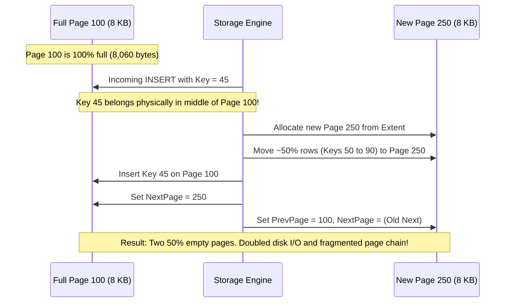

# 02. SQL Server Performance & T-SQL Experienced Developer (5–10+ YOE) Interview Master Guide — India Context

> **Target Audience:** Experienced Full-Stack Developers, Database Engineers, Module Leads, and Tech Leads (5–10+ Years of Experience) preparing for Senior Developer, Technical Lead, and Architect technical rounds in India.  
> **Applicable Companies:**  
> - **Top IT Services & Global Consultancies:** TCS, Infosys, Cognizant, Wipro, Accenture, Capgemini, HCL, LTIMindtree, Tech Mahindra, Hexaware, Persistent Systems, Nagarro, EPAM, Coforge, Virtusa, Deloitte, EY, PwC, KPMG.  
> - **Global Capability Centers (GCCs) & Tier-1 Financials:** Wells Fargo, Morgan Stanley, JPMorgan Chase, Barclays, Bank of America, Walmart Global Tech India, Lowe's India, Target India, Optum, Fidelity, Standard Chartered, HSBC.  
> - **High-Scale Product Firms & Fintechs:** PhonePe, Razorpay, Paytm, Zerodha, CRED, Swiggy, Zomato, Flipkart, MakeMyTrip.  
>
> **Philosophy:** 100% grounded in authentic Indian technical interviews. Every question follows the **6-Part Senior Answer Architecture**:  
> 1. **⚡ 30-Second Senior Opening Pitch** (The immediate, confident opening sentence)  
> 2. **🎯 Exact Formal Definitions & Rubric Keywords Interviewers Want to Hear** (Verbatim relational CS definition, rubric scoring keywords, and real-project phrasing)  
> 3. **🧠 Intuitive Real-World Analogy** (Easy to remember under interview pressure)  
> 4. **💻 Simple, Clean, Runnable T-SQL Snippet (5–15 lines)** (Shows practical coding ability)  
> 5. **⚠️ Senior Trap & Cross-Question** (What the interviewer will ask when you answer)  
> 6. **📊 "When to Use What & What Must Be Done" Quick Decision Guide** (Explicit Markdown decision matrix)  
>
> *(Note: Advanced storage engine physics, execution plan XML analysis, and production DMV diagnosis playbooks are fully preserved in the [Advanced Engine Internals, Performance Tuning Playbook & DMV Appendix](#appendix-advanced-engine-internals-dmv-playbook-architectural-reference)).*

---

# TABLE OF CONTENTS

- [MODULE 1: CORE T-SQL PROGRAMMING & DATA QUERYING (SCREENING & LIVE CODING HITLIST)](#module-1-core-t-sql-programming-data-querying-screening-live-coding-hitlist)
  - [Q1: Finding 2nd Highest & Nth Highest Salary (DENSE_RANK() vs RANK(), ROW_NUMBER(), OFFSET-FETCH, CTE)](#q1-finding-2nd-highest-nth-highest-salary-dense_rank-vs-rank-row_number-offset-fetch-cte)
  - [Q2: Finding and Deleting Duplicate Records in T-SQL (ROW_NUMBER() Partitioning in a CTE)](#q2-finding-and-deleting-duplicate-records-in-t-sql-row_number-partitioning-in-a-cte)
  - [Q3: SQL Server Joins Mastery: INNER, LEFT, RIGHT, FULL OUTER, CROSS JOIN & Self-Joins](#q3-sql-server-joins-mastery-inner-left-right-full-outer-cross-join-self-joins)
  - [Q4: UNION vs UNION ALL (Sorting, Deduplication, Memory Overhead & TempDB Spills)](#q4-union-vs-union-all-sorting-deduplication-memory-overhead-tempdb-spills)
  - [Q5: Stored Procedure vs User-Defined Function (UDF) (DML Capabilities, Execution Plans, Performance Traps)](#q5-stored-procedure-vs-user-defined-function-udf-dml-capabilities-execution-plans-performance-traps)
  - [Q6: Temporary Storage Mechanics: CTE vs #Temp Table vs @Table Variable vs In-Memory Table Types](#q6-temporary-storage-mechanics-cte-vs-temp-table-vs-table-variable-vs-in-memory-table-types)
- [MODULE 2: DATABASE DESIGN, INTEGRITY & RELATIONAL MODELING](#module-2-database-design-integrity-relational-modeling)
  - [Q7: Primary Key vs Unique Key Constraint (NULL Handling in SQL Server vs ANSI Standard)](#q7-primary-key-vs-unique-key-constraint-null-handling-in-sql-server-vs-ansi-standard)
  - [Q8: DELETE vs TRUNCATE vs DROP (DML vs DDL, Logging Overhead, Rollback, Identity Reset, Triggers)](#q8-delete-vs-truncate-vs-drop-dml-vs-ddl-logging-overhead-rollback-identity-reset-triggers)
  - [Q9: Database Normalization (1NF, 2NF, 3NF, BCNF) with Real-World E-Commerce Schema Decomposition](#q9-database-normalization-1nf-2nf-3nf-bcnf-with-real-world-e-commerce-schema-decomposition)
  - [Q10: Database Triggers: AFTER (FOR) Triggers vs INSTEAD OF Triggers (Inserted/Deleted Pseudo-tables)](#q10-database-triggers-after-for-triggers-vs-instead-of-triggers-inserteddeleted-pseudo-tables)
- [MODULE 3: INDEXING INTERNALS & PHYSICAL ARCHITECTURE](#module-3-indexing-internals-physical-architecture)
  - [Q11: Clustered vs Non-Clustered Index Internals (B-Tree Data Storage, Pointers, 1 vs 999 Limit)](#q11-clustered-vs-non-clustered-index-internals-b-tree-data-storage-pointers-1-vs-999-limit)
  - [Q12: Execution Plan Analysis: Index Seek vs Index Scan vs Table Scan vs Key Lookup](#q12-execution-plan-analysis-index-seek-vs-index-scan-vs-table-scan-vs-key-lookup)
  - [Q13: Covering Index with INCLUDE Columns to Eliminate Costly Key Lookups](#q13-covering-index-with-include-columns-to-eliminate-costly-key-lookups)
  - [Q14: Query SARGability: SARGable vs Non-SARGable WHERE Clauses (Functions, Wildcards, Dates, COALESCE)](#q14-query-sargability-sargable-vs-non-sargable-where-clauses-functions-wildcards-dates-coalesce)
- [MODULE 4: PERFORMANCE TUNING, PARAMETER SNIFFING & QUERY OPTIMIZER](#module-4-performance-tuning-parameter-sniffing-query-optimizer)
  - [Q15: Parameter Sniffing: Diagnosis & 4 Production Remedies (OPTION RECOMPILE, OPTIMIZE FOR UNKNOWN, Local Variables, Plan Guides)](#q15-parameter-sniffing-diagnosis-4-production-remedies-option-recompile-optimize-for-unknown-local-variables-plan-guides)
  - [Q16: Execution Plan Physical Join Operators: Nested Loops vs Hash Match vs Merge Join](#q16-execution-plan-physical-join-operators-nested-loops-vs-hash-match-vs-merge-join)
  - [Q17: SQL Server Statistics & Cardinality Estimation (Histogram Steps, Auto-Update Thresholds, Stale Stats)](#q17-sql-server-statistics-cardinality-estimation-histogram-steps-auto-update-thresholds-stale-stats)
- [MODULE 5: TRANSACTIONS, CONCURRENCY, LOCKS & DEADLOCKS](#module-5-transactions-concurrency-locks-deadlocks)
  - [Q18: ACID Properties Explained with a Real-World Banking Money Transfer Example](#q18-acid-properties-explained-with-a-real-world-banking-money-transfer-example)
  - [Q19: Transaction Isolation Levels & Concurrency Anomalies (Dirty Reads, Non-Repeatable Reads, Phantom Reads, Read Committed, RCSI, Snapshot, Serializable)](#q19-transaction-isolation-levels-concurrency-anomalies-dirty-reads-non-repeatable-reads-phantom-reads-read-committed-rcsi-snapshot-serializable)
  - [Q20: SQL Server Deadlocks: Detection via Error 1205, Extended Events & Prevention Strategies (UPDLOCK, Resource Ordering)](#q20-sql-server-deadlocks-detection-via-error-1205-extended-events-prevention-strategies-updlock-resource-ordering)
  - [Q21: Lock Modes, Lock Escalation Mechanics & Critical Table Hints (Shared, Exclusive, Intent Locks, Lock Escalation Thresholds)](#q21-lock-modes-lock-escalation-mechanics-critical-table-hints-shared-exclusive-intent-locks-lock-escalation-thresholds)
- [APPENDIX: ADVANCED ENGINE INTERNALS, DMV PLAYBOOK & ARCHITECTURAL REFERENCE](#appendix-advanced-engine-internals-dmv-playbook-architectural-reference)
  - [Appendix A: Storage Engine Deep Physics (8 KB Pages, Page Headers, Slot Arrays, Extents, Row-Overflow & LOB Pages)](#appendix-a-storage-engine-deep-physics-8-kb-pages-page-headers-slot-arrays-extents-row-overflow-lob-pages)
  - [Appendix B: Physical Page Splits & Fill Factor Mechanics (50-50 Splits, Fragmentation, NEWID vs NEWSEQUENTIALID)](#appendix-b-physical-page-splits-fill-factor-mechanics-50-50-splits-fragmentation-newid-vs-newsequentialid)
  - [Appendix C: TempDB Allocation Contention (GAM, SGAM, PFS Latches & Multi-File Configuration)](#appendix-c-tempdb-allocation-contention-gam-sgam-pfs-latches-multi-file-configuration)
  - [Appendix D: Production DMV Troubleshooting Playbook (Top CPU Queries, Real-Time Blocking Tree, Missing Indexes, Log Reuse Wait, Rebuild vs Reorganize)](#appendix-d-production-dmv-troubleshooting-playbook-top-cpu-queries-real-time-blocking-tree-missing-indexes-log-reuse-wait-rebuild-vs-reorganize)
  - [Appendix E: Curated Senior Architectural Q&A Hitlist (CXPACKET, PAGELATCH vs PAGEIOLATCH, Memory Grants, Filtered Indexes, DATETIME vs DATETIME2, Adaptive Joins)](#appendix-e-curated-senior-architectural-qa-hitlist-cxpacket-pagelatch-vs-pageiolatch-memory-grants-filtered-indexes-datetime-vs-datetime2-adaptive-joins)
  - [Appendix F: Real-World Anti-Pattern vs Senior Architecture Showcase (Paged Order History Lookup with Dynamic Filtering)](#appendix-f-real-world-anti-pattern-vs-senior-architecture-showcase-paged-order-history-lookup-with-dynamic-filtering)

---

# MODULE 1: CORE T-SQL PROGRAMMING & DATA QUERYING (SCREENING & LIVE CODING HITLIST)

## Q1: Finding 2nd Highest & Nth Highest Salary (DENSE_RANK() vs RANK(), ROW_NUMBER(), OFFSET-FETCH, CTE)
* **Asked At:** TCS, Infosys, Cognizant, Wipro, Accenture, Capgemini, HCL, LTIMindtree, Tech Mahindra, Nagarro, EPAM (Literally the #1 screening query in India).
* **⚡ 30-Second Senior Opening Pitch:**  
  > "To reliably find the Nth highest salary in SQL Server handling duplicate salary values, the industry standard is `DENSE_RANK() OVER (ORDER BY Salary DESC)` wrapped inside a Common Table Expression (CTE). Unlike `RANK()`, which skips rank numbers when ties occur (e.g., 1, 1, 3), and unlike `ROW_NUMBER()`, which assigns arbitrary distinct numbers to tied values, `DENSE_RANK()` produces continuous, gapless ranking (1, 1, 2). For a simple scalar distinct value in SQL Server 2012+, using `ORDER BY Salary DESC OFFSET (N-1) ROWS FETCH NEXT 1 ROWS ONLY` on distinct salaries is equally clean and performant."
* **🎯 Exact Formal Definitions & Rubric Keywords Interviewers Want to Hear:**
  * **Formal Definition:** An analytical window ranking function evaluated during the logical query processing `SELECT` phase, computing deterministic rank values across ordered partitions. `DENSE_RANK()` evaluates the strict relational ordering specified in the `OVER (ORDER BY ...)` clause and assigns contiguous, monotonically increasing integers to distinct values, guaranteeing no sequence gaps across tied tuples.
  * **Rubric Keywords / Scoring Criteria:** Analytical Window Function (`OVER(ORDER BY ...)`), Logical Query Processing Phase (SELECT phase evaluation), Monotonic Gapless Ranking (1, 1, 2 vs 1, 1, 3 in `RANK()`), Non-deterministic Tie Breaking (`ROW_NUMBER()`), Updatable CTE / Subquery Materialization, ANSI SQL:2008 `OFFSET ... FETCH NEXT` clause.
  * **How to Say It in Your Project:** *"In our payroll and appraisal microservices, we wrap `DENSE_RANK() OVER (PARTITION BY DepartmentId ORDER BY CTC DESC)` in a CTE to extract the top-N salary bands per department without omitting tied compensation packages."*
* **🧠 Real-World Analogy:**  
  * **Olympic Podium Ties:** If two athletes win Gold (Rank 1 tie), `DENSE_RANK()` gives the very next runner Silver (Rank 2). `RANK()` skips Silver completely and hands the next runner Bronze (Rank 3). `ROW_NUMBER()` flips a coin and gives one athlete Gold and the other Silver even though they had the exact same time! If you are asking for the 2nd highest salary, you want the Silver medal amount, which only `DENSE_RANK()` guarantees.
* **💻 Simple, Clean, Runnable T-SQL Snippet:**
```sql
-- Solution 1: Production Standard using DENSE_RANK() in a CTE (Handles ties perfectly)
WITH RankedSalaries AS (
    SELECT 
        EmployeeId, FullName, DepartmentId, Salary,
        DENSE_RANK() OVER (ORDER BY Salary DESC) AS SalaryRank
    FROM dbo.Employees
)
SELECT EmployeeId, FullName, DepartmentId, Salary
FROM RankedSalaries
WHERE SalaryRank = 2; -- Change to N for Nth highest salary

-- Solution 2: Modern SQL Server 2012+ Scalar Lookup using OFFSET-FETCH
SELECT DISTINCT Salary
FROM dbo.Employees
ORDER BY Salary DESC
OFFSET 1 ROWS FETCH NEXT 1 ROWS ONLY; -- 2nd Highest = OFFSET 1
```
* **⚠️ Senior Trap & Cross-Question:**  
  * *Trap Question 1:* "What happens if there are two employees with the exact highest salary (e.g., both earn ₹25,00,000) and you use `ROW_NUMBER()` or `SELECT TOP 1 Salary FROM Employees WHERE Salary < (SELECT MAX(Salary))`?"  
  * *Senior Answer:* "`ROW_NUMBER()` arbitrarily ranks one as 1 and the other as 2, incorrectly returning ₹25,00,000 as the '2nd highest' salary! The subquery with `WHERE Salary < MAX(Salary)` correctly returns the 2nd salary, but it is notoriously difficult to generalize to the Nth highest (requires nested subqueries or loops) and causes multiple index scans."  
  * *Trap Question 2:* "How do you find the 2nd highest salary **per department**?"  
  * *Senior Answer:* "Add `PARTITION BY DepartmentId` inside the over clause: `DENSE_RANK() OVER (PARTITION BY DepartmentId ORDER BY Salary DESC)`."
* **📊 "When to Use What & What Must Be Done" Quick Decision Guide:**
| Scenario / Requirement | What to Use | Why / Trade-offs | What Must Be Done (Exact Action) |
| :--- | :--- | :--- | :--- |
| **All employees tied at Nth rank needed** | `DENSE_RANK()` in a CTE | Returns all employee rows sharing the Nth salary without missing ties. | `WITH Cte AS (SELECT *, DENSE_RANK() OVER (ORDER BY Sal DESC) r FROM Emp) SELECT * FROM Cte WHERE r = @N;` |
| **Scalar salary value only (no employee names)** | `DISTINCT` + `OFFSET FETCH` | Minimal memory grant, very readable syntax in SQL 2012+. | `SELECT DISTINCT Sal FROM Emp ORDER BY Sal DESC OFFSET (@N - 1) ROWS FETCH NEXT 1 ROWS ONLY;` |
| **Nth highest per department / category** | `DENSE_RANK()` with `PARTITION BY` | Segregates ranking window per department partition. | `DENSE_RANK() OVER (PARTITION BY DeptId ORDER BY Sal DESC)` inside CTE. |
| **Arbitrary single row wanted (ignore ties)** | `ROW_NUMBER()` in a CTE | Guarantees exactly 1 row returned, but tie selection is arbitrary. | Add secondary deterministic sort column: `ROW_NUMBER() OVER (ORDER BY Sal DESC, EmpId ASC)`. |

---

## Q2: Finding and Deleting Duplicate Records in T-SQL (ROW_NUMBER() Partitioning in a CTE)
* **Asked At:** TCS, Cognizant, Infosys, Capgemini, Accenture, Wipro, Persistent Systems, EPAM, Deloitte.
* **⚡ 30-Second Senior Opening Pitch:**  
  > "To find and delete duplicate records while preserving exactly one original master record, the senior pattern in SQL Server is a Common Table Expression (CTE) combined with `ROW_NUMBER() OVER (PARTITION BY [NaturalKeys] ORDER BY [SurrogateKey/Date])`. Because SQL Server permits direct DML operations on updatable CTEs, executing `DELETE FROM cte WHERE RowNum > 1` deletes the duplicate physical rows directly without requiring self-joins or temporary staging tables."
* **🎯 Exact Formal Definitions & Rubric Keywords Interviewers Want to Hear:**
  * **Formal Definition:** Redundant tuple elimination based on candidate natural key functional dependencies. Executed in SQL Server using an updatable Common Table Expression (CTE) projecting an analytical ordering sequence (`ROW_NUMBER() OVER (PARTITION BY [NaturalKeys] ORDER BY [DeterministicTieBreaker])`), where tuples satisfying `ROW_NUMBER() > 1` are targeted directly by a set-based relational `DELETE` operator.
  * **Rubric Keywords / Scoring Criteria:** Updatable CTE Semantics, Set-Based DML Operator, Partitioning Predicate (`PARTITION BY`), Deterministic Tie-Breaker (`ORDER BY ASC/DESC`), Transactional Atomicity, Natural Key vs Surrogate Key, Eliminates Self-Join / Cursor / Staging Table anti-patterns, Batching via `DELETE TOP (N)` to prevent Lock Escalation.
  * **How to Say It in Your Project:** *"When processing webhook payment retries from Razorpay where network timeouts caused duplicate delivery, we execute an atomic CTE deletion partitioned on `TransactionReference, MerchantId` ordering by `EventTimestamp ASC`, retaining strictly the first validated event."*
* **🧠 Real-World Analogy:**  
  * **Aadhaar / Passport Application Desk:** A citizen submits 4 photocopies of their Aadhaar card. The clerk arranges them chronologically by submission date, stamps serial numbers 1, 2, 3, 4 on the copies, keeps stamp #1 in the master citizen folder, and feeds stamps #2, #3, and #4 directly into the paper shredder.
* **💻 Simple, Clean, Runnable T-SQL Snippet:**
```sql
-- Production Standard: Direct Atomic Deletion via CTE
WITH DuplicateRowsCTE AS (
    SELECT 
        Email, PhoneNumber,
        ROW_NUMBER() OVER (
            PARTITION BY Email, PhoneNumber  -- Natural duplicate identification keys
            ORDER BY CreatedAt ASC, CustomerId ASC -- Retain earliest inserted record
        ) AS RowSeq
    FROM dbo.Customers
)
DELETE FROM DuplicateRowsCTE
WHERE RowSeq > 1; -- Deletes all duplicate physical records, retaining RowSeq = 1
```
* **⚠️ Senior Trap & Cross-Question:**  
  * *Trap Question 1:* "If the table has 20 million rows and 5 million are duplicates, will executing `DELETE FROM DuplicateRowsCTE WHERE RowSeq > 1;` work in production?"  
  * *Senior Answer:* "No! Running a single massive `DELETE` of 5 million rows will escalate from fine-grained row locks to an Exclusive Table Lock (`X`), blocking all application reads and writes. Additionally, it will inflate the transaction log (`LDF`), risk disk exhaustion, and take hours to roll back if cancelled. In production, we must batch deletions in transactions of 5,000 rows inside a `WHILE` loop."  
  * *Senior Production Batching Pattern:*
    ```sql
    DECLARE @DeletedCount INT = 1;
    WHILE (@DeletedCount > 0)
    BEGIN
        WITH BatchCTE AS (
            SELECT TOP (5000) ROW_NUMBER() OVER (PARTITION BY Email ORDER BY CustomerId) AS rn
            FROM dbo.Customers
        )
        DELETE FROM BatchCTE WHERE rn > 1;
        SET @DeletedCount = @@ROWCOUNT;
        CHECKPOINT; -- Or wait 500ms to yield to production OLTP traffic
    END;
    ```
* **📊 "When to Use What & What Must Be Done" Quick Decision Guide:**
| Scenario | What to Use | Why / Trade-offs | What Must Be Done (Exact Action) |
| :--- | :--- | :--- | :--- |
| **Small-to-medium table (< 500k rows)** | Updatable CTE with `ROW_NUMBER()` | Cleanest, single-statement atomic transaction. | `WITH C AS (SELECT *, ROW_NUMBER() OVER (PARTITION BY KeyCol ORDER BY Id) rn FROM T) DELETE FROM C WHERE rn > 1;` |
| **High-concurrency large OLTP table** | Batched `DELETE TOP (5000)` in a `WHILE` loop | Prevents lock escalation to Table (`X`) lock and prevents transaction log bloat. | Run looped `DELETE TOP (5000)` inside `WHILE @@ROWCOUNT > 0` with small delays. |
| **Massive table where > 60% rows are duplicates** | CTAS / `SELECT INTO NewTable` | Faster than logging millions of individual row deletes; reconstructs clean clustered index. | `SELECT MIN(Id), KeyCol INTO NewT FROM T GROUP BY KeyCol;` swap tables via partition switch or rename. |

---

## Q3: SQL Server Joins Mastery: INNER, LEFT, RIGHT, FULL OUTER, CROSS JOIN & Self-Joins
* **Asked At:** Wells Fargo, Barclays, Morgan Stanley, TCS, Infosys, Cognizant, Wipro, Accenture.
* **⚡ 30-Second Senior Opening Pitch:**  
  > "SQL Joins logically combine columns from two or more relations based on join predicates. `INNER JOIN` returns strict intersections where predicates match in both tables. `LEFT` and `RIGHT OUTER JOIN` preserve all rows from one side, populating non-matching opposite columns with `NULL`. `FULL OUTER JOIN` preserves all rows from both tables. `CROSS JOIN` produces a Cartesian product ($M 	imes N$ rows). A `Self-Join` joins a table to itself to resolve hierarchical models like manager-employee org charts. At the engine level, the Query Optimizer maps these logical joins to physical algorithms: Nested Loops, Merge Joins, or Hash Matches."
* **🎯 Exact Formal Definitions & Rubric Keywords Interviewers Want to Hear:**
  * **Formal Definition:** Binary relational algebra operators combining Cartesian product with a theta selection predicate ($R \bowtie_\theta S$). `INNER JOIN` computes the relational intersection satisfying the join predicate; `OUTER JOIN` (LEFT, RIGHT, FULL) preserves unmatched tuples from one or both relations by padding absent attributes with relational `NULL`s; `CROSS JOIN` produces the unconstrained Cartesian product ($|R| \times |S|$); `Self-Join` joins a relation to itself using distinct tuple variable aliases.
  * **Rubric Keywords / Scoring Criteria:** Relational Algebra ($\bowtie, \times$), Theta Join Predicate, Outer Preservation, Three-Valued Logic (3VL: True, False, Unknown), `NULL` Equality Failure (`NULL = NULL` is UNKNOWN), Physical Join Operators (Nested Loops, Hash Match, Merge Join), Non-SARGable Join Predicates, Filter placement (`ON` vs `WHERE` outer join nullification).
  * **How to Say It in Your Project:** *"In our core billing ledger, we join `Invoices` to `Receipts` using a `LEFT JOIN` to catch unpaid invoices, explicitly placing payment status predicates in the `ON` clause to prevent accidental conversion to an inner join."*
* **🧠 Real-World Analogy:**  
  * **Engineering Slack Workspace & Production On-Call Roster:**  
    * **INNER JOIN:** Engineers who are both in the company and actively scheduled on the On-Call roster.  
    * **LEFT JOIN:** All company engineers; if an engineer is not on call, their On-Call Shift details show as `NULL`.  
    * **FULL OUTER JOIN:** All engineers plus open unassigned on-call shifts.  
    * **CROSS JOIN:** Every single developer paired with every single backlog ticket ($10	ext{ devs} 	imes 20	ext{ tickets} = 200	ext{ pairing combinations}$).  
    * **Self-Join:** Looking at the employee directory where the `ManagerId` column points to another row's `EmployeeId` in the exact same directory.
* **💻 Simple, Clean, Runnable T-SQL Snippet:**
```sql
-- 1. Anti-Join: Find all Customers who have NEVER placed an Order (Senior Pattern)
SELECT c.CustomerId, c.FullName
FROM dbo.Customers c
LEFT JOIN dbo.Orders o ON c.CustomerId = o.CustomerId
WHERE o.CustomerId IS NULL; -- Highly optimized anti-join pattern

-- 2. Self-Join: Employee-Manager Org Hierarchy with Root CEO Handling
SELECT 
    e.EmployeeId, 
    e.FullName AS EmployeeName, 
    ISNULL(m.FullName, '<<TOP EXECUTIVE / CEO>>') AS ManagerName
FROM dbo.Employees e
LEFT JOIN dbo.Employees m ON e.ManagerId = m.EmployeeId;
```
* **⚠️ Senior Trap & Cross-Question:**  
  * *Trap Question 1:* "Why can a `NOT IN (SELECT Col FROM ...)` query behave dangerously compared to `NOT EXISTS` or `LEFT JOIN ... WHERE col IS NULL`?"  
  * *Senior Answer:* "If the subquery in `NOT IN` returns even a single `NULL` value, SQL Server evaluates `x NOT IN (..., NULL)` to `UNKNOWN` for all rows due to three-valued logic. Consequently, the entire query returns **zero rows**! `NOT EXISTS` and `LEFT JOIN ... IS NULL` are null-safe and produce optimal anti-semi-join execution plans."  
  * *Trap Question 2:* "What causes an accidental Cartesian product in production?"  
  * *Senior Answer:* "Omitting a join predicate or joining on non-unique foreign keys without proper filtering, causing output row counts to explode exponentially, exhausting TempDB memory grants."
* **📊 "When to Use What & What Must Be Done" Quick Decision Guide:**
| Join Type | Returns | Best Use Case | Anti-Pattern / Warning |
| :--- | :--- | :--- | :--- |
| **`INNER JOIN`** | Only matching records from both tables | Strict relational lookups (Orders with Valid Customers). | Drops parent rows if child record does not exist. |
| **`LEFT OUTER JOIN`** | All left rows + matching right rows (or `NULL`) | Master-detail display where detail is optional. | Filtering right table in `WHERE` clause accidentally converts it to an `INNER JOIN`. |
| **`NOT EXISTS` / Anti-Join** | Left rows that have NO match in right table | Finding orphaned records or inactive users. | Avoid `NOT IN` if child column allows `NULL`s. |
| **`CROSS JOIN`** | Cartesian product ($M 	imes N$ rows) | Generating test data, matrix combinations, date dimension ranges. | Runaway cross joins will blow up TempDB and cause Out-Of-Memory. |
| **`Self-Join`** | Table joined to itself | Manager-Employee hierarchies, sequential event comparisons. | Must use distinct aliases (`e` vs `m`); use `LEFT JOIN` so top root is not dropped. |

---

## Q4: UNION vs UNION ALL (Sorting, Deduplication, Memory Overhead & TempDB Spills)
* **Asked At:** TCS, Wipro, Infosys, Cognizant, Accenture, Capgemini, Deloitte, EY, HCL.
* **⚡ 30-Second Senior Opening Pitch:**  
  > "`UNION` combines the results of two queries and eliminates duplicate rows by performing an explicit Sort (Distinct Sort) or Hash Aggregate operation in the execution plan. `UNION ALL` simply concatenates both result sets directly without checking for duplicates. Because `UNION` requires sorting the entire combined dataset, it demands substantial memory grants and risks spilling to TempDB if memory is insufficient. In high-performance backend development, `UNION ALL` should always be the default choice unless business logic explicitly demands deduplication."
* **🎯 Exact Formal Definitions & Rubric Keywords Interviewers Want to Hear:**
  * **Formal Definition:** Set-theoretic union operators combining compatible relational tuples. `UNION` computes the formal relational set union ($A \cup B$) with implicit duplicate elimination, requiring an explicit `Sort (Distinct Sort)` or `Hash Match (Aggregate)` operator; `UNION ALL` computes the multiset union ($A \uplus B$), executing a lightweight stream concatenation without deduplication, sorting overhead, or memory grant allocation.
  * **Rubric Keywords / Scoring Criteria:** Relational Set Union ($A \cup B$) vs Multiset Union ($A \uplus B$), Distinct Sort Physical Operator, Hash Aggregate, Memory Grant Allocation (`MEMORYGRANT`), TempDB Spill Risk (Sort Warning Events), Stream Concatenation Operator, Execution Plan Operator Cost.
  * **How to Say It in Your Project:** *"Across our telemetry logging services, we strictly mandate `UNION ALL` when aggregating hot transactional partitions with cold archive partitions because partition boundary constraints guarantee disjoint sets, eliminating a 450MB sort memory grant."*
* **🧠 Real-World Analogy:**  
  * **Job Fair Resume Collection:**  
    * **`UNION ALL` (Instant Concatenation):** You collect 500 resumes on Day 1 and 400 resumes on Day 2. You stack Day 2's folder on top of Day 1's folder and staple them together in 5 seconds.  
    * **`UNION` (Painstaking Deduplication):** You take all 900 resumes, sit at a table for 3 hours, compare every applicant name against every other applicant to throw away duplicate submissions, sort all remaining resumes alphabetically, and then file them.
* **💻 Simple, Clean, Runnable T-SQL Snippet:**
```sql
-- Execution Plan Comparison: Concatenation vs Distinct Sort
-- Query A: Fast Concatenation (0% CPU sorting, zero TempDB spill risk)
SELECT OrderId, CustomerId, TotalAmount, 'Active' AS SourceTable FROM dbo.ActiveOrders
UNION ALL
SELECT OrderId, CustomerId, TotalAmount, 'Archive' AS SourceTable FROM dbo.ArchivedOrders;

-- Query B: Memory-Heavy Sort (Introduces 'Distinct Sort' operator in Execution Plan)
SELECT CustomerId, City FROM dbo.CorporateCustomers
UNION
SELECT CustomerId, City FROM dbo.RetailCustomers;
```
* **⚠️ Senior Trap & Cross-Question:**  
  * *Trap Question:* "An interviewer asks: 'Our API query using `UNION` takes 14 seconds. When we changed it to `UNION ALL`, it dropped to 180 milliseconds. If the business user insists they don't want duplicate rows in the final UI grid, how do you keep the performance of `UNION ALL` while satisfying the user?'"  
  * *Senior Answer:* "First, analyze if the two tables are mutually exclusive by definition (e.g. `ActiveOrders` has `Status IN ('New', 'Pending')` and `ArchivedOrders` has `Status = 'Completed'`). If they are disjoint, duplicates are physically impossible, so `UNION ALL` is already 100% duplicate-free! Second, if duplicates only occur within one table, deduplicate locally using an indexed `DISTINCT` or `GROUP BY` on that specific table before `UNION ALL`. Never let SQL Server perform an expensive unindexed Distinct Sort across two huge datasets."
* **📊 "When to Use What & What Must Be Done" Quick Decision Guide:**
| Criteria | `UNION` | `UNION ALL` |
| :--- | :--- | :--- |
| **Duplicate Handling** | Removes duplicate records | Preserves all duplicate records |
| **Execution Plan Operator** | `Distinct Sort` or `Hash Aggregate` | `Concatenation` |
| **Memory Grant Required?** | Yes (proportional to dataset size; risks TempDB spills) | Zero memory grant required for deduplication |
| **Performance Speed** | Slower (CPU & Memory intensive) | Ultra-fast (Immediate stream of rows) |
| **Default Architectural Rule** | Use ONLY when datasets overlap and business demands uniqueness | **Always default to `UNION ALL` in OLTP APIs** |

---

## Q5: Stored Procedure vs User-Defined Function (UDF) (DML Capabilities, Execution Plans, Performance Traps)
* **Asked At:** Infosys, Cognizant, TCS, Wipro, Capgemini, Persistent Systems, Nagarro, Virtusa.
* **⚡ 30-Second Senior Opening Pitch:**  
  > "Stored Procedures are precompiled database programs capable of executing DML operations (`INSERT`, `UPDATE`, `DELETE`), controlling explicit database transactions (`BEGIN TRAN`, `COMMIT`), and returning multiple result sets or output parameters. User-Defined Functions (UDFs) are calculation routines designed to compute and return a single scalar value or a relational table; they are strictly prohibited from altering database state (no DML) or managing transactions, but they can be embedded directly within `SELECT`, `WHERE`, and `JOIN` clauses. Scalar UDFs historically caused severe RBAR (Row-By-Agonizing-Row) performance penalties, whereas Inline Table-Valued Functions (ITVFs) are expanded directly into the outer query plan by the optimizer."
* **🎯 Exact Formal Definitions & Rubric Keywords Interviewers Want to Hear:**
  * **Formal Definition:** A Stored Procedure is an executable procedural module containing control-of-flow logic, full DML capabilities, explicit transaction boundary control (`BEGIN TRAN / COMMIT`), output parameters, and independent execution plan caching. A User-Defined Function (UDF) is a side-effect-free relational expression returning a scalar value or table, callable directly within DQL expressions (`SELECT`, `WHERE`), strictly forbidden from altering database state, and prone to iterative execution (RBAR) unless inlined.
  * **Rubric Keywords / Scoring Criteria:** DML Capabilities, Transaction Boundaries (`COMMIT / ROLLBACK`), Side-Effect-Free Semantics, Execution Plan Caching & Reusability, Scalar UDF Inlining (SQL Server 2019+ FROID framework), RBAR (Row-By-Agonizing-Row) hidden thread overhead, Inline Table-Valued Function (iTVF) vs Multi-Statement Table-Valued Function (MSTVF).
  * **How to Say It in Your Project:** *"In our banking ledger, all fund settlements and debit/credit workflows are encapsulated in Stored Procedures with explicit transactional error handling, whereas financial VAT calculations were refactored from MSTVFs to Inline TVFs to enable cost-based set optimization."*
* **🧠 Real-World Analogy:**  
  * **Stored Procedure (The General Manager):** Authorized to make state-changing decisions—hire an employee, fire a contractor, transfer ₹10,00,000 between bank accounts, and print 3 different department balance sheets.  
  * **Function (The Currency Converter Tool):** A handheld calculator that takes USD and multiplies it by ₹86.50. It does not hire anyone, cannot debit a bank account, and simply returns a number to whoever asked.
* **💻 Simple, Clean, Runnable T-SQL Snippet:**
```sql
-- 1. Stored Procedure: Full DML, Transaction Control, Output Parameters
CREATE OR ALTER PROCEDURE dbo.usp_ProcessOrder
    @CustomerId INT, @TotalAmount DECIMAL(18,2), @OrderId INT OUTPUT
AS
BEGIN
    SET NOCOUNT ON;
    BEGIN TRY
        BEGIN TRANSACTION;
        INSERT INTO dbo.Orders (CustomerId, TotalAmount, CreatedAt)
        VALUES (@CustomerId, @TotalAmount, SYSUTCDATETIME());
        SET @OrderId = SCOPE_IDENTITY();
        COMMIT TRANSACTION;
    END TRY
    BEGIN CATCH
        IF @@TRANCOUNT > 0 ROLLBACK TRANSACTION;
        THROW;
    END CATCH;
END;
GO

-- 2. Senior Best Practice: Inline Table-Valued Function (ITVF) instead of Scalar UDF
CREATE OR ALTER FUNCTION dbo.ufn_GetCustomerDiscountInline (@CustomerId INT)
RETURNS TABLE
AS
RETURN (
    SELECT CASE WHEN Tier = 'VIP' THEN 0.20 ELSE 0.05 END AS DiscountRate
    FROM dbo.Customers WHERE CustomerId = @CustomerId
);
```
* **⚠️ Senior Trap & Cross-Question:**  
  * *Trap Question:* "Why are Scalar UDFs known as performance killers in SQL Server, and how did SQL Server 2019 address this?"  
  * *Senior Answer:* "Prior to SQL Server 2019, Scalar UDFs operated as black boxes: they were executed row-by-row (RBAR), suppressed multi-threaded query parallelism (forcing single-core execution), and concealed row estimates from Cardinality Estimation. Calling `dbo.CalculateTax(Amount)` on 1,000,000 rows invoked the function 1,000,000 times! SQL Server 2019 introduced **Scalar UDF Inlining**, which automatically converts eligible scalar functions into relational subqueries. However, functions with dynamic SQL, `WHILE` loops, or table variables fail inlining. The battle-tested senior fix has always been converting Scalar UDFs into **Inline Table-Valued Functions (ITVFs)** and joining them via `CROSS APPLY`."
* **📊 "When to Use What & What Must Be Done" Quick Decision Guide:**
| Feature / Requirement | Stored Procedure | Scalar UDF | Inline TVF (ITVF) | Multi-Statement TVF (MSTVF) |
| :--- | :--- | :--- | :--- | :--- |
| **Allows DML (`INSERT/UPDATE/DELETE`)** | Yes | No | No | Only to internal `@return_variable` |
| **Transaction Management (`BEGIN TRAN`)** | Yes | No | No | No |
| **Can be used in `SELECT` / `WHERE`** | No (Must `EXEC`) | Yes (`SELECT dbo.fn()`) | Yes (`CROSS APPLY`) | Yes (`FROM dbo.fn()`) |
| **Execution Plan Integration** | Standalone cached plan | RBAR execution | Inlined into caller plan | Black box (1 row estimate pre-2014) |
| **Performance Recommendation** | Preferred for workflows & DML | **Avoid for high-volume SELECTs** | **Preferred for reusable calculation logic** | Avoid unless complex multi-step logic needed |

---

## Q6: Temporary Storage Mechanics: CTE vs #Temp Table vs @Table Variable vs In-Memory Table Types
* **Asked At:** TCS, Infosys, Cognizant, Accenture, Capgemini, Persistent Systems, Nagarro, EPAM, Wells Fargo.
* **⚡ 30-Second Senior Opening Pitch:**  
  > "Temporary storage options serve distinct architectural tiers:  
  > 1. **CTE:** A non-materialized, logical query expression scoped to a single statement; re-evaluated every time it is referenced.  
  > 2. **`#Temp` Table:** A physical table created in `tempdb`; maintains column statistics, supports indexes, permits parallel query execution, and participates in transactions. Best for medium to large intermediate datasets ($> 100	ext{ rows}$).  
  > 3. **`@Table` Variable:** Scoped to the executing batch/proc; stored in `tempdb` (not purely RAM!), historically lacked statistics (assumes 1 row estimate pre-2019), and does not support parallel modification plans or rollback. Best for tiny datasets ($< 100	ext{ rows}$).  
  > 4. **In-Memory Table Type:** Backed by memory-optimized engine structures; completely eliminates TempDB allocation contention and page latching."
* **🎯 Exact Formal Definitions & Rubric Keywords Interviewers Want to Hear:**
  * **Formal Definition:** Ephemeral relational data structures with distinct lifecycles, memory scopes, and physical storage representations. A Common Table Expression (CTE) is a query-scoped non-persistent expression expanded inline by the optimizer; a Temporary Table (`#TempTable`) is a session-scoped physical table created in TempDB with statistics, histograms, and DDL/index support; a Table Variable (`@Table`) is a batch-scoped structure backed by TempDB with fixed cardinality assumptions; an In-Memory Table Type uses memory-optimized, non-blocking lock-free structures.
  * **Rubric Keywords / Scoring Criteria:** Scope & Lifecycle (Statement, Batch, Session), Physical TempDB Backing (Both `#table` and `@table` write to TempDB disk/buffer pool!), Cardinality Estimation (1-row heuristic for table variables prior to SQL 2019 vs 200-step histogram in `#temp`), Distribution Statistics & Histograms, Recompile Thresholds, Allocation Latches (PFS/GAM contention).
  * **How to Say It in Your Project:** *"For intermediate processing exceeding 10,000 rows in our reconciliation engine, we replace table variables with `#temp` tables and build a clustered index, providing the optimizer with real distribution histograms and avoiding severe Nested Loops spills."*
* **🧠 Real-World Analogy:**  
  * **CTE:** An algebraic alias or shorthand formula in parentheses: `x = (a + b)`. It does not take physical paper space; you just recompute it when you see `x`.  
  * **`#Temp` Table:** A physical spiral-bound notebook on your desk where you write notes, dog-ear important pages (create indexes), and tear it out when finished.  
  * **`@Table` Variable:** A tiny 3x3 Post-It sticky note on your monitor. Perfect for writing down 3 phone numbers, but if you try to copy a dictionary onto it, it collapses.  
  * **In-Memory Table Type:** Ultra-fast DDR5 RAM cache inside your CPU with zero disk latency.
* **💻 Simple, Clean, Runnable T-SQL Snippet:**
```sql
-- 1. #Temp Table: Ideal for heavy intermediate processing with dedicated indexes
CREATE TABLE #HighValueOrders (
    OrderId INT NOT NULL,
    CustomerId INT NOT NULL,
    Amount DECIMAL(18,2) NOT NULL,
    INDEX IX_CustId CLUSTERED (CustomerId) -- Local index supported!
);

INSERT INTO #HighValueOrders (OrderId, CustomerId, Amount)
SELECT OrderId, CustomerId, TotalAmount 
FROM dbo.Orders WHERE TotalAmount > 10000;

-- 2. @Table Variable: Scoped strictly to batch; minimal lookup overhead
DECLARE @StatusLookups TABLE (StatusCode VARCHAR(20) PRIMARY KEY, DisplayName NVARCHAR(50));
INSERT INTO @StatusLookups VALUES ('ACT', N'Active'), ('SUSP', N'Suspended');

SELECT o.*, s.DisplayName 
FROM #HighValueOrders o
JOIN @StatusLookups s ON o.Amount > 50000;

DROP TABLE IF EXISTS #HighValueOrders;
```
* **⚠️ Senior Trap & Cross-Question:**  
  * *Trap Question 1:* "Is it true that Table Variables exist strictly in RAM while `#Temp` tables are written to disk?"  
  * *Senior Answer:* "**False!** This is one of the most widespread junior myths in SQL Server interviews. Both Table Variables and `#Temp` tables are physically backed by `tempdb`. If a table variable grows beyond a few pages, its pages are allocated in `tempdb` and written to disk under memory pressure just like `#Temp` tables. The actual physical difference is that Table Variables do not generate column statistics and cannot be rolled back during a transaction abort."  
  * *Trap Question 2:* "What happens if a transaction rolls back after inserting rows into a `@Table` variable vs a `#Temp` table?"  
  * *Senior Answer:* "Rows inserted into `#Temp` tables are rolled back. Rows inserted into `@Table` variables are **NOT** rolled back—the table variable retains all inserted rows because table variables are not part of the user transaction log!"
* **📊 "When to Use What & What Must Be Done" Quick Decision Guide:**
| Characteristic | Common Table Expression (CTE) | Local Temp Table (`#Temp`) | Table Variable (`@Table`) | In-Memory Table Type |
| :--- | :--- | :--- | :--- | :--- |
| **Physical Storage** | None (Logical query definition) | `tempdb` (Pages & Extents) | `tempdb` (Pages & Extents) | Non-volatile Memory (RAM) |
| **Statistics Maintained?** | Inherits from underlying base tables | **Yes** (Full Histograms) | **No** (Assumes 1 row pre-2019) | Hash / Range index statistics |
| **Supports Indexes?** | No | **Yes** (Clustered & Non-clustered) | Only via inline PK/Unique | Inline Memory-Optimized indexes |
| **Transaction Rollback?** | N/A | **Yes** (Fully rolled back) | **No** (Changes persist!) | Follows memory transaction semantics |
| **Ideal Dataset Size** | Single-pass read / Recursion | **$> 100	ext{ to millions of rows}$** | **$< 100	ext{ rows}$** | High-throughput OLTP TVPs |

---

# MODULE 2: DATABASE DESIGN, INTEGRITY & RELATIONAL MODELING

## Q7: Primary Key vs Unique Key Constraint (NULL Handling in SQL Server vs ANSI Standard)
* **Asked At:** TCS, Cognizant, Wipro, Infosys, Capgemini, HCL, Deloitte, Persistent Systems.
* **⚡ 30-Second Senior Opening Pitch:**  
  > "Both Primary Key and Unique Key constraints enforce entity uniqueness and automatically create an underlying index. A table can possess only ONE Primary Key, which strictly prohibits `NULL` values and defaults to a Clustered Index. Conversely, a table can have MULTIPLE Unique Key constraints, which default to Non-Clustered Indexes. Crucially, SQL Server deviates from the ANSI SQL standard regarding `NULL` handling: standard SQL Server Unique constraints permit only a **single `NULL`** value (treating `NULL = NULL` for uniqueness). To achieve ANSI-standard multi-NULL behavior in SQL Server, experienced engineers implement a **Filtered Unique Index** (`WHERE Column IS NOT NULL`)."
* **🎯 Exact Formal Definitions & Rubric Keywords Interviewers Want to Hear:**
  * **Formal Definition:** Relational schema constraints enforcing entity integrity and key uniqueness. A Primary Key enforces unique tuple identification and disallows relational `NULL` values completely, defaulting to a Clustered Index (1 per table). A Unique Constraint enforces attribute uniqueness across non-primary columns, defaults to a Non-Clustered Index (up to 999 per table), and in SQL Server enforces uniqueness across NULLs (permitting only one NULL value unless overridden via a Filtered Index).
  * **Rubric Keywords / Scoring Criteria:** Entity Integrity, Candidate Key, Clustered vs Non-Clustered Default Storage, ANSI SQL Standard (permitting multiple NULLs in unique constraints) vs SQL Server Implementation (single NULL enforcement), Filtered Unique Index (`WHERE Column IS NOT NULL`), Foreign Key Target Capability.
  * **How to Say It in Your Project:** *"In our user onboarding system, `UserId` is the Clustered Primary Key, while `AadhaarNumber` and `PassportNumber` are enforced via Unique Non-Clustered Indexes with `WHERE [Column] IS NOT NULL` filters to permit legitimate null entries during draft registration stages."*
* **🧠 Real-World Analogy:**  
  * **Indian Identity Credentials:**  
    * **Primary Key (Aadhaar / Passport):** Every adult Indian citizen must have one, and it can never be empty or blank. Exactly one primary proof per person.  
    * **Unique Key (Driving License / PAN):** You are not required to hold a driving license (it can be missing/null), but if you do possess one, the license number must be completely unique across the entire country.
* **💻 Simple, Clean, Runnable T-SQL Snippet:**
```sql
-- 1. Demonstrating SQL Server's Single-NULL Unique Constraint Limitation
CREATE TABLE dbo.Users_Standard (
    UserId INT IDENTITY(1,1) PRIMARY KEY,
    Email NVARCHAR(255) UNIQUE -- Allows ONE NULL! Second NULL will throw Error 2627!
);

-- 2. Senior Battle-Tested Fix: Filtered Unique Index (Permits Unlimited NULLs)
CREATE TABLE dbo.Users_AnsiCompliant (
    UserId INT IDENTITY(1,1) PRIMARY KEY,
    Email NVARCHAR(255) NULL
);
-- This index enforces uniqueness ONLY on non-null values!
CREATE UNIQUE NONCLUSTERED INDEX UX_Users_Email_Filtered
ON dbo.Users_AnsiCompliant(Email)
WHERE Email IS NOT NULL;
```
* **⚠️ Senior Trap & Cross-Question:**  
  * *Trap Question 1:* "Why does SQL Server reject a second `NULL` row when creating a `UNIQUE` constraint, while Oracle and PostgreSQL allow multiple `NULL`s?"  
  * *Senior Answer:* "The ANSI SQL standard dictates that two `NULL`s are not equal (`NULL = NULL` yields `UNKNOWN`). Oracle and PostgreSQL implement this standard, allowing unlimited `NULL` rows in a unique column. However, SQL Server's legacy implementation treats `NULL` values as equivalent for the purpose of a unique constraint. Since SQL Server 2008, Microsoft solved this via **Filtered Indexes**: creating a `UNIQUE NONCLUSTERED INDEX ... WHERE Column IS NOT NULL` allows unlimited `NULL` records while guaranteeing strict uniqueness for all non-null entries."  
  * *Trap Question 2:* "Does a Primary Key ALWAYS create a Clustered Index?"  
  * *Senior Answer:* "No! While SQL Server defaults to a Clustered Index when a Primary Key is created, you can explicitly override it using `PRIMARY KEY NONCLUSTERED`. This is mandatory when you want to place the Clustered Index on a different monotonic column like `CreatedAt` or an append-only transaction date."
* **📊 "When to Use What & What Must Be Done" Quick Decision Guide:**
| Constraint / Feature | Primary Key | Standard `UNIQUE` Constraint | Filtered Unique Index |
| :--- | :--- | :--- | :--- |
| **Max per Table** | Exactly 1 | Multiple (up to 999) | Multiple (up to 999) |
| **Allows `NULL` Values?** | **Strictly Forbidden (`NOT NULL`)** | Exactly **1 `NULL`** allowed | **Unlimited `NULL`s** allowed |
| **Default Index Type** | Clustered (can be overridden) | Non-Clustered | Non-Clustered |
| **Can Foreign Keys Reference It?** | Yes | Yes | Yes (if referencing unique constraint) |
| **When to Use** | Primary entity identifier | Natural alternate key with 0 or 1 NULL | Optional business attributes (e.g. `AlternatePhone`, `VoterId`) |

---

## Q8: DELETE vs TRUNCATE vs DROP (DML vs DDL, Logging Overhead, Rollback, Identity Reset, Triggers)
* **Asked At:** 100% of Indian IT Services & GCC Technical Screening Rounds (TCS, Infosys, Cognizant, Wipro, Accenture, Capgemini, HCL, Deloitte).
* **⚡ 30-Second Senior Opening Pitch:**  
  > "`DELETE` is a fully logged DML operation that removes rows individually, permits `WHERE` filtering, fires `AFTER DELETE` triggers, does not reset identity seed counters, and acquires exclusive row/page locks. `TRUNCATE` is a minimally-logged DDL operation that deallocates entire 8 KB extents, operates instantaneously regardless of row count, resets identity seed counters, does not fire `DELETE` triggers, and is blocked if the table is referenced by foreign keys. `DROP` is a DDL command that destroys both table data and the metadata schema from the database catalog. Crucially, **TRUNCATE can be rolled back** if executed inside an explicit transaction."
* **🎯 Exact Formal Definitions & Rubric Keywords Interviewers Want to Hear:**
  * **Formal Definition:** Relational data removal primitives operating across DML and DDL engine layers. `DELETE` is a row-level DML operation that scans qualifying tuples, writes full row images to the transaction log (LDF), fires DML triggers, and retains allocated page extents. `TRUNCATE` is a minimally logged DDL operation that deallocates entire 64KB extents via GAM/SGAM bitmask modifications, bypasses row triggers, and resets identity seeds. `DROP` is a DDL operation removing the entire table definition, schema metadata, and data pages from the catalog.
  * **Rubric Keywords / Scoring Criteria:** DML (Row-level) vs DDL (Extent deallocation), Transaction Log Mechanics (individual row logging vs extent deallocation pages), Rollback Capability (Both TRUNCATE and DELETE can be rolled back inside an active transaction!), GAM / SGAM / PFS page bit flips, Identity Seed Reset, Foreign Key Restrictions (TRUNCATE blocked if referenced by enabled FK, even on empty child tables), Partition-Level Truncation (`TRUNCATE TABLE ... WITH (PARTITIONS ...)`).
  * **How to Say It in Your Project:** *"For our midnight staging pipeline where 15 million ingested records are cleared before every load, we use `TRUNCATE TABLE Staging_Swiggy_Orders` which completes in under 20ms via page deallocation rather than generating 12GB of transaction log bloat with `DELETE`."*
* **🧠 Real-World Analogy:**  
  * **DELETE (Tearing Individual Pages from a Notebook):** You go through a notebook and tear out pages 14, 25, and 30 one by one. You keep the notebook, the page numbers don't reset, and it takes time to find and tear each page.  
  * **TRUNCATE (Emptying the Entire Binder Contents):** You open the binder rings and dump all pages into the recycling bin in one second. You put the empty binder back on the shelf, ready to start from Page 1 again.  
  * **DROP (Burning the Entire Notebook):** You throw the notebook into an incinerator. The binder, paper, and cover cease to exist.
* **💻 Simple, Clean, Runnable T-SQL Snippet:**
```sql
-- Busting the Interview Myth: TRUNCATE CAN BE ROLLED BACK!
CREATE TABLE #AuditScratch (Id INT IDENTITY(1,1), Payload VARCHAR(50));
INSERT INTO #AuditScratch VALUES ('Alpha'), ('Beta'), ('Gamma');

BEGIN TRANSACTION;
    TRUNCATE TABLE #AuditScratch;
    -- At this point, the table appears completely empty:
    SELECT COUNT(*) AS CountDuringTran FROM #AuditScratch; -- Returns 0
ROLLBACK TRANSACTION;

-- Proof of Rollback: All rows are restored!
SELECT COUNT(*) AS CountAfterRollback FROM #AuditScratch; -- Returns 3!
DROP TABLE #AuditScratch;
```
* **⚠️ Senior Trap & Cross-Question:**  
  * *Trap Question 1:* "Why do 80% of junior developers claim `TRUNCATE` cannot be rolled back?"  
  * *Senior Answer:* "Because `TRUNCATE` is commonly described as 'not logged'. That is factually incorrect! `TRUNCATE` is **minimally logged**—instead of logging every individual row deletion, SQL Server logs the deallocation of physical 8 KB pages and extents in the transaction log (`sys.fn_dblog`). Because the extent deallocations are logged, SQL Server can reverse the extent pointers upon rollback, perfectly restoring the data."  
  * *Trap Question 2:* "Why does `TRUNCATE` fail even if the child table referencing it has zero rows?"  
  * *Senior Answer:* "`TRUNCATE` evaluates table metadata at compile time. If an active `FOREIGN KEY` constraint references the target table, SQL Server aborts immediately, even if the referencing child table is 100% empty. To truncate, you must either drop the foreign key or use `DELETE`."
* **📊 "When to Use What & What Must Be Done" Quick Decision Guide:**
| Dimension | `DELETE` | `TRUNCATE` | `DROP` |
| :--- | :--- | :--- | :--- |
| **Command Category** | **DML** (Data Manipulation) | **DDL** (Data Definition) | **DDL** (Data Definition) |
| **`WHERE` Filtering Allowed?** | Yes (`WHERE Status = 'Archived'`) | **No** (Removes all rows) | **No** (Removes entire table) |
| **Can Be Rolled Back?** | **Yes** (Inside `BEGIN TRAN`) | **Yes** (Inside `BEGIN TRAN`) | **Yes** (Inside `BEGIN TRAN`) |
| **Transaction Logging** | Row-by-row (Heavy `LDF` growth) | Page/extent deallocations (Minimal) | Object & extent drops (Minimal) |
| **Fires Triggers?** | Yes (`AFTER DELETE` fires per row) | **No** | **No** |
| **Resets `IDENTITY`?** | No (Retains current seed value) | **Yes** (Resets to initial seed) | N/A (Schema destroyed) |
| **Foreign Key Behavior** | Allowed if no referencing child rows | **Blocked** if referenced by any FK | **Blocked** if referenced by any FK |

---

## Q9: Database Normalization (1NF, 2NF, 3NF, BCNF) with Real-World E-Commerce Schema Decomposition
* **Asked At:** TCS, Infosys, Cognizant, Wipro, Accenture, Capgemini, Persistent Systems, Nagarro, EPAM, GCCs.
* **⚡ 30-Second Senior Opening Pitch:**  
  > "Database Normalization is the formal process of structuring relational schemas to eliminate data redundancy and prevent insertion, update, and deletion anomalies.  
  > - **1NF (First Normal Form):** Enforces atomic column values (no comma-separated strings or repeated groups) and unique row identification.  
  > - **2NF (Second Normal Form):** Satisfies 1NF and ensures **no partial functional dependencies**—every non-key column must depend on the *entire* primary key (relevant for composite keys).  
  > - **3NF (Third Normal Form):** Satisfies 2NF and ensures **no transitive dependencies**—non-key columns must depend *only* on the candidate key, never on other non-key columns.  
  > - **BCNF (Boyce-Codd Normal Form):** A stricter version of 3NF where every determinant attribute must be a candidate key."
* **🎯 Exact Formal Definitions & Rubric Keywords Interviewers Want to Hear:**
  * **Formal Definition:** A formal relational database design methodology applying functional dependencies ($X \to Y$) to eliminate update, insertion, and deletion anomalies. 1NF mandates scalar atomic attributes and unique tuple identification; 2NF eliminates partial functional dependencies on composite candidate keys; 3NF eliminates transitive dependencies between non-key attributes; BCNF guarantees that every functional determinant is a superkey.
  * **Rubric Keywords / Scoring Criteria:** Functional Dependency ($X \to Y$), Determinant, Anomalies (Insertion, Update, Deletion), Lossless-Join Decomposition, Dependency Preservation, Atomic Values (1NF), Partial Key Dependency (2NF), Transitive Dependency ($A \to B \to C$) (3NF), Boyce-Codd Normal Form (BCNF), OLTP (3NF Normalization) vs OLAP (Denormalized Star/Snowflake schemas).
  * **How to Say It in Your Project:** *"In our e-commerce checkout engine, we maintain 3NF across `Customers`, `Addresses`, and `OrderHeaders` to guarantee zero redundant updates, but persist a denormalized line-item snapshot with tax and discount breakdowns in an immutable JSON column for historical auditability."*
* **🧠 Real-World Analogy:**  
  * **Employee Payroll & Office Address Anomaly:** Storing the Branch Office City, Office Rent, and Branch Manager's phone number directly inside every individual employee's salary slip record.  
    * **Update Anomaly:** If the Bangalore branch moves to a new campus, you must update 15,000 employee records; missing 1 record leaves data corrupt.  
    * **Insertion Anomaly:** You cannot add a newly leased Mumbai office to the database until you hire the very first employee there.  
    * **Deletion Anomaly:** If the only 2 employees in the Pune office resign, deleting their employee records accidentally erases the record that the Pune office ever existed!
* **💻 Simple, Clean, Runnable T-SQL Snippet:**
```sql
-- Step 1: Messy Un-normalized Table (Violates 1NF, 2NF, 3NF)
-- Violates 1NF (CSV ItemIds), 2NF (ItemName depends only on ItemId, not OrderId+ItemId),
-- Violates 3NF (CustomerCity depends on CustomerId, not OrderId).
-- Step 2: Fully Normalized 3NF Production Decomposition:

CREATE TABLE dbo.Customers (
    CustomerId INT IDENTITY(1,1) PRIMARY KEY,
    CustomerName NVARCHAR(100) NOT NULL,
    City NVARCHAR(50) NOT NULL -- Depends strictly on CustomerId (3NF compliant)
);

CREATE TABLE dbo.Items (
    ItemId INT IDENTITY(1,1) PRIMARY KEY,
    ItemName NVARCHAR(100) NOT NULL,
    UnitPrice DECIMAL(18,2) NOT NULL -- Depends strictly on ItemId (2NF compliant)
);

CREATE TABLE dbo.Orders (
    OrderId INT IDENTITY(1,1) PRIMARY KEY,
    CustomerId INT NOT NULL REFERENCES dbo.Customers(CustomerId),
    OrderDate DATETIME2(3) NOT NULL
);

CREATE TABLE dbo.OrderDetails (
    OrderId INT NOT NULL REFERENCES dbo.Orders(OrderId),
    ItemId INT NOT NULL REFERENCES dbo.Items(ItemId),
    Quantity INT NOT NULL,
    CONSTRAINT PK_OrderDetails PRIMARY KEY (OrderId, ItemId) -- 1NF atomic!
);
```
* **⚠️ Senior Trap & Cross-Question:**  
  * *Trap Question 1:* "If 3NF eliminates anomalies, why do enterprise data warehouses, reporting databases, and CQRS read stores intentionally denormalize?"  
  * *Senior Answer:* "Normalization optimizes for **writes and concurrency** (OLTP): it eliminates redundant data, minimizing locks and ensuring update integrity. However, retrieving a normalized 3NF customer order requires joining 6 to 10 tables, which burns massive CPU and RAM during analytical reporting. Analytical systems (OLAP/Data Warehouses) intentionally **denormalize** into Star or Snowflake schemas to trade write overhead and storage space for single-table scans and lightning-fast read aggregations."  
  * *Trap Question 2:* "What is Boyce-Codd Normal Form (BCNF)?"  
  * *Senior Answer:* "BCNF handles tables with multiple overlapping composite candidate keys. A table is in BCNF if and only if for every functional dependency $X 
ightarrow Y$, the determinant $X$ is a superkey."
* **📊 "When to Use What & What Must Be Done" Quick Decision Guide:**
| Normal Form | Golden Rule | Anomaly Eliminated | Senior Refactoring Action |
| :--- | :--- | :--- | :--- |
| **1NF** | Atomic values only; unique rows | Multi-valued attributes (CSV strings) | Split CSV strings into child detail table rows. |
| **2NF** | No partial dependencies on composite keys | Redundant non-key attributes repeated per composite part | Extract partial attributes into independent lookup tables. |
| **3NF** | No transitive dependencies ($A 
ightarrow B 
ightarrow C$) | Updating non-key attributes forces bulk row modifications | Move transitive attributes ($B 
ightarrow C$) to parent entity table. |
| **Denormalization** | Controlled redundancy (Star Schema) | High CPU overhead of 10-table joins on read-heavy systems | Flatten lookup data into reporting tables or indexed views. |

---

## Q10: Database Triggers: AFTER (FOR) Triggers vs INSTEAD OF Triggers (Inserted/Deleted Pseudo-tables)
* **Asked At:** TCS, Infosys, Cognizant, Capgemini, Wipro, Persistent Systems, HCL.
* **⚡ 30-Second Senior Opening Pitch:**  
  > "Triggers are event-driven procedural blocks executed automatically in response to DML events. `AFTER` (or `FOR`) triggers execute *after* the triggering DML statement successfully passes constraint validation and writes changes to the table; they cannot prevent the initial modification without issuing an explicit `ROLLBACK TRANSACTION`. `INSTEAD OF` triggers execute *in place of* the triggering DML statement, allowing developers to intercept statements, bypass base table writes, or make complex multi-table views updatable. Both trigger types access the temporary memory-resident `inserted` and `deleted` pseudo-tables."
* **🎯 Exact Formal Definitions & Rubric Keywords Interviewers Want to Hear:**
  * **Formal Definition:** Relational event-driven stored modules automatically executed by the database engine in response to specific DML operations (INSERT, UPDATE, DELETE). `AFTER` (or `FOR`) triggers execute following the completion of the initiating DML statement and constraint validation, operating within the caller's transaction scope. `INSTEAD OF` triggers preempt the initiating DML statement entirely, executing the trigger body instead, enabling write operations against non-updatable complex views.
  * **Rubric Keywords / Scoring Criteria:** `inserted` and `deleted` Pseudo-tables (backed by TempDB Version Store / transaction log images), Set-Based Execution (Triggers fire once per batch, NOT per row!), Ambient Transaction Enlistment (`@@TRANCOUNT`), Rollback Cascading, Constraint Evaluation Precedence (Foreign keys checked BEFORE After-triggers, but AFTER Instead-of triggers), Deadlock Hazard under concurrent workloads.
  * **How to Say It in Your Project:** *"We implement `AFTER INSERT, UPDATE` triggers on financial account tables for immutable compliance audit logging, always querying `inserted` and `deleted` using set-based joins to ensure multi-thousand row batch updates from ETL jobs execute seamlessly without dropping records."*
* **🧠 Real-World Analogy:**  
  * **`AFTER` Trigger (The Bank Auditor):** You deposit cash at a bank counter. The teller counts the money, updates your ledger, and puts the cash in the vault. Once completed, the internal auditor stamps the audit ledger. If an irregularity is uncovered, the auditor pulls the emergency alarm and rolls back the deposit.  
  * **`INSTEAD OF` Trigger (The Security Concierge):** You attempt to deliver a package into a restricted building. The concierge intercepts the package at the front gate, inspects it, routes items to three separate internal lockers, and logs the delivery as complete without you ever stepping foot into the building.
* **💻 Simple, Clean, Runnable T-SQL Snippet:**
```sql
-- Production Standard: Multi-Row Safe AFTER Trigger using inserted and deleted
CREATE OR ALTER TRIGGER dbo.trg_AccountBalanceAudit
ON dbo.BankAccounts
AFTER UPDATE
AS
BEGIN
    SET NOCOUNT ON;
    -- ALWAYS guard against multi-row batch statements!
    IF NOT UPDATE(Balance) RETURN;

    INSERT INTO dbo.AccountBalanceAuditLog (AccountId, OldBalance, NewBalance, ModifiedAt)
    SELECT 
        d.AccountId, d.Balance AS OldBalance, i.Balance AS NewBalance, SYSUTCDATETIME()
    FROM inserted i
    JOIN deleted d ON i.AccountId = d.AccountId
    WHERE i.Balance <> d.Balance; -- Only audit actual value modifications
END;
```
* **⚠️ Senior Trap & Cross-Question:**  
  * *Trap Question 1:* "What is the single most catastrophic bug written by junior developers in T-SQL triggers?"  
  * *Senior Answer:* "Assuming the trigger fires once per row! Writing `SELECT @AccId = AccountId FROM inserted;`. When an application executes a bulk statement (`UPDATE BankAccounts SET Balance = Balance * 1.05 WHERE BranchId = 12;`), the trigger fires **exactly once for the entire batch statement**, and the `inserted` table contains all 10,000 modified rows. A scalar variable captures only ONE arbitrary row, silently corrupting the audit trail for the remaining 9,999 accounts!"  
  * *Trap Question 2:* "Can an `INSTEAD OF` trigger be created on a View?"  
  * *Senior Answer:* "Yes! That is their most powerful production use case. If a View joins three tables, a standard `INSERT` or `UPDATE` fails with Error 4405. Adding an `INSTEAD OF INSERT` trigger on the view allows custom T-SQL to route column data correctly across the three underlying base tables."
* **📊 "When to Use What & What Must Be Done" Quick Decision Guide:**
| Feature | `AFTER` (FOR) Trigger | `INSTEAD OF` Trigger |
| :--- | :--- | :--- |
| **Execution Timing** | Executes *after* base DML & constraints succeed | Executes *in place of* the triggering DML statement |
| **Allowed on Views?** | **No** (Tables only) | **Yes** (Both Tables and Views) |
| **Max per Action** | Multiple `AFTER` triggers per table (`sp_settriggerorder`) | Exactly **one** `INSTEAD OF` trigger per action (`INSERT`, `UPDATE`, `DELETE`) |
| **Constraint Timing** | Constraints (`FK`, `CHECK`) validated **before** trigger | Trigger executes **before** constraints; bypasses standard validation |
| **Primary Use Case** | Audit logging, cascading business logic across tables | Updatable complex Views, custom soft-delete routing |

---

# MODULE 3: INDEXING INTERNALS & PHYSICAL ARCHITECTURE

## Q11: Clustered vs Non-Clustered Index Internals (B-Tree Data Storage, Pointers, 1 vs 999 Limit)
* **Asked At:** TCS, Infosys, Cognizant, Wipro, Accenture, Capgemini, HCL, Persistent Systems, Nagarro, EPAM, Wells Fargo, Barclays, Morgan Stanley, JPMorgan Chase (Literally asked in 100% of Indian senior technical rounds).
* **⚡ 30-Second Senior Opening Pitch:**  
  > "A Clustered Index dictates the physical sort order of the table pages; its leaf level contains the actual data rows of the table ($1\text{ per table}$). A Non-Clustered Index maintains an independent B-Tree structure where leaf pages contain index key columns and a row locator—either an 8-byte RID pointer (for heaps) or the clustered index key (for clustered tables). A table can have up to 999 non-clustered indexes. Choosing a wide or volatile clustered index key penalizes every non-clustered index because that key is duplicated across all non-clustered leaf nodes as the lookup bookmark."
* **🎯 Exact Formal Definitions & Rubric Keywords Interviewers Want to Hear:**
  * **Formal Definition:** Physical storage structures organizing relational table records. A Clustered Index *is* the physical table; its B-tree leaf nodes contain the actual 8KB data pages storing full data rows, physically sequencing the relation based on the clustering key (limit 1 per table). A Non-Clustered Index is an auxiliary B-tree structure whose leaf nodes contain only the indexed key columns plus a row locator—an 8-byte RID (`File:Page:Slot`) for heap tables, or the Clustered Index Key for clustered tables (limit 999 per table).
  * **Rubric Keywords / Scoring Criteria:** B-Tree Architecture (Root, Intermediate, Leaf Nodes), Leaf Level Payload (Data Pages vs Key + Row Locator), Row Locator Mechanics (RID vs Clustered Key), Ideal Clustering Key Properties (Narrow, Unique, Static, Monotonically Increasing), Heap Table mechanics, Bookmark / Key Lookup overhead.
  * **How to Say It in Your Project:** *"On our 100-million row `Payments` table, we established a monotonically increasing `BIGINT IDENTITY` as the Clustered Index to eliminate page splits during inserts, while creating secondary Non-Clustered Indexes on `TransactionReference` and `MerchantId` for sub-millisecond point lookups."*
* **🧠 Real-World Analogy:**  
  * **Clustered Index (The English Dictionary):** The words themselves are physically organized and printed alphabetically from A to Z. You don't need a separate index in the back to find "Concurrency"—the book itself **is** the clustered index. There can physically only be one alphabetical layout in a single book.  
  * **Non-Clustered Index (Subject Index in the back of a Textbook):** A 10-page appendix at the very back of a Chemistry textbook. It lists keywords alphabetically ("Hydrogen ... see page 142"). The content does not live in the index; the index simply holds a bookmark pointer to the physical page where the content resides. You can have 10 different specialized indexes (by Subject, by Scientist name, by Chemical Formula) in the same textbook.
* **💻 Simple, Clean, Runnable T-SQL Snippet:**
```sql
-- Senior Architecture: Monotonic Clustered Key + Targeted Non-Clustered Index
CREATE TABLE dbo.CustomerOrders (
    OrderId BIGINT IDENTITY(1,1) NOT NULL,
    CustomerId INT NOT NULL,
    OrderDate DATETIME2(3) NOT NULL,
    TotalAmount DECIMAL(18,2) NOT NULL,
    Status VARCHAR(20) NOT NULL,
    CONSTRAINT PK_CustomerOrders PRIMARY KEY CLUSTERED (OrderId) -- Leaf = Physical Data Row
);

-- Non-Clustered Index: Leaf stores (CustomerId, OrderDate) + OrderId (Bookmark pointer)
CREATE NONCLUSTERED INDEX IX_CustomerOrders_CustId_OrderDate
ON dbo.CustomerOrders (CustomerId, OrderDate)
INCLUDE (TotalAmount, Status); -- Eliminates Key Lookups for customer history queries!
```
* **⚠️ Senior Trap & Cross-Question:**  
  * *Trap Question 1:* "What happens if you drop or rebuild the Clustered Index on a table with 8 Non-Clustered Indexes?"  
  * *Senior Answer:* "When a Clustered Index is dropped, the table becomes a Heap, forcing SQL Server to rebuild all 8 non-clustered indexes so their leaf pointers point to 8-byte RIDs instead of the old clustered key. When you create a new Clustered Index, all 8 non-clustered indexes must be rebuilt a *second time* to replace the RIDs with the new clustered key! In enterprise databases with 50M rows, this generates massive log volume and hours of blocking."  
  * *Trap Question 2:* "Why is a random GUID (`uniqueidentifier` with `NEWID()`) disastrous as a Clustered Index key?"  
  * *Senior Answer:* "Two fatal reasons: First, random inserts force frequent 50-50 page splits on leaf pages, driving fragmentation to > 90% and wasting Buffer Pool RAM. Second, the wide 16-byte GUID is duplicated inside every leaf node of all 999 non-clustered indexes, ballooning memory and disk footprints."
* **📊 "When to Use What & What Must Be Done" Quick Decision Guide:**
| Dimension | Clustered Index | Non-Clustered Index |
| :--- | :--- | :--- |
| **Max Allowed per Table** | **Exactly 1** | **Up to 999** (SQL Server 2008+) |
| **Leaf Level Contents** | **The actual physical data rows** | Index key columns + Row Locator (Clustered Key or RID) |
| **Dictates Disk Page Order?** | **Yes** (Pages ordered via doubly linked list) | **No** (Independent logical B-tree ordering) |
| **Ideal Key Characteristics** | Narrow, Unique, Monotonically Increasing (`BIGINT IDENTITY`), Static | Highly selective columns, Foreign keys, `WHERE`/`JOIN` filters |
| **Impact of Key Width** | Determines width of every NC index bookmark | Affects only this specific index |

---

## Q12: Execution Plan Analysis: Index Seek vs Index Scan vs Table Scan vs Key Lookup
* **Asked At:** Wells Fargo, Barclays, JPMorgan Chase, Walmart Global Tech, TCS, Infosys, Cognizant, Wipro, Accenture.
* **⚡ 30-Second Senior Opening Pitch:**  
  > "Execution plan operators reveal how the storage engine accesses physical data:  
  > - **Index Seek:** Navigates the B-Tree from root through intermediate levels directly to the leaf pages using index keys ($O(\log N)$ complexity). This is the gold standard for OLTP.  
  > - **Index Scan:** Traverses all leaf pages of an index sequentially ($O(N)$ complexity), occurring when predicates are non-SARGable or miss leading index keys.  
  > - **Table Scan:** Reads all pages of an unindexed Heap table from beginning to end.  
  > - **Key Lookup (Bookmark Lookup):** Occurs when a non-clustered index satisfies a search predicate, but the query requests additional columns not present in the index, forcing SQL Server to traverse the clustered index B-Tree for every qualifying row."
* **🎯 Exact Formal Definitions & Rubric Keywords Interviewers Want to Hear:**
  * **Formal Definition:** Relational query execution operators representing physical access paths through table and index storage structures. An Index Seek performs a logarithmic B-Tree traversal ($O(\log N)$) from root to leaf to pinpoint qualified rows using a SARGable search predicate; an Index Scan reads all leaf pages of an index sequentially ($O(N)$); a Table Scan reads all allocation pages of an unordered Heap table; a Key Lookup is an auxiliary bookmark lookup navigating the base clustered index to retrieve non-indexed columns for qualifying rows.
  * **Rubric Keywords / Scoring Criteria:** B-Tree Navigation ($O(\log N)$ root-to-leaf traversal), SARGable Predicate, Tipping Point (usually 1/4 to 1/3 of an 8KB page or 1–5% of table cardinality where Optimizer abandons Seek + Key Lookup for full Clustered Index Scan), Bookmark Lookup / Key Lookup, Nested Loops join overhead, I/O cost (`logical reads`).
  * **How to Say It in Your Project:** *"When analyzing a slow-running order search query doing 120,000 logical reads, execution plans revealed a non-clustered Index Seek paired with an expensive Key Lookup taking 94% cost; converting the index into a covering index eliminated the lookup and slashed reads to 15."*
* **🧠 Real-World Analogy:**  
  * **Index Seek:** You know a friend's phone number starts with 9840; you open the contact list and type "9840" to jump instantly to their name.  
  * **Index Scan:** You read every contact in your phone from A to Z to find anyone living in "Indiranagar".  
  * **Table Scan:** Searching for a loose paper invoice inside an unorganized cardboard box filled with 10,000 mixed receipts.  
  * **Key Lookup:** Looking at the subject index at the back of a book, finding 20 entries referencing "Photosynthesis on page 142", and having to flip back and forth between the back index and page 142 twenty separate times.
* **💻 Simple, Clean, Runnable T-SQL Snippet:**
```sql
-- Execution Plan Comparison: Demonstrating Key Lookup & Elimination
-- Step 1: Index on DepartmentId ONLY
CREATE NONCLUSTERED INDEX IX_Employees_Dept ON dbo.Employees (DepartmentId);

-- Query A: Triggers INDEX SEEK + KEY LOOKUP (Clustered Index Lookup for Salary & FullName)
SELECT EmployeeId, FullName, Salary 
FROM dbo.Employees 
WHERE DepartmentId = 10; -- Key Lookup appears in Execution Plan!

-- Step 2: Covering Index with INCLUDE
CREATE NONCLUSTERED INDEX IX_Employees_Dept_Covering 
ON dbo.Employees (DepartmentId) 
INCLUDE (FullName, Salary);

-- Query B: Pure INDEX SEEK (Zero Key Lookups, 90% fewer logical reads!)
SELECT EmployeeId, FullName, Salary 
FROM dbo.Employees 
WHERE DepartmentId = 10;
```
* **⚠️ Senior Trap & Cross-Question:**  
  * *Trap Question 1:* "What is 'The Tipping Point' in SQL Server execution plans?"  
  * *Senior Answer:* "The Tipping Point is the selectivity threshold where the Query Optimizer decides that an **Index Scan is cheaper than an Index Seek + Key Lookup**. Because each Key Lookup generates a random I/O operation into the clustered index, when a query returns more than roughly **1% to 5% of total table rows**, the accumulated random I/O cost exceeds the cost of simply scanning the entire clustered index sequentially! Beyond the tipping point, SQL Server abandons the non-clustered index and executes a full scan."  
  * *Trap Question 2:* "How do you identify Key Lookups in production DMV telemetry?"  
  * *Senior Answer:* "Look for queries with high logical reads relative to returned rows in `sys.dm_exec_query_stats`, or inspect plan XML for the operator `<IndexScan Lookup='true'>`."
* **📊 "When to Use What & What Must Be Done" Quick Decision Guide:**
| Operator | Physical Operation | Performance Impact | What Must Be Done |
| :--- | :--- | :--- | :--- |
| **Index Seek** | B-Tree point/range traversal ($O(\log N)$) | Highest efficiency; minimal logical page reads | Ideal state for high-frequency OLTP queries. |
| **Index Scan** | Reads all leaf pages ($O(N)$) | Heavy disk & memory throughput; locks leaf pages | Check for SARGability violations; index leading filtered columns. |
| **Table Scan** | Reads all pages of a Heap | High CPU & I/O; causes full table shared locks | Add a Clustered Index immediately (`BIGINT IDENTITY`). |
| **Key Lookup** | Random B-Tree lookup into Clustered Index | Severe overhead if returning $> 100\text{ rows}$ | **Add missing columns to index `INCLUDE` clause.** |

---

## Q13: Covering Index with INCLUDE Columns to Eliminate Costly Key Lookups
* **Asked At:** TCS, Infosys, Cognizant, Wipro, Accenture, Capgemini, Persistent Systems, Nagarro, EPAM, Wells Fargo, Barclays, Walmart.
* **⚡ 30-Second Senior Opening Pitch:**  
  > "A Covering Index contains all columns referenced anywhere in a query (`SELECT`, `WHERE`, `JOIN`, `ORDER BY`, `GROUP BY`), enabling SQL Server to fulfill the entire request directly from the non-clustered index leaf level without touching the base clustered table. Rather than adding all columns to the index key, experienced developers place filter and join columns in the **Key Columns** and auxiliary retrieval columns in the **`INCLUDE` clause**. Included columns reside strictly at the leaf level, preventing intermediate B-Tree bloat, bypassing the 1,700-byte key limit, and allowing LOB data types."
* **🎯 Exact Formal Definitions & Rubric Keywords Interviewers Want to Hear:**
  * **Formal Definition:** A non-clustered composite B-tree index architected such that every column referenced in the query (predicate, join, grouping, and projection) exists within the index structure itself, completely satisfying the query directly from leaf pages without navigating to the base clustered table or heap. Non-key columns are stored only at the leaf level via the `INCLUDE` clause.
  * **Rubric Keywords / Scoring Criteria:** Covering Index, `INCLUDE` Clause vs Composite Key Columns, Intermediate Node Overhead (Key columns increase intermediate index page count; `INCLUDE` columns exist strictly at leaf level), 1,700-byte / 32-column Key Limits bypassed by INCLUDE, Elimination of Key Lookup / RID Lookup, Write Amplification / DML Maintenance Overhead.
  * **How to Say It in Your Project:** *"To optimize a customer authentication API executing 6,000 requests/sec, we designed `CREATE NONCLUSTERED INDEX IX_Users_Email ON Users(Email) INCLUDE (PasswordHash, Salt, IsActive, TenantId)`; this completely eliminated the Key Lookup and reduced query latency from 85ms to 1.2ms."*
* **🧠 Real-World Analogy:**  
  * **Airport Flight Departure Board:** The board in the departures lounge lists Flight Number, Destination, Scheduled Time, and Gate Number. Because Gate Number is included directly on the board, 2,000 passengers don't have to walk over to the physical airline counter to ask "Which gate is my flight departing from?". The screen completely "covers" their query.
* **💻 Simple, Clean, Runnable T-SQL Snippet:**
```sql
-- Production Scenario: High-volume customer order lookup API
-- Query:
-- SELECT OrderDate, TotalAmount, Status FROM dbo.Orders WHERE CustomerId = @CustId AND OrderDate >= @Date;

-- ❌ BAD INDEX DESIGN: Missing covering columns forces 50,000 Key Lookups!
CREATE NONCLUSTERED INDEX IX_Orders_CustId_Bad ON dbo.Orders (CustomerId);

-- ✅ SENIOR COVERING INDEX:
-- Key columns: Ordered by equality filter first, then range filter
-- INCLUDE columns: Projected SELECT columns stored only at leaf level
CREATE NONCLUSTERED INDEX IX_Orders_CustId_Date_Covering
ON dbo.Orders (CustomerId, OrderDate)
INCLUDE (TotalAmount, Status);
```
* **⚠️ Senior Trap & Cross-Question:**  
  * *Trap Question 1:* "Why shouldn't you just add `TotalAmount` and `Status` into the Index Key columns instead of using `INCLUDE`?"  
  * *Senior Answer:* "Three critical architectural reasons:  
    1. **B-Tree Size & Memory Cache:** Key columns are copied into every intermediate and root page of the B-Tree index, bloating the index size and wasting precious Buffer Pool RAM. `INCLUDE` columns are stored **only at the leaf level**.  
    2. **Key Size Limits:** SQL Server limits index keys to 1,700 bytes (900 bytes in older versions) and a maximum of 32 key columns. `INCLUDE` columns do not count toward this limit and support types like `VARCHAR(MAX)` or `XML`.  
    3. **Write Maintenance & Sorting:** Modifying an `INCLUDE` column only updates the leaf page without requiring B-tree branch page restructuring or key sort maintenance."  
  * *Trap Question 2:* "What is the downside of adding too many columns to `INCLUDE`?"  
  * *Senior Answer:* "Insert and Update overhead! Every write to the base table must update the covered non-clustered index, ballooning storage and increasing transaction log write throughput."
* **📊 "When to Use What & What Must Be Done" Quick Decision Guide:**
| Attribute | Index Key Column | Included Non-Key Column (`INCLUDE`) |
| :--- | :--- | :--- |
| **Storage Location** | Root, Intermediate branches, and Leaf levels | **Leaf level ONLY** |
| **B-Tree Size Impact** | High (increases index depth and non-leaf page count) | Minimal (widens only leaf-level data pages) |
| **Allowed in Query Clauses** | `WHERE`, `JOIN`, `ORDER BY`, `GROUP BY` | `SELECT` projection list only |
| **Data Type Restrictions** | Max 1,700 bytes; no `MAX` or `XML` types | Supports `VARCHAR(MAX)`, `NVARCHAR(MAX)`, `VARBINARY(MAX)` |
| **Max Columns Allowed** | Up to 32 columns | Up to 1,023 columns |

---

## Q14: Query SARGability: SARGable vs Non-SARGable WHERE Clauses (Functions, Wildcards, Dates, COALESCE)
* **Asked At:** TCS, Infosys, Cognizant, Wipro, Accenture, Capgemini, Deloitte, EY, Nagarro, EPAM, GCCs (Wells Fargo, Barclays, Walmart, JPMorgan).
* **⚡ 30-Second Senior Opening Pitch:**  
  > "SARGable (Search Argument Able) queries are written in a form that allows the Query Optimizer to leverage B-Tree Index Seeks. A query becomes Non-SARGable whenever an indexed column is wrapped inside a scalar function (`YEAR(OrderDate) = 2024`), modified with arithmetic (`Salary * 1.1 > 50000`), compared against a mismatched datatype triggering implicit conversion (`CONVERT_IMPLICIT`), or filtered with leading wildcards (`LIKE '%Sharma'`). Non-SARGability forces the engine to evaluate the expression row-by-row, collapsing efficient Index Seeks into full Index Scans."
* **🎯 Exact Formal Definitions & Rubric Keywords Interviewers Want to Hear:**
  * **Formal Definition:** Search Argument Able (SARGable) predicates are relational filtering expressions written in a canonical form ($Column \text{ operator } <constant/variable>$) that permit the Query Optimizer to leverage B-tree index ordering to perform an Index Seek. Non-SARGable predicates wrap indexed attributes in scalar functions, implicit datatype coercions, arithmetic expressions, or leading wildcards, forcing the engine to evaluate the expression row-by-row via an Index Scan or Table Scan.
  * **Rubric Keywords / Scoring Criteria:** Search Argument (SARG), Index Seek vs Index Scan, Deterministic Function Evaluation, Implicit Type Coercion (`CONVERT_IMPLICIT`, e.g., VARCHAR vs NVARCHAR collation mismatch), Leading Wildcards (`LIKE '%search'`), Range-Based Date Boundaries (`WHERE DateCol >= '2024-01-01' AND DateCol < '2025-01-01'`).
  * **How to Say It in Your Project:** *"During a performance audit of our notification service, we discovered `WHERE DATEDIFF(day, CreatedAt, GETDATE()) = 0` was causing a full scan across 40 million rows; refactoring to `WHERE CreatedAt >= @StartOfDay AND CreatedAt < @EndOfDay` converted it to a seek and dropped CPU usage by 60%."*
* **🧠 Real-World Analogy:**  
  * **Searching an Indian Telephone Directory:**  
    * **SARGable Seek:** You are asked to find all people whose surname starts with "Nair". You flip directly to the 'N' tab and read only the Nair entries (Instant Index Seek).  
    * **Non-SARGable Scan:** You are asked to find all people whose phone number ends with "777", or whose surname contains the letters "ai" in the middle. You are forced to read every single page in the entire telephone directory from front to back (Full Index Scan).
* **💻 Simple, Clean, Runnable T-SQL Snippet:**
```sql
-- 1. Date Filtering: Non-SARGable vs SARGable
-- ❌ BAD: Function on column -> Index Scan across 10,000,000 rows
SELECT OrderId FROM dbo.Orders WHERE YEAR(OrderDate) = 2024 AND MONTH(OrderDate) = 5;

-- ✅ SENIOR FIX: Half-Open Interval -> Precise Index Seek!
SELECT OrderId FROM dbo.Orders 
WHERE OrderDate >= '2024-05-01' AND OrderDate < '2024-06-01';

-- 2. Optional Parameter Filtering: Anti-Pattern vs SARGable Dynamic / Branching
-- ❌ BAD: ISNULL / COALESCE forces full Scan even when parameter is provided!
SELECT CustomerId FROM dbo.Customers WHERE ISNULL(@SearchCity, City) = City;

-- ✅ SENIOR FIX: SARGable OR expansion or OPTION (RECOMPILE)
SELECT CustomerId FROM dbo.Customers 
WHERE (City = @SearchCity OR @SearchCity IS NULL)
OPTION (RECOMPILE); -- Generates clean Seek when @SearchCity is passed!
```
* **⚠️ Senior Trap & Cross-Question:**  
  * *Trap Question 1:* "Why does `WHERE VarcharColumn = @NvarcharParam` cause an Index Scan even when no explicit function was written in the SQL query?"  
  * *Senior Answer:* "SQL Server's **Datatype Precedence** rules dictate that `NVARCHAR` has higher precedence than `VARCHAR`. To perform the comparison, SQL Server must convert the lower-precedence type to the higher-precedence type. Because it cannot convert the parameter to `VARCHAR` without risking Unicode data loss, SQL Server internally wraps the column: `CONVERT_IMPLICIT(NVARCHAR(50), VarcharColumn) = @NvarcharParam`. This invisible function prevents B-Tree traversal and forces a full Index Scan!"  
  * *Senior Remedy in C# / Entity Framework:* Ensure `HasColumnType("varchar(50)")` or pass `new SqlParameter { SqlDbType = SqlDbType.VarChar }`.
* **📊 "When to Use What & What Must Be Done" Quick Decision Guide:**
| Non-SARGable Anti-Pattern | SARGable Senior Pattern | Why It Matters |
| :--- | :--- | :--- |
| `WHERE YEAR(CreatedDate) = 2024` | `WHERE CreatedDate >= '2024-01-01' AND CreatedDate < '2025-01-01'` | Eliminates function call; enables Range Index Seek. |
| `WHERE ISNULL(Status, 'Pending') = 'Pending'` | `WHERE Status = 'Pending' OR Status IS NULL` | Allows optimizer to evaluate index histogram directly. |
| `WHERE Name LIKE '%Kumar'` | `WHERE Name LIKE 'Kumar%'` or Full-Text Index | Trailing wildcards allow prefix Seek; leading wildcards require Scan. |
| `WHERE Amount + 100 > 1000` | `WHERE Amount > 1000 - 100` (Isolate column!) | Keeps column bare on left-hand side of operator. |
| `WHERE VarcharCol = N'Text'` | `WHERE VarcharCol = 'Text'` (Match types!) | Prevents `CONVERT_IMPLICIT` CPU and scan degradation. |

---

# MODULE 4: PERFORMANCE TUNING, PARAMETER SNIFFING & QUERY OPTIMIZER

## Q15: Parameter Sniffing: Diagnosis & 4 Production Remedies (OPTION RECOMPILE, OPTIMIZE FOR UNKNOWN, Local Variables, Plan Guides)
* **Asked At:** TCS, Infosys, Cognizant, Capgemini, Persistent Systems, Nagarro, EPAM, Wells Fargo, Barclays, Walmart Global Tech, Morgan Stanley, JPMorgan Chase.
* **⚡ 30-Second Senior Opening Pitch:**  
  > "Parameter Sniffing is the normal optimization process where SQL Server inspects parameter values passed during the *initial compilation* of a stored procedure to generate an optimal execution plan for those specific values. However, **bad parameter sniffing** occurs when data distribution is heavily skewed: if the initial compilation occurs with a highly selective parameter (e.g. `Status = 'SPECIAL'` returning 2 rows), SQL Server caches an Index Seek + Key Lookup plan. When subsequent executions pass `Status = 'REGULAR'` returning 2,000,000 rows, the cached seek plan executes millions of random lookups, pegging CPU at 100% and causing production timeouts."
* **🎯 Exact Formal Definitions & Rubric Keywords Interviewers Want to Hear:**
  * **Formal Definition:** The mechanism whereby the Query Optimizer inspects the parameter values passed during the initial query compilation or recompilation event, looks up the column statistics histogram for those specific values, and caches an execution plan optimized specifically for that initial parameter set. If subsequent executions supply atypical parameters with radically different data distributions (parameter skew), the cached plan may perform catastrophically.
  * **Rubric Keywords / Scoring Criteria:** Query Compilation vs Plan Cache Reuse, Parameter Skew, Data Distribution Histograms, Atypical Parameters, 4 Production Remedies: 1) `OPTION (RECOMPILE)` (fresh plan per call), 2) `OPTIMIZE FOR (@var = UNKNOWN)` / `OPTIMIZE FOR (@var = value)` (average density plan), 3) Local Variable Decoupling (forces Optimizer to use average density), 4) Plan Guides / Query Store Plan Forcing.
  * **How to Say It in Your Project:** *"In our multi-tenant SaaS DB, queries compiled with small tenant IDs created Index Seek plans that timed out when invoked for enterprise tenants returning 500,000 rows; applying `OPTION (OPTIMIZE FOR UNKNOWN)` stabilized query performance across all tenant tiers."*
* **🧠 Real-World Analogy:**  
  * **The Airline Luggage Planning Trap:** An airline packs the cargo hold based on the first passenger who checks in for the day. If Passenger #1 is flying to a ski resort in the Himalayas, the ground crew fills the entire plane with heavy parkas, emergency snow blankets, and tyre chains. When the remaining 250 passengers arrive flying to a beach resort in Goa, they are forced to freeze in parkas because the airline refused to re-evaluate the cargo plan!
* **💻 Simple, Clean, Runnable T-SQL Snippet:**
```sql
-- Solution 1: Query-level OPTION (RECOMPILE) - Best for complex, low-frequency reports
CREATE OR ALTER PROCEDURE dbo.usp_GetOrdersByStatus_Recompile (@Status VARCHAR(20))
AS
BEGIN
    SELECT OrderId, CustomerId, TotalAmount FROM dbo.Orders
    WHERE Status = @Status
    OPTION (RECOMPILE); -- Compiles a fresh, ideal plan on every call
END;
GO

-- Solution 2: OPTIMIZE FOR UNKNOWN - Best for high-frequency OLTP (Uses Average Density)
CREATE OR ALTER PROCEDURE dbo.usp_GetOrdersByStatus_Unknown (@Status VARCHAR(20))
AS
BEGIN
    SELECT OrderId, CustomerId, TotalAmount FROM dbo.Orders
    WHERE Status = @Status
    OPTION (OPTIMIZE FOR (@Status UNKNOWN)); -- Uses statistical average, avoiding extreme plans
END;
```
* **⚠️ Senior Trap & Cross-Question:**  
  * *Trap Question 1:* "When should you use `OPTION (RECOMPILE)` versus `OPTIMIZE FOR UNKNOWN` or Local Variables?"  
  * *Senior Answer:* "If a stored procedure executes 500 times per second in an OLTP banking API, using `OPTION (RECOMPILE)` burns immense CPU cycles recompiling the plan on every single execution, degrading throughput. In high-throughput OLTP, use `OPTIMIZE FOR UNKNOWN` or local variable decoupling (`DECLARE @LocalStatus = @Status`) to compile a safe, predictable 'middle-ground' plan once and cache it. Conversely, for large multi-parameter reporting queries executed once every 10 minutes, the 15ms compile cost of `OPTION (RECOMPILE)` is negligible compared to avoiding a 45-minute bad plan execution."  
  * *Trap Question 2:* "How do you diagnose parameter sniffing in production DMVs?"  
  * *Senior Answer:* "Compare `CompiledValue` against `RuntimeValue` inside the execution plan XML (`<ParameterList>`). If `ParameterCompiledValue` shows a value with 1 row but `ParameterRuntimeValue` returned 500,000 rows, you have confirmed parameter sniffing!"
* **📊 "When to Use What & What Must Be Done" Quick Decision Guide:**
| Remedy Technique | Best Production Use Case | CPU Overhead | Memory / Cache Impact |
| :--- | :--- | :--- | :--- |
| **`OPTION (RECOMPILE)`** | Complex reporting queries with dynamic filters executed $< 10\text{ times/sec}$ | Moderate (compiles every call) | Zero cache bloat (no plan cached) |
| **`OPTIMIZE FOR UNKNOWN`** | High-throughput OLTP APIs executed hundreds of times per second | Low (compiles once) | Safe single plan cached based on density vector |
| **Local Variable Decoupling** | Legacy SQL versions lacking optimizer hints | Low (compiles once) | Blind to parameter; assumes average cardinality |
| **Plan Guide / Query Store Forcing** | Third-party vendor databases where code cannot be modified | Zero (forces approved plan) | Stable, predictable plan pinned in Query Store |

---

## Q16: Execution Plan Physical Join Operators: Nested Loops vs Hash Match vs Merge Join
* **Asked At:** Wells Fargo, Barclays, JPMorgan Chase, Walmart Global Tech, TCS, Infosys, Cognizant.
* **⚡ 30-Second Senior Opening Pitch:**  
  > "The Query Optimizer maps logical SQL joins to three fundamental physical join algorithms:  
  > 1. **Nested Loops Join:** Iterates through an outer dataset and probes an index on the inner dataset for each row. Ultra-efficient for small outer inputs with an indexed inner table ($O(M \log N)$).  
  > 2. **Merge Join:** Simultaneously scans two datasets pre-sorted on the join keys in a single coordinated pass ($O(M + N)$). The most performant join algorithm for large inputs, provided indexes supply the sort order.  
  > 3. **Hash Match Join:** Used when inputs are large, unsorted, and unindexed. Builds an in-memory hash table on the smaller input, then probes it with the larger input. It requires a memory grant and risks severe TempDB spills if estimates are inaccurate."
* **🎯 Exact Formal Definitions & Rubric Keywords Interviewers Want to Hear:**
  * **Formal Definition:** Physical algorithms selected by the Query Optimizer to evaluate logical relational joins based on input cardinality, index availability, and sort orders. Nested Loops executes an outer scan and repeatedly probes the inner relation ($O(N \log M)$ or $O(N \cdot M)$); Merge Join simultaneously scans two pre-sorted inputs ($O(N + M)$); Hash Match builds an in-memory hash table on the smaller build input and probes it with the larger stream ($O(N + M)$), requiring a memory grant.
  * **Rubric Keywords / Scoring Criteria:** Outer vs Inner Input, B-Tree Index Probe, Pre-Sorted Input Requirements, In-Memory Hash Table (Build phase & Probe phase), Memory Grant Spills to TempDB (Hash Bailout), Residual Predicate, Adaptive Joins (SQL Server 2017+ dynamic threshold switching).
  * **How to Say It in Your Project:** *"When analyzing our end-of-day billing batch, an unindexed foreign key join triggered a Hash Match that spilled 120MB to TempDB; adding a supporting index transformed the join into a non-spilling Merge Join, reducing execution time from 18 minutes to 45 seconds."*
* **🧠 Real-World Analogy:**  
  * **Nested Loops (Checking a Hotel Guestbook):** You have 3 VIP guests arriving. You take each guest's name and look them up in the hotel alphabetical register one by one (3 quick lookups).  
  * **Merge Join (Zipping Two Alphabetical Decks of Cards):** You have two stacks of student ID cards, both pre-sorted alphabetically from A to Z. You walk down both stacks side by side, matching names in a single fluid pass.  
  * **Hash Match (Sorting Mixed Luggage into Colored Bins):** You have 10,000 unsorted baggage tags. You set up 50 labeled plastic bins (hash buckets). You toss each bag into its hash bucket, then take incoming passengers and look directly into their specific bucket.
* **💻 Simple, Clean, Runnable T-SQL Snippet:**
```sql
-- 1. Nested Loops: Small Outer (TOP 10) + Clustered Index Seek on Inner
SELECT TOP (10) o.OrderId, c.CustomerName 
FROM dbo.Orders o 
INNER JOIN dbo.Customers c ON o.CustomerId = c.CustomerId;

-- 2. Merge Join: Triggered when both inputs are pre-sorted by join key
SELECT o.OrderId, d.ItemId, d.Quantity
FROM dbo.Orders o
INNER JOIN dbo.OrderDetails d ON o.OrderId = d.OrderId
ORDER BY o.OrderId; -- Both tables clustered on OrderId -> Clean Merge Join!

-- 3. Hash Match: Large unsorted, unindexed sets
SELECT p.ProductName, s.SaleAmount
FROM dbo.UnindexedProducts p
INNER JOIN dbo.UnindexedSales s ON p.ProductCode = s.ProductCode;
```
* **⚠️ Senior Trap & Cross-Question:**  
  * *Trap Question 1:* "What is a 'Hash Spill' or 'Sort Spill' warning in an execution plan, and what causes it?"  
  * *Senior Answer:* "When SQL Server chooses a Hash Match or Sort operator, Cardinality Estimation calculates how much RAM is required and requests a **Memory Grant**. If table statistics are stale or parameter sniffing causes an underestimation (e.g. engine expects 100 rows but gets 500,000), the allocated memory is exceeded. SQL Server is forced to spill intermediate hash buckets onto disk inside `tempdb` (Level 1 or Level 2 Spills). This introduces severe disk I/O latency, multiplying query execution times by 10x to 100x!"  
  * *Trap Question 2:* "How do you resolve a Hash Spill in production?"  
  * *Senior Answer:* "Update statistics using `FULLSCAN` to provide accurate row counts, or create covering indexes aligned with the join keys to eliminate the hash join in favor of a Nested Loops or Merge Join."
* **📊 "When to Use What & What Must Be Done" Quick Decision Guide:**
| Physical Join Operator | Input Requirements | Memory Grant Required? | Ideal Scenario | Failure Mode / Bottleneck |
| :--- | :--- | :--- | :--- | :--- |
| **Nested Loops** | Inner table must have a supporting index | **No** (Zero memory grant) | Small outer row count ($< 1,000\text{ rows}$) + indexed inner | Skyrockets to billions of reads if outer set is unexpectedly large |
| **Merge Join** | Both inputs **must be pre-sorted** on join key | Minimal (only if many-to-many matches) | Large datasets with matching clustered or non-clustered index order | Requires explicit Sort operator if inputs are not pre-sorted |
| **Hash Match** | None (Handles unsorted, unindexed data) | **Yes** (Allocates RAM for hash table) | Large, unsorted ad-hoc joins without supporting indexes | TempDB Spills when row count cardinality is underestimated |

---

## Q17: SQL Server Statistics & Cardinality Estimation (Histogram Steps, Auto-Update Thresholds, Stale Stats)
* **Asked At:** TCS, Infosys, Cognizant, Capgemini, Persistent Systems, Nagarro, EPAM, GCCs.
* **⚡ 30-Second Senior Opening Pitch:**  
  > "Statistics are binary metadata blobs containing density vectors and a maximum 200-step histogram that describe the distribution of values in columns and indexes. The Query Optimizer is entirely cost-based: it relies directly on statistics to estimate Cardinality (row counts) at every node of an execution plan. If statistics become stale, cardinality estimates become grossly inaccurate, leading the optimizer to choose wrong join operators (Nested Loops instead of Hash Match), undersized memory grants (causing TempDB spills), or Table Scans instead of Index Seeks. By default, statistics auto-update when roughly $20\% + 500$ rows change (or dynamic thresholds $\sqrt{500 \times N}$ in SQL Server 2016+)."
* **🎯 Exact Formal Definitions & Rubric Keywords Interviewers Want to Hear:**
  * **Formal Definition:** Binary metadata objects containing statistical distribution metrics regarding column data values, utilized by the Cost-Based Query Optimizer to calculate Cardinality Estimation (CE)—the estimated number of rows flowing through each execution plan operator. Statistics consist of a Header (date, row count), a Density Vector (uniqueness across composite keys: $1 / \text{Distinct Values}$), and a Histogram capped at up to 200 steps (quantiles).
  * **Rubric Keywords / Scoring Criteria:** Cardinality Estimation (CE), Histogram (Max 200 Steps: `RANGE_HI_KEY`, `EQ_ROWS`, `RANGE_ROWS`, `DISTINCT_RANGE_ROWS`), Density Vector, Auto-Update Threshold (Legacy: $500 + 20\%$; Dynamic CE in SQL 2016+: $\sqrt{500 \times N}$), Stale Statistics, Ascending Key Problem, `sp_updatestats` vs `UPDATE STATISTICS WITH FULLSCAN`.
  * **How to Say It in Your Project:** *"On our high-velocity transactions table, queries filtering on `CreatedAt` for today's orders experienced severe under-estimations due to the ascending key problem; implementing a nightly automated job with `UPDATE STATISTICS Transactions (IX_CreatedAt) WITH FULLSCAN` restored optimal execution plans."*
* **🧠 Real-World Analogy:**  
  * **The Stale Weather Forecast:** You check the weather forecast on Monday morning; it predicts 35°C sunny skies. On Friday, a massive monsoon cyclone develops, but you refuse to check the radar again and step outside wearing sunglasses and shorts. Stale statistics cause SQL Server to prepare a tiny umbrella (a 1 MB memory grant) for a catastrophic hurricane of 10 million rows!
* **💻 Simple, Clean, Runnable T-SQL Snippet:**
```sql
-- 1. Inspecting Statistics & Histogram for a Column/Index
DBCC SHOW_STATISTICS ('dbo.Orders', 'IX_Orders_OrderDate');

-- 2. Production Maintenance: Update Statistics with FULLSCAN on hot tables
UPDATE STATISTICS dbo.Orders IX_Orders_OrderDate WITH FULLSCAN;

-- 3. Identifying Stale Statistics via DMV
SELECT 
    obj.name AS TableName, stat.name AS StatName, sp.last_updated, 
    sp.rows, sp.modification_counter,
    CAST(100.0 * sp.modification_counter / sp.rows AS DECIMAL(5,2)) AS PercentModified
FROM sys.stats stat
CROSS APPLY sys.dm_db_stats_properties(stat.object_id, stat.stats_id) sp
JOIN sys.objects obj ON stat.object_id = obj.object_id
WHERE sp.modification_counter > 50000; -- Hot candidate for manual update!
```
* **⚠️ Senior Trap & Cross-Question:**  
  * *Trap Question 1:* "What is 'The Ascending Key Problem' on identity and date columns?"  
  * *Senior Answer:* "When a table has an index on an ascending key (like `OrderId IDENTITY` or `TransactionDate`), new rows are continuously inserted with values *higher* than the maximum step recorded in the statistics histogram (`RANGE_HI_KEY`). When queries filter on `WHERE TransactionDate = CAST(GETDATE() AS DATE)`, the optimizer evaluates the histogram, finds zero steps matching today's date, and estimates that the query will return **exactly 1 row**! It selects a single-threaded Nested Loops plan. When 500,000 rows arrive, the query grinds to a halt."  
  * *Senior Production Fix:* Enable Trace Flag 2371 (dynamic auto-update), use `OPTION (RECOMPILE)`, or schedule frequent targeted statistics updates on ascending columns.
* **📊 "When to Use What & What Must Be Done" Quick Decision Guide:**
| Scenario | Problem | Root Cause | Production Fix |
| :--- | :--- | :--- | :--- |
| **Ascending Date / Identity filters** | Estimate = 1 row; Actual = 500k rows | Values exceed highest histogram bucket | Add daily automated `UPDATE STATISTICS ... WITH FULLSCAN` on date index. |
| **Massive 50M row table with 2M changes** | Stale stats not triggering auto-update | Default threshold ($20\% = 10\text{M rows}$) not reached | Ensure SQL 2016+ Cardinality Estimator is active (dynamic threshold $\sqrt{500 \times N}$). |
| **Skewed distribution columns (Status/Country)** | Bad plan selection across distinct filters | 200 histogram steps average out rare values | Create Filtered Statistics or use `OPTIMIZE FOR (@Val)`. |

---

# MODULE 5: TRANSACTIONS, CONCURRENCY, LOCKS & DEADLOCKS

## Q18: ACID Properties Explained with a Real-World Banking Money Transfer Example
* **Asked At:** TCS, Infosys, Cognizant, Wipro, Accenture, Capgemini, HCL, LTIMindtree, Deloitte, EY, Wells Fargo, Barclays, Morgan Stanley, JPMorgan Chase (Literally 100% of Indian senior rounds).
* **⚡ 30-Second Senior Opening Pitch:**  
  > "ACID defines the four non-negotiable guarantees of a relational database transaction:  
  > - **Atomicity (All or Nothing):** Every step in the transaction succeeds, or the entire transaction rolls back completely.  
  > - **Consistency (Valid State Transitions):** Data transitions strictly from one valid state to another, satisfying all schema constraints, check rules, and balance invariants.  
  > - **Isolation (Independent Concurrency):** Intermediate, uncommitted changes made by one transaction remain completely invisible to other concurrent transactions.  
  > - **Durability (Guaranteed Persistence):** Once a transaction commits, its modifications are permanently recorded in the Write-Ahead Transaction Log (`.ldf`) and will survive server crashes or power loss."
* **🎯 Exact Formal Definitions & Rubric Keywords Interviewers Want to Hear:**
  * **Formal Definition:** Theoretical guarantees of reliable transaction processing defined in relational DBMS theory. Atomicity guarantees all operations in a transaction either complete or none do (All-or-Nothing); Consistency ensures the database transitions only between valid states conforming to all relational schema constraints; Isolation guarantees concurrent transactions execute without interfering with one another; Durability guarantees committed transactions survive system crashes via write-ahead logging (WAL).
  * **Rubric Keywords / Scoring Criteria:** Atomicity (Rollback / Commit, `XACT_ABORT`), Consistency (Invariants, Check Constraints, Foreign Keys), Isolation (Locking vs Row Versioning, Concurrency Anomalies), Durability (Write-Ahead Logging / WAL, LDF flush to persistent media before ACK), Double-Entry Bookkeeping Ledger.
  * **How to Say It in Your Project:** *"In our payment processing microservice, money transfers debiting Account A and crediting Account B run in a single transaction with `SET XACT_ABORT ON`; if the credit leg violates an account freeze check constraint, atomicity rolls back the debit, guaranteeing financial consistency."*
* **🧠 Real-World Analogy:**  
  * **IMPS / UPI Money Transfer of ₹5,000 from Vikram to Ananya:**  
    * **Atomicity:** Debiting ₹5,000 from Vikram and crediting ₹5,000 to Ananya are bound together. If the network crashes after debiting Vikram, the ₹5,000 cannot vanish into thin air—the debit is rolled back automatically.  
    * **Consistency:** Vikram's account balance cannot drop below ₹0 (enforced via `CHECK (Balance >= 0)`), and the sum of Vikram's and Ananya's balances before the transfer must equal their sum after the transfer.  
    * **Isolation:** If Ananya checks her account balance from a mobile app at the exact millisecond Vikram's transfer is midway through, she will not see a 'ghost' balance that hasn't officially committed.  
    * **Durability:** The moment Vikram receives the SMS saying "Transfer Successful", the database server's physical power cord could be pulled out from the wall. Upon reboot, the database recovery process (REDO phase) replays the committed log records, ensuring Vikram's ₹5,000 remains debited and Ananya's remains credited.
* **💻 Simple, Clean, Runnable T-SQL Snippet:**
```sql
-- Production Standard Banking Transfer: Atomicity, Consistency & Durability Enforced
CREATE OR ALTER PROCEDURE dbo.usp_TransferFunds
    @SenderAccountId INT, @ReceiverAccountId INT, @TransferAmount DECIMAL(18,2)
AS
BEGIN
    SET NOCOUNT ON;
    SET XACT_ABORT ON; -- Guarantees immediate rollback on fatal run-time exceptions

    BEGIN TRY
        BEGIN TRANSACTION;
        -- Step 1: Debit Sender (Check constraint prevents negative balance - Consistency)
        UPDATE dbo.BankAccounts
        SET Balance = Balance - @TransferAmount, UpdatedAt = SYSUTCDATETIME()
        WHERE AccountId = @SenderAccountId;

        -- Step 2: Credit Receiver
        UPDATE dbo.BankAccounts
        SET Balance = Balance + @TransferAmount, UpdatedAt = SYSUTCDATETIME()
        WHERE AccountId = @ReceiverAccountId;

        -- Step 3: Write to Audit Ledger
        INSERT INTO dbo.TransferAuditLog (SenderId, ReceiverId, Amount, TransferDate)
        VALUES (@SenderAccountId, @ReceiverAccountId, @TransferAmount, SYSUTCDATETIME());

        COMMIT TRANSACTION; -- Synchronously flushes WAL records to disk (Durability)
    END TRY
    BEGIN CATCH
        IF @@TRANCOUNT > 0 ROLLBACK TRANSACTION; -- All-or-nothing guarantee (Atomicity)
        THROW;
    END CATCH;
END;
```
* **⚠️ Senior Trap & Cross-Question:**  
  * *Trap Question 1:* "How does SQL Server physically guarantee Durability before dirty data pages are saved to the physical `.mdf` database file on disk?"  
  * *Senior Answer:* "Through **Write-Ahead Logging (WAL)**! When a transaction issues `COMMIT TRANSACTION`, SQL Server does *not* immediately write modified 8 KB data pages to the `.mdf` data file. Instead, it writes log records describing the modification from memory log buffers to the physical `.ldf` transaction log file **synchronously**. The commit completes the moment the log records hit disk. The dirty data pages in RAM (Buffer Pool) are flushed to disk asynchronously later by the background **Checkpoint** or Lazy Writer process. If the server crashes, SQL Server reads the transaction log during startup, executing the REDO phase for committed transactions and the UNDO phase for uncommitted ones."  
  * *Trap Question 2:* "What does `SET XACT_ABORT ON` do and why is it mandatory in financial procedures?"  
  * *Senior Answer:* "By default (`XACT_ABORT OFF`), certain T-SQL runtime errors (e.g., statement timeouts, constraint violations) abort only the offending statement while leaving the transaction open and executing subsequent statements, leading to partial commits! Setting `XACT_ABORT ON` forces SQL Server to automatically abort and roll back the *entire* transaction whenever any runtime error occurs."
* **📊 "When to Use What & What Must Be Done" Quick Decision Guide:**
| ACID Property | Failure Prevented | SQL Server Engine Mechanism | Senior Developer Best Practice |
| :--- | :--- | :--- | :--- |
| **Atomicity** | Partial updates leaving corrupted half-states | Transaction Log Undo passes / `ROLLBACK` | Wrap modifications in `BEGIN TRAN ... COMMIT` with `TRY...CATCH`. |
| **Consistency** | Corrupted negative balances, orphaned keys | `CHECK` constraints, `FOREIGN KEY`s, `PRIMARY KEY`s | Enforce business invariants at database schema level, not just C# code. |
| **Isolation** | Reading dirty uncommitted data, lost updates | Locking Matrix & Row Versioning (`tempdb`) | Select appropriate isolation level (`RCSI`, `SNAPSHOT`, or `SERIALIZABLE`). |
| **Durability** | Data loss upon sudden hardware power cut | Write-Ahead Logging (WAL) to `.ldf` | Keep transaction log on high-IOPS NVMe storage; avoid fake delayed durability. |

---

## Q19: Transaction Isolation Levels & Concurrency Anomalies (Dirty Reads, Non-Repeatable Reads, Phantom Reads, Read Committed, RCSI, Snapshot, Serializable)
* **Asked At:** TCS, Infosys, Cognizant, Wipro, Accenture, Capgemini, Wells Fargo, Barclays, Walmart, Morgan Stanley, JPMorgan Chase.
* **⚡ 30-Second Senior Opening Pitch:**  
  > "Isolation levels control the balance between transactional concurrency and data accuracy by preventing three classical read phenomena:  
  > 1. **Dirty Read:** Reading uncommitted modifications that could subsequently roll back (prevented by Read Committed).  
  > 2. **Non-Repeatable Read:** Re-reading the same row within a single transaction and observing values changed by another committed transaction (prevented by Repeatable Read / Snapshot).  
  > 3. **Phantom Read:** Re-executing a range query within a transaction and discovering new rows inserted by another committed transaction (prevented by Serializable).  
  > In modern enterprise systems, rather than locking rows, we enable **Read Committed Snapshot Isolation (RCSI)** or **Snapshot Isolation**, which leverage `tempdb` row versioning so readers never block writers and writers never block readers."
* **🎯 Exact Formal Definitions & Rubric Keywords Interviewers Want to Hear:**
  * **Formal Definition:** Relational concurrency control specifications governed by ANSI SQL and extended by SQL Server, balancing concurrency throughput against data anomalies. The 5 isolation levels (Read Uncommitted, Read Committed, Repeatable Read, Serializable, Snapshot) prevent or permit specific phenomena: Dirty Reads (G-1 / P-1), Non-Repeatable Reads (P-2), and Phantom Reads (A-3) via pessimistic locking (S/X locks) or optimistic multi-version concurrency control (MVCC / TempDB Version Store).
  * **Rubric Keywords / Scoring Criteria:** Concurrency Anomalies (Dirty Read G-1, Non-Repeatable Read P-2, Phantom Read A-3), Pessimistic Locking (Shared S-locks held until statement vs end of transaction; Exclusive X-locks), Optimistic Concurrency (RCSI - Read Committed Snapshot Isolation vs SNAPSHOT), TempDB Version Store, Range Locks (`RangeS-S`, `RangeS-U`) in Serializable.
  * **How to Say It in Your Project:** *"To eliminate writer-reader blocking on our executive dashboard without risking dirty reads, we enabled `READ_COMMITTED_SNAPSHOT (RCSI)` at the database level, allowing queries to read consistent point-in-time snapshots from TempDB without holding shared locks."*
* **🧠 Real-World Analogy:**  
  * **Dirty Read (Peeking at a Colleague's Draft Email):** You peek over your colleague's shoulder and read a draft email saying "I resign tomorrow". You run to tell your manager. 5 minutes later, the colleague deletes the draft. You acted on dirty, uncommitted data!  
  * **Non-Repeatable Read (IRCTC Tatkal Train Ticket):** You search for a train ticket at 10:00:00 AM; the fare shows ₹1,200. While your transaction is still thinking, another user buys the last economy seat. You refresh at 10:00:02 AM, and the exact same ticket row now reads ₹2,800. The data changed under your feet!  
  * **Phantom Read (Hotel Room Booking):** You query a hotel database: "Show all vacant rooms on Floor 3". It returns Room 301 and Room 302. Before your transaction commits, a concierge in another branch inserts Room 303 into the system. You run the exact same query again, and a 'phantom' third room appears!
* **💻 Simple, Clean, Runnable T-SQL Snippet:**
```sql
-- Step 1: Database-Level Setup for Modern Non-Blocking Concurrency (RCSI)
ALTER DATABASE CurrentDatabaseName SET READ_COMMITTED_SNAPSHOT ON WITH ROLLBACK IMMEDIATE;
-- Result: Standard READ COMMITTED statements now read committed versions from TempDB!
-- Writers NEVER block Readers; Readers NEVER block Writers!

-- Step 2: Transaction-Level Snapshot Isolation (Full Repeatable Read without Key Locks)
ALTER DATABASE CurrentDatabaseName SET ALLOW_SNAPSHOT_ISOLATION ON;

-- Step 3: Application Transaction using Snapshot Isolation
SET TRANSACTION ISOLATION LEVEL SNAPSHOT;
BEGIN TRANSACTION;
    -- Reads point-in-time snapshot as of transaction start time:
    SELECT SUM(Balance) FROM dbo.BankAccounts WHERE BranchId = 10;
COMMIT TRANSACTION;
```
* **⚠️ Senior Trap & Cross-Question:**  
  * *Trap Question 1:* "What is the precise architectural difference between RCSI and Snapshot Isolation?"  
  * *Senior Answer:* "Both utilize `tempdb` row versioning, but operate at different temporal boundaries:  
    1. **RCSI (Statement-Level Snapshot):** Every individual query in a transaction sees the latest committed data as of the *start of that statement*. It requires zero application code changes (`SET READ_COMMITTED_SNAPSHOT ON`). There is no update conflict detection.  
    2. **Snapshot Isolation (Transaction-Level Snapshot):** Every query throughout the entire transaction sees the data exactly as it existed at the *start of the transaction*. It requires explicit application code (`SET TRANSACTION ISOLATION LEVEL SNAPSHOT`). Crucially, if two concurrent transactions attempt to update the same row, SQL Server throws **Update Conflict Error 3960**, requiring application retry logic!"  
  * *Trap Question 2:* "What is the physical storage overhead of enabling row versioning?"  
  * *Senior Answer:* "SQL Server adds a **14-byte pointer** to every modified data row on the data page, pointing to the previous version stored inside the `tempdb` Version Store. If an 8 KB page was 100% full, the 14-byte addition can trigger mid-page splits!"
* **📊 "When to Use What & What Must Be Done" Quick Decision Guide:**
| Isolation Level | Dirty Reads? | Non-Repeatable Reads? | Phantom Reads? | Mechanism | Concurrency / Overhead |
| :--- | :--- | :--- | :--- | :--- | :--- |
| **`READ UNCOMMITTED` (`NOLOCK`)** | **Permitted** | **Permitted** | **Permitted** | Zero locks acquired | High concurrency; completely unsafe for financial data. |
| **`READ COMMITTED` (Default)** | Prevented | Permitted | Permitted | Shared (`S`) locks released immediately after read | Moderate; readers block writers & writers block readers. |
| **`RCSI` (Read Committed Snapshot)** | Prevented | Permitted | Permitted | `tempdb` Row Versioning (Statement start) | **Highest OLTP throughput; zero read/write blocking.** |
| **`REPEATABLE READ`** | Prevented | Prevented | Permitted | Shared (`S`) locks held until end of transaction | Low; causes severe blocking and conversion deadlocks. |
| **`SNAPSHOT`** | Prevented | Prevented | Prevented | `tempdb` Row Versioning (Transaction start) | High read speed; throws Error 3960 on write conflicts. |
| **`SERIALIZABLE`** | Prevented | Prevented | Prevented | Range Locks (`RangeS-S`, `RangeS-U`) | Lowest concurrency; guarantees absolute serial execution. |

---

## Q20: SQL Server Deadlocks: Detection via Error 1205, Extended Events & Prevention Strategies (UPDLOCK, Resource Ordering)
* **Asked At:** TCS, Infosys, Cognizant, Wipro, Accenture, Capgemini, HCL, Persistent Systems, Nagarro, EPAM, Wells Fargo, Barclays, Walmart, JPMorgan Chase (100% senior hitlist).
* **⚡ 30-Second Senior Opening Pitch:**  
  > "A deadlock is a mutual blocking condition where two or more sessions hold locks on resources the other sessions require, forming a cyclic dependency graph where neither transaction can proceed. SQL Server's background Lock Monitor thread wakes up every 5 seconds (dropping to 100ms when deadlocks are active), detects the cycle, selects a Deadlock Victim based on `DEADLOCK_PRIORITY` or lowest transaction log rollback cost, terminates that session with **Error 1205**, and rolls back its transaction. Senior prevention strategies include enforcing strict object access ordering, keeping transactions short, and using `UPDLOCK, HOLDLOCK` to prevent conversion deadlocks."
* **🎯 Exact Formal Definitions & Rubric Keywords Interviewers Want to Hear:**
  * **Formal Definition:** A mutual exclusion concurrency condition where two or more independent database sessions permanently block each other, each holding a lock on a resource that the other requires to proceed, forming a closed cycle in the lock wait-for graph (violating Coffman's circular wait condition). SQL Server's lock monitor thread polls every 5 seconds (or down to 100ms), detects the cycle, selects the deadlock victim based on `DEADLOCK_PRIORITY` or rollback cost, and terminates its transaction with Error 1205.
  * **Rubric Keywords / Scoring Criteria:** Circular Wait-For Graph, Coffman Conditions, Lock Monitor Thread (polling interval 100ms - 5000ms), Error 1205, Deadlock Victim Selection (`DEADLOCK_PRIORITY LOW/NORMAL/HIGH`, transaction rollback log volume), Extended Events (`xml_deadlock_report`), Prevention: Consistent Resource Access Ordering, `UPDLOCK, HOLDLOCK` hints, Short Transactions, Proper Indexing.
  * **How to Say It in Your Project:** *"We captured recurring deadlocks between our inventory deduction and order processing services using Extended Events `system_health`; enforcing strict alphabetical object access order (`Orders` before `OrderItems`) and adding `WITH (UPDLOCK)` on initial lookups eradicated Error 1205 occurrences."*
* **🧠 Real-World Analogy:**  
  * **The Single-Lane Railway Tunnel:** Train A enters the tunnel from the North heading South. Train B enters the exact same single-lane track from the South heading North. Both engines stop 5 feet apart. Train A cannot move forward until Train B clears the track; Train B cannot move forward until Train A clears the track. Neither train driver will ever reach their destination until the railway controller orders Train A to reverse out of the tunnel (Deadlock Victim).
* **💻 Simple, Clean, Runnable T-SQL Snippet:**
```sql
-- 1. How a Classic Conversion Deadlock Happens:
-- Session 1 & Session 2 both execute:
-- Step A: SELECT Balance FROM Accounts WHERE AccountId = 1; (Both acquire Shared 'S' locks)
-- Step B: UPDATE Accounts SET Balance = ... WHERE AccountId = 1; 
-- (Both want Exclusive 'X' locks, waiting for the other's 'S' lock to drop -> DEADLOCK 1205!)

-- 2. Senior Prevention Pattern: UPDLOCK + HOLDLOCK
BEGIN TRANSACTION;
    -- UPDLOCK converts Shared lock to an Update Lock immediately!
    -- Only ONE session can hold an Update Lock at a time, forcing Session 2 to WAIT gracefully!
    SELECT Balance 
    FROM dbo.BankAccounts WITH (UPDLOCK, HOLDLOCK)
    WHERE AccountId = @AccountId;

    UPDATE dbo.BankAccounts 
    SET Balance = Balance - @Amount 
    WHERE AccountId = @AccountId;
COMMIT TRANSACTION;
```
* **⚠️ Senior Trap & Cross-Question:**  
  * *Trap Question 1:* "How does the SQL Server engine choose which session to kill as the Deadlock Victim?"  
  * *Senior Answer:* "First, it checks `SET DEADLOCK_PRIORITY`. A session with `LOW` (-5) will always be chosen over `NORMAL` (0), and `NORMAL` is chosen over `HIGH` (5). If both sessions have the identical priority, SQL Server calculates the **estimated rollback cost** based on the volume of transaction log records generated (`sys.fn_dblog`). The session that generated the fewest log bytes is chosen as the victim to minimize recovery I/O."  
  * *Trap Question 2:* "How do you capture production deadlock graphs without degrading server performance?"  
  * *Senior Answer:* "Never use deprecated SQL Profiler trace events. Use the built-in **system_health Extended Events session** which runs by default in all modern SQL Server instances:  
    ```sql
    SELECT CAST(target_data AS XML) AS DeadlockGraph
    FROM sys.dm_xe_session_targets st
    JOIN sys.dm_xe_sessions s ON s.address = st.event_session_address
    WHERE s.name = 'system_health' AND st.target_name = 'ring_buffer';
    ```
    This captures full deadlock XML graphs including SPIDs, SQL statements, and held/requested lock modes with zero CPU impact."
* **📊 "When to Use What & What Must Be Done" Quick Decision Guide:**
| Deadlock Pattern | Root Cause | Senior Prevention Strategy | Code Action Required |
| :--- | :--- | :--- | :--- |
| **Cyclic Table Deadlock** | Session 1: Table A $\rightarrow$ B; Session 2: Table B $\rightarrow$ A | Enforce identical alphabetical access order across all stored procedures | Always access Table A before Table B everywhere in code. |
| **Conversion Deadlock** | Both sessions read with Shared (`S`), then try to upgrade to Exclusive (`X`) | Prevent lock upgrade collisions | Read using `WITH (UPDLOCK, HOLDLOCK)` during the initial `SELECT`. |
| **Bookmark Lookup Deadlock** | Select query doing Key Lookup deadlocks with concurrent `UPDATE` | Non-clustered index does not cover query | Create a **Covering Index with `INCLUDE`** to eliminate Key Lookups. |
| **Index Range Deadlock** | Serializable range scan conflicts with inserts | Wide range locks (`RangeS-S`) | Shorten transaction scope; switch to `SNAPSHOT` isolation. |

---

## Q21: Lock Modes, Lock Escalation Mechanics & Critical Table Hints (Shared, Exclusive, Intent Locks, Lock Escalation Thresholds)
* **Asked At:** Wells Fargo, Barclays, JPMorgan Chase, Walmart Global Tech, TCS, Infosys, Cognizant, Accenture.
* **⚡ 30-Second Senior Opening Pitch:**  
  > "SQL Server utilizes a multi-granular lock hierarchy to protect concurrent data integrity. The primary modes are:  
  > - **Shared (`S`):** Acquired for read operations; compatible with other `S` locks, incompatible with Exclusive (`X`).  
  > - **Exclusive (`X`):** Acquired for write operations; completely incompatible with all other lock modes.  
  > - **Update (`U`):** Hybrid lock placed when reading with intent to update; only one `U` lock can be held on a resource, eliminating conversion deadlocks.  
  > - **Intent Locks (`IS`, `IX`, `SIX`):** Acquired at higher levels of the object hierarchy (Table, Page) to indicate fine-grained locks held below, preventing concurrent transactions from acquiring conflicting table-level locks.  
  > When a single query exceeds roughly **5,000 locks** on a single table or memory pressure occurs, SQL Server triggers **Lock Escalation**, converting thousands of fine-grained row/page locks into a single Exclusive Table Lock (`X`), blocking all concurrent queries."
* **🎯 Exact Formal Definitions & Rubric Keywords Interviewers Want to Hear:**
  * **Formal Definition:** Granular concurrency control mechanisms managing concurrent access to hierarchical database resources (Row, Page, Extent, Table). Lock modes include Shared (S), Exclusive (X), Update (U), and Intent locks (IS, IX, SIX). Lock Escalation is an automated memory-optimization mechanism triggered when a single transaction acquires exceeding 5,000 locks on a single table or partition, converting fine-grained row/page locks into a single coarse-grained Table Lock (`X` or `S`).
  * **Rubric Keywords / Scoring Criteria:** Hierarchical Locking (Database -> Table -> Extent -> Page -> Row / Key), Lock Compatibility Matrix, Intent Locks (IS, IX - prevents coarse locking by other sessions), Update Lock (`U` - conversion lock avoiding U-to-X deadlocks), Lock Escalation Threshold (~5,000 locks), Memory Overhead of Locks (96 bytes per lock), Table Hints (`ROWLOCK`, `PAGLOCK`, `TABLOCKX`, `UPDLOCK`, `NOLOCK`).
  * **How to Say It in Your Project:** *"When designing our nightly transaction archive script purging 500,000 rows, we batched deletions into chunks of 4,000 rows with `DELETE TOP (4000)`, keeping session lock counts safely below the 5,000-lock threshold to prevent full table lock escalation on live customer tables."*
* **🧠 Real-World Analogy:**  
  * **Hotel Room vs Floor vs Master Key:**  
    * **Row Lock:** A guest checking into Room 402 locks only Room 402. Other guests can enter Room 403.  
    * **Intent Lock:** The hotel management places a sign at the 4th-floor elevator saying "Guests are inside rooms on this floor" (Intent Shared `IS`). This tells maintenance they cannot shut down electricity for the entire 4th floor.  
    * **Lock Escalation:** If an international delegation books 50 rooms on the 4th floor, rather than checking 50 individual door keys, hotel security locks down the entire 4th-floor entrance door with a padlock (Table Lock `X`).
* **💻 Simple, Clean, Runnable T-SQL Snippet:**
```sql
-- 1. Checking Active Locks in Real Time
SELECT 
    request_session_id AS Spid, resource_type, resource_description,
    request_mode AS LockMode, request_status AS Status
FROM sys.dm_tran_locks
WHERE resource_database_id = DB_ID();

-- 2. Controlling Lock Escalation on High-Volume Partitioned / Batch Tables
-- Option A: Disable escalation completely (Forces row/page locks only)
ALTER TABLE dbo.OrderProcessing SET (LOCK_ESCALATION = DISABLE);

-- Option B: Escalate to Partition level instead of entire Table
ALTER TABLE dbo.OrderProcessing SET (LOCK_ESCALATION = AUTO);
```
* **⚠️ Senior Trap & Cross-Question:**  
  * *Trap Question 1:* "Can you prevent Lock Escalation by using the `ROWLOCK` table hint?"  
  * *Senior Answer:* "No! The `ROWLOCK` hint tells the engine to *initially* acquire row-level locks, but it does **not** prevent Lock Escalation once the 5,000-lock threshold is breached. To prevent lock escalation, you must either use Trace Flag 1211 / 1224, execute `ALTER TABLE ... SET (LOCK_ESCALATION = DISABLE)`, or batch your modifications into transactions of $< 4,500\text{ rows}$."  
  * *Trap Question 2:* "What is the difference between `NOLOCK` and `READPAST`?"  
  * *Senior Answer:* "`NOLOCK` reads uncommitted dirty data and risks reading ghost or duplicate rows. `READPAST` skips past rows or pages locked with Exclusive (`X`) locks, returning only committed, unlocked rows without blocking or dirty reads! `READPAST` combined with `UPDLOCK` is the golden senior pattern for building high-throughput queue processing tables:  
    ```sql
    WITH NextJob AS (
        SELECT TOP (1) JobId, Payload FROM dbo.JobQueue WITH (UPDLOCK, READPAST) WHERE Status = 'Queued'
    )
    UPDATE NextJob SET Status = 'Processing' OUTPUT inserted.*;
    ```"
* **📊 "When to Use What & What Must Be Done" Quick Decision Guide:**
| Lock Hint / Mode | Physical Behavior | Concurrency Impact | Production Recommendation |
| :--- | :--- | :--- | :--- |
| **`NOLOCK`** | Ignores locks; reads dirty uncommitted data | High concurrency; dirty reads | Strictly avoid in financial, accounting, and transactional tables. |
| **`READPAST`** | Skips locked rows without waiting or blocking | Zero blocking on locked rows | Ideal for message queues and asynchronous job processors. |
| **`UPDLOCK`** | Acquires Update lock instead of Shared lock | Serializes concurrent updaters | Use when reading a row prior to an update to prevent deadlocks. |
| **`HOLDLOCK`** | Holds lock until transaction commits (Serializable) | High blocking risk | Combine with `UPDLOCK` for atomic check-and-insert patterns. |
| **`TABLOCKX`** | Forces immediate Exclusive Table Lock | Blocks entire table | Use during dedicated ETL bulk loads (`bcp`) to maximize throughput. |

---

# APPENDIX: ADVANCED ENGINE INTERNALS, DMV PLAYBOOK & ARCHITECTURAL REFERENCE

## Appendix A: Storage Engine Deep Physics (8 KB Pages, Page Headers, Slot Arrays, Extents, Row-Overflow & LOB Pages)

### Physical Page Architecture & The 8,060-Byte Boundary
* **Physical Anatomy:**  
  SQL Server stores all data inside fixed **8 KB (8,192 bytes)** blocks called **Pages**. Because 96 bytes are reserved for the page header and 2 bytes per row for the slot array, the maximum usable space for fixed-length columns is **8,060 bytes per page**.
* **Page Header (96 bytes):** Holds page metadata: `m_pageId`, `m_type` (1 = Data page, 2 = Index page), `m_freeCnt` (available bytes), and `m_prevPage` / `m_nextPage` (pointers forming a doubly-linked list on leaf levels).
* **Slot Array (Row Offset Array):** Grows backward from the very end of the page, storing 2-byte offsets pointing to the start of each row.
* **Row-Overflow Mechanics:** Fixed-length columns must fit within 8,060 bytes. If variable-length columns (`VARCHAR`, `NVARCHAR`, `VARBINARY`) push a row beyond 8,060 bytes, SQL Server moves the largest column to a **Row-Overflow Data Page** and leaves a 24-byte pointer in the primary page.
* **LOB Pages:** Large Object columns (`VARCHAR(MAX)`, `NVARCHAR(MAX)`, `VARBINARY(MAX)`) exceeding 8,000 bytes are pushed to dedicated **LOB Pages** structured as a B-Tree hierarchy of chunks.
* **Extents (64 KB):** An Extent is a collection of **8 contiguous 8 KB pages** (64 KB total).
  * **Uniform Extent:** Owned entirely by a single table or index partition.
  * **Mixed Extent:** Shared by up to 8 different objects (modern SQL Server defaults to uniform allocations via `ALTER DATABASE ... SET MIXED_PAGE_ALLOCATION OFF`).

```mermaid
flowchart TD
    subgraph Data Page - 8,192 Bytes
        H["Page Header (96 Bytes)<br>PageID, PrevPage, NextPage, FreeSpaceOffset, LSN"]
        D["Data Rows Storage Area (~8,060 Bytes)<br>Variable-length and fixed-length data"]
        F["Free Space Hole"]
        S["Row Offset Array (Slot Array)<br>Grows backward from the end of page (2 bytes per row)"]
    end
```

### Production Architectural Example: Vertical Partitioning
When designing hot transaction tables (e.g. `SettlementLedger` processing 10,000 transactions/min), defining wide variable audit columns directly on the base row pushes rows to row-overflow pages, causing 450 logical reads for 100 rows instead of 2 reads!
```sql
-- SENIOR ARCHITECTURE: Vertical Partitioning & Right-Sized Data Types
-- Step 1: Keep the core hot ledger slim so 40+ rows fit on a single 8 KB page
CREATE TABLE dbo.SettlementLedger (
    SettlementId BIGINT IDENTITY(1,1) PRIMARY KEY CLUSTERED,
    MerchantId INT NOT NULL,
    Amount DECIMAL(18,2) NOT NULL,
    Status VARCHAR(20) NOT NULL,
    CreatedAt DATETIME2(3) NOT NULL
);

-- Step 2: Separate heavy audit and payload blobs into an off-row detail table
CREATE TABLE dbo.SettlementLedgerPayload (
    SettlementId BIGINT PRIMARY KEY,
    GatewayPayload NVARCHAR(MAX),
    ReconciliationNotes NVARCHAR(MAX),
    AuditTrailRemarks NVARCHAR(MAX),
    FOREIGN KEY (SettlementId) REFERENCES dbo.SettlementLedger(SettlementId)
);
```

---

## Appendix B: Physical Page Splits & Fill Factor Mechanics (50-50 Splits, Fragmentation, NEWID vs NEWSEQUENTIALID)

### The Anatomy of a Mid-Page Split
When an insert or expanding update targets a full 8 KB page, SQL Server cannot simply append a byte. It must allocate a brand-new 8 KB page from an extent, move approximately 50% of the rows to the new page, and rewire the doubly-linked list pointers on three pages (`m_prevPage` and `m_nextPage`).



### Random GUIDs vs Sequential Keys
* **`NEWID()` (Disaster):** Generates random GUIDs. Every insert lands randomly across the B-Tree leaf pages. Once pages are full, every write triggers a 50/50 mid-page split, driving fragmentation to > 90% and flooding the transaction log.
* **`NEWSEQUENTIALID()` / `BIGINT IDENTITY` (Senior Pattern):** Guaranteed monotonic increase. Every insert appends strictly to the end of the rightmost leaf page. Zero mid-page splits!
* **Fill Factor:** Use `FILLFACTOR = 85` on tables that must absorb unavoidable random inserts, leaving 15% free headroom on leaf pages to absorb inserts without splitting.

---

## Appendix C: TempDB Allocation Contention (GAM, SGAM, PFS Latches & Multi-File Configuration)

### Allocation Map Pages
* **PFS (Page Free Space):** Occurs every 8,088 pages (~64 MB); tracks byte-level page fullness (empty, 1-50%, 51-80%, etc.).
* **GAM (Global Allocation Map):** Occurs every 511,232 pages (~4 GB); tracks extent allocation status (1 = Free, 0 = Allocated).
* **SGAM (Shared Global Allocation Map):** Tracks mixed extents having at least one free page.

### The Contention Bottleneck
When hundreds of concurrent worker threads simultaneously create and destroy temporary tables (`#Temp`), all threads contend for in-memory latches (`PAGELATCH_UP`) on the very same physical tracking page: `2:1:1` (Database 2 = TempDB, File 1, Page 1 = PFS).

### Senior Production Remediation
1. **Multiple TempDB Data Files:** Configure equal-sized TempDB data files matching the physical CPU core count (up to 8 files by default). This distributes allocation latches across multiple independent PFS/GAM pages.
2. **Trace Flags 1118 & 1117 (Default in SQL 2016+):** TF 1118 eliminates mixed extent allocations (forces uniform extents), bypassing SGAM pages. TF 1117 forces all data files in a filegroup to grow simultaneously by equal chunks.
3. **Replace `#Temp` with In-Memory Table Types or Memory-Optimized Tables:** Completely removes allocation latching from TempDB.

---

## Appendix D: Production DMV Troubleshooting Playbook (Top CPU Queries, Real-Time Blocking Tree, Missing Indexes, Log Reuse Wait, Rebuild vs Reorganize)

### Query 1: Top 10 CPU-Consuming Queries with Execution Plans
```sql
SELECT TOP (10)
    qs.total_worker_time / qs.execution_count AS AvgCpuMicrosec,
    qs.total_worker_time AS TotalCpuMicrosec,
    qs.execution_count,
    qs.total_logical_reads / qs.execution_count AS AvgLogicalReads,
    qs.total_elapsed_time / qs.execution_count AS AvgDurationMicrosec,
    SUBSTRING(st.text, (qs.statement_start_offset/2) + 1,
        ((CASE qs.statement_end_offset
            WHEN -1 THEN DATALENGTH(st.text)
            ELSE qs.statement_end_offset
        END - qs.statement_start_offset)/2) + 1) AS QueryText,
    qp.query_plan AS ExecutionPlan
FROM sys.dm_exec_query_stats qs
CROSS APPLY sys.dm_exec_sql_text(qs.sql_handle) st
CROSS APPLY sys.dm_exec_query_plan(qs.plan_handle) qp
ORDER BY qs.total_worker_time DESC;
```

### Query 2: Real-Time Blocking Tree Identification
```sql
SELECT 
    blocking.session_id AS BlockingSpid,
    blocked.session_id AS BlockedSpid,
    wait.wait_type AS BlockedWaitType,
    wait.wait_duration_ms AS BlockedDurationMs,
    blocked_txt.text AS BlockedQueryText,
    blocking_txt.text AS BlockingQueryText
FROM sys.dm_os_waiting_tasks wait
JOIN sys.dm_exec_connections blocked ON wait.session_id = blocked.session_id
JOIN sys.dm_exec_connections blocking ON wait.blocking_session_id = blocking.session_id
CROSS APPLY sys.dm_exec_sql_text(blocked.most_recent_sql_handle) blocked_txt
CROSS APPLY sys.dm_exec_sql_text(blocking.most_recent_sql_handle) blocking_txt
WHERE wait.blocking_session_id IS NOT NULL;
```

### Query 3: Missing Index DMV with Expected Impact
```sql
SELECT TOP (10)
    ROUND(s.avg_total_user_cost * (s.avg_user_impact / 100.0) * (s.user_seeks + s.user_scans), 0) AS ImpactScore,
    d.statement AS TableName,
    'CREATE NONCLUSTERED INDEX IX_' + 
        REPLACE(REPLACE(REPLACE(ISNULL(d.equality_columns, ''), ', ', '_'), '[', ''), ']', '') +
        CASE WHEN d.inequality_columns IS NOT NULL THEN '_' + REPLACE(REPLACE(REPLACE(d.inequality_columns, ', ', '_'), '[', ''), ']', '') ELSE '' END +
        ' ON ' + d.statement + ' (' + ISNULL(d.equality_columns, '') +
        CASE WHEN d.equality_columns IS NOT NULL AND d.inequality_columns IS NOT NULL THEN ', ' ELSE '' END +
        ISNULL(d.inequality_columns, '') + ')' +
        ISNULL(' INCLUDE (' + d.included_columns + ')', '') AS SuggestedIndexDDL
FROM sys.dm_db_missing_index_group_stats s
JOIN sys.dm_db_missing_index_groups g ON s.group_handle = g.index_group_handle
JOIN sys.dm_db_missing_index_details d ON g.index_handle = d.index_handle
ORDER BY ImpactScore DESC;
```

### Query 4: Identifying Log Reuse Wait & Log Truncation Blockers
```sql
SELECT 
    name AS DatabaseName,
    log_reuse_wait_desc AS LogTruncationBlocker,
    recovery_model_desc AS RecoveryModel
FROM sys.databases
WHERE name = DB_NAME();
-- If LogTruncationBlocker = 'ACTIVE_TRANSACTION': Run DBCC OPENTRAN to find the orphan SPID!
-- If LogTruncationBlocker = 'LOG_BACKUP': Transaction log backup has not been scheduled!
```

### Query 5: Index Fragmentation DMV & Rebuild vs Reorganize Decision Script
```sql
SELECT 
    obj.name AS TableName,
    ix.name AS IndexName,
    ps.avg_fragmentation_in_percent,
    ps.page_count,
    CASE 
        WHEN ps.avg_fragmentation_in_percent > 30.0 THEN 'ALTER INDEX [' + ix.name + '] ON [' + obj.name + '] REBUILD WITH (ONLINE = ON);'
        WHEN ps.avg_fragmentation_in_percent BETWEEN 10.0 AND 30.0 THEN 'ALTER INDEX [' + ix.name + '] ON [' + obj.name + '] REORGANIZE;'
        ELSE 'INDEX HEALTHY - NO ACTION'
    END AS RemediationCommand
FROM sys.dm_db_index_physical_stats(DB_ID(), NULL, NULL, NULL, 'LIMITED') ps
JOIN sys.indexes ix ON ps.object_id = ix.object_id AND ps.index_id = ix.index_id
JOIN sys.objects obj ON ps.object_id = obj.object_id
WHERE ps.page_count > 1000 AND ix.name IS NOT NULL
ORDER BY ps.avg_fragmentation_in_percent DESC;
```

---

## Appendix E: Curated Senior Architectural Q&A Hitlist (CXPACKET, PAGELATCH vs PAGEIOLATCH, Memory Grants, Filtered Indexes, DATETIME vs DATETIME2, Adaptive Joins)

### Q: What is the physical difference between `PAGELATCH_*` and `PAGEIOLATCH_*` wait types?
* **`PAGEIOLATCH_*`:** Thread is waiting for an 8 KB page to be read from physical disk into RAM (Buffer Pool). Indicates physical disk subsystem latency, slow SAN storage, or RAM shortage causing buffer cache thrashing.
* **`PAGELATCH_*` (No 'IO'):** Thread is waiting for an in-memory short-term synchronization lock on a page that is *already resident in RAM*. Indicates CPU thread concurrency contention (e.g. TempDB allocation bottlenecks on PFS/GAM pages or hot-spot inserts on an ascending key).

### Q: What does the `CXPACKET` wait type signify and how is it tuned?
* **Meaning:** `CXPACKET` (Class Exchange Packet) occurs in parallel execution plans. It indicates that faster worker threads have completed their chunk of work and are waiting at the coordination node for slower threads to finish.
* **Senior Tuning:** Never set `MAXDOP = 1` globally to hide `CXPACKET`! That disables parallelism entirely. Tune **Cost Threshold for Parallelism** (raise from default 5 to 50) and configure `MAXDOP` to match physical NUMA core topology (typically 4 or 8). In SQL Server 2016+, paired with `CXCONSUMER` (which is benign).

### Q: What is a Memory Grant in SQL Server execution plans?
* **Meaning:** The dedicated amount of RAM allocated by the engine to execute sort, hash match, and bulk copy operations.
* **Failure Mode:** If statistics underestimate row counts, an undersized grant is allocated, causing TempDB spills. If row counts are overestimated, SQL Server reserves excess RAM, starving concurrent queries and triggering `RESOURCE_SEMAPHORE` wait types.

### Q: What is the difference between `DATETIME` and `DATETIME2`?
* **`DATETIME` (Legacy):** 8 bytes, precision rounded to 3.33 milliseconds ($0.000, 0.003, 0.007$), date range starting from 1753-01-01.
* **`DATETIME2` (Modern Standard):** 6 to 8 bytes, precision up to 100 nanoseconds (`DATETIME2(7)`), date range 0001-01-01 to 9999-12-31, fully ANSI compliant. Always use `DATETIME2(3)` in modern schemas.

### Q: What is an Adaptive Join in modern SQL Server (2017+)?
* **Meaning:** An Intelligent Query Processing feature that dynamically defers the choice between a **Nested Loops Join** and a **Hash Match Join** until runtime.
* **Mechanism:** The plan contains an Adaptive Join operator with a defined row threshold. If the outer input row count is below the threshold, it executes Nested Loops; if it exceeds the threshold, it dynamically switches to Hash Match.

---

## Appendix F: Real-World Anti-Pattern vs Senior Architecture Showcase (Paged Order History Lookup with Dynamic Filtering)

### The Production Scenario
A mobile banking / e-commerce order history API serving 500 requests/sec. Users filter by `CustomerId`, optional `Status`, optional date ranges, and paginate through results (Page 1, 2, ... 100).

### ❌ The Junior Anti-Pattern (Forces Table Scans & Parameter Sniffing)
```sql
-- BAD PRODUCTION ANTI-PATTERN
CREATE PROCEDURE dbo.usp_GetOrders_Junior
    @CustomerId INT,
    @Status VARCHAR(20) = NULL,
    @FromDate DATETIME = NULL,
    @ToDate DATETIME = NULL,
    @PageNumber INT = 1,
    @PageSize INT = 20
AS
BEGIN
    -- Bug 1: Non-SARGable ISNULL/COALESCE suppresses Index Seeks
    -- Bug 2: Function on OrderDate destroys index usage
    -- Bug 3: High-page OFFSET FETCH requires scanning and discarding prior rows
    SELECT OrderId, CustomerId, TotalAmount, Status, OrderDate
    FROM dbo.Orders
    WHERE CustomerId = @CustomerId
      AND (@Status IS NULL OR Status = @Status)
      AND (@FromDate IS NULL OR CAST(OrderDate AS DATE) >= @FromDate)
      AND (@ToDate IS NULL OR CAST(OrderDate AS DATE) <= @ToDate)
    ORDER BY OrderDate DESC
    OFFSET (@PageNumber - 1) * @PageSize ROWS
    FETCH NEXT @PageSize ROWS ONLY;
END;
```

### ✅ The Battle-Tested Senior Architecture (Covering Index + Keyset Paging + SARGable Intervals)
```sql
-- SENIOR ARCHITECTURE: Dedicated Covering Index + SARGable Keyset / Seek Paging
-- Step 1: Composite Covering Index
CREATE NONCLUSTERED INDEX IX_Orders_Paging_Covering
ON dbo.Orders (CustomerId, OrderDate DESC, OrderId DESC)
INCLUDE (TotalAmount, Status);

-- Step 2: Keyset / Seek Paging Stored Procedure
CREATE OR ALTER PROCEDURE dbo.usp_GetOrders_Senior
    @CustomerId INT,
    @Status VARCHAR(20) = NULL,
    @FromDate DATETIME2(3) = NULL,
    @ToDate DATETIME2(3) = NULL,
    @LastSeenOrderDate DATETIME2(3) = NULL, -- Keyset bookmark from prior page
    @LastSeenOrderId BIGINT = NULL,         -- Tie-breaker
    @PageSize INT = 20
AS
BEGIN
    SET NOCOUNT ON;

    -- Senior Pattern: Keyset Paging provides constant O(1) page access times!
    SELECT TOP (@PageSize)
        OrderId, CustomerId, TotalAmount, Status, OrderDate
    FROM dbo.Orders
    WHERE CustomerId = @CustomerId
      AND (@Status IS NULL OR Status = @Status)
      AND (@FromDate IS NULL OR OrderDate >= @FromDate)
      AND (@ToDate IS NULL OR OrderDate < DATEADD(DAY, 1, @ToDate)) -- Half-open interval!
      -- Keyset Seek Filter: Jumps directly to next page via B-Tree Seek!
      AND (
          @LastSeenOrderDate IS NULL 
          OR (OrderDate < @LastSeenOrderDate)
          OR (OrderDate = @LastSeenOrderDate AND OrderId < @LastSeenOrderId)
      )
    ORDER BY OrderDate DESC, OrderId DESC
    OPTION (RECOMPILE); -- Eliminates optional parameter sniffing
END;
GO
```
