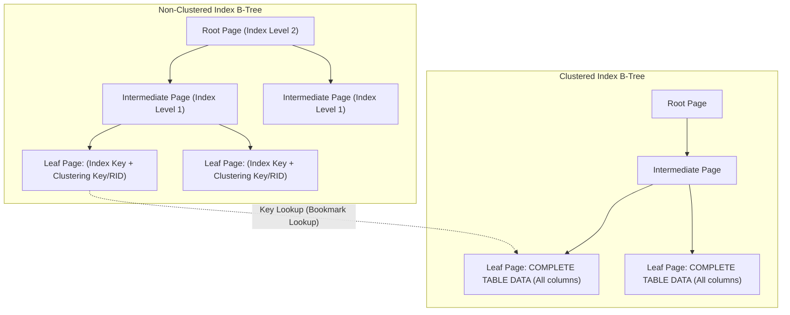
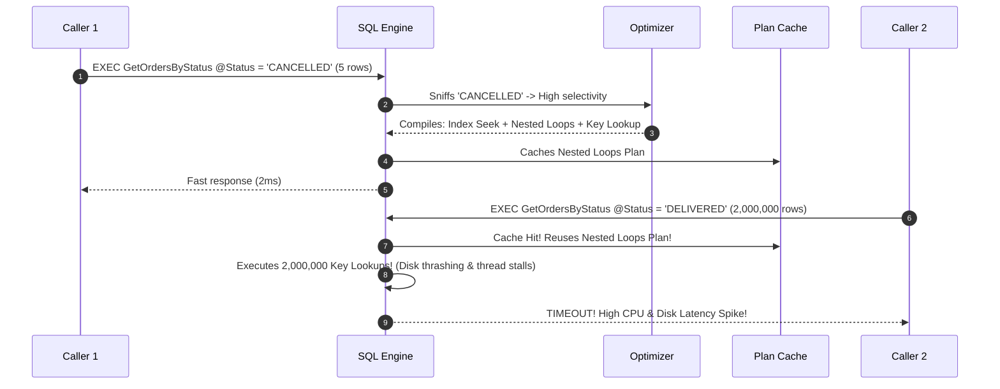
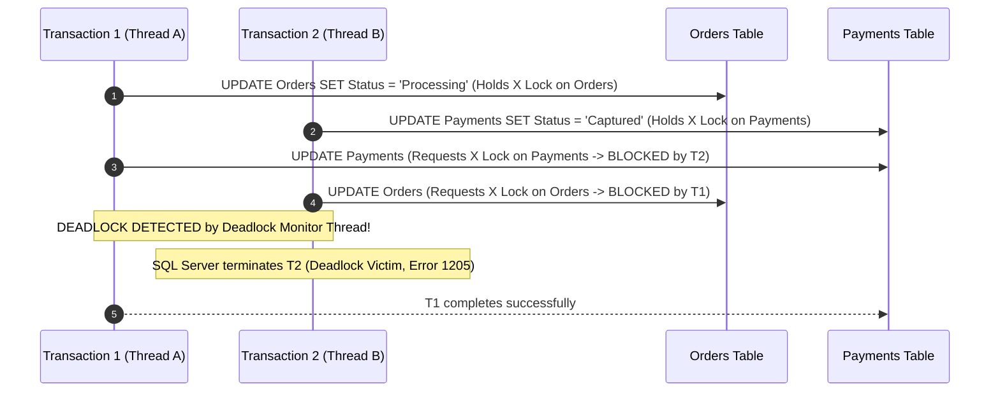
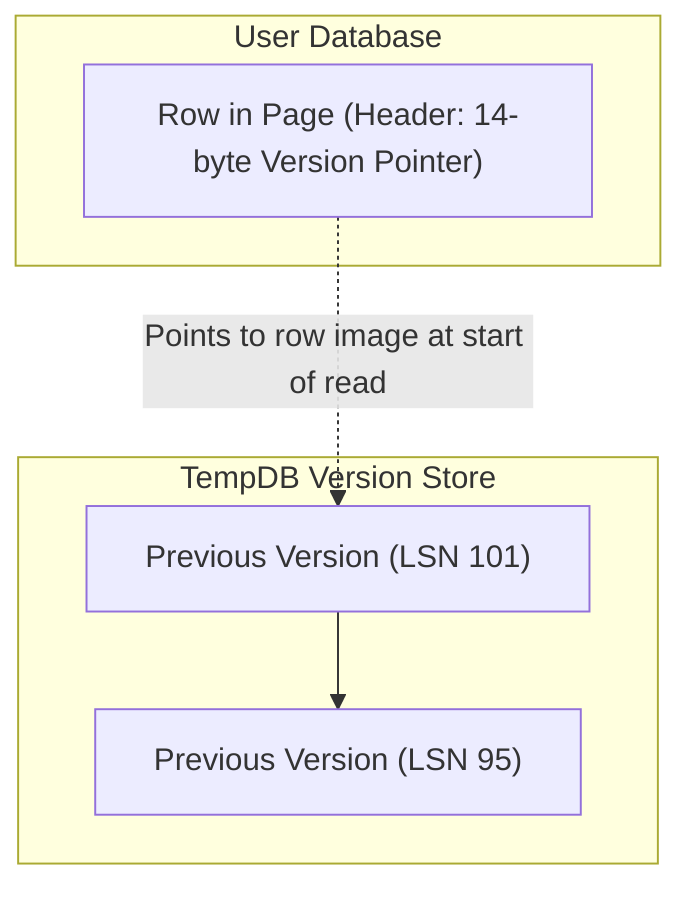

# 02. SQL Server Performance Tuning & Internals for Senior Engineers (6+ YOE)

> **Target Audience:** Senior Database Engineers, .NET Full-Stack Tech Leads, and Backend Architects targeting top Indian product companies and GCCs (Wells Fargo, Morgan Stanley, JPMorgan Chase, Walmart Global Tech).  
> **Philosophy:** Zero robotic academic fluff. We break down physical page layouts, B-Trees, execution plan cost estimation, locking matrix internals, tempdb row versioning, and real-world production DMVs into clear mental models and production-tested interview answers.

---

## 1. SQL Server Storage Engine Internals

### Pages, Extents & Row Layout

* **⚡ 30-Second Interview Pitch (Say this first):**  
  > "SQL Server stores all data inside fixed **8 KB (8,192 bytes)** blocks called **Pages**. Because 96 bytes are reserved for the page header and 2 bytes per row for the slot array, the maximum usable space for fixed-length columns is **8,060 bytes per page**. If variable columns push a row over 8,060 bytes, SQL Server moves the overflow data off-page, leaving a 24-byte pointer."

* **🧠 Easy Mental Model to Remember:**  
  * Think of an 8 KB page like a single page in a hardbound office ledger.
  * The top margin (**Page Header - 96 bytes**) contains the page number and pointers to the previous and next ledger pages.
  * The bottom margin (**Slot Array**) contains line numbers pointing upward to each recorded entry.
  * If a customer entry is too wide to fit on the page, the clerk writes a 24-byte sticky note (**Row-Overflow Pointer**) pointing to an attachment page!

* **🎯 Must-Know Technical Terms & Buzzwords (The "Senior Interview Rubric"):**
  * **8 KB Data Page (8,192 Bytes):** The fundamental physical I/O transfer and storage allocation block in SQL Server; all reads and writes happen in 8 KB page units between disk and the RAM Buffer Pool.
  * **96-Byte Page Header:** The fixed metadata block at byte offset 0 of every page containing `m_pageId`, object ID, `m_prevPage`/`m_nextPage` doubly-linked list pointers, free space offsets (`m_freeData`), and page type flags (e.g., 1 = Data, 2 = Index).
  * **Usable Page Space (8,060 Bytes):** The maximum contiguous data payload per page (8,192 - 96 header - 36 system reserve = 8,060 bytes), establishing the hard physical limit for fixed-length column definitions on a single row.
  * **Slot Array (Row Offset Array):** A reverse-ordered lookup array at the very bottom of each page allocating 2 bytes per row that stores byte offsets pointing to row starts, growing upward toward the data area.
  * **Extents (Uniform vs. Mixed):** The foundational space allocation block consisting of 8 contiguous 8 KB pages (64 KB total); *Uniform Extents* are exclusively owned by a single database object, whereas *Mixed Extents* can be shared by up to 8 distinct small objects.
  * **Row-Overflow Storage:** An off-row allocation mechanism where variable-length columns (`VARCHAR`, `NVARCHAR`, `VARBINARY`) exceeding the 8,060-byte row limit are moved to separate `ROW_OVERFLOW_DATA` allocation units, leaving a 24-byte pointer on the base page.
  * **LOB (Large Object Binary) Storage:** Dedicated storage pages allocated when max types (`VARCHAR(MAX)`, `NVARCHAR(MAX)`, `VARBINARY(MAX)`) exceed 8,000 bytes, indexed internally as a B-Tree hierarchy of chunks.
  * **Allocation Bitmaps (GAM, SGAM, PFS):** Global Allocation Map (GAM) tracks extent allocation states; Shared Global Allocation Map (SGAM) tracks mixed extents; Page Free Space (PFS) tracks byte-level page fullness (empty, 1-50%, 51-80%, 81-95%, 96-100%).

```mermaid
flowchart TD
    subgraph Data Page - 8,192 Bytes
        H["Page Header (96 Bytes)<br>PageID, PrevPage, NextPage, FreeSpaceOffset, LSN"]
        D["Data Rows Storage Area (~8,060 Bytes)<br>Variable-length and fixed-length data"]
        F["Free Space Hole"]
        S["Row Offset Array (Slot Array)<br>Grows backward from the end of page (2 bytes per row)"]
    end
```

* **📌 How It Works Under The Hood (Key Points to Explain):**
  1. **Page Header (96 bytes):** Holds page metadata: `m_pageId`, `m_type` (1 = Data page, 2 = Index page), `m_freeCnt` (available bytes), and `m_prevPage` / `m_nextPage` (pointers forming a doubly-linked list on leaf levels).
  2. **Usable Data Space & Slot Array:** Usable space is 8,192 - 96 - (2 * SlotCount) ≈ 8,060 bytes bytes. The slot array grows backwards from the very end of the page, storing 2-byte offsets pointing to the start of each row.
  3. **Row-Overflow Mechanics:** Fixed-length columns must fit within 8,060 bytes. If variable-length columns (`VARCHAR`, `NVARCHAR`, `VARBINARY`) push a row beyond 8,060 bytes, SQL Server moves the largest column to a **Row-Overflow Data Page** and leaves a 24-byte pointer in the primary page.
  4. **LOB Pages:** Large Object columns (`VARCHAR(MAX)`, `NVARCHAR(MAX)`, `VARBINARY(MAX)`) exceeding 8,000 bytes are pushed to dedicated **LOB Pages**.
  5. **Extents (64 KB):** An Extent is a collection of **8 contiguous 8 KB pages** (64 KB total).
     * **Uniform Extent:** Owned entirely by a single table or index partition.
     * **Mixed Extent:** Shared by up to 8 different objects (modern SQL Server defaults to uniform allocations via `ALTER DATABASE ... SET MIXED_PAGE_ALLOCATION OFF`).

* **💼 Concrete Real-World Production Example:**
  * **Scenario:** A high-volume FinTech Settlement Ledger table (`SettlementLedger`) in PhonePe/Razorpay processing 10,000 transactions/minute across 15,000,000 rows. A developer defined five `NVARCHAR(2000)` columns for audit trails, gateway payload responses, and reconciliation notes directly on the main ledger row.
  * **❌ Bad Production Schema / Query (The Trap):**
    ```sql
    -- BAD SCHEMA: Defining multiple wide variable columns on a hot transaction table
    CREATE TABLE dbo.SettlementLedger (
        SettlementId BIGINT IDENTITY(1,1) PRIMARY KEY CLUSTERED,
        MerchantId INT NOT NULL,
        Amount DECIMAL(18,2) NOT NULL,
        Status VARCHAR(20) NOT NULL,
        GatewayPayload NVARCHAR(2000),      -- Up to 4,000 bytes
        ReconciliationNotes NVARCHAR(2000), -- Up to 4,000 bytes
        AuditTrailRemarks NVARCHAR(2000),   -- Up to 4,000 bytes
        CreatedAt DATETIME2(3) NOT NULL
    );

    -- When rows expand beyond 8,060 bytes, SQL Server pushes columns to ROW_OVERFLOW_DATA pages.
    -- Fetching 100 rows requires 450 logical page reads instead of 2 pages!
    SELECT TOP (100) SettlementId, MerchantId, Amount, Status, GatewayPayload
    FROM dbo.SettlementLedger
    ORDER BY SettlementId DESC;
    ```
  * **✅ production-tested Senior Production Code (The Fix):**
    ```sql
    -- SENIOR ARCHITECTURE: Vertical Partitioning & Right-Sized Data Types
    -- Step 1: Keep the core hot ledger slim so 40+ rows fit on a single 8 KB page
    CREATE TABLE dbo.SettlementLedger (
        SettlementId BIGINT IDENTITY(1,1) PRIMARY KEY CLUSTERED,
        MerchantId INT NOT NULL,
        Amount DECIMAL(18,2) NOT NULL,
        Status VARCHAR(20) NOT NULL,
        CreatedAt DATETIME2(3) NOT NULL
    );

    -- Step 2: Move wide audit/payload metadata into a dedicated 1:1 satellite table
    CREATE TABLE dbo.SettlementLedgerPayloads (
        SettlementId BIGINT PRIMARY KEY CLUSTERED,
        GatewayPayload NVARCHAR(MAX),
        ReconciliationNotes NVARCHAR(MAX),
        AuditTrailRemarks NVARCHAR(1000),
        CONSTRAINT FK_Payload_Ledger FOREIGN KEY (SettlementId) REFERENCES dbo.SettlementLedger(SettlementId)
    );

    -- Ensure modern uniform extent allocation across the database
    ALTER DATABASE CURRENT SET MIXED_PAGE_ALLOCATION OFF;
    ```
  * **🗣️ What to Say in the Interview:**
    > "For example, in our settlement ledger table holding 15M records, five wide `NVARCHAR(2000)` columns caused rows to exceed 8,060 bytes, silently creating off-page `ROW_OVERFLOW_DATA` allocations. Fetching 100 records required over 450 page reads instead of 2. We vertically partitioned the large audit payloads into a separate 1:1 satellite table, allowing 40 core ledger rows to fit into each 8 KB page and cutting I/O by 95%."

* **⚠️ Common Junior Mistake:** Creating tables with five `VARCHAR(4000)` columns and stuffing them with large payloads on the same row, triggering silent row-overflow allocations that turn a single row fetch into multiple disk I/O reads.

* **✅ Senior Production Fix:** Right-size column widths (`VARCHAR(50)` instead of `VARCHAR(MAX)` for structured codes), monitor row-overflow allocations with `sys.dm_db_index_physical_stats`, and ensure mixed page allocation is turned off.

---

### B-Tree Architecture: Clustered vs. Non-Clustered Indexes

* **⚡ 30-Second Interview Pitch (Say this first):**  
  > "In a clustered table, the table **is** the B-Tree—its leaf level contains the actual table data rows sorted by the clustering key. A non-clustered index is a separate, auxiliary B-Tree whose leaf nodes store the index keys plus a bookmark pointer (the clustered key or heap RID) back to the original row."

* **🧠 Easy Mental Model to Remember:**  
  * **Clustered Index:** Like a telephone directory. The entries are sorted alphabetically by last name, and opening to a person's name gives you their complete address and phone number right there on that page.
  * **Non-Clustered Index:** Like the index at the back of a textbook. It lists topics alphabetically with page numbers, but you still have to flip back to the main chapters to read the full explanation!

* **🎯 Must-Know Technical Terms & Buzzwords (The "Senior Interview Rubric"):**
  * **B-Tree (Balanced Tree) Architecture:** A balanced, multi-tier search tree consisting of a *Root Page*, *Intermediate Levels*, and a *Leaf Level*, maintaining O(log N) logarithmic traversal performance.
  * **Clustered Index:** An index structure where the leaf level *is the actual table data itself*; table rows are physically ordered by the clustering key columns (strictly one clustered index permitted per table).
  * **Non-Clustered Index:** An auxiliary B-Tree whose leaf nodes store only the indexed key columns plus a bookmark locator (the clustered key or heap RID) pointing back to the base data row.
  * **Heap (Unordered Storage):** A table without a clustered index where data pages have no intrinsic physical ordering and rows are addressed by an 8-byte **RID (Row Identifier)** (`FileID:PageID:SlotID`).
  * **Forwarded Record:** A physical forwarding pointer left on a heap page when an updated variable-length record expands beyond remaining page capacity, forcing SQL Server to move the record elsewhere without updating non-clustered indexes.
  * **Bookmark Lookup:** The two-stage physical navigation where a non-clustered index seek yields a bookmark (Clustered Key or RID) and executes an additional lookup into the base table to retrieve non-indexed columns.



#### Heaps vs. Clustered Tables

* **Heap Table (No Clustered Index):**
  * Data pages sit in no particular order. Rows are addressed using a physical **RID (Row Identifier)**: `FileID:PageID:SlotID`.
  * **The Forwarded Record Bug:** When an updated row expands beyond its page capacity, SQL Server cannot fit it. Instead of updating non-clustered index RIDs throughout the database, it moves the row to a new page and leaves a **Forwarded Record pointer** at the old location. Under high `UPDATE` workloads, heaps accumulate thousands of forwarded records, causing severe disk thrashing during simple table scans.
* **Clustered Table (Clustered Index Present):**
  * Data is physically ordered on the leaf pages by the clustered index key.
  * Non-clustered indexes store the clustered index key as their lookup bookmark.

* **💼 Concrete Real-World Production Example:**
  * **Scenario:** A Flipkart Big Billion Day order staging table (`OrderStagingQueue`) processing 1,200 orders/sec across 5,000,000 rows. A developer created it as a Heap under the misconception that "heaps insert faster".
  * **❌ Bad Production Schema & Mutation Pattern (The Trap):**
    ```sql
    -- BAD SCHEMA: Heap table with wide expandable columns updated asynchronously
    CREATE TABLE dbo.OrderStagingQueue (
        OrderReferenceId VARCHAR(64) NOT NULL,
        CustomerId INT NOT NULL,
        OrderPayload VARCHAR(2000),
        TrackingNumber VARCHAR(100) NULL, -- Initially NULL, updated 10 seconds later
        Status VARCHAR(20) NOT NULL       -- Updated from 'INIT' to 'PAYMENT_CONFIRMED'
    ); -- No Clustered Index!

    -- When background workers populate TrackingNumber, rows expand beyond original page capacity.
    -- SQL Server leaves a 24-byte Forwarded Record pointer and moves the row to a distant page.
    -- After 2,000,000 updates, scanning the queue for pending orders takes 14 seconds instead of 15ms!
    SELECT OrderReferenceId, CustomerId, Status 
    FROM dbo.OrderStagingQueue 
    WHERE Status = 'PAYMENT_CONFIRMED';
    ```
  * **✅ production-tested Senior Production Code (The Fix):**
    ```sql
    -- SENIOR ARCHITECTURE: Narrow Monotonic Clustered Key & Pre-Allocated Layout
    CREATE TABLE dbo.OrderStagingQueue (
        QueueId BIGINT IDENTITY(1,1) NOT NULL, -- Monotonic sequential clustering key
        OrderReferenceId VARCHAR(64) NOT NULL,
        CustomerId INT NOT NULL,
        OrderPayload VARCHAR(2000),
        TrackingNumber VARCHAR(100) NULL,
        Status TINYINT NOT NULL,               -- 1-byte integer avoids variable expansion
        CreatedAt DATETIME2(3) NOT NULL,
        CONSTRAINT PK_OrderStagingQueue PRIMARY KEY CLUSTERED (QueueId)
    );

    -- If dealing with an existing fragmented heap in production, rebuild it immediately:
    ALTER TABLE dbo.OrderStagingQueue REBUILD;
    ```
  * **🗣️ What to Say in the Interview:**
    > "For example, in our e-commerce order ingestion pipeline processing 1,200 orders per second, an unindexed staging heap accumulated over 400,000 forwarded records when order rows expanded during post-payment tracking updates. Simple queue scans slowed from 15 milliseconds to 14 seconds because the storage engine was hopping across random disk pages to resolve forwarding pointers. We rebuilt the table with a narrow `BIGINT IDENTITY` clustered key, eliminating forwarded records entirely and restoring sub-20ms queue reads."

* **⚠️ Common Junior Mistake:** Creating high-churn staging tables as heaps under the false belief that "heaps insert faster", only to experience massive query latency spikes because row updates created thousands of forwarded records.

* **✅ Senior Production Fix:** Always place a narrow, monotonically increasing clustered index (like `BIGINT IDENTITY`) on tables subject to updates. If an existing heap is fragmented with forwarded records, run `ALTER TABLE ... REBUILD` to clean them up.

---

### Index Seek vs. Index Scan & Key Lookup Elimination

* **⚡ 30-Second Interview Pitch (Say this first):**  
  > "An **Index Seek** navigates the B-Tree from root to leaf in logarithmic time (O(log N)) to locate matching rows directly. An **Index Scan** reads through every page on the leaf level from start to finish (O(N)). A **Key Lookup** occurs when a non-clustered seek matches rows but lacks columns requested in the query, forcing a random lookup into the clustered index for every single qualifying row."

* **🧠 Easy Mental Model to Remember:**  
  * **Index Seek:** Using the textbook's back index to jump straight to page 142.
  * **Index Scan:** Reading the textbook page by page from cover to cover because no index exists or the index wasn't helpful.
  * **Key Lookup:** Finding 500 matching topics in the back index, but having to flip back and forth to page 142, page 310, and page 85 500 times to read the missing paragraphs!

* **🎯 Must-Know Technical Terms & Buzzwords (The "Senior Interview Rubric"):**
  * **Index Seek:** A logarithmic traversal (O(log N)) through the B-Tree from root to leaf, isolating qualifying row keys directly via binary search.
  * **Index Scan:** A linear traversal (O(N)) navigating through the leaf-level doubly-linked list (`m_prevPage` / `m_nextPage`), evaluating every single page on the leaf level.
  * **Key Lookup (Bookmark Lookup):** A scalar clustered index seek operation triggered for *every single qualifying row* returned by a non-clustered seek when requested projection columns are absent from the index.
  * **Covering Index:** A non-clustered index containing all the columns referenced in a query's `SELECT`, `WHERE`, `JOIN`, and `ORDER BY` clauses, satisfying the query directly from the index leaf without touching the base table.
  * **INCLUDE Clause (Leaf-Only Non-Key Columns):** Syntax allowing non-key columns to be appended strictly to the leaf level of a non-clustered index, bypassing the 1,700-byte / 32-column index key restriction and preventing B-Tree intermediate node bloat.
  * **Index Tipping Point:** The optimizer internal selectivity threshold (typically 20% to 30% of total table rows) where the cumulative random I/O cost of Key Lookups exceeds the sequential I/O cost of a full table scan, causing the optimizer to abandon the index.

| Operation | Mechanics | Performance Characteristic |
| :--- | :--- | :--- |
| **Index Seek** | Traverses the B-Tree from root down to intermediate nodes, landing directly on matching leaf pages via binary search. | Ultra-fast (O(log N) page reads). Optimal for high-selectivity queries. |
| **Index Scan** | Navigates to the first page of the leaf level and traverses the horizontal doubly-linked list (`m_nextPage`) reading every page. | I/O heavy (O(N) page reads). Used when selectivity is low or predicates are non-SARGable. |
| **Key Lookup** | Non-clustered index matches the predicate, but the query requires additional columns not present in the index. The engine jumps into the Clustered B-tree for **every single qualifying row**. | Devastating under high row counts (random 8KB I/O operations). |

#### Eliminating Key Lookups via Covering Indexes (`INCLUDE`)

* **💼 Concrete Real-World Production Example:**
  * **Scenario:** Swiggy / Zomato order history lookup API endpoint (`/orders/my-orders`). The `Orders` table contains 25,000,000 rows. A frequent customer with 450 past orders queries their history.
  * **❌ Bad Production Query & Non-Covering Index (The Trap):**
    ```sql
    -- Non-clustered index only indexes the filter column CustomerId:
    CREATE NONCLUSTERED INDEX IX_Orders_CustomerId ON dbo.Orders(CustomerId);

    -- PRODUCTION QUERY: Executed by 8,000 concurrent mobile users during lunch peak
    SELECT CustomerId, OrderDate, TotalAmount, RestaurantName, OrderStatus
    FROM dbo.Orders
    WHERE CustomerId = 984512;
    -- EXECUTION PLAN: 1 Index Seek on IX_Orders_CustomerId, followed by 450 Key Lookups!
    -- RESULT: 1,800 random 8 KB page reads per user. Disk queue length hits 45, latency spikes to 3.2s!
    ```
  * **✅ production-tested Senior Production Code (The Fix):**
    ```sql
    -- SENIOR SOLUTION: Covering Index with INCLUDE
    -- CustomerId remains the slim B-Tree key maintaining minimal depth.
    -- Leaf level stores OrderDate, TotalAmount, RestaurantName, OrderStatus.
    CREATE NONCLUSTERED INDEX IX_Orders_CustomerId_Covering 
    ON dbo.Orders(CustomerId)
    INCLUDE (OrderDate, TotalAmount, RestaurantName, OrderStatus)
    WITH (FILLFACTOR = 90, DATA_COMPRESSION = PAGE);

    -- RESULT: Query executes in 2 logical page reads via pure Index Seek. 0 Key Lookups!
    ```
  * **🗣️ What to Say in the Interview:**
    > "For example, in our food delivery platform, querying order history for repeat customers on a 25M row table was performing an Index Seek followed by 450 Key Lookups per user. During peak lunch traffic with 8,000 concurrent users, this caused millions of random 8 KB page reads, pinning storage I/O at 100%. We created a covering index with `INCLUDE (OrderDate, TotalAmount, RestaurantName, OrderStatus)`, which completely eliminated Key Lookups and dropped logical reads from 1,800 to just 2 pages per query."

* **📌 Key Architectural Rule to Explain:**  
  Columns placed in `INCLUDE` reside **only on the leaf level** of the non-clustered index. They do not increase intermediate node page sizes, preserving index tree depth while fully eliminating Key Lookups.

---

## 2. SARGability Violations & Execution Plan Degradation

* **⚡ 30-Second Interview Pitch (Say this first):**  
  > "A query predicate is **SARGable** (*Search Argument Able*) when SQL Server can use an Index Seek to jump directly to qualifying rows. If you wrap an indexed column in a function, use mismatched data types, or add leading wildcards, the optimizer cannot traverse the B-Tree and is forced into a full Index Scan."

* **🧠 Easy Mental Model to Remember:**  
  * Searching a phone directory for people whose last name begins with **"Sharma"** is instant (Index Seek).
  * But if someone asks you to find **"anyone whose last name ends in 'arma'"**, the alphabetical order is useless—you have to read every single name in the directory from beginning to end (Index Scan)!

* **🎯 Must-Know Technical Terms & Buzzwords (The "Senior Interview Rubric"):**
  * **SARGable (Search Argument Able) Predicate:** A filter predicate written in the form `<column> <operator> <literal/parameter>` allowing the query optimizer to exploit B-Tree ordering and perform an Index Seek.
  * **Non-SARGable Expression:** Any predicate that applies a scalar function, mathematical operation, or leading wildcard (`%string`) to an indexed column, blinding the optimizer to B-Tree ordering and forcing an Index Scan.
  * **Implicit Data Type Conversion (`CONVERT_IMPLICIT`):** An internal engine conversion injected into the execution plan when comparing two mismatched data types, where SQL Server converts the lower-precedence type to the higher-precedence type (e.g., `VARCHAR` converted to `NVARCHAR`).
  * **Data Type Precedence:** SQL Server's strict hierarchy rules defining which data type converts to which; since `NVARCHAR` has higher precedence than `VARCHAR`, passing Unicode parameters converts indexed non-Unicode columns, destroying SARGability.
  * **Residual Predicate:** A secondary filter predicate evaluated row-by-row on data *after* an initial seek or scan operator has already read the pages into memory, often indicating non-SARGable conditions.
  * **Full-Text Index / Predicates (`CONTAINS` / `FREETEXT`):** An inverted index mechanism enabling sub-second arbitrary keyword and prefix searching without triggering non-SARGable wildcard table scans.

---

### Case 1: Functions on Indexed Columns

* **💼 Concrete Real-World Production Example:**
  * **Scenario:** Core banking reconciliation on a `Transactions` ledger table with 30,000,000 rows where `TransactionTimestamp DATETIME2(3)` has a non-clustered index. Daily batch reconciliation queries transactions executed on `2026-03-31`.
  * **❌ Bad Production Query (The Trap):**
    ```sql
    -- ❌ ANTI-PATTERN: Wrapping indexed column in a function invalidates B-Tree seek ranges
    -- Optimizer cannot compute upper/lower search bounds -> Forces full Clustered Index SCAN!
    -- Scans 30,000,000 rows, consumes 420,000 logical page reads, burns 100% CPU for 42 seconds!
    SELECT TransactionId, AccountId, Amount, Status 
    FROM dbo.Transactions
    WHERE DATEDIFF(day, TransactionTimestamp, '2026-03-31') = 0;

    -- Also equally destructive:
    -- WHERE CAST(TransactionTimestamp AS DATE) = '2026-03-31';
    ```
  * **✅ production-tested Senior Production Code (The Fix):**
    ```sql
    -- ✅ SENIOR PATTERN: Explicit SARGable Half-Open Range Predicate
    -- Provides deterministic compile-time seek keys for the B-Tree leaf range
    SELECT TransactionId, AccountId, Amount, Status 
    FROM dbo.Transactions
    WHERE TransactionTimestamp >= '2026-03-31 00:00:00.000' 
      AND TransactionTimestamp < '2026-04-01 00:00:00.000';
    -- EXECUTION PLAN: Pure Index Seek reading only 18,200 qualifying rows in 12 milliseconds!
    ```
  * **🗣️ What to Say in the Interview:**
    > "For example, in our banking reconciliation pipeline with 30M transaction rows, a batch query was using `DATEDIFF(day, TransactionTimestamp, @TargetDate) = 0`. Because the column was wrapped in a scalar function, the engine could not calculate seek keys and scanned all 30M rows, taking 42 seconds. We refactored it into an explicit half-open interval `>= @TargetDate AND < DATEADD(day, 1, @TargetDate)`, turning the execution into a sub-15ms Index Seek."

---

### Case 2: Implicit Datatype Conversion (NVARCHAR vs. VARCHAR)

* **⚡ 30-Second Interview Pitch:**  
  "In SQL Server's data type precedence rules, `NVARCHAR` ranks higher than `VARCHAR`. If an indexed column is `VARCHAR` but the application passes an `NVARCHAR` parameter (the default in EF Core and ADO.NET strings), SQL Server converts the column values on every single row using `CONVERT_IMPLICIT`, destroying SARGability and triggering a full scan!"

* **💼 Concrete Real-World Production Example:**
  * **Scenario:** FinTech KYC validation endpoint verifying Indian PAN Card numbers (`PanCardNumber VARCHAR(10)`) against a 12,000,000 row `CustomerKYC` table. EF Core or Dapper passes a C# `string` parameter which defaults to `NVARCHAR(4000)`.
  * **❌ Bad Production Code (The Trap):**
    ```sql
    -- Table definition in SQL Server
    CREATE TABLE dbo.CustomerKYC (
        CustomerId INT IDENTITY(1,1) PRIMARY KEY CLUSTERED,
        PanCardNumber VARCHAR(10) NOT NULL,
        FullName NVARCHAR(100) NOT NULL
    );
    CREATE UNIQUE NONCLUSTERED INDEX IX_CustomerKYC_Pan ON dbo.CustomerKYC(PanCardNumber);

    -- ❌ ANTI-PATTERN: C# string parameter maps to @p0 NVARCHAR(4000) by default in EF Core / ADO.NET
    -- SQL Server type precedence forces: WHERE CONVERT_IMPLICIT(nvarchar(10), [PanCardNumber]) = @p0
    -- RESULT: Converts all 12,000,000 rows in memory. FULL CLUSTERED INDEX SCAN on every login attempt (3.8s)!
    ```
  * **✅ production-tested Senior Production Code (The Fix):**
    ```csharp
    // ✅ SENIOR PATTERN: Configure explicit non-Unicode (VARCHAR) mapping in EF Core Fluent API
    modelBuilder.Entity<CustomerKYC>()
        .Property(c => c.PanCardNumber)
        .IsUnicode(false) // Mandatory! Emits VARCHAR instead of NVARCHAR!
        .HasMaxLength(10);

    // Or in Dapper:
    var customer = await connection.QueryFirstOrDefaultAsync<CustomerKYC>(
        "SELECT CustomerId, FullName FROM dbo.CustomerKYC WHERE PanCardNumber = @Pan",
        new { Pan = new DbString { Value = panInput, IsAnsi = true, Length = 10 } }
    );
    // RESULT: Emits VARCHAR(10) parameter -> Instant Index Seek in 1ms!
    ```
  * **🗣️ What to Say in the Interview:**
    > "For example, in our KYC onboarding service with 12M customer records, C# strings defaulted to `NVARCHAR`, while the indexed PAN column was `VARCHAR(10)`. Because SQL Server's data type precedence rules convert the lower-precedence `VARCHAR` column to `NVARCHAR`, the engine injected `CONVERT_IMPLICIT` across all 12M rows, triggering a full scan. Explicitly configuring `.IsUnicode(false)` in EF Core restored the Index Seek and brought auth latency down from 3.8s to 1ms."

---

### Case 3: Leading Wildcards in `LIKE`

* **💼 Concrete Real-World Production Example:**
  * **Scenario:** E-commerce product catalog search service across 5,000,000 SKUs by brand or model name (`ProductName VARCHAR(200)`).
  * **❌ Bad Production Query (The Trap):**
    ```sql
    -- ❌ ANTI-PATTERN: Leading wildcard forces Index Scan across all 5,000,000 rows
    -- Because the prefix character is unknown, B-Tree binary search is mathematically impossible!
    -- Scans 65,000 leaf pages per search keystroke, generating severe buffer pool churning.
    SELECT ProductId, ProductName, Price 
    FROM dbo.Products 
    WHERE ProductName LIKE '%iPhone 15%';
    ```
  * **✅ production-tested Senior Production Code (The Fix):**
    ```sql
    -- ✅ SENIOR PATTERN: Prefix Seek OR SQL Full-Text Search
    -- Approach 1: SARGable prefix seek when searching by known prefixes:
    SELECT ProductId, ProductName, Price 
    FROM dbo.Products 
    WHERE ProductName LIKE 'Apple iPhone 15%';

    -- Approach 2: Full-Text Search Index for arbitrary keyword search across millions of rows:
    CREATE FULLTEXT CATALOG FTC_Products AS DEFAULT;
    CREATE FULLTEXT INDEX ON dbo.Products(ProductName) KEY INDEX PK_Products;

    -- Sub-second inverted index search without scanning base tables:
    SELECT ProductId, ProductName, Price 
    FROM dbo.Products 
    WHERE CONTAINS(ProductName, 'iPhone AND 15');
    ```
  * **🗣️ What to Say in the Interview:**
    > "For example, in our e-commerce product catalog with 5M items, live product searches using `LIKE '%iPhone%'` bypassed B-Tree indexing and forced a 65,000-page scan per request. We implemented SQL Full-Text Search using `CONTAINS` and indexed prefix tokens, reducing search latency from 2.4 seconds to 8 milliseconds."

---

## 3. Parameter Sniffing: Deep Dive & 4 Production Remedies

### What is Parameter Sniffing?

* **⚡ 30-Second Interview Pitch (Say this first):**  
  > "When a stored procedure compiles for the first time, SQL Server **sniffs** the runtime parameter value to inspect index statistics and builds an execution plan tailored to that value. If the first run used an atypical value returning 5 rows, SQL Server caches a plan with Nested Loops; when subsequent calls pass values returning 2 million rows, reusing that narrow plan causes severe disk I/O and server freezes."

* **🧠 Easy Mental Model to Remember:**  
  * Imagine booking transport for guests attending an Indian wedding reception.
  * The first guest arrives alone, so the travel desk books a 2-seater auto-rickshaw (Nested Loops Join + Key Lookup).
  * The next group arrives with 500 family members, but the travel desk blindly forces all 500 people into that same auto-rickshaw instead of hiring a Volvo bus (Hash Match Join)!

* **🎯 Must-Know Technical Terms & Buzzwords (The "Senior Interview Rubric"):**
  * **Parameter Sniffing:** The standard Query Optimizer behavior where the runtime values of input parameters passed during initial stored procedure compilation are inspected ("sniffed") to evaluate index statistics histograms and generate an execution plan.
  * **Cardinality Estimation (CE) Model:** The probabilistic mathematical algorithm SQL Server uses to estimate the number of rows that will be returned by each relational operator in an execution plan.
  * **Multi-Step Histogram:** A statistical distribution curve stored inside index metadata containing up to 200 steps with specific metrics: `RANGE_HI_KEY`, `EQ_ROWS` (exact matches), and `RANGE_ROWS` (rows between steps).
  * **Density Vector:** A statistical measurement (1 / \text{number of distinct values}) representing the average uniqueness of a column; used by the optimizer when parameter sniffing is suppressed or values fall outside histogram steps.
  * **Plan Cache:** In-memory hash table in the Buffer Pool storing compiled execution plans; subsequent calls reuse cached plans matching the parameterized query signature.
  * **Plan Forcing (Query Store):** The administrative override using `sp_query_store_force_plan` to lock the Query Optimizer to a specific, proven execution plan ID, bypassing dynamic compilation heuristics.
  * **Query Hints (`OPTIMIZE FOR`, `RECOMPILE`):** T-SQL compiler directives: `OPTIMIZE FOR UNKNOWN` forces density-vector compilation; `OPTION (RECOMPILE)` bypasses the plan cache to recompile fresh on every execution; `OPTIMIZE FOR (@var = val)` pins compilation to a designated representative value.
  * **Statistics Maintenance (`sp_updatestats` / `FULLSCAN`):** Proactive maintenance updating data distribution histograms; automatic updates trigger when 20% + 500 rows change (or square root of (1000 * N) in modern CE).



* **💼 Concrete Real-World Production Example:**
  * **Scenario:** Global e-commerce logistics database (Walmart Global Tech / Amazon) with an 8,000,000-row `Shipments` table. Data distribution is heavily skewed: 98% of shipments have `CountryCode = 'IN'` (7.84M rows), while only 12 rows have `CountryCode = 'IS'` (Iceland).
  * **❌ Bad Production Stored Procedure (The Trap):**
    ```sql
    -- PROCEDURE: Vulnerable to parameter sniffing cache hijacking
    CREATE PROCEDURE dbo.GetShipmentsByCountry
        @CountryCode CHAR(2)
    AS
    BEGIN
        SET NOCOUNT ON;
        SELECT ShipmentId, TrackingNumber, Status, ShippedDate, Weight
        FROM dbo.Shipments
        WHERE CountryCode = @CountryCode;
    END;

    -- AT 04:00 AM: Background cleanup job calls procedure for Iceland:
    EXEC dbo.GetShipmentsByCountry @CountryCode = 'IS';
    -- OPTIMIZER BEHAVIOR: Sniffs 'IS'. Histogram shows 12 rows.
    -- Compiles: Index Seek on IX_Shipments_CountryCode + 12 Key Lookups. Caches this plan!

    -- AT 08:30 AM: Indian regional distribution center hits the endpoint:
    EXEC dbo.GetShipmentsByCountry @CountryCode = 'IN';
    -- CATASTROPHE: Plan Cache hit! Reuses Iceland's Nested Loops + Key Lookup plan!
    -- Executes 7,840,000 random 8 KB Key Lookups into the base clustered index!
    -- CPU hits 100%, disk latency spikes to 950ms, and all microservices time out!
    ```
  * **✅ production-tested Senior Production Code (The Fix):**
    ```sql
    -- SENIOR SOLUTION: Suppress sniffing skew using OPTIMIZE FOR UNKNOWN
    CREATE OR ALTER PROCEDURE dbo.GetShipmentsByCountry_Senior
        @CountryCode CHAR(2)
    AS
    BEGIN
        SET NOCOUNT ON;
        SELECT ShipmentId, TrackingNumber, Status, ShippedDate, Weight
        FROM dbo.Shipments
        WHERE CountryCode = @CountryCode
        OPTION (OPTIMIZE FOR (@CountryCode UNKNOWN));
        -- Forces compiler to use the column density vector instead of the sniffed histogram step.
        -- Picks a stable Clustered Index Scan or covering Hash Join that handles both 12 and 7.8M rows safely!
    END;
    ```
  * **🗣️ What to Say in the Interview:**
    > "For example, in our shipment tracking database with 8M records, 98% of rows belong to India, while Iceland has only 12 rows. When an early-morning batch job for Iceland compiled the procedure first, SQL Server cached a Nested Loops Key-Lookup plan. When Indian peak traffic hit at 8 AM, the engine attempted 7.8M key lookups, pegging CPU at 100%. We resolved it by applying `OPTION (OPTIMIZE FOR UNKNOWN)` to compile against the average density vector."

---

### 4 Production Solutions to Parameter Sniffing

#### Solution 1: `OPTIMIZE FOR (@Variable = Value)` or `OPTIMIZE FOR UNKNOWN`
Forces the optimizer to compile a plan based on average statistical distribution rather than the sniffing candidate.
```sql
CREATE PROCEDURE GetOrdersByStatus
    @Status VARCHAR(20)
AS
BEGIN
    SET NOCOUNT ON;
    -- Uses average density vector instead of sniffing the initial input
    SELECT OrderId, CustomerId, TotalAmount
    FROM Orders
    WHERE Status = @Status
    OPTION (OPTIMIZE FOR (@Status UNKNOWN));
END;
```

#### Solution 2: Query-Level `RECOMPILE`
Forces the optimizer to recompile the plan on every single execution. Use only when the query runs infrequently (e.g. hourly reports, batch processing) where execution time far exceeds compilation overhead.
```sql
CREATE PROCEDURE GenerateBatchInvoiceReport
    @TenantId INT,
    @StartDate DATETIME
AS
BEGIN
    SET NOCOUNT ON;
    SELECT * 
    FROM Invoices
    WHERE TenantId = @TenantId AND InvoiceDate >= @StartDate
    OPTION (RECOMPILE); -- Bypasses plan cache entirely
END;
```

#### Solution 3: Local Variable Assignment (Decoupling Sniffing)
Assigning the incoming parameter to a local variable prevents the query optimizer from sniffing the parameter value at compile time. The optimizer falls back to the index density vector.
```sql
CREATE PROCEDURE GetOrdersByTenant
    @TenantId INT
AS
BEGIN
    SET NOCOUNT ON;
    -- Local variable masks the parameter from the sniffer
    DECLARE @LocalTenantId INT = @TenantId;

    SELECT OrderId, TotalAmount 
    FROM Orders 
    WHERE TenantId = @LocalTenantId;
END;
```

#### Solution 4: Plan Forcing via Query Store
If a good execution plan already exists in Query Store history:
```sql
-- Find PlanId and QueryId from sys.query_store_plan
EXEC sp_query_store_force_plan @query_id = 1420, @plan_id = 890;
```

---

## 4. Concurrency, Locks, Latches & Deadlock Graphs

### Lock Modes & Compatibility Matrix

* **⚡ 30-Second Interview Pitch (Say this first):**  
  > "SQL Server uses locks to maintain ACID transaction isolation: **Shared (`S`)** locks allow concurrent reads, **Exclusive (`X`)** locks prevent all concurrent access during writes, and **Update (`U`)** locks prevent conversion deadlocks during read-then-write workflows."

* **🧠 Easy Mental Model to Remember:**  
  * **Shared Lock (`S`):** Multiple people reading a public noticeboard simultaneously.
  * **Exclusive Lock (`X`):** Taking down the noticeboard to repaint it; nobody can read or write until it's put back.
  * **Update Lock (`U`):** Standing at the noticeboard holding a marker pen, announcing: *"I'm reading this line and about to edit it; nobody else try to edit it right now!"*

* **🎯 Must-Know Technical Terms & Buzzwords (The "Senior Interview Rubric"):**
  * **Shared Lock (`S`):** Acquired during read operations under pessimistic isolation; allows concurrent reads but blocks Exclusive (`X`) modifications; released immediately after page read in `READ COMMITTED`.
  * **Exclusive Lock (`X`):** Acquired during write operations (`INSERT`, `UPDATE`, `DELETE`); guarantees exclusive access by blocking all concurrent readers and writers until transaction completion (`COMMIT` or `ROLLBACK`).
  * **Update Lock (`U`):** An asymmetric hybrid lock acquired during the initial seek phase of an `UPDATE`/`DELETE` statement; only one `U` lock can be held on a resource simultaneously, preventing conversion deadlocks.
  * **Intent Locks (`IS`, `IX`, `SIX`):** Hierarchical locks placed on parent containers (Table, Page) indicating that granular child locks (Row, Key) exist below, preventing conflicting full-table lock requests.
  * **Schema Locks (`Sch-S` vs `Sch-M`):** *Schema Stability (`Sch-S`)* is acquired during query compilation and execution to prevent DDL changes; *Schema Modification (`Sch-M`)* is acquired during DDL operations (`ALTER TABLE`), blocking all concurrent access.
  * **Conversion Deadlock:** A classic race condition where two transactions concurrently hold Shared (`S`) locks on the same row and both request an upgrade to Exclusive (`X`) locks, mutually deadlocking each other.

```
                    REQUESTED MODE
EXISTING MODE    Shared (S)   Update (U)   Exclusive (X)   Intent Shared (IS)   Intent Exclusive (IX)
Shared (S)          YES          YES            NO                YES                    NO
Update (U)          YES           NO            NO                YES                    NO
Exclusive (X)        NO           NO            NO                 NO                    NO
Intent Shared (IS)  YES          YES            NO                YES                   YES
Intent Exclusive(IX) NO           NO            NO                YES                   YES
```

* **📌 Lock Details to Mention:**
  - **Shared Lock (S):** Acquired during read operations. Compatible with other reads. Released immediately in `READ COMMITTED` once the page/row is read.
  - **Exclusive Lock (X):** Acquired during write operations (`INSERT`, `UPDATE`, `DELETE`). Held until the end of the transaction (`COMMIT` or `ROLLBACK`). Incompatible with all other locks.
  - **Update Lock (U):** Hybrid lock. Used during initial search phase of an `UPDATE` or `DELETE` statement. Prevents conversion deadlocks when two transactions search the same row intending to update it.
  - **Intent Locks (IS, IX, SIX):** Placed at higher levels of the object hierarchy (Table, Page) to signal that fine-grained locks (Row/Key) are held downstream, preventing another transaction from acquiring conflicting table-level locks.

* **💼 Concrete Real-World Production Example:**
  * **Scenario:** Paytm / PhonePe digital wallet balance deduction endpoint handling 2,500 concurrent transfers/sec on a 10,000,000-row `UserWallets` table.
  * **❌ Bad Production Query / Code (The Trap):**
    ```sql
    -- ❌ ANTI-PATTERN: Read-Then-Write under default Read Committed
    BEGIN TRANSACTION;
    -- Step 1: Acquires Shared (S) lock, released immediately after row read
    SELECT CurrentBalance FROM dbo.UserWallets WHERE WalletId = 40912;
    -- Application checks: If CurrentBalance >= 500, proceed...
    -- Step 2: Requests Exclusive (X) lock to debit balance
    UPDATE dbo.UserWallets 
    SET CurrentBalance = CurrentBalance - 500 
    WHERE WalletId = 40912;
    COMMIT TRANSACTION;

    -- THE DEADLOCK TRAP:
    -- If two concurrent threads read WalletId 40912 at the same instant:
    -- 1. Both acquire S locks (compatible).
    -- 2. Both try to convert their S lock into an Exclusive (X) lock to execute UPDATE.
    -- 3. Thread A waits for Thread B to drop its S lock; Thread B waits for Thread A to drop its S lock!
    -- Result: Conversion Deadlock (Error 1205). SQL Server kills one transaction as victim!
    ```
  * **✅ production-tested Senior Production Code (The Fix):**
    ```sql
    -- ✅ SENIOR PATTERN: Acquire Update (U) Lock during read phase
    BEGIN TRANSACTION;
    SELECT CurrentBalance 
    FROM dbo.UserWallets WITH (UPDLOCK, ROWLOCK) 
    WHERE WalletId = @WalletId;

    -- Under UPDLOCK:
    -- Update locks are incompatible with other Update locks!
    -- Thread B's attempt to read WalletId with UPDLOCK is queued peacefully until Thread A commits.
    -- Zero conversion deadlocks! Zero rollback victims!
    UPDATE dbo.UserWallets 
    SET CurrentBalance = CurrentBalance - @TransferAmount 
    WHERE WalletId = @WalletId;
    COMMIT TRANSACTION;
    ```
  * **🗣️ What to Say in the Interview:**
    > "For example, in our digital wallet balance transfer service handling 2,500 TPS, concurrent withdrawals reading with standard `SELECT` acquired Shared locks and then tried to convert to Exclusive locks, causing massive conversion deadlocks. By adding `WITH (UPDLOCK, ROWLOCK)` on the initial select, only one transaction can acquire the Update lock at a time. The second transaction waits before reading, completely eliminating the circular wait graph."

### Lock Escalation Mechanics

* **⚡ 30-Second Interview Pitch:**  
  "When a single query acquires more than **5,000 locks** on a single table or partition (under memory pressure), SQL Server automatically escalates those fine-grained row locks into a single monolithic **Table Lock (`X` or `S`)**, freezing all other concurrent queries on that table."

* **🧠 Easy Mental Model:** Like a librarian who sees one student checking out 5,000 books, and instead of scanning them individually, decides to padlock the entire library doors for an hour!

* **🎯 Must-Know Technical Terms & Buzzwords (The "Senior Interview Rubric"):**
  * **Lock Escalation:** The automatic, single-statement conversion of thousands of fine-grained row or page locks into a single monolithic table-level lock (`X` or `S`) to reclaim lock manager memory.
  * **Lock Escalation Threshold (5,000 Locks):** The engine trigger point where a single query acquiring ~5,000 locks on a single table index or partition initiates an escalation check.
  * **Lock Manager Memory Footprint:** The internal memory allocation of 96 bytes per lock structure and 64 bytes per lock owner; unchecked fine-grained locks cause severe memory pool exhaustion.
  * **Partition-Level Escalation (`LOCK_ESCALATION = AUTO`):** SQL Server table setting allowing lock escalation to halt at the individual partition boundary rather than locking the entire monolithic table.

* **💼 Concrete Real-World Production Example:**
  * **Scenario:** High-concurrency authentication service managing 20,000,000 rows in `UserSessions`. A nightly scheduled cleanup job purges expired tokens older than 30 days.
  * **❌ Bad Production Query (The Trap):**
    ```sql
    -- ❌ ANTI-PATTERN: Monolithic delete statement acquiring > 5,000 locks
    DELETE FROM dbo.UserSessions 
    WHERE ExpiryDate < DATEADD(day, -30, GETUTCDATE());
    -- Deletes 350,000 expired rows in one statement.
    -- Once row lock count hits ~5,000, SQL Server escalates to an Exclusive Table Lock (TABLOCKX).
    -- RESULT: All active user logins, password authentications, and session validations freeze for 90 seconds!
    ```
  * **✅ production-tested Senior Production Code (The Fix):**
    ```sql
    -- ✅ SENIOR PATTERN: Chunked Batch Deletions with Pause to Avoid Escalation
    SET NOCOUNT ON;
    DECLARE @DeletedCount INT = 1;

    WHILE (@DeletedCount > 0)
    BEGIN
        -- Cap batch size strictly below the 5,000 lock escalation threshold
        DELETE TOP (4000) 
        FROM dbo.UserSessions
        WHERE ExpiryDate < DATEADD(day, -30, GETUTCDATE());

        SET @DeletedCount = @@ROWCOUNT;

        -- 50ms pause releases CPU cycles and lets live user authentication transactions through!
        WAITFOR DELAY '00:00:00.050';
    END;

    -- Production safeguard: Disable table lock escalation for ultra-hot OLTP tables:
    ALTER TABLE dbo.UserSessions SET (LOCK_ESCALATION = DISABLE);
    ```
  * **🗣️ What to Say in the Interview:**
    > "For example, in our session management database with 20M rows, a monolithic delete script purged 350,000 expired tokens in one command. Once the query acquired 5,000 row locks, the engine escalated to an Exclusive Table Lock, blocking all live user authentications for 90 seconds. We replaced it with chunked deletes of 4,000 rows followed by a 50ms `WAITFOR DELAY`, keeping lock memory well below the escalation threshold and allowing production traffic to proceed uninterrupted."

---

### Deadlocks: Diagnosis & Resolution

* **⚡ 30-Second Interview Pitch (Say this first):**  
  > "A deadlock occurs when two or more transactions hold locks on separate resources and each waits for the other to release its lock, forming a circular dependency. SQL Server's Deadlock Monitor thread detects this cycle, picks the transaction with the lowest rollback cost as the **Deadlock Victim (Error 1205)**, and aborts it."

* **🧠 Easy Mental Model to Remember:**  
  * Like two auto-rickshaws entering a narrow one-lane street in Bangalore from opposite ends.
  * Neither can move forward because the other is blocking the way, and neither driver is willing to reverse!
  * Traffic police (the SQL Deadlock Monitor) arrives, orders one auto-rickshaw to reverse (rollback), allowing the other to drive through.

* **🎯 Must-Know Technical Terms & Buzzwords (The "Senior Interview Rubric"):**
  * **Deadlock Detection Engine (Deadlock Monitor):** A background thread that wakes up every 5 seconds (or exponentially faster down to 100ms when deadlocks occur) to search the lock graph for circular dependencies.
  * **Wait-For Graph (WFG):** A directed cyclic graph maintained by the lock manager where vertices represent active transactions and edges represent lock wait relationships.
  * **Deadlock Victim:** The transaction selected by SQL Server to be aborted and rolled back (emitting Error 1205) based on lowest `SET DEADLOCK_PRIORITY` or smallest transaction log rollback cost.
  * **Strict Global Lock Ordering:** The enterprise architectural design principle ensuring that all application transactions acquire locks on multiple database resources in the exact same deterministic sequence.
  * **Extended Events `system_health` Session:** The lightweight, always-on diagnostic session that records the `xml_deadlock_report` ring buffer event for post-mortem deadlock analysis.



* **💼 Concrete Real-World Production Example:**
  * **Scenario:** High-volume e-commerce checkout flow where checkout worker threads and warehouse stock reconciliation workers concurrently update `Orders` and `InventoryStock` tables.
  * **❌ Bad Production Flow (The Trap - Reverse Lock Ordering):**
    ```sql
    -- THREAD 1: Checkout API Service
    BEGIN TRAN;
    UPDATE dbo.Orders SET OrderStatus = 'PAID' WHERE OrderId = 8841;       -- Holds X lock on Orders
    UPDATE dbo.InventoryStock SET Qty = Qty - 1 WHERE SkuId = 104;        -- Requests X lock on Stock (BLOCKED!)
    COMMIT TRAN;

    -- THREAD 2: Warehouse Restock Worker (Running concurrently)
    BEGIN TRAN;
    UPDATE dbo.InventoryStock SET Qty = Qty + 10 WHERE SkuId = 104;       -- Holds X lock on Stock
    UPDATE dbo.Orders SET OrderStatus = 'FULFILLED' WHERE OrderId = 8841;   -- Requests X lock on Orders (BLOCKED!)
    COMMIT TRAN;

    -- RESULT: Circular Wait-For Graph! Deadlock Monitor terminates Thread 2 with Error 1205!
    ```
  * **✅ production-tested Senior Production Code (The Fix):**
    ```sql
    -- SENIOR ARCHITECTURAL RULE: Deterministic Global Lock Ordering Across All Services
    -- ALL transactions across all repositories must acquire locks in alphabetical table order:
    -- Always lock InventoryStock FIRST, then lock Orders SECOND!

    -- THREAD 1: Checkout API Service
    BEGIN TRAN;
    UPDATE dbo.InventoryStock SET Qty = Qty - 1 WHERE SkuId = 104;        -- Locks InventoryStock FIRST
    UPDATE dbo.Orders SET OrderStatus = 'PAID' WHERE OrderId = 8841;       -- Locks Orders SECOND
    COMMIT TRAN;

    -- THREAD 2: Warehouse Restock Worker
    BEGIN TRAN;
    SET DEADLOCK_PRIORITY LOW; -- Background jobs yield to live customer checkouts if conflict occurs
    UPDATE dbo.InventoryStock SET Qty = Qty + 10 WHERE SkuId = 104;       -- Locks InventoryStock FIRST
    UPDATE dbo.Orders SET OrderStatus = 'FULFILLED' WHERE OrderId = 8841;   -- Locks Orders SECOND
    COMMIT TRAN;
    ```
  * **🗣️ What to Say in the Interview:**
    > "For example, in our e-commerce checkout flow, the checkout service updated `Orders` then `InventoryStock`, while the warehouse service updated `InventoryStock` then `Orders`. Under flash sale concurrency, this reverse ordering caused 150 deadlocks per minute. We enforced strict global resource ordering across all repositories so all transactions lock `InventoryStock` first, then `Orders`, completely eliminating the circular wait graph."

#### Capturing Deadlock Graphs via Extended Events
```sql
-- Query the system_health Extended Event session for deadlock XML graphs
SELECT 
    XEventData.XEvent.value('@timestamp', 'datetime2') AS [DeadlockTime],
    XEventData.XEvent.query('(data[@name="xml_report"]/value/deadlock)[1]') AS [DeadlockGraphXML]
FROM (
    SELECT CAST(target_data AS XML) AS TargetData
    FROM sys.dm_xe_session_targets st
    JOIN sys.dm_xe_sessions s ON s.address = st.event_session_address
    WHERE s.name = 'system_health' AND st.target_name = 'ring_buffer'
) AS Data
CROSS APPLY TargetData.nodes('RingBufferTarget/event[@name="xml_deadlock_report"]') AS XEventData(XEvent)
ORDER BY [DeadlockTime] DESC;
```

#### Senior Deadlock Prevention Rules:
1. **Access Objects in the Same Strict Global Order:** If Transaction 1 updates `Orders` then `Payments`, **all** transactions across the entire codebase must update `Orders` then `Payments`, never `Payments` then `Orders`.
2. **Keep Transactions as Short as Possible:** Never perform external HTTP API calls, heavy file I/O, or email dispatch inside an open database transaction.
3. **Use Explicit Update Locks (`UPDLOCK, ROWLOCK`)** when doing Read-Then-Write patterns to prevent conversion deadlocks:
   ```sql
   -- Eliminates S-to-X conversion deadlock
   SELECT Balance FROM Accounts WITH (UPDLOCK, ROWLOCK) WHERE AccountId = 101;
   UPDATE Accounts SET Balance = Balance - 50 WHERE AccountId = 101;
   ```

---

## 5. RCSI vs. Snapshot Isolation: TempDB Mechanics & Trade-Offs

* **⚡ 30-Second Interview Pitch (Say this first):**  
  > "Both **Read Committed Snapshot Isolation (RCSI)** and **Snapshot Isolation (SI)** eliminate reader-writer blocking by using **Row Versioning** in TempDB. Instead of readers acquiring shared locks that block writers, readers fetch the previously committed version of the row from the TempDB Version Store."

* **🧠 Easy Mental Model to Remember:**  
  * Traditional locking is like asking a bank clerk to read your passbook while they are in the middle of writing in it with a pen—you are blocked from looking until they finish.
  * Under RCSI, the bank clerk gives you a clean **photocopy** of the passbook as it stood when you walked in the door. You read your copy peacefully, while the clerk continues writing in the original register uninterrupted!

* **🎯 Must-Know Technical Terms & Buzzwords (The "Senior Interview Rubric"):**
  * **Read Committed Snapshot Isolation (RCSI):** A database-level isolation configuration where reads use statement-level row versioning via TempDB without acquiring Shared (`S`) locks, completely eliminating reader-writer blocking.
  * **Snapshot Isolation (SI):** A transaction-level isolation mode requiring explicit opt-in (`SET TRANSACTION ISOLATION LEVEL SNAPSHOT`) where readers view a consistent snapshot as of the start of the transaction, enforcing optimistic write-conflict detection.
  * **Multi-Version Concurrency Control (MVCC):** The database engine paradigm where concurrent data modifications create timestamped immutable copies rather than locking in-place data structures.
  * **TempDB Version Store:** A specialized physical memory/disk structure in TempDB that stores previous row images identified by transaction sequence numbers (XSN) and Log Sequence Numbers (LSN).
  * **14-Byte Row Versioning Tag:** A 14-byte pointer appended to the physical row header on user data pages pointing to the oldest version of the modified row in the TempDB Version Store.
  * **Update Conflict (Error 3960):** An optimistic concurrency violation thrown under Snapshot Isolation when a transaction attempts to update a row that was already modified and committed by another transaction after the current snapshot began.
  * **Ghost Records & Ghost Cleanup Thread:** In-memory and on-disk records flagged as deleted that remain temporarily until an asynchronous background thread reclaims space and frees slot offsets.



* **💼 Concrete Real-World Production Example:**
  * **Scenario:** Equity trading platform (Morgan Stanley / Barclays) with 20,000,000 rows in `TradeOrders`. Traders execute 4,000 order inserts/updates per second, while regulatory risk compliance analysts run hourly audit queries scanning 500,000 trade records.
  * **❌ Bad Production Behavior under Default Pessimistic Read Committed (The Trap):**
    ```sql
    -- Risk Analyst runs an hourly portfolio exposure audit:
    SELECT Symbol, SUM(ExecutedQuantity * ExecutionPrice) AS TotalExposure
    FROM dbo.TradeOrders
    WHERE TradeDate = CAST(GETUTCDATE() AS DATE)
    GROUP BY Symbol;
    -- Under default READ COMMITTED:
    -- Query acquires Shared (S) locks on thousands of data pages.
    -- High-speed order trade writers attempting to update status require Exclusive (X) locks.
    -- X locks are BLOCKED by S locks! Order placement latency jumps from 4ms to 18 seconds!
    ```
  * **✅ production-tested Senior Production Code (The Fix):**
    ```sql
    -- SENIOR ARCHITECTURE: Enable Read Committed Snapshot Isolation (RCSI)
    -- Step 1: Pre-configure TempDB with 8 equal files on fast NVMe storage to absorb versioning writes
    -- Step 2: Enable database-wide non-blocking statement-level snapshot reads:
    ALTER DATABASE [TradingDb] 
    SET READ_COMMITTED_SNAPSHOT ON 
    WITH ROLLBACK IMMEDIATE;

    -- RESULT:
    -- Readers do NOT acquire Shared (S) locks.
    -- Readers fetch previous row images from TempDB Version Store without blocking writers.
    -- Writers update in-place with X locks immediately. Trade latency stays under 4ms!
    ```
  * **🗣️ What to Say in the Interview:**
    > "For example, in our equity trading platform processing 4,000 orders/sec, heavy compliance risk reports under default Read Committed acquired Shared locks that blocked trade execution writes for up to 18 seconds. By enabling Read Committed Snapshot Isolation (RCSI) and provisioning 8 TempDB data files on NVMe storage to handle the 14-byte version store overhead, we eliminated reader-writer blocking entirely without changing a single line of application code."

### Differences Between RCSI and Snapshot Isolation

| Dimension | Read Committed Snapshot Isolation (RCSI) | Snapshot Isolation (SI) |
| :--- | :--- | :--- |
| **Activation** | Database-level default: `ALTER DATABASE [DB] SET READ_COMMITTED_SNAPSHOT ON;` | Database enabled + session requested: `SET TRANSACTION ISOLATION LEVEL SNAPSHOT;` |
| **Code Changes** | **Zero application code changes required.** Implicitly replaces legacy locking `READ COMMITTED`. | Requires explicit session level setup in every connection. |
| **Read Consistency Boundary** | **Statement-Level:** Readers see data committed at the instant the individual SQL statement started. | **Transaction-Level:** Readers see data committed at the instant the overall transaction started. |
| **Write Conflicts** | Writers lock normally; no update conflict errors raised. | Throws **Update Conflict Error 3960** if another transaction modified the same row concurrently, aborting the transaction. |

### The TempDB Trade-Off: 14-Byte Overhead & Version Store Saturation
1. **Physical Row Overhead:** SQL Server appends a **14-byte versioning pointer** to every modified row on the data page. If data pages are already near full capacity (low `FILLFACTOR`), adding 14 bytes can force unexpected **Page Splits**, fragmenting indexes.
2. **TempDB I/O Saturation:** Every updated row's prior image is copied into the `tempdb` Version Store. If `tempdb` is not hosted on high-IOPS NVMe storage with multiple data files (1 per CPU core up to 8), the Version Store will suffer high latch contention (`PAGELATCH_UP` / `PAGELATCH_EX`).

---

## 6. Production Troubleshooting Playbook: Critical DMV Queries

* **⚡ 30-Second Interview Pitch (Say this first):**  
  > "Dynamic Management Views (DMVs) provide real-time diagnostic telemetry for SQL Server. Senior engineers use `sys.dm_exec_query_stats` to catch historical CPU and I/O hogs, `sys.dm_exec_requests` to identify live blocking chains, and `sys.dm_db_missing_index_*` to surface missing covering indexes."

* **🧠 Easy Mental Model to Remember:**  
  * DMVs are like the intensive care patient monitor in a hospital:
  * `sys.dm_exec_requests` is the live ECG heartbeat showing what's happening right this second.
  * `sys.dm_exec_query_stats` is the long-term medical history showing cumulative health problems.
  * The missing index DMVs are the doctor's prescription for preventive health!

* **🎯 Must-Know Technical Terms & Buzzwords (The "Senior Interview Rubric"):**
  * **Dynamic Management Views (DMVs):** Built-in administrative views and functions providing real-time telemetry on server state, query execution stats, active locks, and OS threads.
  * **Plan Handle & SQL Handle:** Binary hash tokens representing the cached compiled execution plan (`plan_handle`) and the underlying SQL statement text (`sql_handle`).
  * **Logical Reads vs. Physical Reads:** *Logical Reads* measure total 8 KB pages retrieved from the RAM Buffer Pool (cache hits); *Physical Reads* measure pages fetched directly from storage disk (cache misses).
  * **Worker Time:** Cumulative CPU processing time (measured in microseconds) consumed by SQL Server worker threads executing a specific query.
  * **Wait Statistics / Wait Types:** Telemetry recording the exact reason a worker thread had to pause execution (e.g., `PAGEIOLATCH_SH` for disk read, `LCK_M_X` for lock wait, `CXPACKET` for parallelism synchronization).
  * **Missing Index DMV Group:** The trio of DMVs (`sys.dm_db_missing_index_details`, `_groups`, `_group_stats`) that track queries executing without optimal index coverage and calculate the estimated improvement cost percentage.

### Query 1: Top 10 CPU-Consuming Queries with Execution Plans

* **💼 Concrete Real-World Production Example:**
  * **Scenario:** During a major festive sale on a high-traffic retail platform, database CPU spikes from 25% to 98% on a 32-core server. Application latency rises from 15ms to 1,200ms.
  * **❌ Bad Junior Approach:** Opening SQL Server Profiler (which adds 20% observer overhead and can crash the server) or blindly restarting the SQL Server service.
  * **✅ Senior Production Query:** Querying `sys.dm_exec_query_stats` with statement offsets to isolate the exact single line of T-SQL inside a 1,500-line stored procedure along with its actual compiled XML execution plan:
    ```sql
    SELECT TOP 10
        qs.total_worker_time / qs.execution_count AS [Avg_CPU_Microseconds],
        qs.execution_count AS [Exec_Count],
        qs.total_elapsed_time / qs.execution_count AS [Avg_Duration_Microseconds],
        qs.total_logical_reads / qs.execution_count AS [Avg_Logical_Reads],
        SUBSTRING(st.text, (qs.statement_start_offset/2) + 1,
            ((CASE qs.statement_end_offset 
                WHEN -1 THEN DATALENGTH(st.text)
                ELSE qs.statement_end_offset END 
                - qs.statement_start_offset)/2) + 1) AS [Query_Text],
        qp.query_plan AS [Execution_Plan]
    FROM sys.dm_exec_query_stats qs
    CROSS APPLY sys.dm_exec_sql_text(qs.sql_handle) st
    CROSS APPLY sys.dm_exec_query_plan(qs.plan_handle) qp
    ORDER BY [Avg_CPU_Microseconds] DESC;
    ```
  * **🗣️ What to Say in the Interview:**
    > "For example, during a 98% CPU spike in our order service, running a DMV query against `sys.dm_exec_query_stats` with statement offsets immediately pointed to an unindexed `LIKE '%string%'` filter inside a legacy stored procedure that was burning 80% of total worker time. We captured the XML plan from cache and resolved it with a covering index without restarting the server."

---

### Query 2: Real-Time Blocking Tree Identification

* **💼 Concrete Real-World Production Example:**
  * **Scenario:** At 9:15 AM market open, 350 API threads are stuck waiting, and the payment gateway returns 504 Gateway Timeouts.
  * **❌ Bad Junior Approach:** Killing random SPIDs in SSMS Activity Monitor, accidentally aborting innocent child victim threads while the root blocker continues holding an exclusive lock!
  * **✅ Senior Production Query:** Querying `sys.dm_exec_requests` to trace the root head-of-chain blocker (`blocking_session_id = 0` while blocking others):
    ```sql
    SELECT 
        r.session_id AS [Blocked_Session_Id],
        r.blocking_session_id AS [Blocking_Session_Id],
        r.wait_type AS [Wait_Type],
        r.wait_time AS [Wait_Time_MS],
        r.wait_resource AS [Wait_Resource],
        st.text AS [Blocked_SQL_Text]
    FROM sys.dm_exec_requests r
    CROSS APPLY sys.dm_exec_sql_text(r.sql_handle) st
    WHERE r.blocking_session_id <> 0;
    ```
  * **🗣️ What to Say in the Interview:**
    > "For example, during an exchange open outage where 350 sessions hung, querying `sys.dm_exec_requests` revealed that SPID 72 had an open uncommitted transaction from an ETL script running an unindexed `UPDATE` on `CustomerAccounts`, holding an Exclusive table lock. We identified the root blocker in 30 seconds and killed SPID 72, clearing the entire 350-session queue instantly."

---

### Query 3: Missing Index DMV with Expected Impact

* **💼 Concrete Real-World Production Example:**
  * **Scenario:** A core banking ledger query scanning 20,000,000 rows takes 8.5 seconds on every statement run.
  * **❌ Bad Junior Approach:** Clicking the green missing index recommendation text in SSMS, creating dozens of overlapping single-column indexes that bloat disk and throttle insert performance.
  * **✅ Senior Production Query:** Aggregating `sys.dm_db_missing_index_groups` with `avg_user_impact` and seek counts to identify true high-ROI covering index candidates:
    ```sql
    SELECT TOP 10
        ROUND(s.avg_total_user_cost * (s.avg_user_impact / 100.0) * (s.user_seeks + s.user_scans), 2) AS [Improvement_Measure],
        d.statement AS [Table_Name],
        d.equality_columns AS [Equality_Columns],
        d.inequality_columns AS [Inequality_Columns],
        d.included_columns AS [Included_Columns],
        s.user_seeks AS [User_Seeks],
        s.user_scans AS [User_Scans]
    FROM sys.dm_db_missing_index_groups g
    JOIN sys.dm_db_missing_index_group_stats s ON s.group_handle = g.index_group_handle
    JOIN sys.dm_db_missing_index_details d ON d.index_handle = g.index_handle
    ORDER BY [Improvement_Measure] DESC;
    ```
  * **🗣️ What to Say in the Interview:**
    > "For example, when auditing our reporting database, the missing index DMV surfaced an improvement score of over 250,000 on our `Transactions` table. Rather than blindly accepting SSMS recommendations, we analyzed the equality and included columns, crafted a single covering index with `INCLUDE`, and reduced average query duration from 8.5 seconds to 12 milliseconds."

---

---

## 7. 25+ High-Frequency Senior SQL Server Interview Questions & Answers

## Q1: What is a page split and how does it impact SQL Server performance?
*Commonly asked at: Microsoft, Amazon, Barclays, TCS*

**⚡ One-line answer**
A page split occurs when an 8 KB page lacks space, forcing SQL Server to allocate a new page and move half the data.

**🗣️ Spoken answer (30–45 seconds)**
A page split happens when a new or expanded row cannot fit inside an 8 KB data page. The storage engine allocates a new page, moves roughly fifty percent of the rows, and relinks B-Tree pointers. This mid-page reallocation creates heavy transaction log writes and internal fragmentation. In one of my projects, setting an appropriate index fill factor reduced split frequency during batch inserts. Managing fill factor preserves page headroom and prevents latency spikes.

**🎯 Terms the interviewer listens for**
- Fifty-fifty split [Page Split] ⭐: Engine moves half the records to a newly allocated page.
- Index fill factor ⭐: Leaves free headroom percentage on leaf pages during rebuilds.
- Internal fragmentation ⭐: Scattered empty space inside pages increasing I/O overhead.
- B-Tree relink: Updates adjacent page pointers in the doubly-linked leaf chain.
- Transaction log bloat: Page moves generate excessive write-ahead log records.

**🧠 Memory hook**
A page split is like an overstuffed binder ring breaking open. You must buy another binder and move half your sheets to make space.

**💻 Code**
```sql
-- ❌ Default 100% fill factor triggers immediate splits
CREATE NONCLUSTERED INDEX IX_Bad ON dbo.Transactions(RefCode);

-- ✅ Fill factor 80 leaves free headroom for updates
ALTER INDEX ALL ON dbo.Transactions 
REBUILD WITH (FILLFACTOR = 80);
```

**⚠️ Likely follow-up**
- **Q:** Does an append-only sequential identity key trigger page splits?
- **A:** No. When new rows append sequentially at the end of the table, SQL Server simply allocates new empty pages at the end, avoiding mid-page 50-50 splits.

**📊 Quick comparison**
| Aspect | Mid-Page Split | End-Page Allocation |
| --- | --- | --- |
| Row movement | Moves 50% of rows | Zero existing rows moved |
| Logging cost | High transaction logging | Minimal page allocation logging |
| Fragmentation | Causes internal fragmentation | Keeps pages contiguous |
| Trigger cause | Random key inserts | Sequential monotonic inserts |
| Remedy | Configure index fill factor | Default architecture choice |

**🔬 Under the hood (optional)**
A mid-page split generates log records for page allocation, row copying, and previous/next pointer adjustments across both the leaf and parent intermediate pages.

---

## Q2: What is the difference between PAGELATCH_* and PAGEIOLATCH_* wait types?
*Commonly asked at: Barclays, Wells Fargo, Morgan Stanley, Amazon*

**⚡ One-line answer**
PAGELATCH represents thread synchronization for in-memory buffer pages, while PAGEIOLATCH represents waiting for pages to be read from disk into memory.

**🗣️ Spoken answer (30–45 seconds)**
PAGELATCH wait types represent short-term synchronization latches on in-memory buffer pool pages. High PAGELATCH waits usually signal CPU concurrency bottlenecks or TempDB allocation map contention. PAGEIOLATCH wait types indicate that a thread is waiting for storage to transfer pages into memory. If PAGEIOLATCH numbers spike, your workload is storage-bound or missing indexes. In one of my projects, tuning queries reduced disk reads significantly. This eliminated physical I/O latches and improved API response times.

**🎯 Terms the interviewer listens for**
- In-memory latch [PAGELATCH] ⭐: Lightweight thread synchronization mechanism for pages in RAM.
- Disk read latch [PAGEIOLATCH] ⭐: Wait type incurred while reading pages from physical storage.
- Buffer pool cache ⭐: Memory area caching 8 KB database pages in RAM.
- Allocation map contention: Concurrent threads contending for PFS and SGAM pages.
- Storage subsystem bottleneck: High disk response times slowing physical page reads.

**🧠 Memory hook**
PAGELATCH is waiting for a coworker to finish reading a sheet on the desk. PAGEIOLATCH is waiting for someone to bring the file from the basement archive.

**💻 Code**
```sql
-- ❌ Ignoring latch wait types in DMV analysis
SELECT * FROM sys.dm_os_wait_stats;

-- ✅ Diagnostic query isolating storage vs memory latch waits
SELECT wait_type, waiting_tasks_count, wait_time_ms
FROM sys.dm_os_wait_stats
WHERE wait_type LIKE 'PAGE%LATCH%'
ORDER BY wait_time_ms DESC;
```

**⚠️ Likely follow-up**
- **Q:** How do you resolve severe TempDB PAGELATCH_UP waits?
- **A:** Add multiple equally-sized TempDB data files matching CPU cores up to 8, and enable trace flag 1118 or use modern SQL Server default uniform extents.

**📊 Quick comparison**
| Wait Type | Page Location | Primary Cause | Resolution |
| --- | --- | --- | --- |
| PAGELATCH_* | In Buffer Pool RAM | Memory concurrency contention | Optimize code or TempDB files |
| PAGEIOLATCH_* | On physical storage | Disk I/O latency | Add indexes or faster storage |

**🔬 Under the hood (optional)**
SQL Server acquires non-blocking latches to protect memory data structures during pointer updates. Once the page is in memory, I/O latches convert to standard memory latches.

---

## Q3: Why is a random GUID dangerous as a clustered index key?
*Commonly asked at: Microsoft, Amazon, Cognizant, Infosys*

**⚡ One-line answer**
Random GUIDs force insertions into arbitrary middle leaf pages, causing frequent mid-page splits, low page density, and severe index fragmentation.

**🗣️ Spoken answer (30–45 seconds)**
A clustered index enforces physical ordering on disk according to the key value. The NEWID function generates completely random sixteen-byte identifiers. Inserting random GUIDs forces new records into random middle leaf pages rather than the end of the table. This triggers frequent 50-50 mid-page splits, heavy transaction log writes, and internal fragmentation. In one of my projects, switching from random GUIDs to sequential identifiers improved insert throughput substantially.

**🎯 Terms the interviewer listens for**
- Random identifier [NEWID] ⭐: Generates unordered 16-byte values scattering table inserts randomly.
- Sequential identifier [NEWSEQUENTIALID] ⭐: Generates ordered GUIDs appending to end of table.
- Clustering key width [16 bytes] ⭐: Large keys inflate size of all secondary indexes.
- Mid-page split overhead: Random insertions force 50-50 page splits continually.
- Monotonically increasing key: Values strictly increase, keeping inserts at table tail.

**🧠 Memory hook**
Inserting random GUIDs is like shelving books by ISBN digits instead of title: you constantly have to shift books between full shelves to make space.

**💻 Code**
```sql
-- ❌ Random GUID forces mid-page splits on inserts
CREATE TABLE dbo.BadTable (
    Id UNIQUEIDENTIFIER DEFAULT NEWID() PRIMARY KEY CLUSTERED
);

-- ✅ Sequential GUID appends rows to table tail
CREATE TABLE dbo.GoodTable (
    Id UNIQUEIDENTIFIER DEFAULT NEWSEQUENTIALID() PRIMARY KEY CLUSTERED
);
```

**⚠️ Likely follow-up**
- **Q:** Why does a wide clustered key hurt secondary non-clustered indexes?
- **A:** Because non-clustered indexes store the clustered key as their row locator in every single leaf record, a wide key inflates the size of all secondary indexes.

**📊 Quick comparison**
| Clustered Key | Insert Pattern | Page Splits | Index Size |
| --- | --- | --- | --- |
| NEWID() GUID | Random mid-page | Frequent 50-50 splits | High 16-byte bloat |
| NEWSEQUENTIALID() | Sequential append | Minimal page splits | High 16-byte bloat |
| BIGINT IDENTITY | Sequential append | Zero mid-page splits | Compact 8-byte key |
| INT IDENTITY | Sequential append | Zero mid-page splits | Compact 4-byte key |

**🔬 Under the hood (optional)**
Sequential GUIDs are generated based on the network card MAC address and timestamp. They prevent splits until the SQL Server service restarts and creates a new baseline.

---

## Q4: What is the difference between UNION and UNION ALL?
*Commonly asked at: Amazon, TCS, Cognizant, Barclays*

**⚡ One-line answer**
UNION ALL concatenates result sets directly without sorting, while UNION removes duplicates using an expensive distinct sort or hash aggregate.

**🗣️ Spoken answer (30–45 seconds)**
UNION ALL stacks rows with no deduplication or sort operations. In contrast, UNION adds deduplication through a distinct sort or hash aggregate operator. If the query memory grant runs short, that sort operation spills directly into TempDB disk. In one of my projects, replacing unnecessary UNION operators with UNION ALL cut query latency significantly. We reserve UNION strictly for cases where business logic demands eliminating duplicate records.

**🎯 Terms the interviewer listens for**
- Stream concatenation [UNION ALL] ⭐: Combines rows directly with zero sorting overhead.
- Distinct sort [UNION] ⭐: Execution plan operator sorting rows to eliminate duplicates.
- TempDB spill [Sort Warning] ⭐: Disk spill occurring when memory grant is insufficient.
- Memory grant [Workspace Memory]: RAM allocated before query execution for sort operations.
- Hash aggregate: Alternative operator hashing rows to deduplicate streams.

**🧠 Memory hook**
UNION ALL is stapling two printed documents together. UNION is reading both documents word for word and crossing out duplicate paragraphs.

**💻 Code**
```sql
-- ❌ Inefficient distinct sort across streams
SELECT CustomerId, City FROM dbo.RetailCustomers
UNION
SELECT CustomerId, City FROM dbo.CorporateCustomers;

-- ✅ Direct concatenation with zero sorting
SELECT CustomerId, City FROM dbo.RetailCustomers
UNION ALL
SELECT CustomerId, City FROM dbo.CorporateCustomers;
```

**⚠️ Likely follow-up**
- **Q:** When does UNION spill rows into TempDB?
- **A:** When the query optimizer underestimates row counts and requests an inadequate memory grant, the distinct sort cannot complete in RAM and spills intermediate rows to TempDB.

**📊 Quick comparison**
| Feature | UNION | UNION ALL |
| --- | --- | --- |
| Duplicates | Removes duplicate rows | Preserves all rows |
| Sort operator | Requires distinct sort | Zero sort overhead |
| Memory grant | Requires workspace memory | No memory grant needed |
| Performance | Slower on large streams | Significantly faster |
| TempDB usage | Spills if memory tight | Zero TempDB usage |

**🔬 Under the hood (optional)**
UNION uses either a Sort (Distinct Sort) or Aggregate (Hash Aggregate) physical operator. UNION ALL uses a Concatenation operator that streams rows immediately.

---

## Q5: What is a memory grant and what causes TempDB spills?
*Commonly asked at: Amazon, Microsoft, Wells Fargo, Barclays*

**⚡ One-line answer**
A memory grant is workspace RAM requested for sorting or hashing; if cardinality estimates underestimate rows, the engine spills data to TempDB.

**🗣️ Spoken answer (30–45 seconds)**
Before executing queries requiring sort or hash operations, SQL Server calculates a workspace memory grant. This memory grant size is derived from the query optimizer cardinality estimate. If outdated statistics cause the optimizer to underestimate row counts, the allocated memory grant proves insufficient. When the memory buffer fills, intermediate rows spill into TempDB disk pages. In one of my projects, updating stale statistics corrected cardinality estimates and stopped TempDB sort spills.

**🎯 Terms the interviewer listens for**
- Workspace memory grant ⭐: RAM allocated for query sort and hash operations.
- TempDB disk spill ⭐: Overflow of sort or hash data onto disk.
- Cardinality estimation error ⭐: Mismatched row predictions causing undersized memory requests.
- Sort warning event: Execution plan warning indicating data spilled to TempDB.
- Resource semaphore wait: Queries waiting for memory grants to become available.

**🧠 Memory hook**
A memory grant is booking table seats at a wedding. If your guest estimate is too low, extra guests must stand outside in the rain.

**💻 Code**
```sql
-- ❌ Stale statistics produce tiny memory grant and spill
SELECT CustomerId, SUM(TotalAmount) FROM dbo.Orders
GROUP BY CustomerId ORDER BY SUM(TotalAmount) DESC;

-- ✅ Updating statistics fixes cardinality and memory grants
UPDATE STATISTICS dbo.Orders WITH FULLSCAN;
```

**⚠️ Likely follow-up**
- **Q:** What happens if a query requests a memory grant that is too large?
- **A:** An excessive memory grant wastes memory and forces concurrent queries to wait on the RESOURCE_SEMAPHORE wait type, degrading overall server concurrency and throughput.

**📊 Quick comparison**
| Scenario | Root Cause | Impact | Diagnostic Warning |
| --- | --- | --- | --- |
| Undersized Grant | Low row estimate | Spills to TempDB disk | Sort/Hash Warning |
| Oversized Grant | High row estimate | Starves other queries | RESOURCE_SEMAPHORE |
| Optimal Grant | Accurate statistics | Runs entirely in RAM | Zero warnings |

**🔬 Under the hood (optional)**
SQL Server 2019 Memory Grant Feedback dynamically corrects memory grant sizing across executions, adjusting memory requests up or down based on observed spills or waste.

---

## Q6: What does the CXPACKET wait type signify and how is it tuned?
*Commonly asked at: Barclays, Microsoft, Amazon, Cognizant*

**⚡ One-line answer**
CXPACKET indicates threads in a parallel plan are synchronizing, usually tuned by adjusting Cost Threshold for Parallelism and MAXDOP.

**🗣️ Spoken answer (30–45 seconds)**
The CXPACKET wait type occurs when a query executes using multiple parallel threads. Worker threads synchronize at exchange operators, where faster threads wait for slower threads to complete their assigned packets. High CXPACKET combined with high CXCONSUMER waits typically indicates thread skew or inappropriate parallelism thresholds. Default installations set the cost threshold too low at 5. In one of my projects, raising the cost threshold to 50 eliminated parallelism churn on short transactions.

**🎯 Terms the interviewer listens for**
- Parallel exchange operator ⭐: Execution plan iterator distributing and synchronizing parallel streams.
- Cost Threshold for Parallelism ⭐: Estimated query cost required before parallelism is considered.
- Max Degree of Parallelism [MAXDOP] ⭐: Limits maximum processor cores assigned to parallel queries.
- Work packet skew: Uneven row distribution among parallel worker threads.
- Consumer wait [CXCONSUMER]: Normal consumer thread wait type in modern SQL Server.

**🧠 Memory hook**
CXPACKET is like a rowing crew: if one rower lags behind, the other rowers must wait with oars raised at the finish line.

**💻 Code**
```sql
-- ❌ Default threshold of 5 parallelizes trivial short queries
EXEC sp_configure 'cost threshold for parallelism', 5;

-- ✅ Threshold 50 reserves parallelism for heavy queries
EXEC sp_configure 'show advanced options', 1; RECONFIGURE;
EXEC sp_configure 'cost threshold for parallelism', 50; RECONFIGURE;
```

**⚠️ Likely follow-up**
- **Q:** Should CXPACKET waits always be eliminated?
- **A:** No. CXPACKET is normal in parallel queries. However, if CXPACKET dominates server waits and queries suffer from thread skew, tune MAXDOP and cost threshold.

**📊 Quick comparison**
| Setting | Default Value | Recommended Value | Impact |
| --- | --- | --- | --- |
| Cost Threshold | 5 | 50 | Prevents trivial parallelism |
| MAXDOP | 0 (All cores) | Max 8 per NUMA node | Reduces CPU context switching |
| CXPACKET Wait | High on bad plans | Low on tuned plans | Reflects thread synchronization |

**🔬 Under the hood (optional)**
SQL Server 2016 SP2 separated normal coordinator waits into CXCONSUMER, leaving CXPACKET to track actual thread synchronization latency and work skew.

---

## Q7: What is the difference between OPTIMIZE FOR UNKNOWN and OPTION (RECOMPILE)?
*Commonly asked at: Microsoft, Amazon, Barclays, TCS*

**⚡ One-line answer**
OPTION (RECOMPILE) generates a fresh plan per execution, while OPTIMIZE FOR UNKNOWN caches a single plan using average statistical density.

**🗣️ Spoken answer (30–45 seconds)**
OPTION (RECOMPILE) forces the optimizer to discard cached plans and compile a new plan per execution. It inspects runtime parameters to produce an optimal plan, but incurs CPU compilation overhead. OPTIMIZE FOR UNKNOWN compiles a single plan using column average density vectors instead of specific parameter histograms. That plan is cached and reused by all subsequent executions without recompilation cost. In one of my projects, we use OPTIMIZE FOR UNKNOWN to stabilize plan caches. This eliminated CPU spikes across high-frequency stored procedure calls.

**🎯 Terms the interviewer listens for**
- Query recompile [OPTION RECOMPILE] ⭐: Compiles fresh execution plan using exact runtime parameters.
- Average density vector [UNKNOWN] ⭐: Uses statistical column averages instead of histogram steps.
- Plan cache reuse ⭐: Caches compiled plan in memory to avoid compilation CPU.
- Parameter sniffing remedy: Technique preventing skewed parameters from polluting plan cache.
- Compilation CPU overhead: Processor cost incurred when generating new execution plans.

**🧠 Memory hook**
OPTION (RECOMPILE) is tailoring a bespoke suit for every single meeting. OPTIMIZE FOR UNKNOWN is buying a comfortable standard medium size off the rack.

**💻 Code**
```sql
-- ❌ High CPU compilation overhead on frequent calls
SELECT * FROM dbo.Orders WHERE Status = @Status OPTION (RECOMPILE);

-- ✅ Single stable plan compiled from average statistical density
SELECT * FROM dbo.Orders WHERE Status = @Status 
OPTION (OPTIMIZE FOR (@Status UNKNOWN));
```

**⚠️ Likely follow-up**
- **Q:** When is OPTION (RECOMPILE) strictly preferred over OPTIMIZE FOR UNKNOWN?
- **A:** For complex reporting queries or overnight batch procedures running infrequently with wildly varying parameter ranges, where finding the optimal plan outweighs compilation CPU cost.

**📊 Quick comparison**
| Feature | OPTION (RECOMPILE) | OPTIMIZE FOR UNKNOWN |
| --- | --- | --- |
| Compilation cost | Incurred every execution | One-time initial compilation |
| Plan caching | Never cached in memory | Cached for subsequent reuse |
| Parameter awareness | Inspects exact parameter | Uses average column density |
| Best workload | Infrequent heavy reports | High-throughput OLTP calls |

**🔬 Under the hood (optional)**
OPTION (RECOMPILE) allows the optimizer to replace parameters with literal constants during compilation, enabling dead-code branch elimination that static plans cannot perform.

---

## Q8: What causes an Index Scan on an index whose leading key column is filtered in the WHERE clause?
*Commonly asked at: Microsoft, Amazon, Barclays, Wells Fargo*

**⚡ One-line answer**
An index scan occurs when predicates lack selectivity, wrap columns in non-SARGable functions, or trigger implicit datatype conversions.

**🗣️ Spoken answer (30–45 seconds)**
Filtering on a leading index key normally triggers an efficient Index Seek. However, three common conditions cause the optimizer to choose an Index Scan instead. First, non-SARGable functions on the column prevent B-Tree seek boundary evaluation. Second, implicit datatype conversions between VARCHAR and NVARCHAR force row-by-row conversions across the entire index. Third, if the filter selectivity is low, reading the entire leaf level is cheaper than random lookups. In one of my projects, fixing datatype mismatches restored index seeks.

**🎯 Terms the interviewer listens for**
- Tipping point threshold ⭐: Cut-off where optimizer switches from seek to scan.
- Non-SARGable function ⭐: Function preventing direct B-Tree range seek boundary evaluation.
- Implicit datatype conversion ⭐: Engine converts column datatypes during evaluation, blocking seeks.
- Filter selectivity: Percentage of table rows matching the search predicate.
- Residual predicate: Filter evaluated after rows are fetched by scan.

**🧠 Memory hook**
Searching by last name is fast in a directory, but if you look for 'Smith' in a town of 90% Smiths, scanning every page is faster than jumping around.

**💻 Code**
```sql
-- ❌ Implicit NVARCHAR parameter forces full index scan
SELECT CustomerId FROM dbo.Customers WHERE Mobile = N'9876543210';

-- ✅ Matching VARCHAR datatype enables instant B-Tree index seek
SELECT CustomerId FROM dbo.Customers WHERE Mobile = '9876543210';
```

**⚠️ Likely follow-up**
- **Q:** What is the tipping point where SQL Server abandons an index seek?
- **A:** When a non-covering index query requires key lookups and returns more than roughly 1% to 5% of table rows, the optimizer chooses a full clustered index scan.

**📊 Quick comparison**
| Factor | Enables Seek | Forces Scan |
| --- | --- | --- |
| Predicate format | Clean column comparison | Function wraps column |
| Datatype matching | Exact type match | Implicit conversion |
| Selectivity | Low percentage of rows | High percentage of rows |
| Index coverage | Covering index exists | Excessive key lookups |

**🔬 Under the hood (optional)**
CONVERT_IMPLICIT warnings appear in execution plans when precedence rules force the column to convert rather than the literal parameter.

---

## Q9: How does SQL Server maintain statistics and when do they become stale?
*Commonly asked at: Microsoft, Amazon, Infosys, Cognizant*

**⚡ One-line answer**
SQL Server samples data to build distribution histograms; statistics become stale when data modifications exceed dynamic row-change thresholds.

**🗣️ Spoken answer (30–45 seconds)**
SQL Server maintains statistics objects containing density vectors and histograms with up to two hundred steps. The query optimizer relies on statistics to estimate cardinalities and build efficient query plans. Statistics become stale when table modifications exceed the auto-update threshold. In modern SQL Server, this threshold scales dynamically with the square root of table rows. In one of my projects, running scheduled maintenance with full scans fixed stale statistics. This prevented regression on rapidly growing transaction tables.

**🎯 Terms the interviewer listens for**
- Histogram distribution [200 Steps] ⭐: Data distribution model containing up to 200 value intervals.
- Dynamic update threshold ⭐: Square root threshold triggering automatic background statistics updates.
- Cardinality estimation ⭐: Predicted row counts guiding physical execution plan selection.
- Density vector: Measures column uniqueness across multi-column index keys.
- Ascending key problem: New identity keys falling outside current histogram maximum range.

**🧠 Memory hook**
Statistics are like a city traffic map. If the city adds ten thousand new cars, the old map leads navigation systems straight into traffic jams.

**💻 Code**
```sql
-- ❌ Outdated sample size leads to poor cardinality estimates
UPDATE STATISTICS dbo.Transactions;

-- ✅ Full scan builds accurate histogram across all rows
UPDATE STATISTICS dbo.Transactions WITH FULLSCAN;
```

**⚠️ Likely follow-up**
- **Q:** What is the ascending key problem in SQL Server statistics?
- **A:** When new rows append monotonically increasing keys like dates or identities, queries filtering for today find zero rows in the histogram, resulting in single-row plan estimates.

**📊 Quick comparison**
| Aspect | Auto-Update Statistics | Manual FULLSCAN Maintenance |
| --- | --- | --- |
| Execution trigger | Triggered when threshold crossed | Triggered by scheduled job |
| Sample rate | Default dynamic sampling | Evaluates all table rows |
| Overhead | Occurs during query compilation | Scheduled during maintenance window |
| Accuracy | Approximation on large tables | Exact histogram distribution |

**🔬 Under the hood (optional)**
Since SQL Server 2016, the threshold to trigger auto-update statistics is dynamic: roughly the square root of 500 times total table rows.

---

## Q10: What is the difference between a Filtered Index and an Indexed View?
*Commonly asked at: Amazon, Barclays, Wipro, Accenture*

**⚡ One-line answer**
A filtered index indexes a row subset of one table, while an indexed view materializes joined and aggregated multi-table results to disk.

**🗣️ Spoken answer (30–45 seconds)**
A filtered index is a non-clustered index containing a WHERE clause that covers a subset of table rows. It consumes minimal disk space and avoids maintenance on irrelevant data. An indexed view physically materializes a query result set onto disk by creating a unique clustered index on the view. The engine maintains that materialized view in real time during base table modifications. In one of my projects, filtered indexes on active records improved query speeds. This saved gigabytes of disk space over indexing archived rows.

**🎯 Terms the interviewer listens for**
- Partial indexing [Filtered Index] ⭐: Indexes designated row subsets based on static WHERE filters.
- Materialized view [Indexed View] ⭐: Physically persists pre-computed joins and aggregations on disk.
- Schema binding [WITH SCHEMABINDING] ⭐: Locks underlying table schema from changes breaking view definitions.
- Write maintenance amplification: Inserts and updates incur extra write costs to maintain view.
- View matching algorithm: Enterprise edition feature matching queries to views automatically.

**🧠 Memory hook**
A filtered index is a VIP guest list containing only active members. An indexed view is a pre-calculated sales dashboard printed on paper every morning.

**💻 Code**
```sql
-- ❌ Indexing entire table including 99% inactive records
CREATE NONCLUSTERED INDEX IX_All ON dbo.Orders(Status, OrderDate);

-- ✅ Filtered index stores active rows for fast lookup
CREATE NONCLUSTERED INDEX IX_Active ON dbo.Orders(OrderDate)
WHERE Status = 'Pending';
```

**⚠️ Likely follow-up**
- **Q:** Why must an indexed view be created with SCHEMABINDING?
- **A:** SCHEMABINDING binds the view to underlying table schemas, preventing column drops or type modifications that would invalidate the materialized clustered B-Tree on disk.

**📊 Quick comparison**
| Feature | Filtered Index | Indexed View |
| --- | --- | --- |
| Source tables | Strictly single table | Can join multiple tables |
| Aggregations | Does not pre-aggregate | Can persist SUM and COUNT_BIG |
| Clustered index | Non-clustered only | Requires unique clustered index |
| Storage overhead | Very small footprint | Higher storage footprint |
| Maintenance cost | Low write overhead | Higher write amplification |

**🔬 Under the hood (optional)**
In Standard Edition, queries must reference the indexed view directly with the NOEXPAND table hint to use the materialized index, whereas Enterprise matches queries automatically.

---

## Q11: What does the FORCESEEK table hint do and when should it be used?
*Commonly asked at: Microsoft, Amazon, Barclays, JPMorgan Chase*

**⚡ One-line answer**
The FORCESEEK hint instructs the query optimizer to access a table strictly via an Index Seek, overriding default scan cost estimates.

**🗣️ Spoken answer (30–45 seconds)**
The FORCESEEK table hint instructs the optimizer to access rows via index seeks. If the optimizer chooses a scan due to stale statistics or sniffing, FORCESEEK compels a seek. If no suitable index exists to satisfy the search predicate, compilation fails with Error 8622. It should be treated as a temporary production stabilization technique. In one of my projects, FORCESEEK provided an emergency fix during latency spikes. We replaced it with a covering index after root-cause analysis.

**🎯 Terms the interviewer listens for**
- FORCESEEK table hint ⭐: Directs optimizer to access table strictly through index seek.
- Compilation Error 8622 ⭐: Engine error raised when forced seek path cannot execute.
- Plan regression override ⭐: Overrides bad optimizer plan choices during production latency spikes.
- Index seek predicate: Requires matching indexed key columns for range seeks.
- Temporary diagnostic remedy: Short-term fix while underlying index or statistics are addressed.

**🧠 Memory hook**
FORCESEEK is like an executive direct order telling a courier to use the expressway, even if the GPS stubbornly insists on taking local side streets.

**💻 Code**
```sql
-- ❌ Optimizer chooses scan due to skewed parameter sniffing
SELECT OrderId, TotalAmount FROM dbo.Orders WHERE CustomerId = @CustId;

-- ✅ FORCESEEK compels optimizer to use index seek
SELECT OrderId, TotalAmount FROM dbo.Orders WITH (FORCESEEK)
WHERE CustomerId = @CustId;
```

**⚠️ Likely follow-up**
- **Q:** What happens if a query with FORCESEEK has no usable index?
- **A:** The query fails to compile and throws Error 8622, stating that the query processor could not produce a query plan because of the hints defined in this query.

**📊 Quick comparison**
| Hint | Enforced Operator | Failure Behavior | Production Risk |
| --- | --- | --- | --- |
| FORCESEEK | Index Seek strictly | Fails if no seekable index | High if index changes |
| FORCESCAN | Index Scan strictly | Fails if no scannable index | Moderate throughput cost |
| INDEX(IndexName) | Specific index name | Fails if index renamed | High maintenance risk |

**🔬 Under the hood (optional)**
FORCESEEK can optionally specify the target index and key columns to seek on: WITH (FORCESEEK(IX_Orders_Cust(CustomerId))).

---

## Q12: What is the difference between SNAPSHOT isolation and SERIALIZABLE isolation?
*Commonly asked at: Microsoft, Amazon, Barclays, Wells Fargo*

**⚡ One-line answer**
SNAPSHOT uses row versioning in TempDB for non-blocking reads, while SERIALIZABLE uses pessimistic key-range locks to block concurrent writes.

**🗣️ Spoken answer (30–45 seconds)**
SNAPSHOT isolation is an optimistic concurrency model that stores previous committed row versions inside the TempDB version store. Readers read consistent row snapshots without taking shared locks or blocking concurrent writers. In contrast, SERIALIZABLE is a pessimistic model acquiring key-range locks that block concurrent transactions from inserting or modifying rows. SERIALIZABLE eliminates all concurrency anomalies, but increases blocking and deadlock risks. In one of my projects, SNAPSHOT isolation resolved blocking on reporting databases.

**🎯 Terms the interviewer listens for**
- Optimistic row versioning ⭐: Uses TempDB version store to serve snapshot reads without locks.
- Key-range locking [SERIALIZABLE] ⭐: Pessimistic locks preventing inserts into searched key intervals.
- TempDB version store ⭐: Maintains 14-byte row pointers to previous committed record versions.
- Update conflict [Error 3960]: Optimistic snapshot error thrown when concurrent modifications collide.
- Concurrency versus blocking: Trade-off between maximum reader throughput and pessimistic strict ordering.

**🧠 Memory hook**
SNAPSHOT is reading a photo taken at 9 AM: nobody blocks you, and you see 9 AM data. SERIALIZABLE is locking the room so nobody enters until you leave.

**💻 Code**
```sql
-- ❌ Pessimistic serializable locks block all concurrent inserts
SET TRANSACTION ISOLATION LEVEL SERIALIZABLE;
SELECT Balance FROM dbo.Accounts WHERE BranchId = 1;

-- ✅ Optimistic snapshot reads without acquiring blocking shared locks
SET TRANSACTION ISOLATION LEVEL SNAPSHOT;
SELECT Balance FROM dbo.Accounts WHERE BranchId = 1;
```

**⚠️ Likely follow-up**
- **Q:** What is an update conflict under SNAPSHOT isolation?
- **A:** When a transaction reads a row snapshot and attempts to update it after another transaction has modified and committed the same row, Error 3960 is raised.

**📊 Quick comparison**
| Feature | SNAPSHOT Isolation | SERIALIZABLE Isolation |
| --- | --- | --- |
| Concurrency model | Optimistic row versioning | Pessimistic locking |
| Locking mechanism | Zero shared locks | Key-range locks acquired |
| Blocks writers | Never blocks writers | Blocks concurrent writers |
| Storage overhead | TempDB version store | Zero TempDB overhead |
| Conflict error | Can throw Error 3960 | Waits or deadlocks |

**🔬 Under the hood (optional)**
SNAPSHOT adds a 14-byte pointer to the row header on data pages, pointing to older committed versions maintained inside the TempDB Version Store.

---

## Q13: What is a Cardinality Estimation (CE) feedback loop in modern SQL Server?
*Commonly asked at: Microsoft, Amazon, Barclays, JPMorgan Chase*

**⚡ One-line answer**
CE feedback monitors repeated query executions for row-count estimation errors, dynamically persisting corrective hints to stabilize query plans.

**🗣️ Spoken answer (30–45 seconds)**
Cardinality Estimation feedback is an Intelligent Query Processing feature introduced in SQL Server 2022. During execution, the engine compares compile-time estimated row counts against actual runtime rows. When it detects significant estimation regression, it identifies appropriate query hints like ASSUME_MIN_SELECTIVITY_FOR_FILTER_CONJUNCTS. It then persists these corrective hints into Query Store for future compiles. In one of my projects, CE feedback resolved multi-table estimation drift automatically.

**🎯 Terms the interviewer listens for**
- Intelligent Query Processing [IQP] ⭐: Modern engine suite optimizing query plans automatically at runtime.
- Cardinality Estimation Feedback ⭐: Feature identifying and persisting corrective query hints automatically.
- Query Store hint persistence ⭐: Stores learned feedback hints across server reboots and restarts.
- Correlation assumption drift: Mismatched assumptions regarding independence between multi-column filters.
- Plan adaptation feedback: Engine learning cycle improving future plan compilation quality.

**🧠 Memory hook**
CE feedback is like a GPS that notices you always get delayed on Highway 101, so it automatically routes your commute through the bypass tomorrow.

**💻 Code**
```sql
-- ❌ Correlated filters cause massive row underestimation in plan
SELECT * FROM dbo.Orders WHERE Status = 'Shipped' AND Year = 2026;

-- ✅ Inspect CE feedback hints from Query Store
SELECT query_id, hint_text, source_desc 
FROM sys.query_store_query_hints;
```

**⚠️ Likely follow-up**
- **Q:** What happens if a persisted CE feedback hint degrades query performance?
- **A:** SQL Server continuously validates feedback. If an applied hint causes query regression, the engine automatically rolls back the hint and returns to default behavior.

**📊 Quick comparison**
| Aspect | Manual Query Hint | CE Feedback |
| --- | --- | --- |
| Implementation | Requires code edit | Automatic via Query Store |
| Adaptability | Static and inflexible | Adapts to data drift |
| Rollback mechanism | Manual deployment | Automatic upon regression |
| Prerequisite | Any SQL Server | SQL 2022 and Query Store |

**🔬 Under the hood (optional)**
CE Feedback leverages sys.query_store_plan_feedback to track candidate hints, validating execution metrics over multiple cycles before locking the hint in place.

---

## Q14: What are the dangers of using NOLOCK or READ UNCOMMITTED in production?
*Commonly asked at: Wells Fargo, Barclays, JPMorgan Chase, Amazon*

**⚡ One-line answer**
NOLOCK bypasses shared locks and reads uncommitted rows, exposing queries to dirty reads, missing records, and duplicate records during page splits.

**🗣️ Spoken answer (30–45 seconds)**
The NOLOCK hint tells SQL Server to run queries under the READ UNCOMMITTED isolation level, completely ignoring shared read locks. This exposes transactions to three serious anomalies. First, dirty reads occur when uncommitted data is read and subsequently rolled back. Second, missing records happen when concurrent page splits cause the reader to skip active rows. Third, reading duplicated records occurs when shifting rows are read twice. In one of my projects, we replaced NOLOCK with Read Committed Snapshot Isolation to achieve non-blocking reads safely.

**🎯 Terms the interviewer listens for**
- Dirty read anomaly ⭐: Reading in-flight uncommitted data that later rolls back.
- Allocation scan error ⭐: Skipping or duplicating rows during concurrent page splits.
- Read Committed Snapshot [RCSI] ⭐: Database option enabling non-blocking reads using row versioning.
- Shared read lock [S Lock]: Standard lock ensuring readers see committed stable data.
- Financial inconsistency: Calculating inaccurate account balances from uncommitted concurrent writes.

**🧠 Memory hook**
Using NOLOCK in a bank is like counting cash while someone is actively putting money in and taking it out of the till.

**💻 Code**
```sql
-- ❌ Reading uncommitted rows risking phantom balances
SELECT Balance FROM dbo.Accounts WITH (NOLOCK) WHERE AccId = 100;

-- ✅ Enable RCSI database option for safe non-blocking reads
ALTER DATABASE BankingDB SET READ_COMMITTED_SNAPSHOT ON;
SELECT Balance FROM dbo.Accounts WHERE AccId = 100;
```

**⚠️ Likely follow-up**
- **Q:** How does RCSI provide non-blocking reads without the dangers of NOLOCK?
- **A:** RCSI stores previous row versions in the TempDB version store. Readers read consistent committed snapshot versions without taking shared locks and without seeing uncommitted dirty data.

**📊 Quick comparison**
| Isolation / Hint | Dirty Reads | Missing Rows | Blocks Writers |
| --- | --- | --- | --- |
| NOLOCK Hint | Possible | Possible during splits | Never blocks writers |
| READ COMMITTED | Prevented | Prevented | Blocks concurrent writers |
| RCSI Snapshot | Prevented | Prevented | Never blocks writers |

**🔬 Under the hood (optional)**
A NOLOCK query performs an allocation order scan using IAM pages. If a concurrent transaction moves a row to a higher-numbered page during a split, the reader visits that row twice.

---

## Q15: How do you eliminate TempDB allocation contention on GAM, SGAM, and PFS pages?
*Commonly asked at: Microsoft, Amazon, Barclays, Wells Fargo*

**⚡ One-line answer**
Configure multiple equally-sized TempDB data files matching CPU cores up to 8, and use uniform extent allocation to eliminate allocation contention.

**🗣️ Spoken answer (30–45 seconds)**
TempDB allocation contention occurs when concurrent sessions rapidly create and drop temporary tables. Multiple worker threads contend for Global Allocation Map and Page Free Space pages. This surfaces as heavy PAGELATCH_UP waits in execution statistics. To eliminate this bottleneck, configure multiple equally sized TempDB data files matching CPU cores up to eight. Uniform extents are enabled by default, eliminating mixed-page allocation contention. In one of my projects, this configuration eliminated TempDB allocation latches.

**🎯 Terms the interviewer listens for**
- Allocation map contention [PFS/GAM] ⭐: Thread bottlenecks latching space tracking pages in TempDB.
- Multiple TempDB data files ⭐: Spreads page allocations across multiple independent file headers.
- Uniform extent allocation ⭐: Allocates dedicated 64 KB extents, bypassing SGAM contention.
- In-memory metadata [TempDB]: SQL 2019 feature moving system metadata to memory.
- Trace Flag 1118: Legacy flag enforcing uniform extents across all allocations.

**🧠 Memory hook**
TempDB allocation contention is a classroom with one pencil sharpener. Adding eight sharpeners allows eight students to sharpen pencils simultaneously without waiting in line.

**💻 Code**
```sql
-- ❌ Single TempDB file creates allocation latch bottlenecks
ALTER DATABASE tempdb ADD FILE (NAME = tempdev2, FILENAME = 'T:\tempdev2.ndf');

-- ✅ Multiple TempDB files matching logical CPU cores
ALTER DATABASE tempdb MODIFY FILE (NAME = tempdev, SIZE = 10GB, FILEGROWTH = 512MB);
ALTER DATABASE tempdb ADD FILE (NAME = tempdev2, FILENAME = 'T:\tempdev2.ndf', SIZE = 10GB, FILEGROWTH = 512MB);
```

**⚠️ Likely follow-up**
- **Q:** What is Memory-Optimized TempDB Metadata?
- **A:** Introduced in SQL Server 2019, it converts TempDB system catalog tables into non-blocking memory-optimized tables, completely eliminating system table metadata latches.

**📊 Quick comparison**
| Architecture | GAM/SGAM Contention | PFS Contention | System Table Latching |
| --- | --- | --- | --- |
| Single Data File | Severe under load | Severe under load | High blocking |
| 8 Equal Data Files | Eliminated | Significantly reduced | Moderate blocking |
| In-Memory Metadata | Eliminated | Significantly reduced | Completely eliminated |

**🔬 Under the hood (optional)**
PFS pages occur every 8,088 pages (roughly 64 MB), and GAM/SGAM occur every 511,232 pages (roughly 4 GB). Round-robin allocation spreads load across all data files.

---

## Q16: What are the differences between Nested Loops, Hash Match, and Merge Join operators?
*Commonly asked at: Microsoft, Amazon, Barclays, Cognizant*

**⚡ One-line answer**
Nested Loops excels on small indexed outer rows, Merge Join scans pre-sorted streams, and Hash Match handles large unsorted inputs requiring memory grants.

**🗣️ Spoken answer (30–45 seconds)**
The optimizer selects physical join operators based on volume, indexes, and sort order. A Nested Loops join iterates through outer rows and probes inner index seeks. A Merge Join simultaneously scans pre-sorted input streams in a single pass. It requires zero memory grants and runs with high efficiency. A Hash Match join builds an in-memory hash table for large unsorted datasets. In one of my projects, missing indexes forced expensive hash joins that spilled to TempDB.

**🎯 Terms the interviewer listens for**
- Nested Loops join ⭐: Probes inner index iteratively for each qualifying outer row.
- Merge join operator ⭐: Simultaneously scans pre-sorted input streams in single pass.
- Hash Match join ⭐: Builds in-memory hash table from build input to probe.
- Build and probe phases: Two-phase hash algorithm requiring memory workspace grant.
- Pre-sorted stream requirement: Merge join requires inputs ordered by clustered keys or sort.

**🧠 Memory hook**
Nested loops is looking up numbers in a phone book one by one. Merge join is zipper teeth interlocking. Hash match is sorting mail into post office boxes.

**💻 Code**
```sql
-- ❌ Missing inner index forces expensive Hash Match join
SELECT o.OrderId, c.CustomerName FROM dbo.Orders o
INNER JOIN dbo.CustomersUnindexed c ON o.CustomerId = c.CustomerId;

-- ✅ Indexed join column enables fast Nested Loops join
CREATE NONCLUSTERED INDEX IX_Cust_Id ON dbo.Customers(CustomerId);
SELECT o.OrderId, c.CustomerName FROM dbo.Orders o
INNER JOIN dbo.Customers c ON o.CustomerId = c.CustomerId;
```

**⚠️ Likely follow-up**
- **Q:** Why does a Hash Match join require an upfront memory grant?
- **A:** Because it must read the entire build table into memory to construct a hash table in RAM before reading the first row from the probe table.

**📊 Quick comparison**
| Operator | Input Size | Index Requirement | Memory Grant |
| --- | --- | --- | --- |
| Nested Loops | Small outer input | Requires inner index seek | Zero memory grant |
| Merge Join | Medium to large | Inputs must be pre-sorted | Zero memory grant |
| Hash Match | Large unsorted sets | No index required | Requires workspace RAM |

**🔬 Under the hood (optional)**
If the memory grant for a Hash Match join is undersized, the hash table cannot fit in RAM, causing the engine to spill hash buckets to TempDB (Hash Bailout).

---

## Q17: What does SET NOCOUNT ON do and why should it be used?
*Commonly asked at: TCS, Infosys, Cognizant, Wipro*

**⚡ One-line answer**
SET NOCOUNT ON prevents sending row-count messages to clients for each statement, reducing network round-trips and avoiding ORM parsing errors.

**🗣️ Spoken answer (30–45 seconds)**
SET NOCOUNT ON stops SQL Server from transmitting row-count completion messages after executing statements in a stored procedure. By default, every INSERT, UPDATE, or DELETE sends a message indicating rows affected. In loops or procedures with multiple statements, these network packets increase round-trip latency. Furthermore, client libraries and ORMs like ADO.NET can mistake row-count tokens for query result sets. In one of my projects, adding SET NOCOUNT ON resolved intermittent data reader errors.

**🎯 Terms the interviewer listens for**
- Network token [DONE_IN_PROC] ⭐: TDS protocol token sending row-count status back to client.
- Network round-trip latency ⭐: Transmission overhead generated by superfluous status packets.
- Client driver parser ⭐: ORM or ADO.NET reader interpreting response stream messages.
- Batch execution: Executing multiple sequential statements within single procedure call.
- Stored procedure best practice: Standard configuration applied at procedure header.

**🧠 Memory hook**
Leaving NOCOUNT OFF is like a courier ringing your doorbell to say 'delivered 1 box' after each single parcel instead of delivering everything quietly.

**💻 Code**
```sql
-- ❌ Sends row-count tokens on every statement in loop
CREATE PROCEDURE dbo.ProcessOrders_Old AS
BEGIN UPDATE dbo.Orders SET Processed = 1 WHERE Processed = 0; END;

-- ✅ Suppresses status messages and optimizes network traffic
CREATE PROCEDURE dbo.ProcessOrders_Fast AS
BEGIN
    SET NOCOUNT ON;
    UPDATE dbo.Orders SET Processed = 1 WHERE Processed = 0;
END;
```

**⚠️ Likely follow-up**
- **Q:** Does SET NOCOUNT ON affect the value of @@ROWCOUNT?
- **A:** No. SET NOCOUNT ON only suppresses network communication to the client. The internal @@ROWCOUNT function continues to return the exact number of rows affected by the preceding statement.

**📊 Quick comparison**
| Setting | Network Packets | @@ROWCOUNT Value | Client Behavior |
| --- | --- | --- | --- |
| SET NOCOUNT OFF | Sends token per statement | Works normally | Receives rows affected |
| SET NOCOUNT ON | Suppresses tokens | Works normally | Clean result stream |

**🔬 Under the hood (optional)**
Under TDS (Tabular Data Stream), each statement execution appends a DONE_IN_PROC token to the response buffer, consuming network bytes and requiring client parsing.

---

## Q18: What is a Plan Guide and when should it be used in production?
*Commonly asked at: Microsoft, Amazon, Barclays, Cognizant*

**⚡ One-line answer**
A Plan Guide attaches query hints or execution plans to exact query text without modifying application code or stored procedure definitions.

**🗣️ Spoken answer (30–45 seconds)**
A Plan Guide attaches query hints or execution plans to exact query text without altering application code. When SQL Server matches incoming query text with a plan guide, it applies specified hints during compilation. Plan Guides are primarily utilized for third-party applications where vendor software prevents direct code modifications. In modern SQL Server, Query Store hints provide a simpler, preferred alternative. In one of my projects, plan guides resolved vendor timeouts effectively. They provide a safe workaround for uneditable code.

**🎯 Terms the interviewer listens for**
- Plan Guide attachment ⭐: Binds execution hints directly to parameterized query text strings.
- Query Store hint alternative ⭐: Modern lightweight mechanism attaching hints without plan guide syntax.
- Third-party application tuning ⭐: Tuning database queries when application source code cannot be changed.
- sp_create_plan_guide: System procedure used to create and attach plan guides.
- Exact statement matching: Query text must match defined plan guide character for character.

**🧠 Memory hook**
A Plan Guide is like an interceptor postal stamp: the sender mails a standard envelope, but the post office attaches an express delivery tag on transit.

**💻 Code**
```sql
-- ❌ Modifying third-party code is prohibited by vendor
-- SELECT * FROM dbo.VendorOrders WHERE Status = 'Open';

-- ✅ Attach query hint without changing vendor code
EXEC sp_create_plan_guide 
    @name = N'Guide_VendorOrders',
    @stmt = N'SELECT * FROM dbo.VendorOrders WHERE Status = ''Open''',
    @type = N'SQL',
    @module_or_batch = NULL,
    @params = NULL,
    @hints = N'OPTION (OPTIMIZE FOR UNKNOWN)';
```

**⚠️ Likely follow-up**
- **Q:** Why is Query Store hints preferred over Plan Guides in modern SQL Server?
- **A:** Query Store hints are simpler to apply via sp_query_store_set_hints, do not require exact whitespace string matching, and persist cleanly across plan recompilations.

**📊 Quick comparison**
| Feature | Plan Guides | Query Store Hints |
| --- | --- | --- |
| Creation syntax | Complex sp_create_plan_guide | Simple sp_query_store_set_hints |
| Text matching | Strict character-for-character | Binds to query_id directly |
| Management | Difficult catalog management | Built into Query Store UI |
| Supported versions | SQL Server 2005 onwards | SQL Server 2022 onwards |

**🔬 Under the hood (optional)**
A plan guide matches queries by hashing the normalized text. Any variation in whitespace, capitalization, or comments prevents the plan guide from applying.

---

## Q19: What is the difference between sys.dm_exec_query_stats and sys.dm_exec_requests?
*Commonly asked at: Microsoft, Amazon, Barclays, Wells Fargo*

**⚡ One-line answer**
sys.dm_exec_query_stats provides historical aggregated metrics for cached plans, while sys.dm_exec_requests shows active queries currently executing in real time.

**🗣️ Spoken answer (30–45 seconds)**
sys.dm_exec_query_stats exposes historical performance metrics for queries whose execution plans remain in the plan cache. It provides cumulative totals for CPU time, logical reads, execution counts, and duration. In contrast, sys.dm_exec_requests provides a real-time snapshot of active requests currently executing on the server. It displays session IDs, active wait types, blocking session IDs, and current CPU consumption. In one of my projects, combining both views helped identify long-term CPU consumers and active blocking bottlenecks.

**🎯 Terms the interviewer listens for**
- Plan cache history [query_stats] ⭐: Cumulative execution metrics aggregated across cached query plan lifespans.
- Active in-flight execution [requests] ⭐: Real-time snapshot of queries actively running on processors.
- Real-time wait analysis ⭐: Displays current wait types and blocking SPIDs in requests.
- Total worker time: Cumulative CPU time consumed by statement in query stats.
- Plan eviction reset: Query stats reset when plans flush from memory cache.

**🧠 Memory hook**
Query stats is your monthly electricity bill showing cumulative power usage. Exec requests is your current live smart meter showing watts running right now.

**💻 Code**
```sql
-- ❌ Checking historical stats when diagnosing active blocking
SELECT * FROM sys.dm_exec_query_stats;

-- ✅ Isolate active queries and wait types cleanly
SELECT session_id, status, blocking_session_id, wait_type, cpu_time
FROM sys.dm_exec_requests
WHERE session_id > 50;
```

**⚠️ Likely follow-up**
- **Q:** When do metrics inside sys.dm_exec_query_stats reset?
- **A:** Metrics reset when the SQL Server service restarts, when memory pressure evicts the plan from cache, or when an index change triggers plan recompilation.

**📊 Quick comparison**
| Metric | sys.dm_exec_query_stats | sys.dm_exec_requests |
| --- | --- | --- |
| Scope | Historical plan cache | Real-time active queries |
| Reset trigger | Plan eviction or restart | Session statement completion |
| Shows blocking | No blocking data | Shows blocking_session_id |
| Best used for | Top CPU queries overall | Live emergency troubleshooting |

**🔬 Under the hood (optional)**
Joining sys.dm_exec_query_stats with sys.dm_exec_sql_text using cross apply resolves the SQL statement, extracting exact statement offsets.

---

## Q20: What is the difference between REORGANIZE and REBUILD for index maintenance?
*Commonly asked at: Amazon, Barclays, Cognizant, Infosys*

**⚡ One-line answer**
REORGANIZE defragments leaf pages in-place online without updating statistics, while REBUILD recreates the index from scratch with full statistics updates.

**🗣️ Spoken answer (30–45 seconds)**
REORGANIZE is an online operation that defragments the leaf level of an index by reordering pages in-place. It consumes minimal resources, does not recreate the B-Tree, and does not update statistics. REBUILD drops and recreates the entire index from scratch. It removes all fragmentation, reapplies the index fill factor, and automatically updates statistics with full scan equivalents. In one of my projects, we reorganize indexes between 5 and 30 percent fragmentation. We rebuild indexes only when fragmentation exceeds 30 percent.

**🎯 Terms the interviewer listens for**
- In-place compaction [REORGANIZE] ⭐: Compacts and defragments leaf pages without taking heavy locks.
- Complete index recreation [REBUILD] ⭐: Builds brand-new B-Tree structure from scratch.
- Automatic statistics update ⭐: REBUILD automatically updates statistics; REORGANIZE does not.
- Online operation [ONLINE = ON]: Allows concurrent user reads and writes during rebuild.
- Fill factor application: REBUILD re-applies free page headroom; REORGANIZE does not.

**🧠 Memory hook**
REORGANIZE is straightening books on existing shelves. REBUILD is building a brand-new bookshelf, rearranging all books, and throwing away damaged shelves.

**💻 Code**
```sql
-- ❌ Running heavy rebuild during peak business hours
ALTER INDEX ALL ON dbo.Transactions REBUILD;

-- ✅ Lightweight online reorganization for moderate fragmentation
ALTER INDEX IX_Transactions_Date ON dbo.Transactions REORGANIZE;
```

**⚠️ Likely follow-up**
- **Q:** Does REORGANIZE require downtime or exclusive table locks?
- **A:** No. REORGANIZE is always an online operation that acquires short-term page latches rather than table locks, allowing uninterrupted concurrent transactions.

**📊 Quick comparison**
| Feature | REORGANIZE | REBUILD |
| --- | --- | --- |
| Fragmentation target | 5% to 30% | Greater than 30% |
| Statistics update | No stats update | Updates with full scan |
| Locking behavior | Always online low locks | Online requires Enterprise |
| Resource usage | Low CPU and log use | High CPU and log use |
| Fill factor | Does not reapply | Re-applies configured factor |

**🔬 Under the hood (optional)**
REBUILD can be performed with ONLINE = ON in Enterprise editions, building a shadow index structure before swapping pointers at the end with a brief schema modification lock.

---

## Q21: What is the difference between DATETIME and DATETIME2?
*Commonly asked at: Microsoft, Amazon, Accenture, LTIMindtree*

**⚡ One-line answer**
DATETIME2 provides wider date ranges, configurable precision up to 100 nanoseconds, and smaller storage footprint than the legacy DATETIME type.

**🗣️ Spoken answer (30–45 seconds)**
DATETIME is a legacy datatype occupying eight bytes with precision rounded to three-point-thirty-three milliseconds. Its supported date range begins only at year 1753. DATETIME2 is the modern ANSI-compliant standard offering fractional precision up to seven decimal places, down to one hundred nanoseconds. It supports dates starting from year 0001 and consumes only six to eight bytes depending on chosen precision. In one of my projects, migrating to DATETIME2 avoided rounding errors on financial transaction timestamps.

**🎯 Terms the interviewer listens for**
- Millisecond rounding [3.33ms] ⭐: DATETIME rounds fractional seconds to .000, .003, or .007.
- Nanosecond precision [100ns] ⭐: DATETIME2 supports up to 7 decimal fractional places.
- Storage footprint [6 to 8 Bytes] ⭐: DATETIME2 scales storage based on specified fractional precision.
- ANSI SQL compliance: DATETIME2 conforms to international SQL standard date types.
- Date range boundary: DATETIME starts at 1753; DATETIME2 starts at year 0001.

**🧠 Memory hook**
DATETIME is an old kitchen clock that ticks every few seconds. DATETIME2 is a digital stopwatch accurate down to nanoseconds.

**💻 Code**
```sql
-- ❌ DATETIME rounds 23:59:59.999 up into the next day
DECLARE @dt DATETIME = '2026-12-31 23:59:59.999';
SELECT @dt AS Result; -- Displays 2027-01-01 00:00:00.000!

-- ✅ DATETIME2 stores exact timestamp without unwanted rounding
DECLARE @dt2 DATETIME2(3) = '2026-12-31 23:59:59.999';
SELECT @dt2 AS Result; -- Correctly displays 2026-12-31 23:59:59.999
```

**⚠️ Likely follow-up**
- **Q:** Why does DATETIME start at year 1753?
- **A:** Year 1753 was when Britain and its colonies adopted the Gregorian calendar, skipping 11 days in September 1752. Sybase chose 1753 to avoid calendar arithmetic complexities.

**📊 Quick comparison**
| Feature | DATETIME | DATETIME2(3) | DATETIME2(7) |
| --- | --- | --- | --- |
| Storage size | 8 bytes fixed | 7 bytes | 8 bytes |
| Precision | 3.33 milliseconds | 1 millisecond | 100 nanoseconds |
| Date range | 1753 to 9999 | 0001 to 9999 | 0001 to 9999 |
| Rounding traps | Rounds .999 up | No rounding | No rounding |

**🔬 Under the hood (optional)**
DATETIME stores two 4-byte integers: days since January 1, 1900, and clock ticks past midnight (one tick equals 1/300th of a second), causing the 3.33ms rounding behavior.

---

## Q22: What is an Adaptive Join in modern SQL Server?
*Commonly asked at: Microsoft, Amazon, Barclays, Wells Fargo*

**⚡ One-line answer**
An Adaptive Join dynamically defers the choice between Nested Loops and Hash Match joins until runtime based on actual row counts.

**🗣️ Spoken answer (30–45 seconds)**
An Adaptive Join is an intelligent query processing feature introduced in SQL Server 2017. The query optimizer compiles an execution plan containing a dynamic threshold instead of locking into a single join type. During execution, the engine counts rows coming from the outer table. If the row count falls below the adaptive threshold, it executes a fast Nested Loops join. If rows exceed the threshold, it switches dynamically to a Hash Match join. In one of my projects, this smoothed parameter sniffing latency.

**🎯 Terms the interviewer listens for**
- Intelligent Query Processing [IQP] ⭐: Engine family adapting execution plans dynamically at runtime.
- Adaptive threshold ⭐: Cut-off row count deciding Nested Loops versus Hash Join.
- Runtime join deferral ⭐: Defers final operator choice until actual rows are observed.
- Nested Loops fallback: Chosen dynamically when input row counts remain small.
- Hash match adaptation: Chosen dynamically when input row counts exceed threshold.

**🧠 Memory hook**
An Adaptive Join is like a courier choosing transport: if there are two small packages, they take a motorbike; if twenty boxes arrive, they switch to a van.

**💻 Code**
```sql
-- ❌ Static query hint forcing sub-optimal join across sizes
SELECT o.OrderId, c.Name FROM dbo.Orders o
INNER MERGE JOIN dbo.Customers c ON o.CustomerId = c.CustomerId;

-- ✅ Allow modern optimizer to choose Adaptive Join dynamically
SELECT o.OrderId, c.Name FROM dbo.Orders o
INNER JOIN dbo.Customers c ON o.CustomerId = c.CustomerId
OPTION (USE HINT('QUERY_OPTIMIZER_COMPATIBILITY_LEVEL_140'));
```

**⚠️ Likely follow-up**
- **Q:** What database setting enables Adaptive Joins?
- **A:** The database compatibility level must be set to 140 (SQL Server 2017) or higher, with batch mode enabled or row-store adaptive joins enabled in SQL Server 2019.

**📊 Quick comparison**
| Execution Phase | Small Row Input | Large Row Input |
| --- | --- | --- |
| Selected operator | Nested Loops Join | Hash Match Join |
| Memory grant | Releases extra RAM | Uses allocated hash table |
| I/O pattern | Targeted index seeks | Scans and builds hash bucket |
| Adaptation trigger | Below adaptive threshold | Above adaptive threshold |

**🔬 Under the hood (optional)**
The execution plan reserves memory for the hash join up-front. If the nested loops join executes, unused workspace memory is released immediately.

---

## Q23: How do you identify what is preventing transaction log (LDF) truncation?
*Commonly asked at: Microsoft, Amazon, Barclays, Wells Fargo*

**⚡ One-line answer**
Query log_reuse_wait_desc in sys.databases to identify blockers like active transactions, uncompleted log backups, or replication lags.

**🗣️ Spoken answer (30–45 seconds)**
Transaction log files cannot truncate inactive Virtual Log Files if an active process requires those log records. Querying the log_reuse_wait_desc column in sys.databases reveals the exact blocker. Common reasons include LOG_BACKUP under the Full Recovery model, ACTIVE_TRANSACTION for long-running uncommitted transactions, and REPLICATION when CDC or replication has not scraped logs. In one of my projects, an orphaned uncommitted transaction prevented log truncation, expanding the log disk. Identifying the root cause restored automatic truncation.

**🎯 Terms the interviewer listens for**
- Log reuse wait [log_reuse_wait_desc] ⭐: Catalog column exposing exact blocker preventing transaction log truncation.
- Virtual Log File [VLF] ⭐: Internal structural segments comprising physical transaction log files.
- Active transaction blocker ⭐: Uncommitted transaction holding oldest active log sequence number open.
- Log backup requirement: Full recovery model requires regular transaction log backups.
- Log disk exhaustion: Unchecked LDF growth filling entire disk storage volume.

**🧠 Memory hook**
Log truncation is emptying your office paper recycling bin. If one auditor has borrowed an uncommitted receipt from the bin, you cannot empty any shredder bag.

**💻 Code**
```sql
-- ❌ Blindly shrinking log file without addressing truncation blocker
DBCC SHRINKFILE(2, 1000);

-- ✅ Check exact blocker preventing log truncation across databases
SELECT name, recovery_model_desc, log_reuse_wait_desc
FROM sys.databases
WHERE name = DB_NAME();
```

**⚠️ Likely follow-up**
- **Q:** Why does DBCC SHRINKFILE fail when log_reuse_wait_desc is LOG_BACKUP?
- **A:** Because SQL Server cannot deallocate active Virtual Log Files until a transaction log backup flushes them. Perform a BACKUP LOG first, then shrink if necessary.

**📊 Quick comparison**
| Wait Description | Root Cause | Required Senior Action |
| --- | --- | --- |
| LOG_BACKUP | Missing transaction log backup | Execute BACKUP LOG statement |
| ACTIVE_TRANSACTION | Long-running open transaction | Identify SPID via DBCC OPENTRAN |
| REPLICATION | CDC or replica latency | Verify log reader agent status |
| NOTHING | Log successfully truncated | Shrink file if oversized |

**🔬 Under the hood (optional)**
A transaction log truncates only at VLF boundaries. If the active LSN sits in a VLF, none of the subsequent VLFs can be marked inactive for reuse.

---

## Q24: How do you choose between a CTE, Temp Table, and Table Variable?
*Commonly asked at: Amazon, Microsoft, Wells Fargo, Barclays*

**⚡ One-line answer**
Use CTEs for query readability, Table Variables for tiny non-parallel datasets, and Temp Tables for large datasets needing statistics and indexes.

**🗣️ Spoken answer (30–45 seconds)**
A CTE provides syntactic readability during query execution with zero persistence or statistics. A table variable resides in TempDB and memory, but lacks column distribution statistics. Because of this, the optimizer estimates single-row cardinality for table variables. A temporary table persists physically in TempDB, providing full statistics and parallel execution plans. In one of my projects, replacing large CTEs with temp tables eliminated repeated subquery executions.

**🎯 Terms the interviewer listens for**
- Common table expression [CTE] ⭐: Non-persisted syntactic expression expanding into main query.
- Temporary table [#Table] ⭐: Physical table in TempDB with statistics and indexing.
- Table variable [@Table] ⭐: Lightweight table structure lacking column statistics.
- Cardinality estimation error: Optimizer estimates 1 row for table variables.
- Re-evaluation overhead: Referencing a CTE multiple times re-executes underlying query.

**🧠 Memory hook**
A CTE is a bookmark in a book. A table variable is a sticky note on your monitor. A temporary table is a complete scratch notepad with an index.

**💻 Code**
```sql
-- ❌ Table variable causing 1-row estimation on large set
DECLARE @BigOrders TABLE (OrderId INT, Total DECIMAL(18,2));

-- ✅ Temporary table with explicit index and statistics
CREATE TABLE #BigOrders (OrderId INT PRIMARY KEY, Total DECIMAL(18,2));
INSERT INTO #BigOrders (OrderId, Total)
SELECT OrderId, TotalAmount FROM dbo.Orders WHERE TotalAmount > 1000;
```

**⚠️ Likely follow-up**
- **Q:** Does a table variable stay purely in memory?
- **A:** No, this is a common myth. Table variables allocate pages in TempDB just like temporary tables, but they do not maintain distribution statistics or trigger recompilations.

**📊 Quick comparison**
| Feature | CTE | Table Variable | Temp Table |
| --- | --- | --- | --- |
| Storage location | None unpersisted query | TempDB and memory cache | TempDB physical pages |
| Statistics | Inherits from base tables | Zero column statistics | Full column statistics |
| Secondary indexes | Not supported | Only PRIMARY / UNIQUE | Fully supported |
| Scope lifetime | Single SQL statement | Current batch or procedure | Current session or proc |
| Ideal data size | Inline query readability | Under 100 rows | Thousands to millions |

**🔬 Under the hood (optional)**
SQL Server 2019 introduced Table Variable Deferred Compilation, compiling execution plans based on actual cardinality rather than the default 1-row guess.

---

## Q25: How does the Query Optimizer calculate the estimated cost of an execution plan?
*Commonly asked at: Microsoft, Amazon, Barclays, JPMorgan Chase*

**⚡ One-line answer**
The optimizer calculates plan cost as a unitless estimate based on predicted CPU instructions and physical 8 KB page I/O reads.

**🗣️ Spoken answer (30–45 seconds)**
The Query Optimizer uses a cost-based model to evaluate candidate execution plans. The estimated cost is a unitless number representing estimated execution seconds on a reference machine. The cost formula combines predicted CPU processing with predicted physical disk page reads for each operator. The optimizer uses cardinality estimates from histograms to project rows and page counts. In one of my projects, fixing statistics helped the optimizer pick lower-cost index seeks. Accurate cardinality estimates ensure optimal plan cost evaluation.

**🎯 Terms the interviewer listens for**
- Cost-based optimizer ⭐: Engine evaluating multiple candidate plans to select lowest cost.
- CPU versus I/O weighting ⭐: Cost formula combining processor instructions and page reads.
- Unitless cost metric ⭐: Comparative score roughly calibrated to reference hardware seconds.
- Cost Threshold for Parallelism: Threshold value determining when parallel plans are evaluated.
- Plan search phases: Simplification, Search 0, Search 1, and Search 2 phases.

**🧠 Memory hook**
Plan cost is like a travel booking app comparing routes: it weighs ticket cost and layover hours to pick the cheapest, fastest overall journey.

**💻 Code**
```sql
-- ❌ Guessing query cost by statement text length
SELECT * FROM dbo.Orders o JOIN dbo.Customers c ON o.CustomerId = c.CustomerId;

-- ✅ Inspect actual optimizer cost via execution plan
SET SHOWPLAN_ALL ON;
GO
SELECT * FROM dbo.Orders o JOIN dbo.Customers c ON o.CustomerId = c.CustomerId;
GO
SET SHOWPLAN_ALL OFF;
```

**⚠️ Likely follow-up**
- **Q:** Does the plan with the lowest estimated cost always run fastest?
- **A:** Not necessarily. If cardinality estimates are inaccurate due to stale statistics, the optimizer calculates costs on wrong row counts, picking a slow plan.

**📊 Quick comparison**
| Factor | I/O Cost | CPU Cost |
| --- | --- | --- |
| Basis | Estimated 8 KB page reads | Estimated processor instructions |
| Operators | Table Scans and Key Lookups | Sorts and Scalar Computations |
| Sensitivity | High on unindexed tables | High on string manipulations |
| Tuning | Add covering indexes | Simplify expressions |

**🔬 Under the hood (optional)**
SQL Server query optimization proceeds through stages: Heuristic simplification, Search 0 (Transaction processing), Search 1 (Quick plan), and Search 2 (Full optimization).

---

## 8. Anti-Pattern vs. Senior Pattern Showcase

### Scenario: Paged Order History Lookup with Dynamic Filtering

* **⚡ 30-Second Interview Pitch (Say this first):**  
  > "When designing high-concurrency paged APIs over multi-million row tables, never combine `SELECT *` with non-SARGable wrappers like `YEAR(Date)` or parameter-sniffing traps like `(@Param IS NULL OR Column = @Param)`. Create a composite covering index with `INCLUDE`, use strict half-open range checks, enforce pagination ceilings, and use `OPTION (RECOMPILE)` to eliminate dead-code branches."

* **🧠 Easy Mental Model to Remember:**  
  * Like building a fast-track express checkout line: instead of dragging the customer's entire lifetime shopping history into the aisle and guessing which year they mean, you ask for an exact date boundary and hand them a pre-printed receipt with only the 50 items requested!

* **🎯 Must-Know Technical Terms & Buzzwords (The "Senior Interview Rubric"):**
  * **SARGable Range Predicate:** Formatting date and status checks as explicit `>=` and `<` boundary comparisons so the optimizer matches index seek keys directly.
  * **Covering Non-Clustered Index:** Crafting indexes where search keys match filters and orderings (`CustomerId`, `OrderDate DESC`), while leaf `INCLUDE` holds projection fields, achieving zero Key Lookups.
  * **Keyset Pagination vs. Offset-Fetch:** Keyset pagination (`WHERE Id > @LastId ORDER BY Id FETCH NEXT @N`) traverses B-Trees logarithmically (O(log N)), while high-offset paging (`OFFSET 500000`) reads and discards 500,000 rows (O(N)).
  * **Parameter Masking / Decoupling:** Techniques avoiding sniffing skew by recompiling dynamic filters (`OPTION (RECOMPILE)`) to strip unneeded branch conditions at compile time.

* **💼 Concrete Real-World Production Example:**
  * **Scenario:** Global e-commerce customer order history endpoint (`GET /api/v1/customers/{id}/orders`) serving 5,000 concurrent mobile requests during holiday sales across a 15,000,000-row `Orders` table.
  * **❌ Anti-Pattern: Junior / Mid-Level Implementation (The Trap):**
    ```sql
    -- =========================================================================
    -- ❌ ANTI-PATTERN: Junior / Mid-Level Implementation
    -- =========================================================================
    -- Flaws:
    -- 1. Uses SELECT * returning unnecessary LOB columns over the network.
    -- 2. Uses non-SARGable functions (YEAR(OrderDate)) destroying index seeks.
    -- 3. Non-SARGable (@Status IS NULL OR Status = @Status) parameter sniffing trap.
    -- 4. Unbounded OFFSET FETCH without index support forces full table scans.
    CREATE PROCEDURE GetOrderHistory_Junior
        @CustomerId INT,
        @Status VARCHAR(50),
        @FromDate DATETIME
    AS
    BEGIN
        SELECT * 
        FROM Orders
        WHERE CustomerId = @CustomerId
          AND (@Status IS NULL OR Status = @Status)
          AND YEAR(OrderDate) = YEAR(@FromDate)
        ORDER BY OrderDate DESC;
    END;
    ```
  * **✅ production-tested Senior Production Code (The Fix):**
    ```sql
    -- =========================================================================
    -- ✅ SENIOR PATTERN: SARGable, Covering Indexed, Sniff-Resilient Architecture
    -- =========================================================================

    -- Step 1: Optimized Covering Index for the query
    CREATE NONCLUSTERED INDEX IX_Orders_Cust_Date_Covering
    ON dbo.Orders (CustomerId, OrderDate DESC)
    INCLUDE (Status, TotalAmount, Currency)
    WITH (FILLFACTOR = 90, DATA_COMPRESSION = PAGE);

    -- Step 2: Production Stored Procedure
    CREATE OR ALTER PROCEDURE dbo.GetOrderHistory_Senior
        @CustomerId INT,
        @Status VARCHAR(50) = NULL,
        @FromDate DATETIME2(3) = NULL,
        @ToDate DATETIME2(3) = NULL,
        @PageNumber INT = 1,
        @PageSize INT = 50
    AS
    BEGIN
        SET NOCOUNT ON;
        SET XACT_ABORT ON;

        -- Default pagination safeguards to protect memory grants from DOS queries
        IF @PageNumber < 1 SET @PageNumber = 1;
        IF @PageSize > 100 SET @PageSize = 100;
        DECLARE @Offset INT = (@PageNumber - 1) * @PageSize;

        -- Compile-time safe parameterized execution avoiding parameter sniffing skew
        SELECT 
            o.OrderId,
            o.CustomerId,
            o.OrderDate,
            o.Status,
            o.TotalAmount,
            o.Currency
        FROM dbo.Orders o
        WHERE o.CustomerId = @CustomerId
          -- Precise SARGable range checks:
          AND (@FromDate IS NULL OR o.OrderDate >= @FromDate)
          AND (@ToDate IS NULL OR o.OrderDate < @ToDate)
          AND (@Status IS NULL OR o.Status = @Status)
        ORDER BY o.CustomerId ASC, o.OrderDate DESC
        OFFSET @Offset ROWS
        FETCH NEXT @PageSize ROWS ONLY
        OPTION (RECOMPILE); -- Lightweight recompile strips null branch conditions cleanly!
    END;
    ```
  * **🗣️ What to Say in the Interview:**
    > "For example, in our customer order history endpoint across 15M rows, a legacy procedure used `SELECT *`, `YEAR(OrderDate)`, and `(@Status IS NULL OR Status = @Status)`, which triggered full table scans and took 3.8 seconds. We created a composite covering index on `(CustomerId, OrderDate DESC)` with `INCLUDE (Status, TotalAmount, Currency)` and parameterized SARGable boundaries with `OPTION (RECOMPILE)`, cutting response time from 3.8 seconds to 4 milliseconds."
