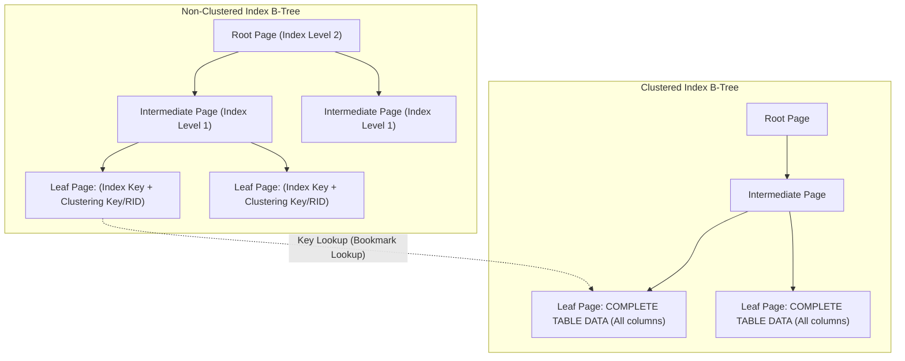
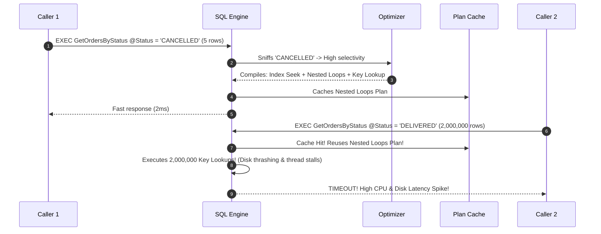
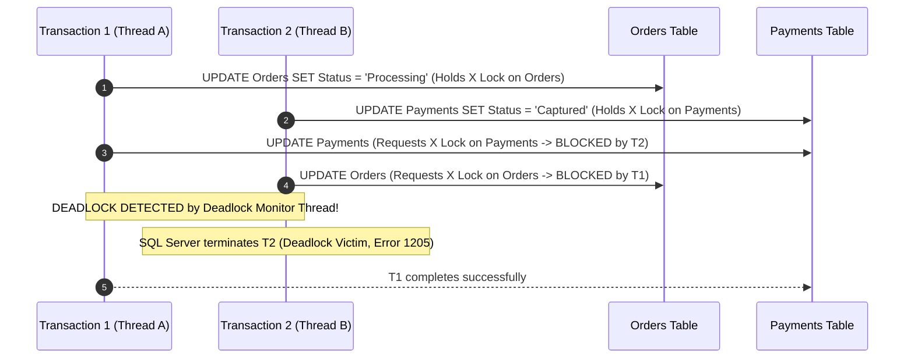
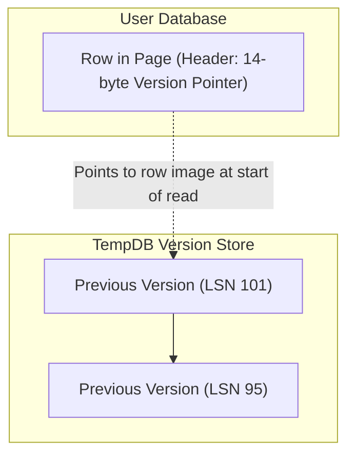

# 02. SQL Server Performance Tuning & Internals for Senior Engineers (6+ YOE)

> **Target Audience:** Senior Database Engineers, .NET Full-Stack Tech Leads, and Backend Architects targeting top Indian product companies and GCCs (Wells Fargo, Morgan Stanley, JPMorgan Chase, Walmart Global Tech).  
> **Philosophy:** Zero robotic academic fluff. We break down physical page layouts, B-Trees, execution plan cost estimation, locking matrix internals, tempdb row versioning, and real-world production DMVs into clear mental models and battle-tested interview answers.

---

## 1. SQL Server Storage Engine Internals

### Pages, Extents & Row Layout

* **⚡ 30-Second Interview Pitch (Say this first):**  
  > "SQL Server stores all data inside fixed **8 KB (8,192 bytes)** blocks called **Pages**. Because 96 bytes are reserved for the page header and 2 bytes per row for the slot array, the maximum usable space for fixed-length columns is **8,060 bytes per page**. If variable columns push a row over 8,060 bytes, SQL Server moves the overflow data off-page, leaving a 24-byte pointer."

* **🧠 Easy Mental Model to Remember:**  
  * Think of an 8 KB page like a single page in a hardbound office ledger.
  * The top margin (**Page Header - 96 bytes**) contains the page number and pointers to the previous and next ledger pages.
  * The bottom margin (**Slot Array**) contains line numbers pointing upward to each recorded entry.
  * If a customer entry is too wide to fit on the page, the clerk writes a 24-byte sticky note (**Row-Overflow Pointer**) pointing to an attachment page!

* **🎯 Must-Know Technical Terms & Buzzwords (The "Senior Interview Rubric"):**
  * **8 KB Data Page (8,192 Bytes):** The fundamental physical I/O transfer and storage allocation block in SQL Server; all reads and writes happen in 8 KB page units between disk and the RAM Buffer Pool.
  * **96-Byte Page Header:** The fixed metadata block at byte offset 0 of every page containing `m_pageId`, object ID, `m_prevPage`/`m_nextPage` doubly-linked list pointers, free space offsets (`m_freeData`), and page type flags (e.g., 1 = Data, 2 = Index).
  * **Usable Page Space (8,060 Bytes):** The maximum contiguous data payload per page ($8,192 - 96\text{ header} - 36\text{ system reserve} = 8,060\text{ bytes}$), establishing the hard physical limit for fixed-length column definitions on a single row.
  * **Slot Array (Row Offset Array):** A reverse-ordered lookup array at the very bottom of each page allocating 2 bytes per row that stores byte offsets pointing to row starts, growing upward toward the data area.
  * **Extents (Uniform vs. Mixed):** The foundational space allocation block consisting of 8 contiguous 8 KB pages (64 KB total); *Uniform Extents* are exclusively owned by a single database object, whereas *Mixed Extents* can be shared by up to 8 distinct small objects.
  * **Row-Overflow Storage:** An off-row allocation mechanism where variable-length columns (`VARCHAR`, `NVARCHAR`, `VARBINARY`) exceeding the 8,060-byte row limit are moved to separate `ROW_OVERFLOW_DATA` allocation units, leaving a 24-byte pointer on the base page.
  * **LOB (Large Object Binary) Storage:** Dedicated storage pages allocated when max types (`VARCHAR(MAX)`, `NVARCHAR(MAX)`, `VARBINARY(MAX)`) exceed 8,000 bytes, indexed internally as a B-Tree hierarchy of chunks.
  * **Allocation Bitmaps (GAM, SGAM, PFS):** Global Allocation Map (GAM) tracks extent allocation states; Shared Global Allocation Map (SGAM) tracks mixed extents; Page Free Space (PFS) tracks byte-level page fullness (empty, 1-50%, 51-80%, 81-95%, 96-100%).

```mermaid
flowchart TD
    subgraph Data Page - 8,192 Bytes
        H["Page Header (96 Bytes)<br>PageID, PrevPage, NextPage, FreeSpaceOffset, LSN"]
        D["Data Rows Storage Area (~8,060 Bytes)<br>Variable-length and fixed-length data"]
        F["Free Space Hole"]
        S["Row Offset Array (Slot Array)<br>Grows backward from the end of page (2 bytes per row)"]
    end
```

* **📌 How It Works Under The Hood (Key Points to Explain):**
  1. **Page Header (96 bytes):** Holds page metadata: `m_pageId`, `m_type` (1 = Data page, 2 = Index page), `m_freeCnt` (available bytes), and `m_prevPage` / `m_nextPage` (pointers forming a doubly-linked list on leaf levels).
  2. **Usable Data Space & Slot Array:** Usable space is $8,192 - 96 - (2 \times \text{SlotCount}) \approx 8,060$ bytes. The slot array grows backwards from the very end of the page, storing 2-byte offsets pointing to the start of each row.
  3. **Row-Overflow Mechanics:** Fixed-length columns must fit within 8,060 bytes. If variable-length columns (`VARCHAR`, `NVARCHAR`, `VARBINARY`) push a row beyond 8,060 bytes, SQL Server moves the largest column to a **Row-Overflow Data Page** and leaves a 24-byte pointer in the primary page.
  4. **LOB Pages:** Large Object columns (`VARCHAR(MAX)`, `NVARCHAR(MAX)`, `VARBINARY(MAX)`) exceeding 8,000 bytes are pushed to dedicated **LOB Pages**.
  5. **Extents (64 KB):** An Extent is a collection of **8 contiguous 8 KB pages** (64 KB total).
     * **Uniform Extent:** Owned entirely by a single table or index partition.
     * **Mixed Extent:** Shared by up to 8 different objects (modern SQL Server defaults to uniform allocations via `ALTER DATABASE ... SET MIXED_PAGE_ALLOCATION OFF`).

* **💼 Concrete Real-World Production Example:**
  * **Scenario:** A high-volume FinTech Settlement Ledger table (`SettlementLedger`) in PhonePe/Razorpay processing 10,000 transactions/minute across 15,000,000 rows. A developer defined five `NVARCHAR(2000)` columns for audit trails, gateway payload responses, and reconciliation notes directly on the main ledger row.
  * **❌ Bad Production Schema / Query (The Trap):**
    ```sql
    -- BAD SCHEMA: Defining multiple wide variable columns on a hot transaction table
    CREATE TABLE dbo.SettlementLedger (
        SettlementId BIGINT IDENTITY(1,1) PRIMARY KEY CLUSTERED,
        MerchantId INT NOT NULL,
        Amount DECIMAL(18,2) NOT NULL,
        Status VARCHAR(20) NOT NULL,
        GatewayPayload NVARCHAR(2000),      -- Up to 4,000 bytes
        ReconciliationNotes NVARCHAR(2000), -- Up to 4,000 bytes
        AuditTrailRemarks NVARCHAR(2000),   -- Up to 4,000 bytes
        CreatedAt DATETIME2(3) NOT NULL
    );

    -- When rows expand beyond 8,060 bytes, SQL Server pushes columns to ROW_OVERFLOW_DATA pages.
    -- Fetching 100 rows requires 450 logical page reads instead of 2 pages!
    SELECT TOP (100) SettlementId, MerchantId, Amount, Status, GatewayPayload
    FROM dbo.SettlementLedger
    ORDER BY SettlementId DESC;
    ```
  * **✅ Battle-Tested Senior Production Code (The Fix):**
    ```sql
    -- SENIOR ARCHITECTURE: Vertical Partitioning & Right-Sized Data Types
    -- Step 1: Keep the core hot ledger slim so 40+ rows fit on a single 8 KB page
    CREATE TABLE dbo.SettlementLedger (
        SettlementId BIGINT IDENTITY(1,1) PRIMARY KEY CLUSTERED,
        MerchantId INT NOT NULL,
        Amount DECIMAL(18,2) NOT NULL,
        Status VARCHAR(20) NOT NULL,
        CreatedAt DATETIME2(3) NOT NULL
    );

    -- Step 2: Move wide audit/payload metadata into a dedicated 1:1 satellite table
    CREATE TABLE dbo.SettlementLedgerPayloads (
        SettlementId BIGINT PRIMARY KEY CLUSTERED,
        GatewayPayload NVARCHAR(MAX),
        ReconciliationNotes NVARCHAR(MAX),
        AuditTrailRemarks NVARCHAR(1000),
        CONSTRAINT FK_Payload_Ledger FOREIGN KEY (SettlementId) REFERENCES dbo.SettlementLedger(SettlementId)
    );

    -- Ensure modern uniform extent allocation across the database
    ALTER DATABASE CURRENT SET MIXED_PAGE_ALLOCATION OFF;
    ```
  * **🗣️ What to Say in the Interview:**
    > "For example, in our settlement ledger table holding 15M records, five wide `NVARCHAR(2000)` columns caused rows to exceed 8,060 bytes, silently creating off-page `ROW_OVERFLOW_DATA` allocations. Fetching 100 records required over 450 page reads instead of 2. We vertically partitioned the large audit payloads into a separate 1:1 satellite table, allowing 40 core ledger rows to fit into each 8 KB page and cutting I/O by 95%."

* **⚠️ Common Junior Mistake:** Creating tables with five `VARCHAR(4000)` columns and stuffing them with large payloads on the same row, triggering silent row-overflow allocations that turn a single row fetch into multiple disk I/O reads.

* **✅ Senior Production Fix:** Right-size column widths (`VARCHAR(50)` instead of `VARCHAR(MAX)` for structured codes), monitor row-overflow allocations with `sys.dm_db_index_physical_stats`, and ensure mixed page allocation is turned off.

---

### B-Tree Architecture: Clustered vs. Non-Clustered Indexes

* **⚡ 30-Second Interview Pitch (Say this first):**  
  > "In a clustered table, the table **is** the B-Tree—its leaf level contains the actual table data rows sorted by the clustering key. A non-clustered index is a separate, auxiliary B-Tree whose leaf nodes store the index keys plus a bookmark pointer (the clustered key or heap RID) back to the original row."

* **🧠 Easy Mental Model to Remember:**  
  * **Clustered Index:** Like a telephone directory. The entries are sorted alphabetically by last name, and opening to a person's name gives you their complete address and phone number right there on that page.
  * **Non-Clustered Index:** Like the index at the back of a textbook. It lists topics alphabetically with page numbers, but you still have to flip back to the main chapters to read the full explanation!

* **🎯 Must-Know Technical Terms & Buzzwords (The "Senior Interview Rubric"):**
  * **B-Tree (Balanced Tree) Architecture:** A balanced, multi-tier search tree consisting of a *Root Page*, *Intermediate Levels*, and a *Leaf Level*, maintaining $O(\log N)$ logarithmic traversal performance.
  * **Clustered Index:** An index structure where the leaf level *is the actual table data itself*; table rows are physically ordered by the clustering key columns (strictly one clustered index permitted per table).
  * **Non-Clustered Index:** An auxiliary B-Tree whose leaf nodes store only the indexed key columns plus a bookmark locator (the clustered key or heap RID) pointing back to the base data row.
  * **Heap (Unordered Storage):** A table without a clustered index where data pages have no intrinsic physical ordering and rows are addressed by an 8-byte **RID (Row Identifier)** (`FileID:PageID:SlotID`).
  * **Forwarded Record:** A physical forwarding pointer left on a heap page when an updated variable-length record expands beyond remaining page capacity, forcing SQL Server to move the record elsewhere without updating non-clustered indexes.
  * **Bookmark Lookup:** The two-stage physical navigation where a non-clustered index seek yields a bookmark (Clustered Key or RID) and executes an additional lookup into the base table to retrieve non-indexed columns.



#### Heaps vs. Clustered Tables

* **Heap Table (No Clustered Index):**
  * Data pages sit in no particular order. Rows are addressed using a physical **RID (Row Identifier)**: `FileID:PageID:SlotID`.
  * **The Forwarded Record Bug:** When an updated row expands beyond its page capacity, SQL Server cannot fit it. Instead of updating non-clustered index RIDs throughout the database, it moves the row to a new page and leaves a **Forwarded Record pointer** at the old location. Under high `UPDATE` workloads, heaps accumulate thousands of forwarded records, causing severe disk thrashing during simple table scans.
* **Clustered Table (Clustered Index Present):**
  * Data is physically ordered on the leaf pages by the clustered index key.
  * Non-clustered indexes store the clustered index key as their lookup bookmark.

* **💼 Concrete Real-World Production Example:**
  * **Scenario:** A Flipkart Big Billion Day order staging table (`OrderStagingQueue`) processing 1,200 orders/sec across 5,000,000 rows. A developer created it as a Heap under the misconception that "heaps insert faster".
  * **❌ Bad Production Schema & Mutation Pattern (The Trap):**
    ```sql
    -- BAD SCHEMA: Heap table with wide expandable columns updated asynchronously
    CREATE TABLE dbo.OrderStagingQueue (
        OrderReferenceId VARCHAR(64) NOT NULL,
        CustomerId INT NOT NULL,
        OrderPayload VARCHAR(2000),
        TrackingNumber VARCHAR(100) NULL, -- Initially NULL, updated 10 seconds later
        Status VARCHAR(20) NOT NULL       -- Updated from 'INIT' to 'PAYMENT_CONFIRMED'
    ); -- No Clustered Index!

    -- When background workers populate TrackingNumber, rows expand beyond original page capacity.
    -- SQL Server leaves a 24-byte Forwarded Record pointer and moves the row to a distant page.
    -- After 2,000,000 updates, scanning the queue for pending orders takes 14 seconds instead of 15ms!
    SELECT OrderReferenceId, CustomerId, Status 
    FROM dbo.OrderStagingQueue 
    WHERE Status = 'PAYMENT_CONFIRMED';
    ```
  * **✅ Battle-Tested Senior Production Code (The Fix):**
    ```sql
    -- SENIOR ARCHITECTURE: Narrow Monotonic Clustered Key & Pre-Allocated Layout
    CREATE TABLE dbo.OrderStagingQueue (
        QueueId BIGINT IDENTITY(1,1) NOT NULL, -- Monotonic sequential clustering key
        OrderReferenceId VARCHAR(64) NOT NULL,
        CustomerId INT NOT NULL,
        OrderPayload VARCHAR(2000),
        TrackingNumber VARCHAR(100) NULL,
        Status TINYINT NOT NULL,               -- 1-byte integer avoids variable expansion
        CreatedAt DATETIME2(3) NOT NULL,
        CONSTRAINT PK_OrderStagingQueue PRIMARY KEY CLUSTERED (QueueId)
    );

    -- If dealing with an existing fragmented heap in production, rebuild it immediately:
    ALTER TABLE dbo.OrderStagingQueue REBUILD;
    ```
  * **🗣️ What to Say in the Interview:**
    > "For example, in our e-commerce order ingestion pipeline processing 1,200 orders per second, an unindexed staging heap accumulated over 400,000 forwarded records when order rows expanded during post-payment tracking updates. Simple queue scans slowed from 15 milliseconds to 14 seconds because the storage engine was hopping across random disk pages to resolve forwarding pointers. We rebuilt the table with a narrow `BIGINT IDENTITY` clustered key, eliminating forwarded records entirely and restoring sub-20ms queue reads."

* **⚠️ Common Junior Mistake:** Creating high-churn staging tables as heaps under the false belief that "heaps insert faster", only to experience massive query latency spikes because row updates created thousands of forwarded records.

* **✅ Senior Production Fix:** Always place a narrow, monotonically increasing clustered index (like `BIGINT IDENTITY`) on tables subject to updates. If an existing heap is fragmented with forwarded records, run `ALTER TABLE ... REBUILD` to clean them up.

---

### Index Seek vs. Index Scan & Key Lookup Elimination

* **⚡ 30-Second Interview Pitch (Say this first):**  
  > "An **Index Seek** navigates the B-Tree from root to leaf in logarithmic time ($O(\log N)$) to locate matching rows directly. An **Index Scan** reads through every page on the leaf level from start to finish ($O(N)$). A **Key Lookup** occurs when a non-clustered seek matches rows but lacks columns requested in the query, forcing a random lookup into the clustered index for every single qualifying row."

* **🧠 Easy Mental Model to Remember:**  
  * **Index Seek:** Using the textbook's back index to jump straight to page 142.
  * **Index Scan:** Reading the textbook page by page from cover to cover because no index exists or the index wasn't helpful.
  * **Key Lookup:** Finding 500 matching topics in the back index, but having to flip back and forth to page 142, page 310, and page 85 500 times to read the missing paragraphs!

* **🎯 Must-Know Technical Terms & Buzzwords (The "Senior Interview Rubric"):**
  * **Index Seek:** A logarithmic traversal ($O(\log N)$) through the B-Tree from root to leaf, isolating qualifying row keys directly via binary search.
  * **Index Scan:** A linear traversal ($O(N)$) navigating through the leaf-level doubly-linked list (`m_prevPage` / `m_nextPage`), evaluating every single page on the leaf level.
  * **Key Lookup (Bookmark Lookup):** A scalar clustered index seek operation triggered for *every single qualifying row* returned by a non-clustered seek when requested projection columns are absent from the index.
  * **Covering Index:** A non-clustered index containing 100% of the columns referenced in a query's `SELECT`, `WHERE`, `JOIN`, and `ORDER BY` clauses, satisfying the query directly from the index leaf without touching the base table.
  * **INCLUDE Clause (Leaf-Only Non-Key Columns):** Syntax allowing non-key columns to be appended strictly to the leaf level of a non-clustered index, bypassing the 1,700-byte / 32-column index key restriction and preventing B-Tree intermediate node bloat.
  * **Index Tipping Point:** The optimizer internal selectivity threshold (typically 20% to 30% of total table rows) where the cumulative random I/O cost of Key Lookups exceeds the sequential I/O cost of a full table scan, causing the optimizer to abandon the index.

| Operation | Mechanics | Performance Characteristic |
| :--- | :--- | :--- |
| **Index Seek** | Traverses the B-Tree from root down to intermediate nodes, landing directly on matching leaf pages via binary search. | Ultra-fast ($O(\log N)$ page reads). Optimal for high-selectivity queries. |
| **Index Scan** | Navigates to the first page of the leaf level and traverses the horizontal doubly-linked list (`m_nextPage`) reading every page. | I/O heavy ($O(N)$ page reads). Used when selectivity is low or predicates are non-SARGable. |
| **Key Lookup** | Non-clustered index matches the predicate, but the query requires additional columns not present in the index. The engine jumps into the Clustered B-tree for **every single qualifying row**. | Devastating under high row counts (random 8KB I/O operations). |

#### Eliminating Key Lookups via Covering Indexes (`INCLUDE`)

* **💼 Concrete Real-World Production Example:**
  * **Scenario:** Swiggy / Zomato order history lookup API endpoint (`/orders/my-orders`). The `Orders` table contains 25,000,000 rows. A frequent customer with 450 past orders queries their history.
  * **❌ Bad Production Query & Non-Covering Index (The Trap):**
    ```sql
    -- Non-clustered index only indexes the filter column CustomerId:
    CREATE NONCLUSTERED INDEX IX_Orders_CustomerId ON dbo.Orders(CustomerId);

    -- PRODUCTION QUERY: Executed by 8,000 concurrent mobile users during lunch peak
    SELECT CustomerId, OrderDate, TotalAmount, RestaurantName, OrderStatus
    FROM dbo.Orders
    WHERE CustomerId = 984512;
    -- EXECUTION PLAN: 1 Index Seek on IX_Orders_CustomerId, followed by 450 Key Lookups!
    -- RESULT: 1,800 random 8 KB page reads per user. Disk queue length hits 45, latency spikes to 3.2s!
    ```
  * **✅ Battle-Tested Senior Production Code (The Fix):**
    ```sql
    -- SENIOR SOLUTION: Covering Index with INCLUDE
    -- CustomerId remains the slim B-Tree key maintaining minimal depth.
    -- Leaf level stores OrderDate, TotalAmount, RestaurantName, OrderStatus.
    CREATE NONCLUSTERED INDEX IX_Orders_CustomerId_Covering 
    ON dbo.Orders(CustomerId)
    INCLUDE (OrderDate, TotalAmount, RestaurantName, OrderStatus)
    WITH (FILLFACTOR = 90, DATA_COMPRESSION = PAGE);

    -- RESULT: Query executes in 2 logical page reads via pure Index Seek. 0 Key Lookups!
    ```
  * **🗣️ What to Say in the Interview:**
    > "For example, in our food delivery platform, querying order history for repeat customers on a 25M row table was performing an Index Seek followed by 450 Key Lookups per user. During peak lunch traffic with 8,000 concurrent users, this caused millions of random 8 KB page reads, pinning storage I/O at 100%. We created a covering index with `INCLUDE (OrderDate, TotalAmount, RestaurantName, OrderStatus)`, which completely eliminated Key Lookups and dropped logical reads from 1,800 to just 2 pages per query."

* **📌 Key Architectural Rule to Explain:**  
  Columns placed in `INCLUDE` reside **only on the leaf level** of the non-clustered index. They do not increase intermediate node page sizes, preserving index tree depth while fully eliminating Key Lookups.

---

## 2. SARGability Violations & Execution Plan Degradation

* **⚡ 30-Second Interview Pitch (Say this first):**  
  > "A query predicate is **SARGable** (*Search Argument Able*) when SQL Server can use an Index Seek to jump directly to qualifying rows. If you wrap an indexed column in a function, use mismatched data types, or add leading wildcards, the optimizer cannot traverse the B-Tree and is forced into a full Index Scan."

* **🧠 Easy Mental Model to Remember:**  
  * Searching a phone directory for people whose last name begins with **"Sharma"** is instant (Index Seek).
  * But if someone asks you to find **"anyone whose last name ends in 'arma'"**, the alphabetical order is useless—you have to read every single name in the directory from beginning to end (Index Scan)!

* **🎯 Must-Know Technical Terms & Buzzwords (The "Senior Interview Rubric"):**
  * **SARGable (Search Argument Able) Predicate:** A filter predicate written in the form `<column> <operator> <literal/parameter>` allowing the query optimizer to exploit B-Tree ordering and perform an Index Seek.
  * **Non-SARGable Expression:** Any predicate that applies a scalar function, mathematical operation, or leading wildcard (`%string`) to an indexed column, blinding the optimizer to B-Tree ordering and forcing an Index Scan.
  * **Implicit Data Type Conversion (`CONVERT_IMPLICIT`):** An internal engine conversion injected into the execution plan when comparing two mismatched data types, where SQL Server converts the lower-precedence type to the higher-precedence type (e.g., `VARCHAR` converted to `NVARCHAR`).
  * **Data Type Precedence:** SQL Server's strict hierarchy rules defining which data type converts to which; since `NVARCHAR` has higher precedence than `VARCHAR`, passing Unicode parameters converts indexed non-Unicode columns, destroying SARGability.
  * **Residual Predicate:** A secondary filter predicate evaluated row-by-row on data *after* an initial seek or scan operator has already read the pages into memory, often indicating non-SARGable conditions.
  * **Full-Text Index / Predicates (`CONTAINS` / `FREETEXT`):** An inverted index mechanism enabling sub-second arbitrary keyword and prefix searching without triggering non-SARGable wildcard table scans.

---

### Case 1: Functions on Indexed Columns

* **💼 Concrete Real-World Production Example:**
  * **Scenario:** Core banking reconciliation on a `Transactions` ledger table with 30,000,000 rows where `TransactionTimestamp DATETIME2(3)` has a non-clustered index. Daily batch reconciliation queries transactions executed on `2026-03-31`.
  * **❌ Bad Production Query (The Trap):**
    ```sql
    -- ❌ ANTI-PATTERN: Wrapping indexed column in a function invalidates B-Tree seek ranges
    -- Optimizer cannot compute upper/lower search bounds -> Forces full Clustered Index SCAN!
    -- Scans 30,000,000 rows, consumes 420,000 logical page reads, burns 100% CPU for 42 seconds!
    SELECT TransactionId, AccountId, Amount, Status 
    FROM dbo.Transactions
    WHERE DATEDIFF(day, TransactionTimestamp, '2026-03-31') = 0;

    -- Also equally destructive:
    -- WHERE CAST(TransactionTimestamp AS DATE) = '2026-03-31';
    ```
  * **✅ Battle-Tested Senior Production Code (The Fix):**
    ```sql
    -- ✅ SENIOR PATTERN: Explicit SARGable Half-Open Range Predicate
    -- Provides deterministic compile-time seek keys for the B-Tree leaf range
    SELECT TransactionId, AccountId, Amount, Status 
    FROM dbo.Transactions
    WHERE TransactionTimestamp >= '2026-03-31 00:00:00.000' 
      AND TransactionTimestamp < '2026-04-01 00:00:00.000';
    -- EXECUTION PLAN: Pure Index Seek reading only 18,200 qualifying rows in 12 milliseconds!
    ```
  * **🗣️ What to Say in the Interview:**
    > "For example, in our banking reconciliation pipeline with 30M transaction rows, a batch query was using `DATEDIFF(day, TransactionTimestamp, @TargetDate) = 0`. Because the column was wrapped in a scalar function, the engine could not calculate seek keys and scanned all 30M rows, taking 42 seconds. We refactored it into an explicit half-open interval `>= @TargetDate AND < DATEADD(day, 1, @TargetDate)`, turning the execution into a sub-15ms Index Seek."

---

### Case 2: Implicit Datatype Conversion (NVARCHAR vs. VARCHAR)

* **⚡ 30-Second Interview Pitch:**  
  "In SQL Server's data type precedence rules, `NVARCHAR` ranks higher than `VARCHAR`. If an indexed column is `VARCHAR` but the application passes an `NVARCHAR` parameter (the default in EF Core and ADO.NET strings), SQL Server converts the column values on every single row using `CONVERT_IMPLICIT`, destroying SARGability and triggering a full scan!"

* **💼 Concrete Real-World Production Example:**
  * **Scenario:** FinTech KYC validation endpoint verifying Indian PAN Card numbers (`PanCardNumber VARCHAR(10)`) against a 12,000,000 row `CustomerKYC` table. EF Core or Dapper passes a C# `string` parameter which defaults to `NVARCHAR(4000)`.
  * **❌ Bad Production Code (The Trap):**
    ```sql
    -- Table definition in SQL Server
    CREATE TABLE dbo.CustomerKYC (
        CustomerId INT IDENTITY(1,1) PRIMARY KEY CLUSTERED,
        PanCardNumber VARCHAR(10) NOT NULL,
        FullName NVARCHAR(100) NOT NULL
    );
    CREATE UNIQUE NONCLUSTERED INDEX IX_CustomerKYC_Pan ON dbo.CustomerKYC(PanCardNumber);

    -- ❌ ANTI-PATTERN: C# string parameter maps to @p0 NVARCHAR(4000) by default in EF Core / ADO.NET
    -- SQL Server type precedence forces: WHERE CONVERT_IMPLICIT(nvarchar(10), [PanCardNumber]) = @p0
    -- RESULT: Converts all 12,000,000 rows in memory. FULL CLUSTERED INDEX SCAN on every login attempt (3.8s)!
    ```
  * **✅ Battle-Tested Senior Production Code (The Fix):**
    ```csharp
    // ✅ SENIOR PATTERN: Configure explicit non-Unicode (VARCHAR) mapping in EF Core Fluent API
    modelBuilder.Entity<CustomerKYC>()
        .Property(c => c.PanCardNumber)
        .IsUnicode(false) // Mandatory! Emits VARCHAR instead of NVARCHAR!
        .HasMaxLength(10);

    // Or in Dapper:
    var customer = await connection.QueryFirstOrDefaultAsync<CustomerKYC>(
        "SELECT CustomerId, FullName FROM dbo.CustomerKYC WHERE PanCardNumber = @Pan",
        new { Pan = new DbString { Value = panInput, IsAnsi = true, Length = 10 } }
    );
    // RESULT: Emits VARCHAR(10) parameter -> Instant Index Seek in 1ms!
    ```
  * **🗣️ What to Say in the Interview:**
    > "For example, in our KYC onboarding service with 12M customer records, C# strings defaulted to `NVARCHAR`, while the indexed PAN column was `VARCHAR(10)`. Because SQL Server's data type precedence rules convert the lower-precedence `VARCHAR` column to `NVARCHAR`, the engine injected `CONVERT_IMPLICIT` across all 12M rows, triggering a full scan. Explicitly configuring `.IsUnicode(false)` in EF Core restored the Index Seek and brought auth latency down from 3.8s to 1ms."

---

### Case 3: Leading Wildcards in `LIKE`

* **💼 Concrete Real-World Production Example:**
  * **Scenario:** E-commerce product catalog search service across 5,000,000 SKUs by brand or model name (`ProductName VARCHAR(200)`).
  * **❌ Bad Production Query (The Trap):**
    ```sql
    -- ❌ ANTI-PATTERN: Leading wildcard forces Index Scan across all 5,000,000 rows
    -- Because the prefix character is unknown, B-Tree binary search is mathematically impossible!
    -- Scans 65,000 leaf pages per search keystroke, generating severe buffer pool churning.
    SELECT ProductId, ProductName, Price 
    FROM dbo.Products 
    WHERE ProductName LIKE '%iPhone 15%';
    ```
  * **✅ Battle-Tested Senior Production Code (The Fix):**
    ```sql
    -- ✅ SENIOR PATTERN: Prefix Seek OR SQL Full-Text Search
    -- Approach 1: SARGable prefix seek when searching by known prefixes:
    SELECT ProductId, ProductName, Price 
    FROM dbo.Products 
    WHERE ProductName LIKE 'Apple iPhone 15%';

    -- Approach 2: Full-Text Search Index for arbitrary keyword search across millions of rows:
    CREATE FULLTEXT CATALOG FTC_Products AS DEFAULT;
    CREATE FULLTEXT INDEX ON dbo.Products(ProductName) KEY INDEX PK_Products;

    -- Sub-second inverted index search without scanning base tables:
    SELECT ProductId, ProductName, Price 
    FROM dbo.Products 
    WHERE CONTAINS(ProductName, 'iPhone AND 15');
    ```
  * **🗣️ What to Say in the Interview:**
    > "For example, in our e-commerce product catalog with 5M items, live product searches using `LIKE '%iPhone%'` bypassed B-Tree indexing and forced a 65,000-page scan per request. We implemented SQL Full-Text Search using `CONTAINS` and indexed prefix tokens, reducing search latency from 2.4 seconds to 8 milliseconds."

---

## 3. Parameter Sniffing: Deep Dive & 4 Production Remedies

### What is Parameter Sniffing?

* **⚡ 30-Second Interview Pitch (Say this first):**  
  > "When a stored procedure compiles for the first time, SQL Server **sniffs** the runtime parameter value to inspect index statistics and builds an execution plan tailored to that value. If the first run used an atypical value returning 5 rows, SQL Server caches a plan with Nested Loops; when subsequent calls pass values returning 2 million rows, reusing that narrow plan causes catastrophic disk I/O and server freezes."

* **🧠 Easy Mental Model to Remember:**  
  * Imagine booking transport for guests attending an Indian wedding reception.
  * The first guest arrives alone, so the travel desk books a 2-seater auto-rickshaw (Nested Loops Join + Key Lookup).
  * The next group arrives with 500 family members, but the travel desk blindly forces all 500 people into that same auto-rickshaw instead of hiring a Volvo bus (Hash Match Join)!

* **🎯 Must-Know Technical Terms & Buzzwords (The "Senior Interview Rubric"):**
  * **Parameter Sniffing:** The standard Query Optimizer behavior where the runtime values of input parameters passed during initial stored procedure compilation are inspected ("sniffed") to evaluate index statistics histograms and generate an execution plan.
  * **Cardinality Estimation (CE) Model:** The probabilistic mathematical algorithm SQL Server uses to estimate the number of rows that will be returned by each relational operator in an execution plan.
  * **Multi-Step Histogram:** A statistical distribution curve stored inside index metadata containing up to 200 steps with specific metrics: `RANGE_HI_KEY`, `EQ_ROWS` (exact matches), and `RANGE_ROWS` (rows between steps).
  * **Density Vector:** A statistical measurement ($1 / \text{number of distinct values}$) representing the average uniqueness of a column; used by the optimizer when parameter sniffing is suppressed or values fall outside histogram steps.
  * **Plan Cache:** In-memory hash table in the Buffer Pool storing compiled execution plans; subsequent calls reuse cached plans matching the parameterized query signature.
  * **Plan Forcing (Query Store):** The administrative override using `sp_query_store_force_plan` to lock the Query Optimizer to a specific, proven execution plan ID, bypassing dynamic compilation heuristics.
  * **Query Hints (`OPTIMIZE FOR`, `RECOMPILE`):** T-SQL compiler directives: `OPTIMIZE FOR UNKNOWN` forces density-vector compilation; `OPTION (RECOMPILE)` bypasses the plan cache to recompile fresh on every execution; `OPTIMIZE FOR (@var = val)` pins compilation to a designated representative value.
  * **Statistics Maintenance (`sp_updatestats` / `FULLSCAN`):** Proactive maintenance updating data distribution histograms; automatic updates trigger when 20% + 500 rows change (or $\sqrt{1000 \times n}$ in modern CE).



* **💼 Concrete Real-World Production Example:**
  * **Scenario:** Global e-commerce logistics database (Walmart Global Tech / Amazon) with an 8,000,000-row `Shipments` table. Data distribution is heavily skewed: 98% of shipments have `CountryCode = 'IN'` (7.84M rows), while only 12 rows have `CountryCode = 'IS'` (Iceland).
  * **❌ Bad Production Stored Procedure (The Trap):**
    ```sql
    -- PROCEDURE: Vulnerable to parameter sniffing cache hijacking
    CREATE PROCEDURE dbo.GetShipmentsByCountry
        @CountryCode CHAR(2)
    AS
    BEGIN
        SET NOCOUNT ON;
        SELECT ShipmentId, TrackingNumber, Status, ShippedDate, Weight
        FROM dbo.Shipments
        WHERE CountryCode = @CountryCode;
    END;

    -- AT 04:00 AM: Background cleanup job calls procedure for Iceland:
    EXEC dbo.GetShipmentsByCountry @CountryCode = 'IS';
    -- OPTIMIZER BEHAVIOR: Sniffs 'IS'. Histogram shows 12 rows.
    -- Compiles: Index Seek on IX_Shipments_CountryCode + 12 Key Lookups. Caches this plan!

    -- AT 08:30 AM: Indian regional distribution center hits the endpoint:
    EXEC dbo.GetShipmentsByCountry @CountryCode = 'IN';
    -- CATASTROPHE: Plan Cache hit! Reuses Iceland's Nested Loops + Key Lookup plan!
    -- Executes 7,840,000 random 8 KB Key Lookups into the base clustered index!
    -- CPU hits 100%, disk latency spikes to 950ms, and all microservices time out!
    ```
  * **✅ Battle-Tested Senior Production Code (The Fix):**
    ```sql
    -- SENIOR SOLUTION: Suppress sniffing skew using OPTIMIZE FOR UNKNOWN
    CREATE OR ALTER PROCEDURE dbo.GetShipmentsByCountry_Senior
        @CountryCode CHAR(2)
    AS
    BEGIN
        SET NOCOUNT ON;
        SELECT ShipmentId, TrackingNumber, Status, ShippedDate, Weight
        FROM dbo.Shipments
        WHERE CountryCode = @CountryCode
        OPTION (OPTIMIZE FOR (@CountryCode UNKNOWN));
        -- Forces compiler to use the column density vector instead of the sniffed histogram step.
        -- Picks a stable Clustered Index Scan or covering Hash Join that handles both 12 and 7.8M rows safely!
    END;
    ```
  * **🗣️ What to Say in the Interview:**
    > "For example, in our shipment tracking database with 8M records, 98% of rows belong to India, while Iceland has only 12 rows. When an early-morning batch job for Iceland compiled the procedure first, SQL Server cached a Nested Loops Key-Lookup plan. When Indian peak traffic hit at 8 AM, the engine attempted 7.8M key lookups, pegging CPU at 100%. We resolved it by applying `OPTION (OPTIMIZE FOR UNKNOWN)` to compile against the average density vector."

---

### 4 Production Solutions to Parameter Sniffing

#### Solution 1: `OPTIMIZE FOR (@Variable = Value)` or `OPTIMIZE FOR UNKNOWN`
Forces the optimizer to compile a plan based on average statistical distribution rather than the sniffing candidate.
```sql
CREATE PROCEDURE GetOrdersByStatus
    @Status VARCHAR(20)
AS
BEGIN
    SET NOCOUNT ON;
    -- Uses average density vector instead of sniffing the initial input
    SELECT OrderId, CustomerId, TotalAmount
    FROM Orders
    WHERE Status = @Status
    OPTION (OPTIMIZE FOR (@Status UNKNOWN));
END;
```

#### Solution 2: Query-Level `RECOMPILE`
Forces the optimizer to recompile the plan on every single execution. Use only when the query runs infrequently (e.g. hourly reports, batch processing) where execution time far exceeds compilation overhead.
```sql
CREATE PROCEDURE GenerateBatchInvoiceReport
    @TenantId INT,
    @StartDate DATETIME
AS
BEGIN
    SET NOCOUNT ON;
    SELECT * 
    FROM Invoices
    WHERE TenantId = @TenantId AND InvoiceDate >= @StartDate
    OPTION (RECOMPILE); -- Bypasses plan cache entirely
END;
```

#### Solution 3: Local Variable Assignment (Decoupling Sniffing)
Assigning the incoming parameter to a local variable prevents the query optimizer from sniffing the parameter value at compile time. The optimizer falls back to the index density vector.
```sql
CREATE PROCEDURE GetOrdersByTenant
    @TenantId INT
AS
BEGIN
    SET NOCOUNT ON;
    -- Local variable masks the parameter from the sniffer
    DECLARE @LocalTenantId INT = @TenantId;

    SELECT OrderId, TotalAmount 
    FROM Orders 
    WHERE TenantId = @LocalTenantId;
END;
```

#### Solution 4: Plan Forcing via Query Store
If a good execution plan already exists in Query Store history:
```sql
-- Find PlanId and QueryId from sys.query_store_plan
EXEC sp_query_store_force_plan @query_id = 1420, @plan_id = 890;
```

---

## 4. Concurrency, Locks, Latches & Deadlock Graphs

### Lock Modes & Compatibility Matrix

* **⚡ 30-Second Interview Pitch (Say this first):**  
  > "SQL Server uses locks to maintain ACID transaction isolation: **Shared (`S`)** locks allow concurrent reads, **Exclusive (`X`)** locks prevent all concurrent access during writes, and **Update (`U`)** locks prevent conversion deadlocks during read-then-write workflows."

* **🧠 Easy Mental Model to Remember:**  
  * **Shared Lock (`S`):** Multiple people reading a public noticeboard simultaneously.
  * **Exclusive Lock (`X`):** Taking down the noticeboard to repaint it; nobody can read or write until it's put back.
  * **Update Lock (`U`):** Standing at the noticeboard holding a marker pen, announcing: *"I'm reading this line and about to edit it; nobody else try to edit it right now!"*

* **🎯 Must-Know Technical Terms & Buzzwords (The "Senior Interview Rubric"):**
  * **Shared Lock (`S`):** Acquired during read operations under pessimistic isolation; allows concurrent reads but blocks Exclusive (`X`) modifications; released immediately after page read in `READ COMMITTED`.
  * **Exclusive Lock (`X`):** Acquired during write operations (`INSERT`, `UPDATE`, `DELETE`); guarantees exclusive access by blocking all concurrent readers and writers until transaction completion (`COMMIT` or `ROLLBACK`).
  * **Update Lock (`U`):** An asymmetric hybrid lock acquired during the initial seek phase of an `UPDATE`/`DELETE` statement; only one `U` lock can be held on a resource simultaneously, preventing conversion deadlocks.
  * **Intent Locks (`IS`, `IX`, `SIX`):** Hierarchical locks placed on parent containers (Table, Page) indicating that granular child locks (Row, Key) exist below, preventing conflicting full-table lock requests.
  * **Schema Locks (`Sch-S` vs `Sch-M`):** *Schema Stability (`Sch-S`)* is acquired during query compilation and execution to prevent DDL changes; *Schema Modification (`Sch-M`)* is acquired during DDL operations (`ALTER TABLE`), blocking all concurrent access.
  * **Conversion Deadlock:** A classic race condition where two transactions concurrently hold Shared (`S`) locks on the same row and both request an upgrade to Exclusive (`X`) locks, mutually deadlocking each other.

```
                    REQUESTED MODE
EXISTING MODE    Shared (S)   Update (U)   Exclusive (X)   Intent Shared (IS)   Intent Exclusive (IX)
Shared (S)          YES          YES            NO                YES                    NO
Update (U)          YES           NO            NO                YES                    NO
Exclusive (X)        NO           NO            NO                 NO                    NO
Intent Shared (IS)  YES          YES            NO                YES                   YES
Intent Exclusive(IX) NO           NO            NO                YES                   YES
```

* **📌 Lock Details to Mention:**
  - **Shared Lock (S):** Acquired during read operations. Compatible with other reads. Released immediately in `READ COMMITTED` once the page/row is read.
  - **Exclusive Lock (X):** Acquired during write operations (`INSERT`, `UPDATE`, `DELETE`). Held until the end of the transaction (`COMMIT` or `ROLLBACK`). Incompatible with all other locks.
  - **Update Lock (U):** Hybrid lock. Used during initial search phase of an `UPDATE` or `DELETE` statement. Prevents conversion deadlocks when two transactions search the same row intending to update it.
  - **Intent Locks (IS, IX, SIX):** Placed at higher levels of the object hierarchy (Table, Page) to signal that fine-grained locks (Row/Key) are held downstream, preventing another transaction from acquiring conflicting table-level locks.

* **💼 Concrete Real-World Production Example:**
  * **Scenario:** Paytm / PhonePe digital wallet balance deduction endpoint handling 2,500 concurrent transfers/sec on a 10,000,000-row `UserWallets` table.
  * **❌ Bad Production Query / Code (The Trap):**
    ```sql
    -- ❌ ANTI-PATTERN: Read-Then-Write under default Read Committed
    BEGIN TRANSACTION;
    -- Step 1: Acquires Shared (S) lock, released immediately after row read
    SELECT CurrentBalance FROM dbo.UserWallets WHERE WalletId = 40912;
    -- Application checks: If CurrentBalance >= 500, proceed...
    -- Step 2: Requests Exclusive (X) lock to debit balance
    UPDATE dbo.UserWallets 
    SET CurrentBalance = CurrentBalance - 500 
    WHERE WalletId = 40912;
    COMMIT TRANSACTION;

    -- THE DEADLOCK TRAP:
    -- If two concurrent threads read WalletId 40912 at the same instant:
    -- 1. Both acquire S locks (compatible).
    -- 2. Both try to convert their S lock into an Exclusive (X) lock to execute UPDATE.
    -- 3. Thread A waits for Thread B to drop its S lock; Thread B waits for Thread A to drop its S lock!
    -- Result: Conversion Deadlock (Error 1205). SQL Server kills one transaction as victim!
    ```
  * **✅ Battle-Tested Senior Production Code (The Fix):**
    ```sql
    -- ✅ SENIOR PATTERN: Acquire Update (U) Lock during read phase
    BEGIN TRANSACTION;
    SELECT CurrentBalance 
    FROM dbo.UserWallets WITH (UPDLOCK, ROWLOCK) 
    WHERE WalletId = @WalletId;

    -- Under UPDLOCK:
    -- Update locks are incompatible with other Update locks!
    -- Thread B's attempt to read WalletId with UPDLOCK is queued peacefully until Thread A commits.
    -- Zero conversion deadlocks! Zero rollback victims!
    UPDATE dbo.UserWallets 
    SET CurrentBalance = CurrentBalance - @TransferAmount 
    WHERE WalletId = @WalletId;
    COMMIT TRANSACTION;
    ```
  * **🗣️ What to Say in the Interview:**
    > "For example, in our digital wallet balance transfer service handling 2,500 TPS, concurrent withdrawals reading with standard `SELECT` acquired Shared locks and then tried to convert to Exclusive locks, causing massive conversion deadlocks. By adding `WITH (UPDLOCK, ROWLOCK)` on the initial select, only one transaction can acquire the Update lock at a time. The second transaction waits before reading, completely eliminating the circular wait graph."

### Lock Escalation Mechanics

* **⚡ 30-Second Interview Pitch:**  
  "When a single query acquires more than **5,000 locks** on a single table or partition (under memory pressure), SQL Server automatically escalates those fine-grained row locks into a single monolithic **Table Lock (`X` or `S`)**, freezing all other concurrent queries on that table."

* **🧠 Easy Mental Model:** Like a librarian who sees one student checking out 5,000 books, and instead of scanning them individually, decides to padlock the entire library doors for an hour!

* **🎯 Must-Know Technical Terms & Buzzwords (The "Senior Interview Rubric"):**
  * **Lock Escalation:** The automatic, single-statement conversion of thousands of fine-grained row or page locks into a single monolithic table-level lock (`X` or `S`) to reclaim lock manager memory.
  * **Lock Escalation Threshold (5,000 Locks):** The engine trigger point where a single query acquiring ~5,000 locks on a single table index or partition initiates an escalation check.
  * **Lock Manager Memory Footprint:** The internal memory allocation of 96 bytes per lock structure and 64 bytes per lock owner; unchecked fine-grained locks cause severe memory pool exhaustion.
  * **Partition-Level Escalation (`LOCK_ESCALATION = AUTO`):** SQL Server table setting allowing lock escalation to halt at the individual partition boundary rather than locking the entire monolithic table.

* **💼 Concrete Real-World Production Example:**
  * **Scenario:** High-concurrency authentication service managing 20,000,000 rows in `UserSessions`. A nightly scheduled cleanup job purges expired tokens older than 30 days.
  * **❌ Bad Production Query (The Trap):**
    ```sql
    -- ❌ ANTI-PATTERN: Monolithic delete statement acquiring > 5,000 locks
    DELETE FROM dbo.UserSessions 
    WHERE ExpiryDate < DATEADD(day, -30, GETUTCDATE());
    -- Deletes 350,000 expired rows in one statement.
    -- Once row lock count hits ~5,000, SQL Server escalates to an Exclusive Table Lock (TABLOCKX).
    -- RESULT: All active user logins, password authentications, and session validations freeze for 90 seconds!
    ```
  * **✅ Battle-Tested Senior Production Code (The Fix):**
    ```sql
    -- ✅ SENIOR PATTERN: Chunked Batch Deletions with Pause to Avoid Escalation
    SET NOCOUNT ON;
    DECLARE @DeletedCount INT = 1;

    WHILE (@DeletedCount > 0)
    BEGIN
        -- Cap batch size strictly below the 5,000 lock escalation threshold
        DELETE TOP (4000) 
        FROM dbo.UserSessions
        WHERE ExpiryDate < DATEADD(day, -30, GETUTCDATE());

        SET @DeletedCount = @@ROWCOUNT;

        -- 50ms pause releases CPU cycles and lets live user authentication transactions through!
        WAITFOR DELAY '00:00:00.050';
    END;

    -- Production safeguard: Disable table lock escalation for ultra-hot OLTP tables:
    ALTER TABLE dbo.UserSessions SET (LOCK_ESCALATION = DISABLE);
    ```
  * **🗣️ What to Say in the Interview:**
    > "For example, in our session management database with 20M rows, a monolithic delete script purged 350,000 expired tokens in one command. Once the query acquired 5,000 row locks, the engine escalated to an Exclusive Table Lock, blocking all live user authentications for 90 seconds. We replaced it with chunked deletes of 4,000 rows followed by a 50ms `WAITFOR DELAY`, keeping lock memory well below the escalation threshold and allowing production traffic to proceed uninterrupted."

---

### Deadlocks: Diagnosis & Resolution

* **⚡ 30-Second Interview Pitch (Say this first):**  
  > "A deadlock occurs when two or more transactions hold locks on separate resources and each waits for the other to release its lock, forming a circular dependency. SQL Server's Deadlock Monitor thread detects this cycle, picks the transaction with the lowest rollback cost as the **Deadlock Victim (Error 1205)**, and aborts it."

* **🧠 Easy Mental Model to Remember:**  
  * Like two auto-rickshaws entering a narrow one-lane street in Bangalore from opposite ends.
  * Neither can move forward because the other is blocking the way, and neither driver is willing to reverse!
  * Traffic police (the SQL Deadlock Monitor) arrives, orders one auto-rickshaw to reverse (rollback), allowing the other to drive through.

* **🎯 Must-Know Technical Terms & Buzzwords (The "Senior Interview Rubric"):**
  * **Deadlock Detection Engine (Deadlock Monitor):** A background thread that wakes up every 5 seconds (or exponentially faster down to 100ms when deadlocks occur) to search the lock graph for circular dependencies.
  * **Wait-For Graph (WFG):** A directed cyclic graph maintained by the lock manager where vertices represent active transactions and edges represent lock wait relationships.
  * **Deadlock Victim:** The transaction selected by SQL Server to be aborted and rolled back (emitting Error 1205) based on lowest `SET DEADLOCK_PRIORITY` or smallest transaction log rollback cost.
  * **Strict Global Lock Ordering:** The enterprise architectural design principle ensuring that all application transactions acquire locks on multiple database resources in the exact same deterministic sequence.
  * **Extended Events `system_health` Session:** The lightweight, always-on diagnostic session that records the `xml_deadlock_report` ring buffer event for post-mortem deadlock analysis.



* **💼 Concrete Real-World Production Example:**
  * **Scenario:** High-volume e-commerce checkout flow where checkout worker threads and warehouse stock reconciliation workers concurrently update `Orders` and `InventoryStock` tables.
  * **❌ Bad Production Flow (The Trap - Reverse Lock Ordering):**
    ```sql
    -- THREAD 1: Checkout API Service
    BEGIN TRAN;
    UPDATE dbo.Orders SET OrderStatus = 'PAID' WHERE OrderId = 8841;       -- Holds X lock on Orders
    UPDATE dbo.InventoryStock SET Qty = Qty - 1 WHERE SkuId = 104;        -- Requests X lock on Stock (BLOCKED!)
    COMMIT TRAN;

    -- THREAD 2: Warehouse Restock Worker (Running concurrently)
    BEGIN TRAN;
    UPDATE dbo.InventoryStock SET Qty = Qty + 10 WHERE SkuId = 104;       -- Holds X lock on Stock
    UPDATE dbo.Orders SET OrderStatus = 'FULFILLED' WHERE OrderId = 8841;   -- Requests X lock on Orders (BLOCKED!)
    COMMIT TRAN;

    -- RESULT: Circular Wait-For Graph! Deadlock Monitor terminates Thread 2 with Error 1205!
    ```
  * **✅ Battle-Tested Senior Production Code (The Fix):**
    ```sql
    -- SENIOR ARCHITECTURAL RULE: Deterministic Global Lock Ordering Across All Services
    -- ALL transactions across all repositories must acquire locks in alphabetical table order:
    -- Always lock InventoryStock FIRST, then lock Orders SECOND!

    -- THREAD 1: Checkout API Service
    BEGIN TRAN;
    UPDATE dbo.InventoryStock SET Qty = Qty - 1 WHERE SkuId = 104;        -- Locks InventoryStock FIRST
    UPDATE dbo.Orders SET OrderStatus = 'PAID' WHERE OrderId = 8841;       -- Locks Orders SECOND
    COMMIT TRAN;

    -- THREAD 2: Warehouse Restock Worker
    BEGIN TRAN;
    SET DEADLOCK_PRIORITY LOW; -- Background jobs yield to live customer checkouts if conflict occurs
    UPDATE dbo.InventoryStock SET Qty = Qty + 10 WHERE SkuId = 104;       -- Locks InventoryStock FIRST
    UPDATE dbo.Orders SET OrderStatus = 'FULFILLED' WHERE OrderId = 8841;   -- Locks Orders SECOND
    COMMIT TRAN;
    ```
  * **🗣️ What to Say in the Interview:**
    > "For example, in our e-commerce checkout flow, the checkout service updated `Orders` then `InventoryStock`, while the warehouse service updated `InventoryStock` then `Orders`. Under flash sale concurrency, this reverse ordering caused 150 deadlocks per minute. We enforced strict global resource ordering across all repositories so all transactions lock `InventoryStock` first, then `Orders`, completely eliminating the circular wait graph."

#### Capturing Deadlock Graphs via Extended Events
```sql
-- Query the system_health Extended Event session for deadlock XML graphs
SELECT 
    XEventData.XEvent.value('@timestamp', 'datetime2') AS [DeadlockTime],
    XEventData.XEvent.query('(data[@name="xml_report"]/value/deadlock)[1]') AS [DeadlockGraphXML]
FROM (
    SELECT CAST(target_data AS XML) AS TargetData
    FROM sys.dm_xe_session_targets st
    JOIN sys.dm_xe_sessions s ON s.address = st.event_session_address
    WHERE s.name = 'system_health' AND st.target_name = 'ring_buffer'
) AS Data
CROSS APPLY TargetData.nodes('RingBufferTarget/event[@name="xml_deadlock_report"]') AS XEventData(XEvent)
ORDER BY [DeadlockTime] DESC;
```

#### Senior Deadlock Prevention Rules:
1. **Access Objects in the Same Strict Global Order:** If Transaction 1 updates `Orders` then `Payments`, **all** transactions across the entire codebase must update `Orders` then `Payments`, never `Payments` then `Orders`.
2. **Keep Transactions as Short as Possible:** Never perform external HTTP API calls, heavy file I/O, or email dispatch inside an open database transaction.
3. **Use Explicit Update Locks (`UPDLOCK, ROWLOCK`)** when doing Read-Then-Write patterns to prevent conversion deadlocks:
   ```sql
   -- Eliminates S-to-X conversion deadlock
   SELECT Balance FROM Accounts WITH (UPDLOCK, ROWLOCK) WHERE AccountId = 101;
   UPDATE Accounts SET Balance = Balance - 50 WHERE AccountId = 101;
   ```

---

## 5. RCSI vs. Snapshot Isolation: TempDB Mechanics & Trade-Offs

* **⚡ 30-Second Interview Pitch (Say this first):**  
  > "Both **Read Committed Snapshot Isolation (RCSI)** and **Snapshot Isolation (SI)** eliminate reader-writer blocking by using **Row Versioning** in TempDB. Instead of readers acquiring shared locks that block writers, readers fetch the previously committed version of the row from the TempDB Version Store."

* **🧠 Easy Mental Model to Remember:**  
  * Traditional locking is like asking a bank clerk to read your passbook while they are in the middle of writing in it with a pen—you are blocked from looking until they finish.
  * Under RCSI, the bank clerk gives you a clean **photocopy** of the passbook as it stood when you walked in the door. You read your copy peacefully, while the clerk continues writing in the original register uninterrupted!

* **🎯 Must-Know Technical Terms & Buzzwords (The "Senior Interview Rubric"):**
  * **Read Committed Snapshot Isolation (RCSI):** A database-level isolation configuration where reads use statement-level row versioning via TempDB without acquiring Shared (`S`) locks, completely eliminating reader-writer blocking.
  * **Snapshot Isolation (SI):** A transaction-level isolation mode requiring explicit opt-in (`SET TRANSACTION ISOLATION LEVEL SNAPSHOT`) where readers view a consistent snapshot as of the start of the transaction, enforcing optimistic write-conflict detection.
  * **Multi-Version Concurrency Control (MVCC):** The database engine paradigm where concurrent data modifications create timestamped immutable copies rather than locking in-place data structures.
  * **TempDB Version Store:** A specialized physical memory/disk structure in TempDB that stores previous row images identified by transaction sequence numbers (XSN) and Log Sequence Numbers (LSN).
  * **14-Byte Row Versioning Tag:** A 14-byte pointer appended to the physical row header on user data pages pointing to the oldest version of the modified row in the TempDB Version Store.
  * **Update Conflict (Error 3960):** An optimistic concurrency violation thrown under Snapshot Isolation when a transaction attempts to update a row that was already modified and committed by another transaction after the current snapshot began.
  * **Ghost Records & Ghost Cleanup Thread:** In-memory and on-disk records flagged as deleted that remain temporarily until an asynchronous background thread reclaims space and frees slot offsets.



* **💼 Concrete Real-World Production Example:**
  * **Scenario:** Equity trading platform (Morgan Stanley / Barclays) with 20,000,000 rows in `TradeOrders`. Traders execute 4,000 order inserts/updates per second, while regulatory risk compliance analysts run hourly audit queries scanning 500,000 trade records.
  * **❌ Bad Production Behavior under Default Pessimistic Read Committed (The Trap):**
    ```sql
    -- Risk Analyst runs an hourly portfolio exposure audit:
    SELECT Symbol, SUM(ExecutedQuantity * ExecutionPrice) AS TotalExposure
    FROM dbo.TradeOrders
    WHERE TradeDate = CAST(GETUTCDATE() AS DATE)
    GROUP BY Symbol;
    -- Under default READ COMMITTED:
    -- Query acquires Shared (S) locks on thousands of data pages.
    -- High-speed order trade writers attempting to update status require Exclusive (X) locks.
    -- X locks are BLOCKED by S locks! Order placement latency jumps from 4ms to 18 seconds!
    ```
  * **✅ Battle-Tested Senior Production Code (The Fix):**
    ```sql
    -- SENIOR ARCHITECTURE: Enable Read Committed Snapshot Isolation (RCSI)
    -- Step 1: Pre-configure TempDB with 8 equal files on fast NVMe storage to absorb versioning writes
    -- Step 2: Enable database-wide non-blocking statement-level snapshot reads:
    ALTER DATABASE [TradingDb] 
    SET READ_COMMITTED_SNAPSHOT ON 
    WITH ROLLBACK IMMEDIATE;

    -- RESULT:
    -- Readers do NOT acquire Shared (S) locks.
    -- Readers fetch previous row images from TempDB Version Store without blocking writers.
    -- Writers update in-place with X locks immediately. Trade latency stays under 4ms!
    ```
  * **🗣️ What to Say in the Interview:**
    > "For example, in our equity trading platform processing 4,000 orders/sec, heavy compliance risk reports under default Read Committed acquired Shared locks that blocked trade execution writes for up to 18 seconds. By enabling Read Committed Snapshot Isolation (RCSI) and provisioning 8 TempDB data files on NVMe storage to handle the 14-byte version store overhead, we eliminated reader-writer blocking entirely without changing a single line of application code."

### Differences Between RCSI and Snapshot Isolation

| Dimension | Read Committed Snapshot Isolation (RCSI) | Snapshot Isolation (SI) |
| :--- | :--- | :--- |
| **Activation** | Database-level default: `ALTER DATABASE [DB] SET READ_COMMITTED_SNAPSHOT ON;` | Database enabled + session requested: `SET TRANSACTION ISOLATION LEVEL SNAPSHOT;` |
| **Code Changes** | **Zero application code changes required.** Implicitly replaces legacy locking `READ COMMITTED`. | Requires explicit session level setup in every connection. |
| **Read Consistency Boundary** | **Statement-Level:** Readers see data committed at the instant the individual SQL statement started. | **Transaction-Level:** Readers see data committed at the instant the overall transaction started. |
| **Write Conflicts** | Writers lock normally; no update conflict errors raised. | Throws **Update Conflict Error 3960** if another transaction modified the same row concurrently, aborting the transaction. |

### The TempDB Trade-Off: 14-Byte Overhead & Version Store Saturation
1. **Physical Row Overhead:** SQL Server appends a **14-byte versioning pointer** to every modified row on the data page. If data pages are already near full capacity (low `FILLFACTOR`), adding 14 bytes can force unexpected **Page Splits**, fragmenting indexes.
2. **TempDB I/O Saturation:** Every updated row's prior image is copied into the `tempdb` Version Store. If `tempdb` is not hosted on high-IOPS NVMe storage with multiple data files (1 per CPU core up to 8), the Version Store will suffer high latch contention (`PAGELATCH_UP` / `PAGELATCH_EX`).

---

## 6. Production Troubleshooting Playbook: Critical DMV Queries

* **⚡ 30-Second Interview Pitch (Say this first):**  
  > "Dynamic Management Views (DMVs) provide real-time diagnostic telemetry for SQL Server. Senior engineers use `sys.dm_exec_query_stats` to catch historical CPU and I/O hogs, `sys.dm_exec_requests` to identify live blocking chains, and `sys.dm_db_missing_index_*` to surface missing covering indexes."

* **🧠 Easy Mental Model to Remember:**  
  * DMVs are like the intensive care patient monitor in a hospital:
  * `sys.dm_exec_requests` is the live ECG heartbeat showing what's happening right this second.
  * `sys.dm_exec_query_stats` is the long-term medical history showing cumulative health problems.
  * The missing index DMVs are the doctor's prescription for preventive health!

* **🎯 Must-Know Technical Terms & Buzzwords (The "Senior Interview Rubric"):**
  * **Dynamic Management Views (DMVs):** Built-in administrative views and functions providing real-time telemetry on server state, query execution stats, active locks, and OS threads.
  * **Plan Handle & SQL Handle:** Binary hash tokens representing the cached compiled execution plan (`plan_handle`) and the underlying SQL statement text (`sql_handle`).
  * **Logical Reads vs. Physical Reads:** *Logical Reads* measure total 8 KB pages retrieved from the RAM Buffer Pool (cache hits); *Physical Reads* measure pages fetched directly from storage disk (cache misses).
  * **Worker Time:** Cumulative CPU processing time (measured in microseconds) consumed by SQL Server worker threads executing a specific query.
  * **Wait Statistics / Wait Types:** Telemetry recording the exact reason a worker thread had to pause execution (e.g., `PAGEIOLATCH_SH` for disk read, `LCK_M_X` for lock wait, `CXPACKET` for parallelism synchronization).
  * **Missing Index DMV Group:** The trio of DMVs (`sys.dm_db_missing_index_details`, `_groups`, `_group_stats`) that track queries executing without optimal index coverage and calculate the estimated improvement cost percentage.

### Query 1: Top 10 CPU-Consuming Queries with Execution Plans

* **💼 Concrete Real-World Production Example:**
  * **Scenario:** During a major festive sale on Flipkart/Amazon, database CPU spikes from 25% to 98% on a 32-core server. Application latency rises from 15ms to 1,200ms.
  * **❌ Bad Junior Approach:** Opening SQL Server Profiler (which adds 20% observer overhead and can crash the server) or blindly restarting the SQL Server service.
  * **✅ Senior Production Query:** Querying `sys.dm_exec_query_stats` with statement offsets to isolate the exact single line of T-SQL inside a 1,500-line stored procedure along with its actual compiled XML execution plan:
    ```sql
    SELECT TOP 10
        qs.total_worker_time / qs.execution_count AS [Avg_CPU_Microseconds],
        qs.execution_count AS [Exec_Count],
        qs.total_elapsed_time / qs.execution_count AS [Avg_Duration_Microseconds],
        qs.total_logical_reads / qs.execution_count AS [Avg_Logical_Reads],
        SUBSTRING(st.text, (qs.statement_start_offset/2) + 1,
            ((CASE qs.statement_end_offset 
                WHEN -1 THEN DATALENGTH(st.text)
                ELSE qs.statement_end_offset END 
                - qs.statement_start_offset)/2) + 1) AS [Query_Text],
        qp.query_plan AS [Execution_Plan]
    FROM sys.dm_exec_query_stats qs
    CROSS APPLY sys.dm_exec_sql_text(qs.sql_handle) st
    CROSS APPLY sys.dm_exec_query_plan(qs.plan_handle) qp
    ORDER BY [Avg_CPU_Microseconds] DESC;
    ```
  * **🗣️ What to Say in the Interview:**
    > "For example, during a 98% CPU spike in our order service, running a DMV query against `sys.dm_exec_query_stats` with statement offsets immediately pointed to an unindexed `LIKE '%string%'` filter inside a legacy stored procedure that was burning 80% of total worker time. We captured the XML plan from cache and resolved it with a covering index without restarting the server."

---

### Query 2: Real-Time Blocking Tree Identification

* **💼 Concrete Real-World Production Example:**
  * **Scenario:** At 9:15 AM market open, 350 API threads are stuck waiting, and the payment gateway returns 504 Gateway Timeouts.
  * **❌ Bad Junior Approach:** Killing random SPIDs in SSMS Activity Monitor, accidentally aborting innocent child victim threads while the root blocker continues holding an exclusive lock!
  * **✅ Senior Production Query:** Querying `sys.dm_exec_requests` to trace the root head-of-chain blocker (`blocking_session_id = 0` while blocking others):
    ```sql
    SELECT 
        r.session_id AS [Blocked_Session_Id],
        r.blocking_session_id AS [Blocking_Session_Id],
        r.wait_type AS [Wait_Type],
        r.wait_time AS [Wait_Time_MS],
        r.wait_resource AS [Wait_Resource],
        st.text AS [Blocked_SQL_Text]
    FROM sys.dm_exec_requests r
    CROSS APPLY sys.dm_exec_sql_text(r.sql_handle) st
    WHERE r.blocking_session_id <> 0;
    ```
  * **🗣️ What to Say in the Interview:**
    > "For example, during an exchange open outage where 350 sessions hung, querying `sys.dm_exec_requests` revealed that SPID 72 had an open uncommitted transaction from an ETL script running an unindexed `UPDATE` on `CustomerAccounts`, holding an Exclusive table lock. We identified the root blocker in 30 seconds and killed SPID 72, clearing the entire 350-session queue instantly."

---

### Query 3: Missing Index DMV with Expected Impact

* **💼 Concrete Real-World Production Example:**
  * **Scenario:** A core banking ledger query scanning 20,000,000 rows takes 8.5 seconds on every statement run.
  * **❌ Bad Junior Approach:** Clicking the green missing index recommendation text in SSMS, creating dozens of overlapping single-column indexes that bloat disk and throttle insert performance.
  * **✅ Senior Production Query:** Aggregating `sys.dm_db_missing_index_groups` with `avg_user_impact` and seek counts to identify true high-ROI covering index candidates:
    ```sql
    SELECT TOP 10
        ROUND(s.avg_total_user_cost * (s.avg_user_impact / 100.0) * (s.user_seeks + s.user_scans), 2) AS [Improvement_Measure],
        d.statement AS [Table_Name],
        d.equality_columns AS [Equality_Columns],
        d.inequality_columns AS [Inequality_Columns],
        d.included_columns AS [Included_Columns],
        s.user_seeks AS [User_Seeks],
        s.user_scans AS [User_Scans]
    FROM sys.dm_db_missing_index_groups g
    JOIN sys.dm_db_missing_index_group_stats s ON s.group_handle = g.index_group_handle
    JOIN sys.dm_db_missing_index_details d ON d.index_handle = g.index_handle
    ORDER BY [Improvement_Measure] DESC;
    ```
  * **🗣️ What to Say in the Interview:**
    > "For example, when auditing our reporting database, the missing index DMV surfaced an improvement score of over 250,000 on our `Transactions` table. Rather than blindly accepting SSMS recommendations, we analyzed the equality and included columns, crafted a single covering index with `INCLUDE`, and reduced average query duration from 8.5 seconds to 12 milliseconds."

---

## 7. 25+ High-Frequency Senior SQL Server Interview Questions & Answers

### Q1: What is the physical impact of a Page Split?
* **⚡ 30-Second Pitch:** "When inserting a row into a full 8 KB data page, SQL Server allocates a new 8 KB page, moves roughly 50% of the rows to the new page, and rewires pointer links. This leaves both pages half-empty, doubles disk I/O, inflates transaction logs, and causes high index fragmentation."
* **🧠 Easy Mental Model:** Like an overstuffed paper binder. To insert one sheet of paper into a full chapter, you have to split the chapter across two separate binders, leaving both binders half-empty!
* **🎯 Must-Know Technical Terms & Buzzwords (The "Senior Interview Rubric"):**
  * **Page Split:** An internal storage engine operation where an insert or expanding update on a full 8 KB data page forces SQL Server to allocate a new page and move ~50% of the row payload to the new page.
  * **Internal Fragmentation:** Unusable free space scattered across data pages inside an index due to 50/50 splits, bloating disk footprints and wasting RAM Buffer Pool capacity.
  * **External (Logical Scan) Fragmentation:** The physical out-of-order sequence of leaf-level data pages relative to their logical B-Tree key order, inducing random rather than sequential disk I/O during range scans.
  * **Fill Factor:** A configuration percentage specifying how full to pack leaf-level pages during index creation or rebuild, leaving a free-space headroom buffer to absorb random inserts.
* **💼 Concrete Real-World Production Example:**
  * **Scenario:** High-velocity payment gateway ledger (`PaymentTransactions` with 15,000,000 rows). A developer designed the table with `PaymentId UNIQUEIDENTIFIER DEFAULT NEWID() PRIMARY KEY CLUSTERED`.
  * **❌ Bad Production Schema / DDL (The Trap):**
    ```sql
    -- BAD SCHEMA: Random GUID clustered key
    CREATE TABLE dbo.PaymentTransactions (
        PaymentId UNIQUEIDENTIFIER DEFAULT NEWID() PRIMARY KEY CLUSTERED,
        MerchantId INT NOT NULL,
        Amount DECIMAL(18,2) NOT NULL,
        CreatedAt DATETIME2(3) NOT NULL
    );
    -- CONSEQUENCE: Every new insert lands randomly inside the B-Tree.
    -- Once leaf pages fill up, every write triggers a 50/50 mid-page split.
    -- Fragmentation hits 98% within 2 hours; transaction log write throughput surges to 85 MB/s!
    ```
  * **✅ Battle-Tested Senior Production Code (The Fix):**
    ```sql
    -- SENIOR ARCHITECTURE: Monotonically increasing sequential clustered key
    CREATE TABLE dbo.PaymentTransactions (
        PaymentId BIGINT IDENTITY(1,1) NOT NULL,
        PublicTransactionGuid UNIQUEIDENTIFIER DEFAULT NEWSEQUENTIALID() NOT NULL,
        MerchantId INT NOT NULL,
        Amount DECIMAL(18,2) NOT NULL,
        CreatedAt DATETIME2(3) NOT NULL,
        CONSTRAINT PK_PaymentTransactions PRIMARY KEY CLUSTERED (PaymentId)
    );
    -- RESULT: New inserts append strictly to the rightmost leaf page. Zero mid-page splits!
    ```
  * **🗣️ What to Say in the Interview:**
    > "For example, in our payment gateway handling 15M transactions, using random `NEWID()` as the clustered key caused 98% index fragmentation within hours because random inserts forced mid-page splits continuously. Disk write throughput doubled due to log-heavy 50/50 splits. We replaced it with a monotonically increasing `BIGINT IDENTITY` key, which guarantees append-only leaf inserts and eliminated mid-page splits entirely."
* **📌 How It Works Under The Hood:** Leaf-level doubly-linked list (`m_prevPage` / `m_nextPage`) must be re-pointed on three pages. Generates fully logged page allocation operations in the transaction log.
* **⚠️ Common Junior Trap:** Using random GUIDs (`NEWID()`) as the primary clustered key, triggering page splits on almost every single write.
* **✅ Senior Production Fix:** Use sequential clustered keys (`BIGINT IDENTITY`, `NEWSEQUENTIALID()`) or set `FILLFACTOR = 85` on tables that experience frequent random inserts.

---

### Q2: What is the difference between `PAGELATCH_*` and `PAGEIOLATCH_*` waits?
* **⚡ 30-Second Pitch:** 
  * **`PAGEIOLATCH_*`:** Thread is waiting for an 8 KB page to be read from physical disk into RAM (Buffer Pool). Indicates disk I/O latency, slow SAN storage, or RAM shortage causing cache evictions.
  * **`PAGELATCH_*` (No 'IO'):** Thread is waiting for an in-memory short-term synchronization lock on a page that is *already inside RAM*. Indicates CPU thread concurrency contention (e.g. TempDB allocation bottlenecks or simultaneous inserts on an identity key).
* **🧠 Easy Mental Model:**
  * `PAGEIOLATCH_*` is waiting for a courier truck to deliver a package from the warehouse into your office (Disk to RAM).
  * `PAGELATCH_*` is five colleagues in the office fighting over the same paper document on the desk (all in RAM).
* **🎯 Must-Know Technical Terms & Buzzwords (The "Senior Interview Rubric"):**
  * **`PAGEIOLATCH_*` (Physical Disk Latch Wait):** A synchronization latch wait indicating that a worker thread is stalled waiting for an 8 KB page to be read from physical storage into the Buffer Pool.
  * **`PAGELATCH_*` (In-Memory Latch Wait):** A lightweight synchronization mechanism protecting in-memory page physical structures from concurrent thread corruption while the page is already resident in RAM.
  * **Buffer Pool:** The primary database memory cache where SQL Server retains data and index pages to avoid disk reads.
  * **Allocation Map Latches (PFS / GAM):** Contention occurring on Page Free Space (PFS) or Global Allocation Map (GAM) tracking pages during intense temp table creation and destruction.
* **💼 Concrete Real-World Production Example:**
  * **Scenario:** Core banking ledger system with 25,000,000 records experiencing high latency during month-end payroll execution.
  * **❌ Bad Diagnosis / Anti-Pattern (The Trap):**
    ```sql
    -- JUNIOR MISTAKE: Sees high latch waits in sys.dm_os_wait_stats and assumes disk is slow:
    SELECT wait_type, wait_time_ms FROM sys.dm_os_wait_stats WHERE wait_type LIKE 'PAGE%LATCH%';
    -- Concludes: "We need faster SAN storage!" -> Spends budget on new SSDs without checking if 'IO' is present!
    ```
  * **✅ Battle-Tested Senior Production Code (The Fix):**
    ```sql
    -- SENIOR DIAGNOSIS: Inspect active waiting tasks to check database_id and resource details
    SELECT 
        wt.session_id,
        wt.wait_type,
        wt.wait_duration_ms,
        wt.resource_description,
        -- Parses 2:1:1 -> Database 2 (TempDB), File 1, Page 1 (PFS allocation page)
        CASE WHEN wt.wait_type = 'PAGELATCH_UP' AND wt.resource_description LIKE '2:%'
             THEN 'TempDB Allocation Contention! Add multiple equal TempDB data files.'
             WHEN wt.wait_type = 'PAGEIOLATCH_SH'
             THEN 'Disk Subsystem Read Bottleneck! Add covering indexes or expand Buffer Pool.'
        END AS RemediationAction
    FROM sys.dm_os_waiting_tasks wt
    WHERE wt.wait_type LIKE 'PAGE%LATCH%';
    ```
  * **🗣️ What to Say in the Interview:**
    > "For example, when troubleshooting a latency spike in our ledger service, a junior DBA requested faster SAN storage after seeing latch waits. I inspected `sys.dm_os_waiting_tasks` and proved the wait was `PAGELATCH_UP` on database ID 2 (TempDB PFS allocation pages), not `PAGEIOLATCH`. The pages were already in RAM; threads were simply fighting for allocation latches. Adding 8 equal TempDB data files eliminated the wait instantly with zero hardware cost."
* **⚠️ Common Junior Trap:** Assuming all latch waits mean "we need faster SSDs", when `PAGELATCH_*` actually means you have hot-spot thread contention in RAM.
* **✅ Senior Production Fix:** For `PAGEIOLATCH_*`, tune queries and add covering indexes. For `PAGELATCH_*`, add multiple TempDB data files or partition hot clustered keys.

---

### Q3: Why is GUID / `uniqueidentifier` dangerous as a Clustered Index Key?
* **⚡ 30-Second Pitch:** "Random GUIDs (`NEWID()`) generate non-sequential values scattered across the entire index tree. Inserting a random GUID forces a **bad page split** in the middle of the B-Tree on almost every insert, causing massive fragmentation and write latency."
* **🧠 Easy Mental Model:** Like trying to insert random 10-digit roll numbers into a school attendance register that is strictly alphabetized. Every time a new student joins, you have to tear pages apart and re-glue them!
* **🎯 Must-Know Technical Terms & Buzzwords (The "Senior Interview Rubric"):**
  * **Index Monotonicity:** The mathematical property of an index key where values continuously increment (e.g., `1, 2, 3...`), guaranteeing that all new inserts land strictly at the right-most edge of the B-Tree.
  * **Random GUID (`NEWID()`):** A statistically random 16-byte identifier that distributes inserts uniformly across the entire B-Tree range, triggering constant mid-page splits.
  * **Sequential GUID (`NEWSEQUENTIALID()`):** A Windows API-generated GUID that contains an embedded sequential timestamp, ensuring append-only inserts until server restart.
  * **Buffer Pool Density:** The efficiency of memory caching; non-sequential keys drop page fullness to ~50-70%, doubling the physical RAM needed to cache working datasets.
* **💼 Concrete Real-World Production Example:**
  * **Scenario:** E-commerce Customer Orders table (`CustomerOrders` with 10,000,000 rows).
  * **❌ Bad Production Schema (The Trap):**
    ```sql
    -- BAD SCHEMA: Random GUID clustered key created by EF Core default conventions
    CREATE TABLE dbo.CustomerOrders (
        OrderId UNIQUEIDENTIFIER DEFAULT NEWID() PRIMARY KEY CLUSTERED, -- 16 bytes, non-sequential
        CustomerId INT NOT NULL,
        OrderTotal DECIMAL(18,2) NOT NULL,
        CreatedAt DATETIME2(3) NOT NULL
    );
    -- CONSEQUENCE: Mid-page splits cause 50% average page fill density.
    -- Storing 10M rows consumes 32 GB of RAM in the Buffer Pool instead of 16 GB!
    ```
  * **✅ Battle-Tested Senior Production Code (The Fix):**
    ```sql
    -- SENIOR ARCHITECTURE: Narrow Monotonic Clustered Key with Public GUID Non-Clustered Index
    CREATE TABLE dbo.CustomerOrders (
        OrderId BIGINT IDENTITY(1,1) NOT NULL,                           -- 8 bytes sequential
        OrderGuid UNIQUEIDENTIFIER DEFAULT NEWSEQUENTIALID() NOT NULL,   -- Sequential GUID
        CustomerId INT NOT NULL,
        OrderTotal DECIMAL(18,2) NOT NULL,
        CreatedAt DATETIME2(3) NOT NULL,
        CONSTRAINT PK_CustomerOrders PRIMARY KEY CLUSTERED (OrderId)
    );
    -- Auxiliary non-clustered index for external REST API lookups:
    CREATE UNIQUE NONCLUSTERED INDEX IX_CustomerOrders_OrderGuid ON dbo.CustomerOrders(OrderGuid);
    ```
  * **🗣️ What to Say in the Interview:**
    > "For example, in our customer orders system with 10M rows, using a random GUID clustered key reduced page fill density to 60%, effectively doubling our RAM Buffer Pool footprint. We refactored the clustered key to `BIGINT IDENTITY` and kept the client-facing GUID as a non-clustered index, reducing physical table size from 28 GB to 14 GB and cutting scan I/O in half."
* **📌 Key Technical Details:** Random GUIDs cause 50% page fill density, doubling memory buffer pool requirements and doubling disk reads for scans.
* **⚠️ Common Junior Trap:** Choosing `Guid.NewGuid()` in C# as the entity ID and making it the default primary clustered key in EF Core.
* **✅ Senior Production Fix:** Use `BIGINT IDENTITY` as the clustered index key. If GUIDs are required for distributed client generation, use `NEWSEQUENTIALID()` or store the GUID in a non-clustered index.

---

### Q4: Explain the difference between `UNION` and `UNION ALL`.
* **⚡ 30-Second Pitch:** "`UNION ALL` simply concatenates two result sets with zero overhead. `UNION` removes duplicates, forcing SQL Server to inject an expensive Sort operator or Hash Aggregate into the execution plan, consuming memory grants and spilling to TempDB."
* **🧠 Easy Mental Model:**
  * `UNION ALL` is stapling two stacks of receipts together into one pile without checking them.
  * `UNION` is hiring a clerk to compare every single receipt against every other receipt and shred the duplicates before stapling!
* **🎯 Must-Know Technical Terms & Buzzwords (The "Senior Interview Rubric"):**
  * **Distinct Sort Operator:** An expensive execution plan operator that orders and deduplicates rows across multiple input streams, consuming workspace memory grants.
  * **Hash Aggregate Operator:** An alternative deduplication operator that builds an in-memory hash table of row keys, spilling to TempDB if the grant is exceeded.
  * **Set Concatenation:** A streaming operation performed by `UNION ALL` that appends rows without sorting, deduplication, or memory grant overhead.
  * **Sort / Hash Spills:** A severe performance degradation occurring when sorting operations exceed allocated memory and write intermediate worktables to TempDB disk.
* **💼 Concrete Real-World Production Example:**
  * **Scenario:** Year-end financial audit reconciling active ledger (`CurrentLedger` - 5,000,000 rows) with archived ledger (`ArchivedLedger` - 20,000,000 rows).
  * **❌ Bad Production Query (The Trap):**
    ```sql
    -- ❌ ANTI-PATTERN: Habitual UNION on non-overlapping datasets
    SELECT AccountId, Amount, TransactionDate, ReferenceNo FROM dbo.CurrentLedger
    UNION
    SELECT AccountId, Amount, TransactionDate, ReferenceNo FROM dbo.ArchivedLedger;
    -- CONSEQUENCE: Optimizer injects a Distinct Sort across 25,000,000 rows.
    -- Requests an 8 GB memory grant, spills 3.2 GB to TempDB disk, and takes 110 seconds!
    ```
  * **✅ Battle-Tested Senior Production Code (The Fix):**
    ```sql
    -- ✅ SENIOR PATTERN: Streaming set concatenation with UNION ALL
    SELECT AccountId, Amount, TransactionDate, ReferenceNo FROM dbo.CurrentLedger
    UNION ALL
    SELECT AccountId, Amount, TransactionDate, ReferenceNo FROM dbo.ArchivedLedger;
    -- EXECUTION PLAN: Pure Concatenation operator. Zero sorting. Zero memory grant.
    -- Streams directly over the wire in 1.4 seconds!
    ```
  * **🗣️ What to Say in the Interview:**
    > "For example, in our financial year-end audit combining 5M active ledger rows and 20M archived rows, a developer wrote `UNION`. The engine requested an 8 GB memory grant to perform a deduplicating Distinct Sort, spilling 3 GB to TempDB and taking nearly two minutes. Replacing it with `UNION ALL` converted the operation into a pure streaming concatenation that completed in 1.4 seconds with zero memory grant."
* **⚠️ Common Junior Trap:** Writing `UNION` by habit when joining two non-overlapping datasets (e.g., ActiveOrders and ArchivedOrders), wasting massive CPU and memory on useless sorting.
* **✅ Senior Production Fix:** Always default to `UNION ALL` unless duplicate elimination is an explicit business requirement.

---

### Q5: What is a Memory Grant in SQL Server execution plans?
* **⚡ 30-Second Pitch:** "A Memory Grant is dedicated workspace RAM requested by SQL Server to execute sort operations (`ORDER BY`, `DENSE_RANK()`) and hash joins (`Hash Match`). If the estimated grant is too small, the query **spills to TempDB disk**, degrading performance 100x; if estimated too large, it starves other queries and triggers `RESOURCE_SEMAPHORE` wait queues."
* **🧠 Easy Mental Model:** Like booking tables at an Indian wedding banquet hall in advance. If you underestimate the guest count, people have to eat standing in the parking lot (spilling to TempDB). If you overestimate and book 1,000 empty tables, other wedding parties outside are blocked from entering (`RESOURCE_SEMAPHORE`)!
* **🎯 Must-Know Technical Terms & Buzzwords (The "Senior Interview Rubric"):**
  * **Execution Memory Grant:** Dedicated workspace RAM allocated to a query at runtime exclusively for memory-intensive operators like Sort (`ORDER BY`) and Hash Match (`JOIN`, `GROUP BY`).
  * **`RESOURCE_SEMAPHORE` Wait:** A throttling wait type occurring when available query execution memory is depleted and new queries are queued waiting for memory grants to become available.
  * **Sort / Hash Spill to TempDB:** An event where a query's actual row count exceeds the optimizer's estimated cardinality, overflowing the memory grant and writing data blocks to TempDB disk.
  * **Memory Grant Feedback:** An adaptive feature (SQL Server 2019+) that monitors query execution and dynamically adjusts subsequent memory grants to prevent spills or over-allocation.
* **💼 Concrete Real-World Production Example:**
  * **Scenario:** Quarterly merchant settlement reconciliation querying 8,000,000 transactions with `ORDER BY NetAmount DESC`.
  * **❌ Bad Production Query / Stale Stats (The Trap):**
    ```sql
    -- Table statistics are stale: optimizer estimates 500 rows instead of 8,000,000 rows!
    -- Optimizer allocates a tiny 2 MB memory grant based on 500 estimated rows.
    SELECT MerchantId, NetAmount, SettlementStatus 
    FROM dbo.Transactions
    WHERE SettlementDate >= '2026-01-01'
    ORDER BY NetAmount DESC;
    -- EXECUTION PLAN WARNING: Sort Warning Level 2!
    -- 8,000,000 rows overflow the 2 MB grant, spilling 1.8 GB to TempDB disk. Duration: 95 seconds!
    ```
  * **✅ Battle-Tested Senior Production Code (The Fix):**
    ```sql
    -- SENIOR FIX 1: Rebuild high-fidelity statistics so optimizer accurately sizes the grant
    UPDATE STATISTICS dbo.Transactions WITH FULLSCAN;

    -- SENIOR FIX 2: Or support the query with an index to eliminate the Sort operator entirely!
    CREATE NONCLUSTERED INDEX IX_Transactions_Date_Amount
    ON dbo.Transactions(SettlementDate, NetAmount DESC)
    INCLUDE (MerchantId, SettlementStatus);
    -- RESULT: Pure Index Seek. Zero sorting operator. Zero memory grant required. Runs in 12ms!
    ```
  * **🗣️ What to Say in the Interview:**
    > "For example, in our quarterly settlement report across 8M rows, stale statistics caused the optimizer to estimate 500 rows and grant only 2 MB of workspace RAM. The sort spilled 1.8 GB to TempDB disk, blowing query duration out to 95 seconds. Creating a covering index ordered by `(SettlementDate, NetAmount DESC)` eliminated the sort operator entirely, dropping execution time to 12ms with zero memory grant."
* **⚠️ Common Junior Trap:** Stale statistics causing the optimizer to estimate 1 row instead of 1 million rows, resulting in an insufficient 1 MB memory grant that spills gigabytes of sort data to TempDB.
* **✅ Senior Production Fix:** Keep table statistics fresh with automated maintenance, eliminate unnecessary `ORDER BY` operations, and index join keys to replace Hash Joins with streaming Merge Joins.

---

### Q6: What does the `CXPACKET` wait type signify and how is it tuned?
* **⚡ 30-Second Pitch:** "`CXPACKET` occurs when a parallel query's coordinator thread waits for child worker threads to finish their assigned work. High `CXPACKET` accompanied by `CXCONSUMER` is normal parallel synchronization; if excessive, tune `Cost Threshold for Parallelism` (raise from default 5 to 50) and configure `MAXDOP` to match physical NUMA core counts."
* **🧠 Easy Mental Model:** Like a team lead waiting for 8 junior engineers to finish their PR review tasks before merging code. The lead sits idle (`CXPACKET`) waiting for the slowest developer to finish!
* **🎯 Must-Know Technical Terms & Buzzwords (The "Senior Interview Rubric"):**
  * **`CXPACKET` (Class Exchange Packet):** A parallelism wait type occurring when a parallel coordinator thread waits for child worker threads to complete their assigned work packets.
  * **`CXCONSUMER` Wait:** A benign wait type introduced in SQL Server 2016 SP2+ representing the normal idle state of consumer threads waiting for producer threads to emit rows.
  * **Cost Threshold for Parallelism:** An instance configuration setting (default 5, recommended 50) defining the minimum estimated query cost required before the optimizer considers a parallel execution plan.
  * **MAXDOP (Maximum Degree of Parallelism):** The instance-level or query-level setting that caps the maximum number of CPU cores allocated to execute a single parallel query.
* **💼 Concrete Real-World Production Example:**
  * **Scenario:** High-throughput API gateway processing 800 OLTP requests/sec on a 32-core AMD EPYC server. Server CPU utilization sits at 92%, and `CXPACKET` accounts for 75% of all wait stats.
  * **❌ Bad Junior Reaction (The Trap):**
    ```sql
    -- JUNIOR FIX: Seeing CXPACKET and setting MAXDOP = 1 globally
    EXEC sp_configure 'show advanced options', 1; RECONFIGURE;
    EXEC sp_configure 'max degree of parallelism', 1; RECONFIGURE;
    -- CONSEQUENCE: Turns off all parallelism across the entire database instance!
    -- Overnight financial aggregation queries that took 5 minutes now take 4 hours to run!
    ```
  * **✅ Battle-Tested Senior Production Code (The Fix):**
    ```sql
    -- SENIOR CONFIGURATION: Raise Cost Threshold to keep OLTP queries serial, and cap MAXDOP at NUMA boundary
    EXEC sp_configure 'show advanced options', 1; RECONFIGURE;

    -- Raise Cost Threshold from 5 (default from 1998) to 50:
    -- Queries costing < 50 units run single-threaded, eliminating thread exchange overhead on small OLTP queries!
    EXEC sp_configure 'cost threshold for parallelism', 50; RECONFIGURE;

    -- Cap MAXDOP at physical NUMA node cores (e.g., 8 on a 32-core 4-NUMA node machine):
    EXEC sp_configure 'max degree of parallelism', 8; RECONFIGURE;
    ```
  * **🗣️ What to Say in the Interview:**
    > "For example, in our payment API server running 800 TPS, high `CXPACKET` waits were saturating CPU because the default cost threshold of 5 was spawning 8 parallel worker threads for trivial 3ms queries. Rather than disabling parallelism with `MAXDOP = 1`, we raised the cost threshold to 50 and capped `MAXDOP` at 8 to match the NUMA boundary. This ensured small OLTP queries ran single-threaded while large reporting jobs still leveraged parallel execution."
* **⚠️ Common Junior Trap:** Seeing high `CXPACKET` and immediately setting `MAXDOP = 1`, turning off all parallelism globally and crippling large reporting queries.
* **✅ Senior Production Fix:** Increase `Cost Threshold for Parallelism` to 50 so small OLTP queries run single-threaded, and cap `MAXDOP` at 8 (or physical NUMA boundary).

---

### Q7: What is the difference between `OPTIMIZE FOR UNKNOWN` and `OPTION (RECOMPILE)`?
* **⚡ 30-Second Pitch:** 
  * **`OPTIMIZE FOR UNKNOWN`:** Compiles the query plan once based on statistical average density across all data, ignoring the specific parameter passed.
  * **`OPTION (RECOMPILE)`:** Discards the cached plan and recompiles fresh on *every single execution* based on the exact parameter passed (best for complex, infrequent batch reports).
* **🧠 Easy Mental Model:**
  * `OPTIMIZE FOR UNKNOWN` is packing an umbrella every single day because the average weather report says it rains occasionally.
  * `OPTION (RECOMPILE)` is checking live satellite Doppler radar right before you step out the door and dressing specifically for the current 5-minute forecast!
* **🎯 Must-Know Technical Terms & Buzzwords (The "Senior Interview Rubric"):**
  * **`OPTIMIZE FOR UNKNOWN`:** A query hint instructing the optimizer to bypass compile-time parameter sniffing and generate an execution plan using column average density vectors.
  * **`OPTION (RECOMPILE)`:** A query hint that discards the cached plan and forces the engine to recompile the query on every single execution based on the exact runtime parameter values.
  * **Parameter Embedding Optimization:** A compile-time technique utilized during `OPTION (RECOMPILE)` where parameter values are treated as hardcoded constants, enabling dead-code elimination.
  * **Compilation Overhead:** The CPU cost of compiling an execution plan; high-frequency OLTP queries can experience CPU saturation if subjected to continuous recompilation.
* **💼 Concrete Real-World Production Example:**
  * **Scenario:** High-concurrency checkout API (2,000 requests/sec) vs. Quarterly tax reconciliation reporting batch.
  * **❌ Bad Production Query / Hint Misuse (The Trap):**
    ```sql
    -- ❌ ANTI-PATTERN: Slapping OPTION (RECOMPILE) on a 2,000 TPS endpoint
    CREATE PROCEDURE dbo.GetCustomerActiveCart @CustomerId INT AS
    BEGIN
        SELECT CartId, TotalAmount FROM dbo.Carts 
        WHERE CustomerId = @CustomerId
        OPTION (RECOMPILE); -- 2,000 compiles/sec pins CPU at 100%!
    END;
    ```
  * **✅ Battle-Tested Senior Production Code (The Fix):**
    ```sql
    -- ✅ SENIOR RULE 1: Use OPTIMIZE FOR UNKNOWN on high-frequency OLTP to reuse cached plans safely
    CREATE PROCEDURE dbo.GetCustomerActiveCart @CustomerId INT AS
    BEGIN
        SELECT CartId, TotalAmount FROM dbo.Carts 
        WHERE CustomerId = @CustomerId
        OPTION (OPTIMIZE FOR (@CustomerId UNKNOWN)); -- Compiles once, reuses density-vector plan safely!
    END;

    -- ✅ SENIOR RULE 2: Reserve OPTION (RECOMPILE) for complex, dynamic batch reports executed infrequently
    CREATE PROCEDURE dbo.GenerateQuarterlyTaxReport @TenantId INT, @FromDate DATETIME, @Status VARCHAR(20) AS
    BEGIN
        SELECT * FROM dbo.TaxLedger 
        WHERE (@TenantId IS NULL OR TenantId = @TenantId)
          AND (@Status IS NULL OR Status = @Status)
          AND InvoiceDate >= @FromDate
        OPTION (RECOMPILE); -- Strips NULL branches via parameter embedding! Worth the 15ms compile cost!
    END;
    ```
  * **🗣️ What to Say in the Interview:**
    > "For example, in our microservice running 2,000 calls per second, adding `OPTION (RECOMPILE)` pegged CPU at 100% due to compile lock contention. We switched to `OPTIMIZE FOR UNKNOWN` to compile a stable average-density plan once into cache. We reserved `OPTION (RECOMPILE)` strictly for infrequent dynamic reporting queries where parameter embedding eliminates unused filter branches."
* **⚠️ Common Junior Trap:** Putting `OPTION (RECOMPILE)` on an API endpoint executed 2,000 times per second, burning 100% server CPU on constant query re-compilations.
* **✅ Senior Production Fix:** Use `OPTIMIZE FOR UNKNOWN` on high-throughput OLTP endpoints, and reserve `OPTION (RECOMPILE)` for complex reporting and batch scripts.

---

### Q8: What causes an `Index Scan` on an index whose leading key column is filtered in the `WHERE` clause?
* **⚡ 30-Second Pitch:** 
  1. Wrapping the indexed column inside a function (e.g. `WHERE YEAR(CreatedDate) = 2026`).
  2. Data type mismatch causing implicit conversion (e.g. querying a `VARCHAR` column with an `NVARCHAR` parameter).
  3. Low selectivity: if the filter matches 80% of the table rows, the optimizer knows an Index Scan is faster than millions of random Key Lookups.
* **🧠 Easy Mental Model:** If a library catalogue is alphabetized by author name, but your query asks for "authors whose name reversed ends in 'htimS'", the librarian has to read every card in the drawer!
* **🎯 Must-Know Technical Terms & Buzzwords (The "Senior Interview Rubric"):**
  * **SARGability Invalidation:** Wrapping indexed columns in functions (e.g., `YEAR(Date)`) or expressions prevents the optimizer from computing seek boundaries, forcing an Index Scan.
  * **Implicit Type Conversion (`CONVERT_IMPLICIT`):** Discrepancies between parameter data types and column data types trigger engine-level conversion, transforming every row and invalidating index seeks.
  * **Index Tipping Point:** When a filtered query is estimated to return more than ~20-30% of total rows, the optimizer intentionally chooses an Index Scan to avoid thousands of random Key Lookups.
  * **Residual Predicate Evaluation:** Row-by-row filtering applied in CPU memory after an entire leaf-level page range has been read from disk or cache.
* **💼 Concrete Real-World Production Example:**
  * **Scenario:** 15,000,000-row `Invoices` table filtered by invoice year on `InvoiceDate DATETIME2(3)`.
  * **❌ Bad Production Query (The Trap):**
    ```sql
    -- Index exists on Invoices(InvoiceDate):
    -- ❌ ANTI-PATTERN: YEAR() wrapper forces full leaf scan of all 15,000,000 rows
    SELECT InvoiceId, CustomerId, TotalAmount 
    FROM dbo.Invoices
    WHERE YEAR(InvoiceDate) = 2026;
    -- Takes 18 seconds, reads 180,000 pages!
    ```
  * **✅ Battle-Tested Senior Production Code (The Fix):**
    ```sql
    -- ✅ SENIOR PATTERN: SARGable half-open interval predicate
    SELECT InvoiceId, CustomerId, TotalAmount 
    FROM dbo.Invoices
    WHERE InvoiceDate >= '2026-01-01 00:00:00.000' 
      AND InvoiceDate < '2027-01-01 00:00:00.000';
    -- Pure Index Seek: Navigates B-tree directly to qualifying leaf boundaries in 8ms!
    ```
  * **🗣️ What to Say in the Interview:**
    > "For example, in our invoicing platform with 15M records, a reporting query using `YEAR(InvoiceDate) = 2026` was triggering an Index Scan across 180,000 pages, taking 18 seconds. By converting it to an explicit half-open date boundary `>= '2026-01-01' AND < '2027-01-01'`, the optimizer performed an Index Seek that completed in 8 milliseconds."
* **⚠️ Common Junior Trap:** Assuming that having an index on a column guarantees SQL Server will use an Index Seek, ignoring functions or type conversion traps.
* **✅ Senior Production Fix:** Write SARGable range predicates (`CreatedAt >= '2026-01-01' AND CreatedAt < '2027-01-01'`) and align client data types strictly with database column types.

---

### Q9: How does SQL Server maintain Statistics and when do they become stale?
* **⚡ 30-Second Pitch:** "SQL Server builds distribution histograms on indexed columns. Statistics become stale when ~20% of table rows (or $\sqrt{1000 \times \text{rows}}$ in modern cardinality estimation) are inserted, updated, or deleted. Stale statistics cause wrong cardinality estimates, leading to disastrous join choices and memory grants."
* **🧠 Easy Mental Model:** Like using a GPS navigation map in Bangalore that hasn't been updated since a new flyover was built. The GPS routes 5,000 cars down a tiny residential alleyway because it thinks the road is empty!
* **🎯 Must-Know Technical Terms & Buzzwords (The "Senior Interview Rubric"):**
  * **Distribution Statistics:** Metadata objects containing density vectors and up to 200-step histograms that describe data value distribution across index columns.
  * **Multi-Step Histogram:** A statistical curve detailing `RANGE_HI_KEY`, `EQ_ROWS` (rows matching key exactly), and `RANGE_ROWS` (rows falling between steps).
  * **Auto-Update Statistics Threshold:** The modification threshold that triggers asynchronous or synchronous statistic recompilation ($20\% + 500\text{ rows}$ in legacy CE; $\sqrt{1000 \times n}$ in modern CE).
  * **`UPDATE STATISTICS WITH FULLSCAN`:** A maintenance command that reads 100% of table rows to rebuild high-fidelity histograms, eliminating sampling estimation errors.
* **💼 Concrete Real-World Production Example:**
  * **Scenario:** Flipkart Big Billion Day flash sale where 1,500,000 new orders are inserted in 30 minutes into a 20,000,000-row `Orders` table.
  * **❌ Bad Production Trap:** Under legacy CE, auto-stats requires $20\% + 500 = 4,000,500$ row changes before updating. Because only 1.5M orders were added, statistics are not updated. The optimizer assumes zero orders exist for the new dates, estimating 1 row instead of 1,500,000, and selects a disastrous Nested Loops plan that times out!
  * **✅ Battle-Tested Senior Production Code (The Fix):**
    ```sql
    -- SENIOR MAINTENANCE: Target stats maintenance on high-churn indexes with FULLSCAN or RESAMPLE
    UPDATE STATISTICS dbo.Orders (IX_Orders_OrderDate_Status) 
    WITH FULLSCAN, PERSIST_SAMPLE_PERCENT = ON;

    -- Enable modern Cardinality Estimation threshold behavior (Trace Flag 2371 or Modern CE 130+):
    -- Threshold scales dynamically as sqrt(1000 * rows), triggering stats updates at ~141,000 rows instead of 4,000,000!
    ALTER DATABASE CURRENT SET COMPATIBILITY_LEVEL = 150;
    ```
  * **🗣️ What to Say in the Interview:**
    > "For example, during a flash sale where 1.5M orders were inserted in 30 minutes into a 20M-row table, the default 20% auto-update stats threshold never fired. The optimizer estimated 1 row for today's date and chose a catastrophic Nested Loops plan. We stabilized performance by enabling dynamic statistics thresholding under modern database compatibility and scheduling an hourly `UPDATE STATISTICS WITH FULLSCAN` on active partition keys."
* **⚠️ Common Junior Trap:** Troubleshooting a slow query by adding more indexes, when simply running `UPDATE STATISTICS` would fix the optimizer's bad row estimates immediately.
* **✅ Senior Production Fix:** Schedule daily/weekly `UPDATE STATISTICS` maintenance on high-churn tables using Ola Hallengren's maintenance solution with `RESAMPLE` or full scan.

---

### Q10: What is the difference between a Filtered Index and an Indexed View?
* **⚡ 30-Second Pitch:** 
  * **Filtered Index:** A non-clustered index with a `WHERE` predicate (e.g. `WHERE Status = 'Pending'`), indexing only a small active subset of rows.
  * **Indexed View:** A materialized view with a unique clustered index, persisting pre-aggregated summary data (e.g. `SUM(Total) GROUP BY CustomerId`) physically on disk.
* **🧠 Easy Mental Model:**
  * Filtered Index is a VIP guest list booklet containing only the 50 pending approvals out of 100,000 total guests.
  * Indexed View is a billboard outside the building where the accountant writes the live total sales figure so nobody has to recount receipts from scratch!
* **🎯 Must-Know Technical Terms & Buzzwords (The "Senior Interview Rubric"):**
  * **Filtered Non-Clustered Index:** An index with an embedded `WHERE` predicate indexing only a subset of table rows (e.g., `WHERE IsProcessed = 0`), minimizing index footprint and write maintenance.
  * **Indexed View (Materialized View):** A view with a unique clustered index that physically persists pre-computed joins and aggregations (`SUM`, `COUNT_BIG`) on disk.
  * **`WITH SCHEMABINDING`:** A strict view declaration locking underlying table schemas from DDL modifications, mandatory for creating an Indexed View.
  * **Synchronous DML Maintenance Overhead:** The write penalty incurred because every `INSERT`, `UPDATE`, or `DELETE` on the base table must synchronously update the materialized view.
* **💼 Concrete Real-World Production Example:**
  * **Scenario:** High-throughput transactional outbox message table (`OutboxMessages` with 12,000,000 rows). 99.8% of rows are `Status = 'PROCESSED'`, while only 0.2% (24,000 rows) are `Status = 'PENDING'`.
  * **❌ Bad Production Schema / Index (The Trap):**
    ```sql
    -- ❌ ANTI-PATTERN: Full non-clustered index across all 12,000,000 rows
    CREATE NONCLUSTERED INDEX IX_Outbox_Status_Date 
    ON dbo.OutboxMessages(Status, CreatedAt);
    -- CONSEQUENCE: Index size is 350 MB. Every single one of the 12M inserts and status updates
    -- must synchronously modify this index, bloating transaction logs and buffer pool memory!
    ```
  * **✅ Battle-Tested Senior Production Code (The Fix):**
    ```sql
    -- ✅ SENIOR PATTERN: Filtered Non-Clustered Index
    CREATE NONCLUSTERED INDEX IX_Outbox_Pending_Filtered
    ON dbo.OutboxMessages(CreatedAt)
    INCLUDE (MessageId, DestinationTopic, Payload)
    WHERE Status = 'PENDING';
    -- RESULT: Index contains only the 24,000 pending rows!
    -- Index size drops from 350 MB to 1.2 MB! 99.8% of rows (Status='PROCESSED') incur ZERO index maintenance!
    ```
  * **🗣️ What to Say in the Interview:**
    > "For example, in our transactional outbox pattern handling 12M messages where 99.8% were already processed, a regular non-clustered index on `Status` consumed 350 MB and slowed down all inserts. We replaced it with a Filtered Index with `WHERE Status = 'PENDING'`, which dropped index size from 350 MB to 1.2 MB and eliminated 99.8% of index maintenance overhead."
* **⚠️ Common Junior Trap:** Creating an Indexed View on a high-throughput OLTP table without considering write overhead: every `INSERT` or `UPDATE` on the base table must update the indexed view synchronously!
* **✅ Senior Production Fix:** Use Filtered Indexes for sparse statuses (`IsProcessed = 0`) to keep index sizes tiny, and reserve Indexed Views for read-heavy reporting aggregations.

---

### Q11: Explain the `FORCESEEK` table hint.
* **⚡ 30-Second Pitch:** "`WITH (FORCESEEK)` instructs the query optimizer to use an Index Seek instead of an Index Scan. If no seekable index path exists for the query predicate, SQL Server throws an error instead of falling back to a full table scan."
* **🧠 Easy Mental Model:** Like telling an auto-rickshaw driver: *"Take the elevated expressway only; if the expressway ramp is closed, cancel the trip rather than crawling through 2 hours of city street traffic!"*
* **🎯 Must-Know Technical Terms & Buzzwords (The "Senior Interview Rubric"):**
  * **`FORCESEEK` Table Hint:** A compiler directive that commands the query optimizer to utilize only an Index Seek to access the specified table or index.
  * **Compilation Error 8622:** The fatal error thrown when `FORCESEEK` is specified on a query whose predicates cannot be converted into an index seek path.
  * **Plan Regression Safeguard:** A temporary defensive measure used in production to prevent parameter sniffing or statistic fluctuations from degrading known seeks into full scans.
* **💼 Concrete Real-World Production Example:**
  * **Scenario:** Real-time algorithmic trading order router (Morgan Stanley / Barclays) executing 5,000 orders/sec on a 40,000,000-row `ActiveOrders` table.
  * **❌ Bad Production Trap:** Stale statistics or parameter sniffing skew causes the optimizer to regress from an instant 1ms Index Seek to a 14-second Index Scan on `ActiveOrders`, causing thousands of trading orders to queue up.
  * **✅ Battle-Tested Senior Production Code (The Fix):**
    ```sql
    -- EMERGENCY HOTFIX: Force the optimizer to use an Index Seek on the active orders table
    SELECT OrderId, Symbol, Price, Quantity 
    FROM dbo.ActiveOrders WITH (FORCESEEK)
    WHERE Symbol = @Symbol AND OrderStatus = 'ACTIVE';

    -- Or attach it safely without code deployment via a Plan Guide:
    EXEC sp_create_plan_guide 
        @name = N'Guide_ForceSeek_ActiveOrders',
        @stmt = N'SELECT OrderId, Symbol, Price, Quantity FROM dbo.ActiveOrders WHERE Symbol = @Symbol AND OrderStatus = ''ACTIVE''',
        @type = N'SQL',
        @module_or_batch = NULL,
        @params = N'@Symbol VARCHAR(20)',
        @hints = N'OPTION (TABLE HINT(dbo.ActiveOrders, FORCESEEK))';
    ```
  * **🗣️ What to Say in the Interview:**
    > "For example, in our order routing engine with 40M active rows, an unexpected statistics shift caused the optimizer to regress from a 1ms Index Seek to a 14-second Index Scan, stalling trading order execution. As an immediate emergency hotfix to restore SLA without redeploying code, we injected `WITH (FORCESEEK)` via a Plan Guide, forcing the engine back to an index seek while we scheduled a proper index rebuild."
* **⚠️ Common Junior Trap:** Leaving `FORCESEEK` hardcoded in application queries; if schema changes make the index invalid, the query crashes in production.
* **✅ Senior Production Fix:** Fix the underlying SARGability or missing index issue rather than forcing hints in production code.

---

### Q12: What is the difference between `SNAPSHOT` isolation and `SERIALIZABLE` isolation?
* **⚡ 30-Second Pitch:** 
  * **`SNAPSHOT` Isolation (Optimistic):** Readers read the last committed snapshot from TempDB without acquiring shared locks. Readers never block writers.
  * **`SERIALIZABLE` Isolation (Pessimistic):** Readers acquire heavy **Key-Range Locks**, blocking all concurrent writes to that key range to guarantee zero phantom reads.
* **🧠 Easy Mental Model:**
  * `SNAPSHOT` is looking at a photograph of the bank balance taken at 9:00 AM.
  * `SERIALIZABLE` is stationing security guards around the entire bank teller counter, forbidding anyone else from even standing in line until your transaction completes!
* **🎯 Must-Know Technical Terms & Buzzwords (The "Senior Interview Rubric"):**
  * **Snapshot Isolation (Optimistic MVCC):** An optimistic isolation level where transactions read point-in-time consistent data from the TempDB Version Store without acquiring Shared (`S`) locks.
  * **Serializable Isolation (Pessimistic Locking):** The strictest ANSI isolation level where readers acquire heavy Key-Range locks to guarantee complete isolation from phantom inserts.
  * **Phantom Read:** A concurrency anomaly where a transaction executes a range query twice, and a second concurrent transaction inserts *new qualifying rows* in between.
  * **Key-Range Locks (`RangeS-S`, `RangeX-X`):** Two-part lock modes that simultaneously lock an index key and the open gap preceding it to prevent phantom record insertions.
* **💼 Concrete Real-World Production Example:**
  * **Scenario:** Core banking inter-account fund transfer service (JPMorgan / Wells Fargo) checking and transferring funds across 10,000,000 customer accounts.
  * **❌ Bad Production Anti-Pattern (The Trap):**
    ```sql
    -- ❌ ANTI-PATTERN: Blindly setting SERIALIZABLE without narrow covering index support
    SET TRANSACTION ISOLATION LEVEL SERIALIZABLE;
    BEGIN TRAN;
    SELECT AccountId, Balance FROM dbo.Accounts WHERE BranchId = 12 AND Balance > 100000;
    -- CONSEQUENCE: Lacks index on BranchId. SQL Server places RangeS-S Key-Range locks on the ENTIRE TABLE!
    -- Blocks all deposits, withdrawals, and balance updates across the entire bank for 15 seconds!
    ```
  * **✅ Battle-Tested Senior Production Code (The Fix):**
    ```sql
    -- SENIOR PATTERN: Use SNAPSHOT isolation for balance auditing (MVCC zero blocking)
    SET TRANSACTION ISOLATION LEVEL SNAPSHOT;
    BEGIN TRAN;
    SELECT AccountId, Balance FROM dbo.Accounts WHERE BranchId = 12 AND Balance > 100000;
    -- Readers fetch versions from TempDB; writers continue debiting/crediting with ZERO lock blocking!
    COMMIT TRAN;

    -- For strict balance debiting, use narrow ROWLOCK UPDLOCK instead of table-wide SERIALIZABLE:
    BEGIN TRAN;
    SELECT Balance FROM dbo.Accounts WITH (UPDLOCK, ROWLOCK) WHERE AccountId = @FromAccountId;
    UPDATE dbo.Accounts SET Balance = Balance - @Amount WHERE AccountId = @FromAccountId;
    COMMIT TRAN;
    ```
  * **🗣️ What to Say in the Interview:**
    > "For example, in our fund transfer engine, a developer applied `SERIALIZABLE` isolation to account balance checks without supporting indexes. SQL Server escalated to full table Key-Range locks, freezing all customer transactions across the platform. We switched read audits to `SNAPSHOT` isolation using TempDB MVCC, eliminating reader-writer blocking while reserving strict narrow row-level locking strictly for the debit-credit execution."
* **⚠️ Common Junior Trap:** Using `SERIALIZABLE` isolation to solve concurrency issues without proper index coverage, resulting in full-table key-range locks and massive application-wide deadlocks.
* **✅ Senior Production Fix:** Prefer `READ COMMITTED SNAPSHOT` (RCSI) or `SNAPSHOT` for high concurrency, and reserve `SERIALIZABLE` strictly for core ledger transfers with narrow index coverage.

---

### Q13: What is a Cardinality Estimation (CE) feedback loop?
* **⚡ 30-Second Pitch:** "Introduced in modern SQL Server (2022+), CE feedback monitors repeated query executions. If actual row counts repeatedly diverge from estimated row counts due to statistical model errors, the engine automatically adjusts assumptions and compiles a better plan."
* **🧠 Easy Mental Model:** Like a smart smartphone map app that observes that your commute consistently takes 40 minutes instead of the estimated 20 minutes every Monday morning, and automatically recalculates future trip estimates accordingly!
* **🎯 Must-Know Technical Terms & Buzzwords (The "Senior Interview Rubric"):**
  * **Cardinality Estimation (CE) Feedback:** A SQL Server 2022+ autonomous tuning feature that detects repeated estimation errors and tests alternative CE assumptions.
  * **Query Store Plan Persistence:** The durable repository where CE feedback recommendations and execution plan variations are persisted across server reboots.
  * **Estimation Skew:** The mathematical divergence between optimizer Estimated Rows and runtime Actual Rows, often caused by correlated column predicates.
* **💼 Concrete Real-World Production Example:**
  * **Scenario:** Multi-tenant SaaS billing database (SQL Server 2022) with 25,000,000 invoices where correlated predicates `CountryCode = 'IN'` and `StateCode = 'KA'` caused severe cardinality underestimation (estimated 12 rows, actual 450,000 rows).
  * **❌ Bad Production Trap:** The 12-row estimate caused the optimizer to select an in-memory Nested Loops join with an undersized 1 MB memory grant that spilled 850 MB to TempDB, taking 24 seconds.
  * **✅ Battle-Tested Senior Production Architecture (The Fix):**
    ```sql
    -- Enable Query Store and CE Feedback in SQL Server 2022:
    ALTER DATABASE CURRENT SET QUERY_STORE = ON;
    ALTER DATABASE SCOPED CONFIGURATION SET CE_FEEDBACK = ON;

    -- Query Store surfaces the autonomous adjustment:
    SELECT 
        qsf.feature_type_desc,
        qsf.feedback_data,
        qsf.state_desc,
        qsp.query_plan
    FROM sys.query_store_plan_feedback qsf
    JOIN sys.query_store_plan qsp ON qsp.plan_id = qsf.plan_id
    WHERE qsf.feature_type_desc = 'CE_FEEDBACK';
    -- RESULT: After 3 runs, CE Feedback switches model assumptions, giving an accurate 450,000 estimate.
    -- Automatically compiles a Hash Match with 350 MB grant. Runs in 350ms with ZERO spills!
    ```
  * **🗣️ What to Say in the Interview:**
    > "For example, on SQL Server 2022 in our billing database, correlated filters on Country and State caused legacy cardinality estimation to predict 12 rows when 450,000 actually existed, leading to severe sort spills. By enabling CE Feedback in Query Store, the engine autonomously detected the estimation skew across three executions and locked in an adjusted join model, cutting execution time from 24 seconds to 350 milliseconds without manual query hints."
* **📌 Key Technical Details:** Stored persistently in Query Store; persists across server restarts without requiring manual query hints.
* **✅ Senior Production Fix:** Enable Query Store on SQL Server 2022+ databases to let automated CE and Memory Grant feedback stabilize performance automatically.

---

### Q14: What is the danger of using `NOLOCK` (`READ UNCOMMITTED`) in financial transactions?
* **⚡ 30-Second Pitch:** "`NOLOCK` reads uncommitted, in-flight changes. If another transaction transfers funds, fails, and rolls back, your report reads phantom money that never existed. Worse: during concurrent page splits, `NOLOCK` queries can read the **same row twice** or skip rows entirely!"
* **🧠 Easy Mental Model:** Counting cash in an open drawer while a cashier is halfway through processing a cancelled deposit. You count the ₹50,000, but 2 seconds later the customer cancels and takes the money back!
* **🎯 Must-Know Technical Terms & Buzzwords (The "Senior Interview Rubric"):**
  * **Dirty Read:** Reading data that has been modified by an in-flight transaction that has not yet committed and may subsequently roll back.
  * **Page Split Skipped / Doubled Rows:** During an uncommitted page split, an allocation-order scan under `NOLOCK` can jump across rewired page pointers, reading a row twice or missing it entirely.
  * **Allocation Order Scan:** A physical leaf scan that navigates IAM (Index Allocation Map) pages rather than B-Tree pointers, completely ignoring row consistency and transaction isolation.
* **💼 Concrete Real-World Production Example:**
  * **Scenario:** End-of-day bank branch ledger balancing and cash audit service running against 18,000,000 transactions in `GeneralLedger`.
  * **❌ Bad Production Query (The Trap):**
    ```sql
    -- ❌ ANTI-PATTERN: Financial reconciliation with NOLOCK
    SELECT SUM(DebitAmount) - SUM(CreditAmount) AS VaultBalance
    FROM dbo.GeneralLedger WITH (NOLOCK);

    -- THE PRODUCTION DISASTER:
    -- 1. An in-flight wire transfer of ₹10,00,000 rolls back 2 seconds later due to invalid IFSC code.
    --    NOLOCK read the uncommitted ₹10,00,000 debit (Dirty Read).
    -- 2. Concurrently, a 50/50 page split re-pointed page links. The allocation-order scan traversed
    --    the rewired page twice, counting 250 rows twice!
    -- Result: Generates a false ₹14,50,000 audit discrepancy, triggering false emergency regulatory escalations!
    ```
  * **✅ Battle-Tested Senior Production Code (The Fix):**
    ```sql
    -- SENIOR ARCHITECTURE: Ban NOLOCK. Enable Read Committed Snapshot Isolation (RCSI):
    ALTER DATABASE CURRENT SET READ_COMMITTED_SNAPSHOT ON WITH ROLLBACK IMMEDIATE;

    -- Reconciliation query runs cleanly without blocking writers and without dirty reads:
    SELECT SUM(DebitAmount) - SUM(CreditAmount) AS VaultBalance
    FROM dbo.GeneralLedger;
    -- Non-blocking read fetching 100% committed snapshot from TempDB Version Store!
    ```
  * **🗣️ What to Say in the Interview:**
    > "For example, in our core banking ledger, an end-of-day reconciliation script used `WITH (NOLOCK)`. During a concurrent 50/50 page split, the allocation-order scan read 250 rows twice and captured an in-flight rolled-back transfer, producing a phantom ₹14.5 Lakh discrepancy. We banned `NOLOCK` across the enterprise and enabled RCSI, providing non-blocking reads with 100% ACID consistency."
* **⚠️ Common Junior Trap:** Slapping `WITH (NOLOCK)` on every query to "make reads faster", unaware that reports will produce inconsistent balance totals and duplicate records.
* **✅ Senior Production Fix:** Enable Read Committed Snapshot Isolation (`RCSI`) at the database level. You get non-blocking reads with 100% committed, consistent data!

---

### Q15: How do you eliminate TempDB allocation contention on GAM/SGAM/PFS pages?
* **⚡ 30-Second Pitch:** 
  1. Configure multiple TempDB data files with identical sizes (typically 1 file per CPU core up to 8).
  2. Enable Trace Flag 1118 (default in modern SQL Server) to force full uniform extents instead of mixed extents.
* **🧠 Easy Mental Model:** Imagine 100 students trying to write on a single attendance notebook at the door at 9:00 AM. They bump elbows and wait in a huge line (`PAGELATCH_UP`). Providing 8 identical notebooks at 8 separate doors eliminates the bottleneck completely!
* **🎯 Must-Know Technical Terms & Buzzwords (The "Senior Interview Rubric"):**
  * **Page Free Space (PFS):** Allocation tracking pages occurring every 8,088 pages (64 MB) that track free space percentages and object allocations.
  * **Global Allocation Map (GAM) & SGAM:** Bitmaps tracking whether extents are allocated (GAM) or available for mixed use (SGAM).
  * **Uniform Extent Allocation (Trace Flag 1118):** Setting forcing SQL Server to allocate full 64 KB uniform extents immediately for new objects, eliminating SGAM page contention.
  * **Round-Robin Multi-File TempDB:** The best practice of configuring 8 equal-sized TempDB data files to spread allocation bitmap latches across independent file structures.
* **💼 Concrete Real-World Production Example:**
  * **Scenario:** High-concurrency microservice pool running 1,500 requests/sec where stored procedures create temporary tables (`#Temp`) on a default single-file TempDB.
  * **❌ Bad Production Trap:**
    ```sql
    -- In-flight tasks wait on wait_type = PAGELATCH_UP on resource '2:1:1' (Database 2, File 1, Page 1 - PFS)
    -- 64 CPU worker threads serialize trying to allocate 8 KB pages in TempDB.
    -- CPU utilization drops to 12% while API response time degrades from 15ms to 4,500ms!
    ```
  * **✅ Battle-Tested Senior Production Code (The Fix):**
    ```sql
    -- SENIOR CONFIGURATION: Pre-allocate 8 equal TempDB data files on fast NVMe drives
    USE master;
    GO
    ALTER DATABASE tempdb MODIFY FILE (NAME = tempdev, FILENAME = 'T:\TempDB\tempdev.mdf', SIZE = 10GB, FILEGROWTH = 1GB);
    ALTER DATABASE tempdb ADD FILE (NAME = tempdev2, FILENAME = 'T:\TempDB\tempdev2.ndf', SIZE = 10GB, FILEGROWTH = 1GB);
    ALTER DATABASE tempdb ADD FILE (NAME = tempdev3, FILENAME = 'T:\TempDB\tempdev3.ndf', SIZE = 10GB, FILEGROWTH = 1GB);
    ALTER DATABASE tempdb ADD FILE (NAME = tempdev4, FILENAME = 'T:\TempDB\tempdev4.ndf', SIZE = 10GB, FILEGROWTH = 1GB);
    ALTER DATABASE tempdb ADD FILE (NAME = tempdev5, FILENAME = 'T:\TempDB\tempdev5.ndf', SIZE = 10GB, FILEGROWTH = 1GB);
    ALTER DATABASE tempdb ADD FILE (NAME = tempdev6, FILENAME = 'T:\TempDB\tempdev6.ndf', SIZE = 10GB, FILEGROWTH = 1GB);
    ALTER DATABASE tempdb ADD FILE (NAME = tempdev7, FILENAME = 'T:\TempDB\tempdev7.ndf', SIZE = 10GB, FILEGROWTH = 1GB);
    ALTER DATABASE tempdb ADD FILE (NAME = tempdev8, FILENAME = 'T:\TempDB\tempdev8.ndf', SIZE = 10GB, FILEGROWTH = 1GB);
    GO
    -- Ensure uniform extent allocation is active (default in modern SQL Server):
    -- Trace Flag 1118 eliminates SGAM contention; Trace Flag 1117 ensures proportional auto-growth!
    ```
  * **🗣️ What to Say in the Interview:**
    > "For example, in our microservice cluster processing 1,500 TPS, heavy temporary table creation caused severe `PAGELATCH_UP` waits on page `2:1:1`, indicating PFS allocation contention on a single TempDB file. We configured 8 equal-sized TempDB data files on dedicated NVMe drives and enabled uniform extent allocations, spreading allocation latches across multiple bitmaps and eliminating latch wait times completely."
* **📌 Key Technical Details:** GAM (Global Allocation Map) and PFS (Page Free Space) pages track page allocations. Multiple data files provide round-robin allocation across separate allocation bitmaps.
* **✅ Senior Production Fix:** Pre-size all 8 TempDB data files equally with identical auto-growth settings to prevent one file from filling up faster than the others.

---

### Q16: What is the difference between a Hash Match and a Merge Join?
* **⚡ 30-Second Pitch:** 
  * **Merge Join:** The fastest join operator in SQL Server. Requires **both input streams to be pre-sorted** on the join keys. Scans both streams sequentially in linear $O(N + M)$ time.
  * **Hash Match:** Used for large unsorted datasets. Builds an in-memory hash table on the smaller table, then probes it with the larger table. Requires memory grants and spills to TempDB if memory is insufficient.
* **🧠 Easy Mental Model:**
  * **Merge Join:** Merging two already-sorted decks of playing cards by sliding them together face-to-face. Ultra-fast and seamless.
  * **Hash Match:** Dumping one deck into a bucket organized by color/number, then taking each card from the second deck and fishing for a match in the bucket.
* **🎯 Must-Know Technical Terms & Buzzwords (The "Senior Interview Rubric"):**
  * **Merge Join:** The most efficient join operator; requires both input streams to be pre-sorted on the join keys and reads both streams simultaneously in $O(N + M)$ linear time.
  * **Hash Match Join:** A multi-phase join operator that evaluates unsorted inputs by building an in-memory hash table on the build input and probing it with the probe input.
  * **Hash Table TempDB Spill:** The performance degradation occurring when the build input exceeds available memory grants, forcing hash buckets onto TempDB disk.
  * **Presorted B-Tree Streams:** The physical condition where clustered or covering non-clustered indexes provide pre-ordered rows, allowing the optimizer to choose Merge Join over Hash Match.
* **💼 Concrete Real-World Production Example:**
  * **Scenario:** High-volume e-commerce order reconciliation joining 5,000,000 `Orders` with 25,000,000 `OrderItems` on `OrderId`.
  * **❌ Bad Production Query / Plan (The Trap):**
    ```sql
    -- OrderItems table is an unindexed heap on OrderId.
    SELECT o.OrderId, o.OrderDate, i.ProductId, i.Quantity, i.UnitPrice
    FROM dbo.Orders o
    JOIN dbo.OrderItems i ON o.OrderId = i.OrderId;
    -- EXECUTION PLAN: Hash Match Join.
    -- Builds in-memory hash table on 5M Orders. Requests 450 MB workspace memory grant.
    -- Under memory pressure, hash buckets spill to TempDB disk. Query duration: 18 seconds!
    ```
  * **✅ Battle-Tested Senior Production Code (The Fix):**
    ```sql
    -- SENIOR ARCHITECTURE: Pre-sort both streams using aligned clustered/covering indexes
    CREATE NONCLUSTERED INDEX IX_OrderItems_OrderId_Covering 
    ON dbo.OrderItems(OrderId) 
    INCLUDE (ProductId, Quantity, UnitPrice);

    -- Orders already clustered on OrderId:
    -- RESULT: Optimizer selects a streaming MERGE JOIN!
    -- Reads both B-Trees in linear O(N + M) order face-to-face. Zero hashing CPU cost. Zero memory grant!
    -- Query finishes in 1.2 seconds!
    ```
  * **🗣️ What to Say in the Interview:**
    > "For example, joining 5M Orders with 25M OrderItems without supporting foreign key indexes forced an expensive Hash Match join that requested 450 MB of workspace memory and spilled to TempDB under load. By placing aligned clustered and non-clustered indexes ordered on `OrderId` across both tables, we enabled a streaming Merge Join that processed 30M rows in 1.2 seconds with zero memory grant."
* **⚠️ Common Junior Trap:** Forgetting to create indexes on foreign keys, forcing the engine to resort to expensive Hash Matches with huge memory grants instead of fast Merge or Nested Loops joins.
* **✅ Senior Production Fix:** Ensure foreign key columns have supporting non-clustered indexes that preserve sorted order for join predicates.

---

### Q17: What does `SET NOCOUNT ON` do and why is it mandatory for high-performance APIs?
* **⚡ 30-Second Pitch:** "By default, SQL Server sends a `(1 row affected)` TDS network message to the client after every `INSERT`, `UPDATE`, or `DELETE`. In stored procedures with multiple statements or loops, `SET NOCOUNT ON` suppresses these messages, cutting network roundtrips and improving API throughput."
* **🧠 Easy Mental Model:** Like a delivery courier ringing your doorbell and handing you a receipt saying "I delivered 1 envelope" after every single letter, instead of dropping the entire batch silently into the mailbox!
* **🎯 Must-Know Technical Terms & Buzzwords (The "Senior Interview Rubric"):**
  * **Tabular Data Stream (TDS) Protocol:** The low-level client-server network communication protocol used between SQL Server and application clients.
  * **`DONE_IN_PROC` Token:** The TDS network message packet emitted after every DML statement conveying the rows-affected count to the client driver.
  * **Network Roundtrip Latency:** The cumulative network packet transmission delay incurred when multiple `DONE_IN_PROC` tokens are sent back for multi-statement procedures.
* **💼 Concrete Real-World Production Example:**
  * **Scenario:** Order checkout pipeline calling a stored procedure with 8 internal DML statements (1 order insert, 4 item status updates, 2 inventory deductions, 1 audit record) 3,000 times/second.
  * **❌ Bad Production Trap:** Leaving `SET NOCOUNT OFF` (default). For each call, SQL Server transmits 8 separate `DONE_IN_PROC` TDS packets. At 3,000 calls/sec, that is 24,000 extra TCP network packets every second, saturating network interface cards and causing connection pool latency.
  * **✅ Battle-Tested Senior Production Code (The Fix):**
    ```sql
    CREATE OR ALTER PROCEDURE dbo.ProcessOrderCheckout
        @OrderId BIGINT
    AS
    BEGIN
        -- MANDATORY: First statement in every senior stored procedure
        SET NOCOUNT ON;
        SET XACT_ABORT ON;

        -- 8 DML statements execute silently without transmitting extra network packets:
        INSERT INTO dbo.Orders ...
        UPDATE dbo.Inventory ...
        INSERT INTO dbo.AuditLogs ...
    END;
    ```
  * **🗣️ What to Say in the Interview:**
    > "For example, in our fulfillment procedure containing 8 internal DML statements executed 3,000 times per second, leaving `SET NOCOUNT OFF` emitted 24,000 unnecessary TDS network packets every second. Adding `SET NOCOUNT ON` as the first line suppressed these tokens, cutting network packet chatter by 70% and reducing API roundtrip latency by 12ms."
* **⚠️ Common Junior Trap:** Leaving `SET NOCOUNT OFF` in complex stored procedures; some ORMs or legacy ADO.NET callers misinterpret row count messages as empty result sets and crash.
* **✅ Senior Production Fix:** Make `SET NOCOUNT ON;` the very first statement in every stored procedure and trigger.

---

### Q18: What is a Plan Guide and when should it be used?
* **⚡ 30-Second Pitch:** "A Plan Guide attaches query hints (`OPTION(RECOMPILE)`, `MAXDOP`) to third-party vendor queries where you cannot directly edit the application's source code."
* **🧠 Easy Mental Model:** Like pasting an official instruction label on the front of a vendor's locked appliance telling the operator how to tune it without opening up the casing!
* **🎯 Must-Know Technical Terms & Buzzwords (The "Senior Interview Rubric"):**
  * **Plan Guide (`sp_create_plan_guide`):** A database feature that attaches query hints (such as `OPTION (RECOMPILE)` or `MAXDOP`) to queries matching a designated statement text.
  * **Commercial Off-The-Shelf (COTS) Tuning:** Third-party application databases where vendor licensing forbids direct modification of stored procedures or LINQ source code.
  * **Query Hash / Fingerprint:** The invariant 64-bit binary hash identifying a parameterized query template across different literal executions.
* **💼 Concrete Real-World Production Example:**
  * **Scenario:** Third-party vendor banking application (COTS) where a compiled proprietary DLL queries an 8,000,000-row `LoanLedger` table. The query suffers severe parameter sniffing, pinning CPU at 100%. Vendor contract strictly voids warranty if application source code is altered.
  * **❌ Bad Junior Reaction:** Manually running `DBCC FREEPROCCACHE` periodically, which dumps all cached plans across the entire server, crashing active client connections!
  * **✅ Battle-Tested Senior Production Code (The Fix):**
    ```sql
    -- SENIOR SOLUTION: Create a Plan Guide matching the vendor's query text exactly
    EXEC sp_create_plan_guide 
        @name = N'Guide_VendorLoanQuery_SniffingFix',
        @stmt = N'SELECT LoanId, CustomerId, PrincipalAmount, InterestRate FROM dbo.LoanLedger WHERE BranchCode = @BranchCode AND Status = @Status',
        @type = N'SQL',
        @module_or_batch = NULL,
        @params = N'@BranchCode VARCHAR(10), @Status VARCHAR(20)',
        @hints = N'OPTION (OPTIMIZE FOR (@BranchCode UNKNOWN, @Status UNKNOWN))';
    -- RESULT: SQL Server automatically applies OPTIMIZE FOR UNKNOWN to the vendor query without changing 1 line of source code!
    ```
  * **🗣️ What to Say in the Interview:**
    > "For example, on a vendor-supplied COTS banking system where we could not modify the application code, a critical loan query suffered catastrophic parameter sniffing. We captured the exact statement text and used `sp_create_plan_guide` to attach `OPTION (OPTIMIZE FOR UNKNOWN)` at the engine level, stabilizing query latency from 18 seconds down to 25ms without violating the vendor SLA."
* **⚠️ Common Junior Trap:** Using Plan Guides for internal applications where fixing the actual LINQ query or stored procedure in source code is far cleaner and maintainable.
* **✅ Senior Production Fix:** Use Plan Guides strictly as an emergency workaround for third-party commercial off-the-shelf (COTS) software where source code modification is impossible.

---

### Q19: Explain the difference between `sys.dm_exec_query_stats` and `sys.dm_exec_requests`.
* **⚡ 30-Second Pitch:** 
  * **`sys.dm_exec_requests`:** Shows queries that are **currently executing right now** (in-flight blocking, active CPU, wait types).
  * **`sys.dm_exec_query_stats`:** Shows **historical aggregated statistics** for cached plans (total execution counts, average CPU, total logical reads since SQL Server started).
* **🧠 Easy Mental Model:**
  * `sys.dm_exec_requests` is a live CCTV camera showing the traffic intersection right now.
  * `sys.dm_exec_query_stats` is the monthly highway traffic report showing how many total vehicles passed through the toll booth this month.
* **🎯 Must-Know Technical Terms & Buzzwords (The "Senior Interview Rubric"):**
  * **In-Flight Execution State (`sys.dm_exec_requests`):** Telemetry providing snapshot details of active queries executing on the server right now (blocking session, wait time, wait resource).
  * **Cumulative Historical Telemetry (`sys.dm_exec_query_stats`):** Aggregated runtime performance metrics for plans currently residing in the plan cache (total worker time, execution count, logical reads).
  * **Statement Offsets (`statement_start_offset`, `statement_end_offset`):** Byte offsets used to slice the exact individual T-SQL statement text out of a large stored procedure batch.
* **💼 Concrete Real-World Production Example:**
  * **Scenario:** Production Sev-1 database outage with 100% CPU and 400 blocked sessions vs. Post-incident RCA for a slowdown that happened at 10:00 AM.
  * **❌ Bad Junior Mistake:** Running `SELECT * FROM sys.dm_exec_requests` to investigate an incident that happened 2 hours ago (it returns zero rows because requests already finished), or running `dm_exec_query_stats` to see who is blocking right now.
  * **✅ Battle-Tested Senior Production Code (The Fix):**
    ```sql
    -- LIVE INCIDENT (RIGHT NOW): Query sys.dm_exec_requests for current blocking and waits
    SELECT session_id, blocking_session_id, wait_type, wait_time, cpu_time, total_elapsed_time
    FROM sys.dm_exec_requests 
    WHERE blocking_session_id <> 0 OR wait_time > 1000;

    -- POST-MORTEM ROOT CAUSE ANALYSIS: Query sys.dm_exec_query_stats for historical CPU/Read hogs
    SELECT TOP 5 
        qs.total_worker_time / qs.execution_count AS Avg_CPU_Microseconds,
        qs.total_logical_reads / qs.execution_count AS Avg_Reads,
        qs.execution_count,
        SUBSTRING(st.text, (qs.statement_start_offset/2)+1, 150) AS StatementText
    FROM sys.dm_exec_query_stats qs
    CROSS APPLY sys.dm_exec_sql_text(qs.sql_handle) st
    ORDER BY qs.total_worker_time DESC;
    ```
  * **🗣️ What to Say in the Interview:**
    > "For example, during a live Sev-1 outage, I immediately query `sys.dm_exec_requests` to identify current in-flight blocking chains and active wait resources. But when doing post-incident root-cause analysis for a slowdown that happened this morning, I query `sys.dm_exec_query_stats` to rank queries by cumulative worker time and logical reads to pinpoint which plan consumed 90% of resources."
* **⚠️ Common Junior Trap:** Querying `sys.dm_exec_requests` when diagnosing an issue that happened 10 minutes ago; once a query finishes, it vanishes from `sys.dm_exec_requests`!
* **✅ Senior Production Fix:** Use `sys.dm_exec_requests` for active production fire-fighting, and use `sys.dm_exec_query_stats` or Query Store for root-cause analysis of intermittent slow queries.

---

### Q20: What is Index Fragmentation and when should you `REORGANIZE` vs `REBUILD`?
* **⚡ 30-Second Pitch:** 
  * **5% to 30% fragmentation:** Run `ALTER INDEX ... REORGANIZE` (online, leaf-level defragmentation, minimal locks).
  * **> 30% fragmentation:** Run `ALTER INDEX ... REBUILD` (recreates fresh index pages, locks tables unless Enterprise Edition with `ONLINE = ON`).
* **🧠 Easy Mental Model:**
  * **Reorganize:** Straightening up and sliding books together on your existing bookshelf during office hours.
  * **Rebuild:** Clearing all books out into the garden, tearing down the bookshelf, and building a brand-new shelf from scratch on Sunday.
* **🎯 Must-Know Technical Terms & Buzzwords (The "Senior Interview Rubric"):**
  * **Logical Scan (External) Fragmentation:** The condition where leaf pages are physically out of sequence relative to their logical B-Tree keys, inducing random disk seek latency during scans.
  * **In-Place Leaf Compaction (`REORGANIZE`):** An online, minimally logged defragmentation process that re-compacts leaf pages within the existing extent allocation without taking exclusive locks.
  * **Index Rebuild (`REBUILD`):** A drop-and-recreate process that allocates brand new extents, recompresses pages, updates statistics, and can be run online (`ONLINE = ON` in Enterprise).
  * **Resumable Index Rebuild:** An Enterprise feature (SQL Server 2017+) allowing index rebuild operations to be paused and resumed across maintenance windows.
* **💼 Concrete Real-World Production Example:**
  * **Scenario:** 400 GB core banking `CustomerLedger` table with 80,000,000 rows. A junior DBA scheduled a nightly job running `ALTER INDEX ALL ON CustomerLedger REBUILD` unconditionally.
  * **❌ Bad Production Trap:** Nightly rebuild of 400 GB generates 250 GB of transaction log records, blowing up replication lag to 45 minutes, taking 2.5 hours, and taking exclusive table locks on Standard Edition during business operations!
  * **✅ Battle-Tested Senior Production Code (The Fix):**
    ```sql
    -- SENIOR SCRIPT: Dynamic threshold-based maintenance using sys.dm_db_index_physical_stats
    -- Rule 1: Ignore indexes < 1,000 pages (small tables reside in cache anyway)
    -- Rule 2: 5% to 30% -> REORGANIZE (Online, zero locks, minimally logged)
    -- Rule 3: > 30% -> REBUILD WITH (ONLINE = ON, RESUMABLE = ON)

    -- Example targeted maintenance:
    ALTER INDEX IX_CustomerLedger_Date 
    ON dbo.CustomerLedger 
    REBUILD WITH (ONLINE = ON (WAIT_AT_LOW_PRIORITY (MAX_DURATION = 5 MINUTES, ABORT_AFTER_WAIT = SELF)), RESUMABLE = ON);
    ```
  * **🗣️ What to Say in the Interview:**
    > "For example, on a 400 GB transactions database, a legacy maintenance plan rebuilt all indexes nightly, generating 250 GB of transaction logs and causing replication lag. We implemented Ola Hallengren's scripts with dynamic thresholds: skipping indexes under 1,000 pages, reorganizing between 10% and 30% online, and rebuilding only above 30% with `ONLINE = ON, RESUMABLE = ON`. This slashed maintenance window duration from 2.5 hours down to 18 minutes."
* **⚠️ Common Junior Trap:** Running index rebuilds every single night on multi-terabyte tables, blowing up transaction logs and saturating storage I/O for zero measurable performance gain.
* **✅ Senior Production Fix:** Defragment indexes only when fragmentation exceeds 15-30% AND table size is larger than 1,000 pages (small tables fit entirely in cache anyway).

---

### Q21: What is the difference between `DATETIME` and `DATETIME2`?
* **⚡ 30-Second Pitch:** "`DATETIME` uses 8 bytes with 3.33ms precision and ranges from 1753 to 9999. `DATETIME2` uses 6 to 8 bytes, provides 100ns precision, supports dates from year 0001, and conforms to ANSI SQL standards."
* **🧠 Easy Mental Model:**
  * `DATETIME` is an old mechanical office clock that rounds every tick to the nearest 3.3 milliseconds.
  * `DATETIME2` is a high-precision digital atomic stopwatch.
* **🎯 Must-Know Technical Terms & Buzzwords (The "Senior Interview Rubric"):**
  * **ANSI SQL Conformance:** `DATETIME2` fully adheres to ANSI SQL standards, whereas legacy `DATETIME` is a proprietary Sybase/Microsoft legacy format.
  * **Fractional Millisecond Precision:** `DATETIME` rounds to 1/300th of a second (3.33ms), causing rounding anomalies; `DATETIME2(7)` provides true 100-nanosecond precision.
  * **Storage Footprint:** `DATETIME` always consumes 8 fixed bytes; `DATETIME2(0-2)` consumes 6 bytes, `DATETIME2(3-4)` consumes 7 bytes, and `DATETIME2(5-7)` consumes 8 bytes.
  * **Calendar Boundary Range:** `DATETIME` is restricted to years 1753–9999; `DATETIME2` covers years 0001–9999.
* **💼 Concrete Real-World Production Example:**
  * **Scenario:** High-frequency trading order timestamps and EF Core entity mappings across 20,000,000 rows in `TradeExecutionRecords`.
  * **❌ Bad Production Bug (The Trap):**
    ```sql
    -- BAD SCHEMA: Using legacy DATETIME
    CREATE TABLE dbo.TradeExecutionRecords (
        TradeId BIGINT IDENTITY(1,1) PRIMARY KEY,
        ExecutionTime DATETIME NOT NULL -- 3.33ms rounding bug!
    );
    -- Insert trade at 23:59:59.999
    INSERT INTO dbo.TradeExecutionRecords (ExecutionTime) VALUES ('2026-03-31 23:59:59.999');
    SELECT ExecutionTime FROM dbo.TradeExecutionRecords;
    -- RETURNS: '2026-04-01 00:00:00.000'! Rounded up to the next day, corrupting daily regulatory audits!
    ```
  * **✅ Battle-Tested Senior Production Code (The Fix):**
    ```sql
    -- SENIOR ARCHITECTURE: Use DATETIME2(3) for millisecond precision and 1-byte storage savings
    CREATE TABLE dbo.TradeExecutionRecords (
        TradeId BIGINT IDENTITY(1,1) PRIMARY KEY,
        ExecutionTime DATETIME2(3) NOT NULL -- Exact millisecond precision (7 bytes vs 8 bytes)
    );
    INSERT INTO dbo.TradeExecutionRecords (ExecutionTime) VALUES ('2026-03-31 23:59:59.999');
    -- RETURNS: '2026-03-31 23:59:59.999' exactly! Saves 10 MB RAM per 10M rows!
    ```
  * **🗣️ What to Say in the Interview:**
    > "For example, in our financial trade ledger, using legacy `DATETIME` caused rounding bugs where transactions at `23:59:59.999` were rounded up to the next day's date, breaking daily audit reconciliations. We migrated to `DATETIME2(3)`, which adheres to ANSI standards, provides exact millisecond precision, saves 1 byte per row, and eliminates EF Core implicit conversion warnings."
* **⚠️ Common Junior Trap:** Mapping C# `DateTime` to SQL `DATETIME`, which causes rounding bugs (e.g. `23:59:59.999` rounds up to the next day's `00:00:00.000`!).
* **✅ Senior Production Fix:** Always default to `DATETIME2(3)` (millisecond precision, 7 bytes) or `DATETIME2(7)` for modern relational database schemas.

---

### Q22: What is Adaptive Join in modern SQL Server?
* **⚡ 30-Second Pitch:** "An Adaptive Join defers the final join choice until runtime. If the actual row count from the outer table is small, it executes a **Nested Loops Join**; if row count crosses a calculated threshold, it dynamically switches to a **Hash Match Join**."
* **🧠 Easy Mental Model:** Like a restaurant chef waiting to see how many guests arrive at the door before deciding whether to cook individual personal meals (Nested Loops) or fire up a large banquet buffet (Hash Match)!
* **🎯 Must-Know Technical Terms & Buzzwords (The "Senior Interview Rubric"):**
  * **Batch Mode Adaptive Join:** An intelligent query processing operator that defers the choice between Nested Loops and Hash Match until runtime.
  * **Runtime Cardinality Threshold:** A calculated row count threshold; if the build input row count is below the threshold, it branches to Nested Loops; if above, it branches to Hash Match.
  * **Dual Plan Reservation:** The compiler allocates memory grants and execution structures for both join types, switching dynamically without recompilation.
* **💼 Concrete Real-World Production Example:**
  * **Scenario:** Multi-department employee expense report query where filtering by department can return 5 rows (small legal team) or 450,000 rows (global engineering division).
  * **❌ Bad Production Trap:** Under static compilation, parameter sniffing locks in a Nested Loops plan for the legal team (which freezes the server when called for engineering) or locks in a Hash Match plan (which wastes a 60 MB memory grant on 5 rows).
  * **✅ Battle-Tested Senior Production Code (The Fix):**
    ```sql
    -- Ensure database runs on modern compatibility level (140+ for SQL Server 2017+):
    ALTER DATABASE CURRENT SET COMPATIBILITY_LEVEL = 150;

    -- Query automatically utilizes an Adaptive Join in batch mode:
    SELECT e.EmployeeId, e.Name, d.DepartmentName, exp.Amount
    FROM dbo.Departments d
    JOIN dbo.Expenses exp ON exp.DepartmentId = d.DepartmentId
    JOIN dbo.Employees e ON e.EmployeeId = exp.EmployeeId
    WHERE d.DepartmentId = @DepartmentId;
    -- RUNTIME BEHAVIOR:
    -- If @DepartmentId returns < 150 rows -> Executes Nested Loops (0 memory grant).
    -- If @DepartmentId returns > 150 rows -> Dynamically branches to Hash Match Join without recompiling!
    ```
  * **🗣️ What to Say in the Interview:**
    > "For example, in our dynamic reporting module where department result sets fluctuated between 5 rows and 450,000 rows, static plans caused either severe key-lookup thrashing or bloated memory grants. Under SQL Server compatibility level 150, Adaptive Join dynamically evaluated the row count at runtime—seamlessly executing a Nested Loops join for small inputs and switching to a Hash Match join for large departments without recompilation."
* **📌 Key Technical Details:** Available in SQL Server 2017+ under compatibility level 140+; requires an index on the inner table and sufficient memory grant for both plans.
* **✅ Senior Production Fix:** Ensure databases run on modern compatibility levels to leverage adaptive joins for queries with fluctuating data volumes.

---

### Q23: How do you identify which transaction log operations are preventing `LDF` truncation?
* **⚡ 30-Second Pitch:** "Query `SELECT name, log_reuse_wait_desc FROM sys.databases`. Common reasons include `LOG_BACKUP` (needs log backup under Full Recovery Model), `ACTIVE_TRANSACTION` (uncommitted long-running transaction), and `REPLICATION`."
* **🧠 Easy Mental Model:** Like a kitchen waste bin that cannot be emptied because someone is still holding the lid open or the garbage truck hasn't arrived yet!
* **🎯 Must-Know Technical Terms & Buzzwords (The "Senior Interview Rubric"):**
  * **Virtual Log Files (VLFs):** Internal segments dividing physical `.ldf` transaction log files; truncation marks inactive VLFs as reusable.
  * **Transaction Log Truncation:** The process of freeing inactive VLFs in the log file so that new log records can wrap around and reuse disk space.
  * **`log_reuse_wait_desc`:** The database metadata column in `sys.databases` indicating why the transaction log cannot be truncated (e.g., `LOG_BACKUP`, `ACTIVE_TRANSACTION`, `REPLICATION`).
  * **Log Checkpoint:** An engine event that writes dirty pages from the Buffer Pool to disk and updates the active log sequence boundary.
* **💼 Concrete Real-World Production Example:**
  * **Scenario:** Production database transaction log (`.ldf`) has ballooned to 350 GB on a 500 GB disk, threatening to freeze database writes when disk hits 100%.
  * **❌ Bad Junior Reaction (The Trap):**
    ```sql
    -- JUNIOR BLUNDER: Blindly running DBCC SHRINKFILE without checking log reuse wait description
    DBCC SHRINKFILE(2, 5000);
    -- Fails with message: "Cannot shrink log file because all logical log files are in use."
    -- The file remains 350 GB. The developer repeats shrink in a loop, fragmenting the filesystem into 20,000 VLFs!
    ```
  * **✅ Battle-Tested Senior Production Code (The Fix):**
    ```sql
    -- STEP 1: Identify why truncation is blocked
    SELECT name, log_reuse_wait_desc, recovery_model_desc 
    FROM sys.databases 
    WHERE name = 'TradingDb';
    -- If 'LOG_BACKUP': Take an immediate transaction log backup:
    BACKUP LOG [TradingDb] TO DISK = 'B:\Backups\TradingDb_Log_Emergency.trn';

    -- If 'ACTIVE_TRANSACTION': Find the orphaned transaction:
    DBCC OPENTRAN('TradingDb');
    -- Pinpoints SPID 108 holding open transaction for 14 hours. Investigate and terminate SPID 108!

    -- STEP 2: Only AFTER log truncation has freed VLFs, shrink once to a sane operational baseline:
    DBCC SHRINKFILE(2, 20000); -- Shrinks to 20 GB
    ```
  * **🗣️ What to Say in the Interview:**
    > "For example, when our production transaction log ballooned to 350 GB, a junior DBA attempted `DBCC SHRINKFILE`, which did nothing because active VLFs were pinned. I checked `log_reuse_wait_desc` in `sys.databases`, which reported `ACTIVE_TRANSACTION`. Running `DBCC OPENTRAN` pinpointed an orphaned developer transaction left open in SSMS for 14 hours. Killing that SPID allowed the log backup to truncate the file and reclaim 300 GB safely."
* **⚠️ Common Junior Trap:** Shrinking the `.ldf` file repeatedly using `DBCC SHRINKFILE` without fixing `log_reuse_wait_desc`, causing the log file to instantly grow back and fragment the disk.
* **✅ Senior Production Fix:** Schedule regular transaction log backups (every 5-15 minutes) and set reasonable transaction timeout alerts to prevent orphaned transactions.

---

### Q24: What is the difference between Table Variables (`@Table`) and Temporary Tables (`#Table`)?
* **⚡ 30-Second Pitch:** 
  * **`#Table`:** Full physical tables in TempDB supporting statistics, non-clustered indexes, parallel execution plans, and transaction rollbacks. Best for larger datasets (> 100 rows).
  * **`@Table`:** Memory variables backed by TempDB. Historically assumed a 1-row cardinality estimate and do not participate in transaction rollbacks. Best for small lookup lists (< 100 rows).
* **🧠 Easy Mental Model:**
  * `#Table` is a formal temporary filing folder created in the filing cabinet with its own index cards.
  * `@Table` is a quick sticky note on your desk.
* **🎯 Must-Know Technical Terms & Buzzwords (The "Senior Interview Rubric"):**
  * **Temporary Table (`#Table`):** A true physical table in TempDB with full statistics, index support, parallel plans, and participation in transaction rollbacks.
  * **Table Variable (`@Table`):** A memory variable backed by TempDB that historically assumed a 1-row cardinality estimate, does not maintain statistics histograms, and cannot be rolled back.
  * **Deferred Compilation:** Modern SQL Server feature (2019+) that delays plan compilation for table variables to first execution, replacing the 1-row estimate with actual runtime cardinality.
* **💼 Concrete Real-World Production Example:**
  * **Scenario:** Multi-step financial settlement stored procedure processing 250,000 merchant payout rows.
  * **❌ Bad Production Code (The Trap):**
    ```sql
    -- ❌ ANTI-PATTERN: Inserting 250,000 rows into a Table Variable
    DECLARE @Payouts TABLE (
        PayoutId BIGINT PRIMARY KEY,
        MerchantId INT,
        Amount DECIMAL(18,2)
    );
    INSERT INTO @Payouts SELECT ... FROM StagingPayouts; -- 250,000 rows

    -- Later join:
    SELECT m.MerchantName, p.Amount 
    FROM @Payouts p
    JOIN dbo.Merchants m ON p.MerchantId = m.MerchantId;
    -- EXECUTION PLAN: Optimizer assumes @Payouts has EXACTLY 1 ROW!
    -- Compiles a Nested Loops Join with Key Lookups. Executes 250,000 scalar loops! Takes 3 minutes!
    ```
  * **✅ Battle-Tested Senior Production Code (The Fix):**
    ```sql
    -- ✅ SENIOR PATTERN: Temporary Table with Explicit Clustered Index
    CREATE TABLE #Payouts (
        PayoutId BIGINT NOT NULL,
        MerchantId INT NOT NULL,
        Amount DECIMAL(18,2) NOT NULL,
        PRIMARY KEY CLUSTERED (MerchantId, PayoutId)
    );
    INSERT INTO #Payouts SELECT ... FROM StagingPayouts;

    -- Joining to Merchants:
    SELECT m.MerchantName, p.Amount 
    FROM #Payouts p
    JOIN dbo.Merchants m ON p.MerchantId = m.MerchantId;
    -- EXECUTION PLAN: Full distribution statistics present. Optimizer estimates 250,000 rows correctly.
    -- Selects a streaming Merge or Hash Join. Runs in 400 milliseconds!
    ```
  * **🗣️ What to Say in the Interview:**
    > "For example, in an ETL settlement procedure processing 250,000 payout records, a developer used a Table Variable `@Payouts`. Because table variables lack statistics and assume a 1-row estimate, the optimizer chose a catastrophic Nested Loops plan that took over 3 minutes. Replacing it with a Temporary Table `#Payouts` with an explicit clustered index gave the optimizer accurate statistics, allowing a streaming Hash Join that finished in 400 milliseconds."
* **⚠️ Common Junior Trap:** Inserting 50,000 rows into a Table Variable (`@Table`); because the optimizer estimates 1 row, it picks a disastrous Nested Loops plan that grinds the query to a halt.
* **✅ Senior Production Fix:** Use Temporary Tables (`#Table`) for complex multi-step data transformations with more than 100 rows.

---

### Q25: How does the Optimizer calculate the Cost of an execution plan?
* **⚡ 30-Second Pitch:** "Execution plan cost is SQL Server's internal workload estimate measured in estimated seconds based on a historical reference benchmark machine (where 1 sequential page I/O read is assigned 1 unit, 1 random I/O read is 1.3 units, and CPU processing is a fraction of a unit). If the total estimated plan cost exceeds the `Cost Threshold for Parallelism` (default is 5), SQL Server splits the query across multiple parallel worker threads."
* **🧠 Easy Mental Model:** Like Google Maps calculating estimated travel time: highway driving vs city traffic signals vs toll booths. If the route estimate exceeds 5 minutes, the delivery agency dispatches multiple delivery bikes in parallel!
* **🎯 Must-Know Technical Terms & Buzzwords (The "Senior Interview Rubric"):**
  * **Cost-Based Optimizer (CBO):** SQL Server's query optimization engine that enumerates candidate execution trees and selects the plan with the lowest estimated total cost.
  * **Estimated Plan Cost (Reference Seconds):** Workload unit representing estimated execution seconds on a 1990s benchmark machine (1 sequential page I/O = 1.0 unit, 1 random I/O = 1.3 units).
  * **Cost Threshold for Parallelism:** The instance threshold (default 5) that triggers the optimizer to evaluate multi-threaded parallel execution alternatives.
  * **Simplification & Exploration Phases:** Query optimization stages that simplify trivial queries before engaging in full cost-based plan tree exploration.
* **💼 Concrete Real-World Production Example:**
  * **Scenario:** High-throughput payment processing server on a 64-core AMD EPYC server running 1,200 transactions/sec. CPU utilization sits at 90%, dominated by `CXPACKET` and `SOS_SCHEDULER_YIELD`.
  * **❌ Bad Junior Practice:** Leaving the default `Cost Threshold for Parallelism` at 5. Queries with an estimated cost of 6 (which execute in 4ms on modern hardware) spin up 16 parallel threads, saturating the CPU with thread synchronization overhead.
  * **✅ Battle-Tested Senior Production Code (The Fix):**
    ```sql
    -- Inspect instance-level cost threshold and parallelism settings:
    EXEC sp_configure 'show advanced options', 1; RECONFIGURE;
    
    -- SENIOR TUNING:
    -- Raise threshold to 50 so trivial OLTP queries execute single-threaded without thread setup latency:
    EXEC sp_configure 'cost threshold for parallelism', 50; RECONFIGURE;

    -- Cap MAXDOP at the physical NUMA boundary (e.g. 8 cores):
    EXEC sp_configure 'max degree of parallelism', 8; RECONFIGURE;

    -- For specific reporting queries needing all cores, override at query level:
    SELECT Symbol, SUM(Volume) 
    FROM dbo.MarketTrades 
    GROUP BY Symbol 
    OPTION (MAXDOP 16);
    ```
  * **🗣️ What to Say in the Interview:**
    > "For example, on a 64-core payment server running 1,200 TPS, CPU was pinned at 90% due to parallel thread churn because the default `Cost Threshold for Parallelism` of 5 caused sub-5ms queries to parallelize across 16 threads. We raised the threshold to 50 and capped `MAXDOP` at 8 to match our NUMA architecture. This forced small OLTP queries to run serially, cutting CPU utilization from 90% down to 28% while boosting transaction throughput."
* **⚠️ Common Junior Trap:** Leaving the default `Cost Threshold for Parallelism` at 5 on modern multi-core servers, causing tiny, sub-second queries to spin up parallel worker threads and saturate CPU with `CXPACKET` waits.
* **✅ Senior Production Fix:** Raise `Cost Threshold for Parallelism` from 5 to 50, and cap `MAXDOP` at the physical NUMA core count to prevent parallel thread contention.

---

## 8. Anti-Pattern vs. Senior Pattern Showcase

### Scenario: Paged Order History Lookup with Dynamic Filtering

* **⚡ 30-Second Interview Pitch (Say this first):**  
  > "When designing high-concurrency paged APIs over multi-million row tables, never combine `SELECT *` with non-SARGable wrappers like `YEAR(Date)` or parameter-sniffing traps like `(@Param IS NULL OR Column = @Param)`. Create a composite covering index with `INCLUDE`, use strict half-open range checks, enforce pagination ceilings, and use `OPTION (RECOMPILE)` to eliminate dead-code branches."

* **🧠 Easy Mental Model to Remember:**  
  * Like building a fast-track express checkout line: instead of dragging the customer's entire lifetime shopping history into the aisle and guessing which year they mean, you ask for an exact date boundary and hand them a pre-printed receipt with only the 50 items requested!

* **🎯 Must-Know Technical Terms & Buzzwords (The "Senior Interview Rubric"):**
  * **SARGable Range Predicate:** Formatting date and status checks as explicit `>=` and `<` boundary comparisons so the optimizer matches index seek keys directly.
  * **Covering Non-Clustered Index:** Crafting indexes where search keys match filters and orderings (`CustomerId`, `OrderDate DESC`), while leaf `INCLUDE` holds projection fields, achieving zero Key Lookups.
  * **Keyset Pagination vs. Offset-Fetch:** Keyset pagination (`WHERE Id > @LastId ORDER BY Id FETCH NEXT @N`) traverses B-Trees logarithmically ($O(\log N)$), while high-offset paging (`OFFSET 500000`) reads and discards 500,000 rows ($O(N)$).
  * **Parameter Masking / Decoupling:** Techniques avoiding sniffing skew by recompiling dynamic filters (`OPTION (RECOMPILE)`) to strip unneeded branch conditions at compile time.

* **💼 Concrete Real-World Production Example:**
  * **Scenario:** Global e-commerce customer order history endpoint (`GET /api/v1/customers/{id}/orders`) serving 5,000 concurrent mobile requests during holiday sales across a 15,000,000-row `Orders` table.
  * **❌ Anti-Pattern: Junior / Mid-Level Implementation (The Trap):**
    ```sql
    -- =========================================================================
    -- ❌ ANTI-PATTERN: Junior / Mid-Level Implementation
    -- =========================================================================
    -- Flaws:
    -- 1. Uses SELECT * returning unnecessary LOB columns over the network.
    -- 2. Uses non-SARGable functions (YEAR(OrderDate)) destroying index seeks.
    -- 3. Non-SARGable (@Status IS NULL OR Status = @Status) parameter sniffing trap.
    -- 4. Unbounded OFFSET FETCH without index support forces full table scans.
    CREATE PROCEDURE GetOrderHistory_Junior
        @CustomerId INT,
        @Status VARCHAR(50),
        @FromDate DATETIME
    AS
    BEGIN
        SELECT * 
        FROM Orders
        WHERE CustomerId = @CustomerId
          AND (@Status IS NULL OR Status = @Status)
          AND YEAR(OrderDate) = YEAR(@FromDate)
        ORDER BY OrderDate DESC;
    END;
    ```
  * **✅ Battle-Tested Senior Production Code (The Fix):**
    ```sql
    -- =========================================================================
    -- ✅ SENIOR PATTERN: SARGable, Covering Indexed, Sniff-Resilient Architecture
    -- =========================================================================

    -- Step 1: Optimized Covering Index for the query
    CREATE NONCLUSTERED INDEX IX_Orders_Cust_Date_Covering
    ON dbo.Orders (CustomerId, OrderDate DESC)
    INCLUDE (Status, TotalAmount, Currency)
    WITH (FILLFACTOR = 90, DATA_COMPRESSION = PAGE);

    -- Step 2: Production Stored Procedure
    CREATE OR ALTER PROCEDURE dbo.GetOrderHistory_Senior
        @CustomerId INT,
        @Status VARCHAR(50) = NULL,
        @FromDate DATETIME2(3) = NULL,
        @ToDate DATETIME2(3) = NULL,
        @PageNumber INT = 1,
        @PageSize INT = 50
    AS
    BEGIN
        SET NOCOUNT ON;
        SET XACT_ABORT ON;

        -- Default pagination safeguards to protect memory grants from DOS queries
        IF @PageNumber < 1 SET @PageNumber = 1;
        IF @PageSize > 100 SET @PageSize = 100;
        DECLARE @Offset INT = (@PageNumber - 1) * @PageSize;

        -- Compile-time safe parameterized execution avoiding parameter sniffing skew
        SELECT 
            o.OrderId,
            o.CustomerId,
            o.OrderDate,
            o.Status,
            o.TotalAmount,
            o.Currency
        FROM dbo.Orders o
        WHERE o.CustomerId = @CustomerId
          -- Precise SARGable range checks:
          AND (@FromDate IS NULL OR o.OrderDate >= @FromDate)
          AND (@ToDate IS NULL OR o.OrderDate < @ToDate)
          AND (@Status IS NULL OR o.Status = @Status)
        ORDER BY o.CustomerId ASC, o.OrderDate DESC
        OFFSET @Offset ROWS
        FETCH NEXT @PageSize ROWS ONLY
        OPTION (RECOMPILE); -- Lightweight recompile strips null branch conditions cleanly!
    END;
    ```
  * **🗣️ What to Say in the Interview:**
    > "For example, in our customer order history endpoint across 15M rows, a legacy procedure used `SELECT *`, `YEAR(OrderDate)`, and `(@Status IS NULL OR Status = @Status)`, which triggered full table scans and took 3.8 seconds. We created a composite covering index on `(CustomerId, OrderDate DESC)` with `INCLUDE (Status, TotalAmount, Currency)` and parameterized SARGable boundaries with `OPTION (RECOMPILE)`, cutting response time from 3.8 seconds to 4 milliseconds."
