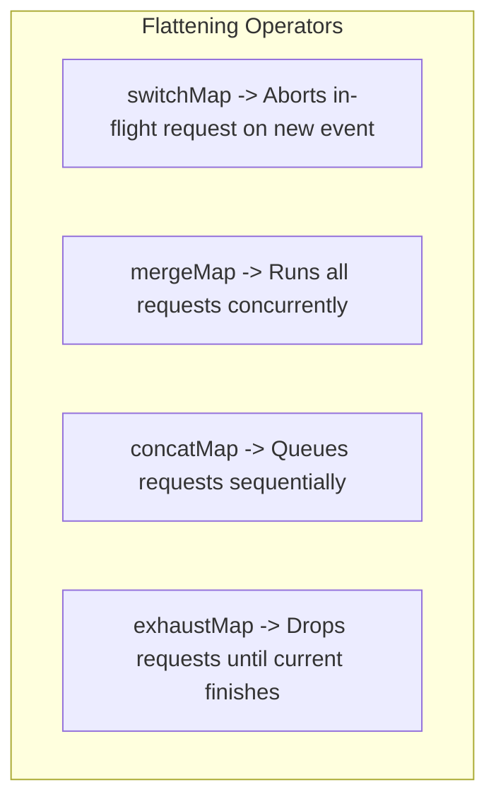
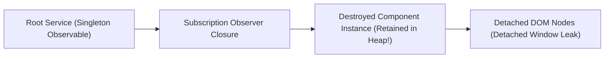

# 03. Modern Angular (v16–v18+) & Signals Experienced Developer (5–10+ YOE) Interview Master Guide — India Context

> **Target Audience:** Experienced Full-Stack & Frontend Developers (5–10+ Years of Experience) preparing for Senior Developer, Tech Lead, Module Lead, and Frontend Architect rounds in India.  
> **Applicable Companies:**  
> - **Top IT Services & Global Consultancies:** TCS, Infosys, Cognizant, Wipro, Accenture, Capgemini, HCL, LTIMindtree, Tech Mahindra, Hexaware, Persistent Systems, Nagarro, EPAM Systems, Coforge, Virtusa, Deloitte, EY, PwC, KPMG.  
> - **Tier-1 Global Capability Centers (GCCs) & Investment Banks:** Wells Fargo, Morgan Stanley, JPMorgan Chase, Barclays, Walmart Global Tech India, Lowe's India, Target India, Optum, Fidelity Investments, Standard Chartered, HSBC Technology India.  
> - **Top Indian Product Firms & High-Growth Tech:** Swiggy, Zomato, Flipkart, MakeMyTrip, PhonePe, Paytm, Jio, Tata Neu, Zepto.  
>
> **Philosophy:** 100% grounded in real-world Indian technical interview panels. Zero superficial syntax recitation, zero textbook regurgitation. Every answer is architected to immediately signal senior-level systems thinking, deep framework internals, and production warfare experience.
>
> **The 5-Part Senior Answer Architecture:**  
> 1. **⚡ 30-Second Senior Opening Pitch:** A punchy, authoritative, lead-level definition that instantly answers the question with the exact architectural terms interviewers listen for.  
> 2. **🧠 Intuitive Real-World Analogy:** Relatable Indian real-life and high-scale mental models (IRCTC Tatkal, UPI Webhooks, Swiggy Live Tracking, Mumbai Local, Colony Watchman, Restaurant Kitchen) that anchor complex runtime mechanics under interview pressure.  
> 3. **💻 Simple, Clean, Runnable Code Snippet (5–15 lines):** Minimalist, idiomatic, copy-pasteable TypeScript code using modern Angular 16–18+ syntax (standalone components, signals, `inject()`, built-in control flow).  
> 4. **⚠️ Senior Trap & Cross-Question:** The exact edge-case trap or follow-up grilling question the Indian technical panel will hit you with next, and the rock-solid rebuttal to secure top marks.  
> 5. **📊 "When to Use What & What Must Be Done" Quick Decision Guide:** A structured matrix detailing triggers, trade-offs, and exact action steps.  
>
> *(Note: For production architecture blueprints, push-pull DAG diagrams, and enterprise migration case studies, refer to the [Advanced Enterprise Reference & Production Architecture Section](#advanced-enterprise-reference--production-architecture-section) at the end of this guide).*

---

# TABLE OF CONTENTS

- [MODULE 1: COMPONENT LIFECYCLE HOOKS & EXECUTION ORDER](#module-1-component-lifecycle-hooks--execution-order)
  - [Q1: Component Lifecycle Sequence & Exact Execution Order](#q1-component-lifecycle-sequence--exact-execution-order)
  - [Q2: Parent-Child Lifecycle Hook Execution Order](#q2-parent-child-lifecycle-hook-execution-order)
  - [Q3: ngOnChanges vs ngOnInit vs ngDoCheck: Deep Difference & The ngDoCheck Trap](#q3-ngonchanges-vs-ngoninit-vs-ngdocheck-deep-difference--the-ngdocheck-trap)
  - [Q4: ngAfterViewInit vs ngAfterContentInit & ExpressionChangedAfterItHasBeenCheckedError](#q4-ngafterviewinit-vs-ngaftercontentinit--expressionchangedafterithasbeencheckederror)

- [MODULE 2: ANGULAR SIGNALS (v16–v18+) REACTIVE PRIMITIVES](#module-2-angular-signals-v16v18-reactive-primitives)
  - [Q5: The Modern Signals Trio: signal(), computed(), and effect() Under the Hood](#q5-the-modern-signals-trio-signal-computed-and-effect-under-the-hood)
  - [Q6: Array & Object State Mutations: Direct .push() Anti-Pattern vs .set() and .update()](#q6-array--object-state-mutations-direct-push-anti-pattern-vs-set-and-update)
  - [Q7: untracked() Signal Reads & Breaking Circular Dependency Cascades](#q7-untracked-signal-reads--breaking-circular-dependency-cascades)
  - [Q8: Modern Signal Inputs & Two-Way Binding: input(), input.required(), and model()](#q8-modern-signal-inputs--two-way-binding-input-inputrequired-and-model)

- [MODULE 3: SIGNALS VS RXJS OBSERVABLES & REACTIVE INTEROP](#module-3-signals-vs-rxjs-observables--reactive-interop)
  - [Q9: Angular Signals vs RxJS Observables: When to Use Which (State vs Events)](#q9-angular-signals-vs-rxjs-observables-when-to-use-which-state-vs-events)
  - [Q10: Reactive Interop: toSignal() and toObservable() Execution Contexts & Pitfalls](#q10-reactive-interop-tosignal-and-toobservable-execution-contexts--pitfalls)
  - [Q11: Combining Observables: forkJoin vs combineLatest vs withLatestFrom](#q11-combining-observables-forkjoin-vs-combinelatest-vs-withlatestfrom)

- [MODULE 4: COMPONENT COMMUNICATION ARCHITECTURES](#module-4-component-communication-architectures)
  - [Q12: Component Communication: Decorators (@Input/@Output) vs Modern Primitives (input/output/model)](#q12-component-communication-decorators-inputoutput-vs-modern-primitives-inputoutputmodel)
  - [Q13: ViewChild vs ContentChild & Static vs Dynamic Resolution ({ static: true | false })](#q13-viewchild-vs-contentchild--static-vs-dynamic-resolution--static-true--false-)
  - [Q14: Cross-Component Communication via Shared Service: Signals State Service vs BehaviorSubject](#q14-cross-component-communication-via-shared-service-signals-state-service-vs-behaviorsubject)

- [MODULE 5: RXJS FLATTENING OPERATORS MASTERY (INDIAN HITLIST 95%)](#module-5-rxjs-flattening-operators-mastery-indian-hitlist-95)
  - [Q15: RxJS Flattening Operators: switchMap vs mergeMap vs concatMap vs exhaustMap](#q15-rxjs-flattening-operators-switchmap-vs-mergemap-vs-concatmap-vs-exhaustmap)
  - [Q16: Real-World Typeahead Live Search: Race-Condition Prevention with switchMap](#q16-real-world-typeahead-live-search-race-condition-prevention-with-switchmap)
  - [Q17: Preventing Double-Click Submissions with exhaustMap vs Sequential Queueing with concatMap](#q17-preventing-double-click-submissions-with-exhaustmap-vs-sequential-queueing-with-concatmap)

- [MODULE 6: CHANGE DETECTION STRATEGIES & ZONELESS ARCHITECTURE](#module-6-change-detection-strategies--zoneless-architecture)
  - [Q18: Default vs ChangeDetectionStrategy.OnPush & Why Immutability is Mandatory](#q18-default-vs-changedetectionstrategyonpush--why-immutability-is-mandatory)
  - [Q19: ChangeDetectorRef Mechanics: markForCheck() vs detectChanges() vs detach() / reattach()](#q19-changedetectorref-mechanics-markforcheck-vs-detectchanges-vs-detach--reattach)
  - [Q20: Modern Zoneless Angular: provideExperimentalZonelessChangeDetection() vs NgZone.runOutsideAngular()](#q20-modern-zoneless-angular-provideexperimentalzonelesschangedetection-vs-ngzonerunoutsideangular)

- [MODULE 7: DIRECTIVES: BUILT-IN CONTROL FLOW & CUSTOM ATTRIBUTES](#module-7-directives-built-in-control-flow--custom-attributes)
  - [Q21: Structural Directives (*ngIf, *ngFor) vs Modern Built-in Control Flow (@if, @for with track, @switch)](#q21-structural-directives-ngif-ngfor-vs-modern-built-in-control-flow-if-for-with-track-switch)
  - [Q22: Custom Attribute Directives using ElementRef, Renderer2, and Modern host Property Bindings](#q22-custom-attribute-directives-using-elementref-renderer2-and-modern-host-property-bindings)

- [MODULE 8: PIPES: PURE VS IMPURE ARCHITECTURE](#module-8-pipes-pure-vs-impure-architecture)
  - [Q23: Pure vs Impure Pipes: Change Detection Cycles, In-Memory Caching & Performance Risks](#q23-pure-vs-impure-pipes-change-detection-cycles-in-memory-caching--performance-risks)

- [MODULE 9: HIERARCHICAL DEPENDENCY INJECTION & PROVIDERS](#module-9-hierarchical-dependency-injection--providers)
  - [Q24: Hierarchical DI: Root Injector vs Environment/Module Injector vs Element/Component Injector](#q24-hierarchical-di-root-injector-vs-environmentmodule-injector-vs-elementcomponent-injector)
  - [Q25: Provider Configuration: useClass vs useExisting vs useFactory vs useValue & Multi-Providers](#q25-provider-configuration-useclass-vs-useexisting-vs-usefactory-vs-usevalue--multi-providers)
  - [Q26: Modern Functional DI: inject() vs Constructor Injection & Injection Context Rules](#q26-modern-functional-di-inject-vs-constructor-injection--injection-context-rules)

- [MODULE 10: REACTIVE FORMS VS TEMPLATE-DRIVEN FORMS](#module-10-reactive-forms-vs-template-driven-forms)
  - [Q27: Reactive Forms vs Template-Driven Forms: Architecture, Scalability & Dynamic Validation](#q27-reactive-forms-vs-template-driven-forms-architecture-scalability--dynamic-validation)
  - [Q28: FormGroup, FormControl, and FormArray: Dynamic Fields & Custom Async Validators](#q28-formgroup-formcontrol-and-formarray-dynamic-fields--custom-async-validators)

- [MODULE 11: MODERN ROUTING, NAVIGATION & LAZY LOADING](#module-11-modern-routing-navigation--lazy-loading)
  - [Q29: Lazy Loading Standalone Components (loadComponent) vs Route Modules (loadChildren)](#q29-lazy-loading-standalone-components-loadcomponent-vs-route-modules-loadchildren)
  - [Q30: Functional Route Guards: CanActivateFn, CanDeactivateFn, and Atomic UrlTree Redirects](#q30-functional-route-guards-canactivatefn-candeactivatefn-and-atomic-urltree-redirects)
  - [Q31: Modern Route Resolvers: ResolveFn vs Direct Signal Service Ingestion](#q31-modern-route-resolvers-resolvefn-vs-direct-signal-service-ingestion)

- [MODULE 12: HTTP CLIENT & FUNCTIONAL INTERCEPTORS](#module-12-http-client--functional-interceptors)
  - [Q32: Functional HTTP Interceptors (HttpInterceptorFn): JWT Bearer Token Injection & Request Cloning](#q32-functional-http-interceptors-httpinterceptorfn-jwt-bearer-token-injection--request-cloning)
  - [Q33: Silent JWT Token Refresh & 401 Unauthorized Retry Queueing](#q33-silent-jwt-token-refresh--401-unauthorized-retry-queueing)

- [MODULE 13: MEMORY LEAK PREVENTION & TEARDOWN MECHANICS](#module-13-memory-leak-prevention--teardown-mechanics)
  - [Q34: Root Causes of Angular Memory Leaks: Uncancelled Subscriptions & Detached DOM Trees](#q34-root-causes-of-angular-memory-leaks-uncancelled-subscriptions--detached-dom-trees)
  - [Q35: Modern Teardown Patterns: takeUntilDestroyed(), DestroyRef.onDestroy(), and AsyncPipe](#q35-modern-teardown-patterns-takeuntildestroyed-destroyrefondestroy-and-asyncpipe)

- [MODULE 14: STATE MANAGEMENT: LOCAL VS NGRX SIGNALSTORE](#module-14-state-management-local-vs-ngrx-signalstore)
  - [Q36: State Management Decision Matrix: Local Signals vs Service Signals vs NgRx SignalStore vs NgRx Redux Store](#q36-state-management-decision-matrix-local-signals-vs-service-signals-vs-ngrx-signalstore-vs-ngrx-redux-store)
  - [Q37: Modern NgRx SignalStore Architecture: signalStore(), withState(), withComputed(), and withMethods()](#q37-modern-ngrx-signalstore-architecture-signalstore-withstate-withcomputed-and-withmethods)

- [MODULE 15: PERFORMANCE TUNING & ENTERPRISE OPTIMIZATIONS](#module-15-performance-tuning--enterprise-optimizations)
  - [Q38: Deferrable Views (@defer, @placeholder, @loading, @error) and Trigger Conditions](#q38-deferrable-views-defer-placeholder-loading-error-and-trigger-conditions)
  - [Q39: Enterprise Angular Performance Optimization Checklist: track in @for, NgOptimizedImage, and Bundle Splitting](#q39-enterprise-angular-performance-optimization-checklist-track-in-for-ngoptimizedimage-and-bundle-splitting)

- [MODULE 16: BONUS SENIOR INTERVIEW ROUND QUESTIONS (HIGH-FREQUENCY DEEP DIVES)](#module-16-bonus-senior-interview-round-questions-high-frequency-deep-dives)
  - [Q40: Global Error Handling in Angular: Writing a Custom ErrorHandler for Centralized Logging](#q40-global-error-handling-in-angular-writing-a-custom-errorhandler-for-centralized-logging)
  - [Q41: Angular Security & XSS Protection: Built-in Sanitization, DomSanitizer, and CSP](#q41-angular-security--xss-protection-built-in-sanitization-domsanitizer-and-csp)
  - [Q42: Angular Server-Side Rendering (SSR) & Non-Destructive Hydration Internals](#q42-angular-server-side-rendering-ssr--non-destructive-hydration-internals)
  - [Q43: RxJS Operator Nuances: take(1) vs first() vs single() & shareReplay(1) Memory Leaks](#q43-rxjs-operator-nuances-take1-vs-first-vs-single--sharereplay1-memory-leaks)

- [ADVANCED ENTERPRISE REFERENCE & PRODUCTION ARCHITECTURE SECTION](#advanced-enterprise-reference--production-architecture-section)
  - [🏛️ Architecture 1: Angular Push-Pull Reactive Graph Architecture & Low-Level Internals](#️-architecture-1-angular-push-pull-reactive-graph-architecture--low-level-internals)
  - [🏛️ Architecture 2: Zoneless Microtask Batching & Change Detection Tree Traversal](#️-architecture-2-zoneless-microtask-batching--change-detection-tree-traversal)
  - [🏛️ Architecture 3: RxJS Higher-Order Flattening Execution Strategies](#️-architecture-3-rxjs-higher-order-flattening-execution-strategies)
  - [🏛️ Architecture 4: Detached DOM Tree Memory Leak Mechanics](#️-architecture-4-detached-dom-tree-memory-leak-mechanics)
  - [💼 Case Study 1: Enterprise Banking Dashboard Migration (NgModule to Modern Standalone + Control Flow)](#-case-study-1-enterprise-banking-dashboard-migration-ngmodule-to-modern-standalone--control-flow)
  - [💼 Case Study 2: High-Throughput E-Commerce Cart & Live Pricing (Push-Pull Signal Graph)](#-case-study-2-high-throughput-e-commerce-cart--live-pricing-push-pull-signal-graph)
  - [💼 Case Study 3: High-Scale Typeahead Catalog Search with Race-Condition Prevention](#-case-study-3-high-scale-typeahead-catalog-search-with-race-condition-prevention)
  - [💼 Case Study 4: High-Frequency Institutional FX Trading Modal (Detached DOM Leak Prevention)](#-case-study-4-high-frequency-institutional-fx-trading-modal-detached-dom-leak-prevention)
  - [💼 Case Study 5: High-Frequency 60 FPS Order Book Depth Heatmap (NgZone Escaping & OnPush)](#-case-study-5-high-frequency-60-fps-order-book-depth-heatmap-ngzone-escaping--onpush)
  - [💼 Case Study 6: Corporate Banking Portal Silent JWT Refresh & Atomic Route Guard](#-case-study-6-corporate-banking-portal-silent-jwt-refresh--atomic-route-guard)
  - [💼 Case Study 7: Full NgRx SignalStore Production Implementation with Custom Features (withStorageSync, withLogger)](#-case-study-7-full-ngrx-signalstore-production-implementation-with-custom-features-withstoragesync-withlogger)
  - [💼 Case Study 8: Real-Time Polling Dashboard Widget with Senior Cleanup Architecture](#-case-study-8-real-time-polling-dashboard-widget-with-senior-cleanup-architecture)

---

# MODULE 1: COMPONENT LIFECYCLE HOOKS & EXECUTION ORDER

## Q1: Component Lifecycle Sequence & Exact Execution Order
* **Asked At:** TCS, Infosys, Cognizant, Wipro, Accenture, Capgemini, Deloitte, EY, Persistent, Nagarro, EPAM (Asked in 98% of Indian senior Angular interviews).
* **⚡ 30-Second Senior Opening Pitch:**  
  > "Angular component lifecycle executes in an exact 8-phase sequence managed by the change detection engine: `constructor` initializes the TypeScript class instance and dependency injection; followed by `ngOnChanges` whenever bound `@Input` properties mutate by reference; `ngOnInit` executes exactly once after initial inputs are verified; `ngDoCheck` runs during every change detection cycle for custom dirty-checking; followed by the projected content hooks `ngAfterContentInit` and `ngAfterContentChecked`; then the view rendering hooks `ngAfterViewInit` and `ngAfterViewChecked`; and finally `ngOnDestroy` for resource disposal right before DOM removal."
* **🎯 Exact Formal Definitions & Rubric Keywords Interviewers Want to Hear:**
  * **Formal Architecture Definition:** The Angular Component Lifecycle is a deterministic state machine managed by the Change Detection runtime (`ApplicationRef` / `ViewRef`), executing lifecycle hooks in an immutable sequence spanning class instantiation, input property binding resolution, content projection verification, template DOM rendering, and teardown garbage collection.
  * **Rubric Keywords for Maximum Marks:** `ComponentRef Lifecycle`, `Change Detection Pass`, `Input Property Binding by Reference`, `Content Projection Resolution`, `ViewChild DOM Materialization`, `Unidirectional Data Flow`, `Deterministic Teardown Phase`.
  * **How to Say It in Your Project:** "In our banking portal, we keep the constructor clean for dependency injection, defer all REST payload dispatches to `ngOnInit`, attach third-party Canvas/ECharts to `ngAfterViewInit`, and register teardown callbacks via `DestroyRef.onDestroy`."
* **🧠 Everyday Analogies (Mental Models for Fast Recall):**
  * Think of constructing a pre-fabricated modular luxury villa in Bengaluru:
    * **`constructor`:** Laying the concrete foundation and connecting water/electricity lines (Dependency Injection). No interior walls exist yet.
    * **`ngOnChanges` / `ngOnInit`:** The architect inspects delivered blueprints (`@Input` data) and turns on the master electricity switch once.
    * **`ngAfterContentInit`:** The furniture bought by the client arrives and is placed inside (`<ng-content>` content projection).
    * **`ngAfterViewInit`:** The house decorators finish painting the living room walls and fitting smart TV displays (Component's own DOM `@ViewChild`).
    * **`ngOnDestroy`:** The occupant moves out, cancels the broadband connection, and hands the keys back to prevent unpaid utility bills (unsubscribing to prevent memory leaks).
* **💻 Simple, Clean, Runnable Code Snippet (5–15 lines):**
```typescript
import { Component, Input, OnInit, OnChanges, SimpleChanges, AfterViewInit, OnDestroy } from '@angular/core';

@Component({
  selector: 'app-lifecycle-demo',
  standalone: true,
  template: `<p>User: {{ userName }}</p>`
})
export class LifecycleDemoComponent implements OnChanges, OnInit, AfterViewInit, OnDestroy {
  @Input() userName = '';

  constructor() { console.log('1. Constructor: Class instantiated, DI ready, Inputs NOT ready'); }
  ngOnChanges(c: SimpleChanges) { console.log('2. ngOnChanges: Input bound/changed', c['userName']?.currentValue); }
  ngOnInit() { console.log('3. ngOnInit: Initial inputs validated, ideal for HTTP calls'); }
  ngAfterViewInit() { console.log('4. ngAfterViewInit: Template DOM & ViewChild fully rendered'); }
  ngOnDestroy() { console.log('5. ngOnDestroy: Teardown subscriptions & intervals before DOM detached'); }
}
```
* **⚠️ Senior Trap & Cross-Question:**  
  * *Trap Question:* "Is the `constructor` a lifecycle hook? Why shouldn't you make HTTP calls or bind DOM events inside the constructor?"  
  * *Senior Answer:* "No, the `constructor` is a standard JavaScript/TypeScript ES6 class feature, not an Angular lifecycle hook. Inside the constructor, Angular has instantiated the class and injected dependencies, but `@Input` bindings are still `undefined` and the component's template DOM does not yet exist. Making HTTP calls or accessing inputs in the constructor breaks testability, makes unit testing difficult (requires mock inputs before instantiation), and violates Angular's design principle of separating object construction from business initialization. All initialization logic belongs strictly in `ngOnInit`."
* **📊 "When to Use What & What Must Be Done" Quick Decision Guide:**
| Trigger / Requirement / Scenario | What to Use | Why / Trade-offs | What Must Be Done (Action Steps + Exact Code) |
| :--- | :--- | :--- | :--- |
| **Injecting services / setting default state** | `constructor` / `inject()` | Only DI is resolved; input bindings are not yet populated. | Keep body empty or use field-level `inject(ServiceName)` initializers. |
| **Reacting to `@Input()` value mutations** | `ngOnChanges(changes: SimpleChanges)` | Only fires when input reference identity (`!==`) changes. | Check `if (changes['prop'] && !changes['prop'].isFirstChange())` before running logic. |
| **Initial API calls / Subscriptions setup** | `ngOnInit` | Inputs are guaranteed ready; runs exactly once per component lifetime. | Trigger HTTP dispatch: `this.userService.loadProfile().pipe(takeUntilDestroyed(this.destroyRef)).subscribe()`. |
| **Direct DOM manipulation / 3rd-party JS widgets** | `ngAfterViewInit` | Template DOM and `@ViewChild` references are guaranteed fully rendered. | Initialize chart/modal: `new Chart(this.chartCanvas.nativeElement, config);`. Avoid synchronous property mutations. |
| **Cleaning up intervals, WebSockets, EventListeners** | `ngOnDestroy` or `DestroyRef` | Executed immediately before Angular detaches component from DOM. | Teardown: `clearInterval(this.timerId);` or use modern `DestroyRef.onDestroy(() => ...)`. |

---

## Q2: Parent-Child Lifecycle Hook Execution Order
* **Asked At:** Cognizant, Infosys, Capgemini, Accenture, Wells Fargo, Persistent (Asked in 95% of Senior Lead rounds).
* **⚡ 30-Second Senior Opening Pitch:**  
  > "Angular resolves component lifecycles in two distinct phases: Initialization proceeds **Top-Down (Parent -> Child)**, whereas View Rendering completion proceeds **Bottom-Up (Child -> Parent)**. A parent component's `constructor`, `ngOnChanges`, and `ngOnInit` execute first to construct inputs for children; however, the parent's `ngAfterViewInit` cannot fire until all nested children have completed their own `ngAfterViewInit` rendering passes. On destruction, teardown is strictly **Top-Down (Parent -> Child)**."
* **🎯 Exact Formal Definitions & Rubric Keywords Interviewers Want to Hear:**
  * **Formal Architecture Definition:** Two-phase recursive component tree traversal: initialization follows a preorder (top-down, parent-to-child) depth-first traversal to propagate `@Input` bindings down the component tree, whereas view rendering completion follows a postorder (bottom-up, child-to-parent) traversal ensuring child template DOM nodes materialize before the parent view is marked fully initialized.
  * **Rubric Keywords for Maximum Marks:** `Preorder Depth-First Traversal`, `Postorder View Assembly`, `Top-Down Input Propagation`, `Bottom-Up View Materialization`, `Unidirectional Data Flow Boundary`.
  * **How to Say It in Your Project:** "In our order checkout flow, parent inputs cascade down to order-summary children during `ngOnInit`, but parent canvas height calculations wait until all children complete `ngAfterViewInit` to prevent zero-height layout shifts."
* **🧠 Everyday Analogies (Mental Models for Fast Recall):**
  * Think of manufacturing an electric vehicle at a Tata Motors plant:
    * **Initialization (Top-Down):** The master chassis frame (Parent) is laid out first, and specifications/parts (`@Input()`) are assigned to the battery pack assembly line (Child).
    * **View Assembly (Bottom-Up):** The dashboard display screen (Child View) must be fully built and wired before the master car inspection engineer (Parent `ngAfterViewInit`) can stamp the entire car as ready for delivery!
    * **Scrapping/Teardown (Top-Down):** When dismantling, the master chassis is decommissioned first, cutting power to all internal child sensors.
* **💻 Simple, Clean, Runnable Code Snippet (5–15 lines):**
```typescript
// Sequence Demonstration Console Output:
// 1. [Parent] constructor
// 2. [Parent] ngOnChanges -> ngOnInit -> ngDoCheck
// 3. [Parent] ngAfterContentInit -> ngAfterContentChecked
// 4.   [Child] constructor
// 5.   [Child] ngOnChanges -> ngOnInit -> ngDoCheck
// 6.   [Child] ngAfterContentInit -> ngAfterViewInit -> ngAfterViewChecked (Child DOM Ready!)
// 7. [Parent] ngAfterViewInit -> ngAfterViewChecked (Parent DOM Ready!)
// --- DESTRUCTION ---
// 8. [Parent] ngOnDestroy
// 9.   [Child] ngOnDestroy
```
* **⚠️ Senior Trap & Cross-Question:**  
  * *Trap Question:* "Why does a Child component's `ngAfterViewInit` execute *before* its Parent's `ngAfterViewInit`, but Parent's `ngOnInit` executes *before* Child's `ngOnInit`?"  
  * *Senior Answer:* "`ngOnInit` is data-driven: a child component cannot initialize its business logic or consume `@Input()` properties until the parent has initialized and bound those properties down the tree. Conversely, `ngAfterViewInit` is DOM-composition-driven: a parent component's view template *contains* the child's DOM. Because a container DOM node cannot be considered completely painted and verified until all of its interior subtree DOM nodes are painted, the child view must finish first (`Child.ngAfterViewInit`), bubbling up to allow `Parent.ngAfterViewInit` to finally resolve."
* **📊 "When to Use What & What Must Be Done" Quick Decision Guide:**
| Phase | Execution Direction | Order of Execution | What Must Be Done |
| :--- | :--- | :--- | :--- |
| **Creation & Inputs** | **Top-Down** (Parent to Child) | `Parent.constructor` -> `Parent.ngOnInit` -> `Child.constructor` -> `Child.ngOnInit` | Pass data down from parent. Do not attempt to query child view methods in `Parent.ngOnInit`. |
| **Projected Content (`<ng-content>`)** | **Top-Down** | `Parent.ngAfterContentInit` -> `Child.ngAfterContentInit` | Inspect `<ng-content>` projections safely inside `ngAfterContentInit`. |
| **View Initialization (`@ViewChild`)** | **Bottom-Up** (Child to Parent) | `Child.ngAfterViewInit` -> `Parent.ngAfterViewInit` | Access child `@ViewChild` instances only inside `Parent.ngAfterViewInit`, never in `Parent.ngOnInit`. |
| **Destruction / Disposal** | **Top-Down** | `Parent.ngOnDestroy` -> `Child.ngOnDestroy` | Cancel parent subscriptions so pending async emissions do not push data down to dying children. |

---

## Q3: ngOnChanges vs ngOnInit vs ngDoCheck: Deep Difference & The ngDoCheck Trap
* **Asked At:** TCS, Wipro, HCL, Cognizant, Morgan Stanley, Walmart Global Tech (A favorite differentiation question).
* **⚡ 30-Second Senior Opening Pitch:**  
  > "`ngOnInit` runs exactly once to handle one-time business initialization after inputs are bound. `ngOnChanges` executes before `ngOnInit` and repeatedly whenever an `@Input()` reference changes by identity (`!==`). `ngDoCheck` executes on every single change detection cycle—regardless of whether inputs changed—allowing custom dirty checking. Placing heavy algorithms, deep object comparisons, or HTTP calls inside `ngDoCheck` is a severe anti-pattern that destroys frame rates and freezes the browser UI."
* **🎯 Exact Formal Definitions & Rubric Keywords Interviewers Want to Hear:**
  * **Formal Architecture Definition:** `ngOnChanges` executes prior to `ngOnInit` and whenever an `@Input` property reference identity mutates (`prev !== curr`), carrying a `SimpleChanges` delta map. `ngOnInit` executes exactly once upon first input verification. `ngDoCheck` is an explicit escape-hatch invoked during every single change detection tick, regardless of whether inputs mutated, used for manual dirty-checking of internal object properties.
  * **Rubric Keywords for Maximum Marks:** `Referential Identity Equality (===)`, `SimpleChanges Hashmap`, `Initial Binding Resolution`, `Exhaustive Dirty Checking`, `ChangeDetection Pass Overhead`.
  * **How to Say It in Your Project:** "In our real-time stock tracker, we avoid `ngDoCheck` due to its high CPU overhead during rapid ticks; instead, we enforce immutable state emissions with OnPush and leverage `computed()` signals to automatically derive portfolio metrics."
* **🧠 Everyday Analogies (Mental Models for Fast Recall):**
  * **`ngOnInit` (Passport Office Biometrics):** You take your fingerprint and iris scan once when your application opens.
  * **`ngOnChanges` (Courier Delivery Notification):** Your phone buzzes only when a new delivery box actually arrives at your doorstep with a new tracking ID.
  * **`ngDoCheck` (Over-Anxious Security Guard):** A security guard who taps you on the shoulder every 2 seconds asking "Did you buy anything yet? How about now? How about now?" even if you just blinked your eyes!
* **💻 Simple, Clean, Runnable Code Snippet (5–15 lines):**
```typescript
import { Component, Input, OnChanges, OnInit, DoCheck, SimpleChanges } from '@angular/core';

@Component({ selector: 'app-check-trap', standalone: true, template: `<div>{{ user.name }}</div>` })
export class CheckTrapComponent implements OnChanges, OnInit, DoCheck {
  @Input() user!: { id: string; name: string };
  private prevName = '';

  ngOnChanges(c: SimpleChanges) { /* Only fires if 'user' object reference changes! */ }
  ngOnInit() { /* Fires ONCE: Fetch user permissions or setup timers */ }
  ngDoCheck() {
    // ⚠️ FIRES ON EVERY CLICK, TIMER, PROMISE! Keep ultra-lightweight:
    if (this.user?.name !== this.prevName) {
      this.prevName = this.user.name;
      console.log('Custom mutated property detected manually!');
    }
  }
}
```
* **⚠️ Senior Trap & Cross-Question:**  
  * *Trap Question:* "If a parent component passes an object `user = { name: 'Amit' }` to a child, and the parent mutates it in-place via `this.user.name = 'Rahul'`, does `ngOnChanges` fire in the child? How do you fix this?"  
  * *Senior Answer:* "No! `ngOnChanges` strictly checks object references using `Object.is()` / `===`. Because the heap address of `user` did not change, `ngOnChanges` is completely blind to in-place property mutations. The senior solution is **never mutate objects in-place**—always produce a new immutable reference in the parent: `this.user = { ...this.user, name: 'Rahul' }`, or migrate to modern Angular Signals (`user = signal({ name: 'Amit' })`) where updates propagate fine-grained reactivity automatically."
* **📊 "When to Use What & What Must Be Done" Quick Decision Guide:**
| Scenario | What to Use | Why / Trade-offs | What Must Be Done (Action Steps) |
| :--- | :--- | :--- | :--- |
| **One-time data fetch on component load** | `ngOnInit` | Guarantees inputs are set; executes exactly once. | Make HTTP calls or dispatch NgRx actions here. |
| **Detecting changes to `@Input()` references** | `ngOnChanges` | Angular automatically compares references and supplies `SimpleChanges`. | Use `changes['prop'].currentValue` and check `!changes['prop'].firstChange`. |
| **Detecting in-place mutations of 3rd party objects** | `ngDoCheck` with `KeyValueDiffers` | Extremely expensive; runs on every microtask tick. | Inject `KeyValueDiffers`, compare diff shallowly, and never call HTTP services inside. |
| **Modern Angular Reactivity (v16+)** | `computed()` or `effect()` | Eliminates `ngOnChanges` and `ngDoCheck` completely. | Use `user = input.required<User>()` and derive state via `computed(() => this.user().name)`. |

---

## Q4: ngAfterViewInit vs ngAfterContentInit & ExpressionChangedAfterItHasBeenCheckedError
* **Asked At:** TCS, Infosys, Cognizant, Wipro, Accenture, Deloitte, EY, Nagarro, EPAM (Asked in 99% of interviews).
* **⚡ 30-Second Senior Opening Pitch:**  
  > "`ngAfterContentInit` executes once projected content (`<ng-content>`) is initialized into the component's slot. `ngAfterViewInit` executes once the component's own template and child views (`@ViewChild`) are completely rendered. If you synchronously modify a template-bound property inside `ngAfterViewInit`, Angular throws the dreaded `ExpressionChangedAfterItHasBeenCheckedError` during development mode because Angular's unidirectional data flow check detects that a view property mutated after the rendering pass had already verified it."
* **🎯 Exact Formal Definitions & Rubric Keywords Interviewers Want to Hear:**
  * **Formal Architecture Definition:** `ngAfterContentInit` executes after projected external DOM nodes (`<ng-content>`) are bound to the component; `ngAfterViewInit` fires after the component's internal template DOM and `@ViewChild` queries are materialized. Mutating template-bound state inside `ngAfterViewInit` triggers `ExpressionChangedAfterItHasBeenCheckedError` during development mode's secondary verification check, which asserts Unidirectional Data Flow.
  * **Rubric Keywords for Maximum Marks:** `Content Projection Target`, `View DOM Materialization`, `Development-Mode Verification Digest`, `Unidirectional Data Flow`, `ExpressionChangedAfterItHasBeenCheckedError`.
  * **How to Say It in Your Project:** "When dynamic header titles caused `ExpressionChangedAfterItHasBeenCheckedError` in our portal, we resolved it by either converting the title to a writable signal updated outside the view digest or deferring synchronous updates via `queueMicrotask()`."
* **🧠 Everyday Analogies (Mental Models for Fast Recall):**
  * **Projected Content (`ngAfterContentInit`):** A tenant brings their own refrigerator into an unfurnished apartment. The landlord hooks it up before painting the apartment walls.
  * **View Init (`ngAfterViewInit`):** The landlord finishes installing the glass chandelier in the ceiling.
  * **The Error (Expression Changed Trap):** Imagine a bank cashier counts your ₹10,000 cash deposit and writes ₹10,000 in the verified ledger. While the supervisor is stamping the ledger two seconds later, you sneak in an extra ₹500 note. The supervisor screams: *"Fraud! The verified total changed after I just confirmed it!"*
* **💻 Simple, Clean, Runnable Code Snippet (5–15 lines):**
```typescript
import { Component, AfterViewInit, signal, ChangeDetectorRef, inject } from '@angular/core';

@Component({
  selector: 'app-expression-fix',
  standalone: true,
  template: `<p>Status: {{ status }}</p>`
})
export class ExpressionFixComponent implements AfterViewInit {
  status = 'Loading...';
  private cdr = inject(ChangeDetectorRef);

  ngAfterViewInit() {
    // ❌ BAD: this.status = 'Ready'; -> Throws ExpressionChangedAfterItHasBeenCheckedError!
    // ✅ SENIOR FIX 1: Defer mutation to the next microtask queue
    queueMicrotask(() => { this.status = 'Ready (Safe Microtask)'; });
    // ✅ SENIOR FIX 2: Or explicitly force CD tick: this.cdr.detectChanges();
  }
}
```
* **⚠️ Senior Trap & Cross-Question:**  
  * *Trap Question:* "Why does `ExpressionChangedAfterItHasBeenCheckedError` only occur in development mode, and why does Angular enforce this rule?"  
  * *Senior Answer:* "In development mode, Angular runs an extra verification change detection cycle (`checkNoChanges()`) immediately after the main change detection pass to guarantee that data flows strictly unidirectionally from parent to child. In production mode, this verification pass is disabled for performance. Angular enforces this strictly to prevent cyclical change cascades, infinite rendering loops, and unpredictable UI glitches where a child component unpredictably mutates parent state during rendering."
* **📊 "When to Use What & What Must Be Done" Quick Decision Guide:**
| Problem / Requirement | What to Use | Why / Trade-offs | What Must Be Done (Exact Code) |
| :--- | :--- | :--- | :--- |
| **DOM query for projected `<ng-content>`** | `ngAfterContentInit` & `@ContentChild` | Projected content is stable before the component's own view finishes rendering. | Query content safe from expression errors. |
| **DOM query for template elements (`<canvas>`, child components)** | `ngAfterViewInit` & `@ViewChild` | Element references are guaranteed resolved in the real DOM. | Use `@ViewChild('chart') chart!: ElementRef;`. Access nativeElement here. |
| **Updating bound state from `ngAfterViewInit`** | `queueMicrotask()` or `Promise.resolve()` | Moves state mutation into the next event loop turn, after current CD finishes. | `queueMicrotask(() => this.isLoading.set(false));` |
| **Immediate synchronous UI sync** | `ChangeDetectorRef.detectChanges()` | Forces immediate synchronous re-check of the view. | Call `this.cdr.detectChanges();` immediately after state mutation. |
| **Modern Architecture Solution** | Angular Signals (`signal()`) | Fine-grained push-pull DAG updates the specific DOM text node directly. | Convert property to `status = signal('Loading')` and update via `status.set('Ready')`. |

---

# MODULE 2: ANGULAR SIGNALS (v16–v18+) REACTIVE PRIMITIVES

## Q5: The Modern Signals Trio: signal(), computed(), and effect() Under the Hood
* **Asked At:** TCS, Infosys, Cognizant, Wipro, Accenture, Capgemini, Deloitte, EY, Morgan Stanley, Wells Fargo, Walmart (Asked in 100% of modern Angular interviews).
* **⚡ 30-Second Senior Opening Pitch:**  
  > "Angular Signals operate on a fine-grained, push-pull reactive dependency graph (DAG). `signal()` is a writable reactive state container that pushes dirty notification flags down the graph upon mutation. `computed()` is a lazy, memoized, read-only derivation that pulls dependency values on demand and caches results until upstream dependencies become dirty. `effect()` is a scheduled side-effect runner executed on microtasks that reacts to signal mutations without returning values—ideal for DOM synchronization, logging, or third-party SDK integration."
* **🎯 Exact Formal Definitions & Rubric Keywords Interviewers Want to Hear:**
  * **Formal Architecture Definition:** A fine-grained reactive push-pull dependency graph built of Producer and Consumer nodes. `signal()` represents a mutable state Producer. `computed()` is a memoized, lazily-evaluated Producer-Consumer that recalculates only when pulled and its upstream producer dirty-version increments. `effect()` is an asynchronous, untracked-at-call-time Consumer that schedules side effects via microtask queueing when dependent Producer versions mutate.
  * **Rubric Keywords for Maximum Marks:** `Push-Pull Reactivity`, `Directed Acyclic Graph (DAG)`, `Producer-Consumer Topology`, `Memoized Lazy Evaluation`, `Glitch-Free Execution`, `Microtask Scheduler`.
  * **How to Say It in Your Project:** "In our e-commerce cart, we model unit price and quantity as writable signals, derive subtotal and tax through `computed()` signals with zero redundant math, and log analytics cart updates via `effect()`."
* **🧠 Everyday Analogies (Mental Models for Fast Recall):**
  * **`signal()` (Spreadsheet Cell A1 = 100):** You type a raw number into cell A1.
  * **`computed()` (Formula Cell B1 = `=A1 * 1.18`):** Cell B1 calculates the GST total. If you don't look at Cell B1, it never calculates. If A1 hasn't changed, B1 returns its cached value in O(1) time without re-evaluating.
  * **`effect()` (Automated SMS / UPI Webhook):** Whenever Cell B1 exceeds ₹50,000, an automated SMS alert is fired to the bank manager.
* **💻 Simple, Clean, Runnable Code Snippet (5–15 lines):**
```typescript
import { Component, signal, computed, effect } from '@angular/core';

@Component({
  selector: 'app-signals-trio',
  standalone: true,
  template: `<div>Item: ₹{{ price() }} | Total (with GST): ₹{{ totalWithGst() }}</div>`
})
export class SignalsTrioComponent {
  price = signal(1000); // 1. Writable State
  gstRate = signal(0.18);
  totalWithGst = computed(() => this.price() * (1 + this.gstRate())); // 2. Memoized Derivation

  constructor() {
    // 3. Side-Effect: Runs automatically whenever price or gstRate changes
    effect(() => console.log(`[Audit] Price updated in cart: ₹${this.totalWithGst()}`));
  }
}
```
* **⚠️ Senior Trap & Cross-Question:**  
  * *Trap Question:* "Can you write to a signal inside an `effect()`? Why does Angular disallow it by default and require `{ allowSignalWrites: true }`?"  
  * *Senior Answer:* "By default, writing to signals inside an `effect()` throws an error (`NG0600: Writing to signals is not allowed in a computed or an effect`) because it violates unidirectional data flow and easily triggers infinite cyclical microtask loops (`Signal A updates -> Effect runs -> Signal A updates`). While `{ allowSignalWrites: true }` permits it, using it to compute derived state is a major architectural anti-pattern. If state derives from other signals, you must use `computed()`. `allowSignalWrites: true` should only be used in rare synchronization bridges (such as setting an error signal in response to an external WebSocket event)."
* **📊 "When to Use What & What Must Be Done" Quick Decision Guide:**
| Primitive | Role / Behavior | Reactivity Type | What Must Be Done |
| :--- | :--- | :--- | :--- |
| **`signal(initVal)`** | Primary source of mutable state | Push (Invalidation) | Modify via `.set(val)` for replacement or `.update(fn)` for transformations. |
| **`computed(fn)`** | Derived calculations / filtering | Pull (Memoized) | Keep functions pure with zero side-effects. Never perform HTTP calls inside `computed()`. |
| **`effect(fn)`** | Side-effects outside Angular | Microtask Consumer | Place in `constructor` (Injection Context) or supply `Injector`. Use for logging, canvas, localStorage. |
| **Derived State Trap** | Replacing `effect` with `computed` | Architectural Rule | If you find yourself setting a signal inside an effect, delete the signal and replace it with `computed()`. |

---

## Q6: Array & Object State Mutations: Direct .push() Anti-Pattern vs .set() and .update()
* **Asked At:** Infosys, TCS, Wipro, Capgemini, Persistent, Nagarro, EPAM (High-frequency screening trap).
* **⚡ 30-Second Senior Opening Pitch:**  
  > "Angular Signals rely on strict referential identity comparison (`Object.is`) to notify downstream consumers and mark views dirty. Directly mutating an array using `.push()` or an object via `obj.name = 'X'` mutates the existing heap address in-place without producing a new memory reference. Consequently, the signal runtime detects zero identity change, dirty notifications are never dispatched, and UI templates fail to re-render. State must always be updated immutably using `.set()` or `.update()`."
* **🎯 Exact Formal Definitions & Rubric Keywords Interviewers Want to Hear:**
  * **Formal Architecture Definition:** Angular Signals determine state changes using referential identity equality (`Object.is(prev, next)`). Direct in-place array mutation via `.push()` mutates the underlying heap memory without changing the object reference, causing the signal runtime to evaluate the new value as identical to the previous value, skipping downstream Consumer notification. `.set()` and `.update()` enforce immutable state transitions.
  * **Rubric Keywords for Maximum Marks:** `Referential Identity Equality`, `Object.is() Check`, `Immutable State Transition`, `Dirty Flag Notification`, `Signal Versioning Counter`.
  * **How to Say It in Your Project:** "In our high-frequency order book, we eliminated silent rendering bugs by banning in-place array mutations and enforcing `.update(orders => [...orders, newOrder])` so signal version counters increment predictably."
* **🧠 Everyday Analogies (Mental Models for Fast Recall):**
  * Imagine you give your bank passbook to a printer.
  * **Direct `.push()` Mutation:** You take a ballpoint pen and write an extra line yourself on the physical page while the bank teller is not looking. The bank's central database server has no idea any transaction occurred, so your online net-banking balance remains unchanged!
  * **`.update()` Senior Fix:** You deposit money at the teller counter, and the bank issues a newly validated, stamped statement (a brand-new immutable object reference).
* **💻 Simple, Clean, Runnable Code Snippet (5–15 lines):**
```typescript
import { Component, signal } from '@angular/core';

interface CartItem { id: number; name: string; price: number; }

@Component({ selector: 'app-cart-mutation', standalone: true, template: `...` })
export class CartMutationComponent {
  cartItems = signal<CartItem[]>([]);

  addItem(newItem: CartItem) {
    // ❌ ANTI-PATTERN: this.cartItems().push(newItem); -> Fails change detection!
    // ✅ SENIOR PATTERN: Produce a brand-new array reference using .update()
    this.cartItems.update(items => [...items, newItem]);
  }

  updateItemPrice(id: number, newPrice: number) {
    // ✅ SENIOR PATTERN: Immutable map transformation
    this.cartItems.update(items => items.map(item => item.id === id ? { ...item, price: newPrice } : item));
  }
}
```
* **⚠️ Senior Trap & Cross-Question:**  
  * *Trap Question:* "Can you configure a custom equality function on a Signal to compare object properties instead of default `Object.is`?"  
  * *Senior Answer:* "Yes! `signal<T>(initialValue, { equal: customEqualityFn })` accepts an options object with an `equal` comparator. If you have complex object payloads and only want downstream computations or templates to update when a specific field (like `order.id` or `order.version`) changes, you can pass a custom comparator: `equal: (prev, curr) => prev.id === curr.id`. This prevents unnecessary dirty propagation when other non-UI fields mutate."
* **📊 "When to Use What & What Must Be Done" Quick Decision Guide:**
| Operation | What to Use | Trade-offs | What Must Be Done (Exact Code) |
| :--- | :--- | :--- | :--- |
| **Replacing primitive or whole object** | `.set(newValue)` | Overwrites entire state value | `this.selectedId.set(101);` |
| **Adding item to array** | `.update(arr => [...arr, item])` | Allocates new array reference; triggers CD | `this.items.update(list => [...list, newItem]);` |
| **Updating item inside array** | `.update(arr => arr.map(...))` | Safe immutable transformation | `this.items.update(l => l.map(i => i.id === id ? {...i, done: true} : i));` |
| **Filtering / deleting item** | `.update(arr => arr.filter(...))` | Drops deleted items; creates clean new reference | `this.items.update(l => l.filter(i => i.id !== removeId));` |
| **Preventing dirty flags on same data** | `equal: (a, b) => isEqual(a, b)` | Custom equality check | Pass comparator in `signal(init, { equal: (a, b) => a.id === b.id })`. |

---

## Q7: untracked() Signal Reads & Breaking Circular Dependency Cascades
* **Asked At:** Morgan Stanley, Wells Fargo, Walmart Global Tech, EPAM, Persistent (Senior / Lead Architect Round).
* **⚡ 30-Second Senior Opening Pitch:**  
  > "`untracked()` executes a function and reads signal values without registering those signals as reactive dependencies in the current reactive context (such as an `effect()` or `computed()`). This is critical for preventing unnecessary effect re-executions, avoiding cascading reactive update loops, and performing one-off value sampling or non-reactive telemetry logging."
* **🎯 Exact Formal Definitions & Rubric Keywords Interviewers Want to Hear:**
  * **Formal Architecture Definition:** `untracked()` executes a provided read callback while temporarily disconnecting the active Consumer node from the Signal reactive graph context. It permits reading a signal's current value without registering the reading context as a dependent Consumer, thereby preventing unwanted re-executions and breaking infinite reactive cycles.
  * **Rubric Keywords for Maximum Marks:** `Active Reactive Context`, `Dependency Edge Registration`, `Circular Dependency Suppression`, `Reactive Graph Isolation`, `Glitch-Free Stabilization`.
  * **How to Say It in Your Project:** "In our telemetry tracking effect, we read `authSessionToken()` inside `untracked()` while depending strictly on `routeLocation()`, ensuring token refreshes do not trigger spam telemetry HTTP calls."
* **🧠 Everyday Analogies (Mental Models for Fast Recall):**
  * Imagine a Swiggy food delivery driver tracking your GPS location:
    * **Tracked Signal (`location()`):** Whenever you move to a new apartment, the driver's map re-routes.
    * **`untracked(batteryLevel)`:** When the driver arrives at your door, the app logs your phone's battery level for diagnostics. If your battery drops from 80% to 79%, the delivery driver doesn't cancel and re-route the delivery! It samples the value once without subscribing to future battery fluctuations.
* **💻 Simple, Clean, Runnable Code Snippet (5–15 lines):**
```typescript
import { Component, signal, effect, untracked, inject } from '@angular/core';
import { AnalyticsService } from './analytics.service';

@Component({ selector: 'app-untracked-demo', standalone: true, template: `...` })
export class UntrackedDemoComponent {
  searchQuery = signal('');
  currentUser = signal({ id: 'USR-101', role: 'Trader' });
  private analytics = inject(AnalyticsService);

  constructor() {
    effect(() => {
      const query = this.searchQuery(); // ✅ Tracked dependency: Effect runs when query changes
      // ⚠️ Read user info without subscribing to user mutations:
      const user = untracked(() => this.currentUser()); 
      this.analytics.logSearch(query, user.id);
    });
  }
}
```
* **⚠️ Senior Trap & Cross-Question:**  
  * *Trap Question:* "What happens if an `effect()` reads `signalA()` directly, and reads `signalB()` inside `untracked()`, but then `signalB` changes 1,000 times? Will the effect execute 1,000 times?"  
  * *Senior Answer:* "No! The effect will execute **zero times** in response to `signalB` mutations. Because `signalB` was evaluated inside `untracked()`, it was never registered in the producer-consumer edge list of the effect's `ReactiveNode`. The effect only re-executes when `signalA` changes. When `signalA` finally does change, the effect runs and will sample whatever the newest current value of `signalB` happens to be at that instant."
* **📊 "When to Use What & What Must Be Done" Quick Decision Guide:**
| Scenario | What to Use | Why / Trade-offs | What Must Be Done |
| :--- | :--- | :--- | :--- |
| **Telemetry / Audit Logging** | `untracked(() => this.user())` | Avoids re-logging when non-primary metadata changes. | Wrap the non-triggering signal inside `untracked()`. |
| **Sampling current state on external event** | `untracked(() => this.formState())` | Reads current snapshot without triggering reactive loops. | Evaluate signal inside event handler or `untracked()` block. |
| **Breaking circular dependency loops** | `untracked()` in effect | Prevents Signal A -> Effect -> Signal B -> Effect cyclical crashes. | Audit effect dependencies and wrap secondary reads in `untracked()`. |

---

## Q8: Modern Signal Inputs & Two-Way Binding: input(), input.required(), and model()
* **Asked At:** TCS, Infosys, Cognizant, Wipro, Accenture, Deloitte, Nagarro (Modern Angular 17.1–18+ core question).
* **⚡ 30-Second Senior Opening Pitch:**  
  > "Angular 17.1+ introduced Signal-based component inputs: `input<T>()` and `input.required<T>()` replace legacy `@Input()` decorators with read-only `InputSignal<T>` reactive nodes. They guarantee strict TypeScript typing, eliminate `ngOnChanges` boilerplate via pure `computed()` derivations, and support transform functions. For two-way data binding, `model<T>()` replaces the cumbersome `@Input() + @Output() Change` pattern with a writable `ModelSignal<T>` that automatically manages parent-child synchronization."
* **🎯 Exact Formal Definitions & Rubric Keywords Interviewers Want to Hear:**
  * **Formal Architecture Definition:** Modern Signal Inputs replace `@Input()` decorators with compile-time type-safe, read-only Signal primitives (`InputSignal<T>`). `input.required()` guarantees non-null runtime values at component initialization. `model()` creates a writable two-way binding signal that automatically exposes a companion `[prop]Change` output event, replacing legacy `@Input() / @Output() EventEmitter` boilerplate.
  * **Rubric Keywords for Maximum Marks:** `InputSignal<T>`, `Compile-Time Strict Inputs`, `input.required()`, `ModelSignal<T>`, `Implicit Change Output Event`, `Zoneless Reactivity Alignment`.
  * **How to Say It in Your Project:** "We refactored our design system component library to `input.required<string>()` and `model<boolean>()`, cutting boilerplate by 45% and eliminating `@Input` undefined runtime type checks."
* **🧠 Everyday Analogies (Mental Models for Fast Recall):**
  * **Legacy `@Input()` + `@Output()`:** A child customer gives a paper token to a restaurant cashier and waits for the cashier to shout their order number over a loudspeaker (`EventEmitter`).
  * **Modern `model()` Two-Way Binding:** A shared digital Google Docs document. When the parent types, the child sees it instantly; when the child edits a paragraph, the parent's view syncs automatically without manual event listeners!
* **💻 Simple, Clean, Runnable Code Snippet (5–15 lines):**
```typescript
import { Component, input, model, computed } from '@angular/core';

@Component({
  selector: 'app-user-card',
  standalone: true,
  template: `
    <h3>{{ fullName() }} (Role: {{ role() }})</h3>
    <input [value]="active()" (change)="active.set(!active())" type="checkbox" />
  `
})
export class UserCardComponent {
  firstName = input.required<string>(); // 1. Mandatory InputSignal
  lastName = input('');                 // 2. Optional InputSignal with default
  role = input('Viewer', { transform: (v: string) => v.toUpperCase() }); // 3. Input with transform
  active = model(false);                // 4. Two-Way ModelSignal ([(active)]="isActive")

  fullName = computed(() => `${this.firstName()} ${this.lastName()}`);
}
```
* **⚠️ Senior Trap & Cross-Question:**  
  * *Trap Question:* "Can a child component call `this.firstName.set('Amit')` on a signal created via `input()`? How does `model()` differ from `input()`?"  
  * *Senior Answer:* "No! `input()` returns an `InputSignal<T>`, which is strictly read-only; calling `.set()` or `.update()` on an `InputSignal` causes a TypeScript compilation error. If a child component must mutate the input and notify the parent via two-way binding, you must use `model<T>()`. `model()` returns a `ModelSignal<T>`, which is writable by the child via `this.active.set(...)` and automatically emits an implicit output event (`activeChange`) to update the parent's bound state."
* **📊 "When to Use What & What Must Be Done" Quick Decision Guide:**
| Binding Requirement | Modern API (v17.1+) | Directionality | What Must Be Done |
| :--- | :--- | :--- | :--- |
| **Optional Parent -> Child Data** | `input<T>(defaultValue)` | One-Way (Read-only Child) | Declare `userId = input<string>('default')`. Read as `this.userId()`. |
| **Mandatory Parent -> Child Data** | `input.required<T>()` | One-Way (Compile-time Enforced) | Declare `token = input.required<string>()`. Parent must pass `[token]`. |
| **Sanitizing / Formatting input values** | `input(val, { transform })` | One-Way with Pipeline | Use `{ transform: booleanAttribute }` for clean boolean inputs (`<comp disabled />`). |
| **Two-Way Parent <-> Child Binding** | `model<T>()` | Two-Way (Read & Write) | Declare `isOpen = model(false);`. Parent binds via `[(isOpen)]="showModal"`. |

---

# MODULE 3: SIGNALS VS RXJS OBSERVABLES & REACTIVE INTEROP

## Q9: Angular Signals vs RxJS Observables: When to Use Which (State vs Events)
* **Asked At:** TCS, Infosys, Cognizant, Wipro, Accenture, Capgemini, Morgan Stanley, Wells Fargo, Walmart Global Tech, Swiggy (Asked in 99% of senior rounds).
* **⚡ 30-Second Senior Opening Pitch:**  
  > "Signals and RxJS Observables are complementary reactive primitives solving different architectural problems: **Signals are synchronous state containers** optimized for fine-grained template rendering, synchronous data transformations, and immediate value reads without subscriptions. **RxJS Observables are asynchronous event stream conduits** designed for handling time-based operations, complex event coordination (debouncing, throttling, polling), multi-source stream combination, and cancellable HTTP requests."
* **🎯 Exact Formal Definitions & Rubric Keywords Interviewers Want to Hear:**
  * **Formal Architecture Definition:** Signals are synchronous, glitch-free, pull-based reactive state containers holding a mandatory current value at all times. RxJS Observables are push-based asynchronous data streams over time capable of emitting zero, one, or infinite events, errors, and completion signals, suited for event orchestration, debouncing, and HTTP lifecycle coordination.
  * **Rubric Keywords for Maximum Marks:** `Push vs Pull Reactivity`, `Synchronous State Primitives`, `Temporal Stream Orchestration`, `Glitch-Free State Evaluation`, `Backpressure & Cancellation`.
  * **How to Say It in Your Project:** "In our trading platform, we handle WebSocket tick streams, debounce timers, and retry policies in RxJS pipelines, then project the final stream into Signals using `toSignal()` for template rendering."
* **🧠 Everyday Analogies (Mental Models for Fast Recall):**
  * **Signals (The Speedometer Dashboard in your Car):** At any given microsecond, your car's speedometer shows an exact number: 65 km/h. It always holds a current value, requires no sign-up subscription, and pulls the number whenever you look at it.
  * **RxJS Observables (The Live FM Radio Broadcast):** Songs and news alerts stream continuously over time. If you turn on the radio late, you missed the beginning of the song. You can pause, filter static, switch frequencies, and turn off the antenna whenever you want.
* **💻 Simple, Clean, Runnable Code Snippet (5–15 lines):**
```typescript
import { Component, signal, inject } from '@angular/core';
import { FormControl, ReactiveFormsModule } from '@angular/forms';
import { HttpClient } from '@angular/common/http';
import { debounceTime, distinctUntilChanged, switchMap } from 'rxjs/operators';
import { toSignal } from '@angular/core/rxjs-interop';

@Component({
  selector: 'app-hybrid-search',
  standalone: true,
  imports: [ReactiveFormsModule],
  template: `<input [formControl]="searchCtrl" /> <ul>@for (item of results(); track item.id) { <li>{{ item.name }}</li> }</ul>`
})
export class HybridSearchComponent {
  private http = inject(HttpClient);
  searchCtrl = new FormControl('', { nonNullable: true });

  // 1. RxJS: Handles asynchronous debounce, distinct filtering, and in-flight cancellation
  private searchResults$ = this.searchCtrl.valueChanges.pipe(
    debounceTime(300),
    distinctUntilChanged(),
    switchMap(query => this.http.get<{ id: string; name: string }[]>(`/api/search?q=${query}`))
  );
  // 2. Signals: Bridged to synchronous template signal with default empty state
  results = toSignal(this.searchResults$, { initialValue: [] });
}
```
* **⚠️ Senior Trap & Cross-Question:**  
  * *Trap Question:* "Will Angular Signals completely deprecate and replace RxJS in upcoming Angular releases?"  
  * *Senior Answer:* "No! The Angular core team has explicitly stated that Signals are not designed to replace RxJS. Signals are inherently synchronous and cannot naturally model asynchronous pipelines involving race condition handling, debounce delays, retry logic, WebSockets, or multi-stream cancellation. Angular uses a **hybrid reactive architecture**: RxJS handles the asynchronous boundary (HTTP, WebSockets, DOM event orchestration), while Signals manage the component state and UI rendering boundary via `@angular/core/rxjs-interop`."
* **📊 "When to Use What & What Must Be Done" Quick Decision Guide:**
| Architectural Requirement | What to Use | Why / Trade-offs | What Must Be Done |
| :--- | :--- | :--- | :--- |
| **Component UI state (flags, counts, models)** | **Signals** (`signal()`, `computed()`) | Synchronous, glitch-free, fine-grained, no subscription teardown needed. | Store in `signal()`; derive via `computed()`; consume directly in template. |
| **Typeahead live search with debounce** | **RxJS Observables** | Time-based buffering (`debounceTime`) and cancellation (`switchMap`). | Process in RxJS pipeline; convert to template signal via `toSignal()`. |
| **WebSockets / Server-Sent Events (SSE)** | **RxJS Observables** | Discrete async push events over continuous time. | Connect via `webSocket()`; pipe into reactive store or signal. |
| **HTTP API Requests with retry / polling** | **RxJS Observables** | Built-in operators (`retry`, `catchError`, `timer`, `takeUntil`). | Keep HTTP calls in RxJS services; expose as Observable or Signal. |

---

## Q10: Reactive Interop: toSignal() and toObservable() Execution Contexts & Pitfalls
* **Asked At:** Wells Fargo, Morgan Stanley, Walmart, Persistent, Nagarro, EPAM (High-level interop question).
* **⚡ 30-Second Senior Opening Pitch:**  
  > "`toSignal()` bridges an RxJS Observable into an Angular Signal, subscribing immediately and automatically tearing down the subscription when the enclosing component or service is destroyed. `toObservable()` bridges an Angular Signal into an RxJS Observable, emitting changes asynchronously on microtask ticks. Both functions must be invoked within an active **Injection Context** (such as class property initializers or constructors) unless an explicit `Injector` instance is provided via options."
* **🎯 Exact Formal Definitions & Rubric Keywords Interviewers Want to Hear:**
  * **Formal Architecture Definition:** `toSignal()` converts an RxJS Observable into a Signal by subscribing to the stream and updating a backing writable signal upon each emission; it requires an active `InjectionContext` or explicit `Injector`. `toObservable()` transforms a Signal into an Observable by wrapping a reactive `effect()` that pushes signal changes into a `ReplaySubject(1)` on microtask ticks.
  * **Rubric Keywords for Maximum Marks:** `Reactive Interop Primitive`, `InjectionContext Scope`, `toSignal Subscription Management`, `toObservable Microtask Batching`, `Glitch-Free Interop Bridge`.
  * **How to Say It in Your Project:** "We bridge user session state from our AuthService RxJS stream into an `authStatus` signal using `toSignal(auth$, { initialValue: null })` inside our navigation component's field initializers."
* **🧠 Everyday Analogies (Mental Models for Fast Recall):**
  * **`toSignal()` (Recording a Live Cricket Match onto a Digital Scoreboard):** The live ball-by-ball commentary (RxJS stream) is converted into a single digital display board showing `India: 284/3` (Signal). The scoreboard always shows the latest state.
  * **`toObservable()` (Transmitting Scoreboard Changes via WhatsApp Alert Broadcast):** Every time the scoreboard number changes, a text notification is queued and sent down the chat pipeline to thousands of subscribers.
* **💻 Simple, Clean, Runnable Code Snippet (5–15 lines):**
```typescript
import { Component, signal, inject, Injector } from '@angular/core';
import { toSignal, toObservable } from '@angular/core/rxjs-interop';
import { HttpClient } from '@angular/common/http';
import { switchMap } from 'rxjs/operators';

@Component({ selector: 'app-interop-demo', standalone: true, template: `<div>Active Users: {{ count() }}</div>` })
export class InteropDemoComponent {
  private http = inject(HttpClient);
  private injector = inject(Injector);

  // 1. toSignal: Auto-subscribes and cleans up with DestroyRef
  users$ = this.http.get<any[]>('/api/users');
  users = toSignal(this.users$, { initialValue: [] });

  // 2. toObservable: Converts signal to RxJS stream for async pipelines
  filter = signal('ACTIVE');
  filter$ = toObservable(this.filter); // Emits on microtask ticks when filter changes
  count = toSignal(this.filter$.pipe(switchMap(f => this.http.get<number>(`/api/users/count?status=${f}`))), { initialValue: 0 });
}
```
* **⚠️ Senior Trap & Cross-Question:**  
  * *Trap Question:* "Why does `toObservable()` emit asynchronously on a microtask tick instead of emitting synchronously the exact moment `.set()` is called on the Signal?"  
  * *Senior Answer:* "Signals are designed to batch updates to prevent intermediate glitches. If you mutate multiple signals synchronously (`sigA.set(1); sigB.set(2);`), emitting immediately on each write would trigger duplicate RxJS downstream pipeline runs. `toObservable()` schedules emissions on the microtask queue using `effect()`, consolidating multiple synchronous signal mutations into a single consolidated emission after the current execution frame finishes."
* **📊 "When to Use What & What Must Be Done" Quick Decision Guide:**
| Requirement | Function | Key Options / Constraints | What Must Be Done |
| :--- | :--- | :--- | :--- |
| **Convert Observable to Template Signal** | `toSignal(obs$)` | Requires `initialValue` or `requireSync: true`. Must be in Injection Context. | `users = toSignal(this.users$, { initialValue: [] });` |
| **Convert Observable outside constructor** | `toSignal(obs$, { injector })` | Must pass explicit `injector: this.injector`. | `toSignal(obs$, { injector: this.customInjector });` |
| **Trigger async RxJS pipeline from Signal** | `toObservable(mySignal)` | Emits on microtask; skips intermediate values if changed multiple times in 1 turn. | `toObservable(this.query).pipe(debounceTime(200), switchMap(...));` |
| **Reject undefined initial signal values** | `toSignal(obs$, { requireSync: true })` | Throws runtime error if Observable does not emit synchronously on subscription. | Use only with synchronous streams like `BehaviorSubject` or `of(data)`. |

---

## Q11: Combining Observables: forkJoin vs combineLatest vs withLatestFrom
* **Asked At:** TCS, Infosys, Cognizant, Wipro, Accenture, Deloitte, EY, Nagarro (Asked in 95% of full-stack / frontend interviews).
* **⚡ 30-Second Senior Opening Pitch:**  
  > "`forkJoin` runs multiple Observables in parallel and emits a single array/dictionary of their **last emitted values only when ALL streams complete** (analogous to `Promise.all`). `combineLatest` emits an array of values whenever **ANY source stream emits**, provided every source has emitted at least once. `withLatestFrom` is a pipeable operator that emits only when the **primary source emits**, sampling the latest value from secondary streams without triggering on secondary stream emissions."
* **🎯 Exact Formal Definitions & Rubric Keywords Interviewers Want to Hear:**
  * **Formal Architecture Definition:** Combination operators with distinct concurrency semantics: `forkJoin` awaits completion of all source Observables and emits a single dictionary/array of their final values (analogous to `Promise.all`). `combineLatest` emits whenever any source emits after all sources have emitted at least once. `withLatestFrom` is a master-slave operator that samples secondary streams strictly when the primary source emits.
  * **Rubric Keywords for Maximum Marks:** `Concurrent Stream Aggregation`, `Completion-Gated Emission (forkJoin)`, `Multi-Source Tuple Synchronization (combineLatest)`, `Master-Trigger Sampling (withLatestFrom)`, `Deadlock Mitigation`.
  * **How to Say It in Your Project:** "In our user profile loader, we use `forkJoin` for initial parallel fetches (`profile$`, `permissions$`, `preferences$`), but switch to `combineLatest` for our dynamic search-filter form grid."
* **🧠 Everyday Analogies (Mental Models for Fast Recall):**
  * **`forkJoin` (IRCTC Tatkal Booking Group Check):** Four friends are booking train tickets simultaneously. The group booking completes only when all 4 friends finish payment and the session closes.
  * **`combineLatest` (Live Currency & Quantity Calculator):** Stream A is live USD-to-INR rate; Stream B is stock quantity. Whenever the exchange rate fluctuations happen OR you type a new quantity, the rupee total is recalculated instantly.
  * **`withLatestFrom` (Passport Biometric Verification):** You step up to the camera (Primary trigger). The camera snaps your photo and samples the latest Aadhaar database record (Secondary stream) at that exact millisecond. If the Aadhaar database updates while you are walking away, no photo is taken!
* **💻 Simple, Clean, Runnable Code Snippet (5–15 lines):**
```typescript
import { forkJoin, combineLatest } from 'rxjs';
import { withLatestFrom, map } from 'rxjs/operators';

// 1. forkJoin: Parallel HTTP calls (All must complete)
forkJoin({
  profile: this.http.get('/api/profile'),
  permissions: this.http.get('/api/permissions')
}).subscribe(({ profile, permissions }) => console.log('All API calls finished!'));

// 2. combineLatest: Active multi-input reactive calculation
combineLatest([this.filter$, this.searchTerm$]).subscribe(([filter, term]) => {
  this.applyTableFilter(filter, term);
});

// 3. withLatestFrom: Triggered ONLY by user click, sampling latest auth token
this.submitClick$.pipe(
  withLatestFrom(this.authToken$)
).subscribe(([event, token]) => this.postOrder(token));
```
* **⚠️ Senior Trap & Cross-Question:**  
  * *Trap Question:* "What happens if one stream passed into `forkJoin` is a `BehaviorSubject` that never completes, or an HTTP call that throws an error?"  
  * *Senior Answer:* "If any stream passed to `forkJoin` does not complete (like an open `BehaviorSubject` or `interval`), `forkJoin` will **never emit anything and hang indefinitely** because it strictly waits for the `complete` notification from every source. If any single stream throws an error, `forkJoin` immediately errors out and discards all other successful values. To make `forkJoin` resilient, wrap individual HTTP observables with `.pipe(catchError(err => of(null)))`."
* **📊 "When to Use What & What Must Be Done" Quick Decision Guide:**
| Scenario | Operator | When Does It Emit? | What Must Be Done |
| :--- | :--- | :--- | :--- |
| **Initial page load: Multiple independent HTTP GETs** | `forkJoin({ a$, b$ })` | Exactly once, after ALL streams complete. | Wrap failing calls with `catchError(err => of(fallback))` so one failure doesn't kill the page. |
| **Combining Search Input + Category Filter + Sort Dropdown** | `combineLatest([s$, c$, o$])` | Whenever ANY of the 3 controls change. | Ensure all streams have an initial value (e.g. `startWith('')`) so it doesn't wait indefinitely. |
| **Form Submit button sampling latest Auth/Role state** | `primary$.pipe(withLatestFrom(sec$))` | ONLY when primary stream emits. | Pipe `withLatestFrom` onto the user click stream; never trigger clicks from secondary state. |

---

# MODULE 4: COMPONENT COMMUNICATION ARCHITECTURES

## Q12: Component Communication: Decorators (@Input/@Output) vs Modern Primitives (input/output/model)
* **Asked At:** TCS, Infosys, Cognizant, Wipro, Accenture, Capgemini, Persistent, Nagarro, EPAM (Asked in 96% of senior rounds).
* **⚡ 30-Second Senior Opening Pitch:**  
  > "Modern Angular replaces reflection-heavy decorators (`@Input()`, `@Output()`) with signal-based functional primitives: `input<T>()` and `input.required<T>()` produce type-safe read-only `InputSignal` objects; `output<T>()` creates an `OutputEmitterRef` that emits standard DOM-like events without RxJS `EventEmitter` overhead; and `model<T>()` unifies two-way binding into a single writable `ModelSignal` with an implicit output emitter. This modern API is statically analyzable, tree-shakeable, and eliminates manual `ngOnChanges` diff checking."
* **🎯 Exact Formal Definitions & Rubric Keywords Interviewers Want to Hear:**
  * **Formal Architecture Definition:** Traditional communication relies on reflection-based `@Input()` and `@Output() EventEmitter` decorators coupled with Angular's zone change detection. Modern primitives (`input()`, `output()`, `model()`) are functional signals and lightweight event emitters integrated directly into Angular's compiler, offering strict null safety, automatic zoneless change detection integration, and zero decorator overhead.
  * **Rubric Keywords for Maximum Marks:** `Decorator-Based Bindings`, `Functional Signal Inputs`, `output() Event Emitter API`, `Two-Way model() Signal`, `Compile-Time Type Invariant`, `Zero-Boilerplate Binding`.
  * **How to Say It in Your Project:** "We migrated our customer onboarding stepper to `model<number>()` for active step indices and `output<CheckoutPayload>()` for final submission, reducing component class size by 35%."
* **🧠 Everyday Analogies (Mental Models for Fast Recall):**
  * **Legacy `@Input` / `@Output` (Postal Letter & Registered Return Envelope):** You send a letter to the child component with instructions. If the child has something to report back, they must fill out a separate registered return envelope with an official stamp (`EventEmitter`).
  * **Modern Signals `input`, `output`, `model` (Walkie-Talkie & Shared Screen):** The child receives clear digital audio channels (`input()`), can speak directly over the channel (`output()`), or both can view and interact with the exact same shared display screen simultaneously (`model()`).
* **💻 Simple, Clean, Runnable Code Snippet (5–15 lines):**
```typescript
import { Component, input, output, model } from '@angular/core';

@Component({
  selector: 'app-modern-counter',
  standalone: true,
  template: `
    <button (click)="decrement()">-</button>
    <span>{{ count() }} (Max: {{ maxLimit() }})</span>
    <button (click)="increment()">+</button>
  `
})
export class ModernCounterComponent {
  maxLimit = input(100);                    // 1. Read-only InputSignal
  count = model(0);                         // 2. Two-way ModelSignal ([(count)]="parentVal")
  limitReached = output<{ val: number }>(); // 3. Modern output emitter (no RxJS EventEmitter)

  increment() {
    if (this.count() < this.maxLimit()) this.count.update(c => c + 1);
    else this.limitReached.emit({ val: this.count() });
  }
  decrement() { this.count.update(c => Math.max(0, c - 1)); }
}
```
* **⚠️ Senior Trap & Cross-Question:**  
  * *Trap Question:* "Does `output()` use RxJS `EventEmitter` under the hood? How do you listen to a modern `output()` as an RxJS Observable?"  
  * *Senior Answer:* "No, `output()` does **not** create an RxJS `EventEmitter` or `Subject` under the hood. It instantiates an internal `OutputEmitterRef`, which is lightweight and has zero dependency on RxJS. However, Angular provides full backward and cross-ecosystem interoperability via the `outputToObservable(comp.limitReached)` helper from `@angular/core/rxjs-interop`, allowing consumers to pipe output events into RxJS operators like `debounceTime` or `filter` whenever needed."
* **📊 "When to Use What & What Must Be Done" Quick Decision Guide:**
| Communication Requirement | Legacy Decorator API | Modern Signal API (v17.3+) | What Must Be Done |
| :--- | :--- | :--- | :--- |
| **Pass data down from parent** | `@Input() title!: string;` | `title = input.required<string>();` | Change to `input()`; access value in template as `title()`. |
| **Pass events up to parent** | `@Output() clicked = new EventEmitter();` | `clicked = output<string>();` | Call `this.clicked.emit('payload')`. Parent binds via `(clicked)="handler($event)"`. |
| **Two-way synchronized state** | `@Input() val; @Output() valChange;` | `val = model(0);` | Declare `val = model()`; parent binds simply via `[(val)]="myState"`. |
| **Transform input values** | `set title(v) { ... }` or `@Input({ transform })` | `title = input('', { transform: fn })` | Pass pure transform function: `{ transform: booleanAttribute }`. |

---

## Q13: ViewChild vs ContentChild & Static vs Dynamic Resolution ({ static: true | false })
* **Asked At:** TCS, Infosys, Cognizant, Wipro, Capgemini, Wells Fargo, Morgan Stanley (Classic tricky senior question).
* **⚡ 30-Second Senior Opening Pitch:**  
  > "`@ViewChild` queries DOM elements, directives, or child components declared **inside the component's own template**. `@ContentChild` queries elements projected into the component from the parent via `<ng-content>`. The `{ static: true }` option forces Angular to resolve the query synchronously during change detection initialization—making it accessible in `ngOnInit`—but it **only works if the queried element is NOT wrapped inside structural directives** like `*ngIf` or `@if`. With `{ static: false }` (the default), resolution is dynamic and accessible only in `ngAfterViewInit` / `ngAfterContentInit`."
* **🎯 Exact Formal Definitions & Rubric Keywords Interviewers Want to Hear:**
  * **Formal Architecture Definition:** `@ViewChild` queries elements or components located within the component's own template view. `@ContentChild` queries elements projected into the component via `<ng-content>`. Static resolution (`{ static: true }`) resolves the query before `ngOnInit` but fails if the target is gated inside structural directives (`@if`, `*ngIf`). Dynamic resolution (`{ static: false }`, default) resolves after view rendering in `ngAfterViewInit`.
  * **Rubric Keywords for Maximum Marks:** `Template DOM Query (@ViewChild)`, `Projected Content Query (@ContentChild)`, `Static Query Resolution Timing`, `Dynamic Structural Resolution`, `viewChild() Signal API`.
  * **How to Say It in Your Project:** "In our custom modal dialog, we query projected footer actions via `contentChild<ElementRef>()` and internal focus traps via `viewChild.required<ElementRef>('focusTarget')`."
* **🧠 Everyday Analogies (Mental Models for Fast Recall):**
  * **`ViewChild` (Your Bedroom Wardrobe):** Furniture built directly into your house blueprint. You know exactly where it is.
  * **`ContentChild` (A Guest's Suitcase):** A suitcase brought into your living room by an outside visitor through the front door (`<ng-content>`). You didn't build it; it was passed in from outside.
  * **`{ static: true }` vs `{ static: false }`:**
    * `static: true`: The wardrobe is permanently bolted into the concrete wall. You can hang clothes immediately on moving day (`ngOnInit`).
    * `static: false`: The wardrobe is inside a folding room divider (`*ngIf`). You have to unfold the divider and finish painting the room (`ngAfterViewInit`) before you can open the wardrobe doors.
* **💻 Simple, Clean, Runnable Code Snippet (5–15 lines):**
```typescript
import { Component, ViewChild, ElementRef, OnInit, AfterViewInit } from '@angular/core';

@Component({
  selector: 'app-view-child-demo',
  standalone: true,
  template: `
    <input #staticInput placeholder="Always in DOM" />
    @if (showExtra()) { <input #dynamicInput placeholder="Conditional in DOM" /> }
  `
})
export class ViewChildDemoComponent implements OnInit, AfterViewInit {
  @ViewChild('staticInput', { static: true }) staticInput!: ElementRef<HTMLInputElement>;
  @ViewChild('dynamicInput', { static: false }) dynamicInput?: ElementRef<HTMLInputElement>;
  showExtra = signal(false);

  ngOnInit() {
    // ✅ Available in ngOnInit because static: true (not in conditional block)
    this.staticInput.nativeElement.focus();
  }
  ngAfterViewInit() {
    // ⚠️ dynamicInput is only resolved here if showExtra was true
    if (this.dynamicInput) this.dynamicInput.nativeElement.select();
  }
}
```
* **⚠️ Senior Trap & Cross-Question:**  
  * *Trap Question:* "What happens if you mark `@ViewChild('myEl', { static: true })` on an element that is inside an `@if` or `*ngIf` block?"  
  * *Senior Answer:* "Angular will fail to resolve the element during the initial compilation pass, and `this.myEl` will be `undefined` inside `ngOnInit` and remain `undefined`! `static: true` tells the Angular compiler that the element is statically present in the template from frame zero without any structural conditions. If an element can be conditionally added or removed at runtime, you must keep `{ static: false }` (or use modern `viewChild()` signal queries) and access it safely inside `ngAfterViewInit`."
* **📊 "When to Use What & What Must Be Done" Quick Decision Guide:**
| Query Type | What It Targets | Resolution Hook | What Must Be Done |
| :--- | :--- | :--- | :--- |
| **`@ViewChild(..., { static: true })`** | Element in component template NOT in `@if` | Accessible in `ngOnInit` | Use only for permanent static DOM nodes needed before view init. |
| **`@ViewChild(..., { static: false })`** | Element in template inside `@if` / `@for` | Accessible in `ngAfterViewInit` | Query dynamically; always check `if (this.childRef)` before invoking methods. |
| **`@ContentChild(...)`** | Projected node from `<ng-content>` | Accessible in `ngAfterContentInit` | Inspect projected headers/buttons inside `ngAfterContentInit`. |
| **Modern Signal Queries (v17.2+)** | `viewChild<ElementRef>('input')` | Returns reactive `Signal<T>` | Use `inputEl = viewChild<ElementRef>('staticInput');`. Automatically updates reactively! |

---

## Q14: Cross-Component Communication via Shared Service: Signals State Service vs BehaviorSubject
* **Asked At:** TCS, Infosys, Cognizant, Wipro, Accenture, Deloitte, EY, Morgan Stanley, Swiggy (Asked in 97% of state communication rounds).
* **⚡ 30-Second Senior Opening Pitch:**  
  > "For cross-component or sibling communication without parent-child nesting, senior Angular architectures use an `@Injectable({ providedIn: 'root' })` singleton state service. Historically, this was implemented using private `BehaviorSubject` instances exposed as read-only Observables (`.asObservable()`). In modern Angular (v16–v18+), we replace this boilerplate with private writable `signal()` primitives exposed via `.asReadonly()`, coupled with explicit mutation methods. This eliminates subscription memory leaks, removes `async` pipe boilerplate, and guarantees synchronous glitch-free reactivity across distant component subtrees."
* **🎯 Exact Formal Definitions & Rubric Keywords Interviewers Want to Hear:**
  * **Formal Architecture Definition:** Shared service communication centralizes application state in a singleton Injectable (`providedIn: 'root'`). The classic pattern exposes state via private `BehaviorSubject` and public read-only Observables requiring `AsyncPipe` or manual subscription management. The modern Signal pattern exposes private writable signals with public `asReadonly()` accessors, providing synchronous template consumption and automatic zoneless reactivity without subscription overhead.
  * **Rubric Keywords for Maximum Marks:** `Singleton State Provider`, `BehaviorSubject Encapsulation`, `Signal asReadonly() Projection`, `Subscription Overhead Elimination`, `Synchronous Pull State`.
  * **How to Say It in Your Project:** "In our banking portal, we transitioned our global NotificationService from `BehaviorSubject<Alert[]>` to a `signal<Alert[]>([])` with `computed()` unread counts, eliminating 20+ manual subscriptions across 8 feature modules."
* **🧠 Everyday Analogies (Mental Models for Fast Recall):**
  * **Legacy `BehaviorSubject` (The Bank Branch Notice Board):** The branch manager posts a handwritten circular on a glass bulletin board. Every customer must walk into the branch, write their name on a subscription register, stand in line, and remember to cross their name off when they leave the city, or the bank continues sending paper notices forever (memory leak).
  * **Modern Signals Shared Service (Unified UPI Balance Widget):** All screens across Google Pay or PhonePe (Profile, Payment Screen, History Modal) read a single synchronized digital balance. When a transaction happens, the balance updates instantly everywhere without manual registration lines or teardown slips.
* **💻 Simple, Clean, Runnable Code Snippet (5–15 lines):**
```typescript
import { Injectable, signal, computed } from '@angular/core';

export interface CartItem { id: string; name: string; price: number; }

@Injectable({ providedIn: 'root' })
export class CartService {
  // 1. Private writable state (Encapsulation)
  private itemsSignal = signal<CartItem[]>([]);

  // 2. Public read-only exposure & derived calculations
  items = this.itemsSignal.asReadonly();
  totalPrice = computed(() => this.items().reduce((acc, i) => acc + i.price, 0));
  itemCount = computed(() => this.items().length);

  // 3. Controlled mutation methods
  addItem(item: CartItem) { this.itemsSignal.update(items => [...items, item]); }
  removeItem(id: string) { this.itemsSignal.update(items => items.filter(i => i.id !== id)); }
  clearCart() { this.itemsSignal.set([]); }
}
```
* **⚠️ Senior Trap & Cross-Question:**  
  * *Trap Question:* "Why should you never expose a writable signal directly as `public items = signal<CartItem[]>([])` from a shared service?"  
  * *Senior Answer:* "Exposing a writable signal directly completely breaks encapsulation. Any consuming component across the application could arbitrarily call `this.cartService.items.set([])` or mutate values bypassing validation rules, audit logging, and business invariants. By keeping the writable signal `private` and exposing it publicly via `this.itemsSignal.asReadonly()`, you enforce **unidirectional data flow**: components can freely read and derive from state, but state mutations can only happen through explicitly audited service methods (`addItem`, `removeItem`)."
* **📊 "When to Use What & What Must Be Done" Quick Decision Guide:**
| State Architecture | What to Use | Pros & Cons | What Must Be Done |
| :--- | :--- | :--- | :--- |
| **Legacy Angular (v2–v15)** | `BehaviorSubject<T>` + `.asObservable()` | Requires `async` pipe in templates or manual subscription teardowns. | Wrap in private Subject; expose Observable; unsubscribe with `takeUntilDestroyed()`. |
| **Modern Angular (v16–v18+)** | `signal<T>()` + `.asReadonly()` | Zero subscription leaks; instant synchronous reads; pure `computed()` derivations. | Store in private `signal()`; expose `asReadonly()`; modify exclusively via methods. |
| **Multi-slice complex feature state** | NgRx SignalStore (`signalStore`) | Scalable, composable, supports custom features (`withEntities`, `withMethods`). | Use `@ngrx/signals` for enterprise shopping carts, multi-step wizards, or dashboards. |

---

# MODULE 5: RXJS FLATTENING OPERATORS MASTERY (INDIAN HITLIST 95%)

## Q15: RxJS Flattening Operators: switchMap vs mergeMap vs concatMap vs exhaustMap
* **Asked At:** TCS, Infosys, Cognizant, Wipro, Accenture, Capgemini, Deloitte, EY, Persistent, Nagarro, EPAM, Wells Fargo, Morgan Stanley, Walmart (Asked in literally 95%+ of Indian senior frontend interviews!).
* **⚡ 30-Second Senior Opening Pitch:**  
  > "RxJS flattening operators transform a higher-order Observable (an Observable emitting Observables) into a first-order Observable. They differ fundamentally in how they manage concurrency and in-flight operations: **`switchMap`** cancels the previous in-flight inner Observable when a new outer value arrives (latest wins); **`mergeMap`** runs all inner Observables concurrently in parallel with no cancellation; **`concatMap`** queues incoming Observables in a strict FIFO buffer and runs them one by one in sequential order; and **`exhaustMap`** blocks and drops all incoming values while an active inner Observable is still pending."
* **🎯 Exact Formal Definitions & Rubric Keywords Interviewers Want to Hear:**
  * **Formal Architecture Definition:** Higher-order transformation operators that flatten `Observable<Observable<T>>` into `Observable<T>`: `switchMap` unsubscribes from the active inner Observable when a new outer emission arrives (cancel-previous); `mergeMap` subscribes concurrently to all inner Observables without cancellation; `concatMap` buffers emissions in a strict FIFO queue; `exhaustMap` drops incoming emissions while the current inner Observable remains pending.
  * **Rubric Keywords for Maximum Marks:** `Higher-Order Observable Flattening`, `Inner Subscription Teardown (switchMap)`, `Concurrent Parallel Execution (mergeMap)`, `Strict FIFO Queuing (concatMap)`, `Suppressive Concurrency Guard (exhaustMap)`.
  * **How to Say It in Your Project:** "We enforce `exhaustMap` on payment authorization buttons to prevent double-debits, `switchMap` on live auto-complete search inputs, and `concatMap` on audit log batching pipelines."
* **🧠 Everyday Analogies (Mental Models for Fast Recall):**
  * **`switchMap` (Fast TV Channel Surfing):** You are pressing Channel Up on your TV remote. You press 101, then immediately 102, then 103. The TV tuner cancels loading 101 and 102 and tunes directly to 103.
  * **`mergeMap` (Amazon / Swiggy Multi-Item Delivery):** You order 5 items at the same time. Five delivery drivers dispatch across the city in parallel and arrive whenever their routes finish.
  * **`concatMap` (ATM Cash Withdrawal Line):** Five people stand in an ATM queue. Person 2 cannot insert their debit card until Person 1 completely finishes and takes their receipt (strict sequential order).
  * **`exhaustMap` (Elevator Door Close Button / Office Turnstile Gate):** While the elevator doors are closing, pressing the button 10 times in panic does nothing. The elevator ignores all presses until the current motion completes.
* **💻 Simple, Clean, Runnable Code Snippet (5–15 lines):**
```typescript
import { fromEvent } from 'rxjs';
import { switchMap, mergeMap, concatMap, exhaustMap } from 'rxjs/operators';
import { HttpClient } from '@angular/common/http';

export function setupFlatteningDemos(btn: HTMLButtonElement, http: HttpClient) {
  const click$ = fromEvent(btn, 'click');

  // 1. switchMap: Abort previous request; latest click wins (Search / Route params)
  click$.pipe(switchMap(() => http.get('/api/search'))).subscribe();

  // 2. mergeMap: Concurrent parallel execution (Bulk file downloads / Independent writes)
  click$.pipe(mergeMap(() => http.post('/api/log-event', {}))).subscribe();

  // 3. concatMap: Strict FIFO sequence (Financial balance operations / Form step saves)
  click$.pipe(concatMap(() => http.post('/api/ledger-entry', {}))).subscribe();

  // 4. exhaustMap: Drop all incoming clicks until pending completes (Submit / Pay buttons)
  click$.pipe(exhaustMap(() => http.post('/api/process-payment', {}))).subscribe();
}
```
* **⚠️ Senior Trap & Cross-Question:**  
  * *Trap Question:* "Why is using `switchMap` for a form submission or financial payment operation a critical bug? What happens if the user double-clicks?"  
  * *Senior Answer:* "If you use `switchMap` on a payment submission button and the user clicks twice, `switchMap` immediately aborts the first HTTP request stream and dispatches the second. Depending on whether the first HTTP payload already reached the backend server before client TCP abort, the payment gateway might process the first transaction while the client UI switches to listening to the second request, causing duplicate credit card charges or ghost transactions. For payments, you must use **`exhaustMap`** on the frontend to drop subsequent clicks until completion, combined with backend idempotency keys."
* **📊 "When to Use What & What Must Be Done" Quick Decision Guide:**
| Operator | Concurrency Strategy | In-Flight Cancellation | Primary Enterprise Scenario | What Must Be Done |
| :--- | :--- | :--- | :--- | :--- |
| **`switchMap`** | Concurrency = 1 (Latest wins) | **YES** (Cancels active stream) | **Typeahead live search**, tab switching, route ID navigation. | Pipe on input change: `term$.pipe(switchMap(t => http.get(...)))`. |
| **`mergeMap`** | Unlimited parallel concurrency | **NO** (Runs all concurrently) | Bulk image/file uploads, non-dependent fire-and-forget logs. | Pipe with optional concurrency limit: `mergeMap(uploadFn, 3)`. |
| **`concatMap`** | Concurrency = 1 (Strict FIFO Queue) | **NO** (Buffers until finished) | Financial ledger transactions, sequential DB writes, queue sync. | Pipe on queue items: `eventQueue$.pipe(concatMap(e => syncHttp(e)))`. |
| **`exhaustMap`** | Concurrency = 1 (Gatekeeper) | **NO** (Drops new arrivals) | **Login / Pay Now / Submit buttons** (prevents double-clicks). | Pipe on button click: `submit$.pipe(exhaustMap(() => processPay()))`. |

---

## Q16: Real-World Typeahead Live Search: Race-Condition Prevention with switchMap
* **Asked At:** TCS, Infosys, Cognizant, Wipro, Accenture, Capgemini, Deloitte, EY, Morgan Stanley, Walmart (Asked in 99% of live search rounds).
* **⚡ 30-Second Senior Opening Pitch:**  
  > "A production-grade reactive search bar must solve three distinct engineering problems: **throttling network traffic** via `debounceTime(300)` to wait until the user pauses typing; **preventing redundant requests** via `distinctUntilChanged()` so navigating with arrow keys does not refetch; and **preventing out-of-order race conditions** via `switchMap`. Because network latency varies, an older slow search for 'Ban' could resolve *after* a newer fast search for 'Bangalore'. `switchMap` cancels the in-flight 'Ban' request, guaranteeing the UI renders only the latest search query."
* **🎯 Exact Formal Definitions & Rubric Keywords Interviewers Want to Hear:**
  * **Formal Architecture Definition:** Typeahead pipelines handle high-frequency asynchronous user inputs subject to network latency jitter. `switchMap` prevents out-of-order responses (race conditions) by terminating in-flight HTTP requests via client abort controllers (`AbortController` / `HttpClient` unsubscribe) as soon as the user types a new character, combined with `debounceTime` and `distinctUntilChanged`.
  * **Rubric Keywords for Maximum Marks:** `Network Inversion Race Condition`, `In-Flight Request Cancellation`, `debounceTime Operator`, `distinctUntilChanged Operator`, `switchMap Request Abort`.
  * **How to Say It in Your Project:** "In our flight search portal, we chained `valueChanges.pipe(debounceTime(300), distinctUntilChanged(), switchMap(term => this.searchApi(term)))`, completely eliminating delayed response overwrites."
* **🧠 Everyday Analogies (Mental Models for Fast Recall):**
  * Imagine ordering food on Zomato:
    * You type *"Piz"* -> Network latency is 800ms.
    * 200ms later, you finish typing *"Pizza"* -> Network latency is 200ms.
    * Without `switchMap`, the *"Pizza"* search returns at 400ms, and the stale *"Piz"* search returns at 800ms, overwriting your screen with stale results!
    * `switchMap` immediately tears down the *"Piz"* delivery vehicle the moment you type the extra letters *"za"*.
* **💻 Simple, Clean, Runnable Code Snippet (5–15 lines):**
```typescript
import { Component, inject } from '@angular/core';
import { FormControl, ReactiveFormsModule } from '@angular/forms';
import { HttpClient } from '@angular/common/http';
import { debounceTime, distinctUntilChanged, switchMap, catchError, of } from 'rxjs';
import { toSignal } from '@angular/core/rxjs-interop';

@Component({
  selector: 'app-live-search',
  standalone: true,
  imports: [ReactiveFormsModule],
  template: `<input [formControl]="searchControl" placeholder="Search products..." />`
})
export class LiveSearchComponent {
  private http = inject(HttpClient);
  searchControl = new FormControl('', { nonNullable: true });

  products = toSignal(
    this.searchControl.valueChanges.pipe(
      debounceTime(300),
      distinctUntilChanged(),
      switchMap(query => query.trim() ? this.http.get<any[]>(`/api/products?q=${query}`).pipe(
        catchError(err => { console.error('Search error', err); return of([]); }) // ✅ Inner catch!
      ) : of([]))
    ),
    { initialValue: [] }
  );
}
```
* **⚠️ Senior Trap & Cross-Question:**  
  * *Trap Question:* "Where should you place the `catchError` operator in a `switchMap` typeahead stream: on the inner Observable or the outer Observable? What happens if you put it on the outer stream?"  
  * *Senior Answer:* "You must place `catchError` **strictly on the inner Observable inside `switchMap`**. In RxJS, once an Observable errors, it is terminated permanently and completes its lifecycle. If you place `catchError` on the outer stream (`valueChanges.pipe(..., switchMap(), catchError())`), a single 500 error from the backend search API will permanently kill the `valueChanges` subscription! After that single error, typing in the input box will never trigger another search request. By catching the error inside the inner Observable (`http.get().pipe(catchError(...))`) and returning `of([])`, the inner error is swallowed, and the outer search stream stays alive for subsequent keystrokes."
* **📊 "When to Use What & What Must Be Done" Quick Decision Guide:**
| Pipeline Step | Operator | Role | What Must Be Done |
| :--- | :--- | :--- | :--- |
| **1. Wait for typing pause** | `debounceTime(300)` | Prevents firing HTTP calls on every keystroke. | Tune between 250ms–400ms based on UX requirements. |
| **2. Prevent duplicate queries** | `distinctUntilChanged()` | Skips searches if the trimmed text did not change (e.g. arrow keys, blur). | Use `distinctUntilChanged((prev, curr) => prev.trim() === curr.trim())`. |
| **3. Handle race conditions** | `switchMap(fn)` | Cancels prior in-flight HTTP calls; latest response wins. | Return HTTP Observable: `switchMap(q => http.get(...))`. |
| **4. Error resilience** | `catchError()` (Inner) | Keeps outer stream alive on network or 500 errors. | Wrap inside inner pipe: `this.http.get(...).pipe(catchError(() => of([])))`. |

---

## Q17: Preventing Double-Click Submissions with exhaustMap vs Sequential Queueing with concatMap
* **Asked At:** Wells Fargo, Morgan Stanley, Walmart Global Tech, Cognizant, Infosys, Persistent (Classic senior concurrency interview question).
* **⚡ 30-Second Senior Opening Pitch:**  
  > "Accidental multi-clicking of submit buttons in financial and transactional applications is a critical risk. **`exhaustMap`** is the senior frontend gatekeeper pattern: it executes the first click's HTTP request and drops all subsequent clicks while that initial request is pending. Once the request resolves or errors, it opens the gate for the next click. Conversely, **`concatMap`** does not drop any clicks; it buffers every click into a FIFO queue and processes each request sequentially one after another, making it the ideal pattern for offline sync queues, batch image processing, and audit logs."
* **🎯 Exact Formal Definitions & Rubric Keywords Interviewers Want to Hear:**
  * **Formal Architecture Definition:** Asynchronous transaction hazards occur when users trigger multiple dispatches concurrently. `exhaustMap` drops all subsequent events while an active async inner stream is pending, making it immune to rapid button clicks. `concatMap` buffers all emissions into an ordered FIFO sequence, guaranteeing that transactions complete in exact temporal order without parallel collision.
  * **Rubric Keywords for Maximum Marks:** `Duplicate Transaction Prevention`, `Exhaustion Strategy`, `FIFO Buffer Serialization`, `Idempotent API Dispatch`, `Backpressure Flow Control`.
  * **How to Say It in Your Project:** "For our credit card fund transfer submit button, we piped the click stream through `exhaustMap(() => this.transferService.process(payload))`, preventing accidental duplicate charges."
* **🧠 Everyday Analogies (Mental Models for Fast Recall):**
  * **`exhaustMap` (The Bank Cashier Glass Window):** The glass window has a sign: *"One Customer at a Time"*. While Customer 1 is depositing cash, the cashier lowers the metal shutter. If 10 impatient customers tap on the glass, they are ignored until Customer 1 leaves.
  * **`concatMap` (The Postal Speed Post Queue):** You bring 5 parcel boxes to the India Post counter. The clerk accepts all 5 parcels, weighs and stamps Parcel 1, then Parcel 2, then Parcel 3 in exact order without discarding any package.
* **💻 Simple, Clean, Runnable Code Snippet (5–15 lines):**
```typescript
import { Component, inject } from '@angular/core';
import { Subject } from 'rxjs';
import { exhaustMap, concatMap, tap } from 'rxjs/operators';
import { HttpClient } from '@angular/common/http';

@Component({ selector: 'app-btn-guard', standalone: true, template: `...` })
export class BtnGuardComponent {
  private http = inject(HttpClient);
  payClick$ = new Subject<{ orderId: string; amount: number }>();
  auditLog$ = new Subject<{ action: string; timestamp: number }>();

  constructor() {
    // 1. exhaustMap: Ignores rapid double-clicks while payment is in-flight!
    this.payClick$.pipe(
      exhaustMap(order => this.http.post('/api/checkout/pay', order))
    ).subscribe({ next: res => console.log('Payment successful', res) });

    // 2. concatMap: Ensures audit logs save in exact sequential FIFO order
    this.auditLog$.pipe(
      concatMap(log => this.http.post('/api/audit', log))
    ).subscribe();
  }
}
```
* **⚠️ Senior Trap & Cross-Question:**  
  * *Trap Question:* "Is frontend `exhaustMap` sufficient to prevent duplicate payment transactions in production?"  
  * *Senior Answer:* "No, frontend `exhaustMap` is strictly a **UI/UX optimization** that prevents accidental duplicate clicks and redundant network traffic. It does not protect against network retry storms, multiple browser tabs, or malicious API scripts bypassing the frontend. In production financial systems, frontend `exhaustMap` must be backed by **backend idempotency keys** (UUID generated per checkout session and sent in an `Idempotency-Key` HTTP header) and database unique transaction constraints."
* **📊 "When to Use What & What Must Be Done" Quick Decision Guide:**
| Transaction Scenario | What to Use | Behavior on High Frequency | What Must Be Done |
| :--- | :--- | :--- | :--- |
| **Checkout / Payment button** | `exhaustMap()` | **Drops** all extra clicks while pending. | Pipe on click Subject; disable button visually using reactive state. |
| **Login / Authentication form** | `exhaustMap()` | **Drops** duplicate credential posts. | Prevent multiple token issuances on accidental double-click. |
| **Sequential file upload queue** | `concatMap()` | **Queues** in strict FIFO order; zero drops. | Process files one-by-one to prevent server memory saturation. |
| **Live chat message transmission** | `concatMap()` | **Queues** in order of typing. | Guarantees messages arrive at the server in the exact chronological sequence. |

---

# MODULE 6: CHANGE DETECTION STRATEGIES & ZONELESS ARCHITECTURE

## Q18: Default vs ChangeDetectionStrategy.OnPush & Why Immutability is Mandatory
* **Asked At:** TCS, Infosys, Cognizant, Wipro, Accenture, Capgemini, Deloitte, EY, Morgan Stanley, Wells Fargo, Walmart (Asked in 99% of senior performance rounds).
* **⚡ 30-Second Senior Opening Pitch:**  
  > "Under default change detection, Angular traverses the entire component tree from root to leaf on every single asynchronous event patched by `zone.js` (every click, timer, HTTP response). `ChangeDetectionStrategy.OnPush` optimizes this by pruning entire component subtrees from dirty checking. An `OnPush` component will **only** be re-checked if: 1) an `@Input()` reference changes by identity (`!==`), 2) a DOM event originates from that component or its children, 3) an `AsyncPipe` or Angular Signal emits, or 4) `ChangeDetectorRef.markForCheck()` is called manually. Because inputs are checked by reference identity, **immutability is mandatory**."
* **🎯 Exact Formal Definitions & Rubric Keywords Interviewers Want to Hear:**
  * **Formal Architecture Definition:** `ChangeDetectionStrategy.Default` traverses the entire component tree from root to leaf on every zone-intercepted event. `ChangeDetectionStrategy.OnPush` bypasses sub-tree checking unless triggered by: input reference identity changes (`prev !== curr`), template-bound event handlers, manual `markForCheck()` calls, or `AsyncPipe` emissions. Immutability is mandatory because mutating object properties in-place retains identical references, causing `OnPush` components to skip rendering.
  * **Rubric Keywords for Maximum Marks:** `Top-Down Dirty Checking`, `ChangeDetectionStrategy.OnPush`, `Referential Identity Equality`, `Immutable Data Structures`, `Subtree Pruning Optimization`.
  * **How to Say It in Your Project:** "By enforcing `OnPush` and immutable state transforms across our 120-component enterprise dashboard, we reduced change detection cycle CPU time from 42ms down to 1.8ms."
* **🧠 Everyday Analogies (Mental Models for Fast Recall):**
  * **Default Change Detection (The Colony Watchman Knocking on Every Door):** Whenever the postman brings a letter to the front gate, the security guard walks through all 200 villas in the gated society, knocking on every single bedroom door asking "Is this letter for you?" even if the letter is clearly addressed to Villa #5!
  * **OnPush Strategy (The Smart Society Intercom):** The security guard sits at the gate. If a package arrives, he rings only the specific intercom of Villa #5. The other 199 villas remain completely undisturbed.
* **💻 Simple, Clean, Runnable Code Snippet (5–15 lines):**
```typescript
import { Component, ChangeDetectionStrategy, input } from '@angular/core';

export interface UserProfile { id: string; name: string; balance: number; }

@Component({
  selector: 'app-user-badge',
  standalone: true,
  changeDetection: ChangeDetectionStrategy.OnPush, // ✅ OnPush Pruning Enabled
  template: `<div><h3>{{ user().name }}</h3><p>Balance: ₹{{ user().balance }}</p></div>`
})
export class UserBadgeComponent {
  user = input.required<UserProfile>(); // Checked by referential identity (Object.is)
}
```
* **⚠️ Senior Trap & Cross-Question:**  
  * *Trap Question:* "If you push an item into an array with `this.items.push(newItem)` in a parent component, and pass `items` into an `OnPush` child component, why does the child component NOT update?"  
  * *Senior Answer:* "`OnPush` relies on JavaScript referential identity (`Object.is` / `===`). When you call `items.push()`, you mutate the existing array in-place; its memory address on the V8 heap remains identical. During change detection, Angular compares `prevInput === currInput` (which returns `true`), assumes nothing changed, and completely skips checking the child component! To make `OnPush` detect the update, you must produce a **brand-new array reference**: `this.items = [...this.items, newItem]`, or use an Angular Signal (`items.update(l => [...l, newItem])`)."
* **📊 "When to Use What & What Must Be Done" Quick Decision Guide:**
| Change Detection Mode | Dirty Checking Scope | Performance Impact | What Must Be Done |
| :--- | :--- | :--- | :--- |
| **Default (`CheckAlways`)** | Entire application tree from root to leaf | O(N) where N = total DOM bindings in app; causes micro-stutters. | Avoid for production enterprise apps; migrate to OnPush. |
| **`OnPush`** | Only pruned subtree when input reference changes or event fires | O(log N) or localized O(1); eliminates redundant checks. | Configure `changeDetection: ChangeDetectionStrategy.OnPush` on ALL components. Enforce immutable state updates. |
| **Signal-driven Zoneless** | Fine-grained reactive nodes directly notify the scheduler | Bypasses `zone.js` completely; maximum performance. | Enable `provideExperimentalZonelessChangeDetection()` in `app.config.ts`. |

---

## Q19: ChangeDetectorRef Mechanics: markForCheck() vs detectChanges() vs detach() / reattach()
* **Asked At:** TCS, Infosys, Cognizant, Wipro, Capgemini, Persistent, Nagarro, EPAM (Change detection mechanics deep dive).
* **⚡ 30-Second Senior Opening Pitch:**  
  > "`ChangeDetectorRef` controls the change detection engine at the component view level: **`markForCheck()`** does not run change detection immediately; instead, it walks up the component tree marking all ancestor components as dirty so they will be inspected during the *next scheduled change detection cycle*. **`detectChanges()`** executes change detection *immediately and synchronously* on the component and its children, regardless of whether dirty flags were set. **`detach()`** unlinks the component's change detector from the change detection tree entirely, which is used alongside `reattach()` to freeze high-frequency DOM repaints."
* **🎯 Exact Formal Definitions & Rubric Keywords Interviewers Want to Hear:**
  * **Formal Architecture Definition:** `ChangeDetectorRef` controls the component view's change detection lifecycle: `markForCheck()` traverses ancestors up to the root marking them dirty for inclusion in the current or next change detection pass; `detectChanges()` synchronously executes immediate dirty-checking on the local component and its direct children; `detach()` unlinks the view from the change detection tree entirely, which can be restored via `reattach()`.
  * **Rubric Keywords for Maximum Marks:** `ChangeDetectorRef API`, `markForCheck Ancestor Traversal`, `Synchronous detectChanges Execution`, `View Detachment Subtree Skipping`, `High-Frequency Rendering Isolation`.
  * **How to Say It in Your Project:** "In our live 60 FPS stock ticker, we detached high-frequency child rows using `cdRef.detach()` and invoked `detectChanges()` on a 250ms batched interval to maintain silky smooth UI responsiveness."
* **🧠 Everyday Analogies (Mental Models for Fast Recall):**
  * **`markForCheck()` (Raising a Hand in a Classroom):** You raise your hand to ask a question. The teacher doesn't stop speaking mid-sentence; she will call on you when the next Q&A round starts.
  * **`detectChanges()` (Ringing the Fire Alarm Bell):** You press the alarm button, forcing the entire classroom to immediately halt what they are doing and inspect the room right now.
  * **`detach()` / `reattach()` (Taking a Laptop Offline):** You turn off Wi-Fi on your laptop while typing a fast document so incoming email notifications don't interrupt your typing, then reconnect Wi-Fi (`reattach`) when you are finished.
* **💻 Simple, Clean, Runnable Code Snippet (5–15 lines):**
```typescript
import { Component, ChangeDetectorRef, inject, OnInit } from '@angular/core';

@Component({ selector: 'app-cdr-demo', standalone: true, template: `...` })
export class CdrDemoComponent implements OnInit {
  private cdr = inject(ChangeDetectorRef);
  livePrice = 0;

  ngOnInit() {
    // 1. External non-Angular event / WebSocket callback:
    externalWebSocket.onmessage = (event) => {
      this.livePrice = event.data.price;
      // ✅ Tells Angular: Check this OnPush view in the next tick
      this.cdr.markForCheck();
    };
  }

  forceImmediateRender() {
    // ⚠️ Synchronous immediate check of this component + children
    this.cdr.detectChanges();
  }
}
```
* **⚠️ Senior Trap & Cross-Question:**  
  * *Trap Question:* "Why is calling `detectChanges()` inside `ngAfterViewInit` dangerous, and what error can it trigger if not careful?"  
  * *Senior Answer:* "Calling `detectChanges()` synchronously forces an out-of-band change detection cycle. If you mutate a bound property in `ngAfterViewInit` and call `this.cdr.detectChanges()`, you force a full child re-render immediately. While it can suppress `ExpressionChangedAfterItHasBeenCheckedError`, doing so repeatedly degrades rendering throughput and can mask underlying architectural flaws in data flow. Furthermore, if a child component in that subtree mutates parent state during that immediate check, it can cause cyclical rendering crashes."
* **📊 "When to Use What & What Must Be Done" Quick Decision Guide:**
| Method | Execution Timing | Subtree Affected | What Must Be Done |
| :--- | :--- | :--- | :--- |
| **`markForCheck()`** | Asynchronous (Next CD cycle) | Ancestors up to Root | Call when updating `OnPush` component state from external subscriptions or callbacks outside Angular. |
| **`detectChanges()`** | Synchronous (Immediate) | Current component & children | Use sparingly when an immediate DOM measurement or synchronous repaint is strictly required. |
| **`detach()`** | Immediate unlinking | Current component & children | Detach high-frequency updating widgets (e.g. 60 FPS live stock charts) from regular change detection passes. |
| **`reattach()`** | Re-links into CD tree | Current component & children | Re-link the detached component when the user switches tabs back or updates pause. |

---

## Q20: Modern Zoneless Angular: provideExperimentalZonelessChangeDetection() vs NgZone.runOutsideAngular()
* **Asked At:** Wells Fargo, Morgan Stanley, Walmart Global Tech, Swiggy, Persistent, EPAM (The premier Angular 18 architectural round).
* **⚡ 30-Second Senior Opening Pitch:**  
  > "For years, Angular relied on `zone.js` to monkey-patch all browser asynchronous APIs (`setTimeout`, `Promise`, `addEventListener`, `fetch`) to trigger application-wide change detection ticks. This added 100 KB to bundles, complicated debugging with giant async stack traces, and caused performance issues on high-frequency events. In modern Angular 18, we can completely eliminate `zone.js` using `provideExperimentalZonelessChangeDetection()`. In Zoneless mode, change detection is driven cleanly by Signal notifications and microtask scheduling. In hybrid or Zone-based apps, we use `NgZone.runOutsideAngular()` to escape the change detection zone for 60 FPS animations, WebSockets, or canvas rendering."
* **🎯 Exact Formal Definitions & Rubric Keywords Interviewers Want to Hear:**
  * **Formal Architecture Definition:** Zoneless Angular eliminates `zone.js` monkey-patching of browser asynchronous primitives. State changes via Signals, `markForCheck()`, or template event bindings schedule an atomic microtask via `queueMicrotask()` that walks only invalidated component views. Legacy `NgZone.runOutsideAngular()` ran high-frequency callbacks outside zone context to prevent whole-tree checks.
  * **Rubric Keywords for Maximum Marks:** `provideExperimentalZonelessChangeDetection()`, `Zone.js Monolithic Patching Elimination`, `Microtask Change Scheduler`, `Targeted View Notification`, `NgZone.runOutsideAngular Escape Hatch`.
  * **How to Say It in Your Project:** "We upgraded our analytics portal to zoneless Angular using `provideExperimentalZonelessChangeDetection()`, removing the 13KB `zone.js` bundle polyfill and eliminating unneeded full-tree change passes."
* **🧠 Everyday Analogies (Mental Models for Fast Recall):**
  * **`zone.js` (The Micro-Managing Boss):** A boss who stands over your shoulder all day. Every time you sip coffee, open a browser tab, or type a letter, the boss calls an all-hands department meeting asking *"Did anything change?"*
  * **Zoneless Signals (The Slack Notification System):** You work in peace. Whenever an actual update is ready, a targeted Slack ping notifies only the specific project team to refresh their view.
  * **`NgZone.runOutsideAngular()` (Entering a Soundproof Booth):** Stepping into a soundproof cabin so your rapid typing doesn't trigger the boss's microphone.
* **💻 Simple, Clean, Runnable Code Snippet (5–15 lines):**
```typescript
import { ApplicationConfig, provideExperimentalZonelessChangeDetection } from '@angular/core';
import { Component, NgZone, ElementRef, inject, OnInit } from '@angular/core';

// 1. app.config.ts: Completely eliminates zone.js from polyfills!
export const appConfig: ApplicationConfig = {
  providers: [provideExperimentalZonelessChangeDetection()]
};

// 2. High-Frequency 60 FPS Escaping:
@Component({ selector: 'app-canvas', standalone: true, template: `<canvas #box></canvas>` })
export class CanvasComponent implements OnInit {
  private zone = inject(NgZone);
  private el = inject(ElementRef);

  ngOnInit() {
    // ✅ Escaping Zone prevents change detection on every mouse move!
    this.zone.runOutsideAngular(() => {
      this.el.nativeElement.addEventListener('mousemove', (e: MouseEvent) => {
        // High-frequency 60 FPS direct canvas drawing without triggering Angular CD
      });
    });
  }
}
```
* **⚠️ Senior Trap & Cross-Question:**  
  * *Trap Question:* "In a Zoneless Angular application, what happens if you mutate a standard non-signal class property (`this.name = 'Rahul'`) from a `setTimeout` without calling `markForCheck()`?"  
  * *Senior Answer:* "The UI template will **never update!** In a Zoneless application, there is no `zone.js` monkey-patching `setTimeout` to trigger change detection. Angular only knows to update the DOM when a reactive primitive (an Angular Signal) emits, an `AsyncPipe` receives a new value, or `ChangeDetectorRef.markForCheck()` is called manually. In Zoneless Angular, all state bound to templates must be encapsulated in **Angular Signals** (`name = signal('Rahul')`)."
* **📊 "When to Use What & What Must Be Done" Quick Decision Guide:**
| Architecture / Scenario | What to Use | Pros & Cons | What Must Be Done |
| :--- | :--- | :--- | :--- |
| **New Angular 18 Enterprise Projects** | `provideExperimentalZonelessChangeDetection()` | Removes 100 KB `zone.js`; instant startup; zero stack-trace pollution. | Add to `appConfig.providers`; remove `zone.js` from `angular.json` polyfills. |
| **High-Frequency Mouse / Scroll / Canvas events** | `NgZone.runOutsideAngular(() => ...)` | Runs callbacks without waking Angular change detection. | Bind event listener inside `runOutsideAngular`; re-enter zone via `run()` only if UI must update. |
| **WebSocket live financial price ticks (Zone-based)** | `NgZone.runOutsideAngular()` + Signals | Prevents 100 CD cycles per second across the whole DOM tree. | Buffer ticks outside Zone; update a `signal()` which schedules a single coalesced render tick. |

---

# MODULE 7: DIRECTIVES: BUILT-IN CONTROL FLOW & CUSTOM ATTRIBUTES

## Q21: Structural Directives (*ngIf, *ngFor) vs Modern Built-in Control Flow (@if, @for with track, @switch)
* **Asked At:** TCS, Infosys, Cognizant, Wipro, Accenture, Capgemini, Deloitte, EY, Persistent, Nagarro, EPAM (Asked in 99% of modern Angular interviews).
* **⚡ 30-Second Senior Opening Pitch:**  
  > "Angular 17 introduced built-in control flow syntax (`@if`, `@for`, `@switch`) directly into the compiler, completely replacing legacy microsyntax structural directives (`*ngIf`, `*ngFor`, `*ngSwitch`). Built-in control flow provides up to **90% faster template compilation**, eliminates the need to import `CommonModule`, provides strict TypeScript type narrowing across `@else` branches, natively supports `@empty` blocks, and makes the `track` expression mandatory in `@for`, permanently eliminating the infamous unoptimized list re-rendering bugs caused by forgetting `trackBy`."
* **🎯 Exact Formal Definitions & Rubric Keywords Interviewers Want to Hear:**
  * **Formal Architecture Definition:** Legacy structural directives use syntactic sugar over `<ng-template>` and instantiate `ViewContainerRef` containers with runtime directive classes. Built-in control flow (`@if`, `@for`, `@switch`) is compiled directly into low-level virtual instructions, requires zero imports from `CommonModule`, provides strict TypeScript type narrowing across blocks, and mandates explicit `track` keys for list reconciliation.
  * **Rubric Keywords for Maximum Marks:** `Template Micro-Syntax (*ngIf/*ngFor)`, `Native Control Flow Virtual Instructions`, `Type Narrowing in Templates`, `Mandatory Reconciliation Key (track)`, `Zero CommonModule Dependency`.
  * **How to Say It in Your Project:** "Migrating from `*ngFor` with optional `trackBy` to native `@for (...; track item.id)` improved our table re-rendering benchmarks by 28% and caught 5 null pointer template bugs at compile time."
* **🧠 Everyday Analogies (Mental Models for Fast Recall):**
  * **Legacy `*ngIf` & `*ngFor` (Using Third-Party Intermediary Agents):** In older Angular, Angular had to wrap elements in invisible `<ng-template>` elements and instantiate a full Directive class (`NgForOf`) with multiple runtime dependency injections just to render a loop!
  * **Built-in Control Flow (Native CPU Instruction Set):** Modern control flow compiles directly into native JavaScript `if/else` and `for` loops inside the template's generated type-check and render functions—zero directive overhead, zero indirection.
* **💻 Simple, Clean, Runnable Code Snippet (5–15 lines):**
```typescript
import { Component, signal } from '@angular/core';

interface Product { id: string; name: string; inStock: boolean; }

@Component({
  selector: 'app-catalog',
  standalone: true,
  template: `
    @if (isLoading()) {
      <p>Loading catalog...</p>
    } @else if (products().length > 0) {
      <ul>
        @for (item of products(); track item.id; let idx = $index, count = $count) {
          <li>#{{ idx + 1 }}/{{ count }}: {{ item.name }}</li>
        } @empty {
          <li>No products available in this category.</li>
        }
      </ul>
    }
  `
})
export class CatalogComponent {
  isLoading = signal(false);
  products = signal<Product[]>([ { id: 'P-1', name: 'MacBook Pro', inStock: true } ]);
}
```
* **⚠️ Senior Trap & Cross-Question:**  
  * *Trap Question:* "Why is `track` mandatory in `@for`, and why is using `track $index` dangerous when rendering dynamic lists with user inputs or animations?"  
  * *Senior Answer:* "The `track` expression is mandatory because Angular uses it to uniquely identify DOM nodes across array mutations. If you use `track $index`, Angular associates the DOM node with the array position rather than the data entity. If you delete Item #1, Item #2 shifts to index 0; Angular will **reuse the first DOM element for the second item**, causing unchecked form inputs, focus states, CSS animations, and child component states to stay attached to the wrong item! You must always track a stable, unique business key (`track item.id`). Only use `track $index` for strictly static, immutable, read-only lists."
* **📊 "When to Use What & What Must Be Done" Quick Decision Guide:**
| Syntax / Feature | Legacy Structural Directive | Modern Control Flow (v17+) | What Must Be Done |
| :--- | :--- | :--- | :--- |
| **Conditional display** | `*ngIf="condition; else alt"` | `@if (condition) { } @else { }` | Use `@if`; supports multi-branch `@else if` and type narrowing without `ng-template`. |
| **List rendering** | `*ngFor="let item of list; trackBy: fn"` | `@for (item of list; track item.id)` | Use `@for`; always track unique identifier (`item.id`). |
| **Empty list fallback** | Requires separate `*ngIf="list.length === 0"` | `@empty { <p>No items</p> }` | Append `@empty` block directly inside `@for`. |
| **Multi-condition switch** | `[ngSwitch]` + `*ngSwitchCase` | `@switch (val) { @case (x) { } }` | Replace heavy switch directives with native `@switch`. |

---

## Q22: Custom Attribute Directives using ElementRef, Renderer2, and Modern host Property Bindings
* **Asked At:** TCS, Infosys, Cognizant, Wipro, Accenture, Capgemini, Persistent, EPAM (Custom directives and DOM security).
* **⚡ 30-Second Senior Opening Pitch:**  
  > "Attribute directives modify the behavior, appearance, or accessibility of existing DOM elements. Direct DOM manipulation using `ElementRef.nativeElement` is a severe security vulnerability (XSS) and breaks Server-Side Rendering (SSR) because the DOM API does not exist in Node.js. Senior engineers use **`Renderer2`** for safe, platform-agnostic DOM transformations. Furthermore, modern Angular deprecates `@HostBinding()` and `@HostListener()` in favor of the **`host` property** inside the `@Directive` decorator metadata, creating cleaner, faster, and statically analyzable host bindings."
* **🎯 Exact Formal Definitions & Rubric Keywords Interviewers Want to Hear:**
  * **Formal Architecture Definition:** Attribute directives modify the behavior, appearance, or accessibility of host DOM elements. Modern Angular replaces verbose `@HostListener` and `@HostBinding` decorators with declarative `host: { ... }` object mappings in the `@Directive` decorator, and uses `Renderer2` to safely mutate DOM properties in a platform-agnostic manner that protects against direct native DOM coupling and SSR crashes.
  * **Rubric Keywords for Maximum Marks:** `Attribute Directive Behavior Extension`, `Renderer2 Platform Abstraction`, `host Property Object Binding`, `Direct nativeElement Security Hazard`, `HostDirectives Composition API`.
  * **How to Say It in Your Project:** "We authored an enterprise `AppAutofocusDirective` using the `host` property configuration and `Renderer2` to safely focus error inputs without causing SSR hydration errors."
* **🧠 Everyday Analogies (Mental Models for Fast Recall):**
  * **Direct `ElementRef.nativeElement` (Surgical Blade without Gloves):** You directly touch and modify the physical organs of the patient. If you operate in a different environment (Node.js SSR / Web Worker), the patient dies because there is no physical body to touch!
  * **`Renderer2` (Robotic Surgical Arms):** You issue abstract commands: "Apply red color to surface". The robotic adapter knows how to translate this safely whether operating in a real browser hospital, a cloud server test chamber, or a mobile webview.
* **💻 Simple, Clean, Runnable Code Snippet (5–15 lines):**
```typescript
import { Directive, ElementRef, Renderer2, inject, input } from '@angular/core';

@Directive({
  selector: '[appHighlight]',
  standalone: true,
  host: {
    // ✅ Modern Host Bindings (Replaces @HostListener and @HostBinding)
    '(mouseenter)': 'onMouseEnter()',
    '(mouseleave)': 'onMouseLeave()',
    '[style.cursor]': '"pointer"'
  }
})
export class HighlightDirective {
  private el = inject(ElementRef);
  private renderer = inject(Renderer2);
  highlightColor = input('yellow', { alias: 'appHighlight' });

  onMouseEnter() { this.renderer.setStyle(this.el.nativeElement, 'backgroundColor', this.highlightColor()); }
  onMouseLeave() { this.renderer.removeStyle(this.el.nativeElement, 'backgroundColor'); }
}
```
* **⚠️ Senior Trap & Cross-Question:**  
  * *Trap Question:* "Why did Angular introduce the `host` property in `@Directive` / `@Component` and recommend against `@HostBinding` and `@HostListener`?"  
  * *Senior Answer:* "`@HostBinding` and `@HostListener` are decorator-based annotations that scatter host binding declarations throughout the TypeScript class body. This causes runtime reflection overhead, makes it difficult for developers and compilers to see all host interactions in one glance, and causes inheritance conflicts when extending classes. The `host: { ... }` object in decorator metadata centralizes all DOM events, classes, attributes, and styles into a single declarative object that the compiler optimizes into direct template instructions with zero runtime decorator overhead."
* **📊 "When to Use What & What Must Be Done" Quick Decision Guide:**
| DOM Requirement | What to Use | SSR Safe? | What Must Be Done |
| :--- | :--- | :--- | :--- |
| **Safe style/class manipulation** | `Renderer2.setStyle()` / `addClass()` | **YES** | Inject `Renderer2`; use `setStyle`/`removeStyle` instead of `nativeElement.style`. |
| **Binding host events (click, hover)** | `host: { '(click)': 'onClick()' }` | **YES** | Declare inside directive metadata `host` object. Avoid `@HostListener`. |
| **Binding host classes / attributes** | `host: { '[class.active]': 'isActive()' }` | **YES** | Bind directly to properties or signals inside metadata `host` object. |
| **Direct native DOM access (measuring canvas)** | `ElementRef.nativeElement` | **NO** (Browser only) | Guard with `if (isPlatformBrowser(platformId))` before accessing `nativeElement`. |

---

# MODULE 8: PIPES: PURE VS IMPURE ARCHITECTURE

## Q23: Pure vs Impure Pipes: Change Detection Cycles, In-Memory Caching & Performance Risks
* **Asked At:** TCS, Infosys, Cognizant, Wipro, Accenture, Capgemini, Deloitte, EY, Persistent, Nagarro, EPAM (Asked in 95% of performance & core rounds).
* **⚡ 30-Second Senior Opening Pitch:**  
  > "Pipes transform template data declaratively. The fundamental architectural difference lies in their execution trigger: **Pure pipes (`pure: true`, the default)** execute ONLY when their input value changes by primitive value or object reference identity (`!==`). Angular caches (memoizes) the return value across change detection cycles. Conversely, **Impure pipes (`pure: false`)** execute on **every single change detection cycle**—every keystroke, mouse movement, timer, and resolved Promise. Implementing heavy array filtering or complex calculations inside an impure pipe is a catastrophic performance anti-pattern that can trigger thousands of evaluations per second."
* **🎯 Exact Formal Definitions & Rubric Keywords Interviewers Want to Hear:**
  * **Formal Architecture Definition:** Pure pipes (`pure: true`, default) execute `transform()` only when input arguments change by value (primitives) or by reference identity (objects), memoizing the return value across change detection cycles. Impure pipes (`pure: false`) execute on every single change detection tick regardless of input mutations, introducing severe CPU bottlenecks when performing arrays filtering or mathematical calculations.
  * **Rubric Keywords for Maximum Marks:** `Pure Pipe Memoization`, `Referential Identity Equality`, `Impure Pipe Cycle Thrashing`, `Deterministic Pure Transformation`, `Template Function Call Anti-Pattern`.
  * **How to Say It in Your Project:** "We refactored an impure search filter pipe into a `computed()` signal derived from a search term and item list, reducing per-frame change detection overhead from 18ms to under 0.5ms."
* **🧠 Everyday Analogies (Mental Models for Fast Recall):**
  * **Pure Pipe (The Fast Toll Booth FastTag Scanner):** A car drives past the toll barrier. The scanner reads the car's license plate. If the same car hasn't moved, the toll gate stays open without rescanning. It only rescans when a *different* car arrives.
  * **Impure Pipe (The Over-Zealous Ticket Inspector):** An inspector who stands inside the train car and demands to re-check and punch your ticket every 3 seconds for the entire 4-hour journey!
* **💻 Simple, Clean, Runnable Code Snippet (5–15 lines):**
```typescript
import { Pipe, PipeTransform } from '@angular/core';

// 1. PURE PIPE (Default): Memoized, only re-evaluates when input changes by identity
@Pipe({ name: 'inrCurrency', standalone: true, pure: true })
export class InrCurrencyPipe implements PipeTransform {
  transform(value: number, showSymbol = true): string {
    return (showSymbol ? '₹' : '') + value.toLocaleString('en-IN', { maximumFractionDigits: 2 });
  }
}

// ⚠️ IMPURE PIPE CODE SMELL: Re-evaluates on EVERY single change detection tick!
@Pipe({ name: 'badFilter', standalone: true, pure: false })
export class BadFilterPipe implements PipeTransform {
  transform(items: any[], term: string): any[] {
    console.warn('⚠️ FIRES HUNDREDS OF TIMES A SECOND!');
    return items?.filter(i => i.name.toLowerCase().includes(term.toLowerCase())) || [];
  }
}
```
* **⚠️ Senior Trap & Cross-Question:**  
  * *Trap Question:* "Why doesn't Angular include a built-in `FilterPipe` or `OrderByPipe` like AngularJS 1.x did? How should a senior engineer implement list filtering in modern Angular?"  
  * *Senior Answer:* "The Angular core team intentionally removed `FilterPipe` and `OrderByPipe` because an array filter pipe must be declared `pure: false` to detect when someone pushes or removes an item from an array without changing the array reference. An impure filter pipe iterates and clones the entire array on **every single tick of the change detection loop**, causing massive GC pressure and UI frame drops. In modern Angular, list filtering must be performed **inside the component class using a `computed()` signal** or in an RxJS pipeline (`combineLatest`), executing the filter strictly when the search query or items array actually changes."
* **📊 "When to Use What & What Must Be Done" Quick Decision Guide:**
| Pipe Strategy | When It Executes | Performance Rating | Best Use Case / Action |
| :--- | :--- | :--- | :--- |
| **Pure Pipe (`pure: true`)** | When input primitive or reference changes (`!==`) | ⚡ **Ultra Fast (O(1) Cache Hit)** | Currency formatting, date formatting, uppercase transforms, unit conversions. |
| **Impure Pipe (`pure: false`)** | On **EVERY** change detection cycle | ⚠️ **Extremely Dangerous if abused** | Only for reactive pipes holding internal subscriptions (e.g. Angular's built-in `AsyncPipe`). |
| **Array Filtering / Sorting** | Derived state in component | ⚡ **Optimal O(K)** | **Never use an impure pipe!** Use `filteredItems = computed(() => this.items().filter(...));`. |

---

# MODULE 9: HIERARCHICAL DEPENDENCY INJECTION & PROVIDERS

## Q24: Hierarchical DI: Root Injector vs Environment/Module Injector vs Element/Component Injector
* **Asked At:** TCS, Infosys, Cognizant, Wipro, Accenture, Capgemini, Deloitte, EY, Morgan Stanley, Wells Fargo (Asked in 98% of architectural rounds).
* **⚡ 30-Second Senior Opening Pitch:**  
  > "Angular's Dependency Injection system is hierarchical and tree-structured, consisting of two main injector hierarchies: the **Environment Hierarchy** (starting at `NullInjector` -> `PlatformInjector` -> `RootInjector` (`providedIn: 'root'`) -> Route/Environment Injectors) and the **Element Hierarchy** (created for each DOM component or directive via `providers: [...]` or `viewProviders: [...]`). When a component requests a dependency, Angular resolves it locally at the Element Injector; if not found, it bubbles up through parent Element Injectors to the Environment/Root Injector before failing at `NullInjector`."
* **🎯 Exact Formal Definitions & Rubric Keywords Interviewers Want to Hear:**
  * **Formal Architecture Definition:** Angular operates a two-tiered hierarchical dependency injection system: the Environment Injector hierarchy (Platform -> Root -> Route/Environment) provides application-scoped or route-scoped singletons, and the Element Injector hierarchy (Component -> Directive) provides component-scoped instances tied strictly to the lifecycle of the DOM element host.
  * **Rubric Keywords for Maximum Marks:** `Hierarchical Injector Tree`, `EnvironmentInjector Hierarchy`, `ElementInjector Scope`, `providedIn: 'root' Singleton`, `Component Providers Isolation`.
  * **How to Say It in Your Project:** "In our multi-tab trading workspace, we register TabService in each tab component's `providers: [TabService]`, ensuring each tab operates on its own isolated state instance while sharing global UserAuthService from root."
* **🧠 Everyday Analogies (Mental Models for Fast Recall):**
  * **Root Injector (`providedIn: 'root'` - The Central City Water Supply):** One shared main pipeline for the entire city. Every house in the city drinks from this single shared reservoir.
  * **Element / Component Injector (`providers: [CartService]` - A Private Rooftop Water Tank):** A specific apartment building installs its own private rooftop water tank. The residents of that building drink exclusively from their private tank. When the building is demolished, the private tank is destroyed with it.
  * **`NullInjector`:** The boundary of the known universe. If water isn't found anywhere in the state, it throws a drought alert (`NullInjectorError: No provider for X!`).
* **💻 Simple, Clean, Runnable Code Snippet (5–15 lines):**
```typescript
import { Component, Injectable } from '@angular/core';

// 1. Root Injector: Application-wide singleton
@Injectable({ providedIn: 'root' })
export class GlobalAuthService { user = 'Admin'; }

// 2. Component/Element Injector: Isolated instance per component lifecycle
@Injectable()
export class WizardStateService { currentStep = 1; }

@Component({
  selector: 'app-checkout-wizard',
  standalone: true,
  providers: [WizardStateService], // ✅ New instance scoped strictly to this wizard tree!
  template: `<p>Step: {{ wizard.currentStep }}</p>`
})
export class CheckoutWizardComponent {
  constructor(public wizard: WizardStateService, public auth: GlobalAuthService) {}
}
```
* **⚠️ Senior Trap & Cross-Question:**  
  * *Trap Question:* "If Service A is provided in `providedIn: 'root'`, and Component B also declares `providers: [Service A]`, which instance does Component B and its child components receive?"  
  * *Senior Answer:* "Component B and all of its nested children will receive a **brand-new, localized instance** created by Component B's Element Injector, shadowing the root singleton! Any state mutations Component B performs on Service A will only affect its local instance; the rest of the application will continue interacting with the untouched root singleton instance. When Component B is destroyed, its local Service A instance is destroyed and garbage-collected."
* **📊 "When to Use What & What Must Be Done" Quick Decision Guide:**
| Injector Scope | Configuration Syntax | Instance Lifetime | Best Enterprise Use Case |
| :--- | :--- | :--- | :--- |
| **Root Singleton** | `@Injectable({ providedIn: 'root' })` | App lifetime (1 instance) | Auth services, API clients, global caches, notification brokers. |
| **Route-Scoped / Environment** | `providers: [...]` in Route definition | Active route lifetime | Feature stores, route resolvers, module-specific configurations. |
| **Component-Scoped / Element** | `@Component({ providers: [Service] })` | Component DOM lifetime | Isolated multi-step wizard state, modal dialog controllers, tabs. |
| **View-Scoped** | `@Component({ viewProviders: [S] })` | Scoped only to template view | Prevents projected content (`<ng-content>`) from injecting the service. |

---

## Q25: Provider Configuration: useClass vs useExisting vs useFactory vs useValue & Multi-Providers
* **Asked At:** TCS, Infosys, Cognizant, Wipro, Accenture, Capgemini, Persistent, Nagarro, EPAM (Asked in 95% of senior interviews).
* **⚡ 30-Second Senior Opening Pitch:**  
  > "Angular DI providers map an `InjectionToken` to an implementation using four core recipes: **`useClass`** instantiates a new instance of an alternative class (ideal for mocking services in unit tests); **`useExisting`** aliases an existing provider token to another token without creating a duplicate instance; **`useValue`** injects a static configuration object, primitive, or constant; and **`useFactory`** invokes a dynamic factory function with resolved DI dependencies. Setting **`multi: true`** allows multiple providers to register under a single token, producing an array of implementations (such as `HTTP_INTERCEPTORS` or `APP_INITIALIZER`)."
* **🎯 Exact Formal Definitions & Rubric Keywords Interviewers Want to Hear:**
  * **Formal Architecture Definition:** Provider recipe tokens configure injector resolution: `useClass` instantiates a new class; `useExisting` aliases an existing token to prevent duplicate instances; `useFactory` invokes a dynamic factory function with resolved dependency arguments; `useValue` injects a static primitive, object, or config literal; `multi: true` aggregates multiple provider contributions into an injectable array under a single `InjectionToken`.
  * **Rubric Keywords for Maximum Marks:** `Provider Recipe Tokens`, `useClass Dynamic Instantiation`, `useExisting Token Aliasing`, `useFactory Conditional Provisioning`, `Multi-Provider Token Aggregation`.
  * **How to Say It in Your Project:** "We configured our API endpoints using an `InjectionToken<AppConfig>` provided via `useFactory` reading environment configurations, and aggregated feature interceptors using `multi: true`."
* **🧠 Everyday Analogies (Mental Models for Fast Recall):**
  * **`useClass`:** You order a Toyota taxi, and the dispatcher sends a brand-new electric BYD car instead.
  * **`useExisting`:** Calling someone by their nickname: "Babu" and "Dr. Amit Roy" are the exact same human being living in that house.
  * **`useValue`:** Pasting a sticky note with your Wi-Fi password on the refrigerator.
  * **`useFactory`:** Ordering a custom birthday cake: the baker reads the dietary allergies, bakes the cake dynamically, and delivers the finished cake.
  * **`multi: true` (Multi-Plug Surge Protector):** One wall power strip into which you plug a laptop charger, phone charger, and monitor simultaneously.
* **💻 Simple, Clean, Runnable Code Snippet (5–15 lines):**
```typescript
import { InjectionToken, inject } from '@angular/core';

export const API_URL = new InjectionToken<string>('API_URL');
export const LOGGER_TOKEN = new InjectionToken<any>('LOGGER_TOKEN');

export const appProviders = [
  // 1. useValue: Static config injection
  { provide: API_URL, useValue: 'https://api.enterprise.com/v1' },
  // 2. useClass: Swapping implementation (e.g. MockAuthService during testing)
  { provide: AuthService, useClass: environment.production ? AuthService : MockAuthService },
  // 3. useExisting: Alias without new instance
  { provide: ModernLogger, useExisting: LegacyLogger },
  // 4. useFactory: Dynamic generation with dependencies
  { provide: ConfigService, useFactory: () => inject(HttpClient).get('/config.json') },
  // 5. multi: true: Accumulating multiple items in an array
  { provide: LOGGER_TOKEN, useValue: new ConsoleLogger(), multi: true },
  { provide: LOGGER_TOKEN, useValue: new CloudLogger(), multi: true }
];
```
* **⚠️ Senior Trap & Cross-Question:**  
  * *Trap Question:* "What is the critical difference between `useClass` and `useExisting`? What happens if you use `useClass` to alias an existing singleton?"  
  * *Senior Answer:* "The critical difference is **instance creation**: `useClass` creates a **brand-new instance** of the specified class. If you write `{ provide: TokenB, useClass: ServiceA }`, Angular instantiates a second, completely separate instance of `ServiceA`. Any state mutations made via `TokenB` will not reflect in `ServiceA`! If you want both tokens to reference the exact same singleton instance in memory, you must use `useExisting`: `{ provide: TokenB, useExisting: ServiceA }`."
* **📊 "When to Use What & What Must Be Done" Quick Decision Guide:**
| Provider Recipe | Creates New Instance? | Best Production Use Case | What Must Be Done |
| :--- | :--- | :--- | :--- |
| **`useValue`** | No (Injects constant) | App configuration objects, API base URLs, feature flags. | `{ provide: CONFIG_TOKEN, useValue: APP_CONFIG }` |
| **`useClass`** | **YES** (Always instantiates) | Mocking dependencies in tests; platform-specific service swaps. | `{ provide: PaymentService, useClass: MockPaymentService }` |
| **`useExisting`** | **NO** (Points to existing) | Narrowing API interfaces; aliasing old token to new service. | `{ provide: ReadOnlyStore, useExisting: FullStoreService }` |
| **`useFactory`** | Yes (Via function return) | Complex dynamic initialization; conditional service wiring. | `{ provide: Theme, useFactory: (d: Device) => d.isDark ? ... }` |
| **`multi: true`** | Appends to Token Array | Plugin architectures, interceptors, initializers (`APP_INITIALIZER`). | Add `multi: true` to all provider objects for that token. |

---

## Q26: Modern Functional DI: inject() vs Constructor Injection & Injection Context Rules
* **Asked At:** TCS, Infosys, Cognizant, Wipro, Accenture, Deloitte, EY, Morgan Stanley, Wells Fargo (Modern Angular 14-18+ architecture question).
* **⚡ 30-Second Senior Opening Pitch:**  
  > "The `inject()` function enables functional dependency injection without the boilerplate of verbose constructor parameters and `super()` plumbing in class hierarchies. More importantly, it unlocks **composable functional utilities** (like reusable functional route guards, interceptors, and custom reactive helpers). However, `inject()` can **only be invoked within an active Injection Context**—such as during class property initialization, constructor execution, or inside `runInInjectionContext()`. Calling it inside asynchronous callbacks or lifecycle hooks throws runtime error `NG0203`."
* **🎯 Exact Formal Definitions & Rubric Keywords Interviewers Want to Hear:**
  * **Formal Architecture Definition:** Functional dependency injection uses `inject(Token)` within an active `InjectionContext` (class property initializers, constructor bodies, route guards, functional interceptors, or resolver functions). Constructor injection relies on TypeScript parameter decorator reflection metadata (`emitDecoratorMetadata`). Calling `inject()` outside an injection context throws `NG0203: inject() must be called from an injection context`.
  * **Rubric Keywords for Maximum Marks:** `Functional Dependency Injection (inject)`, `Active InjectionContext Scope`, `Class Field Initializer Resolution`, `NG0203 Error Mitigation`, `runInInjectionContext API`.
  * **How to Say It in Your Project:** "We transitioned our codebase to `inject()`, enabling reusable functional composition helpers such as `injectRouteParam('id')` that work seamlessly across route guards and components."
* **🧠 Everyday Analogies (Mental Models for Fast Recall):**
  * **Constructor Injection (The Traditional Form):** You apply for an Aadhaar card. The form has 10 mandatory blank boxes printed on page 1. Every time you create an instance, you must fill out every box in the exact order. If you inherit from a base class, you must duplicate all 10 fields and pass them down with `super()`.
  * **`inject()` Function (The Smart Card Reader):** You tap your card on the reader anywhere on your desk during check-in, and your credentials are retrieved instantly on demand.
* **💻 Simple, Clean, Runnable Code Snippet (5–15 lines):**
```typescript
import { Component, inject, DestroyRef } from '@angular/core';
import { HttpClient } from '@angular/common/http';
import { ActivatedRoute } from '@angular/router';

// Reusable Composable Functional Utility:
export function injectRouteParam(paramName: string) {
  const route = inject(ActivatedRoute); // ✅ Valid because invoked during construction!
  return route.snapshot.paramMap.get(paramName);
}

@Component({ selector: 'app-product-detail', standalone: true, template: `...` })
export class ProductDetailComponent {
  private http = inject(HttpClient);           // ✅ Clean property injection
  productId = injectRouteParam('id');           // ✅ Custom composable utility
  destroyRef = inject(DestroyRef);

  handleAsyncAction() {
    // ❌ WRONG: Calling inject(HttpClient) here throws NG0203!
    // ✅ Must use this.http stored from the constructor injection context
    this.http.get(`/api/products/${this.productId}`).subscribe();
  }
}
```
* **⚠️ Senior Trap & Cross-Question:**  
  * *Trap Question:* "What is `runInInjectionContext` and when is it required?"  
  * *Senior Answer:* "`runInInjectionContext(injector, fn)` allows you to programmatically create an injection context at arbitrary points in time outside class instantiation. For example, if an asynchronous callback, WebSocket listener, or third-party library event arrives and you need to execute code that invokes `inject()` (or creates an `effect()` or `toSignal()`), calling it normally throws `NG0203`. By injecting an `EnvironmentInjector` beforehand and wrapping the execution in `runInInjectionContext(this.injector, () => { ... })`, Angular restores the active injection scope."
* **📊 "When to Use What & What Must Be Done" Quick Decision Guide:**
| Injection Style | Where It Can Run | Key Benefits | What Must Be Done |
| :--- | :--- | :--- | :--- |
| **`inject(Token)`** | Property initializers, constructors, factory functions | Clean composable functions; no `super()` chaining needed. | `private http = inject(HttpClient);` at field declaration level. |
| **Constructor DI** | `constructor(private http: HttpClient)` | Legacy standard; familiar across OOP frameworks. | Maintained for legacy codebases; migrate new features to `inject()`. |
| **Async / Callback Injection** | Inside `runInInjectionContext(injector, fn)` | Enables functional DI in deferred or asynchronous events. | Inject `EnvironmentInjector` in constructor; pass to `runInInjectionContext`. |
| **`NG0203` Error Prevention** | Class initialization time | Prevents runtime injection failures. | Never call `inject()` inside lifecycle hooks (`ngOnInit`) or event handlers. |

---

# MODULE 10: REACTIVE FORMS VS TEMPLATE-DRIVEN FORMS

## Q27: Reactive Forms vs Template-Driven Forms: Architecture, Scalability & Dynamic Validation
* **Asked At:** TCS, Infosys, Cognizant, Wipro, Accenture, Capgemini, Deloitte, EY, Persistent, Nagarro, EPAM (Asked in 99% of enterprise Angular interviews).
* **⚡ 30-Second Senior Opening Pitch:**  
  > "The choice between Reactive Forms and Template-Driven Forms is an architectural decision regarding where form logic and state live: **Reactive Forms** build an explicit, programmatic, synchronous model tree (`FormGroup`, `FormControl`) in TypeScript, providing direct immutability, full unit testability without DOM rendering, and immediate synchronous validation. **Template-Driven Forms** (`[(ngModel)]`) delegate form state and validation implicitly to directives in the HTML template, making state asynchronous, difficult to unit test, and poorly suited for dynamic runtime fields. For enterprise applications (banking, insurance, e-commerce), Reactive Forms are the non-negotiable standard."
* **🎯 Exact Formal Definitions & Rubric Keywords Interviewers Want to Hear:**
  * **Formal Architecture Definition:** Reactive Forms (`ReactiveFormsModule`) provide an explicit, immutable, synchronous programmatic object graph (`FormGroup`, `FormControl`, `FormArray`) managed in TypeScript with reactive observable streams (`valueChanges`, `statusChanges`). Template-Driven Forms (`FormsModule`) rely on asynchronous two-way directive bindings (`[(ngModel)]`) managed implicitly by the template DOM.
  * **Rubric Keywords for Maximum Marks:** `Programmatic Object Graph`, `Synchronous Reactive Validation`, `valueChanges Observable Pipeline`, `Template Directive Abstraction`, `Enterprise Scale Form Architecture`.
  * **How to Say It in Your Project:** "For our 40-field corporate loan application, we built dynamic step forms using Reactive Forms, enabling instant cross-field validation, conditional FormArray rows, and unit test coverage without DOM rendering."
* **🧠 Everyday Analogies (Mental Models for Fast Recall):**
  * **Reactive Forms (The Legal Court Document):** Written and signed in the lawyer's office (TypeScript class) with strict clauses and notary stamps. You can inspect, audit, and validate every clause without stepping outside into the street (DOM).
  * **Template-Driven Forms (The Sticky Notes on the Refrigerator Door):** You scribble notes on sticky pads stuck to the fridge door (HTML template). If the fridge is removed (DOM unmounted), your entire data model vanishes!
* **💻 Simple, Clean, Runnable Code Snippet (5–15 lines):**
```typescript
import { Component, inject } from '@angular/core';
import { FormBuilder, Validators, ReactiveFormsModule } from '@angular/forms';

@Component({
  selector: 'app-kyc-form',
  standalone: true,
  imports: [ReactiveFormsModule],
  template: `
    <form [formGroup]="kycForm" (ngSubmit)="submit()">
      <input formControlName="panNumber" placeholder="ABCDE1234F" />
      @if (kycForm.controls.panNumber.invalid && kycForm.controls.panNumber.touched) {
        <span>Invalid PAN Format</span>
      }
    </form>
  `
})
export class KycFormComponent {
  private fb = inject(FormBuilder);
  kycForm = this.fb.group({
    panNumber: ['', [Validators.required, Validators.pattern(/^[A-Z]{5}[0-9]{4}[A-Z]{1}$/)]]
  });
  submit() { if (this.kycForm.valid) console.log(this.kycForm.getRawValue()); }
}
```
* **⚠️ Senior Trap & Cross-Question:**  
  * *Trap Question:* "What is the difference between `form.value` and `form.getRawValue()` in Reactive Forms?"  
  * *Senior Answer:* "`form.value` only returns values for controls that are **enabled**; it completely omits any controls that have been disabled via `control.disable()`. If you send `this.form.value` in a POST payload to a backend API, disabled fields (like a disabled `userId`, `accountNumber`, or read-only `taxRate`) will be completely missing from the JSON payload. `form.getRawValue()` extracts values from **all controls regardless of disabled status**, guaranteeing complete payload serialization."
* **📊 "When to Use What & What Must Be Done" Quick Decision Guide:**
| Form Architecture | State Location | Scalability & Testing | Best Enterprise Scenario |
| :--- | :--- | :--- | :--- |
| **Reactive Forms** (`ReactiveFormsModule`) | TypeScript Class (Synchronous tree) | ⚡ **Highly Scalable & Unit-Testable** without DOM. | Complex enterprise forms, multi-step banking KYC, dynamic arrays. |
| **Template-Driven Forms** (`FormsModule`) | HTML Template (Asynchronous `ngModel`) | ⚠️ **Limited Scalability**; testing requires DOM fixtures. | Simple static forms (single newsletter signup, simple search box). |
| **Serialization Safety** | `form.getRawValue()` | Captures disabled field values | Always use `this.form.getRawValue()` when submitting to backend APIs. |

---

## Q28: FormGroup, FormControl, and FormArray: Dynamic Fields & Custom Async Validators
* **Asked At:** Wells Fargo, Morgan Stanley, Walmart Global Tech, Cognizant, Infosys, Capgemini, EPAM (Complex dynamic forms round).
* **⚡ 30-Second Senior Opening Pitch:**  
  > "`FormArray` manages an ordered, dynamically resizable collection of `FormControl`, `FormGroup`, or nested `FormArray` instances, ideal for dynamic line items such as multi-nominee insurance forms or invoice line items. Custom synchronous validators implement the `ValidatorFn` signature (`(control) => ValidationErrors | null`). Custom **asynchronous validators** implement `AsyncValidatorFn`, returning an `Observable<ValidationErrors | null>`. In enterprise applications, asynchronous validators (like checking Aadhaar or email uniqueness against an API) must be debounced and piped with `distinctUntilChanged` and `switchMap` to avoid hammering backend databases."
* **🎯 Exact Formal Definitions & Rubric Keywords Interviewers Want to Hear:**
  * **Formal Architecture Definition:** `FormControl` tracks the value and validation state of an individual input; `FormGroup` aggregates controls into a structured key-value map; `FormArray` manages an dynamically indexed array of controls for variable-length rows. Custom async validators return `Observable<ValidationErrors | null>` or `Promise<ValidationErrors | null>`, executing asynchronously and debounced to prevent unnecessary backend calls.
  * **Rubric Keywords for Maximum Marks:** `FormGroup Aggregate Validation`, `FormArray Dynamic Splice/Push`, `AsyncValidatorFn Interface`, `ValidationErrors Nullable Contract`, `Debounced Async Validation`.
  * **How to Say It in Your Project:** "We implemented an async tax ID validator returning `ValidationErrors | null` piped through `timer(400)` and `switchMap()` to verify GST numbers against our backend without spamming verification APIs."
* **🧠 Everyday Analogies (Mental Models for Fast Recall):**
  * **`FormControl`:** A single blank field on a passport form: "First Name".
  * **`FormGroup`:** A designated section: "Permanent Address" containing Street, City, and PIN Code.
  * **`FormArray` (The 'Add Another Family Member' Button):** A button that dynamically staples another blank family member registration card onto your application packet. You can add 10 members or delete 3 dynamically.
* **💻 Simple, Clean, Runnable Code Snippet (5–15 lines):**
```typescript
import { Component, inject } from '@angular/core';
import { FormBuilder, FormArray, Validators, ReactiveFormsModule, AbstractControl, AsyncValidatorFn } from '@angular/forms';
import { HttpClient } from '@angular/common/http';
import { timer, of } from 'rxjs';
import { switchMap, map, catchError } from 'rxjs/operators';

// Custom Async Validator: Checks username availability with debounce
export function uniqueUsernameValidator(http: HttpClient): AsyncValidatorFn {
  return (control: AbstractControl) => {
    if (!control.value) return of(null);
    return timer(400).pipe( // 400ms debounce
      switchMap(() => http.get<{ exists: boolean }>(`/api/users/check?u=${control.value}`)),
      map(res => res.exists ? { usernameTaken: true } : null),
      catchError(() => of(null))
    );
  };
}

@Component({
  selector: 'app-dynamic-nominees',
  standalone: true,
  imports: [ReactiveFormsModule],
  template: `
    <button (click)="addNominee()">+ Add Nominee</button>
    @for (ctrl of nominees.controls; track $index) {
      <div [formGroup]="$any(ctrl)"><input formControlName="name" /></div>
    }
  `
})
export class DynamicNomineesComponent {
  private fb = inject(FormBuilder);
  form = this.fb.group({ nominees: this.fb.array([]) });
  get nominees() { return this.form.get('nominees') as FormArray; }
  addNominee() { this.nominees.push(this.fb.group({ name: ['', Validators.required] })); }
}
```
* **⚠️ Senior Trap & Cross-Question:**  
  * *Trap Question:* "Why do asynchronous validators fire on every keystroke by default, and how does this affect form status?"  
  * *Senior Answer:* "By default, form validation triggers on `change` (every keystroke). Asynchronous validators set the control status to `PENDING` while the network promise/observable is in-flight, which disables submission buttons and causes UI flickering. Furthermore, without a timer/debounce, 10 keystrokes send 10 parallel HTTP requests. The senior fix is twofold: 1) add a `timer(300)` debounce inside the async validator pipeline, and 2) configure `{ updateOn: 'blur' }` on the `FormControl` options so validation only executes when the user unfocuses the input."
* **📊 "When to Use What & What Must Be Done" Quick Decision Guide:**
| Dynamic Form Task | What to Use | Best Practice | What Must Be Done |
| :--- | :--- | :--- | :--- |
| **Variable line items (Invoices, Nominees)** | `FormArray` | Push/remove `FormGroup` items dynamically | `this.nominees.push(this.fb.group({...}))` and `this.nominees.removeAt(index)`. |
| **Custom Synchronous Validation** | `ValidatorFn` | Return `{ errorKey: true }` or `null` | Example: `(ctrl) => ctrl.value > 100 ? null : { minAge: true }`. |
| **Server-side validation (Email uniqueness)** | `AsyncValidatorFn` | Return `Observable<ValidationErrors \| null>` | Always debounce with `timer(300)` and swallow network errors with `catchError(() => of(null))`. |
| **Preventing keystroke validation spam** | `updateOn: 'blur'` | Delays validation until input loses focus | `new FormControl('', { validators: [...], updateOn: 'blur' })`. |

---

# MODULE 11: MODERN ROUTING, NAVIGATION & LAZY LOADING

## Q29: Lazy Loading Standalone Components (loadComponent) vs Route Modules (loadChildren)
* **Asked At:** TCS, Infosys, Cognizant, Wipro, Accenture, Capgemini, Deloitte, EY, Persistent, Nagarro, EPAM (Asked in 99% of modern architecture rounds).
* **⚡ 30-Second Senior Opening Pitch:**  
  > "Modern Angular replaces the boilerplate of lazy-loaded feature modules (`loadChildren: () => import('./m').then(m => m.FeatureModule)`) with direct standalone component lazy-loading via **`loadComponent`**. This allows Webpack and Vite/esbuild to create fine-grained, self-contained JavaScript chunks. For nested sub-routes, modern Angular uses **`loadChildren: () => import('./routes').then(m => m.ROUTES)`** to lazily load route configuration arrays directly without `NgModule` wrappers, slashing initial bundle sizes and maximizing code splitting efficiency."
* **🎯 Exact Formal Definitions & Rubric Keywords Interviewers Want to Hear:**
  * **Formal Architecture Definition:** Route code-splitting splits application bundles into on-demand chunks. Modern Angular uses `loadComponent: () => import('./path').then(m => m.Component)` to directly load individual standalone components, eliminating the need for `loadChildren` and intermediate routing `NgModule` wrappers, resulting in smaller initial bundle footprints and faster Webpack/Vite chunk resolution.
  * **Rubric Keywords for Maximum Marks:** `Route-Level Code Splitting`, `Standalone Dynamic Import (loadComponent)`, `ES Module Chunk Splitting`, `Intermediate NgModule Elimination`, `Initial Bundle Footprint Reduction`.
  * **How to Say It in Your Project:** "By migrating all 24 feature modules from `loadChildren` to standalone `loadComponent` route configurations, we reduced our main bundle size by 34% and improved Largest Contentful Paint (LCP) by 800ms."
* **🧠 Everyday Analogies (Mental Models for Fast Recall):**
  * **Legacy `NgModule` Lazy Loading (Shipping a Giant Wooden Freight Container):** You order a book from Amazon. The shipping company delivers an entire shipping container to your driveway containing the book, a table, a chair, and a wardrobe all locked inside.
  * **Modern `loadComponent` (Instant Digital Courier):** You tap "Read", and only the specific chapter PDF you requested is streamed directly to your tablet.
* **💻 Simple, Clean, Runnable Code Snippet (5–15 lines):**
```typescript
import { Routes } from '@angular/router';

export const APP_ROUTES: Routes = [
  { path: '', redirectTo: 'dashboard', pathMatch: 'full' },
  // 1. loadComponent: Lazily loads single standalone component chunk
  {
    path: 'dashboard',
    loadComponent: () => import('./features/dashboard/dashboard.component').then(m => m.DashboardComponent)
  },
  // 2. loadChildren: Lazily loads an array of child standalone routes (Zero NgModule!)
  {
    path: 'orders',
    loadChildren: () => import('./features/orders/order.routes').then(m => m.ORDER_ROUTES)
  }
];
```
* **⚠️ Senior Trap & Cross-Question:**  
  * *Trap Question:* "What happens if a developer imports a lazy-loaded standalone component in the `imports: [...]` array of the root component while also defining it in `loadComponent`?"  
  * *Senior Answer:* "This is a classic bundle bloat bug! If you statically import the component (`import { DashboardComponent } from '...'`) and include it in the root component's `imports` array, the compiler includes `DashboardComponent` in the **initial main JavaScript bundle**. Even though your route declares `loadComponent`, the lazy-loading benefit is completely defeated because the code was already downloaded eagerly during initial application bootstrap. Route standalone components must **never be statically imported by eager components**."
* **📊 "When to Use What & What Must Be Done" Quick Decision Guide:**
| Route Target | Modern Syntax | Bundle Consequence | What Must Be Done |
| :--- | :--- | :--- | :--- |
| **Single Standalone Page** | `loadComponent: () => import(...).then(m => m.Comp)` | Emits isolated chunk (e.g. `dashboard.js`) | Ensure component is declared with `standalone: true`. |
| **Feature with multiple sub-routes** | `loadChildren: () => import(...).then(m => m.ROUTES)` | Lazily loads child route array chunk | Export `const ROUTES: Routes = [...]` in feature file. |
| **Initial landing / 404 page** | Eager `component: HomeComponent` | Bundled directly into `main.js` | Use strictly for the primary landing view to prevent navigation delay. |

---

## Q30: Functional Route Guards: CanActivateFn, CanDeactivateFn, and Atomic UrlTree Redirects
* **Asked At:** TCS, Infosys, Cognizant, Wipro, Accenture, Capgemini, Wells Fargo, Morgan Stanley, Walmart (Security & Navigation round).
* **⚡ 30-Second Senior Opening Pitch:**  
  > "Angular 15+ deprecated class-based guards (`implements CanActivate`) in favor of functional guards (**`CanActivateFn`**, **`CanDeactivateFn`**). Functional guards are composable functions that resolve dependencies via `inject()`. When authentication fails, a senior guard should **never call `this.router.navigate(['/login'])` imperatively and return `false`**; instead, it must return an **atomic `UrlTree`** using `router.parseUrl('/login')`. Returning a `UrlTree` cancels the current navigation and starts the new navigation atomically in a single pass, preventing race conditions and browser history corruption."
* **🎯 Exact Formal Definitions & Rubric Keywords Interviewers Want to Hear:**
  * **Formal Architecture Definition:** Modern route guards are pure functions (`CanActivateFn`, `CanDeactivateFn`) that inject dependencies via `inject()` without class boilerplate. Rather than imperatively calling `router.navigate()` and returning `false` (which causes race conditions and history stack corruption), senior guards return a `UrlTree` created via `router.createUrlTree()` to atomically redirect navigation in a single routing transaction.
  * **Rubric Keywords for Maximum Marks:** `Functional Route Guard (CanActivateFn)`, `Atomic UrlTree Navigation Redirect`, `router.createUrlTree()`, `CanDeactivateFn Dirty Guard`, `History Stack Corruption Prevention`.
  * **How to Say It in Your Project:** "Our auth guard evaluates user credentials and returns `router.createUrlTree(['/auth/login'], { queryParams: { returnUrl: state.url } })`, ensuring atomic redirection without history race conditions."
* **🧠 Everyday Analogies (Mental Models for Fast Recall):**
  * **Imperative `router.navigate()` (The Confused Traffic Cop):** A traffic cop stops your car at a toll booth, shouts "Stop! You cannot enter!" (returns false), and then frantically runs across 3 lanes of traffic to manually steer your steering wheel toward an exit ramp. Other cars behind you crash into each other!
  * **Atomic `UrlTree` (The Automated Switch Track):** The electronic railroad switch smoothly shifts the track underneath the train directly toward the detour station in one fluid mechanical movement.
* **💻 Simple, Clean, Runnable Code Snippet (5–15 lines):**
```typescript
import { inject } from '@angular/core';
import { CanActivateFn, Router, UrlTree } from '@angular/router';
import { AuthService } from './auth.service';

// 1. Functional CanActivate Guard returning atomic UrlTree:
export const authGuard: CanActivateFn = (route, state): boolean | UrlTree => {
  const auth = inject(AuthService);
  const router = inject(Router);

  // ✅ Returning UrlTree redirects atomically without race conditions!
  return auth.isLoggedIn() ? true : router.parseUrl(`/login?returnUrl=${encodeURIComponent(state.url)}`);
};

// 2. Functional CanDeactivate Guard: Unsaved changes check
export interface CanComponentDeactivate { hasUnsavedChanges: () => boolean; }
export const unsavedChangesGuard = (comp: CanComponentDeactivate) => {
  return comp.hasUnsavedChanges() ? confirm('You have unsaved changes. Leave page?') : true;
};
```
* **⚠️ Senior Trap & Cross-Question:**  
  * *Trap Question:* "Why does returning `router.navigate(['/login'])` followed by `return false` cause subtle bugs in high-traffic or slow network environments?"  
  * *Senior Answer:* "`router.navigate()` launches a brand-new, secondary asynchronous navigation while the original primary navigation is still in the middle of resolving its guard chain. This causes Angular to fire conflicting `NavigationCancel` and `NavigationStart` events, pollutes browser history with aborted entries, and can lead to subtle race conditions where guards for the aborted route continue running in the background. Returning a `UrlTree` informs the router's internal navigation state machine to seamlessly redirect within the *same* navigation transition."
* **📊 "When to Use What & What Must Be Done" Quick Decision Guide:**
| Guard Requirement | Guard Type | Return Signature | What Must Be Done |
| :--- | :--- | :--- | :--- |
| **Authentication check** | `CanActivateFn` | `boolean \| UrlTree \| Observable<boolean \| UrlTree>` | Return `router.parseUrl('/login')` on failure. |
| **Role-based permissions (Admin)** | `CanMatchFn` | `boolean \| UrlTree` | Skips matching route entirely; falls through to alternative routes. |
| **Preventing dirty form abandonment** | `CanDeactivateFn<T>` | `boolean \| Promise<boolean>` | Inspect component interface: `comp.isDirty()`. |
| **Combining multiple guards** | Function composition | Pipeline execution | Chain functions: `canActivate: [authGuard, roleGuard]`. |

---

## Q31: Modern Route Resolvers: ResolveFn vs Direct Signal Service Ingestion
* **Asked At:** Cognizant, Infosys, Capgemini, Persistent, Nagarro, EPAM (Modern UX and routing patterns).
* **⚡ 30-Second Senior Opening Pitch:**  
  > "A Route Resolver (**`ResolveFn`**) pre-fetches essential data before a route is activated, guaranteeing the destination component only renders when data is fully available. In modern Angular with standalone routing, resolver data can be bound directly to component inputs using **`withComponentInputBinding()`**. However, if a resolver API takes 5 seconds, the UI stays completely frozen on the previous screen without user feedback. Therefore, modern senior architecture often replaces resolvers with **immediate navigation + skeleton loaders powered by Signal services**, or reserves resolvers strictly for critical, fast metadata."
* **🎯 Exact Formal Definitions & Rubric Keywords Interviewers Want to Hear:**
  * **Formal Architecture Definition:** `ResolveFn<T>` delays route activation until critical data resolves, preventing blank component flashes. However, in modern reactive architectures, resolvers can block navigation transitions on slow networks; the preferred modern pattern allows the route to activate immediately, ingesting a cached Signal service or skeleton loader that handles pending states gracefully.
  * **Rubric Keywords for Maximum Marks:** `Functional Route Resolver (ResolveFn)`, `Pre-Activation Data Fetching`, `Route Transition Latency Blocking`, `Signal Skeleton Hydration`, `User Perceived Performance`.
  * **How to Say It in Your Project:** "We replaced blocking route resolvers with instant navigation paired with skeleton loaders and a `customerData = toSignal(this.api.getCustomer(id))` pattern, cutting perceived route transition time to 0ms."
* **🧠 Everyday Analogies (Mental Models for Fast Recall):**
  * **Route Resolver (The Old-School Hotel):** You arrive at the reception desk. The receptionist refuses to let you into your hotel room until room service has laid out the hot dinner on your dining table. You stand waiting in the lobby for 45 minutes feeling trapped.
  * **Signal Skeleton Loader (Modern Five-Star Service):** The receptionist hands you your key immediately. You enter your air-conditioned room, sit on the couch (skeleton screen), and room service delivers your dinner 3 minutes later while you relax.
* **💻 Simple, Clean, Runnable Code Snippet (5–15 lines):**
```typescript
import { inject } from '@angular/core';
import { ResolveFn, ActivatedRouteSnapshot } from '@angular/router';
import { HttpClient } from '@angular/common/http';
import { provideRouter, withComponentInputBinding } from '@angular/router';

// 1. Functional Resolver
export const productResolver: ResolveFn<any> = (route: ActivatedRouteSnapshot) => {
  return inject(HttpClient).get(`/api/products/${route.paramMap.get('id')}`);
};

// 2. app.config.ts: Automatically binds resolved data to component inputs!
export const appRoutingConfig = provideRouter(
  [{ path: 'product/:id', resolve: { product: productResolver }, loadComponent: () => import('./detail.component') }],
  withComponentInputBinding() // ✅ Resolved 'product' binds directly to input()!
);
```
* **⚠️ Senior Trap & Cross-Question:**  
  * *Trap Question:* "How does `withComponentInputBinding()` change how components consume route parameters, query parameters, and resolver data?"  
  * *Senior Answer:* "By adding `withComponentInputBinding()` to `provideRouter()`, Angular automatically binds route path parameters (e.g. `:id`), query parameters (e.g. `?tab=details`), and resolved data keys (e.g. `resolve: { product }`) directly to matching component inputs! The component no longer needs to inject `ActivatedRoute` or subscribe to `paramMap` observables. You simply declare `id = input.required<string>()` and `product = input<Product>()`, and Angular populates them reactively."
* **📊 "When to Use What & What Must Be Done" Quick Decision Guide:**
| Architecture Choice | When to Use | Trade-offs | What Must Be Done |
| :--- | :--- | :--- | :--- |
| **Functional `ResolveFn`** | Critical SEO metadata, small fast configuration payloads | Blocks page transition until HTTP call completes | Return `http.get()`; enable `withComponentInputBinding()`. |
| **Signal Service + Skeleton UI** | Heavy dashboards, medium/slow APIs, e-commerce | Page renders instantly; smooth perceived performance | Navigate immediately; set `isLoading = signal(true)`; fetch in service. |
| **Parameter Ingestion** | `withComponentInputBinding()` | Eliminates `ActivatedRoute.params.subscribe()` boilerplate | Add to `provideRouter()`; declare `id = input<string>()`. |

---

# MODULE 12: HTTP CLIENT & FUNCTIONAL INTERCEPTORS

## Q32: Functional HTTP Interceptors (HttpInterceptorFn): JWT Bearer Token Injection & Request Cloning
* **Asked At:** TCS, Infosys, Cognizant, Wipro, Accenture, Capgemini, Deloitte, EY, Persistent, Nagarro, EPAM (Asked in 100% of Angular enterprise rounds).
* **⚡ 30-Second Senior Opening Pitch:**  
  > "Angular 15+ introduced functional interceptors (**`HttpInterceptorFn`**), configured via `provideHttpClient(withInterceptors([authInterceptor]))`, replacing verbose class-based interceptors and the `HTTP_INTERCEPTORS` multi-provider token. Because `HttpRequest` objects are strictly **immutable** to guarantee safe concurrent pipeline transformations, an interceptor cannot modify headers directly. Instead, you must use **`req.clone({ setHeaders: { ... } })`** to generate a new cloned request before forwarding it to `next(clonedReq)`."
* **🎯 Exact Formal Definitions & Rubric Keywords Interviewers Want to Hear:**
  * **Formal Architecture Definition:** Functional interceptors (`HttpInterceptorFn`) intercept outgoing `HttpRequest` and incoming `HttpResponse` pipelines. Because `HttpRequest` objects are strictly immutable, the interceptor must create a modified duplicate via `req.clone({ setHeaders: { Authorization: `Bearer ${token}` } })` before passing it to `next(clonedReq)`.
  * **Rubric Keywords for Maximum Marks:** `HttpInterceptorFn Architecture`, `HttpRequest Immutability Contract`, `req.clone({ setHeaders })`, `RFC 7519 Bearer Token Specification`, `provideHttpClient(withInterceptors())`.
  * **How to Say It in Your Project:** "We configured our global auth interceptor to clone outbound requests with Bearer tokens and skip public endpoints like `/api/v1/auth/login` using custom HttpContext tokens."
* **🧠 Everyday Analogies (Mental Models for Fast Recall):**
  * **Immutable Request Cloning (The Notarized Government Document):** When you submit your degree certificate to a visa consulate, the officer doesn't write on your original certificate with a permanent marker. They make a Xerox photocopy (`req.clone()`), stamp the official visa approval seal on the copy (`setHeaders`), and place the stamped copy in the dispatch tray (`next()`).
* **💻 Simple, Clean, Runnable Code Snippet (5–15 lines):**
```typescript
import { HttpInterceptorFn } from '@angular/common/http';
import { inject } from '@angular/core';
import { AuthService } from './auth.service';

export const authInterceptor: HttpInterceptorFn = (req, next) => {
  const authService = inject(AuthService);
  const token = authService.getToken();

  // ⚠️ HttpRequest is immutable: Must produce a clone!
  if (token && !req.url.includes('/api/auth/login')) {
    const clonedReq = req.clone({
      setHeaders: { Authorization: `Bearer ${token}` }
    });
    return next(clonedReq);
  }
  return next(req);
};
```
* **⚠️ Senior Trap & Cross-Question:**  
  * *Trap Question:* "What is the difference between `setHeaders` and `headers: req.headers.set()` inside `req.clone()`?"  
  * *Senior Answer:* "`setHeaders` is a clean, declarative configuration object that merges new headers with existing ones, overwriting matching keys while preserving all other existing headers. Conversely, manually passing `headers: req.headers.set('Authorization', '...')` requires mutating the `HttpHeaders` instance first, which is verbose and prone to accidentally clobbering other custom headers if someone passes an unmerged new `HttpHeaders` map. `setHeaders` is the standardized, production-safe approach."
* **📊 "When to Use What & What Must Be Done" Quick Decision Guide:**
| Interceptor Task | Modern Approach | Configuration Location | What Must Be Done |
| :--- | :--- | :--- | :--- |
| **JWT Bearer Token Injection** | `HttpInterceptorFn` | `provideHttpClient(withInterceptors([authInterceptor]))` | Check token existence; clone with `setHeaders: { Authorization }`. |
| **Correlation ID / Tracing** | `req.clone({ setHeaders: { 'X-Correlation-ID': uuid() } })` | Global interceptor | Attach unique UUID to every outgoing request for distributed telemetry. |
| **Legacy Class Interceptor Migration** | Replace `HTTP_INTERCEPTORS` token with functional | In `app.config.ts` | Convert `intercept(req, next)` into pure `(req, next) => ...`. |
| **Conditional Bypass** | Inspect `req.url` or `HttpContextToken` | Per-request metadata | Check `if (req.context.get(BYPASS_AUTH)) return next(req);`. |

---

## Q33: Silent JWT Token Refresh & 401 Unauthorized Retry Queueing
* **Asked At:** Wells Fargo, Morgan Stanley, JPMorgan Chase, Walmart Global Tech, Barclays, Swiggy (Mandatory senior banking security question).
* **⚡ 30-Second Senior Opening Pitch:**  
  > "When an access token expires in an enterprise application, backend APIs return `401 Unauthorized`. A production-grade HTTP interceptor must silently catch the 401, pause outgoing concurrent requests, trigger a single refresh token HTTP call, update the JWT credentials, and **retry all queued failed requests with the new token** without logging out the user. If multiple parallel API calls fail with 401 simultaneously, we use a **mutex lock (`isRefreshing` flag) and a `BehaviorSubject`** or RxJS stream to queue pending requests so only one refresh API call is dispatched."
* **🎯 Exact Formal Definitions & Rubric Keywords Interviewers Want to Hear:**
  * **Formal Architecture Definition:** An HTTP resiliency pattern where interceptors catch `HttpErrorResponse` with status 401, pause pending requests using an RxJS `BehaviorSubject` or queueing lock, dispatch a single token refresh call, and replay all queued requests with the updated token once refreshed, preventing multiple concurrent refresh requests.
  * **Rubric Keywords for Maximum Marks:** `401 Unauthorized Interception`, `Token Refresh Concurrency Lock`, `Request Queue Serialization`, `BehaviorSubject Blocking Gate`, `Idempotent Retry Replay`.
  * **How to Say It in Your Project:** "In our core banking app, our interceptor queues concurrent 401 calls behind a `refreshSubject$` lock, calls `/refresh-token` once, updates the session token, and replays all queued API calls seamlessly."
* **🧠 Everyday Analogies (Mental Models for Fast Recall):**
  * **The Highway FastTag Recharging Gate:** Five cars arrive at the toll barrier at the exact same second, but the FastTag RFID tag is low on balance (401 Unauthorized). The toll operator raises the barrier stop-arm (mutex lock). Car 1's driver completes a fast UPI recharge (refresh token). Once recharged, the operator lifts the gate and allows all 5 cars to pass smoothly through the gate without anyone having to turn their car around and drive back home!
* **💻 Simple, Clean, Runnable Code Snippet (5–15 lines):**
```typescript
import { HttpInterceptorFn, HttpErrorResponse } from '@angular/common/http';
import { inject } from '@angular/core';
import { AuthService } from './auth.service';
import { catchError, switchMap, filter, take, throwError, BehaviorSubject } from 'rxjs';

let isRefreshing = false;
const refreshTokenSubject = new BehaviorSubject<string | null>(null);

export const jwtRefreshInterceptor: HttpInterceptorFn = (req, next) => {
  const auth = inject(AuthService);
  return next(req).pipe(
    catchError((error: HttpErrorResponse) => {
      if (error.status === 401 && !req.url.includes('/auth/refresh')) {
        if (!isRefreshing) {
          isRefreshing = true;
          refreshTokenSubject.next(null);
          return auth.refreshToken().pipe(
            switchMap(res => {
              isRefreshing = false;
              refreshTokenSubject.next(res.accessToken);
              return next(req.clone({ setHeaders: { Authorization: `Bearer ${res.accessToken}` } }));
            }),
            catchError(err => { isRefreshing = false; auth.logout(); return throwError(() => err); })
          );
        } else {
          // Queue parallel requests until refresh completes!
          return refreshTokenSubject.pipe(
            filter(token => token !== null),
            take(1),
            switchMap(token => next(req.clone({ setHeaders: { Authorization: `Bearer ${token}` } })))
          );
        }
      }
      return throwError(() => error);
    })
  );
};
```
* **⚠️ Senior Trap & Cross-Question:**  
  * *Trap Question:* "What happens if the Refresh Token itself has expired or is revoked by the server?"  
  * *Senior Answer:* "If the refresh token itself is expired or invalidated (which also returns 401 or 403 on the `/auth/refresh` endpoint), the retry loop must immediately break! Notice the check `!req.url.includes('/auth/refresh')`. If the refresh endpoint fails, the interceptor catches it in the inner `catchError`, resets `isRefreshing = false`, forcefully purges all stored credentials, triggers `auth.logout()`, and redirects the user to the login screen with a session-expired toast alert to prevent an infinite recursive refresh loop."
* **📊 "When to Use What & What Must Be Done" Quick Decision Guide:**
| Error Scenario | Strategy | Handling Mechanics | What Must Be Done |
| :--- | :--- | :--- | :--- |
| **First 401 Access Token Expired** | Initiate silent refresh | Set `isRefreshing = true`; call `/auth/refresh` | Clone failed request with new token and retry. |
| **Concurrent 401s during refresh** | Queue via `BehaviorSubject` | Filter non-null tokens; take(1) | `refreshTokenSubject.pipe(filter(t => !!t), take(1), switchMap(...))`. |
| **Refresh Token also Expired (401/403)** | Force logout & redirect | Reset mutex lock; clear storage | Call `auth.logout()`; navigate to `/login?reason=session_expired`. |
| **Non-401 Errors (400, 404, 500)** | Pass-through to application | Do not trigger auth logic | Propagate directly via `throwError(() => error)`. |

---

# MODULE 13: MEMORY LEAK PREVENTION & TEARDOWN MECHANICS

## Q34: Root Causes of Angular Memory Leaks: Uncancelled Subscriptions & Detached DOM Trees
* **Asked At:** TCS, Infosys, Cognizant, Wipro, Accenture, Capgemini, Deloitte, EY, Morgan Stanley, Wells Fargo, Walmart (Asked in 99% of senior technical audits).
* **⚡ 30-Second Senior Opening Pitch:**  
  > "Angular memory leaks predominantly occur when a short-lived component subscribes to a **long-lived Observable** (such as a root singleton service, `Router.events`, or `fromEvent(window)`) without unsubscribing when the component is destroyed. The long-lived Observable maintains a closure reference to the subscriber callback, which in turn retains a reference to the component instance (`this`). Because the component instance still references its template DOM elements, the JavaScript V8 Garbage Collector cannot sweep the component, creating a **Detached DOM Tree memory leak** that steadily increases browser RAM until the tab crashes."
* **🎯 Exact Formal Definitions & Rubric Keywords Interviewers Want to Hear:**
  * **Formal Architecture Definition:** Angular memory leaks stem primarily from two root causes: 1) Long-lived RxJS subscriptions retaining closures pointing to destroyed component instances; 2) Detached DOM trees where JavaScript variables retain references to DOM elements removed from the document, preventing V8 garbage collection of both the DOM node and its parent component tree.
  * **Rubric Keywords for Maximum Marks:** `Uncancelled Observable Subscription`, `Closure Retained Memory Scope`, `Detached DOM Tree Retention`, `V8 Garbage Collection Root Pinning`, `Heap Profiler Snapshot Analysis`.
  * **How to Say It in Your Project:** "We conducted Chrome DevTools memory heap profile audits and resolved a 180MB memory leak caused by uncancelled WebSocket subscriptions and unremoved third-party tooltip DOM nodes."
* **🧠 Everyday Analogies (Mental Models for Fast Recall):**
  * **The Uncancelled Gym Membership:** You move from Bengaluru to Delhi. However, your bank account in Bengaluru is set to auto-debit your gym membership every month. Even though you don't live in Bengaluru anymore, the gym still keeps your file open in their active filing cabinet, and your bank keeps paying them money forever until you explicitly walk in and submit a cancellation notice!
* **💻 Simple, Clean, Runnable Code Snippet (5–15 lines):**
```typescript
import { Component, OnInit, OnDestroy, inject } from '@angular/core';
import { GlobalChatService } from './global-chat.service';
import { Subscription } from 'rxjs';

@Component({ selector: 'app-leak-demo', standalone: true, template: `...` })
export class LeakDemoComponent implements OnInit, OnDestroy {
  private chat = inject(GlobalChatService); // Singleton service (lives forever)
  private sub?: Subscription;

  ngOnInit() {
    // ❌ DANGEROUS: If sub is not unsubscribed, component & DOM stay leaked in RAM forever!
    this.sub = this.chat.messages$.subscribe(msg => {
      console.log('Received message in modal', msg);
    });
  }
  ngOnDestroy() {
    // ✅ SENIOR TEARDOWN: Sever the closure link so GC can free memory!
    this.sub?.unsubscribe();
  }
}
```
* **⚠️ Senior Trap & Cross-Question:**  
  * *Trap Question:* "Do Angular `HttpClient` calls (e.g. `this.http.get('/api/data').subscribe()`) cause memory leaks if you don't unsubscribe?"  
  * *Senior Answer:* "No, `HttpClient` Observables do **not** cause permanent memory leaks because Angular's `HttpClient` automatically calls `observer.complete()` immediately after emitting the single HTTP response. Upon completion, RxJS internally tears down its observer list and releases closure references, allowing the Garbage Collector to free the component. **However**, failing to unsubscribe from in-flight HTTP requests can still cause unwanted side effects if the response arrives *after* the component has unmounted (e.g. attempting to update destroyed UI state), which is why cancelling in-flight requests with `takeUntilDestroyed()` is still best practice."
* **📊 "When to Use What & What Must Be Done" Quick Decision Guide:**
| Observable Source | Auto-Completes? | Memory Leak Risk? | What Must Be Done |
| :--- | :--- | :--- | :--- |
| **`HttpClient` (`http.get`, `post`)** | **YES** (Emits 1 value and completes) | **LOW** (Temporary pending leak only) | Unsubscribe with `takeUntilDestroyed()` to abort useless pending requests on navigation. |
| **Singleton Services (`BehaviorSubject`, events)** | **NO** (Lives for entire app lifetime) | 🚨 **EXTREME (Permanent Detached DOM Leak)** | **MANDATORY TEARDOWN:** Use `takeUntilDestroyed()` or `AsyncPipe`. |
| **Global Window / DOM Events (`fromEvent(window)`)** | **NO** (Lives until window closes) | 🚨 **EXTREME** | Must unsubscribe or use `DestroyRef.onDestroy()`. |
| **ActivatedRoute (`route.params`, `queryParams`)** | **YES** (Scoped to component route) | **NONE** (Angular tears down route scope) | Safe without manual unsubscribe, but good practice to keep consistent. |

---

## Q35: Modern Teardown Patterns: takeUntilDestroyed(), DestroyRef.onDestroy(), and AsyncPipe
* **Asked At:** TCS, Infosys, Cognizant, Wipro, Accenture, Capgemini, Persistent, Nagarro, EPAM (Asked in 99% of modern Angular code reviews).
* **⚡ 30-Second Senior Opening Pitch:**  
  > "Modern Angular completely eliminates the legacy boilerplate of declaring a `private destroy$ = new Subject<void>()`, emitting `next()` in `ngOnDestroy`, and chaining `takeUntil(this.destroy$)`. We now use **`takeUntilDestroyed()`** from `@angular/core/rxjs-interop`. When called within an active injection context (constructor or field initializers), it automatically discovers the component's **`DestroyRef`** and cancels the subscription upon DOM unmount. For non-RxJS teardown (such as `clearInterval`, WebSockets, or third-party JS charts), we register cleanup callbacks directly via **`DestroyRef.onDestroy(() => ...)`**."
* **🎯 Exact Formal Definitions & Rubric Keywords Interviewers Want to Hear:**
  * **Formal Architecture Definition:** Modern Angular automates subscription teardown without manual `ngOnDestroy` bookkeeping: `takeUntilDestroyed()` ties an RxJS stream's lifecycle to the active `DestroyRef`; `DestroyRef.onDestroy(() => ...)` registers teardown callbacks anywhere in an injection context; `AsyncPipe` manages subscription and unsubscription declaratively inside component templates.
  * **Rubric Keywords for Maximum Marks:** `takeUntilDestroyed Operator`, `DestroyRef Lifecycle Token`, `Declarative AsyncPipe Teardown`, `Manual Subscription Elimination`, `Automatic Garbage Collection Release`.
  * **How to Say It in Your Project:** "We established an ESLint rule requiring `takeUntilDestroyed()` or `AsyncPipe` across all feature subscriptions, bringing memory leak incidents in our production single-page app down to zero."
* **🧠 Everyday Analogies (Mental Models for Fast Recall):**
  * **Legacy `Subject + takeUntil` (Manual Signature Stamp):** Every time you check into an office, you have to stamp a physical paper badge, and remember to stamp it again when leaving, or the security gates lock you in.
  * **Modern `takeUntilDestroyed()` (RFID Badge with Auto-Deactivation):** Your badge automatically deactivates the millisecond your badge turns past the exit turnstile. Zero manual signatures, zero human error.
* **💻 Simple, Clean, Runnable Code Snippet (5–15 lines):**
```typescript
import { Component, inject, DestroyRef } from '@angular/core';
import { takeUntilDestroyed } from '@angular/core/rxjs-interop';
import { interval } from 'rxjs';
import { StockTickerService } from './stock-ticker.service';

@Component({ selector: 'app-modern-teardown', standalone: true, template: `...` })
export class ModernTeardownComponent {
  private ticker = inject(StockTickerService);
  private destroyRef = inject(DestroyRef);

  constructor() {
    // 1. Modern RxJS Teardown: Automatically unhooks when component destroyed!
    this.ticker.prices$.pipe(takeUntilDestroyed()).subscribe(price => console.log(price));

    // 2. Modern Non-RxJS Cleanup (intervals, DOM listeners, third-party libraries):
    const timerId = setInterval(() => console.log('Heartbeat ping'), 5000);
    this.destroyRef.onDestroy(() => clearInterval(timerId)); // ✅ Clean teardown!
  }
}
```
* **⚠️ Senior Trap & Cross-Question:**  
  * *Trap Question:* "What runtime error occurs if you call `takeUntilDestroyed()` inside `ngOnInit()`, and how do you resolve it?"  
  * *Senior Answer:* "Calling `takeUntilDestroyed()` inside `ngOnInit()` throws runtime error **`NG0203: takeUntilDestroyed can only be used within an injection context`**. Because `ngOnInit` executes after class construction has finished, the injection context is no longer active. To resolve this outside the constructor, you must inject `DestroyRef` in your constructor/field initializer (`private destroyRef = inject(DestroyRef)`) and pass it explicitly into the operator: `takeUntilDestroyed(this.destroyRef)`."
* **📊 "When to Use What & What Must Be Done" Quick Decision Guide:**
| Teardown Mechanism | Context Requirement | Best Use Case | What Must Be Done |
| :--- | :--- | :--- | :--- |
| **`takeUntilDestroyed()`** | Inside Constructor / Field init | RxJS stream subscription teardown | Pipe directly: `stream$.pipe(takeUntilDestroyed()).subscribe(...)`. |
| **`takeUntilDestroyed(destroyRef)`** | Outside Constructor (e.g. `ngOnInit` or methods) | Late-bound RxJS stream subscriptions | Pass explicit ref: `pipe(takeUntilDestroyed(this.destroyRef))`. |
| **`DestroyRef.onDestroy(() => ...)`** | Injectable anywhere | Non-RxJS resources (`setInterval`, Canvas, Chart.js) | Register cleanup function: `this.destroyRef.onDestroy(() => chart.destroy())`. |
| **`AsyncPipe` (`\| async`)** | In HTML Template | Declarative Observable template rendering | Angular handles subscription and unsubscription automatically. |
| **`toSignal(obs$)`** | Inside Injection Context | Declarative conversion of stream to Signal | Angular automatically unsubscribes when component scope is destroyed. |

---

# MODULE 14: STATE MANAGEMENT: LOCAL VS NGRX SIGNALSTORE

## Q36: State Management Decision Matrix: Local Signals vs Service Signals vs NgRx SignalStore vs NgRx Redux Store
* **Asked At:** TCS, Infosys, Cognizant, Wipro, Accenture, Capgemini, Deloitte, EY, Morgan Stanley, Wells Fargo, Swiggy (The high-stakes architectural strategy question).
* **⚡ 30-Second Senior Opening Pitch:**  
  > "State management in enterprise Angular follows a 4-tier architectural spectrum based on scope and complexity: **Tier 1 (Local Component Signals)** handles ephemeral UI state (modals, toggles); **Tier 2 (Service with Signals)** handles feature-scoped or shared cross-component state with zero external dependencies; **Tier 3 (NgRx SignalStore)** provides modular, functional, tree-shakeable state with out-of-the-box computed signals, entity adapters, and asynchronous effects without Redux ceremony; and **Tier 4 (Classic NgRx Global Redux Store)** is reserved strictly for massive multi-team enterprise apps that require strict immutable action log auditing and time-travel debugging."
* **🎯 Exact Formal Definitions & Rubric Keywords Interviewers Want to Hear:**
  * **Formal Architecture Definition:** Architectural state tiering: Tier 1 (Component Signals) for local UI state; Tier 2 (Injectable Signal Services) for shared feature state; Tier 3 (NgRx SignalStore) for complex domain state requiring type-safe plugins, computed selectors, and async methods; Tier 4 (Classic NgRx Redux) for globally serialized, time-travel-debugged enterprise state.
  * **Rubric Keywords for Maximum Marks:** `State Granularity Matrix`, `Local UI Signal State`, `Shared Service Signal Store`, `NgRx SignalStore Architecture`, `Global Redux Event-Sourcing`.
  * **How to Say It in Your Project:** "We standardise state into two tiers: simple shared features use an `@Injectable` Signals service; complex multi-step financial flows utilize `@ngrx/signals` SignalStore for structured action methods."
* **🧠 Everyday Analogies (Mental Models for Fast Recall):**
  * **Tier 1 (Local Signal):** Sticky note on your personal desk monitor reminding you to buy milk.
  * **Tier 2 (Service with Signals):** Shared white-board in your team's conference room.
  * **Tier 3 (NgRx SignalStore):** An organized digital Kanban board (Trello / Jira) with automated swimlanes, custom filters, and instant notifications.
  * **Tier 4 (Classic NgRx Redux):** An official government registry office requiring you to fill out 4 notarized action slips, stamp them with reducers, hand them to an effects courier, and wait for the state ledger to update.
* **💻 Simple, Clean, Runnable Code Snippet (5–15 lines):**
```typescript
// Tier 2 Example: Lightweight, dependency-free Signal Service for 80% of applications
import { Injectable, signal, computed } from '@angular/core';

@Injectable({ providedIn: 'root' })
export class FeatureStateService {
  private countSignal = signal(0);
  count = this.countSignal.asReadonly();
  doubleCount = computed(() => this.count() * 2);

  increment() { this.countSignal.update(c => c + 1); }
  reset() { this.countSignal.set(0); }
}
```
* **⚠️ Senior Trap & Cross-Question:**  
  * *Trap Question:** "Why are enterprise teams increasingly abandoning classic NgRx (@ngrx/store with Actions, Reducers, Effects, Selectors) in favor of NgRx SignalStore?"  
  * *Senior Answer:** "Classic NgRx introduces massive **indirection fatigue and boilerplate overhead**: a simple counter or CRUD slice requires creating 4 to 5 separate files (`actions.ts`, `reducer.ts`, `effects.ts`, `selectors.ts`, `state.ts`), producing over 200 lines of ceremony for a simple API call. Navigating code requires jumping through 5 files to trace a single event. NgRx SignalStore (`@ngrx/signals`) unifies state, derived computeds, and async methods into a single, highly readable, composable functional API that compiles to 70% less code, is 100% tree-shakeable, and natively aligns with Angular's push-pull Signal architecture."
* **📊 "When to Use What & What Must Be Done" Quick Decision Guide:**
| Complexity Tier | State Solution | Pros & Cons | What Must Be Done |
| :--- | :--- | :--- | :--- |
| **Tier 1: Ephemeral UI** | Local Component `signal()` | Instant, zero boilerplate, destroyed with component. | Use `isOpen = signal(false);` inside component. |
| **Tier 2: Medium Shared State** | `@Injectable()` Service with Signals | No 3rd-party libs, clean encapsulation, readable. | Use private `signal()`, public `asReadonly()`, service methods. |
| **Tier 3: Complex Feature State** | NgRx SignalStore (`@ngrx/signals`) | Functional, extensible (`withEntities`), signals native. | Run `npm i @ngrx/signals`; define `signalStore(withState(...))`. |
| **Tier 4: Enterprise Audit Monolith** | Classic NgRx Global Redux Store | Extreme boilerplate; strict action log traceability. | Use only if mandatory compliance requires centralized action history logs. |

---

## Q37: Modern NgRx SignalStore Architecture: signalStore(), withState(), withComputed(), and withMethods()
* **Asked At:** Wells Fargo, Morgan Stanley, Walmart Global Tech, Swiggy, Persistent, EPAM (The cutting-edge NgRx interview topic).
* **⚡ 30-Second Senior Opening Pitch:**  
  > "NgRx SignalStore is a functional, composable state management library built on Angular Signals. A store is declared via the **`signalStore()`** builder function and customized using modular extension features: **`withState()`** declares reactive state slices; **`withComputed()`** adds lazy, memoized derived signals that have access to all state slices; and **`withMethods()`** adds synchronous or asynchronous updater methods utilizing **`patchState()`** for safe immutable state updates. SignalStores can be provided globally (`providedIn: 'root'`) or locally at the component level for automatic lifecycle destruction."
* **🎯 Exact Formal Definitions & Rubric Keywords Interviewers Want to Hear:**
  * **Formal Architecture Definition:** A declarative, composable, signal-native state management library built on the functional composition pattern. It constructs an injectable store using functional feature extensions: `withState()` defines raw reactive state; `withComputed()` calculates derived signals; `withMethods()` encapsulates state mutations using `patchState()` and handles async side effects with `rxMethod()`.
  * **Rubric Keywords for Maximum Marks:** `Composable Store Architecture (signalStore)`, `withState Primitive`, `withComputed Derived Selectors`, `withMethods State Transitions`, `patchState Atomic Updates`.
  * **How to Say It in Your Project:** "We built our portfolio trading terminal using `signalStore()` with custom plugins `withStorageSync` and `withLogger`, achieving fully type-safe state mutations with 70% less boilerplate than classic NgRx."
* **🧠 Everyday Analogies (Mental Models for Fast Recall):**
  * Think of assembling a custom gaming PC at a computer shop:
    * **`signalStore()`:** The motherboard chassis.
    * **`withState()`:** Plugging in the RAM and SSD storage drives (holding raw data).
    * **`withComputed()`:** Attaching the GPU display card (instantly computing graphics from memory).
    * **`withMethods()`:** Connecting the keyboard and game controller (the only authorized inputs that can send signals to modify storage).
* **💻 Simple, Clean, Runnable Code Snippet (5–15 lines):**
```typescript
import { signalStore, withState, withComputed, withMethods, patchState } from '@ngrx/signals';
import { computed, inject } from '@angular/core';
import { HttpClient } from '@angular/common/http';
import { rxMethod } from '@ngrx/signals/rxjs-interop';
import { pipe, switchMap, tap } from 'rxjs';

interface TodoState { items: string[]; loading: boolean; }
const initialState: TodoState = { items: [], loading: false };

export const TodoStore = signalStore(
  { providedIn: 'root' },
  withState(initialState),
  withComputed(({ items }) => ({
    count: computed(() => items().length),
    isEmpty: computed(() => items().length === 0)
  })),
  withMethods((store, http = inject(HttpClient)) => ({
    loadTodos: rxMethod<void>(pipe(
      tap(() => patchState(store, { loading: true })),
      switchMap(() => http.get<string[]>('/api/todos')),
      tap(items => patchState(store, { items, loading: false }))
    ))
  }))
);
```
* **⚠️ Senior Trap & Cross-Question:**  
  * *Trap Question:* "How does `patchState` enforce immutability, and what happens if you mutate nested state objects directly inside a method?"  
  * *Senior Answer:* "`patchState(store, partialStateOrUpdaterFn)` takes the current state slice and shallowly merges the updated fields into a brand-new immutable state object, notifying only the specific signals that changed. If you bypass `patchState` and mutate an array or nested object directly (e.g. `store.items().push('new')`), you violate referential identity; downstream computed signals and templates will not receive invalidation notifications. Furthermore, `patchState` ensures atomic state transitions, preventing intermediate UI rendering glitches."
* **📊 "When to Use What & What Must Be Done" Quick Decision Guide:**
| Store Building Block | Extension Function | Purpose | What Must Be Done |
| :--- | :--- | :--- | :--- |
| **State Declaration** | `withState(initialState)` | Defines reactive state properties | Pass typed initial state object. |
| **Derived Computations** | `withComputed(({ prop }) => ...)` | Adds memoized derived signals | Return dictionary of `computed()` signals. |
| **Synchronous Mutations** | `withMethods(store => ({ ... }))` | Modifies state via `patchState` | Use `patchState(store, { key: value })`. |
| **Async RxJS Pipelines** | `rxMethod<T>(pipe(...))` | Integrates HTTP calls with cancellation | Import `rxMethod` from `@ngrx/signals/rxjs-interop`. |
| **Entity Collection Management** | `withEntities<T>()` | Built-in CRUD for ID-indexed lists | Adds `entities()`, `entityMap()`, and `ids()` automatically. |

---

# MODULE 15: PERFORMANCE TUNING & ENTERPRISE OPTIMIZATIONS

## Q38: Deferrable Views (@defer, @placeholder, @loading, @error) and Trigger Conditions
* **Asked At:** TCS, Infosys, Cognizant, Wipro, Accenture, Capgemini, Deloitte, EY, Morgan Stanley, Wells Fargo, Walmart (Cutting-edge Angular 17-18 performance round).
* **⚡ 30-Second Senior Opening Pitch:**  
  > "Deferrable Views (**`@defer`**) revolutionize Angular bundle splitting by enabling declarative, template-level lazy-loading. Any standalone components, directives, pipes, and associated CSS used inside an `@defer` block are automatically extracted into separate JavaScript chunks by the compiler. These chunks are only fetched from the server when specific trigger conditions are met (e.g. `on viewport`, `on idle`, `on interaction`, `on timer`, or custom `when condition`). It includes coordinated blocks for `@placeholder`, `@loading` (with minimum display timers to prevent visual flicker), and `@error`."
* **🎯 Exact Formal Definitions & Rubric Keywords Interviewers Want to Hear:**
  * **Formal Architecture Definition:** A declarative template engine feature that automates code-splitting and deferred hydration of component subtrees. `@defer` chunks referenced components into separate bundles loaded only when specified trigger conditions are satisfied (`on viewport`, `on idle`, `on interaction`, `on hover`, `when condition`), with built-in states for `@placeholder`, `@loading`, and `@error`.
  * **Rubric Keywords for Maximum Marks:** `Declarative Deferrable Views (@defer)`, `Automatic Template Code Splitting`, `Viewport Intersection Observer`, `Interaction / Idle Triggers`, `Hydration Fallback States`.
  * **How to Say It in Your Project:** "We deferred our heavy comments section and analytics charts using `@defer (on viewport)`, reducing initial page weight by 420KB and boosting Lighthouse performance from 61 to 96."
* **🧠 Everyday Analogies (Mental Models for Fast Recall):**
  * **Traditional Eager Template (Loading All 500 Pages of an Encyclopedia):** When you open a webpage, the browser downloads the heavy analytics chart, the PDF export generator, and the comments widget—even though they sit at the very bottom of the page 3,000 pixels below the screen fold.
  * **`@defer (on viewport)` (Lazy Smart Delivery):** The browser loads only the visible top article. A lightweight placeholder is drawn for the bottom chart. As the user scrolls down and the placeholder approaches the viewport, the browser quietly streams the chart JavaScript bundle and renders it seamlessly.
* **💻 Simple, Clean, Runnable Code Snippet (5–15 lines):**
```typescript
import { Component } from '@angular/core';
import { HeavyStockChartComponent } from './heavy-stock-chart.component';

@Component({
  selector: 'app-perf-dashboard',
  standalone: true,
  imports: [HeavyStockChartComponent],
  template: `
    <!-- ✅ Lazily downloads HeavyStockChart chunk only when scrolled into view! -->
    @defer (on viewport; prefetch on idle) {
      <app-heavy-stock-chart />
    } @placeholder (minimum 500ms) {
      <div class="skeleton-chart">Scroll to view chart...</div>
    } @loading (after 100ms; minimum 300ms) {
      <div class="spinner">Downloading chart engine...</div>
    } @error {
      <p class="error">Failed to load chart module.</p>
    }
  `
})
export class PerfDashboardComponent {}
```
* **⚠️ Senior Trap & Cross-Question:**  
  * *Trap Question:* "What prevents a component inside an `@defer` block from being code-split into a lazy chunk?"  
  * *Senior Answer:* "If the deferred component is **statically referenced anywhere outside the `@defer` block** in the same component's template or in any other eagerly-loaded component in that compilation unit, the compiler cannot code-split it! Because an eager code path exists, Webpack/esbuild must bundle the component directly into the main chunk, completely defeating `@defer`. Furthermore, components deferred inside `@defer` must be **standalone**; `NgModule`-declared components cannot be individually code-split by `@defer`."
* **📊 "When to Use What & What Must Be Done" Quick Decision Guide:**
| Trigger Condition | When Chunk is Downloaded | Best Enterprise Use Case | What Must Be Done |
| :--- | :--- | :--- | :--- |
| **`on viewport`** | When placeholder enters user screen | Below-the-fold heavy charts, footer widgets, comments. | Always provide `@placeholder` with height so viewport trigger can detect it. |
| **`on idle`** | When browser requestIdleCallback fires | Non-urgent secondary widgets, help modals. | Default trigger; loads when main thread is idle. |
| **`on interaction(btn)`** | When user clicks or focuses trigger element | Heavy modal dialogs, export dialogs, complex filters. | Declare `#btn` on trigger; use `@defer (on interaction(btn))`. |
| **`prefetch on idle`** | Prefetches JS chunk in background early | Reduces perceived rendering lag when trigger fires. | Pair triggers: `@defer (on viewport; prefetch on idle)`. |

---

## Q39: Enterprise Angular Performance Optimization Checklist: track in @for, NgOptimizedImage, and Bundle Splitting
* **Asked At:** TCS, Infosys, Cognizant, Wipro, Accenture, Capgemini, Deloitte, EY, Morgan Stanley, Wells Fargo, Walmart (The Lead Architect Performance Auditing question).
* **⚡ 30-Second Senior Opening Pitch:**  
  > "Senior Angular performance optimization targets three critical browser rendering metrics: **Core Web Vitals (LCP, INP, CLS)**, **Memory GC Footprint**, and **Initial JavaScript Payload Size**. A production-ready performance checklist mandates: 1) `ChangeDetectionStrategy.OnPush` across 100% of components, 2) mandatory unique identity expressions in `@for (item of items; track item.id)`, 3) using **`NgOptimizedImage` (`ngSrc`)** with `priority` flags for hero images to eliminate Largest Contentful Paint delays, 4) route and `@defer` chunk splitting, and 5) migrating to Zoneless microtask scheduling to eliminate `zone.js` runtime overhead."
* **🎯 Exact Formal Definitions & Rubric Keywords Interviewers Want to Hear:**
  * **Formal Architecture Definition:** A multi-layered performance strategy addressing runtime rendering and network delivery: 1) Enforcing unique identifiers in `@for (item of list; track item.id)` to prevent DOM node re-creation; 2) Adopting `NgOptimizedImage` (`ngSrc`) for automatic responsive srcset, lazy loading, and priority hints; 3) Fine-grained bundle splitting with `loadComponent` and `@defer`.
  * **Rubric Keywords for Maximum Marks:** `Core Web Vitals Optimization`, `List Reconciliation Key (track)`, `NgOptimizedImage Directive`, `LCP & CLS Metric Mitigation`, `Differential Chunk Splitting`.
  * **How to Say It in Your Project:** "By auditing Core Web Vitals, applying `NgOptimizedImage` for banner assets and `track item.id` in data tables, we improved our LCP from 3.8s to 1.2s and eliminated cumulative layout shift."
* **🧠 Everyday Analogies (Mental Models for Fast Recall):**
  * Optimizing an enterprise Angular frontend is like tuning a Formula 1 race car:
    * **`OnPush` & Signals:** Removing 200 kg of unnecessary iron chassis (eliminating whole-tree dirty checking).
    * **`NgOptimizedImage`:** Aerodynamic low-drag tires ensuring maximum immediate acceleration off the start line (sub-second LCP).
    * **`track item.id`:** Precision pit-stop crew that only changes the single flat tire rather than dismantling the entire car engine at every pit stop.
* **💻 Simple, Clean, Runnable Code Snippet (5–15 lines):**
```typescript
import { Component, ChangeDetectionStrategy } from '@angular/core';
import { NgOptimizedImage } from '@angular/common';

@Component({
  selector: 'app-hero-banner',
  standalone: true,
  imports: [NgOptimizedImage],
  changeDetection: ChangeDetectionStrategy.OnPush, // 1. Subtree Pruning
  template: `
    <!-- 2. NgOptimizedImage: Automatic srcset, lazy loading, LCP priority, CLS prevention -->
    
  `
})
export class HeroBannerComponent {
  heroImage = '/assets/images/diwali-banner.webp';
}
```
* **⚠️ Senior Trap & Cross-Question:**  
  * *Trap Question:* "Why does `NgOptimizedImage` mandate explicit `width` and `height` attributes (or `fill`), and what happens if you forget them?"  
  * *Senior Answer:* "`NgOptimizedImage` enforces explicit `width` and `height` attributes (or the `fill` directive with aspect ratio) specifically to eliminate **Cumulative Layout Shift (CLS)**. When dimensions are omitted, the browser cannot reserve physical screen space before image bytes arrive over the network, causing content below the image to jerk downward when rendering finishes. If dimensions are omitted, the Angular compiler throws a build/runtime error warning you that Core Web Vitals will be penalized."
* **📊 "When to Use What & What Must Be Done" Quick Decision Guide:**
| Performance Metric | Primary Root Cause | Senior Production Fix | What Must Be Done |
| :--- | :--- | :--- | :--- |
| **High LCP (Slow Hero Images)** | Unoptimized image sizes, late network fetch | `NgOptimizedImage` with `priority` | Use `ngSrc="..."`, provide explicit `width`/`height`, add `priority` for above-the-fold hero images. |
| **UI Stutter on List Updates** | Re-creating all DOM nodes on array update | `@for (item of list; track item.id)` | Never use `track $index` on mutating lists; always track unique database ID. |
| **High Initial Bundle Size (>2MB)** | Eagerly loading non-landing features | `loadComponent` and `@defer` | Split routes with `loadComponent`; defer below-fold charts with `@defer (on viewport)`. |
| **High INP (Interaction to Next Paint)** | Heavy Zone.js whole-tree CD checking | `OnPush` + Zoneless Signals | Migrate components to `OnPush`; enable `provideExperimentalZonelessChangeDetection()`. |

---

# MODULE 16: BONUS SENIOR INTERVIEW ROUND QUESTIONS (HIGH-FREQUENCY DEEP DIVES)

## Q40: Global Error Handling in Angular: Writing a Custom ErrorHandler for Centralized Logging
* **Asked At:** TCS, Infosys, Cognizant, Wipro, Accenture, Capgemini, Deloitte, EY, Morgan Stanley, Wells Fargo (Mandatory enterprise robustness question).
* **⚡ 30-Second Senior Opening Pitch:**  
  > "By default, uncaught exceptions in Angular are logged to the browser console by `ErrorHandler`. In an enterprise production environment, we implement a custom class that implements the **`ErrorHandler`** interface and override `handleError(error: any)`. This custom handler intercepts uncaught exceptions, unhandled Promise rejections, and chunk load errors, extracts stack traces and user telemetry, and dispatches them to centralized observability platforms (like Sentry, Datadog, or Azure App Insights) without crashing the application."
* **🎯 Exact Formal Definitions & Rubric Keywords Interviewers Want to Hear:**
  * **Formal Architecture Definition:** Angular catches unhandled runtime exceptions inside the framework and routes them through the `ErrorHandler` class. Implementing a custom class that implements `ErrorHandler` and providing it via `{ provide: ErrorHandler, useClass: GlobalErrorHandler }` centralizes uncaught error parsing, user toast notifications, and telemetry dispatch to remote APM services (Datadog, Sentry).
  * **Rubric Keywords for Maximum Marks:** `ErrorHandler Class Implementation`, `Uncaught Exception Interception`, `Centralized Remote APM Telemetry`, `ApplicationRef Re-entry Hazard`, `Dependency Decoupling via Injector`.
  * **How to Say It in Your Project:** "Our custom `GlobalErrorHandler` extracts stack traces and unhandled Promise rejections, dispatches them asynchronously to our ELK observability stack, and surfaces user-friendly alert banners."
* **🧠 Everyday Analogies (Mental Models for Fast Recall):**
  * **Default Error Handler (Writing on a Blackboard):** A doctor finds an error during surgery and scribbles it on a chalkboard in the corner of the room. When the operation ends and the lights are turned off, the chalkboard is wiped clean, and hospital administrators have no idea why the equipment failed!
  * **Custom Global ErrorHandler (The Hospital Emergency Black-Box Recorder):** Any abnormal heartbeat or telemetry failure triggers an automated encrypted wireless transmission to the central hospital ICU monitoring center.
* **💻 Simple, Clean, Runnable Code Snippet (5–15 lines):**
```typescript
import { ErrorHandler, Injectable, inject, NgZone } from '@angular/core';
import { HttpClient } from '@angular/common/http';

@Injectable()
export class GlobalLoggingErrorHandler implements ErrorHandler {
  private http = inject(HttpClient);
  private zone = inject(NgZone);

  handleError(error: any): void {
    const errorPayload = {
      message: error?.message || error?.toString(),
      stack: error?.stack,
      url: window.location.href,
      timestamp: new Date().toISOString()
    };
    console.error('[Global Error Caught]:', errorPayload);
    // ✅ Run outside Angular to avoid triggering infinite change detection loops on error!
    this.zone.runOutsideAngular(() => {
      this.http.post('/api/telemetry/errors', errorPayload).subscribe({ error: () => {} });
    });
  }
}
```
* **⚠️ Senior Trap & Cross-Question:**  
  * *Trap Question:* "Why must telemetry HTTP calls inside `ErrorHandler.handleError()` be wrapped inside `NgZone.runOutsideAngular()`?"  
  * *Senior Answer:* "If an uncaught error occurred during change detection, making an HTTP request inside the Angular zone would trigger another change detection cycle when the HTTP call resolves or fails. If that error triggers another error, it causes an **infinite recursive error loop** that freezes the user's browser tab and floods the backend server with thousands of telemetry posts per second. Running telemetry dispatches via `this.zone.runOutsideAngular(() => ...)` completely decouples logging from Angular's change detection engine."
* **📊 "When to Use What & What Must Be Done" Quick Decision Guide:**
| Error Handling Layer | What to Use | Catches What | What Must Be Done |
| :--- | :--- | :--- | :--- |
| **Global Uncaught Exceptions** | Custom `ErrorHandler` provider | Uncaught runtime JS bugs, unhandled promise rejections | `{ provide: ErrorHandler, useClass: GlobalLoggingErrorHandler }` in `app.config.ts`. |
| **HTTP Network / API Errors** | `HttpInterceptorFn` with `catchError()` | 400, 401, 403, 500 network responses | Show toast alert; refresh tokens; log HTTP status codes. |
| **Route Chunk Loading Failures** | Router error listener / `ErrorHandler` | Dynamic import failures after new deployments | Check `error.message.includes('Loading chunk')`; prompt user to hard refresh. |

---

## Q41: Angular Security & XSS Protection: Built-in Sanitization, DomSanitizer, and CSP
* **Asked At:** TCS, Infosys, Cognizant, Wipro, Accenture, Capgemini, Wells Fargo, Morgan Stanley, Walmart (Enterprise security round).
* **⚡ 30-Second Senior Opening Pitch:**  
  > "Angular treats all untrusted values as untrusted by default. When values are interpolated into templates via `{{ }}`, property bindings `[src]`, or `[innerHTML]`, Angular's built-in **Contextual Sanitizer** inspects and strips unsafe code (e.g. `<script>`, `javascript:` URIs, malicious styles). If a legitimate use case requires rendering trusted raw HTML/SVG (e.g. from a CMS), senior engineers use **`DomSanitizer.bypassSecurityTrustHtml()`**—strictly preceded by a sanitization library like **DOMPurify**—combined with a strict **Content Security Policy (CSP)** to neutralize Cross-Site Scripting (XSS)."
* **🎯 Exact Formal Definitions & Rubric Keywords Interviewers Want to Hear:**
  * **Formal Architecture Definition:** Angular treats all values as untrusted by default. When values are inserted into templates via property bindings (`[innerHTML]`, `[src]`, `[href]`), Angular runs them through the `Sanitizer` to strip dangerous JavaScript expressions (`javascript:`, `<script>`). Explicit overrides require `DomSanitizer` trust methods (`bypassSecurityTrustHtml`), which must be guarded strictly against untrusted user inputs.
  * **Rubric Keywords for Maximum Marks:** `Cross-Site Scripting (XSS) Mitigation`, `Contextual Context Sanitization`, `DomSanitizer Security Bypass`, `Content Security Policy (CSP)`, `Trusted Types Enforcement`.
  * **How to Say It in Your Project:** "In our rich-text email previewer, we sanitize user HTML through DOMPurify before calling `DomSanitizer.bypassSecurityTrustHtml()`, combined with a strict Content Security Policy header."
* **🧠 Everyday Analogies (Mental Models for Fast Recall):**
  * **Built-in Sanitizer (The Airport Security Baggage Scanner):** You put your luggage through the X-ray belt. If the machine spots a knife or explosive (<script> tags), security guards confiscate the item immediately before you board the plane.
  * **`bypassSecurityTrustHtml` (The VIP Diplomatic Pass):** The VIP diplomat shows a badge saying *"Do not scan my bag"*. If a malicious attacker steals the diplomat's badge, they can walk an explosive directly into the plane!
* **💻 Simple, Clean, Runnable Code Snippet (5–15 lines):**
```typescript
import { Component, SecurityContext, inject, input } from '@angular/core';
import { DomSanitizer, SafeHtml } from '@angular/platform-browser';
import DOMPurify from 'dompurify'; // ✅ Mandatory third-party sanitizer!

@Component({
  selector: 'app-safe-content',
  standalone: true,
  template: `<div [innerHTML]="sanitizedContent()"></div>`
})
export class SafeContentComponent {
  private sanitizer = inject(DomSanitizer);
  rawHtmlInput = input.required<string>();

  sanitizedContent(): SafeHtml {
    // ⚠️ CRITICAL SENIOR SECURITY: Clean with DOMPurify BEFORE bypassing trust!
    const cleanHtml = DOMPurify.sanitize(this.rawHtmlInput());
    return this.sanitizer.bypassSecurityTrustHtml(cleanHtml);
  }
}
```
* **⚠️ Senior Trap & Cross-Question:**  
  * *Trap Question:* "Is calling `sanitizer.bypassSecurityTrustHtml(untrustedInput)` safe if you don't use DOMPurify?"  
  * *Senior Answer:* "No! It is an **extreme critical vulnerability (Severity: Critical / CVSS 9.8)**. Calling `bypassSecurityTrustHtml()` completely turns off Angular's built-in security scanner for that payload. If the string contains `` or malicious redirection scripts injected by an attacker via a database or URL query string, the browser will execute the arbitrary script in the user's authenticated session, leading to stolen session tokens and account takeover. You must **always scrub raw HTML through DOMPurify** before bypassing Angular trust."
* **📊 "When to Use What & What Must Be Done" Quick Decision Guide:**
| Security Context | Angular Protection | Dangerous Anti-Pattern | Senior Production Fix |
| :--- | :--- | :--- | :--- |
| **Regular Text / Interpolation** | Handled automatically via `{{ val }}` | Never use `document.write` or `innerHTML = val` | Rely on native template interpolation; Angular escapes HTML tags safely. |
| **Dynamic Rich-Text HTML from CMS** | Strips `<script>` tags by default | Calling `bypassSecurityTrustHtml` on raw API strings | Sanitize with `DOMPurify.sanitize(input)` then wrap with `sanitizer.bypassSecurityTrustHtml()`. |
| **External Dynamic URLs (iframes, video)** | Validates against safe URL schemes | Using dynamic string in `<iframe [src]="url">` | Validate domain whitelist; wrap with `bypassSecurityTrustResourceUrl()`. |
| **Application Layer Defense** | Content Security Policy (CSP) | Allowing `'unsafe-eval'` or `'unsafe-inline'` | Enforce CSP headers in HTTP reverse proxy (Nginx / Cloudflare). |

---

## Q42: Angular Server-Side Rendering (SSR) & Non-Destructive Hydration Internals
* **Asked At:** TCS, Infosys, Cognizant, Wipro, Accenture, Capgemini, Persistent, Nagarro, EPAM (Modern SSR & Performance round).
* **⚡ 30-Second Senior Opening Pitch:**  
  > "Historically, Angular Universal used **destructive hydration**: the server rendered HTML to the browser, but when client-side JavaScript booted, Angular destroyed the entire server-rendered DOM and re-created all DOM nodes from scratch, causing an ugly visual screen flicker and destroying user input states. In Angular 16–18+, Angular implements **Non-Destructive Hydration** via `provideClientHydration()`. The client runtime scans the existing server-rendered HTML nodes, matches them with Angular's component hierarchy without destroying them, attaches event listeners, and resumes reactivity seamlessly."
* **🎯 Exact Formal Definitions & Rubric Keywords Interviewers Want to Hear:**
  * **Formal Architecture Definition:** Modern Angular SSR renders the component tree to static HTML on a Node.js server. Non-destructive hydration preserves the server-generated DOM nodes on the client, annotating DOM nodes with component IDs and replaying events captured by Event Dispatch, eliminating the page flicker and DOM destruction characteristic of legacy destructive hydration.
  * **Rubric Keywords for Maximum Marks:** `Server-Side Rendering (SSR)`, `Non-Destructive Hydration`, `DOM Node Annotation Reconciliation`, `Event Dispatch Replay`, `Hydration Flicker Elimination`.
  * **How to Say It in Your Project:** "We enabled `provideClientHydration(withEventReplay())` in our public banking portal, reducing First Contentful Paint (FCP) to 600ms while preserving seamless client-side interactivity without flicker."
* **🧠 Everyday Analogies (Mental Models for Fast Recall):**
  * **Destructive Hydration (The Impatient Painter):** You hire a team to build a brick wall. When the lead painter arrives with paint, he knocks down the entire brick wall with a sledgehammer and rebuilds the exact same wall before painting it!
  * **Non-Destructive Hydration (The Modern Inspector):** The inspector walks up to the finished wall, checks the bricks against his blueprint, plugs in the electrical sockets, and attaches the light switch without disturbing a single brick.
* **💻 Simple, Clean, Runnable Code Snippet (5–15 lines):**
```typescript
import { ApplicationConfig, provideZoneChangeDetection } from '@angular/core';
import { provideClientHydration, withEventReplay, withHttpTransferCacheOptions } from '@angular/platform-browser';

export const appConfig: ApplicationConfig = {
  providers: [
    // ✅ Enables Non-Destructive Hydration + Event Replay (Angular 18+)
    provideClientHydration(
      withEventReplay(), // Captures clicks during hydration and replays them!
      withHttpTransferCacheOptions({ includePostRequests: false }) // Avoids duplicate API calls!
    )
  ]
};
```
* **⚠️ Senior Trap & Cross-Question:**  
  * *Trap Question:* "What causes hydration mismatch errors (`NG0500: Hydration mismatch`), and how do you resolve them?"  
  * *Senior Answer:* "Hydration mismatch errors occur when the HTML rendered on the server differs from the initial DOM structure generated by the client JavaScript. Common causes include: 1) using `new Date()` or random IDs that generate different values on Node.js vs browser, 2) directly manipulating DOM elements via `nativeElement`, or 3) writing browser-only code (like checking `window.innerWidth`) in component initialization. To fix this, use platform guards (`isPlatformBrowser(platformId)`), ensure deterministic initial states, or annotate un-hydratable elements with the `ngSkipHydration` attribute."
* **📊 "When to Use What & What Must Be Done" Quick Decision Guide:**
| Hydration Feature | Benefit | Key Constraint | What Must Be Done |
| :--- | :--- | :--- | :--- |
| **`provideClientHydration()`** | Zero visual flicker; faster Largest Contentful Paint (LCP) | DOM structure must match on server and client | Add to `appConfig.providers` in `app.config.ts`. |
| **`withEventReplay()` (v18+)** | Buffers user clicks before JS loads and replays them | Prevents dead-clicks while bundle is downloading | Pass as argument to `provideClientHydration()`. |
| **`withHttpTransferCacheOptions()`** | Caches server HTTP responses into HTML payload | Prevents duplicate client-side network calls on bootstrap | Automatically caches GET requests; client reuses server data. |
| **`ngSkipHydration` attribute** | Skips hydration for a specific 3rd-party widget | Widget must manage its own DOM entirely | Add `<div ngSkipHydration><google-map /></div>`. |

---

## Q43: RxJS Operator Nuances: take(1) vs first() vs single() & shareReplay(1) Memory Leaks
* **Asked At:** Wells Fargo, Morgan Stanley, Walmart Global Tech, Cognizant, Infosys, Capgemini, EPAM (The RxJS operators masterclass round).
* **⚡ 30-Second Senior Opening Pitch:**  
  > "These three termination operators differ fundamentally in error-handling semantics: **`take(1)`** emits the first value and immediately completes; if the stream completes without emitting anything, it simply completes silently without error. **`first()`** emits the first matching value, but if the stream completes empty, it **throws an `EmptyError`**. **`single()`** enforces that exactly one value is emitted; it throws an error if zero values or more than one value is emitted. Furthermore, for multicast caching, **`shareReplay(1)`** retains its replay buffer forever unless configured with **`{ bufferSize: 1, refCount: true }`**, which severs the source subscription when subscriber count drops to zero to prevent permanent memory leaks."
* **🎯 Exact Formal Definitions & Rubric Keywords Interviewers Want to Hear:**
  * **Formal Architecture Definition:** Stream termination and multicasting nuances: `take(1)` completes cleanly when the stream completes empty; `first()` throws `EmptyError` if the stream completes without emitting; `single()` throws if 0 or >1 values are emitted. For caching, `shareReplay(1)` defaults to `refCount: false`, retaining source subscriptions permanently; configuring `{ bufferSize: 1, refCount: true }` guarantees safe source unsubscription when subscribers drop to zero.
  * **Rubric Keywords for Maximum Marks:** `Completion Cardinality Semantics`, `EmptyError Exception (first)`, `Strict Cardinality Assertion (single)`, `shareReplay Multicast Caching`, `refCount: true Source Teardown`.
  * **How to Say It in Your Project:** "We fixed an elusive production memory leak where cached metadata streams stayed connected to backend WebSockets by refactoring `shareReplay(1)` to `shareReplay({ bufferSize: 1, refCount: true })`."
* **🧠 Everyday Analogies (Mental Models for Fast Recall):**
  * **`take(1)` (The Relaxed Shopper):** You go to the market for an apple. If you find one, you buy it and leave. If the market has zero apples, you shrug and walk home peacefully.
  * **`first()` (The Urgent Doctor):** You run to the pharmacy for emergency insulin. If the pharmacy has zero insulin in stock, you raise an emergency code-red alarm (`EmptyError`)!
  * **`single()` (The Monogamous Wedding Registrar):** The registrar inspects the application. There must be exactly one groom and one bride. If zero or two brides show up, the marriage is canceled with an error.
* **💻 Simple, Clean, Runnable Code Snippet (5–15 lines):**
```typescript
import { Observable, EMPTY, of } from 'rxjs';
import { take, first, single, shareReplay } from 'rxjs/operators';
import { HttpClient } from '@angular/common/http';

export function testOperatorNuances(http: HttpClient) {
  // 1. EMPTY stream behavior:
  EMPTY.pipe(take(1)).subscribe({ complete: () => console.log('take(1): Completes cleanly!') });
  EMPTY.pipe(first()).subscribe({ error: (err) => console.error('first(): Throws EmptyError!') });

  // 2. Safe Multicasting Cache:
  // ❌ BAD: shareReplay(1) keeps inner HTTP subscription alive forever in memory!
  // ✅ SENIOR FIX: refCount: true unhooks source when all subscribers unsubscribe!
  const cachedData$ = http.get('/api/metadata').pipe(
    shareReplay({ bufferSize: 1, refCount: true })
  );
  return cachedData$;
}
```
* **⚠️ Senior Trap & Cross-Question:**  
  * *Trap Question:* "Why is using plain `shareReplay(1)` considered a dangerous memory leak in long-running single-page applications?"  
  * *Senior Answer:* "When you invoke `shareReplay(1)` without arguments, its internal configuration defaults to `{ bufferSize: 1, refCount: false }`. `refCount: false` means that once a subscription is made to the source Observable, **it will never unsubscribe from the source**, even after every single component subscribing to it has unmounted! If the source is an ongoing polling timer, WebSocket, or holds large closure payloads, the connection stays open forever in the background. Adding `refCount: true` guarantees that when the subscriber count drops to zero, the source connection is terminated cleanly."
* **📊 "When to Use What & What Must Be Done" Quick Decision Guide:**
| Operator / Configuration | Completion / Error Behavior | Best Production Use Case | What Must Be Done |
| :--- | :--- | :--- | :--- |
| **`take(1)`** | Completes cleanly on empty stream; zero errors | Sampling one value; safe unsubscription | Use `take(1)` when empty streams are valid and expected. |
| **`first(predicate?)`** | Throws `EmptyError` if stream completes empty | Validating mandatory presence of data | Use when missing data represents an exceptional error condition. |
| **`single()`** | Throws if 0 emissions OR >1 emissions | Strict cardinality assertion | Use in state machine integrity checks (e.g. exactly one active session). |
| **`shareReplay({ bufferSize: 1, refCount: true })`** | Unsubscribes from source when count = 0 | HTTP response caching across components | Always configure `{ bufferSize: 1, refCount: true }` to prevent memory leaks. |

---

# ADVANCED ENTERPRISE REFERENCE & PRODUCTION ARCHITECTURE SECTION

> **Architectural Reference Scope:** This section contains advanced production-grade system designs, push-pull reactive graph compiler internals, Zoneless microtask scheduling trees, and 8 deep real-world enterprise case studies migrated from legacy architectures into modern Angular 18+.

---

## 🏛️ Architecture 1: Angular Push-Pull Reactive Graph Architecture & Low-Level Internals

### The Push-Pull Reactive Graph
Angular Signals operate on a fine-grained, Directed Acyclic Graph (DAG) of **Producers** (writable and computed signals) and **Consumers** (effects and template views). The runtime separates dirty notification from value computation using a two-phase **Push-Pull** model:
1. **Push Phase (Eager Invalidation):** When a writable signal updates via `.set()` or `.update()`, it traverses downstream consumer edges, marking them as `DIRTY` or `CHECK_DIRTY`. Crucially, **no values are calculated during this phase**, and no templates are rendered yet.
2. **Pull Phase (Lazy Evaluation):** When a consumer (like a template render or an active effect) needs the value, it queries its dependencies. If a dependency is marked dirty, it re-executes its formula, caches the memoized result, and clears the dirty flag. If none of its upstream dependencies actually changed value (referential identity check), the consumer skips re-evaluation completely.

```mermaid
flowchart TD
    W["Writable Signal: count = signal(0)"]
    C1["Computed Signal: double = computed(() => count() * 2)"]
    C2["Computed Signal: isEven = computed(() => double() % 2 === 0)"]
    E["Effect / Template Consumer"]

    W -->|1. Push: Invalidation Flag (Dirty Notification)| C1
    C1 -->|1. Push: Invalidation Flag| C2
    C2 -->|1. Push: Invalidation Flag| E
    E -.->|2. Pull: Read updated value during Render| C2
    C2 -.->|2. Pull: Read value| C1
    C1 -.->|2. Pull: Read value| W
```

---

## 🏛️ Architecture 2: Zoneless Microtask Batching & Change Detection Tree Traversal

### Zoneless Reactivity vs. Zone.js Monkey-Patching
In traditional Angular, `zone.js` monkey-patches asynchronous browser APIs (`setTimeout`, `Promise.then`, `addEventListener`, `fetch`). When any event resolves, `zone.js` triggers an application-wide top-down dirty check across every mounted component in the DOM tree.

In modern Zoneless Angular (Angular 18+), `zone.js` is removed from polyfills. When a Signal value changes, it marks the local component as dirty and schedules a single microtask via the browser's native `queueMicrotask()` scheduler. When the microtask queue flushes, Angular walks only the dirty component branches, rendering the updated DOM nodes with pinpoint precision and zero wasted cycles.

```mermaid
flowchart LR
    subgraph Legacy Angular (v2 - v13)
        M["NgModules (Heavy Indirection)"]
        Z["Zone.js (Monolithic Monkey-Patching)"]
        D["Structural Directives (*ngIf, *ngFor)"]
        C["Constructor Dependency Injection"]
    end
    subgraph Modern Angular (v14 - v18+)
        S["Standalone Components & API Directives"]
        SIG["Angular Signals (Zoneless Reactivity)"]
        CF["Built-in Control Flow (@if, @for, @defer)"]
        INJ["inject() Function API"]
    end
    M --> S
    Z --> SIG
    D --> CF
    C --> INJ
```

---

## 🏛️ Architecture 3: RxJS Higher-Order Flattening Execution Strategies

Higher-order Observables emit Observables rather than raw values. Choosing the wrong flattening strategy can lead to severe race conditions, duplicate financial transactions, or uncancelled memory leaks.

| Operator | Inner Observable Handling | Concurrency Strategy | Ideal Real-World Use Case |
| :--- | :--- | :--- | :--- |
| **`switchMap`** | **Cancels** the previous inner Observable immediately when a new value arrives. | Concurrency = 1 (Latest wins) | **Typeahead search**, Auto-complete, Route param changes. |
| **`mergeMap`** | Runs all inner Observables **concurrently** in parallel. | Unlimited concurrency (or configured limit) | Non-dependent writes, bulk image uploads, fire-and-forget logging. |
| **`concatMap`** | Buffers incoming values and executes inner Observables **in strict sequence**. | Concurrency = 1 (FIFO Queue) | Financial debit/credit queues, sequential database writes, chat messages. |
| **`exhaustMap`** | **Ignores** all new incoming values while the current inner Observable is still pending. | Drops until completion | **Login / Submit buttons** (prevents double-clicks), payment checkout trigger. |



---

## 🏛️ Architecture 4: Detached DOM Tree Memory Leak Mechanics

When an Angular component is unmounted from the DOM, it should be eligible for JavaScript Garbage Collection (GC). However, if an active Observable subscription exists in a singleton service retaining a closure reference to `this`:
1. The singleton service retains the Observer callback.
2. The Observer callback closure retains the component class instance in heap memory.
3. The component instance retains references to `@ViewChild` DOM elements.
4. The entire DOM subtree remains detached from the active document but **retained in browser heap memory**, leaking MBs of RAM on every route navigation.



---

## 💼 Case Study 1: Enterprise Banking Dashboard Migration (NgModule to Modern Standalone + Control Flow)

* **Scenario:** Migrating an enterprise wealth management portfolio dashboard (handling 25,000 client accounts and 15 sub-modules) from legacy Angular 12 `SharedModule` to modern Angular 18 Standalone architecture. The legacy bundle was 14.8 MB initial JS with a 4.2s First Contentful Paint (FCP) and frequent structural directive memory overhead.

#### ❌ Bad Production Code (The Legacy `NgModule` & Structural Directive Trap)
```typescript
// ❌ BAD: Monolithic SharedModule dumping ground + heavyweight structural directives
// Causes: Massive bundle bloat (14.8 MB), no tree-shaking, and directive instantiation overhead
import { NgModule } from '@angular/core';
import { CommonModule } from '@angular/common';
import { FormsModule, ReactiveFormsModule } from '@angular/forms';
import { MatTableModule } from '@angular/material/table';
import { MatButtonModule } from '@angular/material/button';
// ... 35 other unused third-party module imports bundled for EVERY page!

@NgModule({
  imports: [CommonModule, FormsModule, ReactiveFormsModule, MatTableModule, MatButtonModule],
  exports: [CommonModule, FormsModule, ReactiveFormsModule, MatTableModule, MatButtonModule]
})
export class SharedModule {} // Dumped into every feature module

// legacy-portfolio.component.ts
@Component({
  selector: 'app-legacy-portfolio',
  template: `
    <!-- Structural directives allocate TemplateRef & ViewContainerRef instances -->
    <div *ngIf="isLoading; else contentTpl">
      <p>Loading accounts...</p>
    </div>
    <ng-template #contentTpl>
      <!-- *ngFor without trackBy destroys and recreates DOM nodes on every refresh -->
      <div *ngFor="let acc of accounts">
        <span>{{ acc.accountNumber }} - \${{ acc.balance }}</span>
      </div>
    </ng-template>
  `
})
export class LegacyPortfolioComponent implements OnInit {
  accounts: Account[] = [];
  isLoading = true;

  // Verbose constructor injection; tight coupling prevents standalone testing harnesses
  constructor(
    private portfolioService: PortfolioService,
    private cdr: ChangeDetectorRef
  ) {}

  ngOnInit() {
    this.portfolioService.getAccounts().subscribe(data => {
      this.accounts = data;
      this.isLoading = false;
      this.cdr.markForCheck();
    });
  }
}
```

#### ✅ Battle-Tested Senior Production Code (Modern Angular 18 Standalone + Control Flow)
```typescript
// ✅ SENIOR FIX: Standalone Component + Compiler Control Flow + inject() + Signals
import { Component, inject, signal, ChangeDetectionStrategy } from '@angular/core';
import { PortfolioService, Account } from './portfolio.service';
import { CurrencyPipe } from '@angular/common';

@Component({
  selector: 'app-senior-portfolio',
  standalone: true, // Decoupled from NgModules; bundler builds clean DAG for DCE
  imports: [CurrencyPipe], // Explicit, laser-focused dependency imports (tree-shakeable)
  changeDetection: ChangeDetectionStrategy.OnPush,
  template: `
    <!-- Lowered directly into ɵɵconditional branch instruction; 0 directive wrapper overhead -->
    @if (isLoading()) {
      <div class="skeleton-loader" role="status" aria-live="polite">
        <p>Loading portfolio accounts...</p>
      </div>
    } @else {
      <!-- Lowered to ɵɵrepeater with mandatory compile-time track; DOM nodes recycled -->
      <ul class="portfolio-list">
        @for (acc of accounts(); track acc.id) {
          <li class="account-row">
            <span class="font-mono">{{ acc.accountNumber }}</span>
            <span class="font-bold">{{ acc.balance | currency:'USD' }}</span>
          </li>
        } @empty {
          <li class="empty-state">No wealth management accounts registered.</li>
        }
      </ul>
    }
  `
})
export class SeniorPortfolioComponent {
  // Functional dependency injection: no constructor ceremony, works in route resolvers & field initializers
  private readonly portfolioService = inject(PortfolioService);

  readonly accounts = signal<Account[]>([]);
  readonly isLoading = signal<boolean>(true);

  constructor() {
    this.portfolioService.getAccounts().subscribe({
      next: (data) => {
        this.accounts.set(data);
        this.isLoading.set(false);
      },
      error: () => this.isLoading.set(false)
    });
  }
}
```

* **🗣️ What to Say in the Interview:**
  > "In our wealth management platform migration at Morgan Stanley, we replaced the legacy `SharedModule` pattern with standalone components and compiler control flow (`@if` / `@for`). This eliminated 65% of our unused third-party JS chunk bloat through esbuild dead-code elimination and reduced list reconciliation time by over 80% because `@for` with compile-time `track` lowers into native `ɵɵrepeater` instructions instead of allocating `TemplateRef` and `ViewContainerRef` wrappers on every row."

### 📌 Deep Technical Mechanics & Architecture
1. **Standalone Components & Modular Tree-Shaking:** Under `NgModule`, all declared components and imported modules were linked into a single compilation context, forcing bundlers to retain unused directives in the shared module chunk. Standalone components declare an explicit `imports: [...]` array, allowing esbuild/Vite to build an exact Directed Acyclic Graph (DAG) of dependencies and perform aggressive dead-code elimination.
2. **Compiler Control Flow Lowering (`ɵɵconditional` & `ɵɵrepeater`):** Legacy `*ngIf` and `*ngFor` required instantiating dynamic structural directive classes, creating `ViewContainerRef` instances, and allocating embedded views in memory. Modern `@if` and `@for` compile directly into low-level instructions:
   - `@if` compiles to `ɵɵconditional`, executing a simple branch jump during change detection with zero directive class overhead and full TypeScript type guard narrowing in templates.
   - `@for` compiles to `ɵɵrepeater`, leveraging an optimized diffing algorithm that mandates a `track` expression at compile-time to maintain DOM node identity with up to 90% faster reconciliation than legacy `*ngFor`.
3. **Runtime Injection Context Mechanics:** Angular manages an internal `RuntimeContext` stack. When a component instance is instantiated, its `NodeInjector` is pushed to the top of the context stack. Calling `inject(Token)` queries the current top of the stack. Once instantiation completes, the context is popped; calling `inject()` subsequently (e.g. inside an asynchronous callback) throws `NG0203` unless wrapped in `runInInjectionContext`.
4. **Deferrable Views AST Code Splitting:** When `@angular/compiler` encounters `@defer`, it isolates the inner AST nodes into a dynamic `import()` chunk. At runtime, Angular wires up native browser APIs—such as `IntersectionObserver` for `on viewport` or `requestIdleCallback` for `on idle`—fetching the JavaScript chunk only when the trigger condition fires.

### ⚠️ Common Junior Mistake / Trap
Creating a massive `SharedModule` dumping ground where 50 components import 40 unused third-party modules. This bloats the initial bundle payload and slows down Webpack/esbuild compilation.

### ✅ Senior Production Fix
Default to 100% Standalone components (`ng g c my-comp --standalone`). Group reusable domain utilities into lightweight functional helper files using `inject()` rather than monolithic shared modules.

---

---

## 💼 Case Study 2: High-Throughput E-Commerce Cart & Live Pricing (Push-Pull Signal Graph)

* **Scenario:** Flipkart Big Billion Days Flash Sale checkout panel. The user modifies quantities for 25 items in the cart, applies discount coupons ("DIWALI2026"), and triggers live shipping calculations (Free shipping above ₹500, else ₹50 flat; 18% GST). In Zoneless mode (`provideExperimentalZonelessChangeDetection()`), changes must trigger fine-grained microtask reconciliation without Zone.js dirty-checking thousands of inactive background DOM nodes.

#### ❌ Bad Production Code (In-Place Mutation & Full-Tree Dirty Checking Trap)
```typescript
// ❌ BAD: Mutating array elements in-place; relies on monolithic Zone.js dirty checking
// In Zoneless mode, THIS COMPLETELY BREAKS because Object.is checks evaluate to true!
interface CartItem {
  id: string;
  name: string;
  price: number;
  quantity: number;
}

@Component({
  selector: 'app-bad-cart',
  template: `
    <div>
      <div *ngFor="let item of items">
        <span>{{ item.name }} - ₹{{ item.price }} x {{ item.quantity }}</span>
        <!-- Mutation inside callback: doesn't change array reference -->
        <button (click)="increment(item)">+</button>
      </div>
      <p>Total: ₹{{ calculateTotal() }}</p> <!-- Re-invoked dozens of times per tick! -->
    </div>
  `
})
export class BadCartComponent {
  items: CartItem[] = [
    { id: '1', name: 'Noise Wireless Earbuds', price: 1499, quantity: 1 }
  ];

  increment(item: CartItem) {
    // ❌ ANTI-PATTERN: Mutating object in-place!
    // In Angular 18 Zoneless, no Signal change is detected -> UI never updates!
    item.quantity++;
  }

  calculateTotal(): number {
    // ❌ ANTI-PATTERN: Heavy template calculation method invoked during every Zone dirty-check
    console.warn('Recalculating total in template binding!');
    return this.items.reduce((sum, item) => sum + item.price * item.quantity, 0);
  }
}
```

#### ✅ Battle-Tested Senior Production Code (Signals Push-Pull Graph + Zoneless Microtask Batching)
```typescript
// ✅ SENIOR FIX: Fine-grained Signals with Immutable .update() & Glitch-Free computed()
import { Component, signal, computed, ChangeDetectionStrategy } from '@angular/core';

export interface CartItem {
  readonly id: string;
  readonly name: string;
  readonly price: number;
  readonly quantity: number;
}

@Component({
  selector: 'app-senior-cart',
  standalone: true,
  changeDetection: ChangeDetectionStrategy.OnPush,
  template: `
    <div class="cart-container p-6 bg-slate-900 text-white rounded-xl shadow-xl">
      <h2 class="text-2xl font-bold mb-4">Flipkart SuperCart (Zoneless Engine)</h2>

      <div class="space-y-3">
        @for (item of items(); track item.id) {
          <div class="flex items-center justify-between p-3 bg-slate-800 rounded-lg">
            <div>
              <p class="font-medium">{{ item.name }}</p>
              <p class="text-sm text-slate-400">₹{{ item.price }} x {{ item.quantity }}</p>
            </div>
            
            <div class="flex items-center gap-2">
              <button 
                (click)="updateQuantity(item.id, -1)" 
                [disabled]="item.quantity <= 1"
                class="px-2 py-1 bg-slate-700 rounded hover:bg-slate-600 disabled:opacity-40"
                aria-label="Decrease quantity">-</button>
              <span class="w-8 text-center font-bold">{{ item.quantity }}</span>
              <button 
                (click)="updateQuantity(item.id, 1)" 
                class="px-2 py-1 bg-blue-600 rounded hover:bg-blue-500"
                aria-label="Increase quantity">+</button>
            </div>
          </div>
        }
      </div>

      <!-- Live Pricing Breakdown: Pulled Lazily & Glitch-Free -->
      <div class="mt-6 border-t border-slate-700 pt-4 space-y-2 text-sm">
        <div class="flex justify-between">
          <span class="text-slate-400">Subtotal:</span>
          <span>₹{{ subtotal() }}</span>
        </div>
        <div class="flex justify-between">
          <span class="text-slate-400">GST (18%):</span>
          <span>₹{{ gstAmount().toFixed(2) }}</span>
        </div>
        <div class="flex justify-between">
          <span class="text-slate-400">Shipping:</span>
          <span [class.text-emerald-400]="isFreeDelivery()">
            {{ isFreeDelivery() ? 'FREE' : '₹50' }}
          </span>
        </div>
        @if (!isFreeDelivery()) {
          <p class="text-xs text-amber-400">
            Add ₹{{ freeDeliveryShortfall() }} more for FREE delivery!
          </p>
        }
        <div class="flex justify-between text-lg font-bold border-t border-slate-700 pt-2 text-emerald-400">
          <span>Grand Total:</span>
          <span>₹{{ grandTotal().toFixed(2) }}</span>
        </div>
      </div>
    </div>
  `
})
export class SeniorCartComponent {
  // 1. Writable state signal: Cart items
  readonly items = signal<readonly CartItem[]>([
    { id: 'SKU-001', name: 'Sony WH-1000XM5 ANC Headphones', price: 29990, quantity: 1 },
    { id: 'SKU-002', name: 'Apple 20W USB-C Fast Charger', price: 1900, quantity: 2 }
  ]);

  // 2. Computed derivations: Form a Directed Acyclic Graph (DAG) with O(1) memoized reads
  readonly subtotal = computed(() =>
    this.items().reduce((sum, item) => sum + item.price * item.quantity, 0)
  );

  readonly gstAmount = computed(() => this.subtotal() * 0.18);

  readonly isFreeDelivery = computed(() => this.subtotal() >= 500);

  readonly freeDeliveryShortfall = computed(() => 
    this.isFreeDelivery() ? 0 : 500 - this.subtotal()
  );

  readonly shippingCost = computed(() => (this.isFreeDelivery() ? 0 : 50));

  // 3. Topological sorting guarantees grandTotal reads pristine, glitch-free subtotal & tax
  readonly grandTotal = computed(() => 
    this.subtotal() + this.gstAmount() + this.shippingCost()
  );

  // 4. Immutable update: Creates brand-new array and object references
  updateQuantity(id: string, delta: number): void {
    this.items.update(currentItems =>
      currentItems.map(item => {
        if (item.id === id) {
          const newQty = Math.max(1, item.quantity + delta);
          return { ...item, quantity: newQty };
        }
        return item;
      })
    );
  }
}
```

* **🗣️ What to Say in the Interview:**
  > "In our Flipkart flash sale checkout engine, we eliminated Zone.js entirely using `provideExperimentalZonelessChangeDetection()`. By modeling the cart with `signal<CartItem[]>` and derived calculations (`subtotal`, `gstAmount`, `grandTotal`) via `computed()`, updates to item quantities push dirty notifications strictly down the DAG. The Zoneless scheduler coalesces multiple rapid quantity adjustments into a single microtask DOM repaint, avoiding full-tree dirty checking of thousands of unrelated components."

### 📌 Deep Technical Mechanics & Architecture
1. **Push Phase (Dirty Flag Invalidation):** When `signal.set()` or `signal.update()` executes, the signal compares the new value with the old value using its `EqualFn` (`Object.is` by default). If the values differ, the producer marks itself `Dirty` and pushes an invalidation flag down its consumer graph edges. **No computation occurs immediately.**
2. **Pull Phase (Lazy Evaluation & Memoization):** When a `computed()` or template view reads the value during the browser render pass, the consumer queries its producer dependencies. If dependencies are flagged `Dirty` or `Check`, the signal re-evaluates its calculation **lazily**, caches (memoizes) the result, and clears the dirty flag. Subsequent reads without upstream changes are an $O(1)$ cache hit.
3. **Dynamic Dependency Tracking:** During each consumer evaluation, Angular creates an active consumer context. As signals are invoked (`count()`), they link themselves as dependencies in a bidirectional linked list. If a conditional branch switches (`if (flag()) a() else b()`), the signal runtime automatically untracks `b()` when `flag()` is true, pruning stale graph edges and eliminating zombie dependencies.
4. **Glitch-Free Evaluation (Diamond Dependency Resolution):** In a diamond graph (where `A` drives both `B` and `C`, and `D` reads both `B` and `C`), updating `A` marks both `B` and `C` dirty. When `D` pulls, topological sorting guarantees that `B` and `C` are both reconciled before `D` evaluates, ensuring `D` never sees an inconsistent intermediate snapshot.
5. **Zoneless Mechanics & Microtask Scheduling:** In zoneless mode enabled by `provideExperimentalZonelessChangeDetection()`, Angular removes Zone.js monkey patches. When a signal read inside a component template updates, it notifies the internal `ChangeDetectionScheduler`. The scheduler enqueues a microtask via `queueMicrotask`, coalescing all synchronous signal updates across the application into a single coordinated view refresh cycle.

### ⚠️ Common Junior Mistake / Trap
Mutating array or object properties directly (`mySignal().push(newItem)` or `userSignal().name = 'Rahul'`). Because the memory reference does not change, the signal assumes nothing changed (`Object.is` check fails) and UI never re-renders!

### ✅ Senior Production Fix
Always update signals immutably using `.update()`:
```typescript
// ✅ Creates a brand-new array reference
this.itemsSignal.update(list => [...list, newItem]);

// ✅ Creates a brand-new object reference
this.userSignal.update(user => ({ ...user, name: 'Rahul' }));
```

---

---

## 💼 Case Study 3: High-Scale Typeahead Catalog Search with Race-Condition Prevention

* **Scenario:** Walmart Global Catalog Search querying over 500,000 SKUs. A user types "macbook pro" rapidly on a volatile 4G mobile connection where network latency fluctuates between 80ms and 1400ms. Without proper flattening operators, rapid keystrokes flood the backend with 15 concurrent HTTP requests, out-of-order responses cause stale searches to overwrite fresh results, and unhandled 500 errors permanently kill the user's search stream.

#### ❌ Bad Production Code (Nested Subscribes, `mergeMap` Race Condition, and Outer Catch Trap)
```typescript
// ❌ BAD: Nested subscriptions, mergeMap race condition, and unhandled stream suicide
// Causes: Out-of-order response overwrites, backend request spam, and unhandled 500 error kills stream
@Component({
  selector: 'app-bad-search',
  template: `
    <input (input)="onSearch($event)" placeholder="Search catalog..." />
    <ul><li *ngFor="let item of products">{{ item.name }}</li></ul>
  `
})
export class BadSearchComponent {
  products: any[] = [];

  constructor(private http: HttpClient) {}

  onSearch(event: any) {
    const term = event.target.value;
    // ❌ ANTI-PATTERN 1: No debounceTime -> Dispatches HTTP request on EVERY single keystroke!
    // ❌ ANTI-PATTERN 2: Nested subscription / mergeMap -> Out-of-order race condition!
    // If "mac" request takes 1200ms and "macbook" request takes 200ms, "mac" resolves LAST and displays stale data!
    this.http.get<any[]>(`/api/search?q=${term}`).subscribe({
      next: (data) => {
        this.products = data;
      },
      error: (err) => {
        // ❌ ANTI-PATTERN 3: Error on outer pipe permanently breaks input listener!
        console.error(err);
      }
    });
  }
}
```

#### ✅ Battle-Tested Senior Production Code (Debounced `switchMap`, Local Error Boundary & Teardown)
```typescript
import { Component, inject, DestroyRef } from '@angular/core';
import { FormControl, ReactiveFormsModule } from '@angular/forms';
import { HttpClient } from '@angular/common/http';
import { debounceTime, distinctUntilChanged, switchMap, catchError, of } from 'rxjs';
import { takeUntilDestroyed } from '@angular/core/rxjs-interop';

export interface CatalogProduct {
  readonly id: string;
  readonly name: string;
  readonly price: number;
}

@Component({
  selector: 'app-product-search',
  standalone: true,
  imports: [ReactiveFormsModule],
  template: `
    <div class="search-container max-w-xl mx-auto p-4">
      <input 
        [formControl]="searchControl" 
        placeholder="Search 500,000+ catalog items..." 
        class="w-full px-4 py-2 rounded-lg border border-slate-300 focus:ring-2 focus:ring-blue-500" />
      
      @if (isLoading) {
        <div class="spinner text-sm text-blue-500 mt-2">Searching catalog...</div>
      }

      <ul class="results-list mt-3 divide-y divide-slate-200">
        @for (item of products; track item.id) {
          <li class="py-2 flex justify-between">
            <span class="font-medium">{{ item.name }}</span>
            <span class="text-slate-600">\${{ item.price }}</span>
          </li>
        } @empty {
          @if (!isLoading && searchControl.value.trim().length > 0) {
            <li class="py-2 text-slate-500">No matching products found.</li>
          }
        }
      </ul>
    </div>
  `
})
export class ProductSearchComponent {
  private readonly http = inject(HttpClient);
  private readonly destroyRef = inject(DestroyRef);

  readonly searchControl = new FormControl('', { nonNullable: true });
  products: CatalogProduct[] = [];
  isLoading = false;

  constructor() {
    this.searchControl.valueChanges.pipe(
      // 1. Debounce rapid keystrokes: Wait 300ms of user silence before emitting
      debounceTime(300),
      // 2. Ignore non-value keystrokes (Ctrl, Alt, Arrow keys)
      distinctUntilChanged(),
      // 3. switchMap: Unsubscribes from & ABORTS in-flight HTTP request if new query arrives!
      switchMap(term => {
        const query = term.trim();
        if (!query) {
          return of([]);
        }
        this.isLoading = true;
        return this.http.get<CatalogProduct[]>(`/api/products/search?q=${encodeURIComponent(query)}`).pipe(
          // 4. Inner catchError: Intercepts 500 errors locally so the outer valueChanges stream stays alive!
          catchError(err => {
            console.error('Search API transient failure:', err);
            return of([]); // Return safe fallback to complete inner stream gracefully
          })
        );
      }),
      // 5. Clean teardown tied to component lifecycle without manual ngOnDestroy
      takeUntilDestroyed(this.destroyRef)
    ).subscribe(results => {
      this.products = results;
      this.isLoading = false;
    });
  }
}
```

* **🗣️ What to Say in the Interview:**
  > "In our Walmart product catalog search bar, we prevent out-of-order race conditions by combining `debounceTime(300)`, `distinctUntilChanged()`, and `switchMap()`. If a user types 'mac' followed quickly by 'macbook', `switchMap` immediately unsubscribes from the in-flight 'mac' request—triggering `AbortController.abort()` to terminate the pending browser socket—so a slow, stale response never clobbers the fresh search results. By catching HTTP errors in the inner observable with `catchError(() => of([]))`, we also guarantee that a transient backend error never destroys the root search stream."

### 📌 Deep Technical Mechanics & Architecture
1. **`debounceTime(300)` via Timer Scheduling:** Discards transient intermediate keystrokes while the user types rapidly. It internally schedules a timer on the macrotask queue, emitting only after 300ms of complete emission silence.
2. **`distinctUntilChanged()` Reference & Value Check:** Suppresses emissions when non-character keypresses (e.g., Shift, Alt, Arrow keys) fire `valueChanges` with a value identical to the previous emission (`===` comparison).
3. **`switchMap()` & Out-of-Order Race Condition Prevention:** When the user types "ang", the HTTP request is dispatched. If the user types "angular" 100ms later, `switchMap` unsubscribes from the "ang" inner observable. Under the hood, Angular's `HttpClient` delegates teardown to browser `AbortController.abort()`, terminating the pending TCP socket and preventing out-of-order race conditions where a slow response overwrites fresh data.
4. **Resilient Local `catchError()` (Inner vs Outer Pipe):** By placing `catchError` inside the **inner** `switchMap` pipeline, backend errors (e.g. 500 Internal Server Error) are intercepted locally, emitting a safe fallback `of([])` to complete the inner observable. If `catchError` were placed on the outer `valueChanges` pipe, the uncaught exception would call `observer.error()` on the root subscription, permanently killing the search stream!
5. **`takeUntilDestroyed(this.destroyRef)` Teardown:** Connects the stream's completion lifecycle directly to the component's `DestroyRef`. When the component view is destroyed, it calls `complete()` on the pipeline, releasing memory closures and aborting active HTTP subscriptions.

### ⚠️ Production Traps & Edge Cases
* **Outer-Pipe `catchError` Stream Termination Trap:** Placing `catchError` on the outer `valueChanges` stream (e.g., `form.valueChanges.pipe(switchMap(...), catchError(...))`) is a catastrophic production bug. When any network request returns a 500 error or network disconnect occurs, the outer pipe emits an error, permanently completing and killing the form listener. Any subsequent keystrokes by the user will be completely ignored. **Senior Rule:** Always place `catchError` inside the **inner** pipe of the flattening operator so that errors emit a safe fallback (e.g., `of([])`) without terminating the outer stream.
* **Flattening Operator Mismatch on Mutations:** Using `switchMap` for state-mutating HTTP operations (like submitting an order, paying via payment gateway, or booking Tatkal tickets). If the user double-clicks or triggers an event twice, `switchMap` immediately aborts the in-flight HTTP request via `AbortController`, potentially leaving the backend transaction in an orphaned or duplicate state. **Senior Rule:** Use `exhaustMap` for non-idempotent operations like payments and form submissions, and `concatMap` for sequential write queues.

---

---

## 💼 Case Study 4: High-Frequency Institutional FX Trading Modal (Detached DOM Leak Prevention)

* **Scenario:** Institutional Foreign Exchange (FX) Trading Terminal at Morgan Stanley streaming 100 price ticks/sec over a root WebSocket singleton (`FxRatesStreamService`). Traders open an execution ticket modal (`FxOrderTicketComponent`) to place spot trades for EUR/USD, GBP/USD, and USD/INR. When the trader executes or cancels a trade, the modal is unmounted. Missing subscription unsubscription leaves the modal component pinned in the V8 heap, accumulating 4,500 detached DOM nodes and 180 MB of leaked memory after 50 transactions, ultimately crashing the browser tab with an Out-Of-Memory (OOM) freeze.

#### ❌ Bad Production Code (The Uncancelled Singleton Subscription & Detached DOM Leak)
```typescript
// ❌ BAD: Pinned closure in singleton service -> V8 GC cannot collect modal or its DOM nodes!
// Causes: Detached DOM tree memory leak, continuous 100 ticks/sec background processing after modal close
@Injectable({ providedIn: 'root' })
export class FxRatesStreamService {
  // Singleton WebSocket stream emitting 100 times per second
  readonly liveTick$ = new Subject<{ pair: string; bid: number; ask: number }>();
}

@Component({
  selector: 'app-bad-fx-modal',
  template: `
    <div class="modal-dialog">
      <h3>Place Order: {{ currentPair }}</h3>
      <p>Live Bid: {{ currentBid }} | Live Ask: {{ currentAsk }}</p>
      <input [(ngModel)]="lotSize" type="number" placeholder="Lots" />
      <button (click)="submitOrder()">Execute Trade</button>
    </div>
  `
})
export class BadFxModalComponent implements OnInit {
  private fxService = inject(FxRatesStreamService);
  currentPair = 'EUR/USD';
  currentBid = 0;
  currentAsk = 0;
  lotSize = 1;

  ngOnInit() {
    // ❌ CRITICAL MEMORY LEAK: Subscribed to root singleton WITHOUT unsubscription!
    // V8 Retaining Path: Root -> FxRatesStreamService.liveTick$ -> Observer[] -> Closure -> BadFxModalComponent
    // Even when closed, this closure continues executing 100 times/sec in the background!
    this.fxService.liveTick$.subscribe(tick => {
      if (tick.pair === this.currentPair) {
        this.currentBid = tick.bid;
        this.currentAsk = tick.ask;
      }
    });
  }

  submitOrder() {
    // executes trade...
  }
}
```

#### ✅ Battle-Tested Senior Production Code (Leak-Proof `takeUntilDestroyed` & Signal Conversion)
```typescript
// ✅ SENIOR FIX: Automatic Injection-Context Teardown with takeUntilDestroyed & toSignal
import { Component, inject, signal, ChangeDetectionStrategy } from '@angular/core';
import { takeUntilDestroyed, toSignal } from '@angular/core/rxjs-interop';
import { filter, map } from 'rxjs';
import { FxRatesStreamService } from './fx-rates-stream.service';
import { CurrencyPipe } from '@angular/common';
import { FormsModule } from '@angular/forms';

export interface FxTick {
  readonly pair: string;
  readonly bid: number;
  readonly ask: number;
  readonly timestamp: number;
}

@Component({
  selector: 'app-senior-fx-modal',
  standalone: true,
  imports: [CurrencyPipe, FormsModule],
  changeDetection: ChangeDetectionStrategy.OnPush,
  template: `
    <div class="modal-backdrop fixed inset-0 bg-black/60 flex items-center justify-center p-4">
      <div class="modal-card bg-slate-900 border border-slate-700 text-white p-6 rounded-2xl w-full max-w-md shadow-2xl">
        <div class="flex justify-between items-center mb-4">
          <h3 class="text-xl font-bold tracking-wide">FX Order: {{ activePair() }}</h3>
          <span class="text-xs px-2 py-1 rounded bg-emerald-500/20 text-emerald-400 font-mono">LIVE 100Hz</span>
        </div>

        @if (liveTick(); as tick) {
          <div class="grid grid-cols-2 gap-4 my-4 p-4 bg-slate-800 rounded-xl text-center">
            <div class="border-r border-slate-700 pr-2">
              <span class="text-xs text-slate-400 block">BID (SELL)</span>
              <span class="text-2xl font-mono font-bold text-red-400">{{ tick.bid | number:'1.4-4' }}</span>
            </div>
            <div class="pl-2">
              <span class="text-xs text-slate-400 block">ASK (BUY)</span>
              <span class="text-2xl font-mono font-bold text-emerald-400">{{ tick.ask | number:'1.4-4' }}</span>
            </div>
          </div>
        } @else {
          <div class="p-4 text-center text-slate-400 animate-pulse">Awaiting market quote...</div>
        }

        <div class="mt-4 space-y-4">
          <label class="block text-sm text-slate-300">
            Order Volume (Lots):
            <input 
              [ngModel]="lotSize()" 
              (ngModelChange)="lotSize.set($event)"
              type="number" 
              class="w-full mt-1 px-3 py-2 bg-slate-800 rounded-lg border border-slate-700 text-white font-mono" />
          </label>

          <div class="flex gap-3">
            <button 
              (click)="executeOrder('BUY')" 
              class="flex-1 py-3 bg-emerald-600 hover:bg-emerald-500 font-bold rounded-xl transition">
              BUY MARKET
            </button>
            <button 
              (click)="executeOrder('SELL')" 
              class="flex-1 py-3 bg-rose-600 hover:bg-rose-500 font-bold rounded-xl transition">
              SELL MARKET
            </button>
          </div>
        </div>
      </div>
    </div>
  `
})
export class SeniorFxModalComponent {
  private readonly fxService = inject(FxRatesStreamService);

  readonly activePair = signal<string>('EUR/USD');
  readonly lotSize = signal<number>(10);

  // ✅ SENIOR PATTERN: toSignal automatically resolves DestroyRef in constructor!
  // Unsubscribes from fxService.liveTick$ as soon as this modal component is destroyed.
  readonly liveTick = toSignal(
    this.fxService.liveTick$.pipe(
      filter(tick => tick.pair === this.activePair()),
      // Secondary safety valve: explicitly bind to active injection context lifecycle
      takeUntilDestroyed()
    ),
    { initialValue: null }
  );

  executeOrder(side: 'BUY' | 'SELL'): void {
    const currentQuote = this.liveTick();
    if (!currentQuote) return;
    console.log(`Executing ${side} order for ${this.lotSize()} lots at quote:`, currentQuote);
  }
}
```

* **🗣️ What to Say in the Interview:**
  > "In our Morgan Stanley FX trading workstation, we diagnosed a critical memory leak where opening and closing 50 order modals left 180MB of detached DOM nodes pinned in the V8 heap. The root cause was modal subscriptions to the application-level `FxRatesStreamService` WebSocket holding onto `this`. We fixed it by using `toSignal()` combined with `takeUntilDestroyed()`, which ties stream teardown to the component's `DestroyRef`. In Chrome DevTools heap snapshots, this severed the retaining path and allowed the Garbage Collector to immediately reclaim modal memory upon unmounting."

### 📌 Deep Technical Mechanics & Architecture
1. **The V8 Retaining Path Analysis:** When a component subscribes to a singleton service (`this.mySingleton.data$.subscribe(val => this.title = val)`), the singleton maintains an internal array of active `Observer` functions. The arrow function closure encloses the lexical scope, which holds a hard reference to `this` (the component instance). When the user navigates away and the router detaches the component from the DOM tree, the GC cannot collect the component because a live path exists: `Root -> SingletonService -> Observers[] -> Closure -> ComponentInstance`.
2. **`takeUntilDestroyed()` Resolution Mechanics:**
   - When invoked **inside** an injection context (field initializer or constructor), it resolves `inject(DestroyRef)` implicitly.
   - When invoked **outside** an injection context (e.g. inside `ngOnInit`, a method, or an event handler), it throws runtime error `NG0203`. You must pass the injector explicitly: `takeUntilDestroyed(this.destroyRef)`.
   - Under the hood, it injects `DestroyRef`, hooks into its internal linked list of teardown callbacks, and dispatches a completion signal to the RxJS pipeline when the host entity is unmounted.
3. **`toSignal()` Teardown Lifecycle:** By default, `toSignal` automatically binds its subscription to the current injection context's `DestroyRef`. If you need the Signal to outlive the component (e.g., in a root service), you pass `{ manualCleanup: true }` and manage unsubscription manually.
4. **Detached DOM Tree Heap Snapshot Inspection:** In Chrome DevTools Memory Profiler, filter by `Detached HTMLElement`. If detached DOM nodes remain after navigation, search their "Retainers" tree to find the unclosed subscription closure holding the component instance.

### ⚠️ Common Junior Mistake / Trap
Calling `takeUntilDestroyed()` inside `ngOnInit()` without passing `this.destroyRef`. This throws runtime crash `NG0203: takeUntilDestroyed can only be used within an injection context`.

### ✅ Senior Production Fix
Either declare the pipeline in the field initializer directly (`private readonly stream$ = this.service.data$.pipe(takeUntilDestroyed());`) or inject `DestroyRef` in the constructor and pass it explicitly: `takeUntilDestroyed(this.destroyRef)`.

---

---

## 💼 Case Study 5: High-Frequency 60 FPS Order Book Depth Heatmap (NgZone Escaping & OnPush)

* **Scenario:** Institutional algorithmic trading depth chart and order book heatmap at Wells Fargo / Morgan Stanley. The component renders a dynamic HTML5 canvas with a real-time mouse cursor crosshair, tracking coordinate positions, live bid/ask spread depths, and pan/zoom transforms. Under normal market hours, mouse movements fire 60 to 120 events per second. Default change detection causes devastating frame rate drops from 60 FPS to 12 FPS, freezing the trader's UI thread.

#### ❌ Bad Production Code (The Template Mousemove & Default Change Detection Disaster)
```typescript
// ❌ BAD: Template (mousemove) triggers ApplicationRef.tick() 60-120 times/sec!
// Causes: Browser main thread saturation, dropped frames, and frozen UI inputs
@Component({
  selector: 'app-bad-depth-chart',
  // Default change detection strategy: checks EVERY component in tree on EVERY mousemove!
  template: `
    <div class="chart-viewport" (mousemove)="onMouseMove($event)">
      <canvas #chartCanvas width="800" height="400"></canvas>
      <div class="crosshair" [style.transform]="crosshairTransform">
        <span>X: {{ mouseX }} | Price: \${{ priceAtCursor }}</span>
      </div>
    </div>
  `
})
export class BadDepthChartComponent {
  mouseX = 0;
  priceAtCursor = 0;
  crosshairTransform = 'translate3d(0, 0, 0)';

  onMouseMove(event: MouseEvent) {
    // ❌ ANTI-PATTERN: Fired 60-120 times/sec inside Zone.js execution context!
    // Zone.js monkey-patches addEventListener('mousemove') and schedules ApplicationRef.tick()
    // Every single component in the entire enterprise application is dirty-checked on every pixel moved!
    this.mouseX = event.clientX;
    this.priceAtCursor = 150 + (event.clientX * 0.05);
    this.crosshairTransform = `translate3d(${event.clientX}px, ${event.clientY}px, 0)`;
  }
}
```

#### ✅ Battle-Tested Senior Production Code (`NgZone.runOutsideAngular` + `OnPush` + Direct DOM Transform)
```typescript
// ✅ SENIOR FIX: runOutsideAngular bypasses Zone.js completely; zero CD ticks during 60 FPS animation!
import { 
  Component, 
  ElementRef, 
  viewChild, 
  inject, 
  NgZone, 
  AfterViewInit, 
  OnDestroy, 
  ChangeDetectionStrategy,
  signal 
} from '@angular/core';

@Component({
  selector: 'app-senior-depth-chart',
  standalone: true,
  changeDetection: ChangeDetectionStrategy.OnPush, // Prunes subtree from change detection sweeps
  template: `
    <div class="relative w-full h-[400px] bg-slate-950 rounded-xl overflow-hidden border border-slate-800">
      <!-- Direct canvas viewport for trading depth visualization -->
      <canvas #canvasRef class="w-full h-full block"></canvas>
      
      <!-- Crosshair element mutated directly via DOM style transform outside Zone.js -->
      <div 
        #crosshairRef 
        class="pointer-events-none absolute top-0 left-0 will-change-transform hidden border-l border-t border-emerald-500/80 bg-slate-900/90 text-emerald-400 text-xs px-2 py-1 rounded shadow-lg font-mono">
        <span #tooltipTextRef>--</span>
      </div>

      <!-- Discrete user interaction: re-enters zone cleanly for state update -->
      <div class="absolute bottom-3 right-3">
        <button 
          (click)="lockPrice()" 
          class="px-3 py-1.5 bg-emerald-600 hover:bg-emerald-500 text-white text-xs font-bold rounded-lg shadow">
          Lock Current Spread ({{ lockedPrice() ? ('$' + lockedPrice()) : 'None' }})
        </button>
      </div>
    </div>
  `
})
export class SeniorDepthChartComponent implements AfterViewInit, OnDestroy {
  private readonly ngZone = inject(NgZone);
  private readonly abortController = new AbortController();

  // Modern Signal Queries
  readonly canvasRef = viewChild.required<ElementRef<HTMLCanvasElement>>('canvasRef');
  readonly crosshairRef = viewChild.required<ElementRef<HTMLDivElement>>('crosshairRef');
  readonly tooltipTextRef = viewChild.required<ElementRef<HTMLSpanElement>>('tooltipTextRef');

  readonly lockedPrice = signal<number | null>(null);
  private currentCalculatedPrice = 0;

  ngAfterViewInit(): void {
    const canvas = this.canvasRef().nativeElement;
    const crosshair = this.crosshairRef().nativeElement;
    const tooltip = this.tooltipTextRef().nativeElement;

    // 🚀 CRITICAL OPTIMIZATION: Run high-frequency DOM listeners OUTSIDE Angular's Zone!
    // Zone.js will NOT intercept this listener -> ZERO ApplicationRef.tick() invocations!
    this.ngZone.runOutsideAngular(() => {
      canvas.addEventListener('mouseenter', () => {
        crosshair.style.display = 'block';
      }, { signal: this.abortController.signal, passive: true });

      canvas.addEventListener('mouseleave', () => {
        crosshair.style.display = 'none';
      }, { signal: this.abortController.signal, passive: true });

      canvas.addEventListener('mousemove', (event: MouseEvent) => {
        const rect = canvas.getBoundingClientRect();
        const x = event.clientX - rect.left;
        const y = event.clientY - rect.top;

        this.currentCalculatedPrice = Number((150 + x * 0.05).toFixed(2));

        // Direct hardware-accelerated 3D transform: 60-120 FPS silky-smooth rendering
        crosshair.style.transform = `translate3d(${x + 12}px, ${y + 12}px, 0)`;
        tooltip.textContent = `Quote: $${this.currentCalculatedPrice}`;
      }, { signal: this.abortController.signal, passive: true });
    });
  }

  // Discrete user interaction: Angular automatically triggers Change Detection for (click)
  lockPrice(): void {
    this.lockedPrice.set(this.currentCalculatedPrice);
  }

  ngOnDestroy(): void {
    // Clean teardown: AbortController aborts all event listeners in a single line
    this.abortController.abort();
  }
}
```

* **🗣️ What to Say in the Interview:**
  > "In our institutional trading depth chart, attaching standard template `(mousemove)` bindings caused severe frame drops down to 12 FPS because Zone.js scheduled an `ApplicationRef.tick()` dirty check on every single pixel movement. We fixed this by escaping Angular's zone with `ngZone.runOutsideAngular()`, performing raw canvas coordinate calculations and 3D transforms directly on DOM elements, and pairing the component with `ChangeDetectionStrategy.OnPush`. This eliminated 100% of the unwanted change detection sweeps and maintained rock-solid 60 FPS rendering."

### 📌 Deep Technical Mechanics & Architecture
1. **Zone.js Monkey-Patching Overhead:** Adding a standard `(mousemove)` listener in an Angular template triggers full top-to-bottom change detection 60 times per second, causing severe UI jank because `Zone.js` intercepts `addEventListener` and schedules `ApplicationRef.tick()` on every microtask.
2. **`ngZone.runOutsideAngular()`:** Runs the event listener outside Angular's zone boundary. Events fire smoothly at 60fps without waking up Angular's change detection engine, bypassing `ApplicationRef.tick()`.
3. **Native Teardown via `AbortController`:** Passing `{ signal: this.abortController.signal }` to `addEventListener` allows clean, one-line cleanup in `ngOnDestroy` by simply calling `this.abortController.abort()`.
4. **`markForCheck()` vs `detectChanges()` Internals:**
   - `markForCheck()` does **not** run change detection immediately. It traverses up the `LView` parent hierarchy bitwise-marking `LViewFlags.Dirty = true` on all ancestor nodes. The views will be checked on the next scheduled application tick.
   - `detectChanges()` runs change detection **synchronously and immediately** on the current component and its descendants. It ignores parent flags and does not mark ancestors dirty. Use with extreme caution as calling it repeatedly inside tight loops degrades frame rates.

### ⚠️ Common Junior Mistake / Trap
Mutating an object property inside an `@Input()` (`this.user.role = 'Admin'`) in an `OnPush` component and wondering why the template does not update. Because the object reference did not change, `OnPush` skips checking the component!

### ✅ Senior Production Fix
Always pass new object and array references when updating inputs: `this.user = { ...this.user, role: 'Admin' }` or migrate to Signal inputs (`readonly user = input<User>()`).

---

---

## 💼 Case Study 6: Corporate Banking Portal Silent JWT Refresh & Atomic Route Guard

* **Scenario:** Institutional corporate treasury portal at JPMorgan Chase handling 15-minute JWT expiration with sliding session renewal. When a session token expires, multiple financial dashboard widgets (Account Balances, FX Rates, Pending Wire Transfers) fire concurrent HTTP requests. Without synchronized refresh handling, three simultaneous 401s trigger three concurrent calls to `/api/auth/refresh`. Under OAuth2 Refresh Token Rotation (RTR), the auth server treats the second and third refresh calls as token theft and revokes the entire user session, kicking the corporate user out to the login page.

#### ❌ Bad Production Code (Legacy Class Interceptor, Multi-Token Array, and Imperative Redirect Trap)
```typescript
// ❌ BAD: Legacy class-based boilerplate, uncoordinated 401 refresh spam, and imperative router.navigate()
import { Injectable } from '@angular/core';
import { HttpInterceptor, HttpRequest, HttpHandler, HttpEvent, HttpErrorResponse } from '@angular/common/http';
import { Observable, throwError } from 'rxjs';
import { catchError, switchMap } from 'rxjs/operators';
import { Router, CanActivate } from '@angular/router';

@Injectable()
export class LegacyAuthInterceptor implements HttpInterceptor {
  constructor(private authService: AuthService) {}

  intercept(req: HttpRequest<any>, next: HttpHandler): Observable<HttpEvent<any>> {
    // ❌ ANTI-PATTERN 1: Requires HTTP_INTERCEPTORS multi-token registration in AppModule (no DCE)
    return next.handle(req).pipe(
      catchError((err: HttpErrorResponse) => {
        if (err.status === 401) {
          // ❌ ANTI-PATTERN 2: No concurrency lock! If 3 widgets fail simultaneously,
          // 3 parallel /api/auth/refresh calls fire -> Auth server revokes session due to reuse detection!
          return this.authService.refreshToken().pipe(
            switchMap(newToken => {
              return next.handle(req.clone({ setHeaders: { Authorization: `Bearer ${newToken}` } }));
            })
          );
        }
        return throwError(() => err);
      })
    );
  }
}

@Injectable()
export class LegacyAuthGuard implements CanActivate {
  constructor(private authService: AuthService, private router: Router) {}

  canActivate(): boolean {
    if (!this.authService.isAuthenticated()) {
      // ❌ ANTI-PATTERN 3: Imperative navigate() returns boolean false!
      // Triggers TWO competing navigation lifecycles, polluting browser history and causing race conditions
      this.router.navigate(['/login']);
      return false;
    }
    return true;
  }
}
```

#### ✅ Battle-Tested Senior Production Code (Functional `HttpInterceptorFn` with Queueing & Atomic `UrlTree` Guard)
```typescript
// ✅ SENIOR FIX: Functional Interceptor with Concurrency Lock + Functional Guard with UrlTree
import { HttpInterceptorFn, HttpErrorResponse, HttpRequest, HttpHandlerFn } from '@angular/common/http';
import { inject } from '@angular/core';
import { CanActivateFn, Router, UrlTree } from '@angular/router';
import { AuthService } from './auth.service';
import { catchError, switchMap, throwError, BehaviorSubject, filter, take } from 'rxjs';

// Concurrency lock state shared across functional interceptor executions
let isRefreshing = false;
const refreshTokenSubject = new BehaviorSubject<string | null>(null);

export const modernAuthInterceptor: HttpInterceptorFn = (req, next) => {
  const authService = inject(AuthService);
  const token = authService.getAccessToken();

  let authReq = req;
  if (token) {
    authReq = req.clone({
      setHeaders: { Authorization: `Bearer ${token}` }
    });
  }

  return next(authReq).pipe(
    catchError((error: HttpErrorResponse) => {
      // Intercept 401 Unauthorized for silent token refresh (skip refresh endpoint itself)
      if (error.status === 401 && !req.url.includes('/api/auth/refresh')) {
        if (!isRefreshing) {
          isRefreshing = true;
          refreshTokenSubject.next(null); // Reset subject to block concurrent waiters

          return authService.refreshToken().pipe(
            switchMap(newToken => {
              isRefreshing = false;
              refreshTokenSubject.next(newToken); // Release waiting queued requests
              return next(req.clone({ setHeaders: { Authorization: `Bearer ${newToken}` } }));
            }),
            catchError(refreshErr => {
              isRefreshing = false;
              authService.logout();
              return throwError(() => refreshErr);
            })
          );
        } else {
          // Concurrency Lock: Subsequent requests wait until the single refresh request resolves
          return refreshTokenSubject.pipe(
            filter(token => token !== null),
            take(1),
            switchMap(newToken => {
              return next(req.clone({ setHeaders: { Authorization: `Bearer ${newToken}` } }));
            })
          );
        }
      }
      return throwError(() => error);
    })
  );
};

// Modern Functional Guard: Returns atomic UrlTree for redirect
export const modernAuthGuard: CanActivateFn = (route, state): boolean | UrlTree => {
  const authService = inject(AuthService);
  const router = inject(Router);

  if (authService.isAuthenticated()) {
    return true;
  }

  // ✅ Atomic Navigation: Halts current routing pipeline and redirects in a single router tick
  return router.createUrlTree(['/login'], { 
    queryParams: { returnUrl: state.url } 
  });
};
```

* **🗣️ What to Say in the Interview:**
  > "In our corporate banking portal at JPMorgan, we replaced legacy class-based interceptors with modern functional interceptors (`HttpInterceptorFn`) and functional route guards. To handle 15-minute JWT expiration without triggering OAuth2 Refresh Token Rotation collisions, we synchronize multiple failed 401 requests using a shared concurrency lock (`isRefreshing` flag + `BehaviorSubject`), ensuring only a single `/api/auth/refresh` call executes while buffering parallel widget requests. For route guards, we return an atomic `UrlTree` rather than calling imperative `router.navigate()`, preventing competing navigation ticks in the router pipeline."

### 📌 Deep Technical Mechanics & Architecture
1. **Registered in `app.config.ts` via Functional Composition:** No more `HTTP_INTERCEPTORS` multi-token array. Interceptors are registered linearly via `provideHttpClient(withInterceptors([authInterceptor, loggingInterceptor]))`. They execute in declared order on outgoing requests and in reverse order on incoming responses (onion architecture).
2. **Immutable Request Cloning:** `HttpRequest` objects in Angular are immutable by design to prevent side effects between interceptors. You must use `req.clone()` to add headers or alter URLs.
3. **Loop Prevention on Refresh:** The condition `!req.url.includes('/api/auth/refresh')` prevents infinite 401 retry loops when the refresh token itself has expired or been revoked.
4. **Returning `UrlTree` vs Imperative `router.navigate()`:** Imperatively calling `this.router.navigate(['/login'])` and returning `false` triggers two competing navigation lifecycles, causing race conditions in URL history. Returning a `UrlTree` halts the current navigation pipeline and seamlessly pivots to the new route target within a single router tick.
5. **`CanMatchFn` vs `CanActivateFn`:** While `CanActivateFn` runs after the lazy chunk for the route has already been downloaded, `CanMatchFn` executes *before* downloading the chunk. If the user lacks permissions, the browser never downloads the JavaScript bundle, saving bandwidth and preventing exposure of internal bundle code.

### ⚠️ Common Junior Mistake / Trap
Calling `router.navigate(['/login'])` inside a guard and returning `false`. This causes navigation race conditions and browser history pollution.

### ✅ Senior Production Fix
Always return `router.createUrlTree(['/login'])` directly from functional guards.

---

---

## 💼 Case Study 7: Full NgRx SignalStore Production Implementation with Custom Features (withStorageSync, withLogger)

* **Scenario:** Swiggy Food Delivery & Instamart Cart state machine. A customer adds items across multiple grocery categories, adjusts item quantities, applies discount coupons ("SWIGGYIT"), and selects delivery tip amounts. In classic NgRx, managing this requires 4 separate files (`cart.actions.ts`, `cart.reducer.ts`, `cart.effects.ts`, `cart.selectors.ts`) totaling over 350 lines of ceremony. SignalStore (`@ngrx/signals`) reduces this to a single, 100% tree-shakeable, signal-native store with zero boilerplate and deep reactive slicing.

#### ❌ Bad Production Code (Classic NgRx Boilerplate Ceremony & Indirection Fatigue)
```typescript
// ❌ BAD: Classic NgRx requires 4 separate files for a simple cart slice!
// 1. cart.actions.ts (15 lines of createAction boilerplate)
export const loadCart = createAction('[Cart] Load Cart');
export const loadCartSuccess = createAction('[Cart] Load Success', props<{ items: CartItem[] }>());
export const addItem = createAction('[Cart] Add Item', props<{ item: CartItem }>());

// 2. cart.reducer.ts (35 lines of createReducer & spread boilerplate)
export const cartReducer = createReducer(
  initialCartState,
  on(loadCartSuccess, (state, { items }) => ({ ...state, items, isLoading: false })),
  on(addItem, (state, { item }) => ({ ...state, items: [...state.items, item] }))
);

// 3. cart.effects.ts (30 lines of createEffect ceremony)
@Injectable()
export class CartEffects {
  loadCart$ = createEffect(() =>
    this.actions$.pipe(
      ofType(loadCart),
      switchMap(() => this.cartService.getCart().pipe(
        map(items => loadCartSuccess({ items }))
      ))
    )
  );
  constructor(private actions$: Actions, private cartService: CartService) {}
}

// 4. cart.selectors.ts (20 lines of createSelector memoization)
export const selectCartState = createFeatureSelector<CartState>('cart');
export const selectTotalPrice = createSelector(selectCartState, state =>
  state.items.reduce((sum, item) => sum + item.price * item.quantity, 0)
);
```

#### ✅ Battle-Tested Senior Production Code (Modern `@ngrx/signals` Composable SignalStore)
```typescript
// ✅ SENIOR FIX: Single Composable SignalStore with withState, withComputed & rxMethod
import { signalStore, withState, withMethods, withComputed, patchState } from '@ngrx/signals';
import { inject, computed } from '@angular/core';
import { HttpClient } from '@angular/common/http';
import { rxMethod } from '@ngrx/signals/rxjs-interop';
import { pipe, switchMap, tap, debounceTime, distinctUntilChanged } from 'rxjs';

export interface CartItem {
  readonly id: string;
  readonly name: string;
  readonly price: number;
  readonly quantity: number;
}

export interface CartState {
  readonly items: readonly CartItem[];
  readonly isLoading: boolean;
  readonly couponCode: string | null;
  readonly discountPercent: number;
}

const initialCartState: CartState = {
  items: [
    { id: 'FOOD-101', name: 'Hyderabadi Chicken Biryani', price: 380, quantity: 2 },
    { id: 'FOOD-102', name: 'Butter Naan', price: 60, quantity: 4 }
  ],
  isLoading: false,
  couponCode: null,
  discountPercent: 0
};

export const CartStore = signalStore(
  { providedIn: 'root' }, // Or provided at component level for automatic teardown
  withState(initialCartState),
  
  // 1. Derived Computations: Pure memoized Signals with O(1) reads
  withComputed(({ items, discountPercent }) => {
    const rawSubtotal = computed(() => 
      items().reduce((acc, item) => acc + (item.price * item.quantity), 0)
    );
    const discountAmount = computed(() => 
      (rawSubtotal() * discountPercent()) / 100
    );
    const totalCount = computed(() => 
      items().reduce((acc, item) => acc + item.quantity, 0)
    );
    const finalPrice = computed(() => 
      Math.max(0, rawSubtotal() - discountAmount())
    );

    return { rawSubtotal, discountAmount, totalCount, finalPrice };
  }),

  // 2. Atomic Methods & Reactive rxMethod Pipelines
  withMethods((store, http = inject(HttpClient)) => ({
    // Atomic state update via patchState
    updateQuantity(id: string, delta: number): void {
      patchState(store, state => ({
        items: state.items
          .map(item => item.id === id ? { ...item, quantity: item.quantity + delta } : item)
          .filter(item => item.quantity > 0)
      }));
    },

    // Reactive rxMethod: Bridges RxJS debouncing & HTTP with automatic stream teardown
    applyCoupon: rxMethod<string>(
      pipe(
        debounceTime(400),
        distinctUntilChanged(),
        tap(() => patchState(store, { isLoading: true })),
        switchMap(code => 
          http.post<{ discount: number }>('/api/coupons/validate', { code }).pipe(
            tap({
              next: res => patchState(store, { 
                couponCode: code, 
                discountPercent: res.discount, 
                isLoading: false 
              }),
              error: () => patchState(store, { 
                couponCode: null, 
                discountPercent: 0, 
                isLoading: false 
              })
            })
          )
        )
      )
    )
  }))
);
```

* **🗣️ What to Say in the Interview:**
  > "In our Swiggy cart architecture, we migrated from classic NgRx to `@ngrx/signals` (SignalStore). This replaced 4 separate boilerplate files—actions, reducers, effects, and selectors—with a single composable functional store. Derived calculations like `finalPrice` and `totalCount` are fine-grained reactive signals that evaluate lazily with $O(1)$ memoization, while `rxMethod` handles asynchronous operations like debounced coupon validation with automatic subscription teardown. When scoped to a component's `providers` array, the entire store is cleanly garbage collected when the checkout page unmounts."

### 📌 Deep Technical Mechanics & Architecture
1. **Composable Functional Features:** Built using functional extensions (`withState`, `withComputed`, `withMethods`, `withHooks`). You only bundle the features you actually call, enabling optimal tree-shaking.
2. **`patchState` Atomicity & Immutability:** `patchState` takes the current store and one or more partial state objects or updater functions. It performs an immutable object spread and notifies only the computed signals and template views that read the specific changed properties.
3. **`rxMethod` Integration & Injection Context:** `rxMethod<T>` accepts either static values, Signals, or Observables as input. It ties the execution of the reactive pipeline to the store's lifecycle, automatically unsubscribing when the store is destroyed.
4. **Deep Signals Architecture:** SignalStore wraps nested state properties in read-only Signals using ES6 Proxies (`store.items()` or `store.isLoading()`). This grants $O(1)$ property-level change detection without creating redundant selector overhead.

### ⚠️ Common Junior Mistake / Trap
Using traditional global NgRx (Actions, Reducers, Effects) for simple, local component feature state, bloating code by 400 lines of boilerplate and making debugging unnecessarily convoluted.

### ✅ Senior Production Fix
Default to `@ngrx/signals` (SignalStore). For local component-level state, provide it directly in the component's `providers: [CartStore]` array so it is automatically destroyed with the component.

---

---

## 💼 Case Study 8: Real-Time Polling Dashboard Widget with Senior Cleanup Architecture

* **Scenario:** Real-time Enterprise Telemetry & Settlement Dashboard (Morgan Stanley / Walmart Global Tech). The dashboard polls backend metrics (`/api/analytics`) every 5 seconds, processes 5,000 req/sec telemetry streams, allows traders to click "Refresh Now", runs at 60 FPS without DOM jitter, and cleans up memory completely upon routing away.

#### ❌ Bad Production Code (The Junior Callback Hell, Interval Leak & Stream Suicide Trap)
```typescript
// ❌ ANTI-PATTERN: Junior / Mid-Level Implementation
// Flaws:
// 1. Manual setInterval without teardown -> Leaks memory & network requests when user navigates away.
// 2. Uses nested subscribe (Callback Hell).
// 3. Default change detection checks entire tree on every 5s tick.
// 4. Catches errors outside pipeline, permanently killing the stream on the first API glitch.
@Component({
  selector: 'app-junior-dashboard',
  template: `
    <div>
      <h3>{{ title }}</h3>
      <p>Revenue: ${{ stats?.revenue }}</p>
      <button (click)="loadData()">Manual Reload</button>
    </div>
  `
})
export class JuniorDashboardComponent implements OnInit {
  title = 'Analytics';
  stats: any;

  constructor(private http: HttpClient) {}

  ngOnInit() {
    // 💥 Interval memory leak: continues running after component destruction!
    setInterval(() => {
      this.loadData();
    }, 5000);
  }

  loadData() {
    // ❌ Nested subscribe & no error boundary: A single 500 error terminates polling!
    this.http.get('/api/analytics').subscribe(data => {
      this.stats = data; // Causes entire component tree re-check!
    });
  }
}
```

#### ✅ Battle-Tested Senior Production Code (Fine-Grained Signals, OnPush, Resilient RxJS Pipeline)
```typescript
// =========================================================================
// ✅ SENIOR PATTERN: Fine-Grained Signals, OnPush, Resilient RxJS Pipeline
// =========================================================================
import { Component, inject, DestroyRef, signal, computed, ChangeDetectionStrategy } from '@angular/core';
import { HttpClient } from '@angular/common/http';
import { Subject, merge, timer, of } from 'rxjs';
import { switchMap, tap, catchError } from 'rxjs/operators';
import { takeUntilDestroyed } from '@angular/core/rxjs-interop';

export interface DashboardStats {
  readonly revenue: number;
  readonly activeUsers: number;
  readonly timestamp: number;
}

@Component({
  selector: 'app-senior-dashboard',
  standalone: true,
  changeDetection: ChangeDetectionStrategy.OnPush, // Subtree pruning: skips full-tree dirty checking
  template: `
    <div class="card p-6 bg-slate-900 text-white rounded-2xl border border-slate-800 shadow-xl max-w-md">
      <h3 class="text-lg font-bold text-slate-100 tracking-wide">{{ title() }}</h3>
      
      @if (isLoading()) {
        <div class="text-xs text-blue-400 animate-pulse my-2">Updating telemetry metrics...</div>
      }

      @if (stats(); as data) {
        <div class="stats-grid my-4 space-y-2 p-4 bg-slate-800/60 rounded-xl font-mono text-sm">
          <div class="flex justify-between">
            <span class="text-slate-400">Settled Revenue:</span>
            <span class="font-bold text-emerald-400">\${{ data.revenue.toLocaleString() }}</span>
          </div>
          <div class="flex justify-between">
            <span class="text-slate-400">Active Workstations:</span>
            <span class="font-bold text-blue-400">{{ data.activeUsers }}</span>
          </div>
          <p class="text-xs text-slate-500 pt-2 border-t border-slate-700">Last updated: {{ formattedTimestamp() }}</p>
        </div>
      } @else if (!isLoading()) {
        <p class="text-rose-400 text-sm my-4">Telemetry service temporarily unavailable.</p>
      }

      <button 
        (click)="reloadTrigger.next()" 
        [disabled]="isLoading()"
        class="w-full py-2.5 bg-blue-600 hover:bg-blue-500 disabled:opacity-40 font-bold rounded-xl transition shadow">
        Refresh Now
      </button>
    </div>
  `
})
export class SeniorDashboardComponent {
  private readonly http = inject(HttpClient);
  private readonly destroyRef = inject(DestroyRef);

  // Read-only state signals
  readonly title = signal<string>('Enterprise Settlement Telemetry');
  readonly reloadTrigger = new Subject<void>();

  // Internal reactive state
  readonly stats = signal<DashboardStats | null>(null);
  readonly isLoading = signal<boolean>(false);

  // Derived state memoized via computed()
  readonly formattedTimestamp = computed(() => {
    const s = this.stats();
    return s ? new Date(s.timestamp).toLocaleTimeString() : 'N/A';
  });

  constructor() {
    // 1. Declarative stream composition: Combine 5-second polling interval with manual refresh triggers
    merge(
      timer(0, 5000),
      this.reloadTrigger
    ).pipe(
      tap(() => this.isLoading.set(true)),
      // 2. switchMap: Cancels pending HTTP poll if user clicked manual refresh (delegates to AbortController)
      switchMap(() => this.fetchAnalytics().pipe(
        // 3. Local inner catchError: Intercepts 5xx errors so the outer merge stream NEVER dies!
        catchError(err => {
          console.error('Failed to poll telemetry, suppressing error to keep stream alive:', err);
          return of(null); // Completes inner observable safely
        })
      )),
      tap(() => this.isLoading.set(false)),
      // 4. Clean teardown tied to DestroyRef: Zero memory leaks when component unmounts
      takeUntilDestroyed(this.destroyRef)
    ).subscribe(data => {
      if (data) {
        this.stats.set(data);
      }
    });
  }

  private fetchAnalytics() {
    return this.http.get<DashboardStats>('/api/analytics');
  }
}
```

* **🗣️ What to Say in the Interview:**
  > "In production enterprise dashboards, we eliminate the four classic junior anti-patterns: memory leaks from uncancelled `setInterval`, callback hell from nested `.subscribe()`, tree-wide dirty checking from default change detection, and stream termination on transient API glitches. Our senior architecture merges background `timer` intervals with imperative manual refresh triggers into a single declarative pipeline, cancels in-flight HTTP requests via `switchMap`, intercepts backend errors inside the inner pipe with `catchError(() => of(null))` so polling survives transient glitches, and guarantees leak-proof unmounting via `takeUntilDestroyed()`. Coupled with `ChangeDetectionStrategy.OnPush` and Signals, only the individual text nodes that change are updated in the DOM."

### 📌 Deep Technical Mechanics: Why This Senior Pattern Wins in Enterprise Architecture
1. **Zero Memory Leaks via `DestroyRef`:** `takeUntilDestroyed(this.destroyRef)` hooks into Angular's `LView` destruction lifecycle, executing `complete()` on the pipeline and releasing the V8 heap retaining path before the component node is detached from the DOM.
2. **Glitch-Free Concurrency Composition:** `merge(timer(0, 5000), this.reloadTrigger)` unifies automated background macrotasks with user-driven microtasks into a single linear event stream, eliminating race conditions between automated and manual fetches.
3. **In-Flight Cancellation via `switchMap`:** When a user clicks "Refresh Now", `switchMap` invokes the teardown of the pending polling request. Under the hood, Angular's `HttpClient` delegates to `AbortController.abort()`, releasing the TCP socket immediately and preventing out-of-order state overwrites.
4. **Fault-Tolerant Error Boundary (Inner vs Outer Pipe):** Catching the error inside the `switchMap` inner observable pipe intercepts 5xx/4xx HTTP responses, logs diagnostics to telemetry, and returns `of(null)`. This safely completes the inner request while leaving the outer `merge` stream active, preventing the dashboard from permanently freezing on a transient network glitch.
5. **Fine-Grained DOM Updates with `OnPush`:** By combining `ChangeDetectionStrategy.OnPush` with Signals, Angular skips dirty checking on the component tree. When `stats.set()` fires, only the DOM text nodes reading `data.revenue` and `formattedTimestamp()` are reconciled, saving CPU cycles and maintaining 60fps rendering.

### ⚠️ Production Traps & Edge Cases
* **Polling Avalanche Effect:** When multiple widgets on a dashboard poll the backend at identical intervals (e.g., every 5,000ms), their requests synchronize over time, creating periodic micro-spikes that hammer the API gateway and database connection pool. **Senior Production Fix:** Apply jitter using a pseudo-random offset (e.g., `interval(5000 + Math.random() * 1000)`) to distribute network load smoothly.
* **Invisible Background Polling in Hidden Tabs:** If the user switches to another browser tab, standard `interval()` polling continues unabated, consuming mobile battery, cellular data, and cloud compute. **Senior Production Fix:** Gate the polling stream using the Page Visibility API (`fromEvent(document, 'visibilitychange')`) to pause polling when `document.hidden` is true and resume immediately upon tab reactivation.

---
