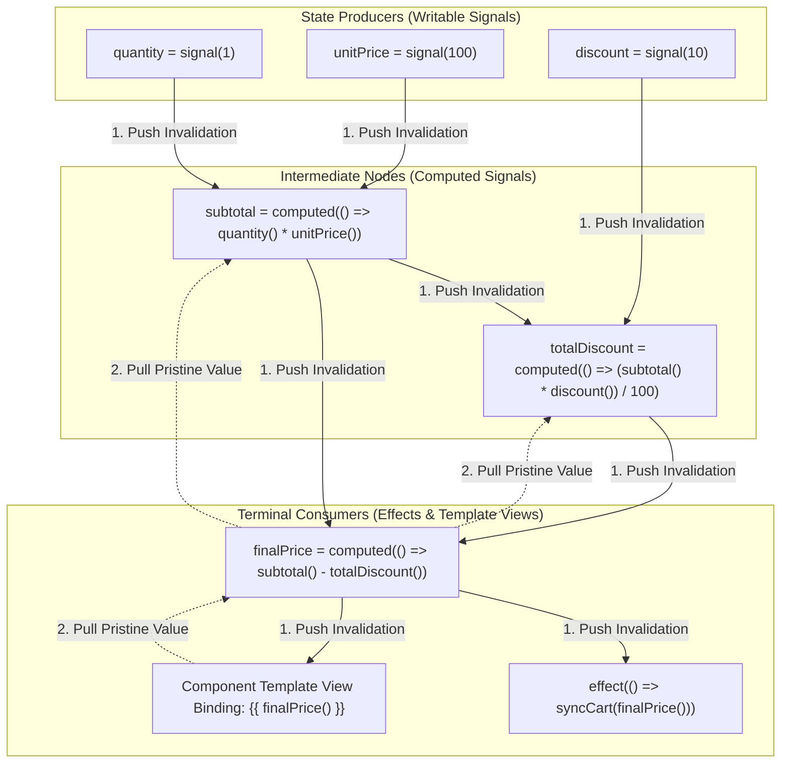
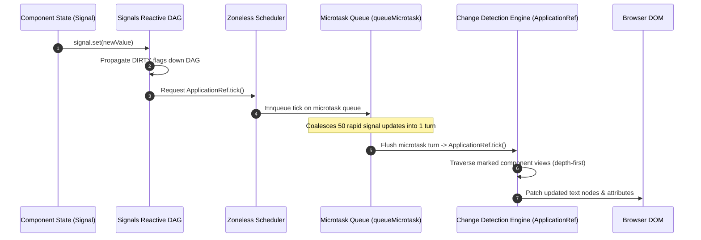
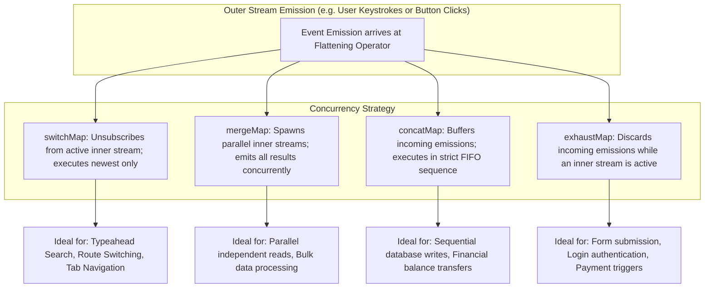
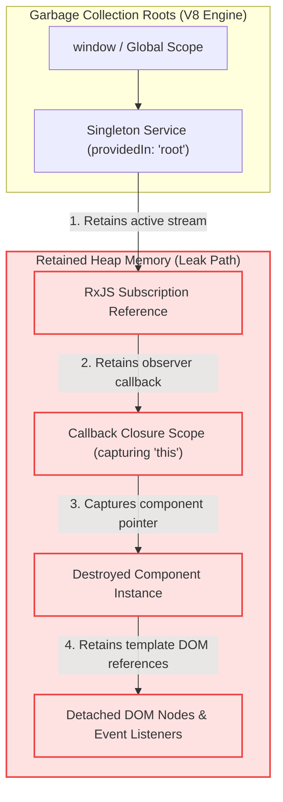

# 03. Modern Angular (v16–v18+) & Signals Experienced Developer (5–10+ YOE) Interview Master Guide — India Context

> **Target Audience:** Experienced Full-Stack & Frontend Developers (5–10+ Years of Experience) preparing for Senior Developer, Tech Lead, Module Lead, and Frontend Architect rounds in India.  
> **Applicable Companies:**  
> - **Top IT Services & Global Consultancies:** TCS, Infosys, Cognizant, Wipro, Accenture, Capgemini, HCL, LTIMindtree, Tech Mahindra, Hexaware, Persistent Systems, Nagarro, EPAM Systems, Coforge, Virtusa, Deloitte, EY, PwC, KPMG.  
> - **Tier-1 Global Capability Centers (GCCs) & Tech Hubs:** Wells Fargo, Morgan Stanley, JPMorgan Chase, Barclays, Walmart Global Tech India, Lowe's India, Target India, Optum, Fidelity Investments, Standard Chartered, HSBC Technology India.  
> - **Top Indian Product Firms & High-Growth Tech:** Swiggy, Zomato, Flipkart, MakeMyTrip, PhonePe, Paytm, Jio, Tata Neu, Zepto.  
>
> **Philosophy:** Senior-level systems thinking, deep framework internals, and real-world project experience. Every question strictly follows the Speakable Senior English v1 (SSE-1) standard.

---

# TABLE OF CONTENTS

- [MODULE 1: COMPONENT LIFECYCLE HOOKS & EXECUTION ORDER](#module-1-component-lifecycle-hooks--execution-order)
  - [Q1: Component Lifecycle Sequence & Exact Execution Order](#q1-component-lifecycle-sequence--exact-execution-order)
  - [Q2: Parent-Child Lifecycle Hook Execution Order](#q2-parent-child-lifecycle-hook-execution-order)
  - [Q3: ngOnChanges vs ngOnInit vs ngDoCheck](#q3-ngonchanges-vs-ngoninit-vs-ngdocheck)
  - [Q4: ngAfterViewInit vs ngAfterContentInit & ExpressionChangedAfterItHasBeenCheckedError](#q4-ngafterviewinit-vs-ngaftercontentinit--expressionchangedafterithasbeencheckederror)
- [MODULE 2: ANGULAR SIGNALS (v16–v18+) REACTIVE PRIMITIVES](#module-2-angular-signals-v16v18-reactive-primitives)
  - [Q5: The Modern Signals Trio: signal(), computed(), and effect() Under the Hood](#q5-the-modern-signals-trio-signal-computed-and-effect-under-the-hood)
  - [Q6: Array & Object State Mutations: Direct .push() Anti-Pattern vs .set() and .update()](#q6-array--object-state-mutations-direct-push-anti-pattern-vs-set-and-update)
  - [Q7: untracked() Signal Reads & Breaking Circular Dependency Cascades](#q7-untracked-signal-reads--breaking-circular-dependency-cascades)
  - [Q8: Modern Signal Inputs & Two-Way Binding: input(), input.required(), and model()](#q8-modern-signal-inputs--two-way-binding-input-inputrequired-and-model)
- [MODULE 3: SIGNALS VS RXJS OBSERVABLES & REACTIVE INTEROP](#module-3-signals-vs-rxjs-observables--reactive-interop)
  - [Q9: Angular Signals vs RxJS Observables: When to Use Which (State vs Events)](#q9-angular-signals-vs-rxjs-observables-when-to-use-which-state-vs-events)
  - [Q10: Reactive Interop: toSignal() and toObservable() Execution Contexts & Pitfalls](#q10-reactive-interop-tosignal-and-toobservable-execution-contexts--pitfalls)
  - [Q11: Combining Observables: forkJoin vs combineLatest vs withLatestFrom](#q11-combining-observables-forkjoin-vs-combinelatest-vs-withlatestfrom)
- [MODULE 4: COMPONENT COMMUNICATION ARCHITECTURES](#module-4-component-communication-architectures)
  - [Q12: Component Communication: Decorators (@Input/@Output) vs Modern Primitives (input/output/model)](#q12-component-communication-decorators-inputoutput-vs-modern-primitives-inputoutputmodel)
  - [Q13: ViewChild vs ContentChild & Static vs Dynamic Resolution ({ static: true | false })](#q13-viewchild-vs-contentchild--static-vs-dynamic-resolution--static-true--false-)
  - [Q14: Cross-Component Communication via Shared Service: Signals State Service vs BehaviorSubject](#q14-cross-component-communication-via-shared-service-signals-state-service-vs-behaviorsubject)
- [MODULE 5: RXJS FLATTENING OPERATORS MASTERY](#module-5-rxjs-flattening-operators-mastery)
  - [Q15: RxJS Flattening Operators: switchMap vs mergeMap vs concatMap vs exhaustMap](#q15-rxjs-flattening-operators-switchmap-vs-mergemap-vs-concatmap-vs-exhaustmap)
  - [Q16: Real-World Typeahead Live Search: Race-Condition Prevention with switchMap](#q16-real-world-typeahead-live-search-race-condition-prevention-with-switchmap)
  - [Q17: Preventing Double-Click Submissions with exhaustMap vs Sequential Queueing with concatMap](#q17-preventing-double-click-submissions-with-exhaustmap-vs-sequential-queueing-with-concatmap)
- [MODULE 6: CHANGE DETECTION STRATEGIES & ZONELESS ARCHITECTURE](#module-6-change-detection-strategies--zoneless-architecture)
  - [Q18: Default vs ChangeDetectionStrategy.OnPush & Why Immutability is Mandatory](#q18-default-vs-changedetectionstrategyonpush--why-immutability-is-mandatory)
  - [Q19: ChangeDetectorRef Mechanics: markForCheck() vs detectChanges() vs detach() / reattach()](#q19-changedetectorref-mechanics-markforcheck-vs-detectchanges-vs-detach--reattach)
  - [Q20: Modern Zoneless Angular: provideExperimentalZonelessChangeDetection() vs NgZone.runOutsideAngular()](#q20-modern-zoneless-angular-provideexperimentalzonelesschangedetection-vs-ngzonerunoutsideangular)
- [MODULE 7: DIRECTIVES: BUILT-IN CONTROL FLOW & CUSTOM ATTRIBUTES](#module-7-directives-built-in-control-flow--custom-attributes)
  - [Q21: Structural Directives (*ngIf, *ngFor) vs Modern Built-in Control Flow (@if, @for with track, @switch)](#q21-structural-directives-ngif-ngfor-vs-modern-built-in-control-flow-if-for-with-track-switch)
  - [Q22: Custom Attribute Directives using ElementRef, Renderer2, and Modern host Property Bindings](#q22-custom-attribute-directives-using-elementref-renderer2-and-modern-host-property-bindings)
- [MODULE 8: PIPES: PURE VS IMPURE ARCHITECTURE](#module-8-pipes-pure-vs-impure-architecture)
  - [Q23: Pure vs Impure Pipes: Change Detection Cycles, In-Memory Caching & Performance Risks](#q23-pure-vs-impure-pipes-change-detection-cycles-in-memory-caching--performance-risks)
- [MODULE 9: HIERARCHICAL DEPENDENCY INJECTION & PROVIDERS](#module-9-hierarchical-dependency-injection--providers)
  - [Q24: Hierarchical DI: Root Injector vs Environment Injector vs Element Injector](#q24-hierarchical-di-root-injector-vs-environment-injector-vs-element-injector)
  - [Q25: Provider Configuration: useClass vs useExisting vs useFactory vs useValue & Multi-Providers](#q25-provider-configuration-useclass-vs-useexisting-vs-usefactory-vs-usevalue--multi-providers)
  - [Q26: Modern Functional DI: inject() vs Constructor Injection & Injection Context Rules](#q26-modern-functional-di-inject-vs-constructor-injection--injection-context-rules)
- [MODULE 10: REACTIVE FORMS VS TEMPLATE-DRIVEN FORMS](#module-10-reactive-forms-vs-template-driven-forms)
  - [Q27: Reactive Forms vs Template-Driven Forms: Architecture, Scalability & Dynamic Validation](#q27-reactive-forms-vs-template-driven-forms-architecture-scalability--dynamic-validation)
  - [Q28: FormGroup, FormControl, and FormArray: Dynamic Fields & Custom Async Validators](#q28-formgroup-formcontrol-and-formarray-dynamic-fields--custom-async-validators)
- [MODULE 11: MODERN ROUTING, NAVIGATION & LAZY LOADING](#module-11-modern-routing-navigation--lazy-loading)
  - [Q29: Lazy Loading Standalone Components (loadComponent) vs Route Modules (loadChildren)](#q29-lazy-loading-standalone-components-loadcomponent-vs-route-modules-loadchildren)
  - [Q30: Functional Route Guards: CanActivateFn, CanDeactivateFn, and Atomic UrlTree Redirects](#q30-functional-route-guards-canactivatefn-candeactivatefn-and-atomic-urltree-redirects)
  - [Q31: Modern Route Resolvers: ResolveFn vs Direct Signal Service Ingestion](#q31-modern-route-resolvers-resolvefn-vs-direct-signal-service-ingestion)
- [MODULE 12: HTTP CLIENT & FUNCTIONAL INTERCEPTORS](#module-12-http-client--functional-interceptors)
  - [Q32: Functional HTTP Interceptors (HttpInterceptorFn): Bearer Token Injection & Request Cloning](#q32-functional-http-interceptors-httpinterceptorfn-bearer-token-injection--request-cloning)
  - [Q33: Silent JWT Token Refresh & 401 Unauthorized Retry Queueing](#q33-silent-jwt-token-refresh--401-unauthorized-retry-queueing)
- [MODULE 13: MEMORY LEAK PREVENTION & TEARDOWN MECHANICS](#module-13-memory-leak-prevention--teardown-mechanics)
  - [Q34: Root Causes of Angular Memory Leaks: Uncancelled Subscriptions & Detached DOM Trees](#q34-root-causes-of-angular-memory-leaks-uncancelled-subscriptions--detached-dom-trees)
  - [Q35: Modern Teardown Patterns: takeUntilDestroyed(), DestroyRef.onDestroy(), and AsyncPipe](#q35-modern-teardown-patterns-takeuntildestroyed-destroyrefondestroy-and-asyncpipe)
- [MODULE 14: STATE MANAGEMENT: LOCAL VS NGRX SIGNALSTORE](#module-14-state-management-local-vs-ngrx-signalstore)
  - [Q36: State Management Decision Matrix: Local Signals vs Service Signals vs NgRx SignalStore](#q36-state-management-decision-matrix-local-signals-vs-service-signals-vs-ngrx-signalstore)
  - [Q37: Modern NgRx SignalStore Architecture: signalStore(), withState(), withComputed(), and withMethods()](#q37-modern-ngrx-signalstore-architecture-signalstore-withstate-withcomputed-and-withmethods)
- [MODULE 15: PERFORMANCE TUNING & ENTERPRISE OPTIMIZATIONS](#module-15-performance-tuning--enterprise-optimizations)
  - [Q38: Deferrable Views (@defer, @placeholder, @loading, @error) and Trigger Conditions](#q38-deferrable-views-defer-placeholder-loading-error-and-trigger-conditions)
  - [Q39: Enterprise Angular Performance Optimization Checklist: track in @for, NgOptimizedImage, and Bundle Splitting](#q39-enterprise-angular-performance-optimization-checklist-track-in-for-ngoptimizedimage-and-bundle-splitting)
- [MODULE 16: BONUS SENIOR INTERVIEW ROUND QUESTIONS](#module-16-bonus-senior-interview-round-questions)
  - [Q40: Global Error Handling in Angular: Writing a Custom ErrorHandler for Centralized Logging](#q40-global-error-handling-in-angular-writing-a-custom-errorhandler-for-centralized-logging)
  - [Q41: Angular Security & XSS Protection: Built-in Sanitization, DomSanitizer, and CSP](#q41-angular-security--xss-protection-built-in-sanitization-domsanitizer-and-csp)
  - [Q42: Angular Server-Side Rendering (SSR) & Non-Destructive Hydration Internals](#q42-angular-server-side-rendering-ssr--non-destructive-hydration-internals)
  - [Q43: RxJS Operator Nuances: take(1) vs first() vs single() & shareReplay(1) Memory Leaks](#q43-rxjs-operator-nuances-take1-vs-first-vs-single--sharereplay1-memory-leaks)
- [MODULE 17: PRODUCTION ARCHITECTURE & SYSTEM DESIGN CASE STUDIES](#module-17-production-architecture--system-design-case-studies)
  - [Q44: Migrating Enterprise Angular Applications to Standalone Architecture & Control Flow](#q44-migrating-enterprise-angular-applications-to-standalone-architecture--control-flow)
  - [Q45: High-Throughput E-Commerce Cart & Live Pricing using Push-Pull Signal Graph](#q45-high-throughput-e-commerce-cart--live-pricing-using-push-pull-signal-graph)
  - [Q46: High-Scale Typeahead Catalog Search with Race-Condition Prevention](#q46-high-scale-typeahead-catalog-search-with-race-condition-prevention)
  - [Q47: High-Frequency Modal Dialogs: Preventing Detached DOM Memory Leaks](#q47-high-frequency-modal-dialogs-preventing-detached-dom-memory-leaks)
  - [Q48: High-Frequency 60 FPS Real-Time Canvas Rendering with NgZone Escaping](#q48-high-frequency-60-fps-real-time-canvas-rendering-with-ngzone-escaping)
  - [Q49: Silent JWT Token Refresh and Atomic Route Guiding in Modern Angular](#q49-silent-jwt-token-refresh-and-atomic-route-guiding-in-modern-angular)
  - [Q50: Enterprise State Management Architecture with NgRx SignalStore](#q50-enterprise-state-management-architecture-with-ngrx-signalstore)
  - [Q51: Real-Time Polling Dashboard Widget with Resilient Cleanup Architecture](#q51-real-time-polling-dashboard-widget-with-resilient-cleanup-architecture)
- [ADVANCED ENTERPRISE REFERENCE & PRODUCTION ARCHITECTURE](#advanced-enterprise-reference--production-architecture)


# MODULE 1: COMPONENT LIFECYCLE HOOKS & EXECUTION ORDER

## Q1: What is the exact execution sequence of Angular component lifecycle hooks?
*Commonly asked at: TCS, Infosys, Cognizant, Accenture*

**⚡ One-line answer**
Angular lifecycle hooks execute in a deterministic order from constructor initialization down to final DOM destruction.

**🗣️ Spoken answer (30–45 seconds)**
Angular manages components through a strict deterministic state sequence. The class constructor runs first for dependency injection. Next, input change detection [ngOnChanges] checks property bindings, followed by ngOnInit for initial business logic. Content projection hooks resolve before view hooks verify the DOM tree. Finally, teardown [ngOnDestroy] frees open subscriptions before element removal. In one of my projects, moving REST calls to ngOnInit prevented premature initialization failures.

**🎯 Terms the interviewer listens for**
- **ngOnInit**: executes once after initial inputs are verified ⭐
- **ngOnChanges**: fires whenever input property references mutate ⭐
- **ngOnDestroy**: cleans active subscriptions before DOM removal ⭐
- **ngAfterViewInit**: fires when component template DOM renders
- **Unidirectional data flow**: prevents binding mutations during render passes

**🧠 Memory hook**
Think of constructing a modular building: lay foundations, verify blueprints, install furniture, inspect lighting, and dismantle cleanly on demolition.

**💻 Code**
```typescript
// ❌ Bad: heavy network call in constructor
constructor(private http: HttpClient) {
  this.http.get('/api/data').subscribe();
}

// ✅ Good: dispatch initial calls in ngOnInit
ngOnInit(): void {
  this.userService.loadInitialProfile();
}
```

**⚠️ Likely follow-up**
*Question:* Why must constructors remain lightweight without side effects?
*Answer:* Constructors run before input bindings resolve; placing asynchronous work there violates separation of concerns and complicates unit testing.

**📊 Quick comparison**
| Hook | Trigger Timing | Primary Responsibility |
| :--- | :--- | :--- |
| `ngOnChanges` | Input reference changes | Validates bound data |
| `ngOnInit` | After first changes | Dispatches HTTP requests |
| `ngAfterViewInit` | Template views rendered | Initializes DOM widgets |
| `ngOnDestroy` | Before DOM removal | Cleans active subscriptions |

**🔬 Under the hood (optional)**
Angular's compiler lowers templates into view instructions, executing lifecycle hooks at strict boundary phases during change detection passes.

---

## Q2: What is the parent-child lifecycle hook execution order during creation and destruction?
*Commonly asked at: Cognizant, Infosys, Capgemini, Wells Fargo*

**⚡ One-line answer**
Initialization runs top-down from parent to child, while view resolution runs bottom-up from child to parent.

**🗣️ Spoken answer (30–45 seconds)**
Component creation proceeds top-down from parent to child. The parent constructor and ngOnInit execute first, enabling child components to initialize their own state. Conversely, view rendering completes bottom-up from child to parent because parent views require rendered children. On destruction, teardown executes top-down to cleanly detach child trees. In one of my projects, understanding this order prevented undefined view query errors.

**🎯 Terms the interviewer listens for**
- **Top-down creation**: parents initialize before child instances instantiate ⭐
- **Bottom-up view completion**: children finish view rendering before parents ⭐
- **Top-down teardown**: parents destroy before nested child components ⭐
- **ngAfterViewInit**: hook signaling template view is ready
- **View encapsulation**: scopes component styles to element boundaries

**🧠 Memory hook**
Assembling a car: the chassis is framed first, then wheels attach, but final inspection happens only after wheels are mounted.

**💻 Code**
```typescript
// ❌ Bad: accessing child view in parent ngOnInit
ngOnInit(): void {
  this.childComponent.refresh(); // undefined!
}

// ✅ Good: access child view in ngAfterViewInit
ngAfterViewInit(): void {
  this.childComponent.refresh();
}
```

**⚠️ Likely follow-up**
*Question:* Why does child ngAfterViewInit run before parent ngAfterViewInit?
*Answer:* A parent template view physically contains child views; a container cannot be fully rendered until all interior children complete rendering.

**📊 Quick comparison**
| Phase | Order Direction | Execution Sequence |
| :--- | :--- | :--- |
| **Creation** | Top-down | Parent init then Child init |
| **View Ready** | Bottom-up | Child view then Parent view |
| **Destruction** | Top-down | Parent destroy then Child destroy |

**🔬 Under the hood (optional)**
Angular builds a view hierarchy tree; depth-first traversal evaluates parent initializers, descending to children before returning upward for view completion.

---

## Q3: What is the difference between ngOnChanges, ngOnInit, and ngDoCheck?
*Commonly asked at: TCS, Wipro, HCL, Walmart*

**⚡ One-line answer**
ngOnInit runs once on initialization; ngOnChanges fires on reference mutations; ngDoCheck runs on every change detection cycle.

**🗣️ Spoken answer (30–45 seconds)**
These three hooks handle component state tracking at different frequencies. `ngOnInit` executes exactly once when initial inputs are bound. `ngOnChanges` executes before ngOnInit and whenever input references mutate by identity. `ngDoCheck` runs on every single change detection cycle to allow custom dirty checking. Placing heavy algorithms inside ngDoCheck degrades rendering performance. In one of my projects, replacing ngDoCheck with computed signals eliminated unnecessary change detection cycles.

**🎯 Terms the interviewer listens for**
- **ngOnInit**: executes once during component initialization ⭐
- **ngOnChanges**: fires when bound input references change ⭐
- **ngDoCheck**: runs during every change detection pass ⭐
- **Reference equality**: checks object pointers via Object.is
- **KeyValueDiffers**: utility for manual object property tracking

**🧠 Memory hook**
ngOnInit is your morning alarm; ngOnChanges is a doorbell ringing on deliveries; ngDoCheck is a guard asking every minute if anything changed.

**💻 Code**
```typescript
// ❌ Bad: heavy calculation inside ngDoCheck
ngDoCheck(): void {
  this.runDeepObjectComparison(); // freezes UI!
}

// ✅ Good: use computed signal for state derivation
readonly total = computed(() => this.items().reduce((a, b) => a + b, 0));
```

**⚠️ Likely follow-up**
*Question:* Does ngOnChanges fire if an object property is mutated in place?
*Answer:* No. ngOnChanges checks reference identity; mutating an object property keeps the same memory pointer, so ngOnChanges ignores it completely.

**📊 Quick comparison**
| Hook | Execution Frequency | Primary Use Case |
| :--- | :--- | :--- |
| `ngOnInit` | Once per lifecycle | Service subscriptions & initial API |
| `ngOnChanges` | On input pointer change | Reacting to parent changes |
| `ngDoCheck` | Every change detection cycle | Custom manual dirty-checking |

**🔬 Under the hood (optional)**
Angular compares current and previous input pointers in the component's view node; if Object.is returns false, SimpleChanges emits.

---

## Q4: What causes ExpressionChangedAfterItHasBeenCheckedError and when does ngAfterViewInit run?
*Commonly asked at: Infosys, Deloitte, Cognizant, TCS*

**⚡ One-line answer**
It occurs when bindings mutate after verification; fix it by moving updates earlier or using signals.

**🗣️ Spoken answer (30–45 seconds)**
This error enforces Angular's unidirectional data flow rule in development mode. In development builds, Angular runs a second verification sweep after change detection. If any template binding value changed since the initial pass, it throws this error. It commonly occurs when child components modify parent properties inside `ngAfterViewInit`. The fix is moving logic to `ngOnInit` or managing updates via signals. In one of my projects, switching to signal inputs eliminated this error.

**🎯 Terms the interviewer listens for**
- **Unidirectional data flow**: parent properties flow strictly downward to children ⭐
- **Verification sweep**: development check verifying template binding stability ⭐
- **ngAfterViewInit**: hook signaling template view DOM completion ⭐
- **queueMicrotask()**: schedules mutations in the next microtask turn
- **ChangeDetectorRef**: service controlling change detection execution

**🧠 Memory hook**
A cashier checking your shopping cart totals, but a helper slips an item in after the receipt has printed.

**💻 Code**
```typescript
// ❌ Bad: mutating parent state after view check
ngAfterViewInit(): void {
  this.parent.title = 'Updated Title';
}

// ✅ Good: defer mutation to next microtask cycle
ngAfterViewInit(): void {
  queueMicrotask(() => this.parent.title.set('Updated'));
}
```

**⚠️ Likely follow-up**
*Question:* Why does ExpressionChangedAfterItHasBeenCheckedError only appear in development mode?
*Answer:* The verification pass is disabled in production to maximize performance, but leaving the underlying race condition causes UI synchronization glitches.

**📊 Quick comparison**
| Phase | Primary Pass | Verification Pass |
| :--- | :--- | :--- |
| **Check Mode** | Computes bindings | Compares previous values |
| **Action** | Updates DOM nodes | Throws error if mismatched |
| **Production** | Enabled | Stripped for speed |

**🔬 Under the hood (optional)**
ApplicationRef runs tick() with checkAndUpdate(), then runs checkNoChangesNode() in development to assert binding idempotency.

---


# MODULE 2: ANGULAR SIGNALS (v16–v18+) REACTIVE PRIMITIVES

## Q5: How do signal, computed, and effect work under the hood in modern Angular?
*Commonly asked at: Accenture, TCS, Cognizant, Capgemini*

**⚡ One-line answer**
signal stores writable state, computed lazily caches derived values, and effect schedules side effects on microtasks.

**🗣️ Spoken answer (30–45 seconds)**
Angular Signals form a reactive dependency graph using producers and consumers. A `signal()` is a writable producer holding state that notifies downstream nodes on update. A `computed()` is a memoized derivation that evaluates lazily only when read. An `effect()` is a consumer that schedules side-effect execution on microtasks when dependencies change. Writing to signals inside effects is discouraged to prevent infinite cycles. In one of my projects, computed signals replaced twenty manual subscription calculations.

**🎯 Terms the interviewer listens for**
- **signal()**: writable producer node holding reactive state ⭐
- **computed()**: lazily evaluated memoized derived signal ⭐
- **effect()**: microtask scheduled consumer executing side effects ⭐
- **Push-pull graph**: dirty flag propagation and lazy pulling
- **Reactive context**: execution frame tracking accessed signal producers

**🧠 Memory hook**
signal is an Excel cell with a number; computed is a formula cell; effect is an email triggered when the total changes.

**💻 Code**
```typescript
// ❌ Bad: using effect to derive state
effect(() => {
  this.total.set(this.price() * this.qty());
}, { allowSignalWrites: true });

// ✅ Good: declarative derived state using computed
readonly total = computed(() => this.price() * this.qty());
```

**⚠️ Likely follow-up**
*Question:* Can a computed signal produce side effects like HTTP calls?
*Answer:* No. Computed expressions must remain pure read-only functions with zero side effects; mutating state inside them triggers runtime errors.

**📊 Quick comparison**
| Primitive | Node Role | Evaluation | Primary Purpose |
| :--- | :--- | :--- | :--- |
| `signal()` | Producer | Immediate | Holds state |
| `computed()` | Producer & Consumer | Lazy on read | Derived values |
| `effect()` | Consumer | Microtask queue | Side effects |

**🔬 Under the hood (optional)**
When a producer updates, it pushes dirty flags down the DAG. Dependent computed nodes recompute their value only when consumers pull them.

---

## Q6: Why is mutating an array with push an anti-pattern in Angular Signals?
*Commonly asked at: Infosys, Deloitte, Wipro, TCS*

**⚡ One-line answer**
Signals check equality using Object.is; in-place array mutation preserves reference identity, preventing consumers from updating.

**🗣️ Spoken answer (30–45 seconds)**
Signals rely on equality checks [Object.is] to decide whether downstream consumers need invalidation. Calling `.push()` on an array mutates elements in place without changing the array reference pointer. Because the old and new references are identical, the signal drops notifications and dependent templates fail to re-render. To trigger updates, use `.update()` with the spread operator to return a new reference. In one of my projects, fixing direct mutations resolved missing shopping cart item updates.

**🎯 Terms the interviewer listens for**
- **Object.is**: equality algorithm used for signal changes ⭐
- **Immutable update**: producing new references without in-place mutation ⭐
- **update()**: modifies signal value using a pure transformation ⭐
- **Reference equality**: evaluates memory address identity of objects
- **Consumer invalidation**: marking downstream nodes dirty on state change

**🧠 Memory hook**
Direct push is writing in an old diary; immutable update is publishing a brand-new edition with fresh pages.

**💻 Code**
```typescript
// ❌ Bad: in-place mutation keeps old reference
this.items().push(newItem);
// UI never updates!

// ✅ Good: update returns a new array reference
this.items.update(list => [...list, newItem]);
```

**⚠️ Likely follow-up**
*Question:* How can you supply a custom equality comparison function to a signal?
*Answer:* Pass an options object with an equal function: `signal(value, { equal: (a, b) => customComparison(a, b) })`.

**📊 Quick comparison**
| Mutation Style | Reference Identity | Signal Notification |
| :--- | :--- | :--- |
| `.push()` | Identical (`prev === next`) | Dropped (No UI update) |
| `.update([...list])` | New reference (`prev !== next`) | Emitted (UI updates) |

**🔬 Under the hood (optional)**
Signal nodes run `equal(prevValue, nextValue)`. If true, the node returns without bumping its version or invalidating downstream consumers.

---

## Q7: What is the purpose of untracked inside an effect or computed signal?
*Commonly asked at: TCS, Accenture, Cognizant, Persistent*

**⚡ One-line answer**
untracked reads a signal value without registering it as a reactive dependency in the current context.

**🗣️ Spoken answer (30–45 seconds)**
Reading a signal inside a reactive context automatically adds that signal as a dependency edge. The `untracked()` function reads a signal value while preventing that signal from being tracked in the active context. Consequently, updates to the untracked signal will not trigger re-execution of the effect or computed. This breaks circular dependency cascades and prevents infinite loops. In one of my projects, untracked prevented infinite loops when logging analytics events alongside state updates.

**🎯 Terms the interviewer listens for**
- **untracked()**: reads signal values without dependency registration ⭐
- **Reactive context**: execution scope tracking accessed signal producers ⭐
- **Circular dependency**: infinite loop caused by reciprocal signal triggers ⭐
- **Dynamic tracking**: registers dependencies accessed during branch execution
- **Version checking**: determines whether computed signals need re-evaluation

**🧠 Memory hook**
Checking the wall clock while cooking without setting an alarm for every passing second.

**💻 Code**
```typescript
// ❌ Bad: effect re-runs when analytics counter updates
effect(() => {
  this.logMetrics(this.user(), this.counter());
});

// ✅ Good: reads counter without registering dependency
effect(() => {
  this.logMetrics(this.user(), untracked(() => this.counter()));
});
```

**⚠️ Likely follow-up**
*Question:* What happens if you mutate a signal inside an untracked block?
*Answer:* Mutating a signal inside untracked still notifies downstream consumers; it only prevents the current context from listening to changes.

**📊 Quick comparison**
| Context | Standard Read | untracked() Read |
| :--- | :--- | :--- |
| `computed()` | Creates dependency edge | Reads without edge |
| `effect()` | Re-runs on update | Ignores signal update |

**🔬 Under the hood (optional)**
untracked temporarily sets the current consumer context to null, reads the producer value, and restores the previous consumer context.

---

## Q8: How do modern signal inputs and two-way model signals work in Angular?
*Commonly asked at: Capgemini, Infosys, Deloitte, TCS*

**⚡ One-line answer**
input creates a read-only signal property, input.required enforces inputs at compile time, and model enables two-way synchronization.

**🗣️ Spoken answer (30–45 seconds)**
Modern Angular replaces traditional input decorators with functional signal primitives. The `input()` function creates a read-only signal property with optional transform functions. Using `input.required()` guarantees that parents provide values, failing compilation if missing. For two-way data binding, `model()` creates a writable signal that automatically emits change events back to the parent. In one of my projects, converting to model signals eliminated thirty manual event emitter definitions.

**🎯 Terms the interviewer listens for**
- **input()**: read-only signal input property ⭐
- **input.required()**: mandates property at compile time ⭐
- **model()**: two-way synchronized writable signal ⭐
- **InputSignal**: internal type representing read-only signal inputs
- **Two-way binding**: synchronizes state across component boundaries

**🧠 Memory hook**
input() is a read-only digital billboard; model() is a walkie-talkie connecting parent and child.

**💻 Code**
```typescript
// ❌ Bad: verbose decorator with EventEmitter pair
@Input() value = 0;
@Output() valueChange = new EventEmitter<number>();

// ✅ Good: single two-way model signal
readonly value = model(0);
```

**⚠️ Likely follow-up**
*Question:* Can a child component write directly to an input() signal using .set()?
*Answer:* No. InputSignal is strictly read-only; calling .set() produces a compile-time error. Use model() when child mutations are needed.

**📊 Quick comparison**
| Primitive | Direction | Writable by Child |
| :--- | :--- | :--- |
| `input()` | Parent to child | No (Compile error) |
| `input.required()` | Mandatory parent to child | No |
| `model()` | Bidirectional sync | Yes (`.set`, `.update`) |

**🔬 Under the hood (optional)**
The compiler transforms model() into an InputSignal paired with an implicit output emitter named with the 'Change' suffix.

---


# MODULE 3: SIGNALS VS RXJS OBSERVABLES & REACTIVE INTEROP

## Q9: When should you use Angular Signals versus RxJS Observables?
*Commonly asked at: Accenture, Cognizant, TCS, Wipro*

**⚡ One-line answer**
Use Signals for synchronous state and template presentation; use RxJS for asynchronous events, timing, and stream composition.

**🗣️ Spoken answer (30–45 seconds)**
Signals and RxJS serve complementary architectural roles. Signals manage synchronous reactive state, powering template bindings and local component derivations with zero subscription boilerplate. RxJS Observables handle asynchronous event streams over time. Use RxJS when you need debounce timing, stream cancellation, or WebSocket coordination. Bridging between them is straightforward using `toSignal()` and `toObservable()`. In one of my projects, using signals for UI state eliminated fifty subscription handlers.

**🎯 Terms the interviewer listens for**
- **Synchronous state**: always holds an active current value ⭐
- **Asynchronous stream**: sequence of discrete events over time ⭐
- **toSignal()**: bridges observable streams into reactive signals ⭐
- **toObservable()**: converts signal changes into an observable
- **Push-pull graph**: reactive graph architecture powering signals

**🧠 Memory hook**
A signal is a gas gauge showing current fuel; an observable is the pump nozzle flowing fuel over time.

**💻 Code**
```typescript
// ❌ Bad: manual subscription to manage UI state
items$.subscribe(data => {
  this.items = data;
});

// ✅ Good: declarative signal conversion with automatic teardown
readonly items = toSignal(this.catalogService.items$, { initialValue: [] });
```

**⚠️ Likely follow-up**
*Question:* Can Signals completely replace RxJS in modern Angular applications?
*Answer:* No. Signals lack temporal coordination operators like debounceTime, switchMap, and retry, which are essential for complex event streaming.

**📊 Quick comparison**
| Dimension | Signals | RxJS Observables |
| :--- | :--- | :--- |
| **Value presence** | Always has current value | Emits only when events fire |
| **Timing** | Synchronous | Asynchronous over time |
| **Operators** | `computed`, `effect` | `debounce`, `switchMap`, `retry` |
| **Cleanup** | Automatic garbage collection | Requires unsubscription |

**🔬 Under the hood (optional)**
Signals lack a temporal dimension; they propagate values instantaneously across the graph, whereas Observables model event sequences across time.

---

## Q10: How do toSignal and toObservable work and what are their context restrictions?
*Commonly asked at: Infosys, Deloitte, Capgemini, TCS*

**⚡ One-line answer**
toSignal and toObservable bridge reactive models, requiring an active injection context for automatic lifecycle management.

**🗣️ Spoken answer (30–45 seconds)**
Angular provides interop utilities in `@angular/core/rxjs-interop`. The `toSignal()` function subscribes to an observable and stores emissions in a signal. It must run inside an injection context to clean up the subscription when the host destroys. Conversely, `toObservable()` monitors a signal and emits changes into an observable stream via internal effects. Calling them outside constructors requires passing an `Injector` explicitly. In one of my projects, toSignal simplified consuming real-time notification streams.

**🎯 Terms the interviewer listens for**
- **toSignal()**: converts observable stream into reactive signal ⭐
- **toObservable()**: converts signal state changes into observable ⭐
- **Injection context**: execution frame resolving dependencies and cleanup ⭐
- **initialValue**: configures fallback value before first emission
- **DestroyRef**: cleans underlying subscriptions on teardown

**🧠 Memory hook**
toSignal is a digital picture frame displaying the latest broadcast photo; toObservable is a camera filming the frame changes.

**💻 Code**
```typescript
// ❌ Bad: calling toSignal outside injection context
setTimeout(() => {
  this.user = toSignal(this.user$); // NG0203 error!
});

// ✅ Good: declare toSignal in class field initializer
readonly user = toSignal(this.userService.user$);
```

**⚠️ Likely follow-up**
*Question:* What happens if an observable converted by toSignal() emits an error?
*Answer:* By default, toSignal rethrows errors into the reactive graph, crashing subsequent reads unless configured with `rejectErrors: true`.

**📊 Quick comparison**
| Utility | Source Type | Output Type | Default Teardown |
| :--- | :--- | :--- | :--- |
| `toSignal()` | Observable | Read-only Signal | Host component destruction |
| `toObservable()` | Signal | Observable stream | Unsubscribe or takeUntil |

**🔬 Under the hood (optional)**
toSignal subscribes immediately using an internal effect consumer, updating an internal writable signal and unsubscribing via DestroyRef.

---

## Q11: How do forkJoin, combineLatest, and withLatestFrom differ in production use?
*Commonly asked at: Cognizant, Accenture, TCS, Persistent*

**⚡ One-line answer**
forkJoin waits for all to complete; combineLatest emits on any source change; withLatestFrom samples on primary triggers.

**🗣️ Spoken answer (30–45 seconds)**
These combination operators handle multiple streams under different trigger policies. `forkJoin` waits for all source observables to complete and emits their final values in parallel. `combineLatest` emits whenever any source emits, provided every source has emitted at least once. `withLatestFrom` emits only when its master source emits, sampling current values from secondary observables. Selecting the wrong operator causes stale data or hung streams. In one of my projects, forkJoin parallelized multiple dashboard configuration requests.

**🎯 Terms the interviewer listens for**
- **forkJoin**: waits for all source streams to complete ⭐
- **combineLatest**: emits latest values whenever any source updates ⭐
- **withLatestFrom**: samples secondary streams on master trigger emission ⭐
- **Completion requirement**: stream must complete before emitting in forkJoin
- **Cold observable**: stream producing values upon subscription

**🧠 Memory hook**
forkJoin waits for everyone to finish exams; combineLatest updates scores on any goal; withLatestFrom takes a photo when the shutter clicks.

**💻 Code**
```typescript
// ❌ Bad: combineLatest when completion is required
combineLatest([httpA$, httpB$]).subscribe(res => {
  this.handleData(res);
});

// ✅ Good: forkJoin waits for completion
forkJoin({
  users: this.getUsers(),
  roles: this.getRoles()
}).subscribe();
```

**⚠️ Likely follow-up**
*Question:* What happens if one stream inside forkJoin throws an HTTP error?
*Answer:* The entire forkJoin operation terminates immediately, discarding successful responses from all other sibling streams.

**📊 Quick comparison**
| Operator | Trigger Rule | Requires Completion |
| :--- | :--- | :--- |
| `forkJoin` | All streams complete | Yes |
| `combineLatest` | Any stream emits | No |
| `withLatestFrom` | Master stream emits | No |

**🔬 Under the hood (optional)**
forkJoin maintains an internal buffer tracking the latest item of each stream, emitting the combined dictionary upon the final completion.

---


# MODULE 4: COMPONENT COMMUNICATION ARCHITECTURES

## Q12: How do modern component communication primitives compare to legacy decorators?
*Commonly asked at: TCS, Capgemini, Infosys, Wipro*

**⚡ One-line answer**
Modern primitives replace decorators with type-safe signals, eliminating boilerplate and manual lifecycle synchronization.

**🗣️ Spoken answer (30–45 seconds)**
Legacy Angular used `@Input()` and `@Output()` decorators, requiring manual `ngOnChanges` checks to track incoming mutations. Modern Angular uses functional primitives: `input()`, `output()`, and `model()`. Signal inputs provide read-only reactive values that integrate directly into computed graphs. Event outputs use lightweight native dispatchers without EventEmitter class overhead. Two-way model signals eliminate separate property and event pairs. In one of my projects, converting to signal primitives reduced component code size by twenty percent.

**🎯 Terms the interviewer listens for**
- **input()**: read-only signal input property ⭐
- **output()**: lightweight native event dispatcher ⭐
- **model()**: bidirectional synchronized writable signal ⭐
- **@Input() decorator**: legacy property binding decorator
- **EventEmitter**: legacy event dispatching utility class

**🧠 Memory hook**
Legacy decorators were paper forms passed through committees; modern primitives are direct telephone lines between desks.

**💻 Code**
```typescript
// ❌ Bad: legacy decorator requiring ngOnChanges
@Input() filter = '';
ngOnChanges(c: SimpleChanges) { this.applyFilter(); }

// ✅ Good: modern signal input with computed derivation
readonly filter = input('');
readonly results = computed(() => this.filterData(this.filter()));
```

**⚠️ Likely follow-up**
*Question:* Can legacy decorators and modern signal primitives coexist in the same application?
*Answer:* Yes. Angular supports incremental migration; components using signal inputs can interact seamlessly with components using legacy decorators.

**📊 Quick comparison**
| Feature | Legacy Decorator | Modern Primitive |
| :--- | :--- | :--- |
| **Input Property** | `@Input()` | `input()` |
| **Output Event** | `@Output() = new EventEmitter()` | `output()` |
| **Two-Way Binding** | `@Input` + `@Output Change` | `model()` |
| **Type Safety** | Loose getter/setter | Strict Signal typing |

**🔬 Under the hood (optional)**
The compiler transforms input() declarations into ViewEngine instructions that link parent binding values directly to child reactive nodes.

---

## Q13: What is the difference between ViewChild and ContentChild and how does static resolution work?
*Commonly asked at: Cognizant, Deloitte, Persistent, Accenture*

**⚡ One-line answer**
ViewChild queries internal template elements, ContentChild queries projected markup, and static true resolves before change detection.

**🗣️ Spoken answer (30–45 seconds)**
DOM query mechanisms target different template locations. `ViewChild` inspects elements inside the component's own template, resolving in `ngAfterViewInit`. `ContentChild` inspects external elements projected via `<ng-content>`, resolving earlier in `ngAfterContentInit`. Setting `{ static: true }` resolves the query before change detection in `ngOnInit`, but fails if elements are gated by conditional blocks like `@if`. Modern `viewChild()` signals eliminate static flag confusion. In one of my projects, viewChild signals simplified accessing canvas elements.

**🎯 Terms the interviewer listens for**
- **ViewChild**: queries internal template DOM nodes ⭐
- **ContentChild**: queries external projected content nodes ⭐
- **static: true**: resolves query before change detection in ngOnInit ⭐
- **viewChild()**: modern signal-based DOM query primitive
- **Content projection**: renders projected external markup slots

**🧠 Memory hook**
ViewChild is checking the TV in your living room; ContentChild is inspecting luggage brought by a guest.

**💻 Code**
```typescript
// ❌ Bad: static true on conditional element
@ViewChild('modal', { static: true })
modal!: ElementRef; // fails if inside @if!

// ✅ Good: modern viewChild signal handles conditionals
readonly modal = viewChild<ElementRef>('modal');
```

**⚠️ Likely follow-up**
*Question:* What does a viewChild() signal return when an element is removed by an @if block?
*Answer:* The viewChild signal reactively emits undefined when the DOM element unmounts, and emits the element reference when it re-renders.

**📊 Quick comparison**
| Query Target | Resolution Hook | Works Inside @if |
| :--- | :--- | :--- |
| `ViewChild { static: true }` | `ngOnInit` | No |
| `ViewChild { static: false }` | `ngAfterViewInit` | Yes |
| `viewChild()` signal | Reactive on render | Yes |

**🔬 Under the hood (optional)**
Static queries resolve during component view creation, whereas dynamic queries re-run during embedded view container updates.

---

## Q14: How do you architect cross-component communication using a Signals service versus BehaviorSubject?
*Commonly asked at: TCS, Infosys, Capgemini, Accenture*

**⚡ One-line answer**
Use a singleton service with private writable signals, exposing read-only signals to prevent uncontrolled external mutations.

**🗣️ Spoken answer (30–45 seconds)**
Sharing state across unrelated components uses an injectable singleton service provided in root. In modern Angular, the service manages private writable signals internally. Public consumers access read-only signals via `.asReadonly()` to enforce unidirectional updates. This avoids BehaviorSubject boilerplate, subscription leaks, and extra pipe transformations. Components read signals directly in templates, triggering fine-grained updates. In one of my projects, a signal cart service eliminated thirty subscription handlers across checkout views.

**🎯 Terms the interviewer listens for**
- **Singleton service**: centralized state container provided in root ⭐
- **asReadonly()**: exposes read-only signal view to consumers ⭐
- **Encapsulation**: restricting state mutations to service methods ⭐
- **BehaviorSubject**: legacy state container requiring manual unsubscribe
- **Fine-grained reactivity**: re-renders only dependent template bindings

**🧠 Memory hook**
A bank vault where customers can view their balance through glass, but only teller methods can deposit funds.

**💻 Code**
```typescript
// ❌ Bad: exposing writable BehaviorSubject directly
public user$ = new BehaviorSubject<User | null>(null);

// ✅ Good: private writable signal with public read-only view
private readonly _user = signal<User | null>(null);
readonly user = this._user.asReadonly();
```

**⚠️ Likely follow-up**
*Question:* Why is exposing writable signals directly from a shared service considered an anti-pattern?
*Answer:* Exposing writable signals allows arbitrary components to call `.set()`, bypassing validation logic and breaking predictable unidirectional state flow.

**📊 Quick comparison**
| Criterion | Signal Service | BehaviorSubject Service |
| :--- | :--- | :--- |
| **Boilerplate** | Minimal | High |
| **Teardown** | Automatic | Requires unsubscription |
| **Derivations** | `computed()` | `pipe(map())` |
| **Template Reading** | Direct call `user()` | Requires `AsyncPipe` |

**🔬 Under the hood (optional)**
When an injected signal updates, Angular marks only the components whose templates read that signal dirty, avoiding broad tree checks.

---


# MODULE 5: RXJS FLATTENING OPERATORS MASTERY

## Q15: How do switchMap, mergeMap, concatMap, and exhaustMap differ in real-world scenarios?
*Commonly asked at: TCS, Cognizant, Deloitte, Wipro*

**⚡ One-line answer**
switchMap cancels stale requests; mergeMap runs parallel reads; concatMap queues writes sequentially; exhaustMap ignores concurrent submissions.

**🗣️ Spoken answer (30–45 seconds)**
Flattening operators handle higher-order observables based on specific concurrency requirements: `switchMap` cancels stale inner requests, making it ideal for typeahead search. `mergeMap` runs inner streams concurrently in parallel, making it ideal for independent reads. `concatMap` queues inner streams in strict order, making it ideal for sequential writes. `exhaustMap` ignores new triggers while an active inner stream runs, making it ideal for login and submit buttons. In one of my projects, exhaustMap eliminated duplicate checkout orders.

**🎯 Terms the interviewer listens for**
- **switchMap**: cancels stale in-flight streams for search ⭐
- **mergeMap**: runs parallel independent child requests concurrently ⭐
- **concatMap**: queues streams in sequential FIFO order ⭐
- **exhaustMap**: ignores new inputs until current completes
- **Higher-order stream**: observable emitting inner observable instances

**🧠 Memory hook**
switchMap is changing TV channels; mergeMap is multi-burner cooking; concatMap is ticket queueing; exhaustMap is an occupied restroom.

**💻 Code**
```typescript
// ❌ Bad: mergeMap causes out-of-order responses
search$.pipe(
  mergeMap(q => this.http.get(`/search?q=${q}`))
).subscribe();

// ✅ Good: switchMap cancels stale search requests
search$.pipe(
  switchMap(q => this.http.get(`/search?q=${q}`))
).subscribe();
```

**⚠️ Likely follow-up**
*Question:* Which flattening operator should you use for financial balance transfers?
*Answer:* Use concatMap to guarantee that debit and credit transactions execute sequentially in strict order without concurrency race conditions.

**📊 Quick comparison**
| Operator | Concurrency Rule | Primary Use Case |
| :--- | :--- | :--- |
| `switchMap` | Cancels active inner stream | Typeahead search |
| `mergeMap` | Runs parallel concurrently | Independent reads |
| `concatMap` | Queues in sequential order | Sequential writes |
| `exhaustMap` | Ignores incoming while busy | Submit & login buttons |

**🔬 Under the hood (optional)**
Higher-order operators manage inner subscription references, handling inner completion signals and outer unsubscriptions according to operator policy.

---

## Q16: How do you implement typeahead live search preventing race conditions and stream death?
*Commonly asked at: Infosys, Capgemini, Accenture, TCS*

**⚡ One-line answer**
Use switchMap with debounceTime, distinctUntilChanged, and an inner catchError operator to keep the outer stream alive.

**🗣️ Spoken answer (30–45 seconds)**
A production typeahead search must handle rapid keystrokes, out-of-order responses, and API failures. We apply `debounceTime(300)` to wait for user typing to pause, and `distinctUntilChanged()` to skip duplicate terms. We use `switchMap` to cancel pending in-flight HTTP requests when new terms arrive. Critically, we place `catchError` inside the inner switchMap observable. Catching errors internally returns a fallback array, keeping the outer listener alive. In one of my projects, this architecture prevented search box lockups.

**🎯 Terms the interviewer listens for**
- **switchMap**: cancels stale in-flight requests on new input ⭐
- **debounceTime**: delays emission until typing pauses for duration ⭐
- **Inner catchError**: recovers from network failures without stream termination ⭐
- **distinctUntilChanged**: ignores consecutive identical search terms
- **takeUntilDestroyed**: cleans subscription on component destruction

**🧠 Memory hook**
A fast-food cashier taking only the newest order while dropping cancelled requests, without shutting down the counter on errors.

**💻 Code**
```typescript
// ❌ Bad: outer catchError permanently breaks input listener
search$.pipe(
  switchMap(q => this.http.get(`/items?q=${q}`)),
  catchError(() => of([])) // outer stream dies!
).subscribe();

// ✅ Good: inner catchError keeps outer stream alive
search$.pipe(
  switchMap(q => this.http.get(`/items?q=${q}`).pipe(catchError(() => of([]))))
).subscribe();
```

**⚠️ Likely follow-up**
*Question:* Why does placing catchError on the outer stream break subsequent search typing?
*Answer:* When an observable stream errors, RxJS contracts mandate immediate termination; catching errors on the outer stream unsubscribes the input listener permanently.

**📊 Quick comparison**
| Pipeline Step | Operator | Primary Responsibility |
| :--- | :--- | :--- |
| **1. Throttle typing** | `debounceTime(300)` | Prevents request storms |
| **2. Deduplicate** | `distinctUntilChanged()` | Skips identical queries |
| **3. Cancel stale** | `switchMap()` | Aborts in-flight calls |
| **4. Error boundary** | Inner `catchError()` | Keeps listener alive |

**🔬 Under the hood (optional)**
switchMap maintains an active subscription reference. On new emissions, it calls unsubscribe() on the active inner subscriber before subscribing to the new observable.

---

## Q17: How do you prevent duplicate form submissions using exhaustMap versus sequential queueing with concatMap?
*Commonly asked at: TCS, Cognizant, Deloitte, Persistent*

**⚡ One-line answer**
exhaustMap ignores clicks while an active request runs; concatMap queues clicks sequentially for ordered processing.

**🗣️ Spoken answer (30–45 seconds)**
Preventing duplicate submissions requires matching operator semantics to business requirements. `exhaustMap` ignores all subsequent button clicks while an existing request is pending. It drops accidental double-clicks automatically until the backend responds. Conversely, `concatMap` queues every submission in strict order. Use concatMap when every click represents a distinct operation that must be saved sequentially. In one of my projects, exhaustMap eliminated duplicate checkout orders during peak sale traffic.

**🎯 Terms the interviewer listens for**
- **exhaustMap**: ignores incoming clicks while request is active ⭐
- **concatMap**: buffers and executes requests in strict sequence ⭐
- **Double-click prevention**: blocks duplicate requests from rapid user clicks ⭐
- **Idempotency**: ensuring duplicate requests do not alter system state
- **Inner completion**: signal releasing exhaustMap to accept new emissions

**🧠 Memory hook**
exhaustMap is a locked voting booth while someone votes; concatMap is a post office queue where everyone waits their turn.

**💻 Code**
```typescript
// ❌ Bad: mergeMap sends duplicate concurrent orders
click$.pipe(
  mergeMap(() => this.orderService.submitOrder())
).subscribe();

// ✅ Good: exhaustMap ignores clicks until order finishes
click$.pipe(
  exhaustMap(() => this.orderService.submitOrder())
).subscribe();
```

**⚠️ Likely follow-up**
*Question:* What happens if an exhaustMap inner observable never completes?
*Answer:* If the inner observable never completes, exhaustMap remains blocked forever, ignoring all future incoming click events permanently.

**📊 Quick comparison**
| Operator | Incoming Event Behavior | Best Use Case |
| :--- | :--- | :--- |
| `exhaustMap` | Discards while busy | Login and payment buttons |
| `concatMap` | Queues in memory | Sequential logging or sync |
| `switchMap` | Aborts active request | Search and tab switching |

**🔬 Under the hood (optional)**
exhaustMap tracks an internal `hasSubscription` boolean. While true, incoming values are discarded without invocation of the project function.

---


# MODULE 6: CHANGE DETECTION STRATEGIES & ZONELESS ARCHITECTURE

## Q18: Why is immutability mandatory when using ChangeDetectionStrategy.OnPush in Angular?
*Commonly asked at: TCS, Accenture, Cognizant, Infosys*

**⚡ One-line answer**
OnPush checks input references using Object.is; in-place mutations keep the same reference, so Angular skips re-rendering.

**🗣️ Spoken answer (30–45 seconds)**
Change detection verifies whether component bindings require DOM updates. The Default strategy checks every single component whenever any asynchronous event occurs. `ChangeDetectionStrategy.OnPush` prunes clean component subtrees from change detection sweeps. It checks an OnPush component only when input references change, signals update, or local event listeners fire. Because OnPush uses reference equality [Object.is], in-place object mutations are ignored. In one of my projects, adopting OnPush reduced change detection cycles by seventy percent.

**🎯 Terms the interviewer listens for**
- **OnPush strategy**: prunes component subtrees from change detection passes ⭐
- **Reference equality**: evaluates memory address identity of objects ⭐
- **Immutability**: producing new references without in-place mutation ⭐
- **markForCheck()**: flags component and ancestors for change verification
- **Subtree pruning**: skipping unchanged branches during change detection

**🧠 Memory hook**
Default is checking every room in a hotel; OnPush is checking only rooms that hung a cleaning sign outside.

**💻 Code**
```typescript
// ❌ Bad: mutating object skips OnPush check
this.user.name = 'Vikram';
// UI fails to update!

// ✅ Good: produce new reference using spread operator
this.user = { ...this.user, name: 'Vikram' };
```

**⚠️ Likely follow-up**
*Question:* What triggers change detection in an OnPush component besides new input references?
*Answer:* Local template DOM events, emitted signals read in the template, and manual calls to `markForCheck()` or `detectChanges()`.

**📊 Quick comparison**
| Strategy | Checking Frequency | Dependency On Immutability |
| :--- | :--- | :--- |
| **Default** | Every asynchronous macro/microtask | Low (dirty checks properties) |
| **OnPush** | Inputs change, signals update, events | Mandatory (checks references) |

**🔬 Under the hood (optional)**
The runtime checks the component ViewFlags. If OnPush is set and no dirty flag is present, the entire component view traversal is skipped.

---

## Q19: How do markForCheck, detectChanges, detach, and reattach differ in ChangeDetectorRef?
*Commonly asked at: Infosys, Capgemini, Deloitte, Persistent*

**⚡ One-line answer**
markForCheck schedules ancestor verification; detectChanges runs immediate local detection; detach disconnects views from the change detection tree.

**🗣️ Spoken answer (30–45 seconds)**
ChangeDetectorRef controls change detection execution programmatically. `markForCheck()` flags the component and all its ancestors dirty for the upcoming change detection sweep. `detectChanges()` runs immediate change detection synchronously on the component and its children. `detach()` disconnects a component view from change detection passes, useful for high-frequency data streams. `reattach()` restores the view to the tree when updates complete. In one of my projects, detaching canvas views during animations prevented browser thread lag.

**🎯 Terms the interviewer listens for**
- **markForCheck()**: flags ancestor path dirty for upcoming check ⭐
- **detectChanges()**: runs synchronous immediate change detection locally ⭐
- **detach()**: disconnects view from change detection passes ⭐
- **reattach()**: re-links detached view back into detection tree
- **ViewRef**: internal representation of component view node

**🧠 Memory hook**
markForCheck raises a flag for the postal worker; detectChanges delivers the letter immediately; detach unplugs the mailbox.

**💻 Code**
```typescript
// ❌ Bad: detectChanges inside loops causes UI lag
items.forEach(() => {
  this.cdr.detectChanges();
});

// ✅ Good: markForCheck schedules single coordinated sweep
this.cdr.markForCheck();
```

**⚠️ Likely follow-up**
*Question:* Can detectChanges() trigger ExpressionChangedAfterItHasBeenCheckedError in development mode?
*Answer:* Yes. Calling detectChanges() synchronously inside lifecycle hooks like ngAfterViewInit can trigger this error if properties mutate afterwards.

**📊 Quick comparison**
| Method | Execution Timing | Tree Scope |
| :--- | :--- | :--- |
| `markForCheck()` | Next tick cycle | Ancestors to current |
| `detectChanges()` | Immediate synchronous | Current view and children |
| `detach()` | Permanent until reattach | Current view and children |
| `reattach()` | Restores view | Current view and children |

**🔬 Under the hood (optional)**
markForCheck iterates up the parent view hierarchy setting `ViewFlags.Dirty`. ApplicationRef.tick() traverses down, checking marked branches.

---

## Q20: How does modern Zoneless Angular compare to NgZone.runOutsideAngular?
*Commonly asked at: Accenture, TCS, Cognizant, Wipro*

**⚡ One-line answer**
Zoneless uses signals to schedule microtask sweeps without Zone.js monkey-patching; runOutsideAngular bypasses Zone.js selectively.

**🗣️ Spoken answer (30–45 seconds)**
Zone.js monkey-patches browser asynchronous APIs to trigger full-tree change detection whenever promises, timers, or events fire. This introduces bundle overhead and broad re-checking passes. Historically, developers used `NgZone.runOutsideAngular()` to escape Zone.js for high-frequency events. Modern Angular introduces experimental zoneless mode via `provideExperimentalZonelessChangeDetection()`. In zoneless mode, Signal notifications schedule microtask updates directly without Zone.js. In one of my projects, enabling zoneless eliminated Zone.js overhead from fifty dashboard charts.

**🎯 Terms the interviewer listens for**
- **Zoneless Angular**: change detection without Zone.js monkey-patching ⭐
- **NgZone.runOutsideAngular()**: runs code without triggering change detection ⭐
- **Microtask scheduler**: batches signal notifications into single browser frames ⭐
- **Monkey-patching**: runtime modification of native browser APIs
- **provideExperimentalZonelessChangeDetection()**: enables zoneless change detection in bootstrap

**🧠 Memory hook**
Zone.js is a colony siren sounding on every car arrival; Zoneless is private text alerts sent only to the receiving house.

**💻 Code**
```typescript
// ❌ Bad: high-frequency canvas updates inside Angular zone
window.addEventListener('mousemove', () => this.draw());

// ✅ Good: run outside zone to avoid detection
this.ngZone.runOutsideAngular(() => {
  window.addEventListener('mousemove', () => this.draw());
});
```

**⚠️ Likely follow-up**
*Question:* What happens if you mutate a plain class property in a zoneless Angular application?
*Answer:* In zoneless mode, plain property mutations do not trigger change detection; you must use signals or call markForCheck explicitly.

**📊 Quick comparison**
| Feature | Zone.js Architecture | Modern Zoneless Architecture |
| :--- | :--- | :--- |
| **API Patching** | Monkey-patches window APIs | Pure native browser APIs |
| **Trigger Mechanism** | Any macro/microtask completion | Signals and explicit events |
| **Bundle Impact** | Adds ~35 KB (Zone.js payload) | Zero Zone.js bundle overhead |
| **Debugging** | Deep patched stack traces | Clean native stack traces |

**🔬 Under the hood (optional)**
In zoneless mode, signal notifications push dirty states to an internal scheduler that coalesces updates into `queueMicrotask()`.

---


# MODULE 7: DIRECTIVES: BUILT-IN CONTROL FLOW & CUSTOM ATTRIBUTES

## Q21: How does modern built-in control flow outperform legacy structural directives?
*Commonly asked at: TCS, Infosys, Capgemini, Deloitte*

**⚡ One-line answer**
Built-in control flow compiles directly into native runtime instructions, eliminating directive wrappers and enabling compile-time type narrowing.

**🗣️ Spoken answer (30–45 seconds)**
Legacy Angular used structural directives like `*ngIf`, `*ngFor`, and `*ngSwitch`. They required instantiating dynamic directive classes, creating ViewContainerRef containers, and allocating embedded views. Modern Angular replaces them with compiler-native control flow: `@if`, `@for`, and `@switch`. Built-in control flow lowers directly into instructions like `ɵɵconditional` and `ɵɵrepeater`. It enforces mandatory tracking keys and enables TypeScript type narrowing in template branches. In one of my projects, modern control flow cut list rendering times by half.

**🎯 Terms the interviewer listens for**
- **Built-in control flow**: compiler-native template branching and looping syntax ⭐
- **track expression**: mandates unique identity key for list diffing ⭐
- **Type narrowing**: TypeScript narrows union types within @if branches ⭐
- **ɵɵrepeater**: compiler instruction executing optimized list diffing
- **ViewContainerRef**: legacy container dynamically inserting embedded views

**🧠 Memory hook**
Legacy directives were outside contractors hired to build partitions; modern control flow is sliding partition doors built into walls.

**💻 Code**
```typescript
// ❌ Bad: legacy loop without trackBy destroys DOM nodes
<div *ngFor="let item of items">{{ item.name }}</div>

// ✅ Good: modern @for with mandatory compile-time track
@for (item of items(); track item.id) {
  <div>{{ item.name }}</div>
} @empty {
  <p>No items found.</p>
}
```

**⚠️ Likely follow-up**
*Question:* Why does modern @for provide an @empty block?
*Answer:* The `@empty` block renders fallback markup automatically when an iterable collection has zero items, eliminating separate `@if` checks.

**📊 Quick comparison**
| Feature | Legacy Structural Directives | Modern Built-in Control Flow |
| :--- | :--- | :--- |
| **Syntax** | `*ngIf`, `*ngFor`, `*ngSwitch` | `@if`, `@for`, `@switch` |
| **Module Import** | Requires `CommonModule` | Zero imports required |
| **Tracking Key** | Optional `trackBy` function | Mandatory `track` expression |
| **Empty Fallback** | Manual separate `*ngIf` | Integrated `@empty` block |

**🔬 Under the hood (optional)**
The compiler transforms @if into ɵɵconditional branch jumps, and @for into ɵɵrepeater which executes an in-place list diffing algorithm.

---

## Q22: How do you build custom attribute directives using modern host property bindings?
*Commonly asked at: Cognizant, Persistent, Accenture, TCS*

**⚡ One-line answer**
Build custom directives with ElementRef and Renderer2, declaring host element bindings cleanly inside the decorator host property.

**🗣️ Spoken answer (30–45 seconds)**
Custom attribute directives alter element appearance or behavior without modifying template DOM structure. Historically, directives used `@HostBinding` and `@HostListener` decorators on class properties. Modern Angular declares host attributes and listeners inside the directive `host` property. For DOM styling, directives inject `ElementRef` and `Renderer2` to maintain platform abstraction. Modern directives can also be composed using Host Directives. In one of my projects, host directives attached focus traps to dialog components cleanly.

**🎯 Terms the interviewer listens for**
- **host property**: metadata object configuring host element bindings ⭐
- **Renderer2**: platform-independent DOM manipulation abstraction layer ⭐
- **Host Directives**: composing directive behaviors directly into components ⭐
- **ElementRef**: wrapper around native DOM element reference
- **Directive composition**: attaching reusable directive logic without inheritance

**🧠 Memory hook**
An attribute directive is a smartphone protective case: it adds shock resistance without altering internal phone electronics.

**💻 Code**
```typescript
// ❌ Bad: scattered legacy decorators on class methods
@HostBinding('class.hovered') isHovered = false;
@HostListener('mouseenter') onEnter() { this.isHovered = true; }

// ✅ Good: centralized modern host property binding
@Directive({
  selector: '[appHighlight]',
  standalone: true,
  host: {
    '[class.hovered]': 'isHovered()',
    '(mouseenter)': 'isHovered.set(true)',
    '(mouseleave)': 'isHovered.set(false)'
  }
})
export class HighlightDirective { readonly isHovered = signal(false); }
```

**⚠️ Likely follow-up**
*Question:* What are Host Directives and when should you use them?
*Answer:* Host Directives allow components to declare other directives in their `hostDirectives` array, composing behaviors without class inheritance.

**📊 Quick comparison**
| Pattern | Syntax Location | Code Clutter |
| :--- | :--- | :--- |
| **host metadata** | Inside `@Directive({ host: ... })` | Minimal |
| **@HostBinding** | Decorator on class properties | High class boilerplate |
| **@HostListener** | Decorator on class methods | Method wrapper bloat |

**🔬 Under the hood (optional)**
The Angular compiler lowers host property entries directly into component view creation and update instructions during compilation.

---


# MODULE 8: PIPES: PURE VS IMPURE ARCHITECTURE

## Q23: What are the performance risks of impure pipes and how does pure pipe caching work?
*Commonly asked at: Infosys, Deloitte, Wipro, TCS*

**⚡ One-line answer**
Pure pipes evaluate only on input reference changes; impure pipes run on every change cycle, risking severe UI frame drops.

**🗣️ Spoken answer (30–45 seconds)**
Angular pipes transform values inside template expressions. A pure pipe evaluates only when its input arguments change by reference [Object.is]. Angular caches the transformation result, reusing it across change detection passes without re-executing. An impure pipe runs on every single change detection cycle regardless of changes. Placing heavy algorithms or array filtering inside impure pipes causes UI sluggishness. In one of my projects, replacing an impure search filter with a computed signal restored 60 FPS scrolling.

**🎯 Terms the interviewer listens for**
- **Pure pipe**: evaluates only on primitive or reference changes ⭐
- **Impure pipe**: executes during every change detection cycle ⭐
- **Memoization**: caches output value for identical input references ⭐
- **Frame drops**: UI lag caused by long-running template expressions
- **Object.is equality**: algorithm verifying input reference changes

**🧠 Memory hook**
A pure pipe is an airport flight display updated only on schedule changes; an impure pipe is a clock ticking continuously.

**💻 Code**
```typescript
// ❌ Bad: impure pipe filters array on every tick
@Pipe({ name: 'filterList', pure: false })
export class BadFilterPipe implements PipeTransform {}

// ✅ Good: pure pipe evaluates only on reference change
@Pipe({ name: 'formatCurrency', pure: true })
export class GoodFormatPipe implements PipeTransform {
  transform(v: number): string { return `$${v.toFixed(2)}`; }
}
```

**⚠️ Likely follow-up**
*Question:* Why is an array filter pipe considered an anti-pattern in Angular?
*Answer:* Mutating arrays via push keeps the same reference so pure pipes miss it, while impure pipes run on every keystroke, degrading performance.

**📊 Quick comparison**
| Pipe Type | Evaluation Frequency | In-Memory Cache |
| :--- | :--- | :--- |
| **Pure** | On input reference mutation | Yes (caches last output) |
| **Impure** | Every change detection cycle | No (recomputes always) |

**🔬 Under the hood (optional)**
Angular assigns a transform cache slot to pure pipes. If input arguments match the cached pointers, the cached value is returned.

---


# MODULE 9: HIERARCHICAL DEPENDENCY INJECTION & PROVIDERS

## Q24: How does Angular's hierarchical dependency injection resolve services across injectors?
*Commonly asked at: Accenture, TCS, Cognizant, Capgemini*

**⚡ One-line answer**
Angular resolves tokens by traversing the ElementInjector tree upward, then falling back to the EnvironmentInjector hierarchy.

**🗣️ Spoken answer (30–45 seconds)**
Angular features a two-tiered hierarchical dependency injection architecture. When a component requests a dependency, Angular first searches the `ElementInjector` tree starting from the host component element upward through parent templates. If the token is not found, resolution falls back to the `EnvironmentInjector` hierarchy. This traverses from route-scoped injectors up to the `RootInjector` and `PlatformInjector`. Understanding this resolution order prevents captive dependencies. In one of my projects, providing state at route level isolated multi-tab editor state.

**🎯 Terms the interviewer listens for**
- **ElementInjector**: injector tree associated with template DOM elements ⭐
- **EnvironmentInjector**: injector hierarchy for routes and application scope ⭐
- **RootInjector**: top-level application injector for singletons ⭐
- **Hierarchical resolution**: upward traversal from element to root container
- **PlatformInjector**: system-level injector configured above application

**🧠 Memory hook**
Searching for a book: check your personal desk first, then your department bookshelf, and finally the central university library.

**💻 Code**
```typescript
// ❌ Bad: providing state service in multiple components
@Component({ providers: [CartService] })
// Creates separate cart instances per component!

// ✅ Good: provide service at route or root level
@Injectable({ providedIn: 'root' })
export class CartService {}
```

**⚠️ Likely follow-up**
*Question:* What happens if a token cannot be found anywhere in the injector hierarchy?
*Answer:* Angular throws an `NG0201: NullInjectorError` unless the dependency is marked with `@Optional()` or injected with `{ optional: true }`.

**📊 Quick comparison**
| Injector Layer | Lifetime Scope | Configured Via |
| :--- | :--- | :--- |
| **ElementInjector** | Component DOM lifetime | `providers: [...]` in `@Component` |
| **EnvironmentInjector** | Route / Feature lifetime | `providers: [...]` in Routes |
| **RootInjector** | Application lifetime | `providedIn: 'root'` |

**🔬 Under the hood (optional)**
Angular traverses node injectors via parent pointers. If null is reached, it delegates to the EnvironmentInjector until NullInjector is hit.

---

## Q25: How do useClass, useExisting, useFactory, and useValue differ in Angular DI?
*Commonly asked at: TCS, Infosys, Deloitte, Wipro*

**⚡ One-line answer**
useClass instantiates a class; useExisting aliases a token; useFactory creates instances via function; useValue supplies static constants.

**🗣️ Spoken answer (30–45 seconds)**
Angular provider objects configure how the dependency injection container resolves tokens. `useClass` creates a new instance of a specified class when the token is requested. `useExisting` aliases an existing token to another token, sharing a single singleton instance. `useFactory` invokes a factory function with injected dependencies to construct dynamic instances. `useValue` supplies static configuration objects or constant values directly. In one of my projects, useExisting aliased mock services during automated testing without rewriting components.

**🎯 Terms the interviewer listens for**
- **useClass**: instantiates new class instance for provider token ⭐
- **useExisting**: creates an alias pointing to an existing token ⭐
- **useFactory**: executes factory function to resolve dependency ⭐
- **useValue**: binds static object or primitive constant directly
- **multi: true**: aggregates multiple providers under a single token

**🧠 Memory hook**
useClass is hiring an employee; useExisting is assigning an alias; useFactory is ordering custom catering; useValue is handing out gift cards.

**💻 Code**
```typescript
// ❌ Bad: useClass on two tokens creates duplicate singletons
{ provide: LoggerService, useClass: CustomLogger }
{ provide: ApiLogger, useClass: CustomLogger } // 2 instances!

// ✅ Good: useExisting aliases token to share single instance
{ provide: ApiLogger, useExisting: LoggerService }
```

**⚠️ Likely follow-up**
*Question:* What is the purpose of the multi: true provider configuration option?
*Answer:* Setting `multi: true` tells Angular to collect multiple provider values into an array, commonly used for HTTP interceptors and app initializers.

**📊 Quick comparison**
| Provider Option | Resolution Mechanism | Best Use Case |
| :--- | :--- | :--- |
| `useClass` | Instantiates class via `new` | Swapping service implementations |
| `useExisting` | References existing token | Token aliasing & mocking |
| `useFactory` | Runs function with arguments | Dynamic runtime configuration |
| `useValue` | Returns static value | Config constants & tokens |

**🔬 Under the hood (optional)**
The DI registry maps tokens to ProviderRecords. When requested, it evaluates the record type, calling factory or constructor instructions.

---

## Q26: What are the advantages of modern inject() and what rules govern the Injection Context?
*Commonly asked at: Capgemini, Cognizant, Persistent, Accenture*

**⚡ One-line answer**
inject() resolves tokens in field initializers and guards, eliminating constructor boilerplate and super() parameter forwarding.

**🗣️ Spoken answer (30–45 seconds)**
The `inject()` function provides functional dependency injection in modern Angular. It resolves tokens during class field declaration, constructor execution, or inside functional route guards. It eliminates constructor parameter bloat and avoids passing dependencies down inheritance hierarchies using `super()`. Calling `inject()` outside an active injection context throws runtime error `NG0203`. To use inject inside asynchronous callbacks, wrap execution in `runInInjectionContext`. In one of my projects, inject() simplified reusable composable state functions.

**🎯 Terms the interviewer listens for**
- **inject()**: functional API resolving tokens from active injector ⭐
- **Injection context**: time window when dependency resolution is legal ⭐
- **runInInjectionContext()**: manually restores injection frame for callbacks ⭐
- **NG0203 error**: thrown when inject() is called outside context
- **Constructor injection**: legacy parameter-based dependency resolution

**🧠 Memory hook**
Constructor injection is declaring all luggage at customs; inject() is pulling tools from a workstation dispenser as you need them.

**💻 Code**
```typescript
// ❌ Bad: verbose constructor forwarding to base class
constructor(http: HttpClient, router: Router) { super(http, router); }

// ✅ Good: functional field injection with zero constructor ceremony
private readonly http = inject(HttpClient);
private readonly router = inject(Router);
```

**⚠️ Likely follow-up**
*Question:* How do you resolve a dependency using inject() inside an asynchronous setTimeout callback?
*Answer:* Capture an `EnvironmentInjector` during initialization, then invoke `runInInjectionContext(injector, () => inject(ServiceName))`.

**📊 Quick comparison**
| Feature | Constructor Injection | Functional inject() |
| :--- | :--- | :--- |
| **Declaration** | Constructor parameters | Class field initializers |
| **Inheritance** | Requires `super()` forwarding | Zero `super()` parameters |
| **Functional Guards** | Not supported | Fully supported |
| **Timing Rule** | Instantiation phase | Injection context only |

**🔬 Under the hood (optional)**
Angular manages an internal injector stack. When a component instantiates, its injector pushes to the top; inject() queries the top injector.

---


# MODULE 10: REACTIVE FORMS VS TEMPLATE-DRIVEN FORMS

## Q27: How do Reactive Forms and Template-Driven Forms compare in architecture and testability?
*Commonly asked at: TCS, Infosys, Deloitte, Wipro*

**⚡ One-line answer**
Reactive Forms build explicit programmatic form trees in TypeScript, while Template-Driven Forms rely on template directives.

**🗣️ Spoken answer (30–45 seconds)**
Angular provides two form paradigms. Reactive Forms build an explicit object graph in TypeScript using FormControl, FormGroup, and FormArray. They offer synchronous data access, strict compile-time typing, and unit testability without DOM rendering. Template-Driven Forms rely on template directives like `ngModel`, with asynchronous data binding that depends on DOM change cycles. Reactive Forms are preferred for complex, dynamic enterprise applications. In one of my projects, migrating to typed Reactive Forms prevented payload schema mismatches.

**🎯 Terms the interviewer listens for**
- **Reactive Forms**: programmatic synchronous form control model ⭐
- **Template-Driven Forms**: declarative template-based asynchronous form model ⭐
- **Typed forms**: compile-time type safety for form control values ⭐
- **FormControl**: atomic entity tracking field value and validity
- **FormGroup**: aggregates child form controls into single entity

**🧠 Memory hook**
Reactive forms are an architectural schematic drawn on paper; template forms are adjusting tent poles directly on the campsite.

**💻 Code**
```typescript
// ❌ Bad: untyped loose form control declaration
const search = new FormControl('');

// ✅ Good: typed non-nullable form control with validator
const search = new FormControl('', {
  nonNullable: true,
  validators: [Validators.required]
});
```

**⚠️ Likely follow-up**
*Question:* How do you make an entire FormGroup strictly typed in modern Angular?
*Answer:* Define an interface matching form fields, then instantiate `FormGroup<MyFormInterface>` to get compile-time checking on `.value`.

**📊 Quick comparison**
| Dimension | Reactive Forms | Template-Driven Forms |
| :--- | :--- | :--- |
| **Model Creation** | Programmatic in TypeScript | Implicit via directives |
| **Data Flow** | Synchronous | Asynchronous |
| **Validation** | Pure TypeScript functions | Directives in template |
| **Unit Testing** | Testable without DOM | Requires DOM harness |

**🔬 Under the hood (optional)**
Reactive forms extend AbstractControl, maintaining internal value and status observables that update synchronously without DOM interaction.

---

## Q28: How do you implement dynamic field arrays and custom async validators in Reactive Forms?
*Commonly asked at: Accenture, Cognizant, Capgemini, TCS*

**⚡ One-line answer**
Use FormArray to add or remove controls dynamically, and apply async validators returning observables of validation errors.

**🗣️ Spoken answer (30–45 seconds)**
Complex enterprise forms require dynamic fields and asynchronous validation. `FormArray` manages an indexed list of AbstractControl instances, allowing controls to be added or removed dynamically at runtime. Custom asynchronous validators verify values against backend APIs, returning an Observable of `ValidationErrors` or null. Async validators run only after synchronous validation passes, preventing unnecessary network traffic. In one of my projects, FormArray managed dynamic invoice item lines with real-time tax calculation.

**🎯 Terms the interviewer listens for**
- **FormArray**: manages dynamically sized list of form controls ⭐
- **AsyncValidatorFn**: asynchronous validator returning observable error object ⭐
- **ValidationErrors**: dictionary describing validation failure reasons ⭐
- **statusChanges**: observable stream emitting VALID, INVALID, or PENDING
- **Pending state**: form status while async validators are in flight

**🧠 Memory hook**
FormArray is an expandable accordion folder where you can insert or remove document sheets on demand.

**💻 Code**
```typescript
// ❌ Bad: synchronous validator doing network requests
(control) => { this.http.get('/check'); return null; }

// ✅ Good: async validator returning observable error object
const uniqueEmail: AsyncValidatorFn = (control) => {
  return inject(UserService).checkEmail(control.value).pipe(
    map(exists => exists ? { emailTaken: true } : null)
  );
};
```

**⚠️ Likely follow-up**
*Question:* Why do async validators run only after all synchronous validators pass?
*Answer:* Running sync validators first filters out basic invalid inputs like required or minLength, preventing wasteful backend API requests.

**📊 Quick comparison**
| Control Entity | Structure | Primary Use Case |
| :--- | :--- | :--- |
| `FormControl` | Single scalar value | Input, checkbox, select |
| `FormGroup` | Key-value dictionary | User profile, address object |
| `FormArray` | Numeric-indexed array | Line items, phone numbers |

**🔬 Under the hood (optional)**
When an async validator triggers, the control enters the PENDING status. On emission, it switches to VALID or INVALID, notifying parents.

---


# MODULE 11: MODERN ROUTING, NAVIGATION & LAZY LOADING

## Q29: How do you implement lazy loading for standalone components versus route modules?
*Commonly asked at: TCS, Infosys, Cognizant, Capgemini*

**⚡ One-line answer**
Modern Angular uses loadComponent to lazy load standalone components directly, eliminating NgModule routing boilerplate.

**🗣️ Spoken answer (30–45 seconds)**
Modern Angular routes lazy load standalone components using `loadComponent` paired with ES dynamic imports. This removes the need for separate feature modules and routing module declarations. Modern bundlers analyze these dynamic imports to generate isolated, granular JavaScript chunks for each route. When a user navigates to the route, Angular fetches the specific component chunk on demand. In one of my projects, converting to loadComponent reduced the initial application bundle size by thirty-five percent.

**🎯 Terms the interviewer listens for**
- **loadComponent**: lazy loads standalone component chunks dynamically ⭐
- **Dynamic import()**: ES module syntax triggering bundler code-splitting ⭐
- **loadChildren**: lazy loads child route configuration arrays ⭐
- **Code splitting**: bundler splits route chunks for lazy loading
- **Tree-shaking**: dead-code elimination stripping unused module exports

**🧠 Memory hook**
Ordering room service dish by dish as you get hungry, rather than preparing an entire five-course buffet in advance.

**💻 Code**
```typescript
// ❌ Bad: legacy module lazy loading with boilerplate
{
  path: 'admin',
  loadChildren: () => import('./admin.module').then(m => m.AdminModule)
}

// ✅ Good: modern standalone component lazy loading
{
  path: 'admin',
  loadComponent: () => import('./admin.component').then(m => m.AdminComponent)
}
```

**⚠️ Likely follow-up**
*Question:* Can you still lazy load a collection of child routes together in modern Angular?
*Answer:* Yes. Use `loadChildren: () => import('./admin.routes').then(m => m.ADMIN_ROUTES)` to load a standalone route configuration array.

**📊 Quick comparison**
| Routing Property | Target Entity | Chunk Granularity |
| :--- | :--- | :--- |
| `loadComponent` | Single Standalone Component | Granular component chunk |
| `loadChildren` | Route array or NgModule | Feature-wide chunk |

**🔬 Under the hood (optional)**
When a route activates, the Router resolves the dynamic import promise, injects route providers, and creates the component in an EnvironmentInjector.

---

## Q30: How do modern functional route guards work and why should they return a UrlTree?
*Commonly asked at: Accenture, Cognizant, Persistent, Deloitte*

**⚡ One-line answer**
Functional guards protect routes using lightweight functions, and returning a UrlTree executes an atomic redirect without race conditions.

**🗣️ Spoken answer (30–45 seconds)**
Angular replaces class-based guards with functional guards like `CanActivateFn` and `CanDeactivateFn`. Functional guards inject services using `inject()`, eliminating class ceremony. When redirecting unauthorized users, guards should return a `UrlTree` created via `Router.createUrlTree()` rather than returning false and calling `router.navigate()`. Returning a UrlTree executes an atomic navigation redirect, preventing competing router lifecycles and preserving clean browser history. In one of my projects, UrlTree guards stopped redirect flickering.

**🎯 Terms the interviewer listens for**
- **CanActivateFn**: functional route guard verifying access permissions ⭐
- **UrlTree**: atomic router representation for navigation targets ⭐
- **CanDeactivateFn**: functional guard preventing unsaved form departures ⭐
- **Atomic redirect**: single-phase redirect avoiding concurrent navigations
- **inject()**: resolves authentication tokens in functional guards

**🧠 Memory hook**
A airport boarding pass scanner: returning true opens the gate; returning a UrlTree directs you directly to the baggage counter.

**💻 Code**
```typescript
// ❌ Bad: returning false with separate navigation call
if (!auth.isLoggedIn()) { router.navigate(['/login']); return false; }

// ✅ Good: return atomic UrlTree redirect directly
export const authGuard: CanActivateFn = () => {
  const auth = inject(AuthService);
  return auth.isLoggedIn() ? true : inject(Router).createUrlTree(['/login']);
};
```

**⚠️ Likely follow-up**
*Question:* What happens if multiple guards run on a route and one returns a UrlTree?
*Answer:* Navigation to the original target cancels immediately, and the router transitions to the returned UrlTree, prioritizing security overrides.

**📊 Quick comparison**
| Guard Style | Implementation | Boilerplate |
| :--- | :--- | :--- |
| **Class-based** | Implements `CanActivate` interface | High class ceremony |
| **Functional** | Composable `CanActivateFn` function | Minimal function |

**🔬 Under the hood (optional)**
The router evaluates guards concurrently. If any guard emits a UrlTree, router traversal halts, discarding remaining guards and redirecting.

---

## Q31: When should you use a ResolveFn versus ingesting state directly via Signal services?
*Commonly asked at: Infosys, Capgemini, TCS, Wipro*

**⚡ One-line answer**
Use ResolveFn when rendering requires pre-fetched data; use Signal services when components render skeletons while streaming data.

**🗣️ Spoken answer (30–45 seconds)**
Route resolvers pre-fetch data before route transitions complete, using functional `ResolveFn`. Resolvers prevent blank screens by delaying navigation until data arrives. However, slow network calls delay route transitions noticeably, hurting perceived performance. In modern reactive architecture, we navigate immediately, render skeleton screens, and fetch data via Signal services reactively. In one of my projects, switching from resolvers to signal services made page transitions feel instant.

**🎯 Terms the interviewer listens for**
- **ResolveFn**: functional route resolver pre-fetching route data ⭐
- **Skeleton screen**: placeholder layout rendered during asynchronous loading ⭐
- **Route transition delay**: delayed navigation caused by slow backend resolvers ⭐
- **withComponentInputBinding**: binds resolved route data to signal inputs
- **ActivatedRouteSnapshot**: contains route parameter state for resolvers

**🧠 Memory hook**
A resolver is waiting in the restaurant lobby until food is cooked; signal streaming is sitting immediately while chefs prepare dishes.

**💻 Code**
```typescript
// ❌ Bad: heavy resolver delays route transition by seconds
export const userResolver: ResolveFn<User> = (route) => {
  return inject(UserService).fetchLargeProfile(route.params['id']);
};

// ✅ Good: immediate navigation with signal-driven skeleton
readonly user = toSignal(this.userService.loadProfile());
```

**⚠️ Likely follow-up**
*Question:* How can resolved data be passed directly into component signal inputs?
*Answer:* Configure `provideRouter(routes, withComponentInputBinding())`; Angular then maps resolved data properties directly to matching `input()` signals.

**📊 Quick comparison**
| Approach | Navigation Speed | User Feedback |
| :--- | :--- | :--- |
| **ResolveFn** | Blocked until API returns | Frozen browser URL |
| **Signal Service** | Instant route transition | Immediate skeleton screen |

**🔬 Under the hood (optional)**
When resolvers execute, the Router pauses the NavigationTransition until all resolved observables complete or emit their first item.

---


# MODULE 12: HTTP CLIENT & FUNCTIONAL INTERCEPTORS

## Q32: How do functional HTTP interceptors work and why is request cloning required?
*Commonly asked at: TCS, Cognizant, Deloitte, Accenture*

**⚡ One-line answer**
Functional interceptors clone immutable requests to attach authentication headers and process responses globally.

**🗣️ Spoken answer (30–45 seconds)**
Modern Angular uses functional HTTP interceptors [HttpInterceptorFn] configured via `provideHttpClient(withInterceptors([...]))`. Because HttpRequest objects are immutable, interceptors cannot modify headers in place. Instead, they call `req.clone({ setHeaders: { Authorization: token } })`. The modified request passes down the pipeline by calling `next(clonedReq)`. Interceptors also handle responses and global errors using standard RxJS operators. In one of my projects, a functional interceptor injected JWT tokens across all outgoing API calls.

**🎯 Terms the interviewer listens for**
- **HttpInterceptorFn**: functional middleware intercepting HTTP traffic ⭐
- **Request cloning**: mutating headers via immutable request clone ⭐
- **Authorization header**: bearer token attached to authenticated requests ⭐
- **withInterceptors**: registers functional interceptors in application config
- **HttpHandlerFn**: passes modified requests down the handler pipeline

**🧠 Memory hook**
A customs officer inspecting outgoing luggage: they cannot alter your bag directly, but they can place verified tags on a clone.

**💻 Code**
```typescript
// ❌ Bad: attempting to modify request headers in place
req.headers.set('Authorization', token); // headers are immutable!

// ✅ Good: clone request to attach authentication headers
export const authInterceptor: HttpInterceptorFn = (req, next) => {
  const token = inject(AuthService).getToken();
  return next(token ? req.clone({ setHeaders: { Authorization: `Bearer ${token}` } }) : req);
};
```

**⚠️ Likely follow-up**
*Question:* Why are HttpRequest instances designed to be immutable in Angular?
*Answer:* Immutability allows safe request retries and prevents race conditions when multiple interceptors inspect or re-dispatch the same request.

**📊 Quick comparison**
| Style | Registration Syntax | Boilerplate |
| :--- | :--- | :--- |
| **Class-based** | `HTTP_INTERCEPTORS` multi-token | High class ceremony |
| **Functional** | `withInterceptors([fn])` | Composable function |

**🔬 Under the hood (optional)**
Functional interceptors chain as an onion-style pipeline. The final handler invokes the platform XMLHttpRequest or Fetch backend.

---

## Q33: How do you implement silent JWT refresh and request queueing for 401 errors?
*Commonly asked at: Capgemini, Infosys, Persistent, TCS*

**⚡ One-line answer**
Catch 401 errors in an interceptor, execute a single refresh token request, and queue concurrent requests until it completes.

**🗣️ Spoken answer (30–45 seconds)**
When an access token expires, the backend returns a 401 Unauthorized response. The interceptor intercepts this error, sets a concurrency lock, and triggers the refresh endpoint. Subsequent failing requests wait in a queue using a `BehaviorSubject`. Once refreshed, the new token emits, unlocking queued requests to retry with updated headers. If refresh fails, the user is logged out immediately. In one of my projects, this queueing prevented multi-tab logout cascades.

**🎯 Terms the interviewer listens for**
- **Silent refresh**: renewing expired access tokens without user interruption ⭐
- **401 Unauthorized**: HTTP error code indicating expired access credentials ⭐
- **Concurrency lock**: flag preventing duplicate concurrent refresh requests ⭐
- **Token rotation**: issuing new access and refresh tokens upon renewal
- **Retry queue**: buffering requests until token refresh completes

**🧠 Memory hook**
A hotel keycard expiring while friends order drinks: one person visits reception for a fresh card while others wait at the table.

**💻 Code**
```typescript
// ❌ Bad: triggering multiple concurrent refresh API calls
catchError(err => auth.refreshToken()); // multi-request storms!

// ✅ Good: concurrency lock with BehaviorSubject queue
if (!isRefreshing) {
  isRefreshing = true;
  return auth.refreshToken().pipe(
    switchMap(token => { isRefreshing = false; return next(clone(req, token)); })
  );
}
```

**⚠️ Likely follow-up**
*Question:* What happens if the silent token refresh API call itself returns a 401 error?
*Answer:* The refresh lock clears, all active user session tokens are wiped, and the user is redirected to the login page immediately.

**📊 Quick comparison**
| Step | Action Taken | State Variable |
| :--- | :--- | :--- |
| **1. First 401** | Triggers refresh call | `isRefreshing = true` |
| **2. Concurrent 401** | Queues in BehaviorSubject | Waits for new token |
| **3. Refresh Success** | Emits token to queue | `isRefreshing = false` |
| **4. Refresh Failure** | Logs out user | Session destroyed |

**🔬 Under the hood (optional)**
Waiting requests subscribe to a BehaviorSubject with filter(token => token !== null) and take(1), resuming execution when the new token emits.

---


# MODULE 13: MEMORY LEAK PREVENTION & TEARDOWN MECHANICS

## Q34: What are the root causes of memory leaks in Angular and how do you profile them?
*Commonly asked at: TCS, Accenture, Cognizant, Deloitte*

**⚡ One-line answer**
Memory leaks stem from unclosed subscriptions retaining component closures; profile them using Chrome DevTools heap snapshots.

**🗣️ Spoken answer (30–45 seconds)**
Memory leaks happen when destroyed components cannot be garbage collected. Long-lived subscriptions capturing component references are the primary cause. Uncleared timers, window event listeners, and detached DOM trees also retain memory. To diagnose leaks, take Chrome DevTools heap snapshots before and after view navigation. Comparing snapshots reveals retained objects holding active memory closures. In one of my projects, heap snapshots revealed retained modal DOM trees caused by uncleared intervals.

**🎯 Terms the interviewer listens for**
- **Memory leak**: failure to release unused memory allocations ⭐
- **Detached DOM tree**: DOM nodes removed from document but retained in memory ⭐
- **Heap snapshot**: diagnostic snapshot of memory objects in DevTools ⭐
- **Closure retention**: callbacks preventing garbage collection of this references
- **Garbage collection**: browser memory reclamation for unreachable objects

**🧠 Memory hook**
Leaving rented equipment checked out under your name after moving out of town, continuing to accrue daily rental charges.

**💻 Code**
```typescript
// ❌ Bad: singleton stream retains destroyed component closure
ngOnInit(): void {
  this.bus.events$.subscribe(ev => this.handleEvent(ev));
}

// ✅ Good: tie subscription lifecycle to component context
private readonly sub = toSignal(this.bus.events$);
```

**⚠️ Likely follow-up**
*Question:* Why do detached DOM trees consume disproportionately large amounts of memory?
*Answer:* Retaining a single detached DOM element in a closure retains all of its child elements, attributes, and attached event listener scopes.

**📊 Quick comparison**
| Leak Source | Retention Mechanism | Detection Method |
| :--- | :--- | :--- |
| **Unclosed Subscription** | Closure retains `this` pointer | Retained Component instance |
| **Uncleared Timer** | Event loop retains callback | Persistent CPU usage |
| **Detached DOM Tree** | JavaScript holds element pointer | Detached DOM in Heap |

**🔬 Under the hood (optional)**
In the V8 engine, an object is eligible for garbage collection only when no active root reference path exists in the memory graph.

---

## Q35: How do modern teardown patterns like takeUntilDestroyed compare to AsyncPipe?
*Commonly asked at: Infosys, Capgemini, Wipro, TCS*

**⚡ One-line answer**
takeUntilDestroyed cleans subscriptions in TypeScript; AsyncPipe cleans subscriptions in templates automatically upon view destruction.

**🗣️ Spoken answer (30–45 seconds)**
Modern Angular provides several declarative teardown strategies. The `AsyncPipe` manages subscriptions directly within templates, subscribing on view creation and unsubscribing when the element unmounts. In TypeScript logic, `takeUntilDestroyed()` automatically disposes subscriptions when the host component destroys. It relies on the current `DestroyRef` within an active injection context. Alternatively, `DestroyRef.onDestroy()` registers custom cleanup callbacks. In one of my projects, takeUntilDestroyed eliminated all manual ngOnDestroy boilerplate.

**🎯 Terms the interviewer listens for**
- **takeUntilDestroyed()**: unsubscribes automatically when component destroys ⭐
- **DestroyRef**: functional teardown hook replacing ngOnDestroy ⭐
- **AsyncPipe**: template pipe handling subscribe and unsubscribe ⭐
- **Injection context**: execution scope providing access to DestroyRef
- **ngOnDestroy**: legacy lifecycle hook for teardown logic

**🧠 Memory hook**
AsyncPipe is a library book returned automatically when due; takeUntilDestroyed is an automatic service cancellation when moving.

**💻 Code**
```typescript
// ❌ Bad: manual Subject for unsubscription boilerplate
private destroy$ = new Subject<void>();
ngOnDestroy() { this.destroy$.next(); }

// ✅ Good: modern takeUntilDestroyed tied to injection context
this.data$.pipe(takeUntilDestroyed()).subscribe();
```

**⚠️ Likely follow-up**
*Question:* Can you call takeUntilDestroyed() inside ngOnInit instead of the constructor?
*Answer:* Yes, but you must pass an injected `DestroyRef` explicitly: `takeUntilDestroyed(this.destroyRef)` since ngOnInit is outside injection context.

**📊 Quick comparison**
| Teardown Pattern | Execution Context | Boilerplate Level |
| :--- | :--- | :--- |
| `AsyncPipe` | HTML Template | Zero TypeScript code |
| `takeUntilDestroyed()` | Constructor or field | Single operator call |
| `DestroyRef.onDestroy()` | Functional teardown | Composable callback |
| Legacy `ngOnDestroy` | Class lifecycle hook | High manual ceremony |

**🔬 Under the hood (optional)**
takeUntilDestroyed resolves DestroyRef, registering an onDestroy callback that emits and completes an internal Subject.

---


# MODULE 14: STATE MANAGEMENT: LOCAL VS NGRX SIGNALSTORE

## Q36: How do you decide between Local Signals, Service Signals, NgRx SignalStore, and Classic Redux?
*Commonly asked at: TCS, Accenture, Cognizant, Persistent*

**⚡ One-line answer**
Use local signals for component state, service signals for simple sharing, and NgRx SignalStore for enterprise modular state.

**🗣️ Spoken answer (30–45 seconds)**
State management architecture should match problem complexity. Use local component signals for simple presentation state like modal toggles and forms. Use an injectable service with signals for shared state across a few related components. For enterprise applications with complex caching, pagination, and optimistic updates, choose `@ngrx/signals` [SignalStore]. SignalStore provides structured state, computed values, and rxMethod side effects with zero Redux ceremony. In one of my projects, migrating from Redux to SignalStore reduced boilerplate by sixty percent.

**🎯 Terms the interviewer listens for**
- **Local Signals**: component-scoped reactive state container ⭐
- **Shared Signal Service**: injectable service holding shared signals ⭐
- **NgRx SignalStore**: composable, lightweight enterprise state container ⭐
- **Classic Redux Store**: action, reducer, and effect based architecture
- **Tree-shaking**: bundler strips unreferenced state slices

**🧠 Memory hook**
Local signal is a personal notepad; signal service is a shared office whiteboard; SignalStore is a structured filing cabinet.

**💻 Code**
```typescript
// ❌ Bad: classic Redux ceremony with actions and reducers
export const loadItems = createAction('[Cart] Load');
export const cartReducer = createReducer(...);

// ✅ Good: modern lightweight NgRx SignalStore
export const CartStore = signalStore(
  withState({ items: [] })
);
```

**⚠️ Likely follow-up**
*Question:* Why is NgRx SignalStore preferred over classic NgRx Global Store for new applications?
*Answer:* SignalStore eliminates actions, reducers, and string action types, providing fine-grained reactivity, native signal integration, and modular composability.

**📊 Quick comparison**
| Dimension | Local Signals | Signal Service | NgRx SignalStore | Classic Redux |
| :--- | :--- | :--- | :--- | :--- |
| **Scope** | Component | Feature | Composable | Global App |
| **Boilerplate** | None | Low | Low | Very High |
| **Side Effects** | None | Manual | `rxMethod` | `@Effect()` |
| **Reactivity** | Signals | Signals | Signals | Observables |

**🔬 Under the hood (optional)**
SignalStore uses functional composition functions [withState, withComputed, withMethods] to build a typed state container.

---

## Q37: Explain the anatomy and features of modern NgRx SignalStore.
*Commonly asked at: Capgemini, Infosys, Deloitte, TCS*

**⚡ One-line answer**
NgRx SignalStore defines state using withState, memoized derivations using withComputed, and methods using withMethods.

**🗣️ Spoken answer (30–45 seconds)**
NgRx SignalStore is a composable state management solution. It configures state slices using `withState(initialState)`. Each state slice is a signal; `computed` caches its result until an input changes. Derived memoized calculations are added using `withComputed()`. Methods and side effects are defined using `withMethods()`, updating state via `patchState()` and `rxMethod`. In one of my projects, SignalStore provided clean caching for our user management portal.

**🎯 Terms the interviewer listens for**
- **signalStore()**: factory function creating a composable store ⭐
- **withState()**: defines reactive state slices as signals ⭐
- **withComputed()**: adds memoized computed signals to the store ⭐
- **withMethods()**: defines state mutation and async methods
- **patchState()**: atomic state update utility function

**🧠 Memory hook**
SignalStore is a modular kitchen: countertops store items, appliances compute recipes, and cooks execute prep methods.

**💻 Code**
```typescript
// ❌ Bad: mutating store state properties directly
store.items = [...newItems]; // direct mutation illegal!

// ✅ Good: atomic state update with patchState
updateCart(item: CartItem): void {
  patchState(store, state => ({ items: [...state.items, item] }));
}
```

**⚠️ Likely follow-up**
*Question:* Can a SignalStore be provided at the component level for automatic teardown?
*Answer:* Yes. Provide the SignalStore in the component's `providers: [CartStore]` array; it will instantiate with the component and destroy automatically.

**📊 Quick comparison**
| Feature | Primary Function | Returned Property |
| :--- | :--- | :--- |
| `withState` | Declares reactive state | Read-only Signals |
| `withComputed` | Derives memoized state | Computed Signals |
| `withMethods` | State update & side effects | Store methods |
| `withHooks` | Lifecycle initialization | onInit, onDestroy |

**🔬 Under the hood (optional)**
SignalStore builds an object whose properties map directly to signals; patchState evaluates state updaters and sets signals cleanly.

---


# MODULE 15: PERFORMANCE TUNING & ENTERPRISE OPTIMIZATIONS

## Q38: How do Deferrable Views work under the hood and what are their trigger conditions?
*Commonly asked at: TCS, Cognizant, Persistent, Accenture*

**⚡ One-line answer**
Deferrable views lazy load template chunks on triggers like viewport, interaction, hover, timer, or browser idle time.

**🗣️ Spoken answer (30–45 seconds)**
Deferrable views provide compiler-level declarative lazy loading for template segments. When the compiler detects `@defer`, it isolates inner components into separate JavaScript chunks. At runtime, Angular downloads chunks based on triggers like `on viewport`, `on interaction`, `on hover`, and `on idle`. Companion blocks include `@placeholder`, `@loading`, and `@error`. In one of my projects, deferring below-the-fold charts reduced initial JavaScript load by forty percent.

**🎯 Terms the interviewer listens for**
- **@defer**: template block for lazy loading markup chunks ⭐
- **on viewport**: loads chunk when placeholder enters viewport ⭐
- **on idle**: loads chunk during browser idle time ⭐
- **@placeholder**: markup displayed before deferred load begins
- **@loading**: markup shown while the chunk is actively downloading

**🧠 Memory hook**
Deferrable views are like ordering courses at a dinner table: the main course arrives only after appetizers finish.

**💻 Code**
```typescript
// ❌ Bad: bundling heavy chart into initial page chunk
<app-heavy-chart [data]="metrics" />

// ✅ Good: defer chunk loading until scrolled into view
@defer (on viewport) {
  <app-heavy-chart [data]="metrics" />
}
@placeholder {
  <div class="h-40">Loading chart...</div>
}
```

**⚠️ Likely follow-up**
*Question:* Why must on viewport triggers be paired with a @placeholder block?
*Answer:* IntersectionObserver requires a rendered DOM element in the document tree to track viewport entry; without a placeholder, observation fails.

**📊 Quick comparison**
| Trigger | Activation Condition | Recommended Use Case |
| :--- | :--- | :--- |
| `on viewport` | Placeholder enters viewport | Below-the-fold content |
| `on interaction` | Click or keydown on element | Modals, expandable menus |
| `on hover` | Cursor hovers over target | Tooltips, preview cards |
| `on idle` | Main thread becomes idle | Analytics, background widgets |

**🔬 Under the hood (optional)**
The Angular compiler extracts @defer contents into a dynamic import() chunk, wiring browser observers to trigger chunk download.

---

## Q39: What are the top performance optimization techniques for enterprise Angular applications?
*Commonly asked at: Deloitte, Infosys, Capgemini, TCS*

**⚡ One-line answer**
Optimize enterprise applications using OnPush change detection, mandatory track keys, deferrable views, NgOptimizedImage, and route splitting.

**🗣️ Spoken answer (30–45 seconds)**
Enterprise frontend optimization requires a multi-layered architectural approach. At runtime, enforce `ChangeDetectionStrategy.OnPush` and modern Signals to prune unnecessary component dirty checking passes. In templates, always specify unique keys in `@for (...; track item.id)` to avoid DOM recreation. Use `@defer` for below-the-fold components to reduce initial bundle parse times. For assets, adopt `NgOptimizedImage` for automated lazy loading and responsive sizing. In one of my projects, this checklist improved our Lighthouse score from 58 to 94.

**🎯 Terms the interviewer listens for**
- **OnPush change detection**: prunes clean subtrees during change passes ⭐
- **track expression**: preserves DOM nodes during list diffing ⭐
- **NgOptimizedImage**: directive optimizing image loading and sizing ⭐
- **@defer views**: declarative template code-splitting primitive
- **Zoneless mode**: removes Zone.js change detection overhead

**🧠 Memory hook**
Tuning a race car: lighten the chassis, install responsive fuel injectors, and streamline tires for maximum speed.

**💻 Code**
```typescript
// ❌ Bad: unoptimized list and plain img tag

<div *ngFor="let item of items">{{ item.name }}</div>

// ✅ Good: NgOptimizedImage with keyed control loop

@for (item of items(); track item.id) { <div>{{ item.name }}</div> }
```

**⚠️ Likely follow-up**
*Question:* What critical optimizations does NgOptimizedImage provide over raw  tags?
*Answer:* It enforces aspect ratio dimensions, automatically generates srcset attributes, enables lazy loading, and warns against layout shifts.

**📊 Quick comparison**
| Area | Optimization Technique | Performance Benefit |
| :--- | :--- | :--- |
| **Change Detection** | `OnPush` + Signals | Eliminates full-tree checks |
| **Bundle Size** | `@defer` + `loadComponent` | Shrinks initial JS bundle |
| **List Rendering** | `@for (...; track id)` | Prevents DOM recycling lag |
| **Images** | `NgOptimizedImage` | Lowers LCP, eliminates CLS |

**🔬 Under the hood (optional)**
esbuild builds an exact dependency graph. Standalone components enable aggressive dead-code elimination, stripping unreferenced code.

---


# MODULE 16: BONUS SENIOR INTERVIEW ROUND QUESTIONS

## Q40: How do you implement centralized global error handling and telemetry in Angular?
*Commonly asked at: TCS, Accenture, Cognizant, Wipro*

**⚡ One-line answer**
Implement a custom ErrorHandler class and provide it in application configuration to intercept uncaught exceptions globally.

**🗣️ Spoken answer (30–45 seconds)**
Angular catches all unhandled runtime errors through its built-in `ErrorHandler` class. By default, it prints error stack traces to the browser console. For enterprise applications, create a class implementing `ErrorHandler` and override `handleError(error: unknown)`. Inside, extract the error message, stack trace, and user context, forwarding telemetry to monitoring backends like Sentry. Register it in `app.config.ts` using `{ provide: ErrorHandler, useClass: GlobalErrorHandler }`. In one of my projects, this centralized error logging reduced defect resolution times.

**🎯 Terms the interviewer listens for**
- **ErrorHandler**: centralized class catching unhandled errors ⭐
- **handleError()**: method executed when an unhandled exception occurs ⭐
- **Telemetry logging**: forwarding client diagnostics to monitoring services ⭐
- **Zone.js error trap**: catches asynchronous errors in microtasks
- **provideErrorHandler**: configures application error handling token

**🧠 Memory hook**
A central emergency command center that receives alarms from every sensor in a skyscraper.

**💻 Code**
```typescript
// ❌ Bad: local try-catch blocks that swallow errors silently
try { init(); } catch (e) { /* ignored! */ }

// ✅ Good: centralized global error handler service
@Injectable()
export class GlobalErrorHandler implements ErrorHandler {
  handleError(error: unknown): void {
    inject(TelemetryService).logException(error);
  }
}
```

**⚠️ Likely follow-up**
*Question:* Why should you avoid injecting HTTP services directly into an ErrorHandler constructor?
*Answer:* ErrorHandler is instantiated before standard networking dependencies; constructor injection can trigger circular dependency crashes during application bootstrap.

**📊 Quick comparison**
| Error Mechanism | Scope | Primary Purpose |
| :--- | :--- | :--- |
| `ErrorHandler` | Whole application | Uncaught crash telemetry |
| `HttpInterceptor` | Network layer | 4xx/5xx network retries |
| `catchError()` | Specific RxJS stream | Local fallback values |

**🔬 Under the hood (optional)**
Zone.js catches unhandled promise rejections and asynchronous callbacks, routing them through ApplicationRef into the ErrorHandler.

---

## Q41: How does Angular protect against Cross-Site Scripting (XSS) and when should you use DomSanitizer?
*Commonly asked at: Capgemini, Infosys, Deloitte, TCS*

**⚡ One-line answer**
Angular sanitizes untrusted bindings automatically; use DomSanitizer only to explicitly trust verified external content.

**🗣️ Spoken answer (30–45 seconds)**
Angular treats all untrusted values as dangerous by default. During binding compilation, Angular evaluates values against security contexts, stripping executable scripts, javascript: pseudo-protocols, and malicious attributes. If you must render trusted HTML strings or dynamic iframe URLs, use `DomSanitizer`. Methods like `bypassSecurityTrustHtml` instruct Angular to bypass sanitization. You should use it only after thoroughly validating input sources. In one of my projects, sanitizing third-party SVG icons prevented potential script injections.

**🎯 Terms the interviewer listens for**
- **DomSanitizer**: service for bypassing Angular security sanitization ⭐
- **Security context**: categorizes bindings like HTML, style, URL ⭐
- **XSS protection**: stripping executable malicious scripts from markup ⭐
- **Content Security Policy**: HTTP header restricting browser resource origins
- **bypassSecurityTrustHtml**: marks HTML string as safe for rendering

**🧠 Memory hook**
Airport baggage security: all luggage is scanned by default, and only diplomatic pouches receive explicit security exemptions.

**💻 Code**
```typescript
// ❌ Bad: rendering raw HTML directly risks injection
<div [innerHTML]="untrustedContent"></div>

// ✅ Good: sanitize through DomSanitizer after verification
readonly safeHtml = computed(() => {
  return this.sanitizer.bypassSecurityTrustHtml(this.content());
});
```

**⚠️ Likely follow-up**
*Question:* What happens if an attacker injects a <script> tag into an interpolated {{ value }} binding?
*Answer:* Angular treats interpolation strictly as plain text, escaping HTML characters so the browser never executes the script.

**📊 Quick comparison**
| Binding Type | Default Security | Sanitizer Required |
| :--- | :--- | :--- |
| `{{ value }}` | Encoded as plain text | Never |
| `[innerHTML]` | Sanitized by context | Only for custom trusted markup |
| `[src]` | URL sanitized | Only for trusted dynamic URLs |

**🔬 Under the hood (optional)**
Angular's compiler maps bindings to contexts (HTML, STYLE, SCRIPT, URL, RESOURCE_URL), applying regular expression cleaners per context.

---

## Q42: How does Non-Destructive Hydration work in modern Angular Server-Side Rendering?
*Commonly asked at: TCS, Cognizant, Persistent, Accenture*

**⚡ One-line answer**
Non-destructive hydration reuses server-rendered DOM nodes, attaching client event listeners without destroying existing markup.

**🗣️ Spoken answer (30–45 seconds)**
In legacy Angular SSR, client bootstrap destroyed server-rendered HTML and re-rendered the entire component tree. This caused visible screen flickering and lost form input states. Modern Angular uses non-destructive hydration enabled via `provideClientHydration()`. The server generates DOM nodes with hydration annotation attributes. On the client, Angular traverses existing nodes, matching components to elements and attaching event listeners without recreating DOM nodes. In one of my projects, hydration reduced Largest Contentful Paint by forty percent.

**🎯 Terms the interviewer listens for**
- **provideClientHydration()**: enables non-destructive hydration in bootstrap ⭐
- **DOM recycling**: attaches events to existing nodes without recreation ⭐
- **Flickering reduction**: prevents visible page flashes during page load ⭐
- **Largest Contentful Paint**: Core Web Vital metric measuring visual load speed
- **Hydration mismatch**: error when client DOM diverges from server HTML

**🧠 Memory hook**
Legacy hydration bulldozed a house to rebuild the same house; non-destructive hydration moves furniture into the existing house.

**💻 Code**
```typescript
// ❌ Bad: manual SSR bootstrap destroying markup
bootstrapApplication(AppComponent, {
  providers: []
});

// ✅ Good: enable non-destructive hydration in application config
bootstrapApplication(AppComponent, {
  providers: [provideClientHydration()]
});
```

**⚠️ Likely follow-up**
*Question:* What causes hydration mismatch warnings in the developer console?
*Answer:* Mismatches occur when client markup diverges from server HTML, commonly caused by reading browser globals like `window` or `localStorage` during render.

**📊 Quick comparison**
| SSR Mode | DOM Destruction | Visual Flash | Performance |
| :--- | :--- | :--- | :--- |
| **Legacy SSR** | Complete wipe and redraw | High flicker | Poor LCP |
| **Non-Destructive** | Reuses server DOM nodes | Zero flicker | Optimal LCP |

**🔬 Under the hood (optional)**
The server annotates DOM nodes with hydration IDs. On the client, Angular reconciles template instructions against these IDs.

---

## Q43: How do take(1), first(), and single() differ, and why is shareReplay(1) dangerous without refCount?
*Commonly asked at: Infosys, Deloitte, Wipro, TCS*

**⚡ One-line answer**
take(1) completes on the first emission; first() errors if empty; shareReplay without refCount retains source connections forever.

**🗣️ Spoken answer (30–45 seconds)**
These three completion operators differ in error handling: `take(1)` emits the first item and completes, or completes cleanly if empty. `first()` emits the first matching item, but throws an `EmptyError` if the stream completes empty. `single()` asserts that exactly one item emits, erroring on empty or multiple emissions. Furthermore, `shareReplay(1)` without `refCount: true` keeps underlying subscriptions open indefinitely. In one of my projects, adding refCount fixed memory growth in our navigation service.

**🎯 Terms the interviewer listens for**
- **take(1)**: emits first value and completes without empty error ⭐
- **first()**: emits first value but throws EmptyError if empty ⭐
- **single()**: errors if emission count is not exactly one ⭐
- **refCount: true**: unsubscribes from source when subscriber count hits zero
- **shareReplay(1)**: multicasts and caches latest emissions for late subscribers

**🧠 Memory hook**
take(1) catches the first bus; first() demands a bus exists; shareReplay without refCount leaves the tap running after everyone leaves.

**💻 Code**
```typescript
// ❌ Bad: shareReplay without refCount leaks source connection
readonly config$ = this.http.get('/config').pipe(shareReplay(1));

// ✅ Good: refCount ensures source unsubscription on zero consumers
readonly config$ = this.http.get('/config').pipe(
  shareReplay({ bufferSize: 1, refCount: true })
);
```

**⚠️ Likely follow-up**
*Question:* What happens when all subscribers unsubscribe from a shareReplay stream with refCount true?
*Answer:* The internal subscriber reference counter reaches zero, unsubscribing from the source stream and disposing cached buffer allocations cleanly.

**📊 Quick comparison**
| Operator | Zero Items Emitted | Multiple Items Emitted |
| :--- | :--- | :--- |
| `take(1)` | Completes cleanly | Emits first & completes |
| `first()` | Throws `EmptyError` | Emits first & completes |
| `single()` | Throws `EmptyError` | Throws error |

**🔬 Under the hood (optional)**
When refCount is true, an internal subscriber reference counter tracks active observers, triggering source disposal when the count reaches zero.

---


# MODULE 17: PRODUCTION ARCHITECTURE & SYSTEM DESIGN CASE STUDIES

## Q44: How do you migrate enterprise Angular applications from NgModules to Standalone Components and Control Flow?
*Commonly asked at: TCS, Infosys, Cognizant, Capgemini*

**⚡ One-line answer**
Migrate by setting standalone true, replacing SharedModule with explicit imports, and converting structural directives to compiler control flow.

**🗣️ Spoken answer (30–45 seconds)**
Migrating legacy Angular applications to modern architecture requires a systematic approach. First, mark components as standalone and declare explicit dependencies inside their `imports` array. This eliminates monolithic SharedModule dumping grounds and unlocks aggressive tree-shaking in esbuild. Next, convert structural directives (`*ngIf`, `*ngFor`) to compiler-native control flow (`@if`, `@for`). In one of my projects, migrating to standalone components reduced initial bundle size by sixty-five percent. For the complete runnable implementation, see [01-standalone-migration.ts](file:///home/ubermensch/Desktop/interview/examples/angular/01-standalone-migration.ts).

**🎯 Terms the interviewer listens for**
- **standalone: true**: decouples components from NgModule compilation containers ⭐
- **Dead-code elimination**: bundler strips unreferenced exports from production bundles ⭐
- **Compiler control flow**: native template branching instructions like ɵɵconditional ⭐
- **SharedModule elimination**: removing bloated central module dumping grounds
- **provideRouter**: functional router configuration replacing RouterModule

**🧠 Memory hook**
Demolishing a massive shared warehouse where everyone stored everything, replacing it with private modular storage units.

**💻 Code**
```typescript
// ❌ Bad: monolithic SharedModule dumping ground
@NgModule({ imports: [CommonModule, MatTableModule, MatButtonModule] })
export class SharedModule {}

// ✅ Good: standalone component with laser-focused imports
@Component({
  standalone: true,
  imports: [CurrencyPipe],
  template: `@if (loading()) { <p>Loading...</p> }`
})
export class ModernPortfolioComponent {}
```

**⚠️ Likely follow-up**
*Question:* How does the automated Angular CLI migration command help migrate to standalone components?
*Answer:* Running `ng generate @angular/core:standalone` automates converting component declarations, removing NgModules, and switching to `bootstrapApplication()`.

**📊 Quick comparison**
| Migration Step | Legacy Pattern | Modern Senior Pattern |
| :--- | :--- | :--- |
| **Component Model** | `NgModule.declarations` | `standalone: true` |
| **Imports** | Monolithic `SharedModule` | Explicit `imports: [...]` |
| **Template Loops** | `*ngFor` with `trackBy` | `@for (...; track id)` |
| **Bootstrap** | `platformBrowserDynamic` | `bootstrapApplication()` |

**🔬 Under the hood (optional)**
Standalone components allow the compiler to build a Directed Acyclic Graph of dependencies, enabling tree-shaking of unreferenced directives.

---

## Q45: How do you build a high-throughput e-commerce cart and live pricing engine using Angular Signals?
*Commonly asked at: Walmart, Flipkart, Amazon, Target*

**⚡ One-line answer**
Model cart items as writable signals, derive pricing via computed signals, and update state using immutable transformations.

**🗣️ Spoken answer (30–45 seconds)**
High-throughput checkout engines require fine-grained reactivity to avoid full-tree change detection passes. Model cart items as a writable `signal<CartItem[]>`. Derive subtotals, tax, and shipping using `computed()` signals. When users modify item quantities, call `.update()` with the spread operator to produce fresh references. In one of my projects, this push-pull architecture handled rapid quantity updates without UI frame drops. For the complete runnable implementation, see [02-signal-cart-pricing.ts](file:///home/ubermensch/Desktop/interview/examples/angular/02-signal-cart-pricing.ts).

**🎯 Terms the interviewer listens for**
- **Push-pull graph**: reactive graph architecture powering signals ⭐
- **computed() derivation**: lazily evaluated memoized calculation signal ⭐
- **Immutable update**: producing new references without in-place mutation ⭐
- **Microtask batching**: coalescing multiple rapid signal changes into one repaint
- **Zoneless change detection**: change detection without Zone.js overhead

**🧠 Memory hook**
An Excel spreadsheet where changing item quantity automatically recalculates taxes and totals through pre-wired formula cells.

**💻 Code**
```typescript
// ❌ Bad: mutating object in place skips signal notifications
this.items()[0].quantity++; // UI fails to update!

// ✅ Good: immutable update producing new object references
this.items.update(list => list.map(item =>
  item.id === id ? { ...item, quantity: item.quantity + 1 } : item
));
```

**⚠️ Likely follow-up**
*Question:* Why is computed() superior to calling calculation methods directly in templates?
*Answer:* Template methods execute during every change detection cycle, whereas `computed()` caches results, recomputing only when dependencies change.

**📊 Quick comparison**
| Metric | Template Method | computed() Signal |
| :--- | :--- | :--- |
| **Execution Count** | Every change pass | Only on dependency change |
| **Memoization** | None | Automatic cached result |
| **Zoneless Support** | Requires manual trigger | Native automatic update |

**🔬 Under the hood (optional)**
The signals graph evaluates dependencies via topological sort, ensuring that grandTotal reads pristine, updated subtotal and tax values.

---

## Q46: How do you implement a typeahead search catalog preventing race conditions and stream termination?
*Commonly asked at: Google, Microsoft, Swiggy, Zomato*

**⚡ One-line answer**
Use switchMap to cancel stale in-flight requests, debounce user keystrokes, and isolate error handling inside the inner stream.

**🗣️ Spoken answer (30–45 seconds)**
A reliable typeahead search must handle rapid keystrokes, out-of-order network responses, and transient API failures. Apply `debounceTime(300)` to throttle typing, followed by `distinctUntilChanged()` to ignore duplicate inputs. Use `switchMap` to cancel pending in-flight requests when new queries arrive. Place `catchError` inside the inner switchMap observable to keep the outer stream alive on errors. In one of my projects, this architecture prevented search race conditions. For the complete runnable implementation, see [03-typeahead-search.ts](file:///home/ubermensch/Desktop/interview/examples/angular/03-typeahead-search.ts).

**🎯 Terms the interviewer listens for**
- **switchMap**: cancels stale in-flight requests on new input ⭐
- **debounceTime**: delays emission until typing pauses for duration ⭐
- **Inner catchError**: recovers from network failures without stream termination ⭐
- **distinctUntilChanged**: ignores consecutive identical search terms
- **takeUntilDestroyed**: cleans subscription on component destruction

**🧠 Memory hook**
A restaurant order counter that cancels previous kitchen tickets when a customer changes their order before cooking begins.

**💻 Code**
```typescript
// ❌ Bad: outer catchError permanently breaks input listener
search$.pipe(
  switchMap(q => this.http.get(`/search?q=${q}`)),
  catchError(() => of([])) // outer stream dies!
).subscribe();

// ✅ Good: inner catchError keeps search listener alive
search$.pipe(
  switchMap(q => this.http.get(`/search?q=${q}`).pipe(catchError(() => of([]))))
).subscribe();
```

**⚠️ Likely follow-up**
*Question:* What happens if network latency causes response B to arrive before response A in a mergeMap search?
*Answer:* mergeMap does not cancel pending requests; response A can overwrite newer response B, displaying stale search results to users.

**📊 Quick comparison**
| Operator | In-Flight Handling | Concurrency Result |
| :--- | :--- | :--- |
| `mergeMap` | Keeps all active | Race condition bug |
| `switchMap` | Aborts previous | Pristine latest results |

**🔬 Under the hood (optional)**
switchMap calls unsubscribe() on the active inner subscriber before subscribing to the new observable, triggering XMLHttpRequest abort().

---

## Q47: How do you prevent detached DOM tree memory leaks when displaying high-frequency data in dialogs?
*Commonly asked at: Morgan Stanley, JPMorgan, Wells Fargo, Barclays*

**⚡ One-line answer**
Prevent detached DOM leaks by tying subscriptions to injection context with takeUntilDestroyed or bridging streams to signals.

**🗣️ Spoken answer (30–45 seconds)**
Dynamic modals displaying high-frequency market data often cause detached DOM tree memory leaks. When components subscribe to singleton streaming services without uninsubscribing, closures retain component references and their entire DOM subtree in memory. Modern Angular prevents this by using `takeUntilDestroyed()` within the constructor or converting streams using `toSignal()`. In one of my projects, adding automatic teardown eliminated three gigabytes of retained heap allocations. For the complete runnable implementation, see [04-leak-proof-modal.ts](file:///home/ubermensch/Desktop/interview/examples/angular/04-leak-proof-modal.ts).

**🎯 Terms the interviewer listens for**
- **takeUntilDestroyed()**: unsubscribes automatically when component destroys ⭐
- **toSignal()**: bridges observable streams to signals with cleanup ⭐
- **Detached DOM tree**: DOM nodes retained in memory by active closures ⭐
- **DestroyRef**: functional teardown hook replacing ngOnDestroy
- **Heap snapshot**: diagnostic snapshot of memory objects in DevTools

**🧠 Memory hook**
Moving out of an apartment and remembering to cancel the high-speed broadband contract so bills do not pile up.

**💻 Code**
```typescript
// ❌ Bad: singleton stream retains destroyed component closure
ngOnInit(): void {
  this.ratesService.stream$.subscribe(r => this.rate = r);
}

// ✅ Good: automatic teardown tied to injection context
readonly liveRate = toSignal(this.ratesService.stream$);
```

**⚠️ Likely follow-up**
*Question:* How can you verify that a modal component was successfully garbage collected?
*Answer:* Take a heap snapshot in Chrome DevTools, open and close the modal, trigger manual garbage collection, and assert the component count is zero.

**📊 Quick comparison**
| Teardown Method | Context Required | Risk of Leak |
| :--- | :--- | :--- |
| `toSignal()` | Injection context | Zero (built-in teardown) |
| `takeUntilDestroyed()` | Injection context | Zero (built-in teardown) |
| Manual `ngOnDestroy` | Class hook | High (forgotten cleanup) |

**🔬 Under the hood (optional)**
When an outer observable retains an inner subscriber callback referencing this, the V8 engine marks the entire component closure reachable.

---

## Q48: How do you achieve 60 FPS performance for high-frequency real-time updates without triggering change detection?
*Commonly asked at: TCS, Accenture, Cognizant, Persistent*

**⚡ One-line answer**
Achieve 60 FPS by executing high-frequency event listeners outside Angular using NgZone.runOutsideAngular and applying direct DOM transforms.

**🗣️ Spoken answer (30–45 seconds)**
High-frequency events like canvas drawing, mouse moves, and WebSockets can trigger hundreds of change detection cycles per second, causing UI stutter. To achieve smooth 60 FPS rendering, run event listeners outside Angular using `NgZone.runOutsideAngular()`. Mutate canvas contexts and element transforms directly via standard DOM APIs without invoking change detection passes. When discrete user interactions require state updates, re-enter the zone using `NgZone.run()`. In one of my projects, this technique restored smooth 60 FPS animations. For the complete runnable implementation, see [05-high-fps-ngzone.ts](file:///home/ubermensch/Desktop/interview/examples/angular/05-high-fps-ngzone.ts).

**🎯 Terms the interviewer listens for**
- **NgZone.runOutsideAngular()**: runs code without triggering change detection ⭐
- **60 FPS rendering**: smooth animation frame rate requiring sixteen millisecond frames ⭐
- **OnPush change detection**: prunes component subtrees from change passes ⭐
- **Direct DOM transform**: updating styles without Angular change detection overhead
- **AbortController**: cancels event listeners cleanly on component destruction

**🧠 Memory hook**
A train conductor letting passengers move freely inside carriages without stopping the train at every seat movement.

**💻 Code**
```typescript
// ❌ Bad: mousemove inside zone triggers frequent detection
canvas.addEventListener('mousemove', () => this.draw());

// ✅ Good: runOutsideAngular bypasses change detection completely
this.ngZone.runOutsideAngular(() => {
  canvas.addEventListener('mousemove', (e) => this.drawDirect(e));
});
```

**⚠️ Likely follow-up**
*Question:* How do you clean up DOM event listeners added via runOutsideAngular?
*Answer:* Use an `AbortController` signal option in `addEventListener`, calling `abortController.abort()` inside `ngOnDestroy` or `DestroyRef`.

**📊 Quick comparison**
| Strategy | Execution Scope | Change Detection Fired | Frame Rate |
| :--- | :--- | :--- | :--- |
| **Standard Binding** | Inside Angular Zone | Every mousemove event | Drops to < 20 FPS |
| **NgZone Escaping** | Outside Angular Zone | Zero ticks fired | Solid 60 FPS |

**🔬 Under the hood (optional)**
Zone.js monkey-patches addEventListener. runOutsideAngular switches the active zone to root zone, bypassing tick() invocation.

---

## Q49: How do you implement silent JWT token refresh and atomic route guarding in modern Angular?
*Commonly asked at: Barclays, Morgan Stanley, Deloitte, Capgemini*

**⚡ One-line answer**
Implement a functional interceptor with a concurrency lock and queue, paired with functional guards returning atomic UrlTrees.

**🗣️ Spoken answer (30–45 seconds)**
Enterprise authentication requires seamless token renewal and secure routing. A functional HTTP interceptor [HttpInterceptorFn] catches 401 Unauthorized errors, using a concurrency lock and BehaviorSubject queue during token renewal. Once refreshed, queued requests resume execution with updated authorization headers. Route protection uses a functional guard returning an atomic `UrlTree` for unauthorized access. In one of my projects, this pattern prevented multi-request token refresh storms. For the complete runnable implementation, see [06-jwt-refresh-interceptor.ts](file:///home/ubermensch/Desktop/interview/examples/angular/06-jwt-refresh-interceptor.ts).

**🎯 Terms the interviewer listens for**
- **HttpInterceptorFn**: functional middleware intercepting HTTP traffic ⭐
- **Silent refresh**: renewing expired access tokens without user interruption ⭐
- **Concurrency lock**: flag preventing duplicate concurrent refresh requests ⭐
- **UrlTree**: atomic router redirect target representation
- **BehaviorSubject queue**: buffers waiting requests until token refresh completes

**🧠 Memory hook**
A group entering a secured room: when the keycard expires, one member gets a new key while others wait outside.

**💻 Code**
```typescript
// ❌ Bad: duplicate concurrent refresh calls on token expiry
catchError(err => this.authService.refreshToken());

// ✅ Good: concurrency lock with BehaviorSubject queue
if (!isRefreshing) {
  isRefreshing = true;
  return auth.refreshToken().pipe(
    switchMap(token => { isRefreshing = false; return next(clone(req, token)); })
  );
}
```

**⚠️ Likely follow-up**
*Question:* Why is returning a UrlTree preferred over router.navigate() in modern route guards?
*Answer:* Returning a UrlTree executes an atomic redirect within the current navigation cycle, avoiding competing navigations and broken history states.

**📊 Quick comparison**
| Component | Responsibility | Modern API |
| :--- | :--- | :--- |
| **Interceptor** | Token injection & 401 refresh | `HttpInterceptorFn` |
| **Route Guard** | Security validation & redirect | `CanActivateFn` with `UrlTree` |

**🔬 Under the hood (optional)**
Waiting requests subscribe to a BehaviorSubject with filter(token => token !== null) and take(1), resuming execution when the new token emits.

---

## Q50: How do you design an enterprise state management architecture using NgRx SignalStore and custom features?
*Commonly asked at: TCS, Accenture, Cognizant, Infosys*

**⚡ One-line answer**
Design SignalStore using withState for state slices, withComputed for derivations, and withMethods with rxMethod for side effects.

**🗣️ Spoken answer (30–45 seconds)**
NgRx SignalStore provides a lightweight, composable alternative to traditional Redux. We define state using `withState(initialState)`, where each state slice is a signal and `computed` caches results until inputs change. Derived calculations are declared using `withComputed()` for memoization. Business methods and asynchronous side effects are encapsulated inside `withMethods()` using `patchState()` and `rxMethod`. In one of my projects, SignalStore reduced state boilerplate by sixty percent. For the complete runnable implementation, see [07-ngrx-signal-store.ts](file:///home/ubermensch/Desktop/interview/examples/angular/07-ngrx-signal-store.ts).

**🎯 Terms the interviewer listens for**
- **signalStore()**: factory function creating a composable store ⭐
- **withState()**: defines reactive state slices as signals ⭐
- **withComputed()**: adds memoized computed signals to the store ⭐
- **withMethods()**: defines state mutation and async methods
- **patchState()**: atomic state update utility function

**🧠 Memory hook**
A modular hi-fi audio system: plug in amplifier modules for power, tuner modules for stations, and speakers for output.

**💻 Code**
```typescript
// ❌ Bad: classic Redux actions, reducers, and selectors boilerplate
export const loadItems = createAction('[Cart] Load');
export const cartReducer = createReducer(...);

// ✅ Good: concise composable NgRx SignalStore
export const CartStore = signalStore(
  withState({ items: [], loading: false }),
  withComputed(({ items }) => ({ total: computed(() => items().length) }))
);
```

**⚠️ Likely follow-up**
*Question:* How do you implement reusable custom store features in NgRx SignalStore?
*Answer:* Create custom functions using `signalStoreFeature` to package reusable behaviors like local storage sync, logging, or entity management.

**📊 Quick comparison**
| Feature | Primary Function | Output Property |
| :--- | :--- | :--- |
| `withState` | Declares reactive state | Read-only Signals |
| `withComputed` | Derives memoized state | Computed Signals |
| `withMethods` | Updates state & side effects | Store methods |
| `withHooks` | Lifecycle initialization | onInit, onDestroy |

**🔬 Under the hood (optional)**
SignalStore builds an object whose properties map directly to signals; patchState evaluates state updaters and sets signals cleanly.

---

## Q51: How do you build a real-time polling dashboard widget with clean teardown, error recovery, and backoff?
*Commonly asked at: Capgemini, Infosys, Deloitte, Wipro*

**⚡ One-line answer**
Combine timer and manual refresh triggers using switchMap, isolate error boundaries, and manage teardown via takeUntilDestroyed.

**🗣️ Spoken answer (30–45 seconds)**
A resilient polling widget must coordinate periodic updates, handle manual refresh requests, and survive network errors. Combine `timer(0, interval)` and a manual refresh `Subject` using `merge()`, piping into `switchMap` to cancel pending in-flight requests. Critically, isolate error handling using `catchError` inside the inner switchMap observable to prevent stream termination. Discard subscriptions automatically using `takeUntilDestroyed()`. In one of my projects, this architecture ensured continuous telemetry display. For the complete runnable implementation, see [08-polling-dashboard.ts](file:///home/ubermensch/Desktop/interview/examples/angular/08-polling-dashboard.ts).

**🎯 Terms the interviewer listens for**
- **timer()**: observable emitting on initial delay and periodic intervals ⭐
- **switchMap**: cancels stale in-flight requests on new polling ticks ⭐
- **takeUntilDestroyed()**: unsubscribes automatically when component destroys ⭐
- **Inner catchError**: recovers from network failures without stream termination
- **merge()**: combines periodic timer with manual refresh triggers

**🧠 Memory hook**
A security guard patrolling rounds every ten minutes, who also checks doors immediately when a sensor alarm chimes.

**💻 Code**
```typescript
// ❌ Bad: setInterval with unmanaged subscribe leaks on destroy
ngOnInit(): void {
  setInterval(() => this.http.get('/metrics').subscribe(), 5000);
}

// ✅ Good: resilient pipeline with automatic teardown
merge(timer(0, 10000), this.manualRefresh$).pipe(
  switchMap(() => this.http.get('/metrics').pipe(catchError(() => of(null)))),
  takeUntilDestroyed()
).subscribe(data => this.stats.set(data));
```

**⚠️ Likely follow-up**
*Question:* What happens if an API call takes longer than the polling interval when using mergeMap?
*Answer:* mergeMap will trigger overlapping concurrent requests, piling up network load and causing out-of-order state overwrites.

**📊 Quick comparison**
| Step | Operator | Primary Responsibility |
| :--- | :--- | :--- |
| **1. Schedule** | `timer(0, interval)` | Periodic polling clock |
| **2. Combine** | `merge(manual$)` | Immediate manual refresh |
| **3. Cancel Stale** | `switchMap()` | Aborts slow pending requests |
| **4. Error Recovery** | Inner `catchError()` | Prevents polling stream death |
| **5. Cleanup** | `takeUntilDestroyed()` | Disposes on component destroy |

**🔬 Under the hood (optional)**
switchMap maintains an active subscription reference. When timer emits, it calls unsubscribe() on the active inner subscriber before fetching.

---


# ADVANCED ENTERPRISE REFERENCE & PRODUCTION ARCHITECTURE

## 🏛️ Architecture 1: Angular Push-Pull Reactive Graph Architecture & Low-Level Internals

Modern Angular Signals operate as a Directed Acyclic Graph (DAG) connecting state producers to consumers.

### The Push-Pull Reactive Graph



1. **Push Phase (Dirty Flag Notification):** When a writable signal mutates via `.set()` or `.update()`, it does not immediately re-evaluate the entire downstream tree. Instead, it pushes a lightweight `DIRTY` notification down its dependent edges, marking consumers as needing re-evaluation.
2. **Pull Phase (Lazy Memoized Evaluation):** When a consumer (such as an effect or template binding) reads a computed signal, the consumer pulls the value. If the computed signal is marked dirty, it evaluates its upstream producers and caches the result. If clean, it returns its cached value immediately.
3. **Glitch-Free Topological Sorting:** Signals resolve the "diamond dependency problem" using dynamic topological sorting. Downstream nodes never observe intermediate contradictory states.

---

## 🏛️ Architecture 2: Zoneless Microtask Batching & Change Detection Tree Traversal

In Zoneless mode (`provideExperimentalZonelessChangeDetection()`), Angular coordinates view updates without Zone.js monkey-patching.



- When signal state mutates, dirty flags notify the Zoneless scheduler.
- The scheduler enqueues a single tick request onto the browser microtask queue using `queueMicrotask()`.
- Fifty rapid synchronous mutations coalesce into a single DOM repaint cycle.

---

## 🏛️ Architecture 3: RxJS Higher-Order Flattening Execution Strategies

Choosing the right flattening operator dictates how concurrent asynchronous operations execute:



---

## 🏛️ Architecture 4: Detached DOM Tree Memory Leak Mechanics

Understanding how uncancelled subscriptions cause retained memory leaks:



When a component is removed from the DOM, if an active subscription remains open in a singleton service, the closure retains the component instance in memory, creating a detached DOM tree leak.
