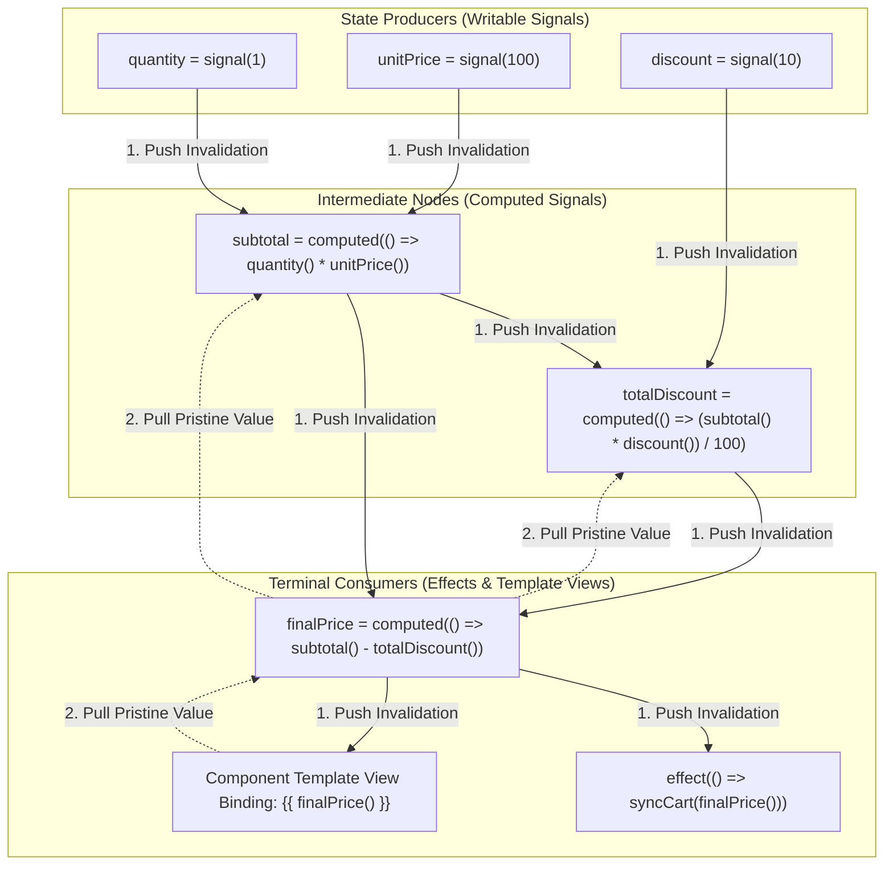
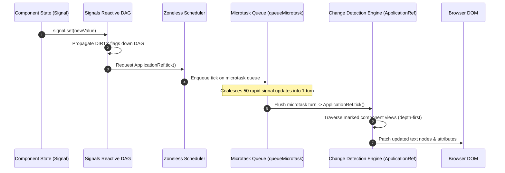
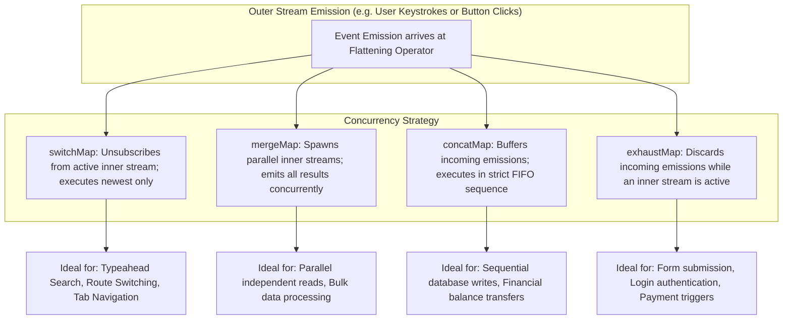
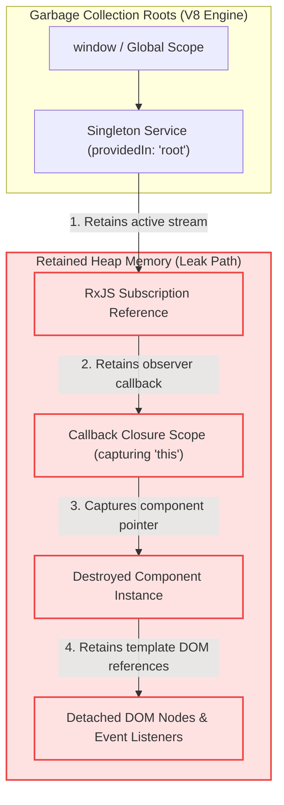

# 03. Modern Angular (v16–v18+) & Signals Experienced Developer (5–10+ YOE) Interview Master Guide — India Context

> **Target Audience:** Experienced Full-Stack & Frontend Developers (5–10+ Years of Experience) preparing for Senior Developer, Tech Lead, Module Lead, and Frontend Architect rounds in India.  
> **Applicable Companies:**  
> - **Top IT Services & Global Consultancies:** TCS, Infosys, Cognizant, Wipro, Accenture, Capgemini, HCL, LTIMindtree, Tech Mahindra, Hexaware, Persistent Systems, Nagarro, EPAM Systems, Coforge, Virtusa, Deloitte, EY, PwC, KPMG.  
> - **Tier-1 Global Capability Centers (GCCs) & Tech Hubs:** Wells Fargo, Morgan Stanley, JPMorgan Chase, Barclays, Walmart Global Tech India, Lowe's India, Target India, Optum, Fidelity Investments, Standard Chartered, HSBC Technology India.  
> - **Top Indian Product Firms & High-Growth Tech:** Swiggy, Zomato, Flipkart, MakeMyTrip, PhonePe, Paytm, Jio, Tata Neu, Zepto.  
>
> **Philosophy:** Senior-level systems thinking, deep framework internals, and real-world project experience. Every question strictly follows the Speakable Senior English v1 (SSE-1) standard.

---

# TABLE OF CONTENTS

- [MODULE 1: COMPONENT LIFECYCLE HOOKS & EXECUTION ORDER](#module-1-component-lifecycle-hooks--execution-order)
  - [Q1: Component Lifecycle Sequence & Exact Execution Order](#q1-component-lifecycle-sequence--exact-execution-order)
  - [Q2: Parent-Child Lifecycle Hook Execution Order](#q2-parent-child-lifecycle-hook-execution-order)
  - [Q3: ngOnChanges vs ngOnInit vs ngDoCheck](#q3-ngonchanges-vs-ngoninit-vs-ngdocheck)
  - [Q4: ngAfterViewInit vs ngAfterContentInit & ExpressionChangedAfterItHasBeenCheckedError](#q4-ngafterviewinit-vs-ngaftercontentinit--expressionchangedafterithasbeencheckederror)
- [MODULE 2: ANGULAR SIGNALS (v16–v18+) REACTIVE PRIMITIVES](#module-2-angular-signals-v16v18-reactive-primitives)
  - [Q5: The Modern Signals Trio: signal(), computed(), and effect() Under the Hood](#q5-the-modern-signals-trio-signal-computed-and-effect-under-the-hood)
  - [Q6: Array & Object State Mutations: Direct .push() Anti-Pattern vs .set() and .update()](#q6-array--object-state-mutations-direct-push-anti-pattern-vs-set-and-update)
  - [Q7: untracked() Signal Reads & Breaking Circular Dependency Cascades](#q7-untracked-signal-reads--breaking-circular-dependency-cascades)
  - [Q8: Modern Signal Inputs & Two-Way Binding: input(), input.required(), and model()](#q8-modern-signal-inputs--two-way-binding-input-inputrequired-and-model)
- [MODULE 3: SIGNALS VS RXJS OBSERVABLES & REACTIVE INTEROP](#module-3-signals-vs-rxjs-observables--reactive-interop)
  - [Q9: Angular Signals vs RxJS Observables: When to Use Which (State vs Events)](#q9-angular-signals-vs-rxjs-observables-when-to-use-which-state-vs-events)
  - [Q10: Reactive Interop: toSignal() and toObservable() Execution Contexts & Pitfalls](#q10-reactive-interop-tosignal-and-toobservable-execution-contexts--pitfalls)
  - [Q11: Combining Observables: forkJoin vs combineLatest vs withLatestFrom](#q11-combining-observables-forkjoin-vs-combinelatest-vs-withlatestfrom)
- [MODULE 4: COMPONENT COMMUNICATION ARCHITECTURES](#module-4-component-communication-architectures)
  - [Q12: Component Communication: Decorators (@Input/@Output) vs Modern Primitives (input/output/model)](#q12-component-communication-decorators-inputoutput-vs-modern-primitives-inputoutputmodel)
  - [Q13: ViewChild vs ContentChild & Static vs Dynamic Resolution ({ static: true | false })](#q13-viewchild-vs-contentchild--static-vs-dynamic-resolution--static-true--false-)
  - [Q14: Cross-Component Communication via Shared Service: Signals State Service vs BehaviorSubject](#q14-cross-component-communication-via-shared-service-signals-state-service-vs-behaviorsubject)
- [MODULE 5: RXJS FLATTENING OPERATORS MASTERY](#module-5-rxjs-flattening-operators-mastery)
  - [Q15: RxJS Flattening Operators: switchMap vs mergeMap vs concatMap vs exhaustMap](#q15-rxjs-flattening-operators-switchmap-vs-mergemap-vs-concatmap-vs-exhaustmap)
  - [Q16: Real-World Typeahead Live Search: Race-Condition Prevention with switchMap](#q16-real-world-typeahead-live-search-race-condition-prevention-with-switchmap)
  - [Q17: Preventing Double-Click Submissions with exhaustMap vs Sequential Queueing with concatMap](#q17-preventing-double-click-submissions-with-exhaustmap-vs-sequential-queueing-with-concatmap)
- [MODULE 6: CHANGE DETECTION STRATEGIES & ZONELESS ARCHITECTURE](#module-6-change-detection-strategies--zoneless-architecture)
  - [Q18: Default vs ChangeDetectionStrategy.OnPush & Why Immutability is Mandatory](#q18-default-vs-changedetectionstrategyonpush--why-immutability-is-mandatory)
  - [Q19: ChangeDetectorRef Mechanics: markForCheck() vs detectChanges() vs detach() / reattach()](#q19-changedetectorref-mechanics-markforcheck-vs-detectchanges-vs-detach--reattach)
  - [Q20: Modern Zoneless Angular: provideExperimentalZonelessChangeDetection() vs NgZone.runOutsideAngular()](#q20-modern-zoneless-angular-provideexperimentalzonelesschangedetection-vs-ngzonerunoutsideangular)
- [MODULE 7: DIRECTIVES: BUILT-IN CONTROL FLOW & CUSTOM ATTRIBUTES](#module-7-directives-built-in-control-flow--custom-attributes)
  - [Q21: Structural Directives (*ngIf, *ngFor) vs Modern Built-in Control Flow (@if, @for with track, @switch)](#q21-structural-directives-ngif-ngfor-vs-modern-built-in-control-flow-if-for-with-track-switch)
  - [Q22: Custom Attribute Directives using ElementRef, Renderer2, and Modern host Property Bindings](#q22-custom-attribute-directives-using-elementref-renderer2-and-modern-host-property-bindings)
- [MODULE 8: PIPES: PURE VS IMPURE ARCHITECTURE](#module-8-pipes-pure-vs-impure-architecture)
  - [Q23: Pure vs Impure Pipes: Change Detection Cycles, In-Memory Caching & Performance Risks](#q23-pure-vs-impure-pipes-change-detection-cycles-in-memory-caching--performance-risks)
- [MODULE 9: HIERARCHICAL DEPENDENCY INJECTION & PROVIDERS](#module-9-hierarchical-dependency-injection--providers)
  - [Q24: Hierarchical DI: Root Injector vs Environment Injector vs Element Injector](#q24-hierarchical-di-root-injector-vs-environment-injector-vs-element-injector)
  - [Q25: Provider Configuration: useClass vs useExisting vs useFactory vs useValue & Multi-Providers](#q25-provider-configuration-useclass-vs-useexisting-vs-usefactory-vs-usevalue--multi-providers)
  - [Q26: Modern Functional DI: inject() vs Constructor Injection & Injection Context Rules](#q26-modern-functional-di-inject-vs-constructor-injection--injection-context-rules)
- [MODULE 10: REACTIVE FORMS VS TEMPLATE-DRIVEN FORMS](#module-10-reactive-forms-vs-template-driven-forms)
  - [Q27: Reactive Forms vs Template-Driven Forms: Architecture, Scalability & Dynamic Validation](#q27-reactive-forms-vs-template-driven-forms-architecture-scalability--dynamic-validation)
  - [Q28: FormGroup, FormControl, and FormArray: Dynamic Fields & Custom Async Validators](#q28-formgroup-formcontrol-and-formarray-dynamic-fields--custom-async-validators)
- [MODULE 11: MODERN ROUTING, NAVIGATION & LAZY LOADING](#module-11-modern-routing-navigation--lazy-loading)
  - [Q29: Lazy Loading Standalone Components (loadComponent) vs Route Modules (loadChildren)](#q29-lazy-loading-standalone-components-loadcomponent-vs-route-modules-loadchildren)
  - [Q30: Functional Route Guards: CanActivateFn, CanDeactivateFn, and Atomic UrlTree Redirects](#q30-functional-route-guards-canactivatefn-candeactivatefn-and-atomic-urltree-redirects)
  - [Q31: Modern Route Resolvers: ResolveFn vs Direct Signal Service Ingestion](#q31-modern-route-resolvers-resolvefn-vs-direct-signal-service-ingestion)
- [MODULE 12: HTTP CLIENT & FUNCTIONAL INTERCEPTORS](#module-12-http-client--functional-interceptors)
  - [Q32: Functional HTTP Interceptors (HttpInterceptorFn): Bearer Token Injection & Request Cloning](#q32-functional-http-interceptors-httpinterceptorfn-bearer-token-injection--request-cloning)
  - [Q33: Silent JWT Token Refresh & 401 Unauthorized Retry Queueing](#q33-silent-jwt-token-refresh--401-unauthorized-retry-queueing)
- [MODULE 13: MEMORY LEAK PREVENTION & TEARDOWN MECHANICS](#module-13-memory-leak-prevention--teardown-mechanics)
  - [Q34: Root Causes of Angular Memory Leaks: Uncancelled Subscriptions & Detached DOM Trees](#q34-root-causes-of-angular-memory-leaks-uncancelled-subscriptions--detached-dom-trees)
  - [Q35: Modern Teardown Patterns: takeUntilDestroyed(), DestroyRef.onDestroy(), and AsyncPipe](#q35-modern-teardown-patterns-takeuntildestroyed-destroyrefondestroy-and-asyncpipe)
- [MODULE 14: STATE MANAGEMENT: LOCAL VS NGRX SIGNALSTORE](#module-14-state-management-local-vs-ngrx-signalstore)
  - [Q36: State Management Decision Matrix: Local Signals vs Service Signals vs NgRx SignalStore](#q36-state-management-decision-matrix-local-signals-vs-service-signals-vs-ngrx-signalstore)
  - [Q37: Modern NgRx SignalStore Architecture: signalStore(), withState(), withComputed(), and withMethods()](#q37-modern-ngrx-signalstore-architecture-signalstore-withstate-withcomputed-and-withmethods)
- [MODULE 15: PERFORMANCE TUNING & ENTERPRISE OPTIMIZATIONS](#module-15-performance-tuning--enterprise-optimizations)
  - [Q38: Deferrable Views (@defer, @placeholder, @loading, @error) and Trigger Conditions](#q38-deferrable-views-defer-placeholder-loading-error-and-trigger-conditions)
  - [Q39: Enterprise Angular Performance Optimization Checklist: track in @for, NgOptimizedImage, and Bundle Splitting](#q39-enterprise-angular-performance-optimization-checklist-track-in-for-ngoptimizedimage-and-bundle-splitting)
- [MODULE 16: BONUS SENIOR INTERVIEW ROUND QUESTIONS](#module-16-bonus-senior-interview-round-questions)
  - [Q40: Global Error Handling in Angular: Writing a Custom ErrorHandler for Centralized Logging](#q40-global-error-handling-in-angular-writing-a-custom-errorhandler-for-centralized-logging)
  - [Q41: Angular Security & XSS Protection: Built-in Sanitization, DomSanitizer, and CSP](#q41-angular-security--xss-protection-built-in-sanitization-domsanitizer-and-csp)
  - [Q42: Angular Server-Side Rendering (SSR) & Non-Destructive Hydration Internals](#q42-angular-server-side-rendering-ssr--non-destructive-hydration-internals)
  - [Q43: RxJS Operator Nuances: take(1) vs first() vs single() & shareReplay(1) Memory Leaks](#q43-rxjs-operator-nuances-take1-vs-first-vs-single--sharereplay1-memory-leaks)
- [MODULE 17: PRODUCTION ARCHITECTURE & SYSTEM DESIGN CASE STUDIES](#module-17-production-architecture--system-design-case-studies)
  - [Q44: Migrating Enterprise Angular Applications to Standalone Architecture & Control Flow](#q44-migrating-enterprise-angular-applications-to-standalone-architecture--control-flow)
  - [Q45: High-Throughput E-Commerce Cart & Live Pricing using Push-Pull Signal Graph](#q45-high-throughput-e-commerce-cart--live-pricing-using-push-pull-signal-graph)
  - [Q46: High-Scale Typeahead Catalog Search with Race-Condition Prevention](#q46-high-scale-typeahead-catalog-search-with-race-condition-prevention)
  - [Q47: High-Frequency Modal Dialogs: Preventing Detached DOM Memory Leaks](#q47-high-frequency-modal-dialogs-preventing-detached-dom-memory-leaks)
  - [Q48: High-Frequency 60 FPS Real-Time Canvas Rendering with NgZone Escaping](#q48-high-frequency-60-fps-real-time-canvas-rendering-with-ngzone-escaping)
  - [Q49: Silent JWT Token Refresh and Atomic Route Guiding in Modern Angular](#q49-silent-jwt-token-refresh-and-atomic-route-guiding-in-modern-angular)
  - [Q50: Enterprise State Management Architecture with NgRx SignalStore](#q50-enterprise-state-management-architecture-with-ngrx-signalstore)
  - [Q51: Real-Time Polling Dashboard Widget with Resilient Cleanup Architecture](#q51-real-time-polling-dashboard-widget-with-resilient-cleanup-architecture)
- [ADVANCED ENTERPRISE REFERENCE & PRODUCTION ARCHITECTURE](#advanced-enterprise-reference--production-architecture)


# MODULE 1: COMPONENT LIFECYCLE HOOKS & EXECUTION ORDER

## Q1: What is the exact execution sequence of Angular component lifecycle hooks?
*Commonly asked at: TCS, Infosys, Cognizant, Accenture*

**⚡ One-line answer**
**Lifecycle hooks** means the deterministic sequence of methods Angular executes from constructor initialization down to final DOM destruction.

**🗣️ Spoken answer (30–45 seconds)**
Angular manages components through a strict deterministic state sequence: **ngOnChanges** checks property bindings when parent inputs mutate, followed by **ngOnInit** which executes once to run initial business logic. Content projection hooks resolve before view hooks verify the DOM tree. Finally, **ngOnDestroy** frees active subscriptions before element removal. The framework strictly enforces **unidirectional data flow**—preventing property changes during render passes. In my project, moving REST calls to **ngOnInit** prevented blank screen initialization failures.

**🎯 Terms the interviewer listens for**
- ⭐ **ngOnInit** — executes once after initial inputs are verified
- ⭐ **ngOnChanges** — fires whenever input property references mutate
- ⭐ **ngOnDestroy** — cleans active subscriptions before DOM removal
- **ngAfterViewInit** — fires when component template DOM renders
- **Unidirectional data flow** — prevents binding mutations during render passes

**🧠 Memory hook**
Think of constructing a modular building: lay foundations, verify blueprints, install furniture, inspect lighting, and dismantle cleanly on demolition.

**💻 Code**
```typescript
// ❌ Bad: heavy network call in constructor
constructor(private http: HttpClient) {
  this.http.get('/api/data').subscribe();
}

// ✅ Good: dispatch initial calls in ngOnInit
ngOnInit(): void {
  this.userService.loadInitialProfile();
}
```

**⚠️ Likely follow-up**
*Question:* Why must constructors remain lightweight without side effects?
*Answer:* Constructors run before input bindings resolve; placing asynchronous work there violates separation of concerns and complicates unit testing.

**📊 Quick comparison**
| Hook | Trigger Timing | Primary Responsibility |
| :--- | :--- | :--- |
| `ngOnChanges` | Input reference changes | Validates bound data |
| `ngOnInit` | After first changes | Dispatches HTTP requests |
| `ngAfterViewInit` | Template views rendered | Initializes DOM widgets |
| `ngOnDestroy` | Before DOM removal | Cleans active subscriptions |

**🔬 Under the hood (optional)**
Angular's compiler lowers templates into view instructions, executing lifecycle hooks at strict boundary phases during change detection passes.

---

## Q2: What is the parent-child lifecycle hook execution order during creation and destruction?
*Commonly asked at: Cognizant, Infosys, Capgemini, Wells Fargo*

**⚡ One-line answer**
**Parent-child lifecycle** means components initialize top-down from parent to child while views resolve bottom-up from child to parent.

**🗣️ Spoken answer (30–45 seconds)**
Component creation follows a strict hierarchical order: **top-down creation** ensures parent constructors and initializers run before child instances instantiate. Conversely, **bottom-up view completion** ensures child views finish rendering before parent views can complete, which is why child ngAfterViewInit executes before parent ngAfterViewInit. On destruction, **top-down teardown** detaches parent trees before destroying nested children. In my project, understanding that children render views first prevented undefined view query errors when calling child methods.

**🎯 Terms the interviewer listens for**
- ⭐ **Top-down creation** — parents initialize before child instances instantiate
- ⭐ **Bottom-up view completion** — children finish view rendering before parents
- ⭐ **Top-down teardown** — parents destroy before nested child components
- **ngAfterViewInit** — hook signaling template view is ready
- **View encapsulation** — scopes component styles to element boundaries

**🧠 Memory hook**
Assembling a car: the chassis is framed first, then wheels attach, but final inspection happens only after wheels are mounted.

**💻 Code**
```typescript
// ❌ Bad: accessing child view in parent ngOnInit
ngOnInit(): void {
  this.childComponent.refresh(); // undefined!
}

// ✅ Good: access child view in ngAfterViewInit
ngAfterViewInit(): void {
  this.childComponent.refresh();
}
```

**⚠️ Likely follow-up**
*Question:* Why does child ngAfterViewInit run before parent ngAfterViewInit?
*Answer:* A parent template view physically contains child views; a container cannot be fully rendered until all interior children complete rendering.

**📊 Quick comparison**
| Phase | Order Direction | Execution Sequence |
| :--- | :--- | :--- |
| **Creation** | Top-down | Parent init then Child init |
| **View Ready** | Bottom-up | Child view then Parent view |
| **Destruction** | Top-down | Parent destroy then Child destroy |

**🔬 Under the hood (optional)**
Angular builds a view hierarchy tree; depth-first traversal evaluates parent initializers, descending to children before returning upward for view completion.

---

## Q3: What is the difference between ngOnChanges, ngOnInit, and ngDoCheck?
*Commonly asked at: TCS, Wipro, HCL, Walmart*

**⚡ One-line answer**
**Lifecycle diffing** means ngOnInit runs once, ngOnChanges fires on pointer changes, and ngDoCheck runs every cycle.

**🗣️ Spoken answer (30–45 seconds)**
These three lifecycle hooks track component state at different intervals. The **ngOnInit** hook executes exactly once when initial inputs are bound. The **ngOnChanges** hook executes before initialization and whenever input references change by memory pointer. The **ngDoCheck** hook runs during every change detection pass to enable custom manual dirty-checking algorithms. Placing expensive comparisons inside ngDoCheck degrades frame rates. In my project, replacing ngDoCheck with computed signals eliminated dozens of redundant verification cycles.

**🎯 Terms the interviewer listens for**
- ⭐ **ngOnInit** — executes once during component initialization
- ⭐ **ngOnChanges** — fires when bound input references change
- ⭐ **ngDoCheck** — runs during every change detection pass
- **Reference equality** — checks object pointers via Object.is comparison
- **KeyValueDiffers** — utility for manual object property tracking

**🧠 Memory hook**
ngOnInit is your morning alarm; ngOnChanges is a doorbell ringing on deliveries; ngDoCheck is a guard asking every minute if anything changed.

**💻 Code**
```typescript
// ❌ Bad: heavy calculation inside ngDoCheck
ngDoCheck(): void {
  this.runDeepObjectComparison(); // freezes UI!
}

// ✅ Good: use computed signal for state derivation
readonly total = computed(() => this.items().reduce((a, b) => a + b, 0));
```

**⚠️ Likely follow-up**
*Question:* Does ngOnChanges fire if an object property is mutated in place?
*Answer:* No. ngOnChanges checks reference identity; mutating an object property keeps the same memory pointer, so ngOnChanges ignores it completely.

**📊 Quick comparison**
| Hook | Execution Frequency | Primary Use Case |
| :--- | :--- | :--- |
| `ngOnInit` | Once per lifecycle | Service subscriptions & initial API |
| `ngOnChanges` | On input pointer change | Reacting to parent changes |
| `ngDoCheck` | Every change detection cycle | Custom manual dirty-checking |

**🔬 Under the hood (optional)**
Angular compares current and previous input pointers in the component's view node; if Object.is returns false, SimpleChanges emits.

---

## Q4: What causes ExpressionChangedAfterItHasBeenCheckedError and when does ngAfterViewInit run?
*Commonly asked at: Infosys, Deloitte, Cognizant, TCS*

**⚡ One-line answer**
**ExpressionChangedError** means a template binding value mutated after change detection verified it in development mode.

**🗣️ Spoken answer (30–45 seconds)**
This development-only error enforces **unidirectional data flow**—the fundamental architectural rule requiring data to flow strictly downward from parents to children. After change detection runs, Angular performs a **verification sweep**—a development-only pass checking that template bindings remained stable after evaluation. Mutating parent properties inside **ngAfterViewInit** violates this rule and throws this error. The fix involves moving updates to ngOnInit or deferring them via queueMicrotask. In my project, switching component bindings to signal inputs eliminated this error completely.

**🎯 Terms the interviewer listens for**
- ⭐ **Unidirectional data flow** — parent properties flow strictly downward to children
- ⭐ **Verification sweep** — development check verifying template binding stability
- ⭐ **ngAfterViewInit** — hook signaling template view DOM completion
- **queueMicrotask()** — schedules mutations in the next microtask turn
- **ChangeDetectorRef** — service controlling change detection execution

**🧠 Memory hook**
A cashier checking your shopping cart totals, but a helper slips an item in after the receipt has printed.

**💻 Code**
```typescript
// ❌ Bad: mutating parent state after view check
ngAfterViewInit(): void {
  this.parent.title = 'Updated Title';
}

// ✅ Good: defer mutation to next microtask cycle
ngAfterViewInit(): void {
  queueMicrotask(() => this.parent.title.set('Updated'));
}
```

**⚠️ Likely follow-up**
*Question:* Why does ExpressionChangedAfterItHasBeenCheckedError only appear in development mode?
*Answer:* The verification pass is disabled in production to maximize performance, but leaving the underlying race condition causes UI synchronization glitches.

**📊 Quick comparison**
| Phase | Primary Pass | Verification Pass |
| :--- | :--- | :--- |
| **Check Mode** | Computes bindings | Compares previous values |
| **Action** | Updates DOM nodes | Throws error if mismatched |
| **Production** | Enabled | Stripped for speed |

**🔬 Under the hood (optional)**
ApplicationRef runs tick() with checkAndUpdate(), then runs checkNoChangesNode() in development to assert binding idempotency.

---


# MODULE 2: ANGULAR SIGNALS (v16–v18+) REACTIVE PRIMITIVES

## Q5: How do signal, computed, and effect work under the hood in modern Angular?
*Commonly asked at: Accenture, TCS, Cognizant, Capgemini*

**⚡ One-line answer**
**Signal reactive trio** means signal stores state, computed derives memoized values, and effect executes microtask side effects.

**🗣️ Spoken answer (30–45 seconds)**
Angular Signals form a reactive dependency graph linking producers to consumers. The **signal()** primitive acts as a writable producer holding state updated via set() or update(). The **computed()** primitive defines a lazily evaluated memoized derivation that recomputes only when read and upstream dependencies changed. The **effect()** primitive registers an asynchronous consumer executing side effects on microtasks. Mutating state inside effects is discouraged to prevent infinite cycles. In my project, computed signals replaced twenty manual subscription calculations.

**🎯 Terms the interviewer listens for**
- ⭐ **signal()** — writable producer node holding reactive state
- ⭐ **computed()** — lazily evaluated memoized derived signal calculation
- ⭐ **effect()** — microtask scheduled consumer executing side effects
- **Push-pull graph** — dirty flag propagation and lazy pulling
- **Reactive context** — execution frame tracking accessed signal producers

**🧠 Memory hook**
signal is an Excel cell with a number; computed is a formula cell; effect is an email triggered when the total changes.

**💻 Code**
```typescript
// ❌ Bad: using effect to derive state
effect(() => {
  this.total.set(this.price() * this.qty());
}, { allowSignalWrites: true });

// ✅ Good: declarative derived state using computed
readonly total = computed(() => this.price() * this.qty());
```

**⚠️ Likely follow-up**
*Question:* Can a computed signal produce side effects like HTTP calls?
*Answer:* No. Computed expressions must remain pure read-only functions with zero side effects; mutating state inside them triggers runtime errors.

**📊 Quick comparison**
| Primitive | Node Role | Evaluation | Primary Purpose |
| :--- | :--- | :--- | :--- |
| `signal()` | Producer | Immediate | Holds state |
| `computed()` | Producer & Consumer | Lazy on read | Derived values |
| `effect()` | Consumer | Microtask queue | Side effects |

**🔬 Under the hood (optional)**
When a producer updates, it pushes dirty flags down the DAG. Dependent computed nodes recompute their value only when consumers pull them.

---

## Q6: Why is mutating an array with push an anti-pattern in Angular Signals?
*Commonly asked at: Infosys, Deloitte, Wipro, TCS*

**⚡ One-line answer**
**Signal immutability** means signals evaluate Object.is equality, so in-place array mutation fails to notify dependent consumers.

**🗣️ Spoken answer (30–45 seconds)**
Angular Signals determine state changes using **Object.is**—an equality algorithm comparing previous and new values by reference. Calling array.push() mutates array elements in place without altering the underlying memory pointer. Because references match, the signal considers the value unchanged and cancels consumer notifications. Instead, developers must execute an **immutable update**—returning a brand-new array reference through the **update()** method using spread operators. In my project, enforcing immutable signal updates fixed missing shopping cart item re-renders.

**🎯 Terms the interviewer listens for**
- ⭐ **Object.is** — equality algorithm evaluating whether signal values changed
- ⭐ **Immutable update** — producing new references without in-place mutation
- ⭐ **update()** — modifies signal value using a pure transformation
- **Reference equality** — evaluates memory address identity of objects
- **Consumer invalidation** — marking downstream nodes dirty on state change

**🧠 Memory hook**
Direct push is writing in an old diary; immutable update is publishing a brand-new edition with fresh pages.

**💻 Code**
```typescript
// ❌ Bad: in-place mutation keeps old reference
this.items().push(newItem);
// UI never updates!

// ✅ Good: update returns a new array reference
this.items.update(list => [...list, newItem]);
```

**⚠️ Likely follow-up**
*Question:* How can you supply a custom equality comparison function to a signal?
*Answer:* Pass an options object with an equal function: `signal(value, { equal: (a, b) => customComparison(a, b) })`.

**📊 Quick comparison**
| Mutation Style | Reference Identity | Signal Notification |
| :--- | :--- | :--- |
| `.push()` | Identical (`prev === next`) | Dropped (No UI update) |
| `.update([...list])` | New reference (`prev !== next`) | Emitted (UI updates) |

**🔬 Under the hood (optional)**
Signal nodes run `equal(prevValue, nextValue)`. If true, the node returns without bumping its version or invalidating downstream consumers.

---

## Q7: What is the purpose of untracked inside an effect or computed signal?
*Commonly asked at: TCS, Accenture, Cognizant, Persistent*

**⚡ One-line answer**
**untracked()** means reading a signal value without registering it as a reactive dependency in the active context.

**🗣️ Spoken answer (30–45 seconds)**
Reading a signal inside a **reactive context**—the active execution scope of an effect or computed—automatically registers it as a dependency. The **untracked()** function reads a signal's current value while excluding it from dependency tracking. Consequently, subsequent mutations to that untracked signal will not re-trigger the surrounding context, preventing a **circular dependency**—a recursive trigger cascade that crashes applications. In my project, untracked prevented infinite loops when logging analytics events alongside state updates.

**🎯 Terms the interviewer listens for**
- ⭐ **untracked()** — reads signal values without dependency registration
- ⭐ **Reactive context** — execution scope tracking accessed signal producers
- ⭐ **Circular dependency** — infinite loop caused by reciprocal signal triggers
- **Dynamic tracking** — registers dependencies accessed during branch execution
- **Version checking** — determines whether computed signals need re-evaluation

**🧠 Memory hook**
Checking the wall clock while cooking without setting an alarm for every passing second.

**💻 Code**
```typescript
// ❌ Bad: effect re-runs when analytics counter updates
effect(() => {
  this.logMetrics(this.user(), this.counter());
});

// ✅ Good: reads counter without registering dependency
effect(() => {
  this.logMetrics(this.user(), untracked(() => this.counter()));
});
```

**⚠️ Likely follow-up**
*Question:* What happens if you mutate a signal inside an untracked block?
*Answer:* Mutating a signal inside untracked still notifies downstream consumers; it only prevents the current context from listening to changes.

**📊 Quick comparison**
| Context | Standard Read | untracked() Read |
| :--- | :--- | :--- |
| `computed()` | Creates dependency edge | Reads without edge |
| `effect()` | Re-runs on update | Ignores signal update |

**🔬 Under the hood (optional)**
untracked temporarily sets the current consumer context to null, reads the producer value, and restores the previous consumer context.

---

## Q8: How do modern signal inputs and two-way model signals work in Angular?
*Commonly asked at: Capgemini, Infosys, Deloitte, TCS*

**⚡ One-line answer**
**Signal inputs** means functional primitives like input, input.required, and model providing type-safe reactive component communication.

**🗣️ Spoken answer (30–45 seconds)**
Modern Angular replaces traditional input decorators with functional signal primitives. The **input()** function creates a read-only signal property holding parent-provided data, and **input.required()** enforces mandatory inputs at compile time to catch missing properties. For two-way data synchronization, **model()** creates a bidirectional writable signal that emits change events back to parent components automatically. In my project, converting component interfaces to **input()** and **model()** eliminated thirty manual ngOnChanges validation checks and simplified test suites.

**🎯 Terms the interviewer listens for**
- ⭐ **input()** — read-only signal input property from parent
- ⭐ **input.required()** — mandates property passing at compile time
- ⭐ **model()** — two-way synchronized writable signal between components
- **InputSignal** — internal type representing read-only signal inputs
- **Two-way binding** — synchronizes state across component boundaries

**🧠 Memory hook**
input() is a read-only digital billboard; model() is a walkie-talkie connecting parent and child.

**💻 Code**
```typescript
// ❌ Bad: verbose decorator with EventEmitter pair
@Input() value = 0;
@Output() valueChange = new EventEmitter<number>();

// ✅ Good: single two-way model signal
readonly value = model(0);
```

**⚠️ Likely follow-up**
*Question:* Can a child component write directly to an input() signal using .set()?
*Answer:* No. InputSignal is strictly read-only; calling .set() produces a compile-time error. Use model() when child mutations are needed.

**📊 Quick comparison**
| Primitive | Direction | Writable by Child |
| :--- | :--- | :--- |
| `input()` | Parent to child | No (Compile error) |
| `input.required()` | Mandatory parent to child | No |
| `model()` | Bidirectional sync | Yes (`.set`, `.update`) |

**🔬 Under the hood (optional)**
The compiler transforms model() into an InputSignal paired with an implicit output emitter named with the 'Change' suffix.

---


# MODULE 3: SIGNALS VS RXJS OBSERVABLES & REACTIVE INTEROP

## Q9: When should you use Angular Signals versus RxJS Observables?
*Commonly asked at: Accenture, Cognizant, TCS, Wipro*

**⚡ One-line answer**
**Reactivity model** means Signals manage synchronous state while RxJS Observables manage asynchronous event streams over time.

**🗣️ Spoken answer (30–45 seconds)**
Signals and RxJS serve complementary architectural roles. Signals represent **synchronous state**—always holding a current value to power template bindings and local derivations without subscription leaks. RxJS represents an **asynchronous stream**—handling events over time like debounced search, WebSocket feeds, and HTTP retries. The utility function **toSignal()** bridges observable streams into signals with automatic teardown tied to component lifecycles. In my project, using signals for UI state eliminated fifty subscription handlers across our dashboards.

**🎯 Terms the interviewer listens for**
- ⭐ **Synchronous state** — always holds an active current value
- ⭐ **Asynchronous stream** — sequence of discrete events over time
- ⭐ **toSignal()** — bridges observable streams into reactive signals
- **toObservable()** — converts signal changes into an observable
- **Push-pull graph** — reactive graph architecture powering signals

**🧠 Memory hook**
A signal is a gas gauge showing current fuel; an observable is the pump nozzle flowing fuel over time.

**💻 Code**
```typescript
// ❌ Bad: manual subscription to manage UI state
items$.subscribe(data => {
  this.items = data;
});

// ✅ Good: declarative signal conversion with automatic teardown
readonly items = toSignal(this.catalogService.items$, { initialValue: [] });
```

**⚠️ Likely follow-up**
*Question:* Can Signals completely replace RxJS in modern Angular applications?
*Answer:* No. Signals lack temporal coordination operators like debounceTime, switchMap, and retry, which are essential for complex event streaming.

**📊 Quick comparison**
| Dimension | Signals | RxJS Observables |
| :--- | :--- | :--- |
| **Value presence** | Always has current value | Emits only when events fire |
| **Timing** | Synchronous | Asynchronous over time |
| **Operators** | `computed`, `effect` | `debounce`, `switchMap`, `retry` |
| **Cleanup** | Automatic garbage collection | Requires unsubscription |

**🔬 Under the hood (optional)**
Signals lack a temporal dimension; they propagate values instantaneously across the graph, whereas Observables model event sequences across time.

---

## Q10: How do toSignal and toObservable work and what are their context restrictions?
*Commonly asked at: Infosys, Deloitte, Capgemini, TCS*

**⚡ One-line answer**
**Reactive interop** means bridging between signals and observables using toSignal and toObservable within an active injection context.

**🗣️ Spoken answer (30–45 seconds)**
The RxJS interop library provides bidirectional bridges between reactive primitives. The **toSignal()** function subscribes to an observable stream and stores emissions in a signal, while **toObservable()** tracks signal changes and emits them as observable events. Both functions require an active **injection context**—an execution scope providing access to DestroyRef to clean up subscriptions when the host unmounts. Outside constructors, an explicit Injector must be passed. In my project, toSignal simplified consuming live notification streams cleanly.

**🎯 Terms the interviewer listens for**
- ⭐ **toSignal()** — converts observable stream into reactive signal
- ⭐ **toObservable()** — converts signal state changes into observable
- ⭐ **Injection context** — execution frame resolving dependencies and cleanup
- **initialValue** — configures fallback value before first emission
- **DestroyRef** — cleans underlying subscriptions on teardown

**🧠 Memory hook**
toSignal is a digital picture frame displaying the latest broadcast photo; toObservable is a camera filming the frame changes.

**💻 Code**
```typescript
// ❌ Bad: calling toSignal outside injection context
setTimeout(() => {
  this.user = toSignal(this.user$); // NG0203 error!
});

// ✅ Good: declare toSignal in class field initializer
readonly user = toSignal(this.userService.user$);
```

**⚠️ Likely follow-up**
*Question:* What happens if an observable converted by toSignal() emits an error?
*Answer:* By default, toSignal rethrows errors into the reactive graph, crashing subsequent reads unless configured with `rejectErrors: true`.

**📊 Quick comparison**
| Utility | Source Type | Output Type | Default Teardown |
| :--- | :--- | :--- | :--- |
| `toSignal()` | Observable | Read-only Signal | Host component destruction |
| `toObservable()` | Signal | Observable stream | Unsubscribe or takeUntil |

**🔬 Under the hood (optional)**
toSignal subscribes immediately using an internal effect consumer, updating an internal writable signal and unsubscribing via DestroyRef.

---

## Q11: How do forkJoin, combineLatest, and withLatestFrom differ in production use?
*Commonly asked at: Cognizant, Accenture, TCS, Persistent*

**⚡ One-line answer**
**forkJoin** means waiting for all streams to complete, unlike combineLatest and withLatestFrom which emit on updates.

**🗣️ Spoken answer (30–45 seconds)**
These combination operators handle multiple streams under different trigger policies. The **forkJoin** operator waits for all source streams to complete before emitting their final values as a dictionary, acting like Promise.all. The **combineLatest** operator emits an array of values whenever any source updates, provided every stream has emitted once. The **withLatestFrom** operator samples secondary streams only when its primary trigger emits. In my project, forkJoin parallelized independent user profile, settings, and permissions API requests on startup.

**🎯 Terms the interviewer listens for**
- ⭐ **forkJoin** — waits for all source streams to complete
- ⭐ **combineLatest** — emits latest values whenever any source updates
- ⭐ **withLatestFrom** — samples secondary streams on master trigger emission
- **Completion requirement** — stream must complete before emitting in forkJoin
- **Cold observable** — stream producing values upon subscription

**🧠 Memory hook**
forkJoin waits for everyone to finish exams; combineLatest updates scores on any goal; withLatestFrom takes a photo when the shutter clicks.

**💻 Code**
```typescript
// ❌ Bad: combineLatest when completion is required
combineLatest([httpA$, httpB$]).subscribe(res => {
  this.handleData(res);
});

// ✅ Good: forkJoin waits for completion
forkJoin({
  users: this.getUsers(),
  roles: this.getRoles()
}).subscribe();
```

**⚠️ Likely follow-up**
*Question:* What happens if one stream inside forkJoin throws an HTTP error?
*Answer:* The entire forkJoin operation terminates immediately, discarding successful responses from all other sibling streams.

**📊 Quick comparison**
| Operator | Trigger Rule | Requires Completion |
| :--- | :--- | :--- |
| `forkJoin` | All streams complete | Yes |
| `combineLatest` | Any stream emits | No |
| `withLatestFrom` | Master stream emits | No |

**🔬 Under the hood (optional)**
forkJoin maintains an internal buffer tracking the latest item of each stream, emitting the combined dictionary upon the final completion.

---


# MODULE 4: COMPONENT COMMUNICATION ARCHITECTURES

## Q12: How do modern component communication primitives compare to legacy decorators?
*Commonly asked at: TCS, Capgemini, Infosys, Wipro*

**⚡ One-line answer**
**Modern communication primitives** means functional signals like input, output, and model replace legacy decorators with reactive type safety.

**🗣️ Spoken answer (30–45 seconds)**
Legacy Angular relied on decorators requiring manual ngOnChanges lifecycle checks to handle input mutations. Modern Angular uses functional primitives: **input()** creates a read-only signal property that integrates directly into computed dependency graphs. Event outputs use **output()**—a lightweight native event dispatcher that eliminates EventEmitter class allocations. Two-way synchronization uses **model()**—a bidirectional writable signal replacing separate input and output pairs. In my project, migrating from legacy decorators to modern primitives reduced component boilerplate by twenty percent.

**🎯 Terms the interviewer listens for**
- ⭐ **input()** — read-only signal input property from parent
- ⭐ **output()** — lightweight native event dispatcher to parent
- ⭐ **model()** — bidirectional synchronized writable signal between components
- **@Input() decorator** — legacy property binding decorator
- **EventEmitter** — legacy event dispatching utility class

**🧠 Memory hook**
Legacy decorators were paper forms passed through committees; modern primitives are direct telephone lines between desks.

**💻 Code**
```typescript
// ❌ Bad: legacy decorator requiring ngOnChanges
@Input() filter = '';
ngOnChanges(c: SimpleChanges) { this.applyFilter(); }

// ✅ Good: modern signal input with computed derivation
readonly filter = input('');
readonly results = computed(() => this.filterData(this.filter()));
```

**⚠️ Likely follow-up**
*Question:* Can legacy decorators and modern signal primitives coexist in the same application?
*Answer:* Yes. Angular supports incremental migration; components using signal inputs can interact seamlessly with components using legacy decorators.

**📊 Quick comparison**
| Feature | Legacy Decorator | Modern Primitive |
| :--- | :--- | :--- |
| **Input Property** | `@Input()` | `input()` |
| **Output Event** | `@Output() = new EventEmitter()` | `output()` |
| **Two-Way Binding** | `@Input` + `@Output Change` | `model()` |
| **Type Safety** | Loose getter/setter | Strict Signal typing |

**🔬 Under the hood (optional)**
The compiler transforms input() declarations into ViewEngine instructions that link parent binding values directly to child reactive nodes.

---

## Q13: What is the difference between ViewChild and ContentChild and how does static resolution work?
*Commonly asked at: Cognizant, Deloitte, Persistent, Accenture*

**⚡ One-line answer**
**DOM query resolution** means ViewChild queries internal templates, ContentChild queries projected markup, and static true resolves in ngOnInit.

**🗣️ Spoken answer (30–45 seconds)**
Angular queries target different DOM regions. The **ViewChild** query inspects internal template elements after views render in ngAfterViewInit. The **ContentChild** query inspects external elements provided via content projection, resolving earlier in ngAfterContentInit. Setting **static: true** resolves the query before change detection in ngOnInit, but fails if elements are gated by conditional blocks like @if. Modern viewChild() signals eliminate static configuration flags. In my project, viewChild signals simplified accessing dynamic canvas elements.

**🎯 Terms the interviewer listens for**
- ⭐ **ViewChild** — queries internal template DOM nodes
- ⭐ **ContentChild** — queries external projected content nodes
- ⭐ **static: true** — resolves query before change detection in ngOnInit
- **viewChild()** — modern signal-based DOM query primitive
- **Content projection** — renders projected external markup slots

**🧠 Memory hook**
ViewChild is checking the TV in your living room; ContentChild is inspecting luggage brought by a guest.

**💻 Code**
```typescript
// ❌ Bad: static true on conditional element
@ViewChild('modal', { static: true })
modal!: ElementRef; // fails if inside @if!

// ✅ Good: modern viewChild signal handles conditionals
readonly modal = viewChild<ElementRef>('modal');
```

**⚠️ Likely follow-up**
*Question:* What does a viewChild() signal return when an element is removed by an @if block?
*Answer:* The viewChild signal reactively emits undefined when the DOM element unmounts, and emits the element reference when it re-renders.

**📊 Quick comparison**
| Query Target | Resolution Hook | Works Inside @if |
| :--- | :--- | :--- |
| `ViewChild { static: true }` | `ngOnInit` | No |
| `ViewChild { static: false }` | `ngAfterViewInit` | Yes |
| `viewChild()` signal | Reactive on render | Yes |

**🔬 Under the hood (optional)**
Static queries resolve during component view creation, whereas dynamic queries re-run during embedded view container updates.

---

## Q14: How do you architect cross-component communication using a Signals service versus BehaviorSubject?
*Commonly asked at: TCS, Infosys, Capgemini, Accenture*

**⚡ One-line answer**
**Signal state service** means a singleton service holding private writable signals and exposing read-only signals to consumers.

**🗣️ Spoken answer (30–45 seconds)**
Sharing state across unrelated components in modern Angular relies on a **singleton service** registered with providedIn: 'root'. The service encapsulates state mutations within private writable signals and exposes them publicly using **asReadonly()**—a method preventing external components from modifying state directly. This strict **encapsulation** ensures predictable data flow and eliminates BehaviorSubject boilerplate and manual unsubscription leaks. In my project, a signal shopping cart service eliminated thirty subscription handlers across header, catalogue, and checkout views.

**🎯 Terms the interviewer listens for**
- ⭐ **Singleton service** — centralized state container provided in root
- ⭐ **asReadonly()** — exposes read-only signal view to consumers
- ⭐ **Encapsulation** — restricting state mutations to service methods
- **BehaviorSubject** — legacy state container requiring manual unsubscribe
- **Fine-grained reactivity** — re-renders only dependent template bindings

**🧠 Memory hook**
A bank vault where customers can view their balance through glass, but only teller methods can deposit funds.

**💻 Code**
```typescript
// ❌ Bad: exposing writable BehaviorSubject directly
public user$ = new BehaviorSubject<User | null>(null);

// ✅ Good: private writable signal with public read-only view
private readonly _user = signal<User | null>(null);
readonly user = this._user.asReadonly();
```

**⚠️ Likely follow-up**
*Question:* Why is exposing writable signals directly from a shared service considered an anti-pattern?
*Answer:* Exposing writable signals allows arbitrary components to call `.set()`, bypassing validation logic and breaking predictable unidirectional state flow.

**📊 Quick comparison**
| Criterion | Signal Service | BehaviorSubject Service |
| :--- | :--- | :--- |
| **Boilerplate** | Minimal | High |
| **Teardown** | Automatic | Requires unsubscription |
| **Derivations** | `computed()` | `pipe(map())` |
| **Template Reading** | Direct call `user()` | Requires `AsyncPipe` |

**🔬 Under the hood (optional)**
When an injected signal updates, Angular marks only the components whose templates read that signal dirty, avoiding broad tree checks.

---


# MODULE 5: RXJS FLATTENING OPERATORS MASTERY

## Q15: How do switchMap, mergeMap, concatMap, and exhaustMap differ in real-world scenarios?
*Commonly asked at: TCS, Cognizant, Deloitte, Wipro*

**⚡ One-line answer**
**Flattening operators** means operators transforming higher-order streams: switchMap cancels, mergeMap parallels, concatMap queues, and exhaustMap blocks.

**🗣️ Spoken answer (30–45 seconds)**
Handling a **higher-order stream** requires matching concurrency rules to business logic. The **switchMap** operator cancels pending in-flight requests when a new value arrives, making it ideal for search typeahead. The **mergeMap** operator runs inner streams concurrently in parallel, suitable for independent concurrent reads. The **concatMap** operator queues requests in strict sequential FIFO order, preserving transactional operations like database writes. Finally, exhaustMap ignores new triggers while active. In my project, switchMap eliminated search race conditions completely.

**🎯 Terms the interviewer listens for**
- ⭐ **switchMap** — cancels stale in-flight streams for search
- ⭐ **mergeMap** — runs parallel independent child requests concurrently
- ⭐ **concatMap** — queues streams in sequential FIFO order
- **exhaustMap** — ignores new inputs until current completes
- **Higher-order stream** — observable emitting inner observable instances

**🧠 Memory hook**
switchMap is changing TV channels; mergeMap is multi-burner cooking; concatMap is ticket queueing; exhaustMap is an occupied restroom.

**💻 Code**
```typescript
// ❌ Bad: mergeMap causes out-of-order responses
search$.pipe(
  mergeMap(q => this.http.get(`/search?q=${q}`))
).subscribe();

// ✅ Good: switchMap cancels stale search requests
search$.pipe(
  switchMap(q => this.http.get(`/search?q=${q}`))
).subscribe();
```

**⚠️ Likely follow-up**
*Question:* Which flattening operator should you use for financial balance transfers?
*Answer:* Use concatMap to guarantee that debit and credit transactions execute sequentially in strict order without concurrency race conditions.

**📊 Quick comparison**
| Operator | Concurrency Rule | Primary Use Case |
| :--- | :--- | :--- |
| `switchMap` | Cancels active inner stream | Typeahead search |
| `mergeMap` | Runs parallel concurrently | Independent reads |
| `concatMap` | Queues in sequential order | Sequential writes |
| `exhaustMap` | Ignores incoming while busy | Submit & login buttons |

**🔬 Under the hood (optional)**
Higher-order operators manage inner subscription references, handling inner completion signals and outer unsubscriptions according to operator policy.

---

## Q16: How do you implement typeahead live search preventing race conditions and stream death?
*Commonly asked at: Infosys, Capgemini, Accenture, TCS*

**⚡ One-line answer**
**Typeahead search** means combining debounceTime, distinctUntilChanged, switchMap, and inner catchError to prevent race conditions safely.

**🗣️ Spoken answer (30–45 seconds)**
A production typeahead search must handle rapid keystrokes and API errors gracefully. We apply **debounceTime**—an operator delaying emissions until user typing pauses—and distinctUntilChanged to discard duplicate inputs. We pipe into **switchMap** to cancel stale in-flight HTTP requests when new terms arrive, preventing race conditions. Crucially, we place an **inner catchError**—an error handler inside the switchMap projection—to catch network failures and return empty fallback arrays without terminating the outer search listener. In my project, this architecture eliminated search freezes.

**🎯 Terms the interviewer listens for**
- ⭐ **switchMap** — cancels stale in-flight requests on new input
- ⭐ **debounceTime** — delays emission until typing pauses for duration
- ⭐ **Inner catchError** — recovers from network failures without stream termination
- **distinctUntilChanged** — ignores consecutive identical search terms
- **takeUntilDestroyed** — cleans subscription on component destruction

**🧠 Memory hook**
A fast-food cashier taking only the newest order while dropping cancelled requests, without shutting down the counter on errors.

**💻 Code**
```typescript
// ❌ Bad: outer catchError permanently breaks input listener
search$.pipe(
  switchMap(q => this.http.get(`/items?q=${q}`)),
  catchError(() => of([])) // outer stream dies!
).subscribe();

// ✅ Good: inner catchError keeps outer stream alive
search$.pipe(
  switchMap(q => this.http.get(`/items?q=${q}`).pipe(catchError(() => of([]))))
).subscribe();
```

**⚠️ Likely follow-up**
*Question:* Why does placing catchError on the outer stream break subsequent search typing?
*Answer:* When an observable stream errors, RxJS contracts mandate immediate termination; catching errors on the outer stream unsubscribes the input listener permanently.

**📊 Quick comparison**
| Pipeline Step | Operator | Primary Responsibility |
| :--- | :--- | :--- |
| **1. Throttle typing** | `debounceTime(300)` | Prevents request storms |
| **2. Deduplicate** | `distinctUntilChanged()` | Skips identical queries |
| **3. Cancel stale** | `switchMap()` | Aborts in-flight calls |
| **4. Error boundary** | Inner `catchError()` | Keeps listener alive |

**🔬 Under the hood (optional)**
switchMap maintains an active subscription reference. On new emissions, it calls unsubscribe() on the active inner subscriber before subscribing to the new observable.

---

## Q17: How do you prevent duplicate form submissions using exhaustMap versus sequential queueing with concatMap?
*Commonly asked at: TCS, Cognizant, Deloitte, Persistent*

**⚡ One-line answer**
**Duplicate prevention** means exhaustMap ignores incoming clicks while busy, whereas concatMap buffers requests in strict sequence.

**🗣️ Spoken answer (30–45 seconds)**
Preventing duplicate submissions requires matching operator semantics to transaction safety. The **exhaustMap** operator provides automatic **double-click prevention**—ignoring all subsequent user clicks while an in-flight HTTP request is active until completion. Conversely, **concatMap** buffers and executes every request sequentially in FIFO order without dropping inputs, ideal when each click represents an independent queued operation. In my project, using exhaustMap on payment submission buttons eliminated accidental duplicate charges during high-latency network conditions.

**🎯 Terms the interviewer listens for**
- ⭐ **exhaustMap** — ignores incoming clicks while request is active
- ⭐ **concatMap** — buffers and executes requests in strict sequence
- ⭐ **Double-click prevention** — blocks duplicate requests from rapid user clicks
- **Idempotency** — ensuring duplicate requests do not alter system state
- **Inner completion** — signal releasing exhaustMap to accept new emissions

**🧠 Memory hook**
exhaustMap is a locked voting booth while someone votes; concatMap is a post office queue where everyone waits their turn.

**💻 Code**
```typescript
// ❌ Bad: mergeMap sends duplicate concurrent orders
click$.pipe(
  mergeMap(() => this.orderService.submitOrder())
).subscribe();

// ✅ Good: exhaustMap ignores clicks until order finishes
click$.pipe(
  exhaustMap(() => this.orderService.submitOrder())
).subscribe();
```

**⚠️ Likely follow-up**
*Question:* What happens if an exhaustMap inner observable never completes?
*Answer:* If the inner observable never completes, exhaustMap remains blocked forever, ignoring all future incoming click events permanently.

**📊 Quick comparison**
| Operator | Incoming Event Behavior | Best Use Case |
| :--- | :--- | :--- |
| `exhaustMap` | Discards while busy | Login and payment buttons |
| `concatMap` | Queues in memory | Sequential logging or sync |
| `switchMap` | Aborts active request | Search and tab switching |

**🔬 Under the hood (optional)**
exhaustMap tracks an internal `hasSubscription` boolean. While true, incoming values are discarded without invocation of the project function.

---


# MODULE 6: CHANGE DETECTION STRATEGIES & ZONELESS ARCHITECTURE

## Q18: Why is immutability mandatory when using ChangeDetectionStrategy.OnPush in Angular?
*Commonly asked at: TCS, Accenture, Cognizant, Infosys*

**⚡ One-line answer**
**OnPush immutability** means OnPush checks object references using Object.is, so mutating properties in place skips change detection.

**🗣️ Spoken answer (30–45 seconds)**
The **OnPush strategy** optimizes rendering by pruning clean component subtrees from change detection sweeps. It checks an OnPush component only when input references change, signals update, or local event handlers fire. Because OnPush relies on **reference equality**—evaluating pointers via Object.is—in-place mutations are ignored because the memory reference remains identical. Therefore, **immutability**—creating fresh object references on every update—is mandatory to notify Angular that data changed. In my project, adopting OnPush and immutable updates cut render cycles by seventy percent.

**🎯 Terms the interviewer listens for**
- ⭐ **OnPush strategy** — prunes component subtrees from change detection passes
- ⭐ **Reference equality** — evaluates memory address identity of objects
- ⭐ **Immutability** — producing new references without in-place mutation
- **markForCheck()** — flags component and ancestors for change verification
- **Subtree pruning** — skipping unchanged branches during change detection

**🧠 Memory hook**
Default is checking every room in a hotel; OnPush is checking only rooms that hung a cleaning sign outside.

**💻 Code**
```typescript
// ❌ Bad: mutating object skips OnPush check
this.user.name = 'Vikram';
// UI fails to update!

// ✅ Good: produce new reference using spread operator
this.user = { ...this.user, name: 'Vikram' };
```

**⚠️ Likely follow-up**
*Question:* What triggers change detection in an OnPush component besides new input references?
*Answer:* Local template DOM events, emitted signals read in the template, and manual calls to `markForCheck()` or `detectChanges()`.

**📊 Quick comparison**
| Strategy | Checking Frequency | Dependency On Immutability |
| :--- | :--- | :--- |
| **Default** | Every asynchronous macro/microtask | Low (dirty checks properties) |
| **OnPush** | Inputs change, signals update, events | Mandatory (checks references) |

**🔬 Under the hood (optional)**
The runtime checks the component ViewFlags. If OnPush is set and no dirty flag is present, the entire component view traversal is skipped.

---

## Q19: How do markForCheck, detectChanges, detach, and reattach differ in ChangeDetectorRef?
*Commonly asked at: Infosys, Capgemini, Deloitte, Persistent*

**⚡ One-line answer**
**ChangeDetectorRef** means an injectable controller providing markForCheck, detectChanges, detach, and reattach to regulate change sweeps.

**🗣️ Spoken answer (30–45 seconds)**
The ChangeDetectorRef service regulates change detection programmatically. Calling **markForCheck()** flags an OnPush component and its ancestors dirty for verification during the upcoming cycle. Calling **detectChanges()** executes immediate synchronous change detection directly on that component and its children without waiting for microtasks. Calling **detach()** disconnects a view from change sweeps completely, allowing high-frequency data streams to update internal state without UI repainting until calling reattach. In my project, detaching live financial ticker views eliminated browser lag.

**🎯 Terms the interviewer listens for**
- ⭐ **markForCheck()** — flags component and ancestors dirty for upcoming sweep
- ⭐ **detectChanges()** — triggers immediate synchronous change detection on component subtree
- ⭐ **detach()** — disconnects a component view from change detection passes
- **reattach()** — restores detached component views to change detection tree
- **ChangeDetectorRef** — service controlling manual change detection execution cycles

**🧠 Memory hook**
markForCheck raises a flag for the postal worker; detectChanges delivers the letter immediately; detach unplugs the mailbox.

**💻 Code**
```typescript
// ❌ Bad: detectChanges inside loops causes UI lag
items.forEach(() => {
  this.cdr.detectChanges();
});

// ✅ Good: markForCheck schedules single coordinated sweep
this.cdr.markForCheck();
```

**⚠️ Likely follow-up**
*Question:* Can detectChanges() trigger ExpressionChangedAfterItHasBeenCheckedError in development mode?
*Answer:* Yes. Calling detectChanges() synchronously inside lifecycle hooks like ngAfterViewInit can trigger this error if properties mutate afterwards.

**📊 Quick comparison**
| Method | Execution Timing | Tree Scope |
| :--- | :--- | :--- |
| `markForCheck()` | Next tick cycle | Ancestors to current |
| `detectChanges()` | Immediate synchronous | Current view and children |
| `detach()` | Permanent until reattach | Current view and children |
| `reattach()` | Restores view | Current view and children |

**🔬 Under the hood (optional)**
markForCheck iterates up the parent view hierarchy setting `ViewFlags.Dirty`. ApplicationRef.tick() traverses down, checking marked branches.

---

## Q20: How does modern Zoneless Angular compare to NgZone.runOutsideAngular?
*Commonly asked at: Accenture, TCS, Cognizant, Wipro*

**⚡ One-line answer**
**Zoneless Angular** means scheduling microtask change detection via signals without Zone.js monkey-patching overhead.

**🗣️ Spoken answer (30–45 seconds)**
Modern Angular introduces a **zoneless architecture** configured using **provideExperimentalZonelessChangeDetection()**—eliminating Zone.js entirely. Instead of monkey-patching browser APIs, signals notify an internal **microtask scheduler** to batch DOM updates efficiently. In legacy Zone-based applications, developers used **NgZone.runOutsideAngular()**—a method running high-frequency listeners outside Zone.js to prevent repeated change sweeps. Zoneless eliminates this workaround by making reactivity fine-grained and explicit. In my project, switching to zoneless reduced bundle size by thirty kilobytes and improved runtime execution speed.

**🎯 Terms the interviewer listens for**
- ⭐ **provideExperimentalZonelessChangeDetection()** — enables native zoneless change detection without Zone.js
- ⭐ **NgZone.runOutsideAngular()** — executes code outside Angular zone to bypass checks
- ⭐ **Microtask scheduler** — batches signal updates into single frame renders
- **Zone.js** — monkey-patches browser APIs to notify change detection
- **Zoneless architecture** — eliminates Zone.js bundle and runtime performance overhead

**🧠 Memory hook**
Zone.js is a colony siren sounding on every car arrival; Zoneless is private text alerts sent only to the receiving house.

**💻 Code**
```typescript
// ❌ Bad: high-frequency canvas updates inside Angular zone
window.addEventListener('mousemove', () => this.draw());

// ✅ Good: run outside zone to avoid detection
this.ngZone.runOutsideAngular(() => {
  window.addEventListener('mousemove', () => this.draw());
});
```

**⚠️ Likely follow-up**
*Question:* What happens if you mutate a plain class property in a zoneless Angular application?
*Answer:* In zoneless mode, plain property mutations do not trigger change detection; you must use signals or call markForCheck explicitly.

**📊 Quick comparison**
| Feature | Zone.js Architecture | Modern Zoneless Architecture |
| :--- | :--- | :--- |
| **API Patching** | Monkey-patches window APIs | Pure native browser APIs |
| **Trigger Mechanism** | Any macro/microtask completion | Signals and explicit events |
| **Bundle Impact** | Adds ~35 KB (Zone.js payload) | Zero Zone.js bundle overhead |
| **Debugging** | Deep patched stack traces | Clean native stack traces |

**🔬 Under the hood (optional)**
In zoneless mode, signal notifications push dirty states to an internal scheduler that coalesces updates into `queueMicrotask()`.

---


# MODULE 7: DIRECTIVES: BUILT-IN CONTROL FLOW & CUSTOM ATTRIBUTES

## Q21: How does modern built-in control flow outperform legacy structural directives?
*Commonly asked at: TCS, Infosys, Capgemini, Deloitte*

**⚡ One-line answer**
**Built-in control flow** means compiler-native blocks like @if and @for outperform legacy structural directives without directive overhead.

**🗣️ Spoken answer (30–45 seconds)**
Modern Angular replaces legacy structural directives with compiler-level control flow. The **@for block** compiles directly into native ɵɵrepeater instructions, bypassing directive class allocations. It enforces a mandatory **track expression**—a compile-time identifier preserving DOM element identity during array mutations to prevent element destruction. It also includes an integrated **@empty block**—a declarative fallback rendered when arrays are empty, eliminating companion *ngIf checks. In my project, converting complex table loops to @for sped up list rendering by forty percent.

**🎯 Terms the interviewer listens for**
- ⭐ **@for block** — compiler-native list rendering control flow block
- ⭐ **track expression** — mandates unique identity key for list diffing
- ⭐ **@empty block** — renders fallback template when collection has zero items
- **ɵɵrepeater** — compiler instruction for optimized list reconciliation
- **Structural directives** — legacy directives modifying DOM layout using micro-syntax

**🧠 Memory hook**
Legacy directives were outside contractors hired to build partitions; modern control flow is sliding partition doors built into walls.

**💻 Code**
```typescript
// ❌ Bad: legacy loop without trackBy destroys DOM nodes
<div *ngFor="let item of items">{{ item.name }}</div>

// ✅ Good: modern @for with mandatory compile-time track
@for (item of items(); track item.id) {
  <div>{{ item.name }}</div>
} @empty {
  <p>No items found.</p>
}
```

**⚠️ Likely follow-up**
*Question:* Why does modern @for provide an @empty block?
*Answer:* The `@empty` block renders fallback markup automatically when an iterable collection has zero items, eliminating separate `@if` checks.

**📊 Quick comparison**
| Feature | Legacy Structural Directives | Modern Built-in Control Flow |
| :--- | :--- | :--- |
| **Syntax** | `*ngIf`, `*ngFor`, `*ngSwitch` | `@if`, `@for`, `@switch` |
| **Module Import** | Requires `CommonModule` | Zero imports required |
| **Tracking Key** | Optional `trackBy` function | Mandatory `track` expression |
| **Empty Fallback** | Manual separate `*ngIf` | Integrated `@empty` block |

**🔬 Under the hood (optional)**
The compiler transforms @if into ɵɵconditional branch jumps, and @for into ɵɵrepeater which executes an in-place list diffing algorithm.

---

## Q22: How do you build custom attribute directives using modern host property bindings?
*Commonly asked at: Cognizant, Persistent, Accenture, TCS*

**⚡ One-line answer**
**Custom attribute directives** means directives applying reusable DOM styling or behavior using modern host property bindings.

**🗣️ Spoken answer (30–45 seconds)**
Attribute directives modify the appearance or behavior of existing DOM elements. Modern directives declare bindings using the decorator **host property**—a metadata object centralizing attribute, style, and event bindings without legacy @HostBinding and @HostListener boilerplate. When imperative manipulation is required, developers inject **Renderer2**—a platform-safe abstraction avoiding direct **ElementRef** access to remain compatible with Server-Side Rendering. In my project, writing an auto-resizing textarea directive with host property bindings simplified our form controls across multiple product views.

**🎯 Terms the interviewer listens for**
- ⭐ **host property** — decorator metadata object configuring host element bindings
- ⭐ **Renderer2** — service providing safe platform-independent DOM manipulation methods
- ⭐ **ElementRef** — wrapper holding a direct reference to nativeElement
- **HostListener** — legacy decorator listening to host DOM element events
- **HostBinding** — legacy decorator binding host attributes to class fields

**🧠 Memory hook**
An attribute directive is a smartphone protective case: it adds shock resistance without altering internal phone electronics.

**💻 Code**
```typescript
// ❌ Bad: scattered legacy decorators on class methods
@HostBinding('class.hovered') isHovered = false;
@HostListener('mouseenter') onEnter() { this.isHovered = true; }

// ✅ Good: centralized modern host property binding
@Directive({
  selector: '[appHighlight]',
  standalone: true,
  host: {
    '[class.hovered]': 'isHovered()',
    '(mouseenter)': 'isHovered.set(true)',
    '(mouseleave)': 'isHovered.set(false)'
  }
})
export class HighlightDirective { readonly isHovered = signal(false); }
```

**⚠️ Likely follow-up**
*Question:* What are Host Directives and when should you use them?
*Answer:* Host Directives allow components to declare other directives in their `hostDirectives` array, composing behaviors without class inheritance.

**📊 Quick comparison**
| Pattern | Syntax Location | Code Clutter |
| :--- | :--- | :--- |
| **host metadata** | Inside `@Directive({ host: ... })` | Minimal |
| **@HostBinding** | Decorator on class properties | High class boilerplate |
| **@HostListener** | Decorator on class methods | Method wrapper bloat |

**🔬 Under the hood (optional)**
The Angular compiler lowers host property entries directly into component view creation and update instructions during compilation.

---


# MODULE 8: PIPES: PURE VS IMPURE ARCHITECTURE

## Q23: What are the performance risks of impure pipes and how does pure pipe caching work?
*Commonly asked at: Infosys, Deloitte, Wipro, TCS*

**⚡ One-line answer**
**Pure pipes** means pipes memoizing transformations on reference changes, whereas impure pipes run during every change pass.

**🗣️ Spoken answer (30–45 seconds)**
Angular pipes transform values inside template expressions. A **pure pipe** evaluates only when its input arguments change by reference, using **memoization**—a caching technique returning previous outputs when input pointers match. An **impure pipe** executes during every change detection cycle regardless of whether inputs mutated. Placing complex calculations or array filtering inside an impure pipe triggers severe frame drops and UI sluggishness. In my project, replacing an impure search pipe with a computed signal restored 60 FPS table scrolling.

**🎯 Terms the interviewer listens for**
- ⭐ **Pure pipe** — executes only on input primitive or reference changes
- ⭐ **Impure pipe** — executes during every change detection cycle indiscriminately
- ⭐ **Memoization** — caches computation outputs for identical input parameters
- **Change detection cycle** — dirty-checking pass traversing the component tree
- **Reference equality** — evaluating object identity using Object.is comparison

**🧠 Memory hook**
A pure pipe is an airport flight display updated only on schedule changes; an impure pipe is a clock ticking continuously.

**💻 Code**
```typescript
// ❌ Bad: impure pipe filters array on every tick
@Pipe({ name: 'filterList', pure: false })
export class BadFilterPipe implements PipeTransform {}

// ✅ Good: pure pipe evaluates only on reference change
@Pipe({ name: 'formatCurrency', pure: true })
export class GoodFormatPipe implements PipeTransform {
  transform(v: number): string { return `$${v.toFixed(2)}`; }
}
```

**⚠️ Likely follow-up**
*Question:* Why is an array filter pipe considered an anti-pattern in Angular?
*Answer:* Mutating arrays via push keeps the same reference so pure pipes miss it, while impure pipes run on every keystroke, degrading performance.

**📊 Quick comparison**
| Pipe Type | Evaluation Frequency | In-Memory Cache |
| :--- | :--- | :--- |
| **Pure** | On input reference mutation | Yes (caches last output) |
| **Impure** | Every change detection cycle | No (recomputes always) |

**🔬 Under the hood (optional)**
Angular assigns a transform cache slot to pure pipes. If input arguments match the cached pointers, the cached value is returned.

---


# MODULE 9: HIERARCHICAL DEPENDENCY INJECTION & PROVIDERS

## Q24: How does Angular's hierarchical dependency injection resolve services across injectors?
*Commonly asked at: Accenture, TCS, Cognizant, Capgemini*

**⚡ One-line answer**
**Hierarchical DI** means resolving dependencies by traversing ElementInjectors upward to EnvironmentInjectors and the root injector.

**🗣️ Spoken answer (30–45 seconds)**
Angular resolves dependencies through **hierarchical DI**—a dual-tree structure traversing upward until matching tokens are found. Resolution begins at the local **ElementInjector**—an injector tied to the specific component DOM node. If unresolved, the search walks up ancestor elements before transitioning to the **EnvironmentInjector**—an injector hierarchy covering route providers, the root injector, and platform injectors. Services registered with providedIn: 'root' live in the root EnvironmentInjector. In my project, scoping editor state to component injectors guaranteed isolated instances per tab.

**🎯 Terms the interviewer listens for**
- ⭐ **ElementInjector** — injector associated with a specific DOM component element
- ⭐ **EnvironmentInjector** — injector providing services across route and application scopes
- ⭐ **Hierarchical DI** — resolves tokens by traversing injector trees upward
- **providedIn: 'root'** — registers an application-wide tree-shakeable singleton service
- **Injector resolution path** — upward search path from host element to root

**🧠 Memory hook**
Searching for a book: check your personal desk first, then your department bookshelf, and finally the central university library.

**💻 Code**
```typescript
// ❌ Bad: providing state service in multiple components
@Component({ providers: [CartService] })
// Creates separate cart instances per component!

// ✅ Good: provide service at route or root level
@Injectable({ providedIn: 'root' })
export class CartService {}
```

**⚠️ Likely follow-up**
*Question:* What happens if a token cannot be found anywhere in the injector hierarchy?
*Answer:* Angular throws an `NG0201: NullInjectorError` unless the dependency is marked with `@Optional()` or injected with `{ optional: true }`.

**📊 Quick comparison**
| Injector Layer | Lifetime Scope | Configured Via |
| :--- | :--- | :--- |
| **ElementInjector** | Component DOM lifetime | `providers: [...]` in `@Component` |
| **EnvironmentInjector** | Route / Feature lifetime | `providers: [...]` in Routes |
| **RootInjector** | Application lifetime | `providedIn: 'root'` |

**🔬 Under the hood (optional)**
Angular traverses node injectors via parent pointers. If null is reached, it delegates to the EnvironmentInjector until NullInjector is hit.

---

## Q25: How do useClass, useExisting, useFactory, and useValue differ in Angular DI?
*Commonly asked at: TCS, Infosys, Deloitte, Wipro*

**⚡ One-line answer**
**Provider recipes** means configuring DI bindings using useClass, useExisting, useFactory, and useValue with multi-provider options.

**🗣️ Spoken answer (30–45 seconds)**
Angular DI supports four provider recipes to customize token resolution. The **useClass** recipe instantiates a specified concrete class for an abstract token. The **useFactory** recipe executes a dynamic factory function that injects runtime dependencies to construct complex services. The **useValue** recipe binds a static configuration object or runtime primitive to an InjectionToken. The useExisting recipe aliases one token to another without duplicate allocations. In my project, useFactory configured dynamic API client endpoints based on environment settings.

**🎯 Terms the interviewer listens for**
- ⭐ **useClass** — instantiates a specified class for a token
- ⭐ **useFactory** — executes a factory function with injected dependencies
- ⭐ **useValue** — binds an existing static object or primitive value
- **useExisting** — aliases an existing token to another token
- **multi: true** — aggregates multiple providers into an array token

**🧠 Memory hook**
useClass is hiring an employee; useExisting is assigning an alias; useFactory is ordering custom catering; useValue is handing out gift cards.

**💻 Code**
```typescript
// ❌ Bad: useClass on two tokens creates duplicate singletons
{ provide: LoggerService, useClass: CustomLogger }
{ provide: ApiLogger, useClass: CustomLogger } // 2 instances!

// ✅ Good: useExisting aliases token to share single instance
{ provide: ApiLogger, useExisting: LoggerService }
```

**⚠️ Likely follow-up**
*Question:* What is the purpose of the multi: true provider configuration option?
*Answer:* Setting `multi: true` tells Angular to collect multiple provider values into an array, commonly used for HTTP interceptors and app initializers.

**📊 Quick comparison**
| Provider Option | Resolution Mechanism | Best Use Case |
| :--- | :--- | :--- |
| `useClass` | Instantiates class via `new` | Swapping service implementations |
| `useExisting` | References existing token | Token aliasing & mocking |
| `useFactory` | Runs function with arguments | Dynamic runtime configuration |
| `useValue` | Returns static value | Config constants & tokens |

**🔬 Under the hood (optional)**
The DI registry maps tokens to ProviderRecords. When requested, it evaluates the record type, calling factory or constructor instructions.

---

## Q26: What are the advantages of modern inject() and what rules govern the Injection Context?
*Commonly asked at: Capgemini, Cognizant, Persistent, Accenture*

**⚡ One-line answer**
**inject()** means functional dependency injection resolving tokens inside constructors, field initializers, or functional guards.

**🗣️ Spoken answer (30–45 seconds)**
The modern **inject()** function resolves dependencies functionally, eliminating repetitive constructor parameter boilerplate. It operates only within an active **injection context**—the runtime execution frame active during class property initialization, constructor execution, or functional route guards. Invoking inject() outside this window throws the NG0203 error. To run functional logic asynchronously inside an injector, developers utilize **runInInjectionContext**—a utility executing callbacks within an explicit injector. In my project, inject() simplified functional guards and custom reactive utilities.

**🎯 Terms the interviewer listens for**
- ⭐ **inject()** — functional primitive resolving dependencies without constructor boilerplate
- ⭐ **Injection context** — execution frame resolving dependencies and cleanup
- ⭐ **runInInjectionContext** — executes arbitrary callbacks within a specified injector context
- **NG0203 error** — runtime error thrown when calling inject outside context
- **Functional guards** — route guards defined as lightweight functions using inject()

**🧠 Memory hook**
Constructor injection is declaring all luggage at customs; inject() is pulling tools from a workstation dispenser as you need them.

**💻 Code**
```typescript
// ❌ Bad: verbose constructor forwarding to base class
constructor(http: HttpClient, router: Router) { super(http, router); }

// ✅ Good: functional field injection with zero constructor ceremony
private readonly http = inject(HttpClient);
private readonly router = inject(Router);
```

**⚠️ Likely follow-up**
*Question:* How do you resolve a dependency using inject() inside an asynchronous setTimeout callback?
*Answer:* Capture an `EnvironmentInjector` during initialization, then invoke `runInInjectionContext(injector, () => inject(ServiceName))`.

**📊 Quick comparison**
| Feature | Constructor Injection | Functional inject() |
| :--- | :--- | :--- |
| **Declaration** | Constructor parameters | Class field initializers |
| **Inheritance** | Requires `super()` forwarding | Zero `super()` parameters |
| **Functional Guards** | Not supported | Fully supported |
| **Timing Rule** | Instantiation phase | Injection context only |

**🔬 Under the hood (optional)**
Angular manages an internal injector stack. When a component instantiates, its injector pushes to the top; inject() queries the top injector.

---


# MODULE 10: REACTIVE FORMS VS TEMPLATE-DRIVEN FORMS

## Q27: How do Reactive Forms and Template-Driven Forms compare in architecture and testability?
*Commonly asked at: TCS, Infosys, Deloitte, Wipro*

**⚡ One-line answer**
**Forms architecture** means Reactive Forms provide synchronous, testable TypeScript trees while Template-Driven Forms rely on template directives.

**🗣️ Spoken answer (30–45 seconds)**
Angular provides two form architectures with distinct trade-offs. Reactive forms construct an explicit model in TypeScript using **FormControl**—which tracks individual field values and validity—and **FormGroup**—which aggregates child controls into structured models. This programmatic approach ensures synchronous data access, direct **unit testability** without DOM rendering, and strict compile-time **typed forms** safety. Conversely, template-driven forms rely on ngModel and asynchronous bindings. In my project, typed reactive forms prevented invalid payload shapes during checkout compilation.

**🎯 Terms the interviewer listens for**
- ⭐ **FormControl** — tracks individual input field value and validation
- ⭐ **FormGroup** — aggregates collections of form controls into objects
- ⭐ **Typed forms** — provides compile-time type safety across form trees
- **Template-driven forms** — declares form models via template directives asynchronously
- **Unit testability** — testing form logic directly without DOM rendering

**🧠 Memory hook**
Reactive forms are an architectural schematic drawn on paper; template forms are adjusting tent poles directly on the campsite.

**💻 Code**
```typescript
// ❌ Bad: untyped loose form control declaration
const search = new FormControl('');

// ✅ Good: typed non-nullable form control with validator
const search = new FormControl('', {
  nonNullable: true,
  validators: [Validators.required]
});
```

**⚠️ Likely follow-up**
*Question:* How do you make an entire FormGroup strictly typed in modern Angular?
*Answer:* Define an interface matching form fields, then instantiate `FormGroup<MyFormInterface>` to get compile-time checking on `.value`.

**📊 Quick comparison**
| Dimension | Reactive Forms | Template-Driven Forms |
| :--- | :--- | :--- |
| **Model Creation** | Programmatic in TypeScript | Implicit via directives |
| **Data Flow** | Synchronous | Asynchronous |
| **Validation** | Pure TypeScript functions | Directives in template |
| **Unit Testing** | Testable without DOM | Requires DOM harness |

**🔬 Under the hood (optional)**
Reactive forms extend AbstractControl, maintaining internal value and status observables that update synchronously without DOM interaction.

---

## Q28: How do you implement dynamic field arrays and custom async validators in Reactive Forms?
*Commonly asked at: Accenture, Cognizant, Capgemini, TCS*

**⚡ One-line answer**
**Dynamic forms** means FormArray manages variable-length control lists while AsyncValidatorFn verifies validity against asynchronous endpoints.

**🗣️ Spoken answer (30–45 seconds)**
Complex enterprise forms require dynamic collections and remote validation. The **FormArray** class manages an ordered, variable-length collection of form controls, enabling users to add or remove line items dynamically. For server-side checks like username availability, developers implement an **AsyncValidatorFn**—a validator returning an observable that emits validation error maps or null. To prevent server overload, we apply **validation debouncing**—delaying HTTP validation requests until typing stops. In my project, FormArray powered our dynamic invoice item builder.

**🎯 Terms the interviewer listens for**
- ⭐ **FormArray** — manages an ordered, variable-length collection of form controls
- ⭐ **AsyncValidatorFn** — asynchronous validator returning observable validation status
- ⭐ **Validation debouncing** — delaying async validation calls until user typing pauses
- **statusChanges** — observable stream emitting PENDING, VALID, or INVALID
- **nonNullable** — option resetting form controls to initial values

**🧠 Memory hook**
FormArray is an expandable accordion folder where you can insert or remove document sheets on demand.

**💻 Code**
```typescript
// ❌ Bad: synchronous validator doing network requests
(control) => { this.http.get('/check'); return null; }

// ✅ Good: async validator returning observable error object
const uniqueEmail: AsyncValidatorFn = (control) => {
  return inject(UserService).checkEmail(control.value).pipe(
    map(exists => exists ? { emailTaken: true } : null)
  );
};
```

**⚠️ Likely follow-up**
*Question:* Why do async validators run only after all synchronous validators pass?
*Answer:* Running sync validators first filters out basic invalid inputs like required or minLength, preventing wasteful backend API requests.

**📊 Quick comparison**
| Control Entity | Structure | Primary Use Case |
| :--- | :--- | :--- |
| `FormControl` | Single scalar value | Input, checkbox, select |
| `FormGroup` | Key-value dictionary | User profile, address object |
| `FormArray` | Numeric-indexed array | Line items, phone numbers |

**🔬 Under the hood (optional)**
When an async validator triggers, the control enters the PENDING status. On emission, it switches to VALID or INVALID, notifying parents.

---


# MODULE 11: MODERN ROUTING, NAVIGATION & LAZY LOADING

## Q29: How do you implement lazy loading for standalone components versus route modules?
*Commonly asked at: TCS, Infosys, Cognizant, Capgemini*

**⚡ One-line answer**
**loadComponent** means dynamically importing standalone component JavaScript chunks, eliminating legacy NgModule route wrappers completely.

**🗣️ Spoken answer (30–45 seconds)**
Modern Angular routing achieves granular **code splitting** using **loadComponent**—a router configuration property that dynamically imports a **standalone component** directly via import() expressions. This eliminates legacy loadChildren configurations that required separate NgModule container files. Bundlers isolate each lazy route into an independent JavaScript chunk downloaded only when the user navigates there. In my project, migrating from NgModule route modules to standalone lazy components reduced initial bundle download size by forty percent and improved load times.

**🎯 Terms the interviewer listens for**
- ⭐ **loadComponent** — lazily imports standalone component JavaScript chunks dynamically
- ⭐ **Code splitting** — bundler optimization dividing bundles into route chunks
- ⭐ **Standalone component** — component declaring its own imports without an NgModule
- **loadChildren** — legacy routing property lazy-loading NgModule containers
- **Route chunking** — partitioning application code into isolated downloadable files

**🧠 Memory hook**
Ordering room service dish by dish as you get hungry, rather than preparing an entire five-course buffet in advance.

**💻 Code**
```typescript
// ❌ Bad: legacy module lazy loading with boilerplate
{
  path: 'admin',
  loadChildren: () => import('./admin.module').then(m => m.AdminModule)
}

// ✅ Good: modern standalone component lazy loading
{
  path: 'admin',
  loadComponent: () => import('./admin.component').then(m => m.AdminComponent)
}
```

**⚠️ Likely follow-up**
*Question:* Can you still lazy load a collection of child routes together in modern Angular?
*Answer:* Yes. Use `loadChildren: () => import('./admin.routes').then(m => m.ADMIN_ROUTES)` to load a standalone route configuration array.

**📊 Quick comparison**
| Routing Property | Target Entity | Chunk Granularity |
| :--- | :--- | :--- |
| `loadComponent` | Single Standalone Component | Granular component chunk |
| `loadChildren` | Route array or NgModule | Feature-wide chunk |

**🔬 Under the hood (optional)**
When a route activates, the Router resolves the dynamic import promise, injects route providers, and creates the component in an EnvironmentInjector.

---

## Q30: How do modern functional route guards work and why should they return a UrlTree?
*Commonly asked at: Accenture, Cognizant, Persistent, Deloitte*

**⚡ One-line answer**
**Functional route guards** means CanActivateFn functions using inject() and returning atomic UrlTree redirects to prevent race conditions.

**🗣️ Spoken answer (30–45 seconds)**
Modern route protection uses **CanActivateFn**—a functional guard that evaluates access permissions using inject() without class boilerplate. Instead of calling router.navigate() imperatively on auth failures, guards return an atomic **UrlTree**—a structured router object that instructs the router where to redirect. This provides **atomic navigation**—cancelling the current navigation and redirecting in a single atomic step without competing navigation race conditions. In my project, returning UrlTrees from functional auth guards eliminated flickering redirects across protected routes.

**🎯 Terms the interviewer listens for**
- ⭐ **CanActivateFn** — functional route guard evaluating navigation access rules
- ⭐ **UrlTree** — router representation enabling atomic and safe redirects
- ⭐ **Atomic navigation** — cancels current navigation and redirects in one step
- **CanDeactivateFn** — functional guard preventing navigation away from dirty forms
- **inject()** — resolves dependencies within functional guard execution frames

**🧠 Memory hook**
A airport boarding pass scanner: returning true opens the gate; returning a UrlTree directs you directly to the baggage counter.

**💻 Code**
```typescript
// ❌ Bad: returning false with separate navigation call
if (!auth.isLoggedIn()) { router.navigate(['/login']); return false; }

// ✅ Good: return atomic UrlTree redirect directly
export const authGuard: CanActivateFn = () => {
  const auth = inject(AuthService);
  return auth.isLoggedIn() ? true : inject(Router).createUrlTree(['/login']);
};
```

**⚠️ Likely follow-up**
*Question:* What happens if multiple guards run on a route and one returns a UrlTree?
*Answer:* Navigation to the original target cancels immediately, and the router transitions to the returned UrlTree, prioritizing security overrides.

**📊 Quick comparison**
| Guard Style | Implementation | Boilerplate |
| :--- | :--- | :--- |
| **Class-based** | Implements `CanActivate` interface | High class ceremony |
| **Functional** | Composable `CanActivateFn` function | Minimal function |

**🔬 Under the hood (optional)**
The router evaluates guards concurrently. If any guard emits a UrlTree, router traversal halts, discarding remaining guards and redirecting.

---

## Q31: When should you use a ResolveFn versus ingesting state directly via Signal services?
*Commonly asked at: Infosys, Capgemini, TCS, Wipro*

**⚡ One-line answer**
**ResolveFn** means pre-fetching route data before activation, whereas signal services stream data after views mount immediately.

**🗣️ Spoken answer (30–45 seconds)**
Route data loading follows two distinct patterns. The traditional approach uses **ResolveFn**—a functional resolver pre-fetching API data before navigation completes, delaying rendering until data arrives. However, this causes noticeable **navigation delay** on slow connections. Modern best practices favor **signal service ingestion**—navigating immediately, rendering the view, and triggering data loading inside component signals. This enables skeleton loaders and improves **perceived performance** dramatically. In my project, replacing route resolvers with signal services made page transitions feel instantaneous.

**🎯 Terms the interviewer listens for**
- ⭐ **ResolveFn** — functional resolver pre-fetching route data before navigation completes
- ⭐ **Signal service ingestion** — loading data inside components to show skeletons immediately
- ⭐ **Perceived performance** — user perception of page responsiveness during navigation
- **Skeleton loading** — placeholder UI displayed while data loads asynchronously
- **Navigation delay** — blank latency experienced while resolvers wait for APIs

**🧠 Memory hook**
A resolver is waiting in the restaurant lobby until food is cooked; signal streaming is sitting immediately while chefs prepare dishes.

**💻 Code**
```typescript
// ❌ Bad: heavy resolver delays route transition by seconds
export const userResolver: ResolveFn<User> = (route) => {
  return inject(UserService).fetchLargeProfile(route.params['id']);
};

// ✅ Good: immediate navigation with signal-driven skeleton
readonly user = toSignal(this.userService.loadProfile());
```

**⚠️ Likely follow-up**
*Question:* How can resolved data be passed directly into component signal inputs?
*Answer:* Configure `provideRouter(routes, withComponentInputBinding())`; Angular then maps resolved data properties directly to matching `input()` signals.

**📊 Quick comparison**
| Approach | Navigation Speed | User Feedback |
| :--- | :--- | :--- |
| **ResolveFn** | Blocked until API returns | Frozen browser URL |
| **Signal Service** | Instant route transition | Immediate skeleton screen |

**🔬 Under the hood (optional)**
When resolvers execute, the Router pauses the NavigationTransition until all resolved observables complete or emit their first item.

---


# MODULE 12: HTTP CLIENT & FUNCTIONAL INTERCEPTORS

## Q32: How do functional HTTP interceptors work and why is request cloning required?
*Commonly asked at: TCS, Cognizant, Deloitte, Accenture*

**⚡ One-line answer**
**HttpInterceptorFn** means functional middleware cloning immutable requests to attach authentication headers and catch errors globally.

**🗣️ Spoken answer (30–45 seconds)**
Modern Angular configures HTTP middleware using **HttpInterceptorFn**—a composable function registered via provideHttpClient. Because HttpRequest objects are immutable to guarantee thread safety and retry idempotency, interceptors perform **request cloning**—creating modified copies using req.clone() to attach an **Authorization header** with user credentials. The interceptor forwards cloned requests to next(clonedReq) and intercepts responses using RxJS catchError for centralized telemetry. In my project, a functional interceptor injected bearer tokens into all outgoing API calls and handled session timeouts centrally.

**🎯 Terms the interviewer listens for**
- ⭐ **HttpInterceptorFn** — functional middleware intercepting and transforming HTTP traffic
- ⭐ **Request cloning** — creating immutable request copies with modified headers
- ⭐ **Authorization header** — bearer token attached to authenticated requests
- **withInterceptors** — registers functional interceptors within HTTP client configuration
- **HttpHandlerFn** — passes modified requests down the handler pipeline

**🧠 Memory hook**
A customs officer inspecting outgoing luggage: they cannot alter your bag directly, but they can place verified tags on a clone.

**💻 Code**
```typescript
// ❌ Bad: attempting to modify request headers in place
req.headers.set('Authorization', token); // headers are immutable!

// ✅ Good: clone request to attach authentication headers
export const authInterceptor: HttpInterceptorFn = (req, next) => {
  const token = inject(AuthService).getToken();
  return next(token ? req.clone({ setHeaders: { Authorization: `Bearer ${token}` } }) : req);
};
```

**⚠️ Likely follow-up**
*Question:* Why are HttpRequest instances designed to be immutable in Angular?
*Answer:* Immutability allows safe request retries and prevents race conditions when multiple interceptors inspect or re-dispatch the same request.

**📊 Quick comparison**
| Style | Registration Syntax | Boilerplate |
| :--- | :--- | :--- |
| **Class-based** | `HTTP_INTERCEPTORS` multi-token | High class ceremony |
| **Functional** | `withInterceptors([fn])` | Composable function |

**🔬 Under the hood (optional)**
Functional interceptors chain as an onion-style pipeline. The final handler invokes the platform XMLHttpRequest or Fetch backend.

---

## Q33: How do you implement silent JWT refresh and request queueing for 401 errors?
*Commonly asked at: Capgemini, Infosys, Persistent, TCS*

**⚡ One-line answer**
**Silent refresh** means renewing expired access tokens via interceptors using concurrency locks and retry queues on 401 errors.

**🗣️ Spoken answer (30–45 seconds)**
When an access token expires, the server responds with a **401 Unauthorized** error. An HTTP interceptor catches this error and initiates a **silent refresh**—exchanging a refresh token for new access credentials without interrupting the user. To prevent simultaneous refresh requests from parallel API calls, the interceptor uses a **concurrency lock**—buffering subsequent requests in a BehaviorSubject queue until the refresh completes. Once renewed, queued calls replay with fresh tokens. In my project, this queueing prevented multi-tab logout cascades.

**🎯 Terms the interviewer listens for**
- ⭐ **Silent refresh** — renewing expired access tokens without user interruption
- ⭐ **401 Unauthorized** — HTTP error code indicating expired access credentials
- ⭐ **Concurrency lock** — flag preventing duplicate concurrent refresh requests
- **Token rotation** — issuing new access and refresh tokens upon renewal
- **Retry queue** — buffering requests until token refresh completes

**🧠 Memory hook**
A hotel keycard expiring while friends order drinks: one person visits reception for a fresh card while others wait at the table.

**💻 Code**
```typescript
// ❌ Bad: triggering multiple concurrent refresh API calls
catchError(err => auth.refreshToken()); // multi-request storms!

// ✅ Good: concurrency lock with BehaviorSubject queue
if (!isRefreshing) {
  isRefreshing = true;
  return auth.refreshToken().pipe(
    switchMap(token => { isRefreshing = false; return next(clone(req, token)); })
  );
}
```

**⚠️ Likely follow-up**
*Question:* What happens if the silent token refresh API call itself returns a 401 error?
*Answer:* The refresh lock clears, all active user session tokens are wiped, and the user is redirected to the login page immediately.

**📊 Quick comparison**
| Step | Action Taken | State Variable |
| :--- | :--- | :--- |
| **1. First 401** | Triggers refresh call | `isRefreshing = true` |
| **2. Concurrent 401** | Queues in BehaviorSubject | Waits for new token |
| **3. Refresh Success** | Emits token to queue | `isRefreshing = false` |
| **4. Refresh Failure** | Logs out user | Session destroyed |

**🔬 Under the hood (optional)**
Waiting requests subscribe to a BehaviorSubject with filter(token => token !== null) and take(1), resuming execution when the new token emits.

---


# MODULE 13: MEMORY LEAK PREVENTION & TEARDOWN MECHANICS

## Q34: What are the root causes of memory leaks in Angular and how do you profile them?
*Commonly asked at: TCS, Accenture, Cognizant, Deloitte*

**⚡ One-line answer**
**Memory leak profiling** means identifying retained component closures and detached DOM trees using Chrome DevTools heap snapshots.

**🗣️ Spoken answer (30–45 seconds)**
A **memory leak** occurs when destroyed components cannot be garbage collected because long-lived services or uncancelled subscriptions capture their closures. This often creates a **detached DOM tree**—a set of orphaned nodes detached from the document but kept in heap memory. To profile leaks, developers record a **heap snapshot**—a memory allocation capture in Chrome DevTools—before and after navigating away from a view. Comparing retained constructor instances pinpoints leaking closures. In my project, heap snapshots identified uncleared intervals inside modal dialogs.

**🎯 Terms the interviewer listens for**
- ⭐ **Memory leak** — failure to release unused memory allocations
- ⭐ **Detached DOM tree** — uncollected DOM nodes retained by active closures
- ⭐ **Heap snapshot** — diagnostic snapshot of memory objects in DevTools
- **Closure retention** — callbacks preventing garbage collection of this references
- **Garbage collection** — browser memory reclamation for unreachable objects

**🧠 Memory hook**
Leaving rented equipment checked out under your name after moving out of town, continuing to accrue daily rental charges.

**💻 Code**
```typescript
// ❌ Bad: singleton stream retains destroyed component closure
ngOnInit(): void {
  this.bus.events$.subscribe(ev => this.handleEvent(ev));
}

// ✅ Good: tie subscription lifecycle to component context
private readonly sub = toSignal(this.bus.events$);
```

**⚠️ Likely follow-up**
*Question:* Why do detached DOM trees consume disproportionately large amounts of memory?
*Answer:* Retaining a single detached DOM element in a closure retains all of its child elements, attributes, and attached event listener scopes.

**📊 Quick comparison**
| Leak Source | Retention Mechanism | Detection Method |
| :--- | :--- | :--- |
| **Unclosed Subscription** | Closure retains `this` pointer | Retained Component instance |
| **Uncleared Timer** | Event loop retains callback | Persistent CPU usage |
| **Detached DOM Tree** | JavaScript holds element pointer | Detached DOM in Heap |

**🔬 Under the hood (optional)**
In the V8 engine, an object is eligible for garbage collection only when no active root reference path exists in the memory graph.

---

## Q35: How do modern teardown patterns like takeUntilDestroyed compare to AsyncPipe?
*Commonly asked at: Infosys, Capgemini, Wipro, TCS*

**⚡ One-line answer**
**Teardown patterns** means takeUntilDestroyed cleans subscriptions in TypeScript, while AsyncPipe unsubscribes automatically in templates.

**🗣️ Spoken answer (30–45 seconds)**
Modern Angular provides declarative subscription teardown across templates and TypeScript. Inside templates, the **AsyncPipe** manages stream lifecycles—subscribing on view creation and unsubscribing when DOM nodes unmount. In TypeScript classes, developers apply **takeUntilDestroyed()**—an operator that registers unsubscriptions directly with **DestroyRef** within the active injection context. This eliminates manual ngOnDestroy boilerplate and subject unsubscription lists entirely. In my project, adopting takeUntilDestroyed and toSignal eliminated all manual subscription bookkeeping across fifty feature components.

**🎯 Terms the interviewer listens for**
- ⭐ **takeUntilDestroyed()** — unsubscribes automatically when component destroys
- ⭐ **DestroyRef** — functional teardown hook replacing ngOnDestroy
- ⭐ **AsyncPipe** — template pipe handling subscribe and unsubscribe
- **Injection context** — execution scope providing access to DestroyRef
- **ngOnDestroy** — legacy lifecycle hook for teardown logic

**🧠 Memory hook**
AsyncPipe is a library book returned automatically when due; takeUntilDestroyed is an automatic service cancellation when moving.

**💻 Code**
```typescript
// ❌ Bad: manual Subject for unsubscription boilerplate
private destroy$ = new Subject<void>();
ngOnDestroy() { this.destroy$.next(); }

// ✅ Good: modern takeUntilDestroyed tied to injection context
this.data$.pipe(takeUntilDestroyed()).subscribe();
```

**⚠️ Likely follow-up**
*Question:* Can you call takeUntilDestroyed() inside ngOnInit instead of the constructor?
*Answer:* Yes, but you must pass an injected `DestroyRef` explicitly: `takeUntilDestroyed(this.destroyRef)` since ngOnInit is outside injection context.

**📊 Quick comparison**
| Teardown Pattern | Execution Context | Boilerplate Level |
| :--- | :--- | :--- |
| `AsyncPipe` | HTML Template | Zero TypeScript code |
| `takeUntilDestroyed()` | Constructor or field | Single operator call |
| `DestroyRef.onDestroy()` | Functional teardown | Composable callback |
| Legacy `ngOnDestroy` | Class lifecycle hook | High manual ceremony |

**🔬 Under the hood (optional)**
takeUntilDestroyed resolves DestroyRef, registering an onDestroy callback that emits and completes an internal Subject.

---


# MODULE 14: STATE MANAGEMENT: LOCAL VS NGRX SIGNALSTORE

## Q36: How do you decide between Local Signals, Service Signals, NgRx SignalStore, and Classic Redux?
*Commonly asked at: TCS, Accenture, Cognizant, Persistent*

**⚡ One-line answer**
**State management matrix** means choosing local signals for components, service signals for features, and NgRx SignalStore for enterprise stores.

**🗣️ Spoken answer (30–45 seconds)**
State management architecture should match domain complexity. Use **Local Signals** for component-scoped UI state like modal open flags and form inputs. For state shared across related components, implement a **Shared Signal Service**—an injectable singleton exposing read-only signals. For enterprise applications requiring pagination, entity management, and async side effects, adopt **NgRx SignalStore**—a modular, composable library built on signals with zero Redux boilerplate. In my project, migrating from Classic Redux to SignalStore reduced state management boilerplate by sixty percent.

**🎯 Terms the interviewer listens for**
- ⭐ **Local Signals** — component-scoped reactive state container
- ⭐ **Shared Signal Service** — injectable service holding shared signals
- ⭐ **NgRx SignalStore** — composable, lightweight enterprise state container
- **Classic Redux Store** — action, reducer, and effect based architecture
- **Tree-shaking** — bundler strips unreferenced state slices

**🧠 Memory hook**
Local signal is a personal notepad; signal service is a shared office whiteboard; SignalStore is a structured filing cabinet.

**💻 Code**
```typescript
// ❌ Bad: classic Redux ceremony with actions and reducers
export const loadItems = createAction('[Cart] Load');
export const cartReducer = createReducer(...);

// ✅ Good: modern lightweight NgRx SignalStore
export const CartStore = signalStore(
  withState({ items: [] })
);
```

**⚠️ Likely follow-up**
*Question:* Why is NgRx SignalStore preferred over classic NgRx Global Store for new applications?
*Answer:* SignalStore eliminates actions, reducers, and string action types, providing fine-grained reactivity, native signal integration, and modular composability.

**📊 Quick comparison**
| Dimension | Local Signals | Signal Service | NgRx SignalStore | Classic Redux |
| :--- | :--- | :--- | :--- | :--- |
| **Scope** | Component | Feature | Composable | Global App |
| **Boilerplate** | None | Low | Low | Very High |
| **Side Effects** | None | Manual | `rxMethod` | `@Effect()` |
| **Reactivity** | Signals | Signals | Signals | Observables |

**🔬 Under the hood (optional)**
SignalStore uses functional composition functions [withState, withComputed, withMethods] to build a typed state container.

---

## Q37: Explain the anatomy and features of modern NgRx SignalStore.
*Commonly asked at: Capgemini, Infosys, Deloitte, TCS*

**⚡ One-line answer**
**SignalStore anatomy** means composing state with withState, derivations with withComputed, and asynchronous operations with withMethods.

**🗣️ Spoken answer (30–45 seconds)**
NgRx SignalStore provides a lightweight, modular state architecture configured via the **signalStore()** factory function. It defines state slices using **withState()**—turning every property into a reactive signal. Derived calculations and filtered lists are declared using **withComputed()**—adding memoized computed signals that cache results until upstream dependencies update. Business logic and side effects are encapsulated in withMethods using patchState and rxMethod. In my project, SignalStore provided a clean, tree-shakeable state architecture for our customer management portal.

**🎯 Terms the interviewer listens for**
- ⭐ **signalStore()** — factory function creating a composable store
- ⭐ **withState()** — defines reactive state slices as signals
- ⭐ **withComputed()** — adds memoized computed signals to the store
- **withMethods()** — defines state mutation and async methods
- **patchState()** — atomic state update utility function

**🧠 Memory hook**
SignalStore is a modular kitchen: countertops store items, appliances compute recipes, and cooks execute prep methods.

**💻 Code**
```typescript
// ❌ Bad: mutating store state properties directly
store.items = [...newItems]; // direct mutation illegal!

// ✅ Good: atomic state update with patchState
updateCart(item: CartItem): void {
  patchState(store, state => ({ items: [...state.items, item] }));
}
```

**⚠️ Likely follow-up**
*Question:* Can a SignalStore be provided at the component level for automatic teardown?
*Answer:* Yes. Provide the SignalStore in the component's `providers: [CartStore]` array; it will instantiate with the component and destroy automatically.

**📊 Quick comparison**
| Feature | Primary Function | Returned Property |
| :--- | :--- | :--- |
| `withState` | Declares reactive state | Read-only Signals |
| `withComputed` | Derives memoized state | Computed Signals |
| `withMethods` | State update & side effects | Store methods |
| `withHooks` | Lifecycle initialization | onInit, onDestroy |

**🔬 Under the hood (optional)**
SignalStore builds an object whose properties map directly to signals; patchState evaluates state updaters and sets signals cleanly.

---


# MODULE 15: PERFORMANCE TUNING & ENTERPRISE OPTIMIZATIONS

## Q38: How do Deferrable Views work under the hood and what are their trigger conditions?
*Commonly asked at: TCS, Cognizant, Persistent, Accenture*

**⚡ One-line answer**
**Deferrable views** means @defer lazily loads template segments on declarative triggers like viewport, interaction, hover, or idle.

**🗣️ Spoken answer (30–45 seconds)**
The **@defer** block provides compiler-level declarative lazy loading for template segments. When detected, Angular isolates inner components into separate JavaScript chunks. At runtime, chunks download based on configured triggers: **on viewport** loads chunks when their placeholder enters the visible screen via IntersectionObserver, while **on idle** defers downloading until the main browser thread is quiet. Companion blocks like @placeholder and @loading manage visual transitions gracefully. In my project, deferring offscreen dashboard widgets reduced initial JavaScript bundle size by thirty-five percent.

**🎯 Terms the interviewer listens for**
- ⭐ **@defer** — template block for lazy loading markup chunks
- ⭐ **on viewport** — loads chunk when placeholder enters viewport
- ⭐ **on idle** — loads chunk during browser idle time
- **@placeholder** — markup displayed before deferred load begins
- **@loading** — markup shown while the chunk is actively downloading

**🧠 Memory hook**
Deferrable views are like ordering courses at a dinner table: the main course arrives only after appetizers finish.

**💻 Code**
```typescript
// ❌ Bad: bundling heavy chart into initial page chunk
<app-heavy-chart [data]="metrics" />

// ✅ Good: defer chunk loading until scrolled into view
@defer (on viewport) {
  <app-heavy-chart [data]="metrics" />
}
@placeholder {
  <div class="h-40">Loading chart...</div>
}
```

**⚠️ Likely follow-up**
*Question:* Why must on viewport triggers be paired with a @placeholder block?
*Answer:* IntersectionObserver requires a rendered DOM element in the document tree to track viewport entry; without a placeholder, observation fails.

**📊 Quick comparison**
| Trigger | Activation Condition | Recommended Use Case |
| :--- | :--- | :--- |
| `on viewport` | Placeholder enters viewport | Below-the-fold content |
| `on interaction` | Click or keydown on element | Modals, expandable menus |
| `on hover` | Cursor hovers over target | Tooltips, preview cards |
| `on idle` | Main thread becomes idle | Analytics, background widgets |

**🔬 Under the hood (optional)**
The Angular compiler extracts @defer contents into a dynamic import() chunk, wiring browser observers to trigger chunk download.

---

## Q39: What are the top performance optimization techniques for enterprise Angular applications?
*Commonly asked at: Deloitte, Infosys, Capgemini, TCS*

**⚡ One-line answer**
**Performance optimization** means applying OnPush detection, tracking @for loops, deferring views, and optimizing images via NgOptimizedImage.

**🗣️ Spoken answer (30–45 seconds)**
Enterprise Angular performance requires optimizations across runtime, rendering, and asset loading. At runtime, enforce **OnPush change detection** and signals to prune unnecessary component dirty checking sweeps. In templates, always specify a **track expression** inside @for loops to preserve DOM node identity and eliminate row recreations. For visual media, apply **NgOptimizedImage**—a directive enforcing lazy loading, proper aspect ratios, and modern image formats. In my project, implementing this optimization checklist improved our Core Web Vitals score from 58 to 94.

**🎯 Terms the interviewer listens for**
- ⭐ **OnPush change detection** — prunes clean subtrees during change passes
- ⭐ **track expression** — preserves DOM nodes during list reconciliation
- ⭐ **NgOptimizedImage** — directive enforcing image lazy loading and sizing
- **@defer** — lazily loads heavy component chunks on triggers
- **Bundle splitting** — divides application code into lazy route chunks

**🧠 Memory hook**
Tuning a race car: lighten the chassis, install responsive fuel injectors, and streamline tires for maximum speed.

**💻 Code**
```typescript
// ❌ Bad: unoptimized list and plain img tag

<div *ngFor="let item of items">{{ item.name }}</div>

// ✅ Good: NgOptimizedImage with keyed control loop

@for (item of items(); track item.id) { <div>{{ item.name }}</div> }
```

**⚠️ Likely follow-up**
*Question:* What critical optimizations does NgOptimizedImage provide over raw  tags?
*Answer:* It enforces aspect ratio dimensions, automatically generates srcset attributes, enables lazy loading, and warns against layout shifts.

**📊 Quick comparison**
| Area | Optimization Technique | Performance Benefit |
| :--- | :--- | :--- |
| **Change Detection** | `OnPush` + Signals | Eliminates full-tree checks |
| **Bundle Size** | `@defer` + `loadComponent` | Shrinks initial JS bundle |
| **List Rendering** | `@for (...; track id)` | Prevents DOM recycling lag |
| **Images** | `NgOptimizedImage` | Lowers LCP, eliminates CLS |

**🔬 Under the hood (optional)**
esbuild builds an exact dependency graph. Standalone components enable aggressive dead-code elimination, stripping unreferenced code.

---


# MODULE 16: BONUS SENIOR INTERVIEW ROUND QUESTIONS

## Q40: How do you implement centralized global error handling and telemetry in Angular?
*Commonly asked at: TCS, Accenture, Cognizant, Wipro*

**⚡ One-line answer**
**Global error handling** means extending ErrorHandler to intercept unhandled application exceptions and dispatch telemetry to observability platforms.

**🗣️ Spoken answer (30–45 seconds)**
Angular routes all unhandled application exceptions through a centralized **ErrorHandler**—an injectable class whose default implementation prints errors to the browser console. By creating a custom error class and overriding the **handleError()** method, teams capture unhandled exceptions, extract user metadata, and execute **centralized logging**—forwarding structured diagnostic payloads to monitoring tools like Sentry. Register it using provideErrorHandler in app.config. In my project, our custom error handler caught unhandled promise rejections and alerted on-call engineers automatically.

**🎯 Terms the interviewer listens for**
- ⭐ **ErrorHandler** — centralized class catching unhandled errors
- ⭐ **handleError()** — method executed when an unhandled exception occurs
- ⭐ **Centralized logging** — forwarding captured errors to remote observability platforms
- **provideErrorHandler** — configures custom error handler in application bootstrap
- **Zone.js** — intercepts asynchronous errors and directs them to handler

**🧠 Memory hook**
A central emergency command center that receives alarms from every sensor in a skyscraper.

**💻 Code**
```typescript
// ❌ Bad: local try-catch blocks that swallow errors silently
try { init(); } catch (e) { /* ignored! */ }

// ✅ Good: centralized global error handler service
@Injectable()
export class GlobalErrorHandler implements ErrorHandler {
  handleError(error: unknown): void {
    inject(TelemetryService).logException(error);
  }
}
```

**⚠️ Likely follow-up**
*Question:* Why should you avoid injecting HTTP services directly into an ErrorHandler constructor?
*Answer:* ErrorHandler is instantiated before standard networking dependencies; constructor injection can trigger circular dependency crashes during application bootstrap.

**📊 Quick comparison**
| Error Mechanism | Scope | Primary Purpose |
| :--- | :--- | :--- |
| `ErrorHandler` | Whole application | Uncaught crash telemetry |
| `HttpInterceptor` | Network layer | 4xx/5xx network retries |
| `catchError()` | Specific RxJS stream | Local fallback values |

**🔬 Under the hood (optional)**
Zone.js catches unhandled promise rejections and asynchronous callbacks, routing them through ApplicationRef into the ErrorHandler.

---

## Q41: How does Angular protect against Cross-Site Scripting (XSS) and when should you use DomSanitizer?
*Commonly asked at: Capgemini, Infosys, Deloitte, TCS*

**⚡ One-line answer**
**Angular security** means automatic sanitization escapes untrusted template values while DomSanitizer explicitly trusts verified safe markup.

**🗣️ Spoken answer (30–45 seconds)**
Angular provides built-in **XSS protection** by treating all untrusted template values as dangerous by default. During binding evaluation, the compiler maps values to a specific **security context**—such as HTML, style, or URL—and automatically strips malicious scripts and handlers. When applications must render verified external markup, developers inject **DomSanitizer** and invoke bypassSecurityTrustHtml after strict server-side validation. In my project, DomSanitizer safely rendered dynamic SVG icons from our design system without exposing user inputs to script injection.

**🎯 Terms the interviewer listens for**
- ⭐ **DomSanitizer** — service for bypassing Angular security sanitization
- ⭐ **Security context** — categorizes bindings like HTML, style, URL
- ⭐ **XSS protection** — stripping executable malicious scripts from markup
- **bypassSecurityTrustHtml** — marks HTML string as safe for rendering
- **Interpolation escaping** — automatically escapes HTML in template bindings

**🧠 Memory hook**
Airport baggage security: all luggage is scanned by default, and only diplomatic pouches receive explicit security exemptions.

**💻 Code**
```typescript
// ❌ Bad: rendering raw HTML directly risks injection
<div [innerHTML]="untrustedContent"></div>

// ✅ Good: sanitize through DomSanitizer after verification
readonly safeHtml = computed(() => {
  return this.sanitizer.bypassSecurityTrustHtml(this.content());
});
```

**⚠️ Likely follow-up**
*Question:* What happens if an attacker injects a <script> tag into an interpolated {{ value }} binding?
*Answer:* Angular treats interpolation strictly as plain text, escaping HTML characters so the browser never executes the script.

**📊 Quick comparison**
| Binding Type | Default Security | Sanitizer Required |
| :--- | :--- | :--- |
| `{{ value }}` | Encoded as plain text | Never |
| `[innerHTML]` | Sanitized by context | Only for custom trusted markup |
| `[src]` | URL sanitized | Only for trusted dynamic URLs |

**🔬 Under the hood (optional)**
Angular's compiler maps bindings to contexts (HTML, STYLE, SCRIPT, URL, RESOURCE_URL), applying regular expression cleaners per context.

---

## Q42: How does Non-Destructive Hydration work in modern Angular Server-Side Rendering?
*Commonly asked at: TCS, Cognizant, Persistent, Accenture*

**⚡ One-line answer**
**Non-destructive hydration** means client Angular attaches event listeners to server-rendered DOM nodes without destroying and rebuilding markup.

**🗣️ Spoken answer (30–45 seconds)**
Legacy Server-Side Rendering downloaded server HTML and immediately destroyed all DOM nodes to re-render client components, causing severe **DOM flickering** and lost form states. Modern Angular introduces **non-destructive hydration**—enabled via **provideClientHydration()**—where the client preserves server-rendered DOM, matches components to existing nodes, and attaches event listeners in place. This avoids markup recreation and preserves user input states. In my project, enabling hydration improved our Largest Contentful Paint metric by forty percent and eliminated page flicker completely.

**🎯 Terms the interviewer listens for**
- ⭐ **provideClientHydration()** — configures hydration providers during application bootstrap
- ⭐ **Non-destructive hydration** — attaches listeners to existing server-rendered DOM
- ⭐ **DOM flickering** — visual glitch caused by tearing down markup
- **Server-Side Rendering (SSR)** — generating HTML on the server for faster loading
- **Largest Contentful Paint (LCP)** — core web vital measuring visual load speed

**🧠 Memory hook**
Legacy hydration bulldozed a house to rebuild the same house; non-destructive hydration moves furniture into the existing house.

**💻 Code**
```typescript
// ❌ Bad: manual SSR bootstrap destroying markup
bootstrapApplication(AppComponent, {
  providers: []
});

// ✅ Good: enable non-destructive hydration in application config
bootstrapApplication(AppComponent, {
  providers: [provideClientHydration()]
});
```

**⚠️ Likely follow-up**
*Question:* What causes hydration mismatch warnings in the developer console?
*Answer:* Mismatches occur when client markup diverges from server HTML, commonly caused by reading browser globals like `window` or `localStorage` during render.

**📊 Quick comparison**
| SSR Mode | DOM Destruction | Visual Flash | Performance |
| :--- | :--- | :--- | :--- |
| **Legacy SSR** | Complete wipe and redraw | High flicker | Poor LCP |
| **Non-Destructive** | Reuses server DOM nodes | Zero flicker | Optimal LCP |

**🔬 Under the hood (optional)**
The server annotates DOM nodes with hydration IDs. On the client, Angular reconciles template instructions against these IDs.

---

## Q43: How do take(1), first(), and single() differ, and why is shareReplay(1) dangerous without refCount?
*Commonly asked at: Infosys, Deloitte, Wipro, TCS*

**⚡ One-line answer**
**Stream termination nuances** means take(1) completes cleanly, first() throws on empty, and shareReplay(1) leaks memory without refCount true.

**🗣️ Spoken answer (30–45 seconds)**
Stream operators carry critical lifecycle differences. The **take(1)** operator emits the first value and completes cleanly without throwing if the stream finishes empty. Conversely, **first()** throws an EmptyError if the source completes without emitting. When caching streams with shareReplay(1), developers must configure **refCount: true**—which automatically unsubscribes from the source when all subscriber components unmount. Omitting refCount keeps subscriptions open permanently in memory. In my project, adding refCount: true fixed silent memory leaks in our global user session stream.

**🎯 Terms the interviewer listens for**
- ⭐ **take(1)** — emits first value and completes without empty error
- ⭐ **first()** — emits first value but throws EmptyError if empty
- ⭐ **refCount: true** — unsubscribes from source when subscriber count hits zero
- **single()** — ensures exactly one item emits, throwing on count violations
- **shareReplay(1)** — multicasts and caches latest emissions for late subscribers

**🧠 Memory hook**
take(1) catches the first bus; first() demands a bus exists; shareReplay without refCount leaves the tap running after everyone leaves.

**💻 Code**
```typescript
// ❌ Bad: shareReplay without refCount leaks source connection
readonly config$ = this.http.get('/config').pipe(shareReplay(1));

// ✅ Good: refCount ensures source unsubscription on zero consumers
readonly config$ = this.http.get('/config').pipe(
  shareReplay({ bufferSize: 1, refCount: true })
);
```

**⚠️ Likely follow-up**
*Question:* What happens when all subscribers unsubscribe from a shareReplay stream with refCount true?
*Answer:* The internal subscriber reference counter reaches zero, unsubscribing from the source stream and disposing cached buffer allocations cleanly.

**📊 Quick comparison**
| Operator | Zero Items Emitted | Multiple Items Emitted |
| :--- | :--- | :--- |
| `take(1)` | Completes cleanly | Emits first & completes |
| `first()` | Throws `EmptyError` | Emits first & completes |
| `single()` | Throws `EmptyError` | Throws error |

**🔬 Under the hood (optional)**
When refCount is true, an internal subscriber reference counter tracks active observers, triggering source disposal when the count reaches zero.

---


# MODULE 17: PRODUCTION ARCHITECTURE & SYSTEM DESIGN CASE STUDIES

## Q44: How do you migrate enterprise Angular applications from NgModules to Standalone Components and Control Flow?
*Commonly asked at: TCS, Infosys, Cognizant, Capgemini*

**⚡ One-line answer**
**Standalone migration** means converting NgModules to standalone components and replacing structural directives with built-in control flow.

**🗣️ Spoken answer (30–45 seconds)**
Migrating enterprise Angular applications to modern architecture follows a phased process. First, run the Angular CLI **automated schematic** to convert legacy modules into each **standalone component**—declaring explicit dependencies in its own imports array. Next, run the control flow migration to replace *ngIf and *ngFor with **built-in control flow** blocks like @if and @for with mandatory tracking keys. Finally, replace RouterModule with provideRouter in app.config. In my project, migrating fifty modules to standalone reduced initial bundle size by twenty-five percent.

**🎯 Terms the interviewer listens for**
- ⭐ **Standalone component** — component declaring its own imports without an NgModule
- ⭐ **Built-in control flow** — native blocks (@if, @for) replacing structural directives
- ⭐ **Automated schematic** — CLI migration tool modernizing project architecture
- **provideRouter** — configures functional routing without RouterModule imports
- **Dead-code elimination** — bundler strips unused modules from production bundles

**🧠 Memory hook**
Demolishing a massive shared warehouse where everyone stored everything, replacing it with private modular storage units.

**💻 Code**
```typescript
// ❌ Bad: monolithic SharedModule dumping ground
@NgModule({ imports: [CommonModule, MatTableModule, MatButtonModule] })
export class SharedModule {}

// ✅ Good: standalone component with laser-focused imports
@Component({
  standalone: true,
  imports: [CurrencyPipe],
  template: `@if (loading()) { <p>Loading...</p> }`
})
export class ModernPortfolioComponent {}
```

**⚠️ Likely follow-up**
*Question:* How does the automated Angular CLI migration command help migrate to standalone components?
*Answer:* Running `ng generate @angular/core:standalone` automates converting component declarations, removing NgModules, and switching to `bootstrapApplication()`.

**📊 Quick comparison**
| Migration Step | Legacy Pattern | Modern Senior Pattern |
| :--- | :--- | :--- |
| **Component Model** | `NgModule.declarations` | `standalone: true` |
| **Imports** | Monolithic `SharedModule` | Explicit `imports: [...]` |
| **Template Loops** | `*ngFor` with `trackBy` | `@for (...; track id)` |
| **Bootstrap** | `platformBrowserDynamic` | `bootstrapApplication()` |

**🔬 Under the hood (optional)**
Standalone components allow the compiler to build a Directed Acyclic Graph of dependencies, enabling tree-shaking of unreferenced directives.

---

## Q45: How do you build a high-throughput e-commerce cart and live pricing engine using Angular Signals?
*Commonly asked at: Walmart, Flipkart, Amazon, Target*

**⚡ One-line answer**
**Push-pull cart** means modeling shopping carts with writable signals and computing tax, discounts, and totals using computed derivations.

**🗣️ Spoken answer (30–45 seconds)**
Building a high-throughput shopping cart leverages Angular's **push-pull graph** architecture. Cart items and coupon codes live inside writable signals, while pricing calculations use **computed()** signals for subtotal, discount, tax, and final grand total. Signals guarantee **glitch-free evaluation**—ensuring derived totals never calculate with transient or inconsistent intermediate values during rapid item quantity adjustments. Dependent UI widgets pull updated totals synchronously only when rendered. In my project, this signal cart architecture handled rapid quantity updates smoothly without frame drops.

**🎯 Terms the interviewer listens for**
- ⭐ **Push-pull graph** — dirty flag propagation and lazy pulling
- ⭐ **Glitch-free evaluation** — ensures computed signals never evaluate with inconsistent intermediate states
- ⭐ **computed()** — lazily evaluated memoized derived signal calculation
- **signal()** — writable producer node holding reactive state
- **untracked()** — reads signal values without dependency registration

**🧠 Memory hook**
An Excel spreadsheet where changing item quantity automatically recalculates taxes and totals through pre-wired formula cells.

**💻 Code**
```typescript
// ❌ Bad: mutating object in place skips signal notifications
this.items()[0].quantity++; // UI fails to update!

// ✅ Good: immutable update producing new object references
this.items.update(list => list.map(item =>
  item.id === id ? { ...item, quantity: item.quantity + 1 } : item
));
```

**⚠️ Likely follow-up**
*Question:* Why is computed() superior to calling calculation methods directly in templates?
*Answer:* Template methods execute during every change detection cycle, whereas `computed()` caches results, recomputing only when dependencies change.

**📊 Quick comparison**
| Metric | Template Method | computed() Signal |
| :--- | :--- | :--- |
| **Execution Count** | Every change pass | Only on dependency change |
| **Memoization** | None | Automatic cached result |
| **Zoneless Support** | Requires manual trigger | Native automatic update |

**🔬 Under the hood (optional)**
The signals graph evaluates dependencies via topological sort, ensuring that grandTotal reads pristine, updated subtotal and tax values.

---

## Q46: How do you implement a typeahead search catalog preventing race conditions and stream termination?
*Commonly asked at: Google, Microsoft, Swiggy, Zomato*

**⚡ One-line answer**
**Search catalog architecture** means combining debounceTime, switchMap, and local error boundaries to prevent race conditions and stream termination.

**🗣️ Spoken answer (30–45 seconds)**
A production search catalog must prevent race conditions, unnecessary network calls, and stream crashes. We pipe search input through **debounceTime** to wait for typing pauses and distinctUntilChanged to discard duplicate values. We use **switchMap** to cancel pending in-flight requests when new queries arrive, guaranteeing only the latest search results render. Crucially, we wrap the HTTP request in an **inner catchError**—returning a fallback observable so network errors never terminate the outer stream. In my project, this pattern eliminated search freezes completely.

**🎯 Terms the interviewer listens for**
- ⭐ **switchMap** — cancels pending inner streams on new emissions
- ⭐ **debounceTime** — delays emission until typing pauses for duration
- ⭐ **Inner catchError** — catches network errors inside switchMap to prevent stream death
- **distinctUntilChanged** — ignores consecutive identical search terms
- **takeUntilDestroyed** — cleans subscription on component destruction

**🧠 Memory hook**
A restaurant order counter that cancels previous kitchen tickets when a customer changes their order before cooking begins.

**💻 Code**
```typescript
// ❌ Bad: outer catchError permanently breaks input listener
search$.pipe(
  switchMap(q => this.http.get(`/search?q=${q}`)),
  catchError(() => of([])) // outer stream dies!
).subscribe();

// ✅ Good: inner catchError keeps search listener alive
search$.pipe(
  switchMap(q => this.http.get(`/search?q=${q}`).pipe(catchError(() => of([]))))
).subscribe();
```

**⚠️ Likely follow-up**
*Question:* What happens if network latency causes response B to arrive before response A in a mergeMap search?
*Answer:* mergeMap does not cancel pending requests; response A can overwrite newer response B, displaying stale search results to users.

**📊 Quick comparison**
| Operator | In-Flight Handling | Concurrency Result |
| :--- | :--- | :--- |
| `mergeMap` | Keeps all active | Race condition bug |
| `switchMap` | Aborts previous | Pristine latest results |

**🔬 Under the hood (optional)**
switchMap calls unsubscribe() on the active inner subscriber before subscribing to the new observable, triggering XMLHttpRequest abort().

---

## Q47: How do you prevent detached DOM tree memory leaks when displaying high-frequency data in dialogs?
*Commonly asked at: Morgan Stanley, JPMorgan, Wells Fargo, Barclays*

**⚡ One-line answer**
**Detached DOM prevention** means unsubscribing high-frequency streams with takeUntilDestroyed and unregistering global listeners on dialog destruction.

**🗣️ Spoken answer (30–45 seconds)**
High-frequency modal dialogs frequently cause memory leaks when closures retain DOM references, leaving a **detached DOM tree**—a set of orphaned nodes detached from the document but kept in heap memory. Modern Angular prevents this by binding all subscriptions to **takeUntilDestroyed()**—an operator that tears down observable streams when the dialog closes. Custom DOM listeners and intervals must register cleanup hooks with **DestroyRef** to guarantee total disposal. In my project, applying this teardown pattern eliminated twenty megabytes of leaked modal DOM nodes.

**🎯 Terms the interviewer listens for**
- ⭐ **Detached DOM tree** — uncollected DOM nodes retained by active closures
- ⭐ **takeUntilDestroyed()** — unsubscribes automatically when component destroys
- ⭐ **DestroyRef** — functional teardown hook replacing ngOnDestroy
- **Memory profiling** — taking heap snapshots to verify object reclamation
- **AbortController** — cancels DOM event listeners on modal teardown

**🧠 Memory hook**
Moving out of an apartment and remembering to cancel the high-speed broadband contract so bills do not pile up.

**💻 Code**
```typescript
// ❌ Bad: singleton stream retains destroyed component closure
ngOnInit(): void {
  this.ratesService.stream$.subscribe(r => this.rate = r);
}

// ✅ Good: automatic teardown tied to injection context
readonly liveRate = toSignal(this.ratesService.stream$);
```

**⚠️ Likely follow-up**
*Question:* How can you verify that a modal component was successfully garbage collected?
*Answer:* Take a heap snapshot in Chrome DevTools, open and close the modal, trigger manual garbage collection, and assert the component count is zero.

**📊 Quick comparison**
| Teardown Method | Context Required | Risk of Leak |
| :--- | :--- | :--- |
| `toSignal()` | Injection context | Zero (built-in teardown) |
| `takeUntilDestroyed()` | Injection context | Zero (built-in teardown) |
| Manual `ngOnDestroy` | Class hook | High (forgotten cleanup) |

**🔬 Under the hood (optional)**
When an outer observable retains an inner subscriber callback referencing this, the V8 engine marks the entire component closure reachable.

---

## Q48: How do you achieve 60 FPS performance for high-frequency real-time updates without triggering change detection?
*Commonly asked at: TCS, Accenture, Cognizant, Persistent*

**⚡ One-line answer**
**60 FPS rendering** means running high-frequency animation loops outside Angular via NgZone.runOutsideAngular and updating DOM transforms directly.

**🗣️ Spoken answer (30–45 seconds)**
Achieving **60 FPS rendering** for high-frequency events like canvas drawing or mouse tracking requires bypassing Angular's change detection loop. Wrapping event listeners in **NgZone.runOutsideAngular()** prevents Zone.js from triggering change sweeps on every animation tick. State updates manipulate DOM styles or canvas contexts directly, while components enforce **OnPush change detection** to ensure background passes ignore clean subtrees. Event listeners are cleaned up on teardown using AbortController. In my project, this approach maintained sixty frames per second during real-time data streaming.

**🎯 Terms the interviewer listens for**
- ⭐ **NgZone.runOutsideAngular()** — executes code outside Angular zone to bypass checks
- ⭐ **60 FPS rendering** — smooth animation frame rate requiring sixteen millisecond frames
- ⭐ **OnPush change detection** — prunes component subtrees from change passes
- **Direct DOM transform** — updating styles without Angular change detection overhead
- **AbortController** — cancels event listeners cleanly on component destruction

**🧠 Memory hook**
A train conductor letting passengers move freely inside carriages without stopping the train at every seat movement.

**💻 Code**
```typescript
// ❌ Bad: mousemove inside zone triggers frequent detection
canvas.addEventListener('mousemove', () => this.draw());

// ✅ Good: runOutsideAngular bypasses change detection completely
this.ngZone.runOutsideAngular(() => {
  canvas.addEventListener('mousemove', (e) => this.drawDirect(e));
});
```

**⚠️ Likely follow-up**
*Question:* How do you clean up DOM event listeners added via runOutsideAngular?
*Answer:* Use an `AbortController` signal option in `addEventListener`, calling `abortController.abort()` inside `ngOnDestroy` or `DestroyRef`.

**📊 Quick comparison**
| Strategy | Execution Scope | Change Detection Fired | Frame Rate |
| :--- | :--- | :--- | :--- |
| **Standard Binding** | Inside Angular Zone | Every mousemove event | Drops to < 20 FPS |
| **NgZone Escaping** | Outside Angular Zone | Zero ticks fired | Solid 60 FPS |

**🔬 Under the hood (optional)**
Zone.js monkey-patches addEventListener. runOutsideAngular switches the active zone to root zone, bypassing tick() invocation.

---

## Q49: How do you implement silent JWT token refresh and atomic route guarding in modern Angular?
*Commonly asked at: Barclays, Morgan Stanley, Deloitte, Capgemini*

**⚡ One-line answer**
**Silent auth routing** means interceptors queue 401 retries with concurrency locks while functional guards redirect unauthorized users with UrlTrees.

**🗣️ Spoken answer (30–45 seconds)**
Enterprise authentication coordinates network retries and navigation security. A functional **HttpInterceptorFn** intercepts 401 Unauthorized errors and performs a **silent refresh**—renewing access tokens without disrupting the user session. To avoid duplicate refresh calls from parallel requests, the interceptor sets a **concurrency lock**—buffering subsequent requests in a BehaviorSubject queue until the new token arrives. Route protection uses functional CanActivateFn guards returning atomic UrlTree redirects. In my project, this architecture eliminated session expiry race conditions across multiple open tabs.

**🎯 Terms the interviewer listens for**
- ⭐ **HttpInterceptorFn** — functional middleware intercepting HTTP traffic
- ⭐ **Silent refresh** — renewing expired access tokens without user interruption
- ⭐ **Concurrency lock** — flag preventing duplicate concurrent refresh requests
- **UrlTree** — atomic router redirect target representation
- **BehaviorSubject queue** — buffers waiting requests until token refresh completes

**🧠 Memory hook**
A group entering a secured room: when the keycard expires, one member gets a new key while others wait outside.

**💻 Code**
```typescript
// ❌ Bad: duplicate concurrent refresh calls on token expiry
catchError(err => this.authService.refreshToken());

// ✅ Good: concurrency lock with BehaviorSubject queue
if (!isRefreshing) {
  isRefreshing = true;
  return auth.refreshToken().pipe(
    switchMap(token => { isRefreshing = false; return next(clone(req, token)); })
  );
}
```

**⚠️ Likely follow-up**
*Question:* Why is returning a UrlTree preferred over router.navigate() in modern route guards?
*Answer:* Returning a UrlTree executes an atomic redirect within the current navigation cycle, avoiding competing navigations and broken history states.

**📊 Quick comparison**
| Component | Responsibility | Modern API |
| :--- | :--- | :--- |
| **Interceptor** | Token injection & 401 refresh | `HttpInterceptorFn` |
| **Route Guard** | Security validation & redirect | `CanActivateFn` with `UrlTree` |

**🔬 Under the hood (optional)**
Waiting requests subscribe to a BehaviorSubject with filter(token => token !== null) and take(1), resuming execution when the new token emits.

---

## Q50: How do you design an enterprise state management architecture using NgRx SignalStore and custom features?
*Commonly asked at: TCS, Accenture, Cognizant, Infosys*

**⚡ One-line answer**
**Enterprise SignalStore** means structuring feature state using withState, withComputed, withMethods, and custom plugins for modularity.

**🗣️ Spoken answer (30–45 seconds)**
Enterprise applications manage state cleanly using NgRx SignalStore. The store is created using the **signalStore()** factory function and configured with modular features: **withState()** declares reactive state slices, turning every property into an accessible signal. Derived filters and summary calculations are declared using **withComputed()**—which provides memoized signals that re-evaluate only when dependencies mutate. Business methods and side effects are encapsulated in withMethods using patchState and rxMethod. In my project, SignalStore simplified our multi-tenant account management portal.

**🎯 Terms the interviewer listens for**
- ⭐ **signalStore()** — factory function creating a composable store
- ⭐ **withState()** — defines reactive state slices as signals
- ⭐ **withComputed()** — adds memoized computed signals to the store
- **withMethods()** — defines state mutation and async methods
- **patchState()** — atomic state update utility function

**🧠 Memory hook**
A modular hi-fi audio system: plug in amplifier modules for power, tuner modules for stations, and speakers for output.

**💻 Code**
```typescript
// ❌ Bad: classic Redux actions, reducers, and selectors boilerplate
export const loadItems = createAction('[Cart] Load');
export const cartReducer = createReducer(...);

// ✅ Good: concise composable NgRx SignalStore
export const CartStore = signalStore(
  withState({ items: [], loading: false }),
  withComputed(({ items }) => ({ total: computed(() => items().length) }))
);
```

**⚠️ Likely follow-up**
*Question:* How do you implement reusable custom store features in NgRx SignalStore?
*Answer:* Create custom functions using `signalStoreFeature` to package reusable behaviors like local storage sync, logging, or entity management.

**📊 Quick comparison**
| Feature | Primary Function | Output Property |
| :--- | :--- | :--- |
| `withState` | Declares reactive state | Read-only Signals |
| `withComputed` | Derives memoized state | Computed Signals |
| `withMethods` | Updates state & side effects | Store methods |
| `withHooks` | Lifecycle initialization | onInit, onDestroy |

**🔬 Under the hood (optional)**
SignalStore builds an object whose properties map directly to signals; patchState evaluates state updaters and sets signals cleanly.

---

## Q51: How do you build a real-time polling dashboard widget with clean teardown, error recovery, and backoff?
*Commonly asked at: Capgemini, Infosys, Deloitte, Wipro*

**⚡ One-line answer**
**Polling widget architecture** means merging timers and manual triggers via switchMap, isolating errors, and auto-unsubscribing with takeUntilDestroyed.

**🗣️ Spoken answer (30–45 seconds)**
A resilient polling dashboard widget must coordinate periodic polling with manual user refreshes. We combine a periodic **timer()** stream with a manual refresh Subject using merge(), piping emissions into **switchMap** to cancel pending in-flight requests when new ticks arrive. Network calls are protected by an inner catchError operator to prevent stream crashes during network blips. All subscriptions are bound to **takeUntilDestroyed()** to release connections when the widget unmounts. In my project, this architecture delivered reliable real-time system metrics.

**🎯 Terms the interviewer listens for**
- ⭐ **timer()** — observable emitting on initial delay and periodic intervals
- ⭐ **switchMap** — cancels stale in-flight requests on new polling ticks
- ⭐ **takeUntilDestroyed()** — unsubscribes automatically when component destroys
- **Inner catchError** — recovers from network failures without stream termination
- **merge()** — combines periodic timer with manual refresh triggers

**🧠 Memory hook**
A security guard patrolling rounds every ten minutes, who also checks doors immediately when a sensor alarm chimes.

**💻 Code**
```typescript
// ❌ Bad: setInterval with unmanaged subscribe leaks on destroy
ngOnInit(): void {
  setInterval(() => this.http.get('/metrics').subscribe(), 5000);
}

// ✅ Good: resilient pipeline with automatic teardown
merge(timer(0, 10000), this.manualRefresh$).pipe(
  switchMap(() => this.http.get('/metrics').pipe(catchError(() => of(null)))),
  takeUntilDestroyed()
).subscribe(data => this.stats.set(data));
```

**⚠️ Likely follow-up**
*Question:* What happens if an API call takes longer than the polling interval when using mergeMap?
*Answer:* mergeMap will trigger overlapping concurrent requests, piling up network load and causing out-of-order state overwrites.

**📊 Quick comparison**
| Step | Operator | Primary Responsibility |
| :--- | :--- | :--- |
| **1. Schedule** | `timer(0, interval)` | Periodic polling clock |
| **2. Combine** | `merge(manual$)` | Immediate manual refresh |
| **3. Cancel Stale** | `switchMap()` | Aborts slow pending requests |
| **4. Error Recovery** | Inner `catchError()` | Prevents polling stream death |
| **5. Cleanup** | `takeUntilDestroyed()` | Disposes on component destroy |

**🔬 Under the hood (optional)**
switchMap maintains an active subscription reference. When timer emits, it calls unsubscribe() on the active inner subscriber before fetching.

---


# ADVANCED ENTERPRISE REFERENCE & PRODUCTION ARCHITECTURE

## 🏛️ Architecture 1: Angular Push-Pull Reactive Graph Architecture & Low-Level Internals

Modern Angular Signals operate as a Directed Acyclic Graph (DAG) connecting state producers to consumers.

### The Push-Pull Reactive Graph



1. **Push Phase (Dirty Flag Notification):** When a writable signal mutates via `.set()` or `.update()`, it does not immediately re-evaluate the entire downstream tree. Instead, it pushes a lightweight `DIRTY` notification down its dependent edges, marking consumers as needing re-evaluation.
2. **Pull Phase (Lazy Memoized Evaluation):** When a consumer (such as an effect or template binding) reads a computed signal, the consumer pulls the value. If the computed signal is marked dirty, it evaluates its upstream producers and caches the result. If clean, it returns its cached value immediately.
3. **Glitch-Free Topological Sorting:** Signals resolve the "diamond dependency problem" using dynamic topological sorting. Downstream nodes never observe intermediate contradictory states.

---

## 🏛️ Architecture 2: Zoneless Microtask Batching & Change Detection Tree Traversal

In Zoneless mode (`provideExperimentalZonelessChangeDetection()`), Angular coordinates view updates without Zone.js monkey-patching.



- When signal state mutates, dirty flags notify the Zoneless scheduler.
- The scheduler enqueues a single tick request onto the browser microtask queue using `queueMicrotask()`.
- Fifty rapid synchronous mutations coalesce into a single DOM repaint cycle.

---

## 🏛️ Architecture 3: RxJS Higher-Order Flattening Execution Strategies

Choosing the right flattening operator dictates how concurrent asynchronous operations execute:



---

## 🏛️ Architecture 4: Detached DOM Tree Memory Leak Mechanics

Understanding how uncancelled subscriptions cause retained memory leaks:



When a component is removed from the DOM, if an active subscription remains open in a singleton service, the closure retains the component instance in memory, creating a detached DOM tree leak.
