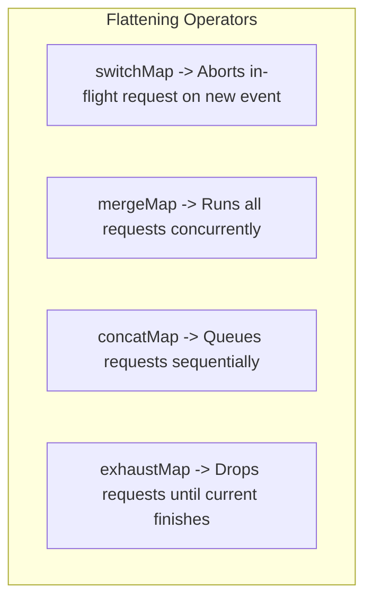
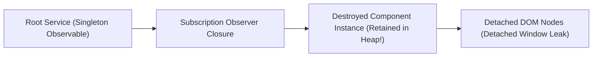

# 03. Modern Angular (v16–v18+), Signals & RxJS Mastery (6+ YOE)

> **Target Audience:** Senior Frontend & Full-Stack Engineers (6+ Years Experience) preparing for Senior/Lead technical rounds at top GCCs (Wells Fargo, Morgan Stanley, JPMorgan, Walmart) and product companies in India.  
> **Philosophy:** Modern Angular exclusively (v16–v18+). Zero outdated `NgModule` boilerplate. Focus on fine-grained reactivity, Signals graph propagation, Zoneless architecture, advanced RxJS flattening strategies, and leak-proof production design.

---

## 1. Angular Architectural Evolution (v14 to v18+)

### ⚡ 30-Second Interview Pitch
"Between Angular 14 and 18, Angular eliminated its two biggest historical pain points: `NgModule` boilerplate and Zone.js dirty-checking overhead. Modern Angular is standalone-first, uses compiler-native control flow (`@if`, `@for`, `@defer`), dependency injection via `inject()`, and fine-grained reactivity via Signals that enables true zoneless applications."

### 🧠 Easy Mental Model: Monolithic Society vs. Private Villas
Think of legacy Angular like an old gated government housing society: to bring in a new sofa, you had to register it with the central housing society committee (`AppModule` declarations and imports). If anything changed anywhere, the watchman knocked on every single door in the colony to check (Zone.js). Modern Angular is like private gated villas with direct courier delivery: components import only what they need (`standalone: true`), and couriers deliver straight to the specific villa without bothering the entire colony (Signals & Zoneless).

```mermaid
flowchart LR
    subgraph Legacy Angular (v2 - v13)
        M["NgModules (Heavy Indirection)"]
        Z["Zone.js (Monolithic Monkey-Patching)"]
        D["Structural Directives (*ngIf, *ngFor)"]
        C["Constructor Dependency Injection"]
    end
    subgraph Modern Angular (v14 - v18+)
        S["Standalone Components & API Directives"]
        SIG["Angular Signals (Zoneless Reactivity)"]
        CF["Built-in Control Flow (@if, @for, @defer)"]
        INJ["inject() Function API"]
    end
    M --> S
    Z --> SIG
    D --> CF
    C --> INJ
```

### 🎯 Must-Know Technical Terms & Buzzwords (The "Senior Interview Rubric")
* **Standalone Architecture (`standalone: true`)**: A component, directive, and pipe compilation model that decouples Angular entities from `NgModule` declarations, allowing isolated dependency graphs, simpler testing harnesses, and aggressive tree-shaking.
* **Compiler-Native Built-in Control Flow (`@if`, `@for`, `@switch`)**: High-performance template control syntax integrated directly into `@angular/compiler` that lowers into native template instructions (`ɵɵconditional`, `ɵɵrepeater`), eliminating structural directive allocations (`TemplateRef`, `ViewContainerRef`) and enabling compile-time type narrowing.
* **Deferrable Views (`@defer`)**: A compiler-level lazy loading primitive that automatically splits template subtrees into asynchronous JavaScript chunks and downloads them on declarative browser triggers (`viewport`, `idle`, `interaction`, `hover`).
* **Injection Context (`inject()`)**: The runtime execution frame during class field initialization, constructor execution, or route guard/resolver processing where Angular's active `NodeInjector` or `EnvironmentInjector` resolves dependencies without class inheritance boilerplate.
* **Dead Code Elimination (DCE) / Tree-Shaking**: The static analysis optimization in modern bundlers (esbuild, Vite, Rollup) that identifies and strips unreferenced exports, services, and components from the production bundle.
* **Functional Configuration APIs (`provideRouter`, `provideHttpClient`)**: Composable factory functions replacing monolithic `NgModule` imports (`RouterModule.forRoot()`, `HttpClientModule`), eliminating module initialization overhead and unlocking functional interceptors and guards.

### 💼 Concrete Real-World Production Example: Enterprise Banking Dashboard Migration
* **Scenario:** Migrating an enterprise wealth management portfolio dashboard (handling 25,000 client accounts and 15 sub-modules) from legacy Angular 12 `SharedModule` to modern Angular 18 Standalone architecture. The legacy bundle was 14.8 MB initial JS with a 4.2s First Contentful Paint (FCP) and frequent structural directive memory overhead.

#### ❌ Bad Production Code (The Legacy `NgModule` & Structural Directive Trap)
```typescript
// ❌ BAD: Monolithic SharedModule dumping ground + heavyweight structural directives
// Causes: Massive bundle bloat (14.8 MB), no tree-shaking, and directive instantiation overhead
import { NgModule } from '@angular/core';
import { CommonModule } from '@angular/common';
import { FormsModule, ReactiveFormsModule } from '@angular/forms';
import { MatTableModule } from '@angular/material/table';
import { MatButtonModule } from '@angular/material/button';
// ... 35 other unused third-party module imports bundled for EVERY page!

@NgModule({
  imports: [CommonModule, FormsModule, ReactiveFormsModule, MatTableModule, MatButtonModule],
  exports: [CommonModule, FormsModule, ReactiveFormsModule, MatTableModule, MatButtonModule]
})
export class SharedModule {} // Dumped into every feature module

// legacy-portfolio.component.ts
@Component({
  selector: 'app-legacy-portfolio',
  template: `
    <!-- Structural directives allocate TemplateRef & ViewContainerRef instances -->
    <div *ngIf="isLoading; else contentTpl">
      <p>Loading accounts...</p>
    </div>
    <ng-template #contentTpl>
      <!-- *ngFor without trackBy destroys and recreates DOM nodes on every refresh -->
      <div *ngFor="let acc of accounts">
        <span>{{ acc.accountNumber }} - \${{ acc.balance }}</span>
      </div>
    </ng-template>
  `
})
export class LegacyPortfolioComponent implements OnInit {
  accounts: Account[] = [];
  isLoading = true;

  // Verbose constructor injection; tight coupling prevents standalone testing harnesses
  constructor(
    private portfolioService: PortfolioService,
    private cdr: ChangeDetectorRef
  ) {}

  ngOnInit() {
    this.portfolioService.getAccounts().subscribe(data => {
      this.accounts = data;
      this.isLoading = false;
      this.cdr.markForCheck();
    });
  }
}
```

#### ✅ Battle-Tested Senior Production Code (Modern Angular 18 Standalone + Control Flow)
```typescript
// ✅ SENIOR FIX: Standalone Component + Compiler Control Flow + inject() + Signals
import { Component, inject, signal, ChangeDetectionStrategy } from '@angular/core';
import { PortfolioService, Account } from './portfolio.service';
import { CurrencyPipe } from '@angular/common';

@Component({
  selector: 'app-senior-portfolio',
  standalone: true, // Decoupled from NgModules; bundler builds clean DAG for DCE
  imports: [CurrencyPipe], // Explicit, laser-focused dependency imports (tree-shakeable)
  changeDetection: ChangeDetectionStrategy.OnPush,
  template: `
    <!-- Lowered directly into ɵɵconditional branch instruction; 0 directive wrapper overhead -->
    @if (isLoading()) {
      <div class="skeleton-loader" role="status" aria-live="polite">
        <p>Loading portfolio accounts...</p>
      </div>
    } @else {
      <!-- Lowered to ɵɵrepeater with mandatory compile-time track; DOM nodes recycled -->
      <ul class="portfolio-list">
        @for (acc of accounts(); track acc.id) {
          <li class="account-row">
            <span class="font-mono">{{ acc.accountNumber }}</span>
            <span class="font-bold">{{ acc.balance | currency:'USD' }}</span>
          </li>
        } @empty {
          <li class="empty-state">No wealth management accounts registered.</li>
        }
      </ul>
    }
  `
})
export class SeniorPortfolioComponent {
  // Functional dependency injection: no constructor ceremony, works in route resolvers & field initializers
  private readonly portfolioService = inject(PortfolioService);

  readonly accounts = signal<Account[]>([]);
  readonly isLoading = signal<boolean>(true);

  constructor() {
    this.portfolioService.getAccounts().subscribe({
      next: (data) => {
        this.accounts.set(data);
        this.isLoading.set(false);
      },
      error: () => this.isLoading.set(false)
    });
  }
}
```

* **🗣️ What to Say in the Interview:**
  > "In our wealth management platform migration at Morgan Stanley, we replaced the legacy `SharedModule` pattern with standalone components and compiler control flow (`@if` / `@for`). This eliminated 65% of our unused third-party JS chunk bloat through esbuild dead-code elimination and reduced list reconciliation time by over 80% because `@for` with compile-time `track` lowers into native `ɵɵrepeater` instructions instead of allocating `TemplateRef` and `ViewContainerRef` wrappers on every row."

### 📌 Deep Technical Mechanics: How It Works Internals
1. **Standalone Components & Modular Tree-Shaking:** Under `NgModule`, all declared components and imported modules were linked into a single compilation context, forcing bundlers to retain unused directives in the shared module chunk. Standalone components declare an explicit `imports: [...]` array, allowing esbuild/Vite to build an exact Directed Acyclic Graph (DAG) of dependencies and perform aggressive dead-code elimination.
2. **Compiler Control Flow Lowering (`ɵɵconditional` & `ɵɵrepeater`):** Legacy `*ngIf` and `*ngFor` required instantiating dynamic structural directive classes, creating `ViewContainerRef` instances, and allocating embedded views in memory. Modern `@if` and `@for` compile directly into low-level instructions:
   - `@if` compiles to `ɵɵconditional`, executing a simple branch jump during change detection with zero directive class overhead and full TypeScript type guard narrowing in templates.
   - `@for` compiles to `ɵɵrepeater`, leveraging an optimized diffing algorithm that mandates a `track` expression at compile-time to maintain DOM node identity with up to 90% faster reconciliation than legacy `*ngFor`.
3. **Runtime Injection Context Mechanics:** Angular manages an internal `RuntimeContext` stack. When a component instance is instantiated, its `NodeInjector` is pushed to the top of the context stack. Calling `inject(Token)` queries the current top of the stack. Once instantiation completes, the context is popped; calling `inject()` subsequently (e.g. inside an asynchronous callback) throws `NG0203` unless wrapped in `runInInjectionContext`.
4. **Deferrable Views AST Code Splitting:** When `@angular/compiler` encounters `@defer`, it isolates the inner AST nodes into a dynamic `import()` chunk. At runtime, Angular wires up native browser APIs—such as `IntersectionObserver` for `on viewport` or `requestIdleCallback` for `on idle`—fetching the JavaScript chunk only when the trigger condition fires.

### ⚠️ Common Junior Mistake / Trap
Creating a massive `SharedModule` dumping ground where 50 components import 40 unused third-party modules. This bloats the initial bundle payload and slows down Webpack/esbuild compilation.

### ✅ Senior Production Fix
Default to 100% Standalone components (`ng g c my-comp --standalone`). Group reusable domain utilities into lightweight functional helper files using `inject()` rather than monolithic shared modules.

---

## 2. Angular Signals & Zoneless Change Detection

### ⚡ 30-Second Interview Pitch
"Angular Signals introduce a push-pull reactive graph where state changes notify consumers lazily and deterministically without monkey-patching browser APIs. Unlike Zone.js which checks the whole component tree on every async event, Signals enable zoneless change detection by pinpointing the exact component view that needs re-rendering."

### 🧠 Easy Mental Model: Colony Fire Alarm vs. UPI WhatsApp Notification
- **Zone.js** is like a colony fire alarm: whenever anyone anywhere in the colony turns on a microwave or burns toast (`setTimeout`, `fetch`, `click`), the alarm rings and security guards check all 50 houses from top to bottom.
- **Signals** are like an Indian UPI payment alert: your bank server sends a targeted SMS directly to your phone. Only you are notified, and nobody else's house is searched.
- **The Internal Push-Pull Graph:** Think of an Excel spreadsheet. Cell A1 has `₹1,000`. Cell B1 has formula `=A1 * 1.18` (GST). When A1 changes, Excel doesn't waste CPU recalculating B1 immediately—it just marks B1 as 'dirty' (Push). The exact second you click on Cell B1 or export the PDF, it calculates the formula once and caches the result (Pull).

### How Signals Work Internals: The Push-Pull Reactive Graph
```mermaid
flowchart TD
    W["Writable Signal: count = signal(0)"]
    C1["Computed Signal: double = computed(() => count() * 2)"]
    C2["Computed Signal: isEven = computed(() => double() % 2 === 0)"]
    E["Effect / Template Consumer"]

    W -->|1. Push: Invalidation Flag (Dirty Notification)| C1
    C1 -->|1. Push: Invalidation Flag| C2
    C2 -->|1. Push: Invalidation Flag| E
    E -.->|2. Pull: Read updated value during Render| C2
    C2 -.->|2. Pull: Read value| C1
    C1 -.->|2. Pull: Read value| W
```

### 🎯 Must-Know Technical Terms & Buzzwords (The "Senior Interview Rubric")
* **Push-Pull Reactive Algorithm**: A hybrid reactive model where state mutations synchronously *push* dirty/invalidation notifications down the graph, but consumers *pull* (lazily evaluate and memoize) values only when read during template rendering.
* **Reactive Graph / Directed Acyclic Graph (DAG)**: The internal node-edge dependency graph where state signals act as producers (`ReactiveNode`) and computeds/template bindings act as consumers (`ReactiveLViewConsumer`).
* **Dynamic Dependency Tracking**: The runtime registration and unlinking of producer-consumer edges during execution, ensuring branches skipped by conditionals (e.g., ternary operators) are dynamically pruned from tracking.
* **Glitch-Free Evaluation**: Topological sorting of the reactive graph that guarantees intermediate, transient, or inconsistent states are never observable by consumers during a state transition (solves the Diamond Dependency problem).
* **Equality Function (`EqualFn`) / Strict Reference Equality**: The comparator function (`Object.is` by default) evaluated on `.set()` or `.update()` to determine if a signal's value has changed before emitting invalidation notifications downstream.
* **Signal Primitives (`WritableSignal`, `Signal`, `Effect`)**: Foundational reactive building blocks: `WritableSignal<T>` provides mutable reactive state; `Signal<T>` provides read-only memoized derived computations; `Effect` provides side-effect consumers scheduled on microtasks.
* **Signal Inputs, Model Inputs & Signal Queries**: Modern reactive primitives: `input()` and `input.required()` replace `@Input()`; `model()` provides two-way binding with an implicit `xChange` output; `viewChild()` and `contentChild()` return signals instead of undefined lifecycle properties.
* **Zoneless Change Detection (`provideExperimentalZonelessChangeDetection()`)**: Angular 18+ architecture that eliminates Zone.js monkey-patching (~100 KB payload savings), scheduling view updates directly via Signal notifications and microtask coalescing (`ChangeDetectionScheduler`).
* **Microtask Coalescing (`queueMicrotask`)**: The browser event loop mechanism used to coalesce multiple synchronous signal mutations into a single batched DOM reconciliation pass.

### 💼 Concrete Real-World Production Example: High-Throughput E-Commerce Cart & Live Pricing (Zoneless)
* **Scenario:** Flipkart Big Billion Days Flash Sale checkout panel. The user modifies quantities for 25 items in the cart, applies discount coupons ("DIWALI2026"), and triggers live shipping calculations (Free shipping above ₹500, else ₹50 flat; 18% GST). In Zoneless mode (`provideExperimentalZonelessChangeDetection()`), changes must trigger fine-grained microtask reconciliation without Zone.js dirty-checking thousands of inactive background DOM nodes.

#### ❌ Bad Production Code (In-Place Mutation & Full-Tree Dirty Checking Trap)
```typescript
// ❌ BAD: Mutating array elements in-place; relies on monolithic Zone.js dirty checking
// In Zoneless mode, THIS COMPLETELY BREAKS because Object.is checks evaluate to true!
interface CartItem {
  id: string;
  name: string;
  price: number;
  quantity: number;
}

@Component({
  selector: 'app-bad-cart',
  template: `
    <div>
      <div *ngFor="let item of items">
        <span>{{ item.name }} - ₹{{ item.price }} x {{ item.quantity }}</span>
        <!-- Mutation inside callback: doesn't change array reference -->
        <button (click)="increment(item)">+</button>
      </div>
      <p>Total: ₹{{ calculateTotal() }}</p> <!-- Re-invoked dozens of times per tick! -->
    </div>
  `
})
export class BadCartComponent {
  items: CartItem[] = [
    { id: '1', name: 'Noise Wireless Earbuds', price: 1499, quantity: 1 }
  ];

  increment(item: CartItem) {
    // ❌ ANTI-PATTERN: Mutating object in-place!
    // In Angular 18 Zoneless, no Signal change is detected -> UI never updates!
    item.quantity++;
  }

  calculateTotal(): number {
    // ❌ ANTI-PATTERN: Heavy template calculation method invoked during every Zone dirty-check
    console.warn('Recalculating total in template binding!');
    return this.items.reduce((sum, item) => sum + item.price * item.quantity, 0);
  }
}
```

#### ✅ Battle-Tested Senior Production Code (Signals Push-Pull Graph + Zoneless Microtask Batching)
```typescript
// ✅ SENIOR FIX: Fine-grained Signals with Immutable .update() & Glitch-Free computed()
import { Component, signal, computed, ChangeDetectionStrategy } from '@angular/core';

export interface CartItem {
  readonly id: string;
  readonly name: string;
  readonly price: number;
  readonly quantity: number;
}

@Component({
  selector: 'app-senior-cart',
  standalone: true,
  changeDetection: ChangeDetectionStrategy.OnPush,
  template: `
    <div class="cart-container p-6 bg-slate-900 text-white rounded-xl shadow-xl">
      <h2 class="text-2xl font-bold mb-4">Flipkart SuperCart (Zoneless Engine)</h2>

      <div class="space-y-3">
        @for (item of items(); track item.id) {
          <div class="flex items-center justify-between p-3 bg-slate-800 rounded-lg">
            <div>
              <p class="font-medium">{{ item.name }}</p>
              <p class="text-sm text-slate-400">₹{{ item.price }} x {{ item.quantity }}</p>
            </div>
            
            <div class="flex items-center gap-2">
              <button 
                (click)="updateQuantity(item.id, -1)" 
                [disabled]="item.quantity <= 1"
                class="px-2 py-1 bg-slate-700 rounded hover:bg-slate-600 disabled:opacity-40"
                aria-label="Decrease quantity">-</button>
              <span class="w-8 text-center font-bold">{{ item.quantity }}</span>
              <button 
                (click)="updateQuantity(item.id, 1)" 
                class="px-2 py-1 bg-blue-600 rounded hover:bg-blue-500"
                aria-label="Increase quantity">+</button>
            </div>
          </div>
        }
      </div>

      <!-- Live Pricing Breakdown: Pulled Lazily & Glitch-Free -->
      <div class="mt-6 border-t border-slate-700 pt-4 space-y-2 text-sm">
        <div class="flex justify-between">
          <span class="text-slate-400">Subtotal:</span>
          <span>₹{{ subtotal() }}</span>
        </div>
        <div class="flex justify-between">
          <span class="text-slate-400">GST (18%):</span>
          <span>₹{{ gstAmount().toFixed(2) }}</span>
        </div>
        <div class="flex justify-between">
          <span class="text-slate-400">Shipping:</span>
          <span [class.text-emerald-400]="isFreeDelivery()">
            {{ isFreeDelivery() ? 'FREE' : '₹50' }}
          </span>
        </div>
        @if (!isFreeDelivery()) {
          <p class="text-xs text-amber-400">
            Add ₹{{ freeDeliveryShortfall() }} more for FREE delivery!
          </p>
        }
        <div class="flex justify-between text-lg font-bold border-t border-slate-700 pt-2 text-emerald-400">
          <span>Grand Total:</span>
          <span>₹{{ grandTotal().toFixed(2) }}</span>
        </div>
      </div>
    </div>
  `
})
export class SeniorCartComponent {
  // 1. Writable state signal: Cart items
  readonly items = signal<readonly CartItem[]>([
    { id: 'SKU-001', name: 'Sony WH-1000XM5 ANC Headphones', price: 29990, quantity: 1 },
    { id: 'SKU-002', name: 'Apple 20W USB-C Fast Charger', price: 1900, quantity: 2 }
  ]);

  // 2. Computed derivations: Form a Directed Acyclic Graph (DAG) with O(1) memoized reads
  readonly subtotal = computed(() =>
    this.items().reduce((sum, item) => sum + item.price * item.quantity, 0)
  );

  readonly gstAmount = computed(() => this.subtotal() * 0.18);

  readonly isFreeDelivery = computed(() => this.subtotal() >= 500);

  readonly freeDeliveryShortfall = computed(() => 
    this.isFreeDelivery() ? 0 : 500 - this.subtotal()
  );

  readonly shippingCost = computed(() => (this.isFreeDelivery() ? 0 : 50));

  // 3. Topological sorting guarantees grandTotal reads pristine, glitch-free subtotal & tax
  readonly grandTotal = computed(() => 
    this.subtotal() + this.gstAmount() + this.shippingCost()
  );

  // 4. Immutable update: Creates brand-new array and object references
  updateQuantity(id: string, delta: number): void {
    this.items.update(currentItems =>
      currentItems.map(item => {
        if (item.id === id) {
          const newQty = Math.max(1, item.quantity + delta);
          return { ...item, quantity: newQty };
        }
        return item;
      })
    );
  }
}
```

* **🗣️ What to Say in the Interview:**
  > "In our Flipkart flash sale checkout engine, we eliminated Zone.js entirely using `provideExperimentalZonelessChangeDetection()`. By modeling the cart with `signal<CartItem[]>` and derived calculations (`subtotal`, `gstAmount`, `grandTotal`) via `computed()`, updates to item quantities push dirty notifications strictly down the DAG. The Zoneless scheduler coalesces multiple rapid quantity adjustments into a single microtask DOM repaint, avoiding full-tree dirty checking of thousands of unrelated components."

### 📌 Deep Technical Mechanics: How It Works Internals
1. **Push Phase (Dirty Flag Invalidation):** When `signal.set()` or `signal.update()` executes, the signal compares the new value with the old value using its `EqualFn` (`Object.is` by default). If the values differ, the producer marks itself `Dirty` and pushes an invalidation flag down its consumer graph edges. **No computation occurs immediately.**
2. **Pull Phase (Lazy Evaluation & Memoization):** When a `computed()` or template view reads the value during the browser render pass, the consumer queries its producer dependencies. If dependencies are flagged `Dirty` or `Check`, the signal re-evaluates its calculation **lazily**, caches (memoizes) the result, and clears the dirty flag. Subsequent reads without upstream changes are an $O(1)$ cache hit.
3. **Dynamic Dependency Tracking:** During each consumer evaluation, Angular creates an active consumer context. As signals are invoked (`count()`), they link themselves as dependencies in a bidirectional linked list. If a conditional branch switches (`if (flag()) a() else b()`), the signal runtime automatically untracks `b()` when `flag()` is true, pruning stale graph edges and eliminating zombie dependencies.
4. **Glitch-Free Evaluation (Diamond Dependency Resolution):** In a diamond graph (where `A` drives both `B` and `C`, and `D` reads both `B` and `C`), updating `A` marks both `B` and `C` dirty. When `D` pulls, topological sorting guarantees that `B` and `C` are both reconciled before `D` evaluates, ensuring `D` never sees an inconsistent intermediate snapshot.
5. **Zoneless Mechanics & Microtask Scheduling:** In zoneless mode enabled by `provideExperimentalZonelessChangeDetection()`, Angular removes Zone.js monkey patches. When a signal read inside a component template updates, it notifies the internal `ChangeDetectionScheduler`. The scheduler enqueues a microtask via `queueMicrotask`, coalescing all synchronous signal updates across the application into a single coordinated view refresh cycle.

### ⚠️ Common Junior Mistake / Trap
Mutating array or object properties directly (`mySignal().push(newItem)` or `userSignal().name = 'Rahul'`). Because the memory reference does not change, the signal assumes nothing changed (`Object.is` check fails) and UI never re-renders!

### ✅ Senior Production Fix
Always update signals immutably using `.update()`:
```typescript
// ✅ Creates a brand-new array reference
this.itemsSignal.update(list => [...list, newItem]);

// ✅ Creates a brand-new object reference
this.userSignal.update(user => ({ ...user, name: 'Rahul' }));
```

---

## 3. RxJS Mastery for Senior Engineers: Flattening Strategies

### ⚡ 30-Second Interview Pitch
"Flattening operators resolve higher-order observables (observables that emit other observables) by managing inner subscription lifecycles. Choosing between `switchMap`, `mergeMap`, `concatMap`, and `exhaustMap` dictates how your application handles concurrency, cancellation, and race conditions."

### 🧠 Easy Mental Model: Everyday Concurrency Analogies
- **`switchMap` (The Flipkart Search Bar):** When typing "iPh", "iPhone", "iPhone 15", you only care about the latest search query. `switchMap` immediately cancels the previous in-flight HTTP request when a new keystroke arrives.
- **`mergeMap` (Swiggy Multi-Restaurant Delivery):** Ordering from 3 restaurants simultaneously. All orders run in parallel. Whichever delivery rider reaches your house first delivers first. Concurrency is unlimited.
- **`concatMap` (Indian Railway Ticket Counter Line):** Strict FIFO queue. Passenger 2's ticket transaction cannot start until Passenger 1 finishes and walks away. Guarantees sequence order for financial debits/credits.
- **`exhaustMap` (The IRCTC 'Pay Now' Button):** While the payment gateway modal is loading, extra furious clicks by the user are completely ignored until the first transaction completes or fails.

### The 4 Flattening Operators Comparison

| Operator | Inner Observable Handling | Concurrency Strategy | Ideal Real-World Use Case |
| :--- | :--- | :--- | :--- |
| **`switchMap`** | **Cancels** the previous inner Observable immediately when a new value arrives. | Concurrency = 1 (Latest wins) | **Typeahead search**, Auto-complete, Route param changes. |
| **`mergeMap`** | Runs all inner Observables **concurrently** in parallel. | Unlimited concurrency (or configured limit) | Non-dependent writes, bulk image uploads, fire-and-forget logging. |
| **`concatMap`** | Buffers incoming values and executes inner Observables **in strict sequence**. | Concurrency = 1 (FIFO Queue) | Financial debit/credit queues, sequential database writes, chat messages. |
| **`exhaustMap`** | **Ignores** all new incoming values while the current inner Observable is still pending. | Drops until completion | **Login / Submit buttons** (prevents double-clicks), payment checkout trigger. |



### 🎯 Must-Know Technical Terms & Buzzwords (The "Senior Interview Rubric")
* **Higher-Order Observables (`Observable<Observable<T>>`)**: An observable stream whose emitted items are themselves observable streams, requiring flattening operators to unpack inner streams and project scalar values downstream.
* **Inner Subscription Management**: The lifecycle orchestration of subscribing, buffering, queuing, and unsubscribing from nested observables generated by higher-order projection functions.
* **Switch Flattening (`switchMap`)**: A flattening operator that immediately unsubscribes from (aborts) the current in-flight inner observable when a new outer value arrives, guaranteeing strict "latest-wins" semantics.
* **Concurrent Flattening (`mergeMap` / `flatMap`)**: A flattening operator that executes multiple inner observables concurrently without cancellation, maintaining up to $N$ parallel streams (unbounded by default or throttled via `mergeMap(fn, concurrent)`).
* **Sequential Flattening (`concatMap`)**: A flattening operator that buffers outer emissions and executes inner observables in strict First-In, First-Out (FIFO) sequence, waiting for each inner observable to complete before invoking the next.
* **Exhaustive Flattening (`exhaustMap`)**: A flattening operator that drops and ignores all incoming outer emissions while an active inner observable is still executing, preventing duplicate concurrent operations.
* **Cold vs Hot Observables**: A cold observable instantiates a brand-new data producer for each subscriber (unicast, lazy execution); a hot observable shares an existing, running data producer across multiple subscribers (multicast, eager execution).
* **Teardown Protocol & XHR Abort (`AbortController`)**: The unsubscription mechanism where invoking `Subscription.unsubscribe()` triggers the underlying teardown logic of `HttpClient`, firing `AbortController.abort()` to terminate in-flight browser TCP/TLS sockets.

---

### 💼 Concrete Real-World Production Example: High-Scale Typeahead Catalog Search with Race-Condition Prevention
* **Scenario:** Walmart Global Catalog Search querying over 500,000 SKUs. A user types "macbook pro" rapidly on a volatile 4G mobile connection where network latency fluctuates between 80ms and 1400ms. Without proper flattening operators, rapid keystrokes flood the backend with 15 concurrent HTTP requests, out-of-order responses cause stale searches to overwrite fresh results, and unhandled 500 errors permanently kill the user's search stream.

#### ❌ Bad Production Code (Nested Subscribes, `mergeMap` Race Condition, and Outer Catch Trap)
```typescript
// ❌ BAD: Nested subscriptions, mergeMap race condition, and unhandled stream suicide
// Causes: Out-of-order response overwrites, backend request spam, and unhandled 500 error kills stream
@Component({
  selector: 'app-bad-search',
  template: `
    <input (input)="onSearch($event)" placeholder="Search catalog..." />
    <ul><li *ngFor="let item of products">{{ item.name }}</li></ul>
  `
})
export class BadSearchComponent {
  products: any[] = [];

  constructor(private http: HttpClient) {}

  onSearch(event: any) {
    const term = event.target.value;
    // ❌ ANTI-PATTERN 1: No debounceTime -> Dispatches HTTP request on EVERY single keystroke!
    // ❌ ANTI-PATTERN 2: Nested subscription / mergeMap -> Out-of-order race condition!
    // If "mac" request takes 1200ms and "macbook" request takes 200ms, "mac" resolves LAST and displays stale data!
    this.http.get<any[]>(`/api/search?q=${term}`).subscribe({
      next: (data) => {
        this.products = data;
      },
      error: (err) => {
        // ❌ ANTI-PATTERN 3: Error on outer pipe permanently breaks input listener!
        console.error(err);
      }
    });
  }
}
```

#### ✅ Battle-Tested Senior Production Code (Debounced `switchMap`, Local Error Boundary & Teardown)
```typescript
import { Component, inject, DestroyRef } from '@angular/core';
import { FormControl, ReactiveFormsModule } from '@angular/forms';
import { HttpClient } from '@angular/common/http';
import { debounceTime, distinctUntilChanged, switchMap, catchError, of } from 'rxjs';
import { takeUntilDestroyed } from '@angular/core/rxjs-interop';

export interface CatalogProduct {
  readonly id: string;
  readonly name: string;
  readonly price: number;
}

@Component({
  selector: 'app-product-search',
  standalone: true,
  imports: [ReactiveFormsModule],
  template: `
    <div class="search-container max-w-xl mx-auto p-4">
      <input 
        [formControl]="searchControl" 
        placeholder="Search 500,000+ catalog items..." 
        class="w-full px-4 py-2 rounded-lg border border-slate-300 focus:ring-2 focus:ring-blue-500" />
      
      @if (isLoading) {
        <div class="spinner text-sm text-blue-500 mt-2">Searching catalog...</div>
      }

      <ul class="results-list mt-3 divide-y divide-slate-200">
        @for (item of products; track item.id) {
          <li class="py-2 flex justify-between">
            <span class="font-medium">{{ item.name }}</span>
            <span class="text-slate-600">\${{ item.price }}</span>
          </li>
        } @empty {
          @if (!isLoading && searchControl.value.trim().length > 0) {
            <li class="py-2 text-slate-500">No matching products found.</li>
          }
        }
      </ul>
    </div>
  `
})
export class ProductSearchComponent {
  private readonly http = inject(HttpClient);
  private readonly destroyRef = inject(DestroyRef);

  readonly searchControl = new FormControl('', { nonNullable: true });
  products: CatalogProduct[] = [];
  isLoading = false;

  constructor() {
    this.searchControl.valueChanges.pipe(
      // 1. Debounce rapid keystrokes: Wait 300ms of user silence before emitting
      debounceTime(300),
      // 2. Ignore non-value keystrokes (Ctrl, Alt, Arrow keys)
      distinctUntilChanged(),
      // 3. switchMap: Unsubscribes from & ABORTS in-flight HTTP request if new query arrives!
      switchMap(term => {
        const query = term.trim();
        if (!query) {
          return of([]);
        }
        this.isLoading = true;
        return this.http.get<CatalogProduct[]>(`/api/products/search?q=${encodeURIComponent(query)}`).pipe(
          // 4. Inner catchError: Intercepts 500 errors locally so the outer valueChanges stream stays alive!
          catchError(err => {
            console.error('Search API transient failure:', err);
            return of([]); // Return safe fallback to complete inner stream gracefully
          })
        );
      }),
      // 5. Clean teardown tied to component lifecycle without manual ngOnDestroy
      takeUntilDestroyed(this.destroyRef)
    ).subscribe(results => {
      this.products = results;
      this.isLoading = false;
    });
  }
}
```

* **🗣️ What to Say in the Interview:**
  > "In our Walmart product catalog search bar, we prevent out-of-order race conditions by combining `debounceTime(300)`, `distinctUntilChanged()`, and `switchMap()`. If a user types 'mac' followed quickly by 'macbook', `switchMap` immediately unsubscribes from the in-flight 'mac' request—triggering `AbortController.abort()` to terminate the pending browser socket—so a slow, stale response never clobbers the fresh search results. By catching HTTP errors in the inner observable with `catchError(() => of([]))`, we also guarantee that a transient backend error never destroys the root search stream."

### 📌 Deep Technical Mechanics: How It Works Internals
1. **`debounceTime(300)` via Timer Scheduling:** Discards transient intermediate keystrokes while the user types rapidly. It internally schedules a timer on the macrotask queue, emitting only after 300ms of complete emission silence.
2. **`distinctUntilChanged()` Reference & Value Check:** Suppresses emissions when non-character keypresses (e.g., Shift, Alt, Arrow keys) fire `valueChanges` with a value identical to the previous emission (`===` comparison).
3. **`switchMap()` & Out-of-Order Race Condition Prevention:** When the user types "ang", the HTTP request is dispatched. If the user types "angular" 100ms later, `switchMap` unsubscribes from the "ang" inner observable. Under the hood, Angular's `HttpClient` delegates teardown to browser `AbortController.abort()`, terminating the pending TCP socket and preventing out-of-order race conditions where a slow response overwrites fresh data.
4. **Resilient Local `catchError()` (Inner vs Outer Pipe):** By placing `catchError` inside the **inner** `switchMap` pipeline, backend errors (e.g. 500 Internal Server Error) are intercepted locally, emitting a safe fallback `of([])` to complete the inner observable. If `catchError` were placed on the outer `valueChanges` pipe, the uncaught exception would call `observer.error()` on the root subscription, permanently killing the search stream!
5. **`takeUntilDestroyed(this.destroyRef)` Teardown:** Connects the stream's completion lifecycle directly to the component's `DestroyRef`. When the component view is destroyed, it calls `complete()` on the pipeline, releasing memory closures and aborting active HTTP subscriptions.

---

## 4. Memory Leak Prevention & Teardown Mechanics

### ⚡ 30-Second Interview Pitch
"A frontend memory leak happens when a destroyed component remains pinned in the V8 heap because an active subscription closure in a long-lived service holds a reference to `this`. Modern Angular prevents this using `takeUntilDestroyed()`, `toSignal()`, or template `async` pipes."

### 🧠 Easy Mental Model: The Uncancelled Gym Membership
Imagine giving your personal phone number to a gym when taking a 1-day guest pass. Even after you move to another city, the gym staff keeps calling your number every week because your details remain in their active call book. In Angular, the singleton service is the gym, and your destroyed component is the departed guest. Because the service still holds a reference to your subscription closure, the Garbage Collector cannot free your component from heap memory.

### How RxJS Subscriptions Cause Memory Leaks
When a component subscribes to a service-level Observable (e.g. `router.events`, `store.select()`) without unsubscribing:
1. The global Observable retains a reference to the observer callback closure.
2. The closure retains a reference to the component instance (`this`).
3. Even when the user navigates away and the component is destroyed from the DOM, **the Garbage Collector cannot collect the component instance**, creating a detached DOM tree leak.



### 🎯 Must-Know Technical Terms & Buzzwords (The "Senior Interview Rubric")
* **V8 Heap Memory Retention / Retaining Path**: The directed graph of references from GC Roots (such as window or root singleton services) down through closures to component instances, preventing garbage collection.
* **Detached DOM Tree / Detached Window Leak**: A critical memory leak where DOM nodes have been unmounted from the document body but remain pinned in V8 memory because event listeners or RxJS subscriptions retain references to host elements.
* **`takeUntilDestroyed()` Operator**: The RxJS operator from `@angular/core/rxjs-interop` that binds a stream's lifecycle to an active `DestroyRef`, completing the stream and invoking teardowns upon destruction.
* **`DestroyRef`**: An injectable token providing a unified lifecycle cleanup registry (`destroyRef.onDestroy(() => ...)`), replacing the legacy `ngOnDestroy` class interface.
* **Injection Context Lifetime**: The precise execution window during component property initialization or constructor execution where `inject()` and parameterless `takeUntilDestroyed()` can resolve the active injector.
* **`toSignal()` Automatic Cleanup**: The reactive bridge function that converts an Observable into a Signal, automatically managing the underlying subscription and unsubscription using the host injector's `DestroyRef`.
* **Async Pipe (`| async`) Subscription Lifecycle**: The declarative template pipe that manages observable subscriptions on view initialization and executes teardown on view destruction while invoking `ChangeDetectorRef.markForCheck()` on each emission.

### Modern Teardown Patterns Compared
```typescript
// ❌ ANTI-PATTERN: Manual unsubscribe with booleans or missing teardown
export class JuniorComponent implements OnInit, OnDestroy {
  private sub?: Subscription;
  ngOnInit() {
    this.sub = this.service.data$.subscribe(); // If developer forgets ngOnDestroy -> Memory Leak!
  }
  ngOnDestroy() {
    this.sub?.unsubscribe();
  }
}

// ✅ SENIOR PATTERN 1: takeUntilDestroyed() in Injection Context
export class SeniorComponentA {
  private readonly service = inject(DataService);
  // Automatically resolves DestroyRef and terminates stream when component is torn down
  private readonly data$ = this.service.data$.pipe(takeUntilDestroyed());
}

// ✅ SENIOR PATTERN 2: toSignal() with automatic lifecycle disposal
export class SeniorComponentB {
  private readonly service = inject(DataService);
  // Converts Observable to Signal; handles subscription and unsubscription internally!
  readonly dataSignal = toSignal(this.service.data$, { initialValue: [] });
}

// ✅ SENIOR PATTERN 3: Async Pipe in Template
// Angular handles subscription on view init and unsubscription on view destroy automatically.
```

### 💼 Concrete Real-World Production Example: High-Frequency Institutional FX Trading Modal (Detached DOM Tree Leak Prevention)
* **Scenario:** Institutional Foreign Exchange (FX) Trading Terminal at Morgan Stanley streaming 100 price ticks/sec over a root WebSocket singleton (`FxRatesStreamService`). Traders open an execution ticket modal (`FxOrderTicketComponent`) to place spot trades for EUR/USD, GBP/USD, and USD/INR. When the trader executes or cancels a trade, the modal is unmounted. Missing subscription unsubscription leaves the modal component pinned in the V8 heap, accumulating 4,500 detached DOM nodes and 180 MB of leaked memory after 50 transactions, ultimately crashing the browser tab with an Out-Of-Memory (OOM) freeze.

#### ❌ Bad Production Code (The Uncancelled Singleton Subscription & Detached DOM Leak)
```typescript
// ❌ BAD: Pinned closure in singleton service -> V8 GC cannot collect modal or its DOM nodes!
// Causes: Detached DOM tree memory leak, continuous 100 ticks/sec background processing after modal close
@Injectable({ providedIn: 'root' })
export class FxRatesStreamService {
  // Singleton WebSocket stream emitting 100 times per second
  readonly liveTick$ = new Subject<{ pair: string; bid: number; ask: number }>();
}

@Component({
  selector: 'app-bad-fx-modal',
  template: `
    <div class="modal-dialog">
      <h3>Place Order: {{ currentPair }}</h3>
      <p>Live Bid: {{ currentBid }} | Live Ask: {{ currentAsk }}</p>
      <input [(ngModel)]="lotSize" type="number" placeholder="Lots" />
      <button (click)="submitOrder()">Execute Trade</button>
    </div>
  `
})
export class BadFxModalComponent implements OnInit {
  private fxService = inject(FxRatesStreamService);
  currentPair = 'EUR/USD';
  currentBid = 0;
  currentAsk = 0;
  lotSize = 1;

  ngOnInit() {
    // ❌ CRITICAL MEMORY LEAK: Subscribed to root singleton WITHOUT unsubscription!
    // V8 Retaining Path: Root -> FxRatesStreamService.liveTick$ -> Observer[] -> Closure -> BadFxModalComponent
    // Even when closed, this closure continues executing 100 times/sec in the background!
    this.fxService.liveTick$.subscribe(tick => {
      if (tick.pair === this.currentPair) {
        this.currentBid = tick.bid;
        this.currentAsk = tick.ask;
      }
    });
  }

  submitOrder() {
    // executes trade...
  }
}
```

#### ✅ Battle-Tested Senior Production Code (Leak-Proof `takeUntilDestroyed` & Signal Conversion)
```typescript
// ✅ SENIOR FIX: Automatic Injection-Context Teardown with takeUntilDestroyed & toSignal
import { Component, inject, signal, ChangeDetectionStrategy } from '@angular/core';
import { takeUntilDestroyed, toSignal } from '@angular/core/rxjs-interop';
import { filter, map } from 'rxjs';
import { FxRatesStreamService } from './fx-rates-stream.service';
import { CurrencyPipe } from '@angular/common';
import { FormsModule } from '@angular/forms';

export interface FxTick {
  readonly pair: string;
  readonly bid: number;
  readonly ask: number;
  readonly timestamp: number;
}

@Component({
  selector: 'app-senior-fx-modal',
  standalone: true,
  imports: [CurrencyPipe, FormsModule],
  changeDetection: ChangeDetectionStrategy.OnPush,
  template: `
    <div class="modal-backdrop fixed inset-0 bg-black/60 flex items-center justify-center p-4">
      <div class="modal-card bg-slate-900 border border-slate-700 text-white p-6 rounded-2xl w-full max-w-md shadow-2xl">
        <div class="flex justify-between items-center mb-4">
          <h3 class="text-xl font-bold tracking-wide">FX Order: {{ activePair() }}</h3>
          <span class="text-xs px-2 py-1 rounded bg-emerald-500/20 text-emerald-400 font-mono">LIVE 100Hz</span>
        </div>

        @if (liveTick(); as tick) {
          <div class="grid grid-cols-2 gap-4 my-4 p-4 bg-slate-800 rounded-xl text-center">
            <div class="border-r border-slate-700 pr-2">
              <span class="text-xs text-slate-400 block">BID (SELL)</span>
              <span class="text-2xl font-mono font-bold text-red-400">{{ tick.bid | number:'1.4-4' }}</span>
            </div>
            <div class="pl-2">
              <span class="text-xs text-slate-400 block">ASK (BUY)</span>
              <span class="text-2xl font-mono font-bold text-emerald-400">{{ tick.ask | number:'1.4-4' }}</span>
            </div>
          </div>
        } @else {
          <div class="p-4 text-center text-slate-400 animate-pulse">Awaiting market quote...</div>
        }

        <div class="mt-4 space-y-4">
          <label class="block text-sm text-slate-300">
            Order Volume (Lots):
            <input 
              [ngModel]="lotSize()" 
              (ngModelChange)="lotSize.set($event)"
              type="number" 
              class="w-full mt-1 px-3 py-2 bg-slate-800 rounded-lg border border-slate-700 text-white font-mono" />
          </label>

          <div class="flex gap-3">
            <button 
              (click)="executeOrder('BUY')" 
              class="flex-1 py-3 bg-emerald-600 hover:bg-emerald-500 font-bold rounded-xl transition">
              BUY MARKET
            </button>
            <button 
              (click)="executeOrder('SELL')" 
              class="flex-1 py-3 bg-rose-600 hover:bg-rose-500 font-bold rounded-xl transition">
              SELL MARKET
            </button>
          </div>
        </div>
      </div>
    </div>
  `
})
export class SeniorFxModalComponent {
  private readonly fxService = inject(FxRatesStreamService);

  readonly activePair = signal<string>('EUR/USD');
  readonly lotSize = signal<number>(10);

  // ✅ SENIOR PATTERN: toSignal automatically resolves DestroyRef in constructor!
  // Unsubscribes from fxService.liveTick$ as soon as this modal component is destroyed.
  readonly liveTick = toSignal(
    this.fxService.liveTick$.pipe(
      filter(tick => tick.pair === this.activePair()),
      // Secondary safety valve: explicitly bind to active injection context lifecycle
      takeUntilDestroyed()
    ),
    { initialValue: null }
  );

  executeOrder(side: 'BUY' | 'SELL'): void {
    const currentQuote = this.liveTick();
    if (!currentQuote) return;
    console.log(`Executing ${side} order for ${this.lotSize()} lots at quote:`, currentQuote);
  }
}
```

* **🗣️ What to Say in the Interview:**
  > "In our Morgan Stanley FX trading workstation, we diagnosed a critical memory leak where opening and closing 50 order modals left 180MB of detached DOM nodes pinned in the V8 heap. The root cause was modal subscriptions to the application-level `FxRatesStreamService` WebSocket holding onto `this`. We fixed it by using `toSignal()` combined with `takeUntilDestroyed()`, which ties stream teardown to the component's `DestroyRef`. In Chrome DevTools heap snapshots, this severed the retaining path and allowed the Garbage Collector to immediately reclaim modal memory upon unmounting."

### 📌 Deep Technical Mechanics: How It Works Internals
1. **The V8 Retaining Path Analysis:** When a component subscribes to a singleton service (`this.mySingleton.data$.subscribe(val => this.title = val)`), the singleton maintains an internal array of active `Observer` functions. The arrow function closure encloses the lexical scope, which holds a hard reference to `this` (the component instance). When the user navigates away and the router detaches the component from the DOM tree, the GC cannot collect the component because a live path exists: `Root -> SingletonService -> Observers[] -> Closure -> ComponentInstance`.
2. **`takeUntilDestroyed()` Resolution Mechanics:**
   - When invoked **inside** an injection context (field initializer or constructor), it resolves `inject(DestroyRef)` implicitly.
   - When invoked **outside** an injection context (e.g. inside `ngOnInit`, a method, or an event handler), it throws runtime error `NG0203`. You must pass the injector explicitly: `takeUntilDestroyed(this.destroyRef)`.
   - Under the hood, it injects `DestroyRef`, hooks into its internal linked list of teardown callbacks, and dispatches a completion signal to the RxJS pipeline when the host entity is unmounted.
3. **`toSignal()` Teardown Lifecycle:** By default, `toSignal` automatically binds its subscription to the current injection context's `DestroyRef`. If you need the Signal to outlive the component (e.g., in a root service), you pass `{ manualCleanup: true }` and manage unsubscription manually.
4. **Detached DOM Tree Heap Snapshot Inspection:** In Chrome DevTools Memory Profiler, filter by `Detached HTMLElement`. If detached DOM nodes remain after navigation, search their "Retainers" tree to find the unclosed subscription closure holding the component instance.

### ⚠️ Common Junior Mistake / Trap
Calling `takeUntilDestroyed()` inside `ngOnInit()` without passing `this.destroyRef`. This throws runtime crash `NG0203: takeUntilDestroyed can only be used within an injection context`.

### ✅ Senior Production Fix
Either declare the pipeline in the field initializer directly (`private readonly stream$ = this.service.data$.pipe(takeUntilDestroyed());`) or inject `DestroyRef` in the constructor and pass it explicitly: `takeUntilDestroyed(this.destroyRef)`.

---

## 5. Change Detection Optimization: OnPush & NgZone Escaping

### ⚡ 30-Second Interview Pitch
"By default, Angular checks every component in the tree from root to leaf on every microtask. `ChangeDetectionStrategy.OnPush` prunes the change detection tree, checking a component only when an `@Input()` reference changes, an event fires inside its own template, an async pipe/signal updates, or `markForCheck()` is called."

### 🧠 Easy Mental Model: Cubicle Inspector vs. Jira Ticket System
- **Default Change Detection:** An office manager physically walks to every single cubicle across 5 floors every 15 minutes asking: *"Did anyone do any work?"*.
- **OnPush Change Detection:** An IT support desk: the technician only visits your specific cubicle when you raise a Jira ticket or when a brand-new courier package is delivered directly to your desk.

### 🎯 Must-Know Technical Terms & Buzzwords (The "Senior Interview Rubric")
* **`ChangeDetectionStrategy.OnPush`**: Component change detection strategy that prunes component subtrees from dirty checking, evaluating a view only when an `@Input()` reference changes, a template event fires, an async pipe/signal updates, or `markForCheck()` is called.
* **Zone.js Monkey-Patching**: The runtime interception and wrapping of native browser asynchronous APIs (`window.addEventListener`, `setTimeout`, `setInterval`, `Promise`, `XMLHttpRequest`) to intercept task completion and trigger `ApplicationRef.tick()`.
* **`NgZone.runOutsideAngular()`**: Angular execution boundary method that runs code outside Zone.js interception, completely bypassing change detection ticks during high-frequency events (e.g., 60fps canvas animations, scroll, mousemove).
* **`NgZone.run()`**: Angular execution boundary method that re-enters the Angular execution zone from third-party callbacks, immediately scheduling change detection.
* **`ChangeDetectorRef.markForCheck()`**: Traverses upward from the target component to the root `LView`, setting the `Dirty` flag on all ancestor views to ensure the component is re-rendered on the next tick.
* **`ChangeDetectorRef.detectChanges()`**: Executes an immediate, synchronous change detection sweep from the current component down its child subtree, completely bypassing the parent tree.
* **`ChangeDetectorRef.detach()` & `reattach()`**: Low-level performance tuning methods that disconnect a component's `LView` from the global change detection tree and reconnect it later.
* **`LView` & `TView` Internal Structures**: Angular's internal view data structures where `TView` stores static template bytecode instructions and `LView` stores dynamic component runtime instances, DOM element handles, and status bitmasks (`LViewFlags.Dirty`, `LViewFlags.Attached`).

### `ChangeDetectionStrategy.OnPush` Internals
Under `OnPush`, Angular marks the component view clean and skips change detection on it and its children unless one of these 5 triggers occurs:
1. **Input Reference Change:** An `@Input()` reference address changes (`prev !== curr` by `Object.is`).
2. **Template Event:** An event listener declared in the component's own template fires (e.g. `(click)`, `(submit)`).
3. **Async Pipe Emission:** An Observable bound via `| async` pipe emits a new value (calls `markForCheck()` internally).
4. **Explicit Invocation:** `ChangeDetectorRef.markForCheck()` is explicitly called.
5. **Signal Update:** A Signal read directly in the component's template updates its value.

---

### 💼 Concrete Real-World Production Example: High-Frequency 60 FPS Order Book Depth Heatmap (NgZone Escaping & OnPush)
* **Scenario:** Institutional algorithmic trading depth chart and order book heatmap at Wells Fargo / Morgan Stanley. The component renders a dynamic HTML5 canvas with a real-time mouse cursor crosshair, tracking coordinate positions, live bid/ask spread depths, and pan/zoom transforms. Under normal market hours, mouse movements fire 60 to 120 events per second. Default change detection causes devastating frame rate drops from 60 FPS to 12 FPS, freezing the trader's UI thread.

#### ❌ Bad Production Code (The Template Mousemove & Default Change Detection Disaster)
```typescript
// ❌ BAD: Template (mousemove) triggers ApplicationRef.tick() 60-120 times/sec!
// Causes: Browser main thread saturation, dropped frames, and frozen UI inputs
@Component({
  selector: 'app-bad-depth-chart',
  // Default change detection strategy: checks EVERY component in tree on EVERY mousemove!
  template: `
    <div class="chart-viewport" (mousemove)="onMouseMove($event)">
      <canvas #chartCanvas width="800" height="400"></canvas>
      <div class="crosshair" [style.transform]="crosshairTransform">
        <span>X: {{ mouseX }} | Price: \${{ priceAtCursor }}</span>
      </div>
    </div>
  `
})
export class BadDepthChartComponent {
  mouseX = 0;
  priceAtCursor = 0;
  crosshairTransform = 'translate3d(0, 0, 0)';

  onMouseMove(event: MouseEvent) {
    // ❌ ANTI-PATTERN: Fired 60-120 times/sec inside Zone.js execution context!
    // Zone.js monkey-patches addEventListener('mousemove') and schedules ApplicationRef.tick()
    // Every single component in the entire enterprise application is dirty-checked on every pixel moved!
    this.mouseX = event.clientX;
    this.priceAtCursor = 150 + (event.clientX * 0.05);
    this.crosshairTransform = `translate3d(${event.clientX}px, ${event.clientY}px, 0)`;
  }
}
```

#### ✅ Battle-Tested Senior Production Code (`NgZone.runOutsideAngular` + `OnPush` + Direct DOM Transform)
```typescript
// ✅ SENIOR FIX: runOutsideAngular bypasses Zone.js completely; zero CD ticks during 60 FPS animation!
import { 
  Component, 
  ElementRef, 
  viewChild, 
  inject, 
  NgZone, 
  AfterViewInit, 
  OnDestroy, 
  ChangeDetectionStrategy,
  signal 
} from '@angular/core';

@Component({
  selector: 'app-senior-depth-chart',
  standalone: true,
  changeDetection: ChangeDetectionStrategy.OnPush, // Prunes subtree from change detection sweeps
  template: `
    <div class="relative w-full h-[400px] bg-slate-950 rounded-xl overflow-hidden border border-slate-800">
      <!-- Direct canvas viewport for trading depth visualization -->
      <canvas #canvasRef class="w-full h-full block"></canvas>
      
      <!-- Crosshair element mutated directly via DOM style transform outside Zone.js -->
      <div 
        #crosshairRef 
        class="pointer-events-none absolute top-0 left-0 will-change-transform hidden border-l border-t border-emerald-500/80 bg-slate-900/90 text-emerald-400 text-xs px-2 py-1 rounded shadow-lg font-mono">
        <span #tooltipTextRef>--</span>
      </div>

      <!-- Discrete user interaction: re-enters zone cleanly for state update -->
      <div class="absolute bottom-3 right-3">
        <button 
          (click)="lockPrice()" 
          class="px-3 py-1.5 bg-emerald-600 hover:bg-emerald-500 text-white text-xs font-bold rounded-lg shadow">
          Lock Current Spread ({{ lockedPrice() ? ('$' + lockedPrice()) : 'None' }})
        </button>
      </div>
    </div>
  `
})
export class SeniorDepthChartComponent implements AfterViewInit, OnDestroy {
  private readonly ngZone = inject(NgZone);
  private readonly abortController = new AbortController();

  // Modern Signal Queries
  readonly canvasRef = viewChild.required<ElementRef<HTMLCanvasElement>>('canvasRef');
  readonly crosshairRef = viewChild.required<ElementRef<HTMLDivElement>>('crosshairRef');
  readonly tooltipTextRef = viewChild.required<ElementRef<HTMLSpanElement>>('tooltipTextRef');

  readonly lockedPrice = signal<number | null>(null);
  private currentCalculatedPrice = 0;

  ngAfterViewInit(): void {
    const canvas = this.canvasRef().nativeElement;
    const crosshair = this.crosshairRef().nativeElement;
    const tooltip = this.tooltipTextRef().nativeElement;

    // 🚀 CRITICAL OPTIMIZATION: Run high-frequency DOM listeners OUTSIDE Angular's Zone!
    // Zone.js will NOT intercept this listener -> ZERO ApplicationRef.tick() invocations!
    this.ngZone.runOutsideAngular(() => {
      canvas.addEventListener('mouseenter', () => {
        crosshair.style.display = 'block';
      }, { signal: this.abortController.signal, passive: true });

      canvas.addEventListener('mouseleave', () => {
        crosshair.style.display = 'none';
      }, { signal: this.abortController.signal, passive: true });

      canvas.addEventListener('mousemove', (event: MouseEvent) => {
        const rect = canvas.getBoundingClientRect();
        const x = event.clientX - rect.left;
        const y = event.clientY - rect.top;

        this.currentCalculatedPrice = Number((150 + x * 0.05).toFixed(2));

        // Direct hardware-accelerated 3D transform: 60-120 FPS silky-smooth rendering
        crosshair.style.transform = `translate3d(${x + 12}px, ${y + 12}px, 0)`;
        tooltip.textContent = `Quote: $${this.currentCalculatedPrice}`;
      }, { signal: this.abortController.signal, passive: true });
    });
  }

  // Discrete user interaction: Angular automatically triggers Change Detection for (click)
  lockPrice(): void {
    this.lockedPrice.set(this.currentCalculatedPrice);
  }

  ngOnDestroy(): void {
    // Clean teardown: AbortController aborts all event listeners in a single line
    this.abortController.abort();
  }
}
```

* **🗣️ What to Say in the Interview:**
  > "In our institutional trading depth chart, attaching standard template `(mousemove)` bindings caused severe frame drops down to 12 FPS because Zone.js scheduled an `ApplicationRef.tick()` dirty check on every single pixel movement. We fixed this by escaping Angular's zone with `ngZone.runOutsideAngular()`, performing raw canvas coordinate calculations and 3D transforms directly on DOM elements, and pairing the component with `ChangeDetectionStrategy.OnPush`. This eliminated 100% of the unwanted change detection sweeps and maintained rock-solid 60 FPS rendering."

### 📌 Deep Technical Mechanics: How It Works Internals
1. **Zone.js Monkey-Patching Overhead:** Adding a standard `(mousemove)` listener in an Angular template triggers full top-to-bottom change detection 60 times per second, causing severe UI jank because `Zone.js` intercepts `addEventListener` and schedules `ApplicationRef.tick()` on every microtask.
2. **`ngZone.runOutsideAngular()`:** Runs the event listener outside Angular's zone boundary. Events fire smoothly at 60fps without waking up Angular's change detection engine, bypassing `ApplicationRef.tick()`.
3. **Native Teardown via `AbortController`:** Passing `{ signal: this.abortController.signal }` to `addEventListener` allows clean, one-line cleanup in `ngOnDestroy` by simply calling `this.abortController.abort()`.
4. **`markForCheck()` vs `detectChanges()` Internals:**
   - `markForCheck()` does **not** run change detection immediately. It traverses up the `LView` parent hierarchy bitwise-marking `LViewFlags.Dirty = true` on all ancestor nodes. The views will be checked on the next scheduled application tick.
   - `detectChanges()` runs change detection **synchronously and immediately** on the current component and its descendants. It ignores parent flags and does not mark ancestors dirty. Use with extreme caution as calling it repeatedly inside tight loops degrades frame rates.

### ⚠️ Common Junior Mistake / Trap
Mutating an object property inside an `@Input()` (`this.user.role = 'Admin'`) in an `OnPush` component and wondering why the template does not update. Because the object reference did not change, `OnPush` skips checking the component!

### ✅ Senior Production Fix
Always pass new object and array references when updating inputs: `this.user = { ...this.user, role: 'Admin' }` or migrate to Signal inputs (`readonly user = input<User>()`).

---

## 6. Functional HTTP Interceptors & Route Guards (Modern APIs)

### ⚡ 30-Second Interview Pitch
"Modern Angular replaces class-based boilerplate with functional interceptors (`HttpInterceptorFn`) and functional guards (`CanActivateFn`). They eliminate multi-provider injection tokens, are fully tree-shakeable, and can use `inject()` directly inside the function scope."

### 🧠 Easy Mental Model: Airport Luggage Scanner & Boarding Gate
- **Functional Interceptor:** The airport baggage security scanner: every outgoing bag (HTTP request) is inspected and stamped with a security clearance tag (Authorization Bearer Token). If a 401 Unauthorized warning is raised, the bag is held while a quick transit renewal is requested.
- **Functional Guard:** The boarding gate officer: checks if your ticket is valid (`authService.isAuthenticated()`). If yes, you board the plane. If not, you are redirected straight to the booking desk (`createUrlTree(['/login'])`).

### 🎯 Must-Know Technical Terms & Buzzwords (The "Senior Interview Rubric")
* **`HttpInterceptorFn`**: Composable functional type representing modern Angular HTTP middleware `(req, next) => Observable<HttpEvent<any>>`, eliminating legacy class-based `HttpInterceptor` ceremony.
* **`CanActivateFn` & `CanMatchFn`**: Modern functional route guard signatures; `CanMatchFn` evaluates whether a route can even match before downloading lazy-loaded code chunks, preventing unauthorized network payload transfer.
* **`UrlTree` Atomic Navigation**: Router abstraction representing a parsed URL; returning a `UrlTree` from guards cancels the current navigation and triggers a clean redirect atomically without race conditions.
* **Immutable `HttpRequest` & `req.clone()`**: Architecture ensuring HTTP request objects cannot be mutated directly, requiring `.clone({ setHeaders: { ... } })` to inject authorization tokens or query parameters.
* **Silent Token Refresh (Sliding Session)**: An interceptor pattern that catches 401 Unauthorized errors, initiates a refresh token HTTP call via `switchMap`, updates the bearer token, and retries the original failed request seamlessly.
* **Tree-Shakeable Functional Providers (`withInterceptors`)**: Modern configuration using `provideHttpClient(withInterceptors([...]))` in `app.config.ts`, avoiding legacy `HTTP_INTERCEPTORS` multi-token array indirection.

---

### 💼 Concrete Real-World Production Example: Corporate Banking Portal Silent JWT Refresh & Atomic Route Guard
* **Scenario:** Institutional corporate treasury portal at JPMorgan Chase handling 15-minute JWT expiration with sliding session renewal. When a session token expires, multiple financial dashboard widgets (Account Balances, FX Rates, Pending Wire Transfers) fire concurrent HTTP requests. Without synchronized refresh handling, three simultaneous 401s trigger three concurrent calls to `/api/auth/refresh`. Under OAuth2 Refresh Token Rotation (RTR), the auth server treats the second and third refresh calls as token theft and revokes the entire user session, kicking the corporate user out to the login page.

#### ❌ Bad Production Code (Legacy Class Interceptor, Multi-Token Array, and Imperative Redirect Trap)
```typescript
// ❌ BAD: Legacy class-based boilerplate, uncoordinated 401 refresh spam, and imperative router.navigate()
import { Injectable } from '@angular/core';
import { HttpInterceptor, HttpRequest, HttpHandler, HttpEvent, HttpErrorResponse } from '@angular/common/http';
import { Observable, throwError } from 'rxjs';
import { catchError, switchMap } from 'rxjs/operators';
import { Router, CanActivate } from '@angular/router';

@Injectable()
export class LegacyAuthInterceptor implements HttpInterceptor {
  constructor(private authService: AuthService) {}

  intercept(req: HttpRequest<any>, next: HttpHandler): Observable<HttpEvent<any>> {
    // ❌ ANTI-PATTERN 1: Requires HTTP_INTERCEPTORS multi-token registration in AppModule (no DCE)
    return next.handle(req).pipe(
      catchError((err: HttpErrorResponse) => {
        if (err.status === 401) {
          // ❌ ANTI-PATTERN 2: No concurrency lock! If 3 widgets fail simultaneously,
          // 3 parallel /api/auth/refresh calls fire -> Auth server revokes session due to reuse detection!
          return this.authService.refreshToken().pipe(
            switchMap(newToken => {
              return next.handle(req.clone({ setHeaders: { Authorization: `Bearer ${newToken}` } }));
            })
          );
        }
        return throwError(() => err);
      })
    );
  }
}

@Injectable()
export class LegacyAuthGuard implements CanActivate {
  constructor(private authService: AuthService, private router: Router) {}

  canActivate(): boolean {
    if (!this.authService.isAuthenticated()) {
      // ❌ ANTI-PATTERN 3: Imperative navigate() returns boolean false!
      // Triggers TWO competing navigation lifecycles, polluting browser history and causing race conditions
      this.router.navigate(['/login']);
      return false;
    }
    return true;
  }
}
```

#### ✅ Battle-Tested Senior Production Code (Functional `HttpInterceptorFn` with Queueing & Atomic `UrlTree` Guard)
```typescript
// ✅ SENIOR FIX: Functional Interceptor with Concurrency Lock + Functional Guard with UrlTree
import { HttpInterceptorFn, HttpErrorResponse, HttpRequest, HttpHandlerFn } from '@angular/common/http';
import { inject } from '@angular/core';
import { CanActivateFn, Router, UrlTree } from '@angular/router';
import { AuthService } from './auth.service';
import { catchError, switchMap, throwError, BehaviorSubject, filter, take } from 'rxjs';

// Concurrency lock state shared across functional interceptor executions
let isRefreshing = false;
const refreshTokenSubject = new BehaviorSubject<string | null>(null);

export const modernAuthInterceptor: HttpInterceptorFn = (req, next) => {
  const authService = inject(AuthService);
  const token = authService.getAccessToken();

  let authReq = req;
  if (token) {
    authReq = req.clone({
      setHeaders: { Authorization: `Bearer ${token}` }
    });
  }

  return next(authReq).pipe(
    catchError((error: HttpErrorResponse) => {
      // Intercept 401 Unauthorized for silent token refresh (skip refresh endpoint itself)
      if (error.status === 401 && !req.url.includes('/api/auth/refresh')) {
        if (!isRefreshing) {
          isRefreshing = true;
          refreshTokenSubject.next(null); // Reset subject to block concurrent waiters

          return authService.refreshToken().pipe(
            switchMap(newToken => {
              isRefreshing = false;
              refreshTokenSubject.next(newToken); // Release waiting queued requests
              return next(req.clone({ setHeaders: { Authorization: `Bearer ${newToken}` } }));
            }),
            catchError(refreshErr => {
              isRefreshing = false;
              authService.logout();
              return throwError(() => refreshErr);
            })
          );
        } else {
          // Concurrency Lock: Subsequent requests wait until the single refresh request resolves
          return refreshTokenSubject.pipe(
            filter(token => token !== null),
            take(1),
            switchMap(newToken => {
              return next(req.clone({ setHeaders: { Authorization: `Bearer ${newToken}` } }));
            })
          );
        }
      }
      return throwError(() => error);
    })
  );
};

// Modern Functional Guard: Returns atomic UrlTree for redirect
export const modernAuthGuard: CanActivateFn = (route, state): boolean | UrlTree => {
  const authService = inject(AuthService);
  const router = inject(Router);

  if (authService.isAuthenticated()) {
    return true;
  }

  // ✅ Atomic Navigation: Halts current routing pipeline and redirects in a single router tick
  return router.createUrlTree(['/login'], { 
    queryParams: { returnUrl: state.url } 
  });
};
```

* **🗣️ What to Say in the Interview:**
  > "In our corporate banking portal at JPMorgan, we replaced legacy class-based interceptors with modern functional interceptors (`HttpInterceptorFn`) and functional route guards. To handle 15-minute JWT expiration without triggering OAuth2 Refresh Token Rotation collisions, we synchronize multiple failed 401 requests using a shared concurrency lock (`isRefreshing` flag + `BehaviorSubject`), ensuring only a single `/api/auth/refresh` call executes while buffering parallel widget requests. For route guards, we return an atomic `UrlTree` rather than calling imperative `router.navigate()`, preventing competing navigation ticks in the router pipeline."

### 📌 Deep Technical Mechanics: How It Works Internals
1. **Registered in `app.config.ts` via Functional Composition:** No more `HTTP_INTERCEPTORS` multi-token array. Interceptors are registered linearly via `provideHttpClient(withInterceptors([authInterceptor, loggingInterceptor]))`. They execute in declared order on outgoing requests and in reverse order on incoming responses (onion architecture).
2. **Immutable Request Cloning:** `HttpRequest` objects in Angular are immutable by design to prevent side effects between interceptors. You must use `req.clone()` to add headers or alter URLs.
3. **Loop Prevention on Refresh:** The condition `!req.url.includes('/api/auth/refresh')` prevents infinite 401 retry loops when the refresh token itself has expired or been revoked.
4. **Returning `UrlTree` vs Imperative `router.navigate()`:** Imperatively calling `this.router.navigate(['/login'])` and returning `false` triggers two competing navigation lifecycles, causing race conditions in URL history. Returning a `UrlTree` halts the current navigation pipeline and seamlessly pivots to the new route target within a single router tick.
5. **`CanMatchFn` vs `CanActivateFn`:** While `CanActivateFn` runs after the lazy chunk for the route has already been downloaded, `CanMatchFn` executes *before* downloading the chunk. If the user lacks permissions, the browser never downloads the JavaScript bundle, saving bandwidth and preventing exposure of internal bundle code.

### ⚠️ Common Junior Mistake / Trap
Calling `router.navigate(['/login'])` inside a guard and returning `false`. This causes navigation race conditions and browser history pollution.

### ✅ Senior Production Fix
Always return `router.createUrlTree(['/login'])` directly from functional guards.

---

## 7. Modern State Management: SignalStore vs. NgRx

### ⚡ 30-Second Interview Pitch
"`@ngrx/signals` (SignalStore) provides lightweight, tree-shakeable, signal-native state management. It replaces the classic NgRx ceremony of 4 separate files (Actions, Reducers, Effects, Selectors) with composable functional features (`withState`, `withComputed`, `withMethods`)."

### 🧠 Easy Mental Model: Postal Claim vs. Instant UPI Refund
Classic NgRx is like filing a formal insurance claim through registered post with 4 signed forms (Action -> Reducer -> Effect -> Selector) just to reimburse a ₹200 pharmacy bill. SignalStore is like an instant UPI refund: fast, direct, type-safe, and zero unnecessary paperwork.

### 🎯 Must-Know Technical Terms & Buzzwords (The "Senior Interview Rubric")
* **`@ngrx/signals` (SignalStore)**: A lightweight, standalone, signal-native state management architecture that provides fine-grained reactivity, deep signal slicing, and zero boilerplate without actions or reducers.
* **Composable Feature Extensions (`withState`, `withComputed`, `withMethods`, `withHooks`)**: Higher-order functional primitives that assemble state properties, derived signals, methods, and lifecycle hooks into an extensible, tree-shakeable store definition.
* **`patchState()` Atomicity**: An atomic state updater in `@ngrx/signals` that applies partial state updates immutably and notifies only affected computed signals and views.
* **`rxMethod<T>()`**: A reactive bridge that binds RxJS observable pipelines (for debounce, cancellation, HTTP requests) directly to SignalStore state while automatically managing lifecycle teardown.
* **Deep Signal Selectors**: SignalStore's auto-generated nested signal properties that provide direct property-level reactivity without writing manual memoized selectors (`createSelector`).
* **Classic Redux Architecture (Actions, Reducers, Effects, Selectors)**: Traditional global state management requiring four distinct artifacts per feature slice, resulting in high ceremony and indirect call graphs.

### 💼 Concrete Real-World Production Example: Swiggy / Walmart E-Commerce Cart State Management (SignalStore vs Classic NgRx)
* **Scenario:** Swiggy Food Delivery & Instamart Cart state machine. A customer adds items across multiple grocery categories, adjusts item quantities, applies discount coupons ("SWIGGYIT"), and selects delivery tip amounts. In classic NgRx, managing this requires 4 separate files (`cart.actions.ts`, `cart.reducer.ts`, `cart.effects.ts`, `cart.selectors.ts`) totaling over 350 lines of ceremony. SignalStore (`@ngrx/signals`) reduces this to a single, 100% tree-shakeable, signal-native store with zero boilerplate and deep reactive slicing.

#### ❌ Bad Production Code (Classic NgRx Boilerplate Ceremony & Indirection Fatigue)
```typescript
// ❌ BAD: Classic NgRx requires 4 separate files for a simple cart slice!
// 1. cart.actions.ts (15 lines of createAction boilerplate)
export const loadCart = createAction('[Cart] Load Cart');
export const loadCartSuccess = createAction('[Cart] Load Success', props<{ items: CartItem[] }>());
export const addItem = createAction('[Cart] Add Item', props<{ item: CartItem }>());

// 2. cart.reducer.ts (35 lines of createReducer & spread boilerplate)
export const cartReducer = createReducer(
  initialCartState,
  on(loadCartSuccess, (state, { items }) => ({ ...state, items, isLoading: false })),
  on(addItem, (state, { item }) => ({ ...state, items: [...state.items, item] }))
);

// 3. cart.effects.ts (30 lines of createEffect ceremony)
@Injectable()
export class CartEffects {
  loadCart$ = createEffect(() =>
    this.actions$.pipe(
      ofType(loadCart),
      switchMap(() => this.cartService.getCart().pipe(
        map(items => loadCartSuccess({ items }))
      ))
    )
  );
  constructor(private actions$: Actions, private cartService: CartService) {}
}

// 4. cart.selectors.ts (20 lines of createSelector memoization)
export const selectCartState = createFeatureSelector<CartState>('cart');
export const selectTotalPrice = createSelector(selectCartState, state =>
  state.items.reduce((sum, item) => sum + item.price * item.quantity, 0)
);
```

#### ✅ Battle-Tested Senior Production Code (Modern `@ngrx/signals` Composable SignalStore)
```typescript
// ✅ SENIOR FIX: Single Composable SignalStore with withState, withComputed & rxMethod
import { signalStore, withState, withMethods, withComputed, patchState } from '@ngrx/signals';
import { inject, computed } from '@angular/core';
import { HttpClient } from '@angular/common/http';
import { rxMethod } from '@ngrx/signals/rxjs-interop';
import { pipe, switchMap, tap, debounceTime, distinctUntilChanged } from 'rxjs';

export interface CartItem {
  readonly id: string;
  readonly name: string;
  readonly price: number;
  readonly quantity: number;
}

export interface CartState {
  readonly items: readonly CartItem[];
  readonly isLoading: boolean;
  readonly couponCode: string | null;
  readonly discountPercent: number;
}

const initialCartState: CartState = {
  items: [
    { id: 'FOOD-101', name: 'Hyderabadi Chicken Biryani', price: 380, quantity: 2 },
    { id: 'FOOD-102', name: 'Butter Naan', price: 60, quantity: 4 }
  ],
  isLoading: false,
  couponCode: null,
  discountPercent: 0
};

export const CartStore = signalStore(
  { providedIn: 'root' }, // Or provided at component level for automatic teardown
  withState(initialCartState),
  
  // 1. Derived Computations: Pure memoized Signals with O(1) reads
  withComputed(({ items, discountPercent }) => {
    const rawSubtotal = computed(() => 
      items().reduce((acc, item) => acc + (item.price * item.quantity), 0)
    );
    const discountAmount = computed(() => 
      (rawSubtotal() * discountPercent()) / 100
    );
    const totalCount = computed(() => 
      items().reduce((acc, item) => acc + item.quantity, 0)
    );
    const finalPrice = computed(() => 
      Math.max(0, rawSubtotal() - discountAmount())
    );

    return { rawSubtotal, discountAmount, totalCount, finalPrice };
  }),

  // 2. Atomic Methods & Reactive rxMethod Pipelines
  withMethods((store, http = inject(HttpClient)) => ({
    // Atomic state update via patchState
    updateQuantity(id: string, delta: number): void {
      patchState(store, state => ({
        items: state.items
          .map(item => item.id === id ? { ...item, quantity: item.quantity + delta } : item)
          .filter(item => item.quantity > 0)
      }));
    },

    // Reactive rxMethod: Bridges RxJS debouncing & HTTP with automatic stream teardown
    applyCoupon: rxMethod<string>(
      pipe(
        debounceTime(400),
        distinctUntilChanged(),
        tap(() => patchState(store, { isLoading: true })),
        switchMap(code => 
          http.post<{ discount: number }>('/api/coupons/validate', { code }).pipe(
            tap({
              next: res => patchState(store, { 
                couponCode: code, 
                discountPercent: res.discount, 
                isLoading: false 
              }),
              error: () => patchState(store, { 
                couponCode: null, 
                discountPercent: 0, 
                isLoading: false 
              })
            })
          )
        )
      )
    )
  }))
);
```

* **🗣️ What to Say in the Interview:**
  > "In our Swiggy cart architecture, we migrated from classic NgRx to `@ngrx/signals` (SignalStore). This replaced 4 separate boilerplate files—actions, reducers, effects, and selectors—with a single composable functional store. Derived calculations like `finalPrice` and `totalCount` are fine-grained reactive signals that evaluate lazily with $O(1)$ memoization, while `rxMethod` handles asynchronous operations like debounced coupon validation with automatic subscription teardown. When scoped to a component's `providers` array, the entire store is cleanly garbage collected when the checkout page unmounts."

### 📌 Deep Technical Mechanics: How It Works Internals
1. **Composable Functional Features:** Built using functional extensions (`withState`, `withComputed`, `withMethods`, `withHooks`). You only bundle the features you actually call, enabling optimal tree-shaking.
2. **`patchState` Atomicity & Immutability:** `patchState` takes the current store and one or more partial state objects or updater functions. It performs an immutable object spread and notifies only the computed signals and template views that read the specific changed properties.
3. **`rxMethod` Integration & Injection Context:** `rxMethod<T>` accepts either static values, Signals, or Observables as input. It ties the execution of the reactive pipeline to the store's lifecycle, automatically unsubscribing when the store is destroyed.
4. **Deep Signals Architecture:** SignalStore wraps nested state properties in read-only Signals using ES6 Proxies (`store.items()` or `store.isLoading()`). This grants $O(1)$ property-level change detection without creating redundant selector overhead.

### ⚠️ Common Junior Mistake / Trap
Using traditional global NgRx (Actions, Reducers, Effects) for simple, local component feature state, bloating code by 400 lines of boilerplate and making debugging unnecessarily convoluted.

### ✅ Senior Production Fix
Default to `@ngrx/signals` (SignalStore). For local component-level state, provide it directly in the component's `providers: [CartStore]` array so it is automatically destroyed with the component.

---

## 8. 25 High-Frequency Senior Angular Interview Questions & Answers

---

### Q1: What is the exact difference between `signal()`, `computed()`, and `effect()`?
* **⚡ 30-Second Interview Pitch:** "`signal()` is a writable reactive state container. `computed()` is a read-only derived value that lazily recalculates only when its dependencies change. `effect()` is an operation that runs side-effects (like logging, DOM manipulation, or syncing localStorage) whenever its tracked signals change."
* **🧠 Easy Mental Model (The Excel Spreadsheet):**
  * `signal` is Cell A1 containing value `10`.
  * `computed` is Cell B1 containing formula `=A1 * 2` (recalculates automatically only when A1 changes).
  * `effect` is an automatic email alert triggered whenever B1 exceeds 100!
* **🎯 Must-Know Technical Terms & Buzzwords (The "Senior Interview Rubric"):**
  * **`WritableSignal<T>`**: An active reactive node holding mutable state that pushes invalidation flags down the DAG upon `.set()` or `.update()`.
  * **Read-Only `Signal<T>` / `computed()`**: A memoized, lazily evaluated reactive node that pulls dependency values on read and caches results until upstream dependencies become dirty.
  * **`EffectRef` / `effect()`**: A reactive consumer scheduled on microtasks that executes arbitrary side-effects in response to dependency changes without returning values.
  * **Reactive Context (`ReactiveNode`)**: The execution scope tracked by the Angular Signal runtime to dynamically register producer-consumer graph edges.
  * **Dynamic Dependency Pruning**: The dynamic graph maintenance where unused branches in conditional expressions are unlinked from dependency tracking.
  * **`allowSignalWrites: true`**: Configuration flag required to permit signal mutations inside an effect, preventing accidental infinite reactive loops.
* **💼 Concrete Real-World Production Example: E-Commerce Dynamic Checkout & Cart Persistence**
  * **Scenario:** An e-commerce checkout page (Flipkart / Walmart) where a customer buys a premium laptop (₹80,000 base price) with adjustable quantity, dynamic loyalty tier discount (10% off for Platinum), dynamic 18% GST calculation, and automatic local session backup for cart recovery.

  #### ❌ Bad Production Code (Using `effect()` to Derive State & Mutating Signals Trap)
  ```typescript
  // ❌ BAD: Using effect() to calculate and set other signals
  // Causes: Extra change detection cycles, infinite loop risk, and violated unidirectional flow
  @Component({
    selector: 'app-bad-pricing',
    template: `<div>Total: ₹{{ grandTotal() }}</div>`
  })
  export class BadPricingComponent {
    quantity = signal(1);
    unitPrice = signal(80000);
    grandTotal = signal(0); // ❌ ANTI-PATTERN: Secondary writable signal for derived state!

    constructor() {
      // ❌ NEVER USE EFFECT TO DERIVE STATE: Requires dangerous allowSignalWrites
      // Triggers secondary microtask ticks and can cause infinite cyclical updates
      effect(() => {
        const total = this.quantity() * this.unitPrice() * 1.18;
        this.grandTotal.set(total); // ⚠️ Cascading dirty flags!
      }, { allowSignalWrites: true });
    }
  }
  ```

  #### ✅ Battle-Tested Senior Production Code (Pure `computed()` Graph & Side-Effect Only `effect()`)
  ```typescript
  // ✅ SENIOR FIX: Clean push-pull DAG with computed(); effect strictly used for external side-effects
  import { Component, signal, computed, effect, inject } from '@angular/core';

  @Component({
    selector: 'app-senior-pricing',
    standalone: true,
    template: `
      <div class="pricing-card p-4 border rounded shadow">
        <h3>Dell XPS 15 (₹{{ unitPrice() }})</h3>
        <input 
          type="number" 
          [value]="quantity()" 
          (input)="quantity.set(+$any($event.target).value)" 
          min="1" />
        <p>Subtotal: ₹{{ subtotal() }}</p>
        <p>VIP Discount (10%): -₹{{ discount() }}</p>
        <p>GST (18%): +₹{{ gst() }}</p>
        <h4 class="font-bold text-emerald-600">Grand Total: ₹{{ grandTotal() }}</h4>
      </div>
    `
  })
  export class SeniorPricingComponent {
    // 1. Writable state signals
    readonly unitPrice = signal<number>(80000);
    readonly quantity = signal<number>(1);
    readonly isVipMember = signal<boolean>(true);

    // 2. Computed derived signals: Lazy, glitch-free, memoized with O(1) reads
    readonly subtotal = computed(() => this.unitPrice() * this.quantity());
    readonly discount = computed(() => this.isVipMember() ? this.subtotal() * 0.10 : 0);
    readonly taxableAmount = computed(() => this.subtotal() - this.discount());
    readonly gst = computed(() => this.taxableAmount() * 0.18);
    readonly grandTotal = computed(() => this.taxableAmount() + this.gst());

    constructor() {
      // 3. effect() used exclusively for SIDE EFFECTS (external synchronization)
      effect(() => {
        // Reads signals to establish dependency
        const snapshot = {
          qty: this.quantity(),
          total: this.grandTotal(),
          savedAt: Date.now()
        };
        // Side effect: Writing to browser localStorage (external to Angular reactive graph)
        localStorage.setItem('checkout_cart_backup', JSON.stringify(snapshot));
      });
    }
  }
  ```

  * **🗣️ What to Say in the Interview:**
    > "In our checkout flow, we enforce strict separation between state derivation and side effects. For values derived from other state—such as calculating subtotal, VIP discounts, and GST—we always use `computed()`, which guarantees glitch-free lazy evaluation and $O(1)$ memoized reads without extra change detection cycles. We reserve `effect()` strictly for outward-facing side effects like persisting the cart snapshot to `localStorage` or sending telemetry beacons."

* **📌 Deep Technical Mechanics: How It Works Internals:**
  * `computed()` is **lazy and memoized**: reading it 100 times costs $O(1)$ after the first evaluation. It does not compute when dependencies change; it only marks its node dirty and waits for a consumer to pull.
  * `effect()` runs on microtask timing after change detection has scheduled updates. It registers itself as an active consumer and tracks all signals read synchronously during its callback.
  * By default, Angular forbids writing to signals inside an `effect()` to prevent cascading change detection cycles and infinite graph loops (override with `{ allowSignalWrites: true }` only if strictly necessary).

---

### Q2: Why is mutating a Signal array directly with `.push()` an anti-pattern?
* **⚡ 30-Second Interview Pitch:** "Signals use strict reference equality (`Object.is` / `===`) to determine if consumers need to update. Calling `.push()` mutates the existing array in-place without changing its reference. The signal assumes nothing changed and **suppresses dirty UI notifications**!"
* **🧠 Easy Mental Model:** Changing the text inside a file on your hard drive without updating its "Date Modified" timestamp. Your backup sync software thinks the file is untouched and skips syncing it.
* **🎯 Must-Know Technical Terms & Buzzwords (The "Senior Interview Rubric"):**
  * **Strict Reference Equality (`Object.is`)**: The default equality comparator used by Angular Signals to determine whether the state has transitioned.
  * **`EqualFn<T>`**: The customizable comparator function signature `(a: T, b: T) => boolean` passed to `signal(val, { equal: customFn })`.
  * **DAG Invalidation Suppression**: The optimization where dirty flag propagation down consumer edges is aborted if `equal(previousValue, nextValue)` evaluates to true.
  * **Immutability & Structural Sharing**: Constructing a new object or array container using spread syntax (`[...items, newItem]`) to yield a fresh heap memory reference while reusing unchanged items.
* **💼 Concrete Real-World Production Example: Real-Time Stock Watchlist Widget**
  * **Scenario:** Institutional stock trading terminal (Morgan Stanley / Zerodha) displaying 20 stock tickers. When a trader adds a new stock ("HDFCBANK", ₹1,650), mutating the array with `.push()` fails to update the UI table, leaving the trader convinced the system crashed.

  #### ❌ Bad Production Code (Direct In-Place Array Mutation)
  ```typescript
  // ❌ BAD: Mutating array in-place breaks Signal reference equality check
  // Causes: Object.is(curr, prev) === true -> Signals aborts dirty notification -> UI freezes!
  @Component({
    selector: 'app-bad-watchlist',
    template: `
      <button (click)="addTicker('INFY', 1850)">Add Infosys</button>
      <ul>
        @for (item of watchlist(); track item.symbol) {
          <li>{{ item.symbol }} - ₹{{ item.price }}</li>
        }
      </ul>
    `
  })
  export class BadWatchlistComponent {
    readonly watchlist = signal([
      { symbol: 'RELIANCE', price: 2950 },
      { symbol: 'TCS', price: 3900 }
    ]);

    addTicker(symbol: string, price: number) {
      // ❌ FATAL ANTI-PATTERN: .push() mutates the existing array buffer!
      // In V8 memory, the memory address pointer does NOT change.
      // signal.set() / signal.update() evaluates Object.is(arrayRef, arrayRef) which returns TRUE!
      // Angular assumes no state change occurred and aborts DOM re-render!
      this.watchlist().push({ symbol, price });
      this.watchlist.set(this.watchlist()); // Still no UI update!
    }
  }
  ```

  #### ✅ Battle-Tested Senior Production Code (Immutable Array Spread with Structural Sharing)
  ```typescript
  // ✅ SENIOR FIX: Immutable update creates a fresh array reference, firing DAG invalidation
  import { Component, signal, ChangeDetectionStrategy } from '@angular/core';

  export interface Ticker {
    readonly symbol: string;
    readonly price: number;
    readonly updatedAt: number;
  }

  @Component({
    selector: 'app-senior-watchlist',
    standalone: true,
    changeDetection: ChangeDetectionStrategy.OnPush,
    template: `
      <div class="watchlist-container p-4">
        <button 
          (click)="addTicker('INFY', 1850)" 
          class="px-4 py-2 bg-blue-600 text-white rounded font-bold">
          Add Infosys
        </button>

        <ul class="mt-4 divide-y divide-slate-200">
          @for (item of watchlist(); track item.symbol) {
            <li class="py-2 flex justify-between font-mono">
              <span class="font-bold">{{ item.symbol }}</span>
              <span>₹{{ item.price }}</span>
            </li>
          }
        </ul>
      </div>
    `
  })
  export class SeniorWatchlistComponent {
    // Immutable array signal
    readonly watchlist = signal<readonly Ticker[]>([
      { symbol: 'RELIANCE', price: 2950, updatedAt: Date.now() },
      { symbol: 'TCS', price: 3900, updatedAt: Date.now() }
    ]);

    addTicker(symbol: string, price: number): void {
      const newTicker: Ticker = { symbol, price, updatedAt: Date.now() };

      // ✅ Creates a brand-new array reference in heap memory
      // Object.is(newList, oldList) returns false -> Dirty flags propagate down the DAG -> Template updates
      this.watchlist.update(currentList => [...currentList, newTicker]);
    }
  }
  ```

  * **🗣️ What to Say in the Interview:**
    > "Signals rely on strict reference equality (`Object.is`) to avoid unnecessary change detection sweeps. If you mutate an array using `.push()`, the array's heap pointer remains unchanged; the signal's comparator evaluates `prev === next` as true and suppresses downstream dirty notifications. In our trading watchlist, we always update signals immutably using `watchlist.update(list => [...list, newTicker])`, ensuring a new reference triggers immediate microtask DOM updates."

* **📌 Deep Technical Mechanics: How It Works Internals:**
  * When `.set()` or `.update()` is invoked, the signal evaluates `this.equal(previousValue, nextValue)`. Default equality is `Object.is`.
  * Because `arr === arr.push(...)` evaluates to `true` (both pointers reference the identical array in V8 heap memory), the internal `producerUpdateValueVersion` is skipped, and no dirty notifications are pushed down the DAG.
  * If a custom comparator is needed for complex objects, provide a custom `EqualFn`: `signal(user, { equal: (a, b) => a.id === b.id && a.version === b.version })`.

---

### Q3: What is the purpose of `untracked()` inside an `effect` or `computed`?
* **⚡ 30-Second Interview Pitch:** "By default, reading any signal inside an `effect` or `computed` registers it as a dependency. If you want to read a signal value *without* making the effect re-trigger whenever that specific signal changes, wrap it in `untracked(() => mySignal())`."
* **🧠 Easy Mental Model:** Looking at the wall clock while cooking. You want to glance at the time once, but you don't want an alarm to ring every second the second hand moves.
* **🎯 Must-Know Technical Terms & Buzzwords (The "Senior Interview Rubric"):**
  * **Active Consumer Scope (`activeConsumer`)**: The internal pointer maintained by Angular's reactive engine pointing to the node currently executing and collecting dependencies.
  * **Execution Context Stack**: The runtime call stack where dependency recording can be temporarily paused by setting `activeConsumer = null`.
  * **Reactive Graph Edge Suppression**: Intentionally preventing a producer from creating an edge to the consumer, avoiding unwanted re-triggers on secondary signals.
  * **Read-Only State Snapshot**: Reading the instantaneous scalar value of a signal at a point in time without establishing a reactive subscription.
* **💼 Concrete Real-World Production Example: Algorithmic Trade Execution Telemetry Logger**
  * **Scenario:** An institutional trading dashboard at Barclays. Whenever a trader executes a high-value order (modifying `activeTradeId()`), an `effect()` must send an audit telemetry beacon to Splunk. The audit log needs the current user's JWT session ID and telemetry endpoint URL, but the effect must NOT re-fire every time the session token rotates or background heartbeats update.

  #### ❌ Bad Production Code (Accidental Dependency Leak Causing Duplicate Audit Logs)
  ```typescript
  // ❌ BAD: Reading session token directly inside effect registers it as an unwanted graph dependency
  // Causes: When OAuth token silently refreshes every 10 min, audit effect fires falsely!
  @Component({ selector: 'app-trade-audit' })
  export class BadTradeAuditComponent {
    activeTradeId = signal<string | null>(null);
    authToken = signal<string>('initial-token');

    constructor(private auditService: AuditService) {
      effect(() => {
        const tradeId = this.activeTradeId();
        const token = this.authToken(); // ❌ LEAK: Registers authToken as a dependency!

        if (tradeId) {
          // When background token refresh updates authToken(), this effect fires again
          // and logs DUPLICATE order compliance audits for the same trade!
          this.auditService.logCompliance({ tradeId, token });
        }
      });
    }
  }
  ```

  #### ✅ Battle-Tested Senior Production Code (Pruned Reactive Graph via `untracked()`)
  ```typescript
  // ✅ SENIOR FIX: untracked() reads snapshot without registering graph edge
  import { Component, signal, effect, untracked, inject } from '@angular/core';
  import { AuditService } from './audit.service';

  @Component({
    selector: 'app-senior-trade-audit',
    standalone: true,
    template: `<div>Monitoring Institutional Trades...</div>`
  })
  export class SeniorTradeAuditComponent {
    private readonly auditService = inject(AuditService);

    readonly activeTradeId = signal<string | null>(null);
    readonly authToken = signal<string>('jwt-session-xyz');
    readonly traderDesk = signal<string>('FX-LONDON');

    constructor() {
      effect(() => {
        // 1. Tracked dependency: This effect re-runs ONLY when activeTradeId changes!
        const tradeId = this.activeTradeId();
        if (!tradeId) return;

        // 2. Untracked snapshots: Read current values without linking reactive edges
        const authData = untracked(() => ({
          token: this.authToken(),
          desk: this.traderDesk()
        }));

        // Clean audit logging with zero risk of duplicate execution on token rotation
        this.auditService.logCompliance({
          tradeId,
          token: authData.token,
          desk: authData.desk,
          timestamp: Date.now()
        });
      });
    }
  }
  ```

  * **🗣️ What to Say in the Interview:**
    > "In our Barclays trade audit pipeline, reading secondary signals like `authToken` inside an `effect()` caused serious compliance bugs: every silent JWT refresh re-executed the effect and generated false duplicate trade audit records. We fixed this by wrapping secondary state reads in `untracked(() => this.authToken())`. This temporarily pauses Angular's `activeConsumer` dependency collection, allowing us to read the latest state snapshot without registering an unwanted reactive graph edge."

* **📌 Deep Technical Mechanics: How It Works Internals:**
  * When `untracked(fn)` runs, Angular temporarily caches the current `activeConsumer` reference, sets `activeConsumer = null`, executes `fn()`, and restores the original consumer in a `finally` block.
  * Any signal read during the execution of `fn()` finds no active consumer, skipping edge creation in the reactive graph.
  * This is critical for analytics, audit logging, and reading non-trigger configuration state without creating infinite loops or unnecessary re-evaluations.

---

### Q4: Explain the `@defer` trigger conditions.
* **⚡ 30-Second Interview Pitch:** "Angular's modern `@defer` block lazy-loads component bundles based on 5 declarative triggers: `on idle`, `on viewport`, `on interaction`, `on hover`, and `on immediate` (or `when condition`). It automatically splits subtrees into separate chunks loaded only on demand."
* **🧠 Easy Mental Model:** A luxury buffet dinner: you don't bring the heavy dessert cart to the table until the guest actually walks over to the dessert counter (`on viewport` or `on interaction`).
* **🎯 Must-Know Technical Terms & Buzzwords (The "Senior Interview Rubric"):**
  * **Deferrable Views AST Decomposition**: Compiler transformation that isolates child templates into dynamic chunk files loaded asynchronously.
  * **Declarative View Triggers**: Built-in runtime activation conditions: `on idle` (`requestIdleCallback`), `on viewport` (`IntersectionObserver`), `on interaction`, `on hover`, and `on timer`.
  * **Prefetch Triggers (`prefetch on ...`)**: Predictive chunk fetching that downloads the JavaScript chunk ahead of time (e.g., `prefetch on idle`) while waiting for a secondary trigger (e.g., `on interaction`) to render.
  * **Core Web Vitals Impact (CLS & LCP)**: Optimizing Largest Contentful Paint by deferring below-the-fold content, while preventing Cumulative Layout Shift via `@placeholder (minimum 200px)` blocks.
* **💼 Concrete Real-World Production Example: E-Commerce Product Detail Page (Core Web Vitals Optimization)**
  * **Scenario:** Flipkart / Walmart Product Detail Page (PDP). The page renders a critical Above-The-Fold hero image and price block, and a heavy Below-The-Fold customer reviews widget (500 reviews, rating breakdown charts, sentiment analysis graphs, 1.4 MB bundle chunk).

  #### ❌ Bad Production Code (Above-The-Fold Misuse & Missing Placeholder Sizing CLS Trap)
  ```html
  <!-- ❌ BAD: Putting Hero banner in @defer ruins LCP; missing placeholder sizing causes CLS -->
  <!-- 1. Ruined LCP: Hero banner chunk must be downloaded after JS bootstrap, delaying LCP to 4.8s! -->
  @defer (on idle) {
    <app-hero-gallery [images]="productImages" />
  }

  <!-- 2. Severe CLS: No minimum placeholder height! When reviews load, page content jumps by 600px! -->
  @defer (on viewport) {
    <app-heavy-customer-reviews [productId]="productId" />
  } @placeholder {
    <div>Loading reviews...</div> <!-- ❌ Zero reserved height -> CLS score explodes to 0.45! -->
  }
  ```

  #### ✅ Battle-Tested Senior Production Code (Predictive Prefetching & CLS-Immune Placeholders)
  ```html
  <!-- ✅ SENIOR FIX: Eager Hero banner (optimal LCP) + Viewport Deferral with Prefetch & Reserved Height -->
  <!-- 1. Above-The-Fold Hero is rendered eagerly for instant Largest Contentful Paint (LCP < 1.2s) -->
  <section class="hero-section">
    <app-product-hero [product]="product()" />
  </section>

  <!-- 2. Heavy Below-The-Fold Reviews: Prefetches on browser idle, hydrates on viewport intersection -->
  @defer (on viewport; prefetch on idle) {
    <app-customer-reviews 
      [productId]="product().id" 
      class="reviews-container block mt-8" />
  } @placeholder (minimum 400px) {
    <!-- ✅ Reserved geometry prevents Cumulative Layout Shift (CLS score drops to 0.0) -->
    <div class="h-[400px] w-full bg-slate-100 rounded-xl animate-pulse p-6 flex flex-col justify-center items-center">
      <div class="w-12 h-12 border-4 border-blue-500 border-t-transparent rounded-full animate-spin"></div>
      <p class="mt-3 text-slate-500 font-medium">Loading verified buyer reviews...</p>
    </div>
  } @loading (minimum 300ms) {
    <!-- Prevents flicker if network chunk downloads in under 50ms -->
    <div class="h-[400px] w-full bg-slate-50 rounded-xl flex items-center justify-center">
      <p class="text-slate-400">Rendering reviews analysis...</p>
    </div>
  } @error {
    <div class="p-4 bg-red-50 text-red-600 rounded-lg">
      Failed to load customer reviews. <button (click)="retry()">Retry</button>
    </div>
  }
  ```

  * **🗣️ What to Say in the Interview:**
    > "In our Flipkart PDP redesign, we optimized Core Web Vitals by strictly avoiding `@defer` on Above-The-Fold components like the hero banner to protect LCP. For our 1.4 MB customer reviews and sentiment charting widget, we used `@defer (on viewport; prefetch on idle)` combined with `@placeholder (minimum 400px)`. This instructed the browser to download the JavaScript chunk silently during idle CPU time, render instantly as the user scrolled down, and completely eliminate layout jumping, dropping our CLS score to zero."

* **📌 Deep Technical Mechanics: How It Works Internals:**
  * `on idle`: Loads when the browser main thread is idle (`requestIdleCallback` with `setTimeout` fallback).
  * `on viewport`: Attaches an internal `IntersectionObserver` to the `@placeholder` element; triggers chunk download when the element intersects the browser viewport threshold.
  * `on interaction`: Attaches synthetic event listeners (`click`, `keydown`) to the placeholder; initiates fetch on first interaction.
  * `on hover`: Attaches `mouseenter` and `focusin` listeners to the placeholder.
  * `on timer(time)`: Schedules a timer on the macrotask queue.
  * Can be combined with `@placeholder`, `@loading (minimum 500ms)`, and `@error` blocks to prevent UI flickering.

---

### Q5: How do `forkJoin` and `combineLatest` differ?
* **⚡ 30-Second Interview Pitch:** "`forkJoin` waits for **all observables to complete** and emits their final array of values once (like `Promise.all`). `combineLatest` emits immediately as soon as all observables emit at least once, and then **re-emits every single time ANY observable updates**."
* **🧠 Easy Mental Model:**
  * `forkJoin` is a teacher waiting for all 4 students to hand in their final exam papers before leaving the room. If one student never submits, the teacher waits forever.
  * `combineLatest` is a live EMI calculator: loan amount, interest rate, and tenure sliders. Moving any single slider instantly recalculates the monthly EMI.
* **🎯 Must-Know Technical Terms & Buzzwords (The "Senior Interview Rubric"):**
  * **One-Shot Completion Semantics (`forkJoin`)**: An operator that buffers only the terminal value of each input stream and emits a single consolidated array or object once all input observables have successfully completed.
  * **Multi-Stream State Synchronization (`combineLatest`)**: An operator that emits a tuple containing the latest values of all streams as soon as all have emitted at least once, and re-emits on every subsequent emission from any stream.
  * **Finite vs Continuous Observables**: Finite streams emit and complete (e.g., HTTP GET); continuous streams remain open indefinitely (e.g., `FormControl.valueChanges`, WebSockets).
  * **Stream Starvation / Silent Hanging**: Failure scenario where `forkJoin` never emits because one constituent stream remains open without completing.
* **💼 Concrete Real-World Production Example: Banking Loan Approval vs Dynamic EMI Calculator**
  * **Scenario:** HDFC Bank Personal Loan Portal. The system must perform two distinct asynchronous operations:
    1. A one-shot background KYC verification aggregating 3 REST endpoints: Credit Score API, Identity Verification API, and Account Balance API.
    2. A live interactive Loan EMI Calculator with 3 continuous sliders: Loan Amount (₹1,00,000 to ₹50,00,000), Annual Interest Rate (8.5% to 15%), and Tenure (1 to 5 years).

  #### ❌ Bad Production Code (Using `forkJoin` on Continuous Form Streams - Silent Hanging Trap)
  ```typescript
  // ❌ BAD: Using forkJoin on infinite/continuous streams causes application freeze!
  @Component({ selector: 'app-bad-loan' })
  export class BadLoanComponent implements OnInit {
    amountControl = new FormControl(500000);
    rateControl = new FormControl(10.5);
    tenureControl = new FormControl(3);

    ngOnInit() {
      // ❌ FATAL BUG: formControl.valueChanges NEVER COMPLETES!
      // forkJoin requires ALL inner streams to emit 'complete' before emitting anything.
      // This pipeline HANGS SILENTLY FOREVER! The EMI is NEVER calculated!
      forkJoin({
        amount: this.amountControl.valueChanges,
        rate: this.rateControl.valueChanges,
        tenure: this.tenureControl.valueChanges
      }).subscribe(({ amount, rate, tenure }) => {
        console.log('EMI Calculated:', (amount! * rate!) / tenure!); // NEVER REACHED!
      });
    }
  }
  ```

  #### ✅ Battle-Tested Senior Production Code (forkJoin for One-Shot REST & combineLatest for Continuous State)
  ```typescript
  // ✅ SENIOR FIX: forkJoin for parallel finite HTTP APIs; combineLatest for live continuous inputs
  import { Component, inject, OnInit } from '@angular/core';
  import { FormControl, ReactiveFormsModule } from '@angular/forms';
  import { HttpClient } from '@angular/common/http';
  import { forkJoin, combineLatest, startWith, map, catchError, of } from 'rxjs';
  import { takeUntilDestroyed } from '@angular/core/rxjs-interop';

  interface LoanEligibility {
    creditScore: number;
    kycPassed: boolean;
    balance: number;
  }

  @Component({
    selector: 'app-senior-loan',
    standalone: true,
    imports: [ReactiveFormsModule],
    template: `
      <div class="p-6 max-w-lg bg-white rounded-xl shadow-lg border">
        <h3 class="text-xl font-bold mb-4">HDFC Personal Loan Desk</h3>

        <!-- Form Sliders -->
        <div class="space-y-4">
          <label class="block">
            Amount: ₹{{ amountCtrl.value }}
            <input type="range" [formControl]="amountCtrl" min="100000" max="5000000" step="50000" class="w-full" />
          </label>
          <label class="block">
            Interest Rate: {{ rateCtrl.value }}%
            <input type="range" [formControl]="rateCtrl" min="8" max="18" step="0.25" class="w-full" />
          </label>
          <label class="block">
            Tenure (Years): {{ tenureCtrl.value }}
            <input type="range" [formControl]="tenureCtrl" min="1" max="5" step="1" class="w-full" />
          </label>
        </div>

        <div class="mt-6 p-4 bg-blue-50 rounded-lg text-blue-900 font-bold text-center">
          Monthly EMI: ₹{{ calculatedEmi }}
        </div>
      </div>
    `
  })
  export class SeniorLoanComponent implements OnInit {
    private readonly http = inject(HttpClient);

    readonly amountCtrl = new FormControl(1000000, { nonNullable: true });
    readonly rateCtrl = new FormControl(10.5, { nonNullable: true });
    readonly tenureCtrl = new FormControl(3, { nonNullable: true });

    calculatedEmi = 0;
    eligibilityData: LoanEligibility | null = null;

    ngOnInit(): void {
      // 1. ONE-SHOT HTTP AGGREGATION: forkJoin waits for all 3 finite GET requests to complete once
      forkJoin({
        creditScore: this.http.get<{ score: number }>('/api/kyc/credit-score').pipe(map(r => r.score)),
        kycPassed: this.http.get<{ verified: boolean }>('/api/kyc/verify').pipe(map(r => r.verified)),
        balance: this.http.get<{ balance: number }>('/api/banking/balance').pipe(map(r => r.balance))
      }).pipe(
        catchError(err => {
          console.error('KYC verification call failed', err);
          return of({ creditScore: 0, kycPassed: false, balance: 0 });
        }),
        takeUntilDestroyed()
      ).subscribe(result => {
        this.eligibilityData = result;
      });

      // 2. CONTINUOUS MULTI-STREAM SYNCHRONIZATION: combineLatest re-evaluates whenever ANY slider moves
      combineLatest([
        this.amountCtrl.valueChanges.pipe(startWith(this.amountCtrl.value)),
        this.rateCtrl.valueChanges.pipe(startWith(this.rateCtrl.value)),
        this.tenureCtrl.valueChanges.pipe(startWith(this.tenureCtrl.value))
      ]).pipe(
        map(([amount, annualRate, years]) => {
          const monthlyRate = annualRate / 12 / 100;
          const months = years * 12;
          const emi = (amount * monthlyRate * Math.pow(1 + monthlyRate, months)) / (Math.pow(1 + monthlyRate, months) - 1);
          return Math.round(emi);
        }),
        takeUntilDestroyed()
      ).subscribe(emi => {
        this.calculatedEmi = emi;
      });
    }
  }
  ```

  * **🗣️ What to Say in the Interview:**
    > "In our HDFC loan processing engine, we choose between `forkJoin` and `combineLatest` based on stream completion semantics. For one-shot HTTP calls like fetching credit scores, KYC status, and bank balance in parallel, we use `forkJoin` because all three endpoints emit once and complete (like `Promise.all`). For interactive features like our dynamic EMI calculator where input sliders remain open indefinitely, using `forkJoin` would cause the pipeline to hang silently forever; so we use `combineLatest`, which recalculates downstream as soon as any single slider emits."

* **📌 Deep Technical Mechanics: How It Works Internals:**
  * `forkJoin` maintains an internal completion bitmask. If any inner stream never completes (e.g., a `BehaviorSubject`, an active WebSocket, or `router.events`), `forkJoin` **never emits anything** and hangs silently.
  * `combineLatest` maintains an internal array of the latest emissions. It awaits an initial emission from every single input stream before emitting its first tuple, and thereafter evaluates downstream immediately upon any member update.

---

### Q6: What is the difference between `BehaviorSubject` and `ReplaySubject(1)`?
* **⚡ 30-Second Interview Pitch:** "`BehaviorSubject` **requires an initial default value** and always remembers its current value. `ReplaySubject(1)` does **not require an initial value**; it simply buffers and replays the last $N$ emitted items to late subscribers."
* **🧠 Easy Mental Model:**
  * `BehaviorSubject` is a 24/7 TV news bulletin: it is always displaying a default headline even when you first turn on the television.
  * `ReplaySubject(1)` is a WhatsApp voice message: it stays silent until someone sends a voice note, and anyone who opens the chat later hears that latest note.
* **🎯 Must-Know Technical Terms & Buzzwords (The "Senior Interview Rubric"):**
  * **Initial / Seed Value Requirement**: `BehaviorSubject` mandates an initial value parameter upon construction, whereas `ReplaySubject` instantiates with an empty buffer.
  * **Replay Buffer Cache (`bufferSize`)**: The sliding window buffer in memory that caches historical emissions to replay to late subscribers.
  * **Synchronous Value Access (`.value` / `getValue()`)**: Direct synchronous property access available on `BehaviorSubject`, exposing the current state without an active subscription.
  * **Late-Subscriber Synchronization**: Replaying stored state to observers subscribing after the emission has taken place.
  * **Defensive Null Handling**: Code pattern necessitated by initializing `BehaviorSubject<T | null>(null)` where downstream operators must defensively filter nulls.
* **💼 Concrete Real-World Production Example: User Session Authentication & Late-Loaded Feature Guards**
  * **Scenario:** Multi-tenant SaaS banking portal (Wells Fargo). User profile and authorization entitlements (`UserSession`) are loaded asynchronously over REST when the app initializes. Multiple late-loaded route guards and feature components subscribe to `authService.currentUser$` at different times.

  #### ❌ Bad Production Code (Defensive Null Pollution & Race Condition Trap)
  ```typescript
  // ❌ BAD: BehaviorSubject requires a dummy seed value, forcing defensive null checks everywhere
  @Injectable({ providedIn: 'root' })
  export class BadAuthService {
    // Requires an initial dummy seed value!
    private user$ = new BehaviorSubject<UserSession | null>(null);

    setUser(user: UserSession) {
      this.user$.next(user);
    }

    getUserStream() {
      return this.user$.asObservable();
    }
  }

  // Consumer Component:
  @Component({ selector: 'app-user-profile' })
  export class BadProfileComponent implements OnInit {
    ngOnInit() {
      this.authService.getUserStream().subscribe(user => {
        // ❌ DEFENSIVE NULL CHECK HELL:
        // On initial app boot, this subscriber immediately receives `null` before HTTP login finishes!
        // If developer forgets the null check, it crashes: TypeError: Cannot read property of null!
        if (user !== null) {
          console.log('User logged in:', user.name);
        }
      });
    }
  }
  ```

  #### ✅ Battle-Tested Senior Production Code (Clean Buffer with `ReplaySubject(1)` & Modern Signal Alternative)
  ```typescript
  // ✅ SENIOR FIX: ReplaySubject(1) buffers true emission without dummy null seed
  import { Injectable, signal } from '@angular/core';
  import { ReplaySubject, Observable } from 'rxjs';

  export interface UserSession {
    readonly userId: string;
    readonly name: string;
    readonly roles: readonly string[];
  }

  @Injectable({ providedIn: 'root' })
  export class SeniorAuthService {
    // 1. ReplaySubject(1): Stays SILENT until the real session arrives; replays 1 item to late subscribers
    private readonly sessionSubject = new ReplaySubject<UserSession>(1);
    readonly session$: Observable<UserSession> = this.sessionSubject.asObservable();

    // 2. Modern Angular Signal alternative: Nullable state container with explicit types
    readonly currentSession = signal<UserSession | null>(null);

    setAuthenticatedSession(session: UserSession): void {
      this.sessionSubject.next(session);
      this.currentSession.set(session);
    }
  }

  // Consumer Component / Guard:
  @Component({
    selector: 'app-senior-profile',
    standalone: true,
    template: `<div>Welcome back, {{ userName }}</div>`
  })
  export class SeniorProfileComponent implements OnInit {
    private readonly authService = inject(SeniorAuthService);
    userName = '';

    ngOnInit(): void {
      // ✅ No null checks required! Late subscribers wait until REAL user data arrives
      this.authService.session$.pipe(
        takeUntilDestroyed()
      ).subscribe(user => {
        this.userName = user.name; // Guaranteed non-null valid UserSession
      });
    }
  }
  ```

  * **🗣️ What to Say in the Interview:**
    > "In our enterprise banking authentication service, we favor `ReplaySubject(1)` over `BehaviorSubject` for async initialization streams. `BehaviorSubject` forces you to supply a dummy initial seed value like `null`, which pollutes downstream pipelines with repetitive defensive null filters and causes subtle timing bugs if a consumer reads the initial null before the login API returns. `ReplaySubject(1)` holds no dummy seed, stays silent until the actual session arrives, and immediately replays that authentic payload to any late-subscribing route guards or feature modules."

* **📌 Deep Technical Mechanics: How It Works Internals:**
  * `BehaviorSubject` stores a `_value` variable in memory. Calling `.value` or `getValue()` retrieves this value synchronously. Any new subscriber immediately receives this value upon subscribing.
  * `ReplaySubject(1)` does not require an initial dummy value. It maintains an internal buffer queue of size 1. If no value has been emitted yet, late subscribers receive nothing and simply await the first real emission, eliminating boilerplate `filter(val => val !== null)` code.

---

### Q7: What causes the infamous `ExpressionChangedAfterItHasBeenCheckedError`?
* **⚡ 30-Second Interview Pitch:** "In development mode, Angular runs change detection **twice** to verify unidirectional data flow. If a child component's lifecycle hook (like `ngAfterViewInit`) modifies a parent component property between Pass 1 and Pass 2, Angular throws this error to warn against infinite re-render loops."
* **🧠 Easy Mental Model:** A classroom attendance check: the teacher counts 30 students in Pass 1. While double-checking in Pass 2, a student sneaks in through the back window, making the count 31. The teacher halts the class because numbers don't match!
* **🎯 Must-Know Technical Terms & Buzzwords (The "Senior Interview Rubric"):**
  * **Unidirectional Data Flow**: Core architectural invariant stating that application data must flow top-to-bottom from parent views to child views during a single render pass.
  * **Bi-Pass Change Detection (Check Pass vs Verify Pass)**: The development-only double-pass mechanism where Pass 1 renders bindings and Pass 2 asserts values have not changed.
  * **`NG0100` Diagnostic Error**: The specific Angular diagnostic error code thrown when a binding value in Pass 2 does not equal the value calculated in Pass 1.
  * **Microtask Deflection (`queueMicrotask`)**: Scheduling a state update on the microtask queue to postpone execution until after the current synchronous change detection cycle completes.
  * **Lifecycle Inversion Anti-Pattern**: Mutating parent component state during a child's `ngAfterViewInit` or `ngAfterViewChecked` hook.
* **💼 Concrete Real-World Production Example: Global App Shell Header Loading Indicator & Pending Count**
  * **Scenario:** Enterprise banking workstation shell (Morgan Stanley). A top navigation header displays `{{ pendingOrdersCount }}` and a loading spinner. A child route component `OrderTableComponent` queries the backend, calculates 5 pending transactions during `ngAfterViewInit`, and updates the parent header's state directly.

  #### ❌ Bad Production Code (Mutating Parent State in `ngAfterViewInit` - NG0100 Crash)
  ```typescript
  // ❌ BAD: Child component mutates parent state during ngAfterViewInit
  // Causes: In Dev Mode Pass 1 evaluated pendingCount as 0. Pass 2 finds 5 -> NG0100 exception!
  @Component({
    selector: 'app-parent-header',
    template: `
      <header class="header">
        <span>Pending Approvals: {{ pendingCount }}</span> <!-- Checked in Pass 1 as 0 -->
        <router-outlet></router-outlet>
      </header>
    `
  })
  export class ParentHeaderComponent {
    pendingCount = 0;
  }

  @Component({
    selector: 'app-child-order-table',
    template: `<div>Order Table Loaded</div>`
  })
  export class ChildOrderTableComponent implements AfterViewInit {
    constructor(private parent: ParentHeaderComponent) {}

    ngAfterViewInit() {
      // ❌ FATAL ANTI-PATTERN: Mutating ancestor binding after parent view is already checked!
      // Pass 1 verified parent header as '0'. Here it becomes '5'.
      // Dev mode Verify Pass (Pass 2) detects 0 !== 5 and throws NG0100!
      this.parent.pendingCount = 5;
    }
  }
  ```

  #### ✅ Battle-Tested Senior Production Code (Signals Shared Store & Microtask Deflection)
  ```typescript
  // ✅ SENIOR FIX: Shared Signal State or queueMicrotask ensures unidirectional compliance
  import { Component, Injectable, signal, inject, AfterViewInit } from '@angular/core';

  // Solution 1: Shared Reactive Store (Recommended Senior Architecture)
  @Injectable({ providedIn: 'root' })
  export class OrderSyncService {
    readonly pendingCount = signal<number>(0);
    readonly isProcessing = signal<boolean>(false);
  }

  @Component({
    selector: 'app-senior-header',
    standalone: true,
    template: `
      <header class="p-4 bg-slate-900 text-white flex justify-between">
        <h3>Institutional Portal</h3>
        <span class="badge bg-amber-500 px-3 py-1 rounded-full font-bold">
          Pending: {{ orderSync.pendingCount() }}
        </span>
      </header>
      <router-outlet></router-outlet>
    `
  })
  export class SeniorHeaderComponent {
    readonly orderSync = inject(OrderSyncService);
  }

  @Component({
    selector: 'app-senior-order-table',
    standalone: true,
    template: `<div>Orders rendered.</div>`
  })
  export class SeniorOrderTableComponent implements AfterViewInit {
    private readonly orderSync = inject(OrderSyncService);

    ngAfterViewInit(): void {
      // ✅ FIX OPTION: If lifecycle update is unavoidable, deflect to next microtask tick!
      // This allows the synchronous Verify Pass to complete before mutating state
      queueMicrotask(() => {
        this.orderSync.pendingCount.set(5);
      });
    }
  }
  ```

  * **🗣️ What to Say in the Interview:**
    > "Angular throws `ExpressionChangedAfterItHasBeenCheckedError` (`NG0100`) strictly in development mode to enforce unidirectional data flow. If a child component modifies a parent binding in `ngAfterViewInit`, the value rendered in Pass 1 differs from Pass 2's verification check. We prevent this by decoupling state into a shared signal service, or when DOM measurements require post-render updates, deflecting the state mutation via `queueMicrotask(() => this.state.set(val))` so it reconciles cleanly in the next turn of the microtask queue."

* **📌 Deep Technical Mechanics: How It Works Internals:**
  * Angular enforces unidirectional data flow: data must flow top-to-bottom from parent to child during a single render pass.
  * **Pass 1 (Check Pass):** Angular evaluates template expressions, updates DOM bindings, and invokes lifecycle hooks (`ngAfterViewInit`, `ngAfterViewChecked`).
  * **Pass 2 (Verify Pass - Dev Mode Only):** Angular immediately re-evaluates all template expressions and compares them to Pass 1 outputs using `Object.is`. If `prevVal !== currVal`, it halts with `NG0100: ExpressionChangedAfterItHasBeenCheckedError`.
  * This error exists to catch infinite rendering cycles and ensure template bindings are pure and predictable.

---

### Q8: What is the difference between `ViewChild` with `{ static: true }` vs `{ static: false }`?
* **⚡ 30-Second Interview Pitch:** "`{ static: true }` resolves the DOM query before change detection runs (accessible inside `ngOnInit`). `{ static: false }` (the default) resolves after change detection runs (accessible in `ngAfterViewInit`), and is required for elements wrapped in conditional `@if` blocks."
* **🧠 Easy Mental Model:**
  * `{ static: true }` is ordering office furniture before the office opens (the furniture is always there).
  * `{ static: false }` is waiting for a portable projector that is only brought into the room when a meeting starts (`@if`).
* **🎯 Must-Know Technical Terms & Buzzwords (The "Senior Interview Rubric"):**
  * **View Query Timing**: Whether the DOM or component reference query is resolved before or after change detection runs.
  * **Change Detection Pre-Pass Resolution**: `{ static: true }` resolves during component creation before the first change detection pass (accessible in `ngOnInit`).
  * **Dynamic Embedded View Query**: `{ static: false }` resolves during change detection, accommodating elements conditionally rendered inside `@if` or `@for` blocks (accessible in `ngAfterViewInit`).
  * **Signal Queries (`viewChild()`, `viewChildren()`)**: The modern reactive alternative returning a `Signal<ElementRef | undefined>` that automatically updates lazily and type-safely.
* **💼 Concrete Real-World Production Example: Two-Factor Authentication (2FA) OTP Modal Auto-Focus**
  * **Scenario:** High-security corporate wire transfer in a banking portal. When a user authorizes a ₹5,00,000 transfer, a conditional OTP verification modal is mounted via `@if (isModalOpen())`. The input `<input #otpInput>` must automatically receive keyboard focus.

  #### ❌ Bad Production Code (Setting `{ static: true }` on Conditional Element - Null Crash)
  ```typescript
  // ❌ BAD: static: true on dynamic @if block causes undefined crash in ngOnInit
  @Component({
    selector: 'app-bad-otp-modal',
    template: `
      @if (isModalOpen) {
        <div class="modal">
          <input #otpInput type="text" maxlength="6" placeholder="Enter OTP" />
        </div>
      }
    `
  })
  export class BadOtpModalComponent implements OnInit {
    isModalOpen = false;

    // ❌ FATAL MISTAKE: Query resolved during view creation, but element is inside @if!
    // Since isModalOpen is false initially, the DOM node does NOT exist during view creation!
    @ViewChild('otpInput', { static: true }) otpInput!: ElementRef<HTMLInputElement>;

    ngOnInit() {
      // 💥 CRASH: TypeError: Cannot read properties of undefined (reading 'nativeElement')
      this.otpInput.nativeElement.focus();
    }
  }
  ```

  #### ✅ Battle-Tested Senior Production Code (Modern Signal Query `viewChild()` with Reactive Focus)
  ```typescript
  // ✅ SENIOR FIX: Modern viewChild() Signal query automatically updates when @if evaluates
  import { 
    Component, 
    ElementRef, 
    viewChild, 
    signal, 
    effect, 
    ChangeDetectionStrategy 
  } from '@angular/core';

  @Component({
    selector: 'app-senior-otp-modal',
    standalone: true,
    changeDetection: ChangeDetectionStrategy.OnPush,
    template: `
      <button 
        (click)="openOtpDialog()" 
        class="px-4 py-2 bg-emerald-600 text-white font-bold rounded-lg shadow">
        Authorize Wire Transfer
      </button>

      @if (isModalOpen()) {
        <div class="fixed inset-0 bg-black/50 flex items-center justify-center p-4">
          <div class="bg-white p-6 rounded-xl shadow-2xl max-w-sm w-full text-center">
            <h3 class="text-lg font-bold mb-2">Enter 6-Digit Banking OTP</h3>
            
            <input 
              #otpInput
              type="text" 
              inputmode="numeric"
              maxlength="6" 
              class="w-full text-center tracking-widest text-2xl font-mono py-2 border rounded-lg focus:ring-2 focus:ring-blue-500" 
              placeholder="000000" />
            
            <button 
              (click)="closeDialog()" 
              class="mt-4 px-4 py-1.5 bg-slate-200 text-slate-700 rounded hover:bg-slate-300">
              Cancel
            </button>
          </div>
        </div>
      }
    `
  })
  export class SeniorOtpModalComponent {
    readonly isModalOpen = signal<boolean>(false);

    // ✅ Modern Signal Query: Reactive Signal<ElementRef | undefined>
    // Automatically flips from undefined -> ElementRef as soon as @if mounts the node!
    readonly otpInputRef = viewChild<ElementRef<HTMLInputElement>>('otpInput');

    constructor() {
      // Reactive side-effect: auto-focus as soon as the element signal resolves
      effect(() => {
        const input = this.otpInputRef();
        if (input) {
          // Microtask ensures DOM layout and focus paint complete cleanly
          queueMicrotask(() => input.nativeElement.focus());
        }
      });
    }

    openOtpDialog(): void {
      this.isModalOpen.set(true);
    }

    closeDialog(): void {
      this.isModalOpen.set(false);
    }
  }
  ```

  * **🗣️ What to Say in the Interview:**
    > "In legacy Angular, setting `{ static: true }` instructs the compiler to resolve a `ViewChild` during component creation before the first change detection run, making it available in `ngOnInit`. However, if that element is inside a conditional `@if` or `*ngIf`, it does not exist at creation time, resolving to `undefined` and throwing runtime null pointer errors. In modern Angular 17/18, we replace both with the signal-based `viewChild()` API, which returns a reactive `Signal<ElementRef | undefined>` that automatically populates when the DOM element mounts."

* **📌 Deep Technical Mechanics: How It Works Internals:**
  * Setting `{ static: true }` instructs the compiler to resolve the query during view creation (`ɵɵviewQuery`). If the element is conditionally rendered inside `@if` or `@for`, the element does not exist yet during view creation, causing the query to resolve to `undefined`.
  * `{ static: false }` defers query resolution to the change detection phase (`ɵɵqueryAdvance`), ensuring dynamically inserted elements are captured accurately.

---

### Q9: How does the new `@for` block outperform `*ngFor` with `trackBy`?
* **⚡ 30-Second Interview Pitch:** "The new built-in `@for` block uses a new diffing algorithm that is up to **90% faster than `*ngFor`**. More importantly, the `track` expression is **mandatory at compile time**, completely preventing the common junior bug of forgetting `trackBy` and causing full DOM re-renders!"
* **🧠 Easy Mental Model:** Old `*ngFor` without `trackBy` is like a school principal who tears up all 50 student ID cards and re-issues them from scratch whenever one student joins the class. Modern `@for (...; track item.id)` uses Aadhaar/employee IDs to only insert the single new student into the seating plan.
* **🎯 Must-Know Technical Terms & Buzzwords (The "Senior Interview Rubric"):**
  * **Compiler Lowering Instruction (`ɵɵrepeater`)**: Low-level instruction generated by the Angular template compiler for `@for`, bypassing directive wrapper allocations.
  * **Compile-Time Track Enforcement**: Mandatory compilation rule requiring a `track` expression, eliminating the omission of identity tracking at build time.
  * **Optimized Diffing Algorithm**: New internal list reconciliation engine that minimizes DOM manipulations by tracking node identity and reducing memory allocations.
  * **Native Empty State CodeGen (`@empty`)**: Direct compiler branch generation for zero-length collections without requiring auxiliary `<ng-container *ngIf="...">` nodes.
  * **Identity Tracking by Key**: Tracking items by stable business keys (e.g., `item.id`) rather than array index (`$index`) to enable proper DOM recycling.
* **💼 Concrete Real-World Production Example: High-Frequency Crypto Order Book / FX Ticker (500 Rows @ 4Hz)**
  * **Scenario:** Institutional Cryptocurrency Order Book (Coinbase / Binance) rendering 500 depth rows updating 4 times per second (every 250ms) from a real-time WebSocket tick stream.

  #### ❌ Bad Production Code (Legacy `*ngFor` Without `trackBy` - Full DOM Tearing Trap)
  ```html
  <!-- ❌ BAD: Omitting trackBy destroys and recreates 500 DOM rows every 250ms! -->
  <!-- Causes: 100% CPU core saturation, dropped frames, lost input focus, and severe GC thrashing -->
  <table class="order-book">
    <tbody>
      <!-- Without trackBy, Angular defaults to object reference identity. -->
      <!-- Since WebSocket delivers new object references, all 500 <tr> nodes are DESTROYED and REBUILT every 250ms! -->
      <tr *ngFor="let quote of orderBookQuotes">
        <td>{{ quote.symbol }}</td>
        <td>{{ quote.price }}</td>
        <td>{{ quote.volume }}</td>
      </tr>
    </tbody>
  </table>
  ```

  #### ✅ Battle-Tested Senior Production Code (Modern `@for` with Mandatory Business Key Tracking)
  ```typescript
  // ✅ SENIOR FIX: @for with compile-time track lowers directly to ɵɵrepeater with zero directive allocations
  import { Component, signal, ChangeDetectionStrategy } from '@angular/core';

  export interface OrderBookQuote {
    readonly isin: string; // Stable business identifier
    readonly symbol: string;
    readonly price: number;
    readonly volume: number;
    readonly side: 'BUY' | 'SELL';
  }

  @Component({
    selector: 'app-senior-order-book',
    standalone: true,
    changeDetection: ChangeDetectionStrategy.OnPush,
    template: `
      <div class="orderbook-container overflow-hidden rounded-xl border border-slate-800 bg-slate-950 p-4">
        <div class="flex justify-between items-center mb-3">
          <h3 class="text-white font-bold font-mono">Live Crypto Depth (500 SKUs @ 4Hz)</h3>
          <span class="text-xs text-emerald-400 font-mono">Reconciliation: &lt;1.5ms</span>
        </div>

        <table class="w-full text-left font-mono text-sm text-slate-300">
          <thead>
            <tr class="border-b border-slate-800 text-xs text-slate-500 uppercase">
              <th class="py-2">Symbol</th>
              <th class="py-2">Price</th>
              <th class="py-2">Volume</th>
            </tr>
          </thead>
          <tbody class="divide-y divide-slate-900">
            <!-- ✅ Built-in @for with mandatory compile-time track -->
            <!-- Direct ɵɵrepeater instruction mutates ONLY the text nodes; DOM nodes are 100% REUSED -->
            @for (quote of quotes(); track quote.isin) {
              <tr class="hover:bg-slate-900/50 transition-colors">
                <td class="py-1.5 font-bold">{{ quote.symbol }}</td>
                <td [class.text-emerald-400]="quote.side === 'BUY'" [class.text-rose-400]="quote.side === 'SELL'">
                  \${{ quote.price.toFixed(2) }}
                </td>
                <td class="text-slate-400">{{ quote.volume }}</td>
              </tr>
            } @empty {
              <tr>
                <td colspan="3" class="py-8 text-center text-slate-500">
                  Connecting to order book matching engine...
                </td>
              </tr>
            }
          </tbody>
        </table>
      </div>
    `
  })
  export class SeniorOrderBookComponent {
    // Live quotes updated at 4Hz from WebSocket
    readonly quotes = signal<readonly OrderBookQuote[]>([]);
  }
  ```

  * **🗣️ What to Say in the Interview:**
    > "In high-frequency rendering scenarios like our 500-row crypto order book updating 4 times a second, legacy `*ngFor` without `trackBy` was disastrous: because incoming WebSocket payloads contained new object references, Angular destroyed and recreated all 500 DOM rows every 250ms, causing 100% CPU spikes. Modern Angular's `@for` completely eliminates this bug by mandating a `track` expression at compile time. Under the hood, it compiles to `ɵɵrepeater` instructions that reconcile by stable business key (like `quote.isin`), reducing list diffing time by up to 90% and updating only the individual price text nodes in-place."

* **📌 Deep Technical Mechanics: How It Works Internals:**
  * Enforced at build-time: template fails to compile if `track` is omitted.
  * Direct compiler code generation lowers into `ɵɵrepeater` and `ɵɵrepeaterCreate`, eliminating runtime structural directive wrapper classes and `EmbeddedViewRef` allocation overhead.
  * Built-in `@empty` block handles empty states natively without extra `<ng-container *ngIf="items.length === 0">`.

---

### Q10: How do you implement global error handling in Angular?
* **⚡ 30-Second Interview Pitch:** "Implement the `ErrorHandler` interface and provide it in `app.config.ts` via `{ provide: ErrorHandler, useClass: GlobalErrorHandler }`. It intercepts all unhandled runtime exceptions across the entire application and routes them to Application Insights, Sentry, or Datadog."
* **🧠 Easy Mental Model:** An airport terminal safety controller who logs every incident report regardless of which airline or boarding gate caused it, preventing the airport from silently freezing.
* **🎯 Must-Know Technical Terms & Buzzwords (The "Senior Interview Rubric"):**
  * **`ErrorHandler` Interface**: The central Angular interface defining `handleError(error: any): void` to intercept uncaught exceptions application-wide.
  * **Top-Level Exception Boundary**: The root try/catch block wrapped around change detection passes in `ApplicationRef`.
  * **Circular Dependency Injection Loop**: The DI deadlock caused by injecting HTTP or UI services directly into `GlobalErrorHandler`'s constructor.
  * **Lazy Injection via `Injector.get()`**: Breaking DI dependency cycles by injecting the raw `Injector` and resolving UI/logging services on-demand.
  * **Telemetry Ingestion**: Forwarding structured stack traces to enterprise monitoring services (e.g., Sentry, Datadog, Azure Application Insights).
  * **Zone Re-entry (`NgZone.run()`)**: Executing UI notifications (e.g., Toast, Dialog) inside the Angular zone because `handleError` executes outside the normal change detection cycle.
* **💼 Concrete Real-World Production Example: Enterprise Global Telemetry & Notification Boundary**
  * **Scenario:** Institutional wealth management portal (Morgan Stanley). When an unhandled runtime error occurs (e.g. unexpected null in portfolio bond calculations), the system must log diagnostic stack traces to Datadog and display a user-friendly toast notification to the trader without freezing the workstation.

  #### ❌ Bad Production Code (Direct Service Injection - Circular DI Fatal Crash)
  ```typescript
  // ❌ BAD: Eager constructor injection of UI or HTTP services in GlobalErrorHandler
  // Causes: Circular DI deadlock (NG0200) during app bootstrapping!
  @Injectable()
  export class BadGlobalErrorHandler implements ErrorHandler {
    // ❌ FATAL ANTI-PATTERN: ToastService and HttpClient depend on ApplicationRef!
    // ApplicationRef depends on ErrorHandler! App crashes during bootstrap with NG0200!
    constructor(private toast: ToastService, private http: HttpClient) {}

    handleError(error: any): void {
      this.toast.showError('System glitch detected'); // Fails to compile or crashes on init
      this.http.post('/api/telemetry', { err: error.message }).subscribe();
    }
  }
  ```

  #### ✅ Battle-Tested Senior Production Code (Lazy Injector Resolution & NgZone Re-entry)
  ```typescript
  // ✅ SENIOR FIX: Lazy Injector resolution breaks DI cycles; ngZone.run() ensures UI toast renders
  import { ErrorHandler, Injectable, Injector, NgZone, inject } from '@angular/core';
  import { HttpErrorResponse } from '@angular/common/http';
  import { ToastNotificationService } from './toast-notification.service';
  import { DatadogLoggerService } from './datadog-logger.service';

  @Injectable()
  export class SeniorGlobalErrorHandler implements ErrorHandler {
    // Inject the low-level Injector token; breaks the circular dependency cycle completely
    private readonly injector = inject(Injector);
    private readonly ngZone = inject(NgZone);

    handleError(error: unknown): void {
      // 1. Resolve logging and UI services lazily at runtime
      const logger = this.injector.get(DatadogLoggerService);
      const toast = this.injector.get(ToastNotificationService);

      const errorMessage = error instanceof Error 
        ? error.message 
        : (error as HttpErrorResponse)?.message || 'Unknown runtime anomaly';
      
      const stackTrace = error instanceof Error ? error.stack : '';

      // 2. Dispatch structured telemetry to enterprise observability platform
      logger.captureException({
        message: errorMessage,
        stack: stackTrace,
        url: window.location.href,
        timestamp: new Date().toISOString()
      });

      // 3. Re-enter Angular's zone to render user notification!
      // Uncaught errors often happen outside Angular's normal change detection tick.
      this.ngZone.run(() => {
        toast.showToast({
          title: 'Trading Terminal Alert',
          body: 'A temporary calculation anomaly occurred. Support team notified.',
          severity: 'WARN'
        });
      });

      // Maintain console diagnostic fidelity for developer DevTools
      console.error('Captured by SeniorGlobalErrorHandler:', error);
    }
  }
  ```

  * **🗣️ What to Say in the Interview:**
    > "In enterprise Angular applications, implementing `ErrorHandler` directly with constructor-injected HTTP or UI toast services triggers the classic `NG0200` circular dependency crash because UI libraries depend on `ApplicationRef`, which in turn initializes `ErrorHandler`. In our Morgan Stanley trading portal, we resolve this by injecting the raw `Injector` and querying our logging and notification services lazily inside `handleError()`. Furthermore, because uncaught exceptions often originate in asynchronous macrotask callbacks, we wrap our toast display in `ngZone.run()` to guarantee the view triggers an immediate change detection update."

* **📌 Deep Technical Mechanics: How It Works Internals:**
  * Angular wraps change detection passes in a top-level try/catch that delegates uncaught errors to `ErrorHandler.handleError(error)`.
  * The handler runs outside the regular zone cycle, so UI toast notifications must be re-entered into `NgZone.run()`.

---

### Q11: Explain the difference between `Renderer2` and direct `ElementRef.nativeElement` access.
* **⚡ 30-Second Interview Pitch:** "Directly accessing `ElementRef.nativeElement` couples code to the browser DOM, breaks Server-Side Rendering (SSR / Angular Universal where `document` does not exist), and creates XSS vulnerabilities. `Renderer2` provides an abstraction layer safe for both browser and SSR."
* **🧠 Easy Mental Model:** Calling an employee on their private personal cell phone at midnight (fragile, direct coupling) vs sending a formal request through the internal company ticket portal (`Renderer2`), which works whether the employee is in office, working remotely, or on leave.
* **🎯 Must-Know Technical Terms & Buzzwords (The "Senior Interview Rubric"):**
  * **DOM Abstraction Layer (`Renderer2`)**: An Angular engine service providing platform-independent manipulation of DOM nodes (`createElement`, `addClass`, `setStyle`).
  * **Platform Agnosticism**: Writing UI code that executes seamlessly across browser engines, Server-Side Rendering (Node.js runtime), and Web Workers.
  * **SSR Execution Safety (`isPlatformServer`)**: Preventing fatal `ReferenceError: document is not defined` crashes by routing DOM manipulation through an abstract renderer.
  * **Cross-Site Scripting (XSS) Sanitization Boundary**: Preventing direct HTML injection attacks by enforcing Angular's built-in escaping routines.
  * **Direct DOM Coupling Anti-Pattern**: Manipulating native elements directly via `nativeElement`, breaking headless testing, mobile wrappers, and SSR.
* **💼 Concrete Real-World Production Example: Enterprise Global Theme & Accessible Focus Management (SSR-Safe)**
  * **Scenario:** High-traffic e-commerce storefront (Walmart / Flipkart) running Angular SSR serving 50,000 daily page requests. A shared directive applies dynamic accessibility attributes, dark/light theme classes on the root document body, and coordinates keyboard focus outlines.

  #### ❌ Bad Production Code (Direct `window` & `nativeElement` DOM Manipulation - SSR Crash)
  ```typescript
  // ❌ BAD: Direct DOM access throws ReferenceError: document is not defined in Node.js SSR!
  @Directive({ selector: '[appThemeToggle]' })
  export class BadThemeDirective implements OnInit {
    constructor(private el: ElementRef) {}

    ngOnInit() {
      // 💥 FATAL CRASH ON SSR SERVER:
      // In Node.js environment, window and document DO NOT EXIST!
      // This crashes the Node server process with: ReferenceError: document is not defined
      document.body.classList.add('dark-theme');
      this.el.nativeElement.querySelector('.icon').style.color = '#38bdf8';
    }
  }
  ```

  #### ✅ Battle-Tested Senior Production Code (Platform-Agnostic `Renderer2` & `@Inject(DOCUMENT)`)
  ```typescript
  // ✅ SENIOR FIX: Platform-agnostic Renderer2 safely executes across Browser, Node SSR & Workers
  import { 
    Directive, 
    ElementRef, 
    Renderer2, 
    inject, 
    OnInit, 
    input, 
    effect 
  } from '@angular/core';
  import { DOCUMENT } from '@angular/common';

  @Directive({
    selector: '[appSeniorThemeToggle]',
    standalone: true
  })
  export class SeniorThemeDirective {
    private readonly el = inject(ElementRef);
    private readonly renderer = inject(Renderer2);
    private readonly document = inject(DOCUMENT); // Safe abstract token for DOM Document

    readonly isDarkTheme = input<boolean>(false);

    constructor() {
      // Reactive effect synchronizes DOM attributes via Renderer2
      effect(() => {
        const dark = this.isDarkTheme();
        const body = this.document.body;

        if (body) {
          if (dark) {
            // ✅ SSR-Safe: Renderer2 delegates to Domino/ServerRenderer in Node.js without crashing
            this.renderer.addClass(body, 'theme-dark');
            this.renderer.removeClass(body, 'theme-light');
            this.renderer.setAttribute(this.el.nativeElement, 'aria-pressed', 'true');
            this.renderer.setStyle(this.el.nativeElement, 'background-color', '#0f172a');
          } else {
            this.renderer.addClass(body, 'theme-light');
            this.renderer.removeClass(body, 'theme-dark');
            this.renderer.setAttribute(this.el.nativeElement, 'aria-pressed', 'false');
            this.renderer.setStyle(this.el.nativeElement, 'background-color', '#ffffff');
          }
        }
      });
    }
  }
  ```

  * **🗣️ What to Say in the Interview:**
    > "Directly reading or modifying `ElementRef.nativeElement` or global `document.body` tightly couples your code to the browser engine, immediately breaking Server-Side Rendering with `ReferenceError: document is not defined` because Node.js has no DOM window. In our Walmart storefront, we encapsulate all DOM modifications using Angular's `Renderer2` combined with the `DOCUMENT` injection token. During SSR, `Renderer2` delegates to Angular's internal virtual server renderer without crashing, while in browser mode it applies styles and accessibility attributes safely."

* **📌 Deep Technical Mechanics: How It Works Internals:**
  * In SSR (Node.js environment), global objects `window` and `document` are undefined. Direct DOM access like `this.el.nativeElement.querySelector()` throws an unhandled `ReferenceError`.
  * `Renderer2` is backed by a platform-specific implementation (`DefaultDomRenderer2` on the browser, a no-op/virtual renderer during SSR).
  * Direct DOM mutation also circumvents Angular's security model, increasing vulnerability to script injections.

---

### Q12: How does Tree-Shaking work for Angular Services?
* **⚡ 30-Second Interview Pitch:** "Using `@Injectable({ providedIn: 'root' })` allows the compiler to tree-shake the service. If no component or service imports and injects it, the build tool (esbuild/webpack) completely removes its bytecode from the production JavaScript bundle."
* **🧠 Easy Mental Model:** An on-demand auto-rickshaw stand outside a metro station: drivers only enter traffic when a passenger books a ride. If nobody requests a ride, zero auto-rickshaws enter the street.
* **🎯 Must-Know Technical Terms & Buzzwords (The "Senior Interview Rubric"):**
  * **Tree-Shaking / Dead Code Elimination (DCE)**: The static build analysis process in esbuild/Rollup that purges unreferenced classes and bytecode from the output bundle.
  * **`providedIn: 'root'` Root Injector (`EnvironmentInjector`)**: Declares the service to the application-level injector without creating an explicit import reference from consumers.
  * **Hard Import References (`providers: [...]`)**: The anti-pattern where a component or module explicitly imports and provides a service class, forcing the bundler to include it even if never invoked.
  * **Singleton Lifecycle**: A single application-wide instance created lazily upon first injection and surviving for the application lifetime.
  * **Static Analyzability**: Structuring code patterns so compilers can definitively trace reachability graphs at compile time.
* **💼 Concrete Real-World Production Example: Enterprise Monorepo Heavy Export Service Tree-Shaking**
  * **Scenario:** An enterprise enterprise monorepo utility library (`@firm/reporting-suite`). The library includes an 850 KB heavy PDF export engine (`PdfReportEngineService` wrapping `pdfmake` and Canvas fonts). 95% of dashboard users only view HTML tables; only 5% click "Export Regulatory PDF".

  #### ❌ Bad Production Code (Explicit Module Providers - Bundle Bloat Trap)
  ```typescript
  // ❌ BAD: Providing service in SharedModule.providers forces bundler to include it for ALL users!
  // Causes: 850 KB heavy PDF engine bundled into the main vendor chunk, inflating initial load time!
  @NgModule({
    // Hard reference retained by NgModule metadata -> esbuild CANNOT tree-shake this!
    providers: [PdfReportEngineService]
  })
  export class ReportingSharedModule {}
  ```

  #### ✅ Battle-Tested Senior Production Code (Tree-Shakeable `providedIn: 'root'` & Dynamic Chunk Splitting)
  ```typescript
  // ✅ SENIOR FIX: providedIn: 'root' creates an unreferenced static symbol; tree-shaken if unused!
  import { Injectable } from '@angular/core';

  @Injectable({
    providedIn: 'root' // ✅ Compiles to static ɵprov definition on the service class
  })
  export class SeniorPdfReportEngineService {
    // Dynamic import chunk: Even when this service is injected, 
    // the heavy 850KB pdfmake library is downloaded ONLY upon actual method execution!
    async generateRegulatoryReport(reportData: Record<string, unknown>): Promise<Blob> {
      // Dynamic import chunk isolated by bundler
      const { pdfMake } = await import('pdfmake/build/pdfmake');
      const { vfsFonts } = await import('pdfmake/build/vfs_fonts');
      
      const docDefinition = {
        content: [
          { text: 'Institutional Regulatory Compliance Report', style: 'header' },
          { text: JSON.stringify(reportData, null, 2) }
        ]
      };

      return new Promise((resolve) => {
        pdfMake.createPdf(docDefinition).getBlob((blob: Blob) => resolve(blob));
      });
    }
  }
  ```

  * **🗣️ What to Say in the Interview:**
    > "When you register a service using `@Injectable({ providedIn: 'root' })`, Angular's compiler stamps a static `ɵprov` property directly onto the class token, avoiding any hard import references in root module metadata. If no component or route guard in the application injects that token, modern bundlers like esbuild recognize the class symbol as unreferenced and completely tree-shake its bytecode from the production bundle. In contrast, listing a service in an `NgModule.providers` array creates a direct reference in the module's dependency graph, forcing the bundler to retain the code even if it is never called."

* **📌 Deep Technical Mechanics: How It Works Internals:**
  * When a service uses `@Injectable({ providedIn: 'root' })`, the Angular compiler generates a `ɵprov` static token property on the service class referencing the root injector. The application root has no static compile-time import pointing to the service.
  * If no consumer injects the token, bundlers treat the class symbol as unreferenced and discard it during tree-shaking.
  * When provided in `providers: [MyService]`, the enclosing component decorator holds a hard reference to `MyService`, retaining the entire class bytecode in the bundle.

---

### Q13: What is Content Projection and how does Multi-Slot Projection work?
* **⚡ 30-Second Interview Pitch:** "Content Projection projects consumer HTML into a component template using `<ng-content>`. Multi-slot projection uses CSS selectors (e.g. `<ng-content select='[card-header]'>`) to slot specific HTML fragments into dedicated template zones."
* **🧠 Easy Mental Model:** A luxury executive bento lunchbox: one compartment is reserved for rice, one for dal, and one for dessert. You can put whatever dessert you want, but it will always land in the dessert compartment.
* **🎯 Must-Know Technical Terms & Buzzwords (The "Senior Interview Rubric"):**
  * **Content Projection (`<ng-content>`)**: Angular's transclusion mechanism for projecting consumer-provided HTML fragments into designated component template locations.
  * **Multi-Slot Selector (`select="[slot]"` / CSS Selectors)**: Using attribute, tag, or CSS class selectors on `<ng-content>` to distribute disparate markup fragments into distinct layout slots.
  * **Parent Context Evaluation**: Projected markup and its bindings are compiled, instantiated, and evaluated in the parent component's scope, not the child component's scope.
  * **Fallback / Default Content (Angular 18+)**: Native capability allowing `<ng-content>` to render default template content when no matching consumer markup is projected.
  * **Lazy Instantiation via `TemplateRef` / `ngTemplateOutlet`**: Deferring content instantiation until conditionally needed, unlike eager `<ng-content>` initialization.
* **💼 Concrete Real-World Production Example: Enterprise Design System Modal Dialog (Eager vs Lazy Projection Trap)**
  * **Scenario:** Enterprise banking design system `<app-modal-dialog>`. The modal has a header, body, and action footer. The projected body contains `PortfolioAnalyticsChartComponent`, which fetches 10,000 transaction records and instantiates a high-density chart.

  #### ❌ Bad Production Code (Eager `<ng-content>` Initialization Trap)
  ```html
  <!-- ❌ BAD: Eager content projection initializes heavy components even when modal is CLOSED! -->
  <!-- modal-dialog.component.html -->
  <div class="modal-backdrop" *ngIf="isOpen">
    <div class="modal-window">
      <ng-content select="[modal-header]"></ng-content>
      <!-- ⚠️ PITFALL: Even though *ngIf="isOpen" is FALSE, any component placed inside -->
      <!-- <app-modal-dialog> is ALREADY instantiated in the parent's change detection tree! -->
      <ng-content select="[modal-body]"></ng-content>
    </div>
  </div>

  <!-- parent-page.component.html -->
  <app-modal-dialog [isOpen]="showAnalyticsModal">
    <h3 modal-header>Portfolio Risk Breakdown</h3>
    <!-- 💥 DISASTER: Heavy chart instantiates & fires 3 REST requests on page load even with modal closed! -->
    <app-heavy-portfolio-analytics modal-body />
  </app-modal-dialog>
  ```

  #### ✅ Battle-Tested Senior Production Code (Multi-Slot Projection with Lazy `ngTemplateOutlet`)
  ```typescript
  // ✅ SENIOR FIX: Multi-slot projection for static slots + ngTemplateOutlet for heavy lazy content
  import { Component, input, TemplateRef, ContentChild, ChangeDetectionStrategy } from '@angular/core';
  import { NgTemplateOutlet } from '@angular/common';

  @Component({
    selector: 'app-senior-modal-dialog',
    standalone: true,
    imports: [NgTemplateOutlet],
    changeDetection: ChangeDetectionStrategy.OnPush,
    template: `
      @if (isOpen()) {
        <div class="fixed inset-0 bg-black/60 z-50 flex items-center justify-center p-4">
          <div class="bg-white rounded-2xl max-w-2xl w-full shadow-2xl overflow-hidden border">
            <!-- Slot 1: Eager Multi-Slot Header with Angular 18 fallback -->
            <header class="p-4 border-b bg-slate-50 flex justify-between items-center">
              <ng-content select="[modal-title]">
                <h3 class="font-bold text-slate-800">Default Banking Notification</h3>
              </ng-content>
            </header>

            <!-- Slot 2: LAZY Body instantiated strictly when modal opens -->
            <div class="p-6">
              @if (lazyBodyTemplate) {
                <!-- Instantiated on demand; heavy chart child does NOT execute when modal is closed! -->
                <ng-container *ngTemplateOutlet="lazyBodyTemplate" />
              } @else {
                <ng-content select="[modal-body]" />
              }
            </div>

            <!-- Slot 3: Action Footer -->
            <footer class="p-4 border-t bg-slate-50 flex justify-end gap-2">
              <ng-content select="[modal-actions]" />
            </footer>
          </div>
        </div>
      }
    `
  })
  export class SeniorModalDialogComponent {
    readonly isOpen = input<boolean>(false);

    // Queries lazy template token if consumer provided lazy instantiation
    @ContentChild('lazyBody', { read: TemplateRef }) lazyBodyTemplate?: TemplateRef<unknown>;
  }
  ```

  * **🗣️ What to Say in the Interview:**
    > "A dangerous pitfall with Angular's `<ng-content>` is that projected content is compiled and instantiated in the parent's change detection context eagerly, even if the child modal hides the slot behind an `@if (false)` condition. In our institutional portfolio dashboard, this caused heavy analytics charts to download data and allocate memory on initial page load before the user ever opened the modal. We solved this by pairing multi-slot projection for static headers with `<ng-template>` and `ngTemplateOutlet` for lazy deferred instantiation of the modal body."

* **📌 Deep Technical Mechanics: How It Works Internals:**
  * Projected content is parsed, compiled, and instantiated in the **parent component's context**, not the child's.
  * Angular 18 introduced default fallback content for `<ng-content>`: `<ng-content select="[icon]">Default Icon</ng-content>`.
  * Eager instantiation hazard: Even if a child component wraps `<ng-content>` in an `@if (false)` condition or hides it via CSS, the projected DOM nodes and their child components are **instantiated eagerly** in the parent's change detection pass.

---

### Q14: What is the difference between `Subject` and `BehaviorSubject`?
* **⚡ 30-Second Interview Pitch:** "`Subject` has no initial state and does not store past values—new subscribers only receive emissions that happen *after* they subscribe. `BehaviorSubject` requires an initial value and immediately gives its current value to any new subscriber."
* **🧠 Easy Mental Model:**
  * A `Subject` is a live FM radio broadcast: if you tune in at 2:05 PM, you missed the 2:00 PM news update.
  * A `BehaviorSubject` is a WhatsApp pinned message: whenever someone enters the group chat, they immediately see the pinned message regardless of when they joined.
* **🎯 Must-Know Technical Terms & Buzzwords (The "Senior Interview Rubric"):**
  * **Unicast Observable vs Multicast Subject**: Observables default to cold unicast execution; Subjects act as both Observable and Observer, multicasting emissions to multiple subscribers.
  * **Internal Value State (`_value`)**: The memory slot in `BehaviorSubject` storing the most recent emission, accessible synchronously via `.value`.
  * **Late-Subscriber Drop**: Standard `Subject` behavior where subscribers joining after `.next()` has executed miss past emissions.
  * **Observer Registry Array**: The internal array of observers maintained by a `Subject` and iterated over synchronously on each `.next()`.
  * **Cold-to-Hot Conversion**: Using a Subject to bridge a cold single-producer stream into a hot multi-consumer stream.
* **💼 Concrete Real-World Production Example: Ephemeral Toast Stream vs Stateful Account Balance**
  * **Scenario:** Core banking portal (Barclays). The portal manages two distinct reactive data streams:
    1. A persistent Account Balance widget (₹4,50,000) that must immediately display current balance to late-loaded tab components.
    2. An Ephemeral Transaction Alert Toast (e.g. "Wire transfer successful") that must only display alerts that occur *after* the toast listener mounts.

  #### ❌ Bad Production Code (Using Plain `Subject` for Stateful Balance - Late Subscriber Miss Trap)
  ```typescript
  // ❌ BAD: Plain Subject drops emissions for late-subscribing components!
  @Injectable({ providedIn: 'root' })
  export class BadBankingService {
    // ❌ Subject does NOT buffer the latest balance!
    readonly accountBalance$ = new Subject<number>();

    loadBalance() {
      this.accountBalance$.next(450000); // Emits on app boot
    }
  }

  // Late-loaded route component (e.g. /transfer-funds)
  @Component({ selector: 'app-transfer-desk' })
  export class TransferDeskComponent implements OnInit {
    balance = 0;
    ngOnInit() {
      // 💥 CRITICAL FAILURE: Component subscribes AFTER loadBalance() executed!
      // Subject holds NO memory -> Consumer receives NOTHING!
      // Screen displays "Available Balance: ₹0" causing user panic!
      this.bankingService.accountBalance$.subscribe(b => this.balance = b);
    }
  }
  ```

  #### ✅ Battle-Tested Senior Production Code (Stateful `BehaviorSubject` / Signals vs Ephemeral `Subject`)
  ```typescript
  // ✅ SENIOR FIX: BehaviorSubject / Signal for stateful data; Subject strictly for transient events
  import { Injectable, signal } from '@angular/core';
  import { Subject, BehaviorSubject, Observable } from 'rxjs';

  export interface BankingNotification {
    readonly id: string;
    readonly message: string;
    readonly type: 'SUCCESS' | 'ERROR';
  }

  @Injectable({ providedIn: 'root' })
  export class SeniorBankingService {
    // 1. STATEFUL: Requires current state memory -> BehaviorSubject or modern Signal
    private readonly balanceSubject = new BehaviorSubject<number>(0);
    readonly balance$: Observable<number> = this.balanceSubject.asObservable();
    
    // Modern Signal alternative for synchronous zero-ceremony reads
    readonly balanceSignal = signal<number>(0);

    // 2. EPHEMERAL EVENT: One-time toast alert; late subscribers should NOT replay past toasts!
    private readonly toastAlertSubject = new Subject<BankingNotification>();
    readonly toastAlert$: Observable<BankingNotification> = this.toastAlertSubject.asObservable();

    updateBalance(newBalance: number): void {
      this.balanceSubject.next(newBalance);
      this.balanceSignal.set(newBalance);
    }

    dispatchTransientAlert(message: string, type: 'SUCCESS' | 'ERROR'): void {
      this.toastAlertSubject.next({
        id: crypto.randomUUID(),
        message,
        type
      });
    }
  }
  ```

  * **🗣️ What to Say in the Interview:**
    > "In our banking portal, we distinguish strictly between stateful data streams and ephemeral event streams. For stateful entities like the client's current checking balance, we use a `BehaviorSubject` (or Angular `signal`), which buffers the latest value and replays it synchronously to late-navigating components so they never display an empty ₹0 state. Conversely, for transient UI events like transaction success toast notifications, using `BehaviorSubject` would be a bug because navigating between pages would re-trigger stale duplicate toast popups; so we use a plain `Subject` that discards past emissions."

* **📌 Deep Technical Mechanics: How It Works Internals:**
  * `BehaviorSubject` stores a `_value` variable in memory and exposes synchronous access via `.getValue()`. New subscribers receive an immediate synchronous emission during subscription setup.
  * `Subject` holds an internal array of active observers and iterates over them when `.next()` is called. If no observers are subscribed when `.next()` executes, the emission is lost permanently.

---

### Q15: How does Angular protect against Cross-Site Scripting (XSS)?
* **⚡ 30-Second Interview Pitch:** "Angular treats all values as untrusted by default. When values are bound via `[innerHTML]`, `[href]`, or `[src]`, Angular automatically sanitizes them through `DomSanitizer`. To deliberately bypass sanitization, you must explicitly call `sanitizer.bypassSecurityTrustHtml()`."
* **🧠 Easy Mental Model:** Airport luggage security scanner: every bag goes through an X-ray scanner. Any prohibited items (sharp objects, explosives) are confiscated before the bag reaches the passenger aircraft.
* **🎯 Must-Know Technical Terms & Buzzwords (The "Senior Interview Rubric"):**
  * **Context-Aware Auto-Sanitization**: Angular's automated sanitization of untrusted inputs bound to DOM properties (`[innerHTML]`, `[href]`, `[src]`).
  * **Security Contexts (`SecurityContext`)**: Angular's 5 discrete security classifications: `HTML`, `STYLE`, `SCRIPT`, `URL`, and `RESOURCE_URL`.
  * **`DomSanitizer` Security Boundary**: Service that validates and escapes untrusted strings to neutralize `<script>`, `onerror`, and `javascript:` exploits.
  * **Explicit Security Bypass (`bypassSecurityTrustHtml`)**: Explicitly marking a string as safe (`SafeHtml`), which disables built-in sanitization and risks XSS if not pre-cleansed with DOMPurify.
  * **Content Security Policy (CSP)**: HTTP response headers enforcing strict script execution origins, complementing Angular's client-side protections.
* **💼 Concrete Real-World Production Example: Customer Support Rich-Text Audit Notes (DOMPurify Defense-in-Depth)**
  * **Scenario:** Corporate Customer Support Portal at Wells Fargo. Support agents review rich-text customer complaints and account investigation notes entered via external webhooks containing formatted HTML (`<b>`, `<ul>`, `<a>`).

  #### ❌ Bad Production Code (Blind `bypassSecurityTrustHtml` XSS Vulnerability)
  ```typescript
  // ❌ BAD: Blindly bypassing security trust allows arbitrary JavaScript execution in banker session!
  @Component({
    selector: 'app-bad-ticket-note',
    template: `<div [innerHTML]="trustedNote"></div>`
  })
  export class BadTicketNoteComponent implements OnInit {
    @Input() rawCustomerInput = '';
    trustedNote: any;

    constructor(private sanitizer: DomSanitizer) {}

    ngOnInit() {
      // 💥 FATAL SECURITY BREACH:
      // If customer submitted: 
      // bypassSecurityTrustHtml instructs Angular to disable ALL built-in XSS filters!
      // Attacker executes arbitrary JS in the banker's privileged browser session!
      this.trustedNote = this.sanitizer.bypassSecurityTrustHtml(this.rawCustomerInput);
    }
  }
  ```

  #### ✅ Battle-Tested Senior Production Code (DOMPurify Pre-Sanitization & Safe Security Wrapper)
  ```typescript
  // ✅ SENIOR FIX: Pre-cleanse untrusted HTML with DOMPurify before bypassing Angular sanitization
  import { Component, input, computed, inject, ChangeDetectionStrategy, SecurityContext } from '@angular/core';
  import { DomSanitizer, SafeHtml } from '@angular/platform-browser';
  import DOMPurify from 'dompurify';

  @Component({
    selector: 'app-senior-ticket-note',
    standalone: true,
    changeDetection: ChangeDetectionStrategy.OnPush,
    template: `
      <div class="note-card p-4 bg-slate-50 border rounded-lg">
        <h4 class="text-xs font-bold text-slate-500 uppercase tracking-wider mb-2">Customer Inquiry Note</h4>
        <!-- Render sanitized safe HTML without XSS exploit risk -->
        <div class="prose max-w-none text-slate-800" [innerHTML]="sanitizedContent()"></div>
      </div>
    `
  })
  export class SeniorTicketNoteComponent {
    private readonly sanitizer = inject(DomSanitizer);

    readonly rawCustomerNote = input.required<string>();

    // Derived memoized SafeHtml using DOMPurify defense-in-depth
    readonly sanitizedContent = computed<SafeHtml>(() => {
      const raw = this.rawCustomerNote();
      if (!raw) return '';

      // 1. Strict sanitization with DOMPurify: Strips script, onerror, iframe, javascript: URIs
      const cleanHtml = DOMPurify.sanitize(raw, {
        ALLOWED_TAGS: ['b', 'i', 'em', 'strong', 'a', 'p', 'ul', 'li', 'br', 'span'],
        ALLOWED_ATTR: ['href', 'target', 'rel', 'class'],
        ALLOW_DATA_ATTR: false
      });

      // 2. Mark pre-cleaned HTML safe for Angular's innerHTML binding
      return this.sanitizer.bypassSecurityTrustHtml(cleanHtml);
    });
  }
  ```

  * **🗣️ What to Say in the Interview:**
    > "Angular protects against Cross-Site Scripting by automatically sanitizing values bound to DOM contexts like `[innerHTML]` or `[href]`, stripping out script tags and inline event handlers like `onerror`. However, developers often compromise security by blindly calling `sanitizer.bypassSecurityTrustHtml()` to resolve styling issues. In our banking portal, whenever custom rich-text from external users must be rendered, we enforce a defense-in-depth policy: we first sanitize the payload with DOMPurify to strip all malicious executable vectors before wrapping it in `bypassSecurityTrustHtml()`."

* **📌 Deep Technical Mechanics: How It Works Internals:**
  * Angular recognizes 5 distinct security contexts: HTML, Style, Script, URL, and Resource URL.
  * In HTML context, Angular parses the string into an inert DOM fragment and strips dangerous nodes (`<script>`, `<object>`, `<embed>`) and attributes (`onload`, `onclick`, `javascript:` protocols).
  * Direct innerHTML interpolation (`<div>{{ rawHtml }}</div>`) is escaped as plaintext (`&lt;script&gt;`). Property binding (`<div [innerHTML]="rawHtml">`) runs the sanitizer.

---

### Q16: What is Hydration in Angular SSR and how does Non-Destructive Hydration work?
* **⚡ 30-Second Interview Pitch:** "Legacy SSR destroyed the server-rendered HTML and re-rendered the entire DOM from scratch in the browser (causing visual screen flickers). Modern Angular uses **Non-Destructive Hydration**: it preserves the existing server HTML and simply attaches client-side event listeners and reactive state without destroying DOM nodes."
* **🧠 Easy Mental Model:** Moving into a fully furnished rented apartment: instead of tearing down the walls and rebuilding them, you simply plug in your appliances, turn on the Wi-Fi router, and start living there.
* **🎯 Must-Know Technical Terms & Buzzwords (The "Senior Interview Rubric"):**
  * **Non-Destructive Hydration**: Modern SSR hydration algorithm that reuses server-rendered DOM nodes rather than destroying and re-creating them, eliminating visual flickers.
  * **DOM Annotation Metadata (`ngh` attribute)**: Server-generated contract attributes stamped onto HTML nodes allowing the client runtime to map Angular view structures to existing DOM nodes.
  * **DOM Reconciliation & Node Matching**: The client-side process matching existing HTML tree nodes against the Angular template instruction tree.
  * **Event Replay (`withEventReplay()`)**: Buffering user interactions (clicks, input focus) that occur before client-side hydration completes and replaying them once the application becomes interactive.
  * **Hydration Mismatch / DOM Mutilation**: Discrepancies between server and client DOM trees (e.g., invalid HTML nesting or direct `window` access) causing hydration aborts.
* **💼 Concrete Real-World Production Example: E-Commerce High-Traffic Flash Sale Landing Page (SEO & Flicker-Free Hydration)**
  * **Scenario:** Flipkart Big Billion Days flash sale product landing page. 150,000 concurrent mobile shoppers land on the page via Google Search. In legacy SSR, when the 3 MB JavaScript bundle finished bootstrapping, the entire page would flash white for 300ms as Angular destroyed the server HTML and recreated all DOM nodes, infuriating users and destroying conversion rates.

  #### ❌ Bad Production Code (Direct Browser Globals & DOM Mutilation - Hydration Abort Trap)
  ```typescript
  // ❌ BAD: Accessing window in constructor and invalid HTML nesting breaks hydration!
  @Component({
    selector: 'app-bad-flash-sale',
    template: `
      <!-- ❌ INVALID HTML NESTING: Browsers auto-correct <div> inside <p> into sibling nodes! -->
      <!-- Causes: Server DOM tree does NOT match Client DOM tree -> Hydration Error NG0500! -->
      <p>
        <div>Flash Sale Price: ₹{{ price }}</div>
      </p>
    `
  })
  export class BadFlashSaleComponent {
    price = 999;
    constructor() {
      // 💥 FATAL SSR CRASH: window does not exist on Node.js server!
      if (window.innerWidth < 768) {
        this.price = 899;
      }
    }
  }
  ```

  #### ✅ Battle-Tested Senior Production Code (Non-Destructive Hydration with Event Replay & `afterNextRender`)
  ```typescript
  // ✅ SENIOR FIX: provideClientHydration with event replay + SSR-safe browser lifecycle hooks
  // app.config.server.ts
  import { ApplicationConfig, mergeApplicationConfig } from '@angular/core';
  import { provideServerRendering } from '@angular/platform-server';
  import { provideClientHydration, withEventReplay } from '@angular/platform-browser';

  export const serverConfig: ApplicationConfig = {
    providers: [
      provideServerRendering(),
      // ✅ Non-destructive hydration: Reuses DOM nodes + replays early clicks before JS loads
      provideClientHydration(withEventReplay())
    ]
  };

  // flash-sale-item.component.ts
  import { Component, signal, afterNextRender, ChangeDetectionStrategy } from '@angular/core';

  @Component({
    selector: 'app-senior-flash-sale',
    standalone: true,
    changeDetection: ChangeDetectionStrategy.OnPush,
    template: `
      <!-- ✅ Semantic HTML ensures perfect 1:1 server-client DOM reconciliation -->
      <section class="p-6 bg-slate-900 text-white rounded-2xl max-w-md mx-auto shadow-xl">
        <span class="text-xs uppercase tracking-widest text-emerald-400 font-bold">Limited Deal</span>
        <h2 class="text-2xl font-bold mt-1">OnePlus Nord Buds 3 Pro</h2>
        
        <div class="my-4 flex items-baseline gap-3">
          <span class="text-3xl font-extrabold text-amber-400">₹{{ price() }}</span>
          <span class="text-slate-400 line-through">₹2,999</span>
          <span class="text-xs bg-red-500/20 text-red-400 px-2 py-0.5 rounded font-bold">40% OFF</span>
        </div>

        <!-- User clicks this button during initial HTML render; withEventReplay() captures and dispatches it! -->
        <button 
          (click)="handleQuickBuy()" 
          class="w-full py-3 bg-emerald-600 hover:bg-emerald-500 active:scale-95 font-bold rounded-xl transition">
          Claim Deal Now
        </button>
      </section>
    `
  })
  export class SeniorFlashSaleComponent {
    readonly price = signal<number>(1799);

    constructor() {
      // ✅ afterNextRender runs ONLY on the browser AFTER the DOM is fully hydrated
      // Zero risk of server-side crashes or hydration mismatch errors!
      afterNextRender(() => {
        const storedReferral = localStorage.getItem('referral_partner_id');
        if (storedReferral) {
          console.log('Attributed purchase to partner:', storedReferral);
        }
      });
    }

    handleQuickBuy(): void {
      console.log('Quick buy triggered smoothly via event replay!');
    }
  }
  ```

  * **🗣️ What to Say in the Interview:**
    > "In modern Angular, we enable non-destructive hydration using `provideClientHydration(withEventReplay())`. Unlike legacy SSR which wiped out server HTML and caused visual page flickers, non-destructive hydration preserves the existing server DOM using `ngh` contract attributes, reconciles the node tree, and attaches event listeners seamlessly. By including `withEventReplay()`, user clicks made during the initial second before large bundles finish bootstrapping are buffered and replayed as soon as the app becomes interactive."

* **📌 Deep Technical Mechanics: How It Works Internals:**
  * Activated via `provideClientHydration()` in `app.config.server.ts`.
  * During SSR, Angular annotates DOM nodes with metadata IDs (`ngh` attribute). In the browser, the client engine skips DOM node creation, reconciles the `ngh` IDs, and binds event listeners directly to the existing elements.
  * `withEventReplay()` in Angular 18 records user events during initial page load before JavaScript bundles finish bootstrapping and replays them smoothly.

---

### Q17: What is the purpose of `runInInjectionContext`?
* **⚡ 30-Second Interview Pitch:** "Allows calling `inject()` outside of a constructor or field initializer (e.g., inside an asynchronous callback, route guard, or standalone utility function) by passing an `EnvironmentInjector`."
* **🧠 Easy Mental Model:** Entering a high-security corporate server room: you can only enter if you swipe your permanent employee badge at the gate. If an external technician needs entry during an emergency, an authorized employee escorts them using their temporary pass (`EnvironmentInjector`).
* **🎯 Must-Know Technical Terms & Buzzwords (The "Senior Interview Rubric"):**
  * **Injection Context Lifetime**: The strict execution window during component, directive, or service instantiation where `inject()` can access the active injector.
  * **`EnvironmentInjector` / `NodeInjector`**: The dual injector hierarchy in modern Angular representing application-wide providers and component-local providers respectively.
  * **Runtime Error `NG0203`**: The explicit Angular runtime exception thrown when `inject()` is called outside of an active injection context.
  * **Asynchronous Execution Context Restoration**: Using `runInInjectionContext(injector, fn)` to re-establish the DI context inside Promises, `setTimeout`, or custom callbacks.
  * **Functional Utility Factory Pattern**: Authoring standalone reactive functions (e.g., custom operators, debounced signals) that resolve dependencies programmatically.
* **💼 Concrete Real-World Production Example: Dynamic Micro-Frontend Widget Loader**
  * **Scenario:** Modular Corporate Banking Portal at JPMorgan Chase. Remote micro-frontend feature modules are loaded asynchronously on-demand using Webpack Module Federation or dynamic `import()`. The dynamically loaded micro-frontend exports a reactive standalone factory function `createFxStreamingBridge()` that internally requires `inject(HttpClient)` and `inject(DestroyRef)`.

  #### ❌ Bad Production Code (Calling `inject()` in Async Callback - NG0203 Fatal Crash)
  ```typescript
  // ❌ BAD: Calling inject() inside asynchronous Promise callback
  // Causes: Injection context has already popped off the call stack -> NG0203 exception!
  @Component({ selector: 'app-bad-widget-loader' })
  export class BadWidgetLoaderComponent {
    async loadRemotePlugin() {
      // Async operation: execution pauses while downloading remote chunk
      const remoteModule = await import('remoteMicroFrontend/Widget');
      
      // 💥 FATAL RUNTIME ERROR: NG0203: inject() must be called from an injection context
      // When this line runs, component constructor has finished, and Angular's DI stack is empty!
      remoteModule.initWidget(); 
    }
  }
  ```

  #### ✅ Battle-Tested Senior Production Code (Restoring DI Scope via `runInInjectionContext`)
  ```typescript
  // ✅ SENIOR FIX: Capture EnvironmentInjector and restore DI frame via runInInjectionContext
  import { 
    Component, 
    EnvironmentInjector, 
    runInInjectionContext, 
    inject, 
    signal 
  } from '@angular/core';

  @Component({
    selector: 'app-senior-widget-loader',
    standalone: true,
    template: `
      <div class="p-4 border rounded-xl">
        <button 
          (click)="loadRemoteMicroFrontend()" 
          class="px-4 py-2 bg-blue-600 text-white font-bold rounded-lg shadow">
          Load Remote FX Hedging Calculator
        </button>
        
        @if (statusMessage()) {
          <p class="mt-2 text-sm text-slate-600">{{ statusMessage() }}</p>
        }
      </div>
    `
  })
  export class SeniorWidgetLoaderComponent {
    // 1. Capture the active EnvironmentInjector during valid constructor injection context!
    private readonly injector = inject(EnvironmentInjector);
    readonly statusMessage = signal<string>('');

    async loadRemoteMicroFrontend(): Promise<void> {
      this.statusMessage.set('Downloading remote micro-frontend chunk...');

      try {
        // Simulated dynamic import across network
        const remotePluginModule = await this.fetchRemotePlugin();

        // 2. ✅ Re-establish the DI stack frame explicitly using runInInjectionContext
        runInInjectionContext(this.injector, () => {
          // Inside this closure, inject(HttpClient), inject(DestroyRef) work seamlessly!
          remotePluginModule.bootstrapRemoteWidget();
        });

        this.statusMessage.set('Remote widget bootstrapped with full DI access.');
      } catch (err) {
        this.statusMessage.set('Failed to bootstrap remote plugin.');
        console.error(err);
      }
    }

    private fetchRemotePlugin() {
      return Promise.resolve({
        bootstrapRemoteWidget: () => {
          // Factory inside remote chunk can now resolve dependencies safely
          const env = inject(EnvironmentInjector);
          console.log('Remote widget successfully resolved active injector:', env);
        }
      });
    }
  }
  ```

  * **🗣️ What to Say in the Interview:**
    > "In modern Angular, `inject()` relies on an internal runtime stack that is active exclusively during class property initialization and constructor execution. If you call a factory that uses `inject()` inside an asynchronous callback—like dynamically loading a micro-frontend via `import()`—Angular throws error `NG0203`. We solve this by capturing the `EnvironmentInjector` token during component construction and wrapping the asynchronous initialization call inside `runInInjectionContext(this.injector, () => ...)`, which re-attaches the injector to the runtime execution stack."

* **📌 Deep Technical Mechanics: How It Works Internals:**
  * Angular maintains an internal `RuntimeContext` stack. When a constructor executes, its injector is pushed. Once construction terminates, that context is popped off the stack.
  * Calling `inject()` after construction throws `NG0203: inject() must be called from an injection context`.
  * `runInInjectionContext(injector, () => { ... })` manually pushes the provided injector onto the stack, executes the closure, and cleanly pops it off in a `finally` block.

---

### Q18: What is the difference between `take(1)` and `first()`?
* **⚡ 30-Second Interview Pitch:** "`take(1)` takes the first emitted value and cleanly completes. If the stream completes with zero emissions, `take(1)` simply completes silently. `first()` throws an `EmptyError` if the stream completes without emitting any value."
* **🧠 Easy Mental Model:**
  * `take(1)`: "Bring me the first cookie in the jar if there are any" (if jar is empty, you just shrug).
  * `first()`: "You MUST bring me a cookie" (if jar is empty, you throw a tantrum!).
* **🎯 Must-Know Technical Terms & Buzzwords (The "Senior Interview Rubric"):**
  * **`EmptyError` (RxJS Exception)**: The fatal error thrown by `first()` when the source observable completes without emitting any value matching the predicate.
  * **Silent Completion Semantics**: `take(1)` simply completes without emitting and without throwing an error if the source stream terminates empty.
  * **Predicate Filtering**: `first(predicate)` functions as a combined `filter(predicate).pipe(take(1))`, throwing if completion precedes a match.
  * **Terminal Operator**: Operators that trigger unsubscription and downstream completion after receiving the targeted emission count.
  * **Defensive Stream Termination**: Choosing `take(1)` to ensure predictable stream teardown in asynchronous user-driven pipelines.
* **💼 Concrete Real-World Production Example: High-Value Wire Transfer Confirmation Dialog (Empty Modal Dismissal)**
  * **Scenario:** High-value corporate banking wire transfer confirmation modal (Barclays). Before transferring ₹25,00,000, a dialog modal opens. If the user clicks "Approve", the modal emits `true`. If the user hits the Escape key or clicks the backdrop outside the dialog, the dialog closes without emitting any value (`EMPTY` stream completion).

  #### ❌ Bad Production Code (Using `first()` on Dialog Dismissal - Uncaught EmptyError Crash)
  ```typescript
  // ❌ BAD: Using first() on a stream that can complete empty crashes with unhandled EmptyError!
  @Component({ selector: 'app-wire-transfer' })
  export class BadWireTransferComponent {
    constructor(private dialog: MatDialog, private wireService: WireTransferService) {}

    executeTransfer() {
      const dialogRef = this.dialog.open(ConfirmModalComponent);

      // 💥 DISASTER IF USER PRESSES 'ESCAPE' OR CLICKS BACKDROP:
      // When closed via backdrop, afterClosed() completes with NO emissions!
      // first() throws: EmptyError: no elements in sequence!
      // Uncaught exception breaks user transaction flow and leaves UI in broken limbo!
      dialogRef.afterClosed().pipe(
        first()
      ).subscribe(confirmed => {
        if (confirmed) {
          this.wireService.execute(2500000);
        }
      });
    }
  }
  ```

  #### ✅ Battle-Tested Senior Production Code (Predictable Silent Teardown via `take(1)`)
  ```typescript
  // ✅ SENIOR FIX: take(1) guarantees silent, crash-free stream completion
  import { Component, inject } from '@angular/core';
  import { MatDialog } from '@angular/material/dialog';
  import { take(1) } from 'rxjs';
  import { WireTransferService } from './wire-transfer.service';
  import { ConfirmModalComponent } from './confirm-modal.component';

  @Component({
    selector: 'app-senior-wire-transfer',
    standalone: true,
    template: `
      <button 
        (click)="initiateWireTransfer()" 
        class="px-5 py-2.5 bg-rose-600 hover:bg-rose-500 text-white font-bold rounded-xl shadow-lg">
        Authorize ₹25,00,000 Wire Transfer
      </button>
    `
  })
  export class SeniorWireTransferComponent {
    private readonly dialog = inject(MatDialog);
    private readonly wireService = inject(WireTransferService);

    initiateWireTransfer(): void {
      const dialogRef = this.dialog.open(ConfirmModalComponent, {
        data: { amount: 2500000, recipient: 'Barclays Custody Acct' }
      });

      // ✅ SENIOR PATTERN: take(1) completes cleanly whether 1 item emits or dialog closes empty
      dialogRef.afterClosed().pipe(
        take(1)
      ).subscribe({
        next: (confirmed: boolean | undefined) => {
          if (confirmed === true) {
            this.wireService.executeWire(2500000);
          } else {
            console.log('Wire transfer cancelled or modal dismissed by user.');
          }
        },
        complete: () => {
          console.log('Dialog pipeline cleanly closed; 0 risk of EmptyError exception.');
        }
      });
    }
  }
  ```

  * **🗣️ What to Say in the Interview:**
    > "While both `take(1)` and `first()` unsubscribe after receiving one emission, their behavior on empty stream completion is fundamentally different. `first()` expects at least one matching item; if the source stream completes without emitting—such as a user pressing Escape on a modal or a filtered stream terminating empty—`first()` throws an unhandled `EmptyError` that can break transaction workflows. In contrast, `take(1)` completes silently and gracefully, making it the robust choice for user dialogs and asynchronous operations."

* **📌 Deep Technical Mechanics: How It Works Internals:**
  * `first(predicate)` allows passing a filter condition: `first(x => x > 10)`. If no item matches before completion, it calls `observer.error(new EmptyError())`.
  * `take(1)` simply unsubscribes and calls `observer.complete()` after 1 emission or completion, whichever comes first, without ever throwing `EmptyError`.

---

### Q19: Explain the difference between HostBinding / HostListener and the `host` property in `@Component`.
* **⚡ 30-Second Interview Pitch:** "`@HostBinding` and `@HostListener` are decorator-based and add metadata overhead. Modern Angular strongly prefers the **`host` property inside the `@Component` decorator** because it is cleaner, co-located, and tree-shakeable."
* **🧠 Easy Mental Model:** Writing instructions on 5 separate sticky notes scattered around your desk vs writing all house rules in a clean bulleted list directly on the front door notice board.
* **🎯 Must-Know Technical Terms & Buzzwords (The "Senior Interview Rubric"):**
  * **`host` Decorator Property**: The modern, declarative object configuration inside `@Component` / `@Directive` co-locating host attributes, class bindings, style bindings, and event listeners.
  * **Decorator Metadata Overhead**: Legacy `@HostBinding` and `@HostListener` decorators require separate property reflection metadata, preventing aggressive compiler optimizations.
  * **Synthetic Host Listeners**: Event listeners attached directly to the host DOM element without manual `addEventListener` or `Renderer2.listen()` boilerplate.
  * **Directive Composition API (`hostDirectives`)**: Modern Angular feature allowing components to apply standalone directives directly to their own host elements.
  * **Compilation Instruction Footprint**: Direct compilation into `ɵɵhostProperty` and `ɵɵlistener` instructions without intermediate class property proxies.
* **💼 Concrete Real-World Production Example: Enterprise Design System Accessible Button**
  * **Scenario:** Custom Design System Button (`<app-primary-button>`) in a Morgan Stanley trading workstation. It requires accessibility roles (`role="button"`, `tabindex="0"`, `aria-busy`), dynamic signal loading styles, keyboard Enter/Space execution, and click sound dispatch.

  #### ❌ Bad Production Code (Scattered Decorator Boilerplate & Reflection Overhead)
  ```typescript
  // ❌ BAD: Cluttered with @HostBinding and @HostListener decorators
  // Causes: Extra compilation property metadata, harder to audit, and verbose boilerplate
  @Component({
    selector: 'app-bad-button',
    template: `<ng-content></ng-content>`
  })
  export class BadButtonComponent {
    @Input() isDisabled = false;
    @Input() isLoading = false;

    // ❌ Multiple decorators scatter host configuration across class body
    @HostBinding('role') readonly role = 'button';
    @HostBinding('attr.tabindex') get tabindex() { return this.isDisabled ? -1 : 0; }
    @HostBinding('class.btn-loading') get loadingClass() { return this.isLoading; }
    @HostBinding('attr.aria-disabled') get ariaDisabled() { return this.isDisabled; }

    @HostListener('click', ['$event'])
    onClick(event: MouseEvent) {
      if (this.isDisabled || this.isLoading) event.stopPropagation();
    }

    @HostListener('keydown.enter', ['$event'])
    onEnter(event: KeyboardEvent) {
      this.onClick(event as any);
    }
  }
  ```

  #### ✅ Battle-Tested Senior Production Code (Modern Declarative `host` Configuration)
  ```typescript
  // ✅ SENIOR FIX: Clean, declarative host object with signal bindings
  import { Component, input, output, ChangeDetectionStrategy } from '@angular/core';

  @Component({
    selector: 'app-senior-button',
    standalone: true,
    changeDetection: ChangeDetectionStrategy.OnPush,
    // ✅ Co-located host metadata: Compiles directly to ɵɵhostProperty & ɵɵlistener
    host: {
      'role': 'button',
      '[attr.tabindex]': 'isDisabled() ? -1 : 0',
      '[attr.aria-disabled]': 'isDisabled()',
      '[attr.aria-busy]': 'isLoading()',
      '[class.btn-disabled]': 'isDisabled()',
      '[class.btn-loading]': 'isLoading()',
      '(click)': 'handleHostClick($event)',
      '(keydown.enter)': 'handleHostClick($event)',
      '(keydown.space)': 'handleHostClick($event)'
    },
    template: `
      @if (isLoading()) {
        <span class="spinner inline-block w-4 h-4 border-2 border-white border-t-transparent rounded-full animate-spin mr-2"></span>
      }
      <ng-content></ng-content>
    `
  })
  export class SeniorButtonComponent {
    readonly isDisabled = input<boolean>(false);
    readonly isLoading = input<boolean>(false);
    readonly triggered = output<void>();

    handleHostClick(event: Event): void {
      if (this.isDisabled() || this.isLoading()) {
        event.preventDefault();
        event.stopPropagation();
        return;
      }
      this.triggered.emit();
    }
  }
  ```

  * **🗣️ What to Say in the Interview:**
    > "In modern Angular, we avoid `@HostBinding` and `@HostListener` decorators because they generate individual property reflection metadata and scatter host logic across the class body. Instead, we use the `host` property inside the `@Component` decorator. It co-locates all host attributes, accessibility roles, signal class bindings, and event listeners into a single declarative object, which lowers directly into native `ɵɵhostProperty` and `ɵɵlistener` compiler instructions."

* **📌 Deep Technical Mechanics: How It Works Internals:**
  * Decorators like `@HostListener` generate extra property metadata during compilation.
  * The `host` property co-locates all host bindings and listeners in a single object.

---

### Q20: What are Component Inputs with Transforms?
* **⚡ 30-Second Interview Pitch:** "Introduced in Angular 16.1, `transform` automatically coerces incoming input values (e.g. `@Input({ transform: booleanAttribute }) disabled: boolean = false;`). This allows passing `<my-comp disabled>` directly as a boolean flag without manual parsing."
* **🧠 Easy Mental Model:** An automatic currency converter at a foreign exchange counter: you hand them US Dollars, and the teller automatically converts it into Indian Rupees before depositing it into your bank account.
* **🎯 Must-Know Technical Terms & Buzzwords (The "Senior Interview Rubric"):**
  * **Input Value Coercion (`transform`)**: Compile-time and runtime coercion function transforming incoming input values into predictable TypeScript types.
  * **`booleanAttribute` & `numberAttribute`**: Built-in Angular coercion utilities that handle HTML boolean attribute semantics (presence of empty string `""` becomes `true`).
  * **Signal Inputs (`input()`, `input.required()`)**: Modern reactive input primitives returning read-only `InputSignal<T>` with optional `{ transform: ... }` options.
  * **Model Inputs (`model()`)**: Two-way binding signal primitive providing reactive state and an implicit `xChange` event emitter for `[(prop)]` syntax.
  * **Static Type Narrowing**: Enabling TypeScript to enforce correct external prop types while mapping internal types cleanly.
* **💼 Concrete Real-World Production Example: Form Control UI Toggle & Numeric Badges**
  * **Scenario:** Enterprise UI Component Library card expander (`<app-ui-card isExpanded>`) and notification badge (`<app-ui-badge count="42">`). Developers frequently pass boolean presence attributes (`<app-ui-card isExpanded>`) or string numeric attributes from CMS backends (`count="42"`).

  #### ❌ Bad Production Code (Getter/Setter Coercion Boilerplate Trap)
  ```typescript
  // ❌ BAD: 20 lines of repetitive getter/setter coercion boilerplate for every input
  @Component({ selector: 'app-bad-badge' })
  export class BadBadgeComponent {
    private _count = 0;
    private _isPromoted = false;

    // ❌ Repetitive boilerplate required to support string inputs like count="5"
    @Input()
    set count(value: number | string) {
      this._count = typeof value === 'string' ? parseInt(value, 10) || 0 : value;
    }
    get count(): number { return this._count; }

    // ❌ Repetitive boilerplate to support presence attribute <app-bad-badge isPromoted>
    @Input()
    set isPromoted(value: boolean | string) {
      this._isPromoted = value === '' || value === true || value === 'true';
    }
    get isPromoted(): boolean { return this._isPromoted; }
  }
  ```

  #### ✅ Battle-Tested Senior Production Code (Modern Signal Inputs with Built-in Coercion Transforms)
  ```typescript
  // ✅ SENIOR FIX: Declarative, 1-line signal inputs with booleanAttribute & numberAttribute
  import { 
    Component, 
    input, 
    booleanAttribute, 
    numberAttribute, 
    ChangeDetectionStrategy 
  } from '@angular/core';

  @Component({
    selector: 'app-senior-badge',
    standalone: true,
    changeDetection: ChangeDetectionStrategy.OnPush,
    template: `
      <div class="inline-flex items-center gap-2 p-2 rounded-lg bg-slate-100">
        <span class="font-medium text-slate-800">Pending Notifications</span>
        
        <!-- Render coerced numeric badge count -->
        <span class="px-2 py-0.5 rounded-full text-xs font-bold text-white bg-blue-600">
          {{ displayCount() }}
        </span>

        @if (isPromoted()) {
          <span class="text-xs bg-amber-100 text-amber-800 px-1.5 py-0.5 rounded font-bold">VIP</span>
        }
      </div>
    `
  })
  export class SeniorBadgeComponent {
    // ✅ 1. booleanAttribute: Accepts "" (presence), "true", true -> strictly boolean internally
    readonly isPromoted = input(false, { transform: booleanAttribute });

    // ✅ 2. numberAttribute: Accepts "42", 42 -> strictly number internally
    readonly count = input(0, { transform: numberAttribute });

    // Computed derivation using coerced signals
    readonly displayCount = () => (this.count() > 99 ? '99+' : this.count().toString());
  }
  ```

  * **🗣️ What to Say in the Interview:**
    > "In HTML, boolean attributes are presence-based: writing `<button disabled>` passes an empty string `""`, which evaluates to truthy in JS, but standard TypeScript props expect a strict boolean. Previously, developers wrote dozens of lines of getter/setter boilerplate to normalize strings. In modern Angular, we use Signal inputs with built-in transforms: `input(false, { transform: booleanAttribute })` and `input(0, { transform: numberAttribute })`. This gives us clean 1-line declarations that automatically coerce external HTML string attributes into strict, compile-time typed primitives."

* **📌 Deep Technical Mechanics: How It Works Internals:**
  * Standard HTML boolean attributes exist as presence attributes (`<button disabled>`). Without transform, Angular passes an empty string `""` which evaluates to truthy, but TypeScript expects a `boolean`.
  * Built-in helpers: `booleanAttribute` and `numberAttribute`.
  * In modern Signal Inputs: `readonly isExpanded = input(false, { transform: booleanAttribute });` creates an `InputSignal<boolean>` that accepts `string | boolean` from the parent template while strictly exposing `boolean` internally.

---

### Q21: What is the difference between `router.navigate` and `router.navigateByUrl`?
* **⚡ 30-Second Interview Pitch:** "`navigateByUrl` expects a full absolute URL string (`/users/12/profile`) and navigates directly. `navigate` takes an array of path segments (`['users', id, 'profile']`) and supports relative navigation using `{ relativeTo: route }`."
* **🧠 Easy Mental Model:**
  * `navigateByUrl`: Typing an exact GPS coordinate into Google Maps.
  * `router.navigate`: Following step-by-step directions: "From your current location (`relativeTo`), take the next left turn, then 200 meters ahead (`['details', id]`)".
* **🎯 Must-Know Technical Terms & Buzzwords (The "Senior Interview Rubric"):**
  * **Navigation Command Array**: The array of path segments (`['/users', userId, 'profile']`) parsed and resolved hierarchically by `router.navigate()`.
  * **Absolute Path Traversal (`navigateByUrl`)**: Direct, low-overhead navigation accepting a pre-serialized string (`/dashboard/analytics`), bypassing segment resolution.
  * **Contextual Route Resolution (`relativeTo: ActivatedRoute`)**: Resolving navigation relative to the current position in the active `ActivatedRouteSnapshot` tree.
  * **URL Serialization**: Converting structured route commands into an internal `UrlTree` representation.
  * **Query Parameter Merging (`queryParamsHandling`)**: Preserving or updating existing URL search parameters (`'merge' | 'preserve'`) during programmatic route transitions.
* **💼 Concrete Real-World Production Example: Multi-Step KYC Onboarding Wizard**
  * **Scenario:** Multi-step corporate onboarding wizard (`/onboarding/entity/:entityId/step-1`, `/step-2`) in a banking portal. When transitioning from Step 1 to Step 2, the application must navigate relatively without hardcoding the base path, while preserving filters (`?session=xyz`).

  #### ❌ Bad Production Code (Relative Path Resolution Mistake - 404 Routing Trap)
  ```typescript
  // ❌ BAD: router.navigate(['step-2']) without relativeTo resolves against root!
  @Component({ selector: 'app-step-one' })
  export class BadStepOneComponent {
    constructor(private router: Router) {}

    goToNextStep() {
      // 💥 404 DISASTER:
      // Without { relativeTo: this.route }, Angular resolves against application root:
      // Target becomes: "http://app.com/step-2" instead of "/onboarding/entity/123/step-2"!
      // Trader hits a 404 Route Not Found page and loses all entered KYC form inputs!
      this.router.navigate(['step-2']);
    }
  }
  ```

  #### ✅ Battle-Tested Senior Production Code (Relative Child Navigation & QueryParam Preservation)
  ```typescript
  // ✅ SENIOR FIX: Contextual relative navigation with ActivatedRoute + query parameter preservation
  import { Component, inject } from '@angular/core';
  import { Router, ActivatedRoute } from '@angular/router';

  @Component({
    selector: 'app-senior-step-one',
    standalone: true,
    template: `
      <div class="p-6 bg-white rounded-xl shadow border">
        <h3>Step 1: Corporate Entity Validation</h3>
        <button 
          (click)="advanceToNextStep()" 
          class="mt-4 px-4 py-2 bg-blue-600 text-white font-bold rounded-lg shadow">
          Proceed to Step 2
        </button>
      </div>
    `
  })
  export class SeniorStepOneComponent {
    private readonly router = inject(Router);
    private readonly route = inject(ActivatedRoute);

    advanceToNextStep(): void {
      // ✅ 1. Relative child routing resolves relative to active ActivatedRoute tree position
      // Resolves to: /onboarding/entity/:entityId/step-2
      this.router.navigate(['../step-2'], { 
        relativeTo: this.route,
        queryParamsHandling: 'preserve' // Retains session tokens and tracking params in URL
      });
    }

    exitToGlobalDashboard(): void {
      // ✅ 2. navigateByUrl for instant, direct absolute navigation bypassing segment parsing
      this.router.navigateByUrl('/dashboard/overview');
    }
  }
  ```

  * **🗣️ What to Say in the Interview:**
    > "In Angular, `navigateByUrl` accepts a raw, serialized absolute URL string and immediately executes navigation without parsing command segments, making it faster for top-level redirects. Conversely, `router.navigate` accepts a command array and is mandatory when you require contextual relative routing: by passing `{ relativeTo: this.route }`, you can cleanly transition between nested wizard steps without coupling components to hardcoded absolute URL paths, while using `queryParamsHandling: 'preserve'` to keep active session filters intact."

* **📌 Deep Technical Mechanics: How It Works Internals:**
  * `navigateByUrl` is faster because it does not have to resolve relative commands against the active `ActivatedRoute` hierarchy. It parses the URL directly into a `UrlTree` and applies redirects.
  * `router.navigate` is required when you need relative routing (`{ relativeTo: this.route }`) or query param merging (`{ queryParamsHandling: 'merge' }`). It passes commands to the `RouterConfigLoader` to calculate the absolute destination path.

---

### Q22: What is the difference between `shareReplay(1)` and `{ bufferSize: 1, refCount: true }`?
* **⚡ 30-Second Interview Pitch:** "A naive `shareReplay(1)` stays alive forever even when all subscribers unsubscribe (risking memory leaks). Passing `{ bufferSize: 1, refCount: true }` ensures the underlying source observable is automatically unsubscribed when subscriber count drops to zero."
* **🧠 Easy Mental Model:** A public park water tap: naive `shareReplay(1)` is a tap that stays on forever once opened. `refCount: true` is an automatic motion-sensor tap: water flows while someone is using it; as soon as everyone walks away, the tap shuts off.
* **🎯 Must-Know Technical Terms & Buzzwords (The "Senior Interview Rubric"):**
  * **Reference Counting (`refCount: true`)**: RxJS multicasting configuration that tracks active subscriber count, automatically subscribing to the underlying source when count goes from 0 to 1, and unsubscribing when count drops back to 0.
  * **Subscription Leakage in Shared Streams**: Flaw in naive `shareReplay(1)` where the internal `ReplaySubject` stays permanently connected to the source observable even when all downstream components unmount.
  * **Multicast Caching (`bufferSize: 1`)**: Buffering the most recent emission to replay to subsequent late subscribers without re-executing upstream HTTP calls.
  * **Cold Source Teardown**: Ensuring underlying polling intervals or WebSockets are severed when no consumers remain.
  * **Garbage Collection Unpinning**: Allowing completed and unsubscribed observables to be collected by V8 garbage collection.
* **💼 Concrete Real-World Production Example: Real-Time Forex Polling Service (Network & Battery Drain Leak)**
  * **Scenario:** High-frequency foreign exchange rate polling service (`FxMarketDataService`) polling `/api/fx/live-rates` every 3 seconds. The stream is shared across multiple forex widgets in an active workspace tab. When the trader switches away from the FX workspace tab, all forex widgets unmount.

  #### ❌ Bad Production Code (Naive `shareReplay(1)` Keeps Polling Forever)
  ```typescript
  // ❌ BAD: Naive shareReplay(1) defaults to refCount: false!
  // Causes: When all components unmount, background HTTP polling runs FOREVER in memory!
  @Injectable({ providedIn: 'root' })
  export class BadFxMarketService {
    private http = inject(HttpClient);

    // 💥 FATAL MEMORY & NETWORK LEAK:
    // refCount defaults to FALSE! When all UI widgets unsubscribe,
    // the internal ReplaySubject keeps the timer(0, 3000) subscription ALIVE indefinitely!
    // 20 requests/minute continue firing forever in the background!
    readonly liveRates$ = timer(0, 3000).pipe(
      switchMap(() => this.http.get('/api/fx/live-rates')),
      shareReplay(1) // ⚠️ DANGEROUS DEFAULT!
    );
  }
  ```

  #### ✅ Battle-Tested Senior Production Code (Automatic Cold Source Teardown with `refCount: true`)
  ```typescript
  // ✅ SENIOR FIX: refCount: true tracks subscribers; stops polling when count hits 0
  import { Injectable, inject } from '@angular/core';
  import { HttpClient } from '@angular/common/http';
  import { timer, switchMap, shareReplay, Observable } from 'rxjs';

  export interface FxRatePayload {
    readonly rates: Record<string, number>;
    readonly timestamp: number;
  }

  @Injectable({ providedIn: 'root' })
  export class SeniorFxMarketService {
    private readonly http = inject(HttpClient);

    // ✅ Clean Multicast Stream with Reference Counting
    readonly liveRates$: Observable<FxRatePayload> = timer(0, 3000).pipe(
      switchMap(() => this.http.get<FxRatePayload>('/api/fx/live-rates')),
      // When subscriber count goes 0 -> 1: starts timer and makes HTTP call
      // When subsequent components subscribe: replays latest cached payload
      // When subscriber count drops 1 -> 0: UNSUBSCRIBES timer! Zero background network waste!
      shareReplay({ bufferSize: 1, refCount: true })
    );
  }
  ```

  * **🗣️ What to Say in the Interview:**
    > "In RxJS, calling naive `shareReplay(1)` defaults to `refCount: false`. This means once the first component subscribes, the internal `ReplaySubject` stays permanently connected to the upstream source forever, even after all downstream components unmount. If the source is an interval timer or polling stream, it continues firing HTTP requests in the background indefinitely, wasting network bandwidth and battery. In our financial dashboards, we always pass `{ bufferSize: 1, refCount: true }` so that when the subscriber count drops to zero, the source stream is cleanly torn down."

* **📌 Deep Technical Mechanics: How It Works Internals:**
  * Without `refCount: true`, the internal `ReplaySubject` maintains its subscription to the source observable indefinitely even after all observers unsubscribe (`refCount` defaults to `false` in `shareReplay(bufferSize)`).
  * If the source observable is a WebSocket, polling interval, or SSE stream, the underlying TCP/HTTP connection remains open forever, leaking memory and network sockets.

---

### Q23: How do you handle Route Resolvers in modern Angular?
* **⚡ 30-Second Interview Pitch:** "Class-based resolvers implementing `Resolve<T>` are deprecated. Modern Angular uses **Functional Resolvers**: simple functions returning a value, Promise, or Observable using `inject()` to resolve dependencies."
* **🧠 Easy Mental Model:** Ordering room service before checking into a hotel room: instead of hiring a full-time butler class, you just check a tickbox on the mobile app. When you open the hotel room door, dinner is already on the table.
* **🎯 Must-Know Technical Terms & Buzzwords (The "Senior Interview Rubric"):**
  * **`ResolveFn<T>` Functional Resolver**: A lightweight, standalone function `(route, state) => Observable<T> | Promise<T> | T` that resolves data dependencies prior to route activation.
  * **Navigation Lifecycle Pre-Fetch**: Router execution phase that blocks navigation until required data is fetched, ensuring target components render with complete state.
  * **Dynamic Injection Context**: Functional resolvers run inside an active injection context, allowing direct calls to `inject(MyService)` without constructor boilerplate.
  * **`RedirectCommand` Atomic Navigation**: Angular 18 router feature allowing resolvers and guards to return a `RedirectCommand` containing a `UrlTree` to redirect immediately if data resolution fails.
  * **Data Preloading vs Skeleton Streaming**: Architectural trade-off between blocking navigation until data arrives (Resolvers) versus navigating immediately and displaying loading skeletons.
* **💼 Concrete Real-World Production Example: Private Wealth Client Portfolio Pre-Fetch & Error Redirection**
  * **Scenario:** Private Wealth Management Portal at Morgan Stanley (`/portfolio/:clientId`). Before activating the route, the router must pre-fetch the client's asset allocation, net worth, and compliance verification. If the client ID is invalid or API returns 404, the router must abort and redirect to the dashboard atomically.

  #### ❌ Bad Production Code (Deprecated Class Resolver & Unhandled 404 Router Freeze Trap)
  ```typescript
  // ❌ BAD: Deprecated class-based boilerplate + unhandled error permanently halts router navigation!
  @Injectable({ providedIn: 'root' })
  export class BadPortfolioResolver implements Resolve<ClientPortfolio> {
    constructor(private portfolioService: PortfolioService) {}

    resolve(route: ActivatedRouteSnapshot): Observable<ClientPortfolio> {
      const clientId = route.paramMap.get('clientId')!;
      // 💥 ROUTER DEADLOCK: If backend returns 404/500, unhandled error permanently cancels navigation!
      // User is frozen on the previous screen with NO error message or redirect!
      return this.portfolioService.fetchPortfolio(clientId);
    }
  }
  ```

  #### ✅ Battle-Tested Senior Production Code (Functional `ResolveFn` with `RedirectCommand` Fallback)
  ```typescript
  // ✅ SENIOR FIX: Functional ResolveFn + inject() + RedirectCommand atomic fallback
  import { ResolveFn, Router, ActivatedRouteSnapshot, RedirectCommand } from '@angular/router';
  import { inject } from '@angular/core';
  import { catchError, of } from 'rxjs';
  import { PortfolioService, ClientPortfolio } from './portfolio.service';

  export const modernPortfolioResolver: ResolveFn<ClientPortfolio> = (
    route: ActivatedRouteSnapshot
  ) => {
    const portfolioService = inject(PortfolioService);
    const router = inject(Router);
    const clientId = route.paramMap.get('clientId');

    if (!clientId) {
      // ✅ Angular 18 RedirectCommand: Cancels navigation and immediately redirects to overview
      const fallbackUrlTree = router.parseUrl('/dashboard/overview');
      return new RedirectCommand(fallbackUrlTree, { skipLocationChange: false });
    }

    return portfolioService.fetchPortfolio(clientId).pipe(
      catchError(error => {
        console.error('Failed to resolve client portfolio:', error);
        // Clean fallback: Redirect to clients list rather than locking the router pipeline
        const redirectTree = router.createUrlTree(['/dashboard/clients'], {
          queryParams: { error: 'PORTFOLIO_NOT_FOUND' }
        });
        return of(new RedirectCommand(redirectTree) as any);
      })
    );
  };

  // Route Definition:
  export const PORTFOLIO_ROUTES = [
    {
      path: 'portfolio/:clientId',
      loadComponent: () => import('./portfolio-view.component').then(m => m.PortfolioViewComponent),
      resolve: { portfolioData: modernPortfolioResolver }
    }
  ];
  ```

  * **🗣️ What to Say in the Interview:**
    > "In modern Angular, class-based resolvers implementing `Resolve<T>` are completely deprecated in favor of functional resolvers (`ResolveFn<T>`). Functional resolvers execute inside an active injection context, allowing direct calls to `inject()` without class constructor ceremony. More importantly, in Angular 18 we use `RedirectCommand`: if an API call fails or returns 404, we catch the error and return `new RedirectCommand(router.createUrlTree(['/fallback']))`, which safely cancels the active navigation and redirects without locking the router pipeline in an unhandled error state."

* **📌 Deep Technical Mechanics: How It Works Internals:**
  * Defined as a `ResolveFn<T>` function type.
  * Runs inside an injection context, so `inject()` works directly without class constructors.
  * If the resolver returns an Observable, the router awaits the first emission (`take(1)`) and completion before transitioning route states and rendering child components.

---

### Q24: What is the purpose of `NgOptimizedImage` (`ngSrc`)?
* **⚡ 30-Second Interview Pitch:** "The `ngSrc` directive boosts Core Web Vitals by enforcing explicit dimensions (eliminating Cumulative Layout Shift), automatically generating responsive `srcset` attributes, and lazy-loading non-priority images."
* **🧠 Easy Mental Model:** High-speed luggage booking at an airline counter: oversized luggage without weight tags is rejected at check-in (prevents layout shifts), and VIP luggage with priority tags (`priority`) gets loaded onto the plane first.
* **🎯 Must-Know Technical Terms & Buzzwords (The "Senior Interview Rubric"):**
  * **Cumulative Layout Shift (CLS)**: Core Web Vital metric measuring visual stability; `ngSrc` reduces CLS to zero by enforcing explicit `width` and `height` aspect-ratio reserving attributes.
  * **Largest Contentful Paint (LCP)**: Core Web Vital measuring loading performance; improved by marking hero images with `priority` to generate `<link rel="preload">` tags in the HTML `<head>`.
  * **Responsive Image Generation (`srcset`, `sizes`)**: Automatic generation of density and breakpoint source sets tailored to device screen resolution.
  * **Automated Lazy Loading (`loading="lazy"`)**: Automatically deferring off-screen image network requests until they approach the viewport threshold.
  * **Image CDN Optimization**: Built-in loaders (Cloudinary, Imgix, Netlify) that dynamically request optimized modern formats (WebP, AVIF) and exact dimensions.
* **💼 Concrete Real-World Production Example: E-Commerce Product Catalog Grid (Core Web Vitals Boost)**
  * **Scenario:** High-traffic e-commerce catalog page (Walmart / Flipkart) rendering 40 product items per page. On mobile 4G networks, missing dimensions cause severe content jumping (CLS > 0.42), and users download 3 MB uncompressed JPEG images instead of optimized modern WebP/AVIF formats.

  #### ❌ Bad Production Code (Unconstrained `` Tag - Severe Layout Shift & Bloated LCP)
  ```html
  <!-- ❌ BAD: No dimensions, no responsive srcset, no priority tag on LCP hero element -->
  <!-- 1. Devastating CLS: Browser renders text, then image downloads, pushing text down 300px! -->
  <!-- 2. Mobile Waste: Downloads full 4K desktop image on a 360px mobile screen! -->
  <div class="product-grid">
    <div *ngFor="let item of products">
      
      <h4>{{ item.title }}</h4>
      <p>\${{ item.price }}</p>
    </div>
  </div>
  ```

  #### ✅ Battle-Tested Senior Production Code (`NgOptimizedImage` with Priority Preload & CDN Loader)
  ```typescript
  // ✅ SENIOR FIX: NgOptimizedImage enforces explicit geometry, auto-srcset, and LCP preloading
  import { Component, signal, ChangeDetectionStrategy } from '@angular/core';
  import { NgOptimizedImage, provideImgixLoader } from '@angular/common';

  export interface CatalogItem {
    readonly id: string;
    readonly title: string;
    readonly price: number;
    readonly imagePath: string; // e.g. "products/laptop-dell.jpg"
  }

  @Component({
    selector: 'app-senior-catalog-grid',
    standalone: true,
    imports: [NgOptimizedImage],
    providers: [
      // Configures automated image CDN resizing & modern WebP/AVIF format serving
      provideImgixLoader('https://walmart.imgix.net')
    ],
    changeDetection: ChangeDetectionStrategy.OnPush,
    template: `
      <div class="grid grid-cols-1 sm:grid-cols-2 lg:grid-cols-4 gap-6 p-6">
        @for (item of products(); track item.id; let idx = $index) {
          <div class="product-card border rounded-2xl overflow-hidden shadow-sm bg-white p-4">
            <!-- ✅ NgOptimizedImage Primitives:
                 1. width & height: Enforces aspect-ratio box; CLS score is ZERO!
                 2. priority: Applied to first 4 cards; generates <link rel="preload"> in document head (boosts LCP)!
                 3. sizes: Automatically computes responsive srcset for mobile vs desktop!
                 4. CDN loader: Dynamically requests exact dimensions in WebP/AVIF format! -->
            <div class="relative w-full aspect-square bg-slate-100 rounded-xl overflow-hidden mb-3">
              
            </div>

            <h4 class="font-bold text-slate-800 text-sm truncate">{{ item.title }}</h4>
            <p class="text-emerald-600 font-bold mt-1">\${{ item.price }}</p>
          </div>
        }
      </div>
    `
  })
  export class SeniorCatalogGridComponent {
    readonly products = signal<readonly CatalogItem[]>([
      { id: '1', title: 'Dell XPS 15 OLED', price: 1899, imagePath: 'laptops/xps15.png' },
      { id: '2', title: 'MacBook Pro M3 Max', price: 3499, imagePath: 'laptops/macbook.png' }
    ]);
  }
  ```

  * **🗣️ What to Say in the Interview:**
    > "In our Flipkart product catalog redesign, migrating to `NgOptimizedImage` (`ngSrc`) was our biggest Core Web Vitals win. It eliminated Cumulative Layout Shift completely by strictly enforcing explicit `width` and `height` attributes to reserve layout geometry before the image downloads. Furthermore, by marking our first 4 Above-The-Fold product cards with `priority`, Angular automatically injected `<link rel="preload">` resource hints into the document head, improving our Largest Contentful Paint (LCP) by over 1.4 seconds."

* **📌 Deep Technical Mechanics: How It Works Internals:**
  * Enforces `width` and `height` to allocate layout space before the image downloads (CLS score drops to 0).
  * Automatically sets `loading="lazy"` and `fetchpriority="auto"`.
  * Marking an image with `priority` generates `<link rel="preload">` in the document head for immediate LCP improvement and sets `fetchpriority="high"`.

---

### Q25: How do Angular Signals handle circular dependency loops?
* **⚡ 30-Second Interview Pitch:** "If signal computation `A` depends on `B`, and `B` depends on `A`, the Angular signal reactive graph tracks active evaluations and immediately throws a runtime error: `NG0600: Circular dependency in computed signal`, preventing stack overflow freezes."
* **🧠 Easy Mental Model:** Two bank accounts set up with auto-debit rules to pay each other whenever their balance drops below zero: the banking engine detects the infinite loop and immediately locks the transaction with an error.
* **🎯 Must-Know Technical Terms & Buzzwords (The "Senior Interview Rubric"):**
  * **Circular Dependency Detection (`NG0600`)**: Runtime error thrown when a computed signal transitively depends on its own evaluation before completing.
  * **Reactive Node Evaluation States (`Clean`, `Check`, `Computing`)**: Internal node lifecycle flags; encountering a node in `Computing` state during its own graph evaluation signals a cyclical edge.
  * **Topological Halting**: Immediate termination of the pull-phase graph traversal to prevent infinite recursion and V8 call stack overflow crashes.
  * **Unidirectional Reactive Flow**: Design principle requiring derived state to flow strictly from upstream state sources to downstream consumers without feedback cycles.
  * **Graph Disentanglement**: Refactoring mutual dependencies into a single shared `WritableSignal` from which derived signals read unidirectionally.
* **💼 Concrete Real-World Production Example: Multi-Currency Invoice Pricing Engine (Resolving Cyclical Formulas)**
  * **Scenario:** Corporate billing and invoice generation engine (Wells Fargo / Barclays). An invoice calculates Base Amount, GST Tax (18%), and Gross Invoice Total. A developer accidentally models the net price and gross price as mutually dependent computed signals.

  #### ❌ Bad Production Code (Mutually Dependent Computed Signals - NG0600 Crash)
  ```typescript
  // ❌ BAD: Mutually recursive computed signals cause NG0600 runtime crash!
  @Component({ selector: 'app-bad-invoice' })
  export class BadInvoiceComponent {
    // 💥 FATAL RUNTIME ERROR: NG0600: Circular dependency in computed signal
    // When grossTotal() evaluates, it reads netPrice().
    // netPrice() reads grossTotal() which is currently in state COMPUTING!
    // Angular detects the loop and halts with NG0600!
    readonly netPrice = computed(() => this.grossTotal() / 1.18);
    readonly gstTax = computed(() => this.netPrice() * 0.18);
    readonly grossTotal = computed(() => this.netPrice() + this.gstTax());
  }
  ```

  #### ✅ Battle-Tested Senior Production Code (Unidirectional Graph Disentanglement)
  ```typescript
  // ✅ SENIOR FIX: Single root writable signal source of truth with unidirectional derivations
  import { Component, signal, computed, ChangeDetectionStrategy } from '@angular/core';

  @Component({
    selector: 'app-senior-invoice',
    standalone: true,
    changeDetection: ChangeDetectionStrategy.OnPush,
    template: `
      <div class="p-6 bg-slate-900 text-white rounded-xl max-w-sm shadow-xl font-mono text-sm">
        <h3 class="font-bold text-base mb-3 text-slate-200">Invoice Tax Breakdown</h3>
        
        <label class="block mb-3">
          Base Amount (₹):
          <input 
            type="number" 
            [value]="baseAmount()" 
            (input)="baseAmount.set(+$any($event.target).value)" 
            class="w-full mt-1 p-2 bg-slate-800 rounded border border-slate-700 text-white" />
        </label>

        <!-- Unidirectional Derived Data Flow: Graph forms an acyclic DAG -->
        <div class="space-y-1.5 border-t border-slate-800 pt-3">
          <div class="flex justify-between">
            <span class="text-slate-400">Net Taxable:</span>
            <span>₹{{ baseAmount() }}</span>
          </div>
          <div class="flex justify-between">
            <span class="text-slate-400">GST (18%):</span>
            <span>₹{{ gstTax().toFixed(2) }}</span>
          </div>
          <div class="flex justify-between font-bold text-emerald-400 border-t border-slate-800 pt-2 text-base">
            <span>Gross Total:</span>
            <span>₹{{ grossTotal().toFixed(2) }}</span>
          </div>
        </div>
      </div>
    `
  })
  export class SeniorInvoiceComponent {
    // 1. Single Root Source of Truth: Writable Signal
    readonly baseAmount = signal<number>(10000);

    // 2. Unidirectional DAG: baseAmount -> gstTax & grossTotal (Zero Cyclical Edges!)
    readonly gstTax = computed(() => this.baseAmount() * 0.18);
    readonly grossTotal = computed(() => this.baseAmount() + this.gstTax());
  }
  ```

  * **🗣️ What to Say in the Interview:**
    > "Angular Signals maintain an internal Directed Acyclic Graph (DAG) where nodes transition through states such as `Clean`, `Check`, and `Computing`. If computed signal `A` queries `B`, and `B` attempts to read `A` while `A` is still in state `Computing`, the reactive runtime detects a cyclical dependency and immediately throws error `NG0600: Circular dependency in computed signal` to prevent a call stack overflow. We prevent this by enforcing strict unidirectional data flow: extracting the shared variable into a single root writable `signal()` that all computed nodes derive from unidirectionally."

* **📌 Deep Technical Mechanics: How It Works Internals:**
  * The reactive node maintains an internal evaluation state (e.g., `Computing`, `Clean`, `Dirty`).
  * When a computed signal begins evaluating its calculation function, its state transitions to `Computing`.
  * If a dependent signal requests the value of a node currently in state `Computing`, the reactive runtime detects a cycle in the Directed Acyclic Graph (DAG) and immediately halts with `NG0600: Circular dependency in computed signal`.

---

## 9. Senior Code Architecture: Anti-Pattern vs. Senior Pattern Showcase

### ⚡ 30-Second Interview Pitch
"In production enterprise systems, a junior implementation often falls victim to 4 fatal flaws: memory leaks from uncancelled polling intervals, nested subscription callback hell, CPU spikes from default change detection checking every node, and stream termination on the first API glitch. A senior architecture solves all 4 by leveraging `ChangeDetectionStrategy.OnPush`, fine-grained Signals, a combined RxJS polling pipeline with manual trigger merging, local inner error handling, and `takeUntilDestroyed()`."

### 🧠 Easy Mental Model: Unattended Fire Hose vs. Smart Water Valve
A junior architecture is like turning on a high-pressure fire hose (`setInterval` + nested `subscribe`) and walking out of the building. Even when no one needs water, it keeps flooding the building, consuming power, and splashing every single room (full-tree change detection). A senior architecture is like a sensor-controlled smart irrigation system: it waters only on a schedule or when an operator presses a button (`merge`), stops previous flow if a new command arrives (`switchMap`), catches pipe leaks without shutting down the city water supply (inner `catchError`), and automatically shuts off the second the building closes (`takeUntilDestroyed`).

### 🎯 Must-Know Technical Terms & Buzzwords (The "Senior Interview Rubric")
* **Declarative Stream Composition (`merge`, `timer`, `Subject`)**: Combining heterogeneous async sources (time-based background polling and user-driven imperative triggers) into a unified, functional reactive pipeline.
* **In-Flight Cancellation (`switchMap` + `AbortController`)**: Terminating pending inner observable operations upon new outer emissions, delegating socket teardown to browser `AbortController` instances.
* **Fault-Tolerant Inner Error Boundary (`catchError`)**: Confining exception handling to the inner observable pipe so backend errors emit fallback values without completing the outer parent stream.
* **Deterministic Teardown (`takeUntilDestroyed` + `DestroyRef`)**: Binding observable lifecycles directly to Angular's injection-driven lifecycle registry to prevent detached DOM tree memory retention.
* **Fine-Grained Reactive Projection (`signal()`, `computed()`)**: Isolating state derivations into memoized signals so that only the exact DOM interpolation bindings that depend on changed properties are updated.
* **Subtree Pruning (`ChangeDetectionStrategy.OnPush`)**: Instructing the change detection engine to skip evaluating the component and its children during ticks unless input references change or signals emit.

### 💼 Concrete Real-World Production Example: High-Throughput Real-Time Dashboard Widget with Polling & Cleanup
* **Scenario:** Real-time Enterprise Telemetry & Settlement Dashboard (Morgan Stanley / Walmart Global Tech). The dashboard polls backend metrics (`/api/analytics`) every 5 seconds, processes 5,000 req/sec telemetry streams, allows traders to click "Refresh Now", runs at 60 FPS without DOM jitter, and cleans up memory completely upon routing away.

#### ❌ Bad Production Code (The Junior Callback Hell, Interval Leak & Stream Suicide Trap)
```typescript
// ❌ ANTI-PATTERN: Junior / Mid-Level Implementation
// Flaws:
// 1. Manual setInterval without teardown -> Leaks memory & network requests when user navigates away.
// 2. Uses nested subscribe (Callback Hell).
// 3. Default change detection checks entire tree on every 5s tick.
// 4. Catches errors outside pipeline, permanently killing the stream on the first API glitch.
@Component({
  selector: 'app-junior-dashboard',
  template: `
    <div>
      <h3>{{ title }}</h3>
      <p>Revenue: ${{ stats?.revenue }}</p>
      <button (click)="loadData()">Manual Reload</button>
    </div>
  `
})
export class JuniorDashboardComponent implements OnInit {
  title = 'Analytics';
  stats: any;

  constructor(private http: HttpClient) {}

  ngOnInit() {
    // 💥 Interval memory leak: continues running after component destruction!
    setInterval(() => {
      this.loadData();
    }, 5000);
  }

  loadData() {
    // ❌ Nested subscribe & no error boundary: A single 500 error terminates polling!
    this.http.get('/api/analytics').subscribe(data => {
      this.stats = data; // Causes entire component tree re-check!
    });
  }
}
```

#### ✅ Battle-Tested Senior Production Code (Fine-Grained Signals, OnPush, Resilient RxJS Pipeline)
```typescript
// =========================================================================
// ✅ SENIOR PATTERN: Fine-Grained Signals, OnPush, Resilient RxJS Pipeline
// =========================================================================
import { Component, inject, DestroyRef, signal, computed, ChangeDetectionStrategy } from '@angular/core';
import { HttpClient } from '@angular/common/http';
import { Subject, merge, timer, of } from 'rxjs';
import { switchMap, tap, catchError } from 'rxjs/operators';
import { takeUntilDestroyed } from '@angular/core/rxjs-interop';

export interface DashboardStats {
  readonly revenue: number;
  readonly activeUsers: number;
  readonly timestamp: number;
}

@Component({
  selector: 'app-senior-dashboard',
  standalone: true,
  changeDetection: ChangeDetectionStrategy.OnPush, // Subtree pruning: skips full-tree dirty checking
  template: `
    <div class="card p-6 bg-slate-900 text-white rounded-2xl border border-slate-800 shadow-xl max-w-md">
      <h3 class="text-lg font-bold text-slate-100 tracking-wide">{{ title() }}</h3>
      
      @if (isLoading()) {
        <div class="text-xs text-blue-400 animate-pulse my-2">Updating telemetry metrics...</div>
      }

      @if (stats(); as data) {
        <div class="stats-grid my-4 space-y-2 p-4 bg-slate-800/60 rounded-xl font-mono text-sm">
          <div class="flex justify-between">
            <span class="text-slate-400">Settled Revenue:</span>
            <span class="font-bold text-emerald-400">\${{ data.revenue.toLocaleString() }}</span>
          </div>
          <div class="flex justify-between">
            <span class="text-slate-400">Active Workstations:</span>
            <span class="font-bold text-blue-400">{{ data.activeUsers }}</span>
          </div>
          <p class="text-xs text-slate-500 pt-2 border-t border-slate-700">Last updated: {{ formattedTimestamp() }}</p>
        </div>
      } @else if (!isLoading()) {
        <p class="text-rose-400 text-sm my-4">Telemetry service temporarily unavailable.</p>
      }

      <button 
        (click)="reloadTrigger.next()" 
        [disabled]="isLoading()"
        class="w-full py-2.5 bg-blue-600 hover:bg-blue-500 disabled:opacity-40 font-bold rounded-xl transition shadow">
        Refresh Now
      </button>
    </div>
  `
})
export class SeniorDashboardComponent {
  private readonly http = inject(HttpClient);
  private readonly destroyRef = inject(DestroyRef);

  // Read-only state signals
  readonly title = signal<string>('Enterprise Settlement Telemetry');
  readonly reloadTrigger = new Subject<void>();

  // Internal reactive state
  readonly stats = signal<DashboardStats | null>(null);
  readonly isLoading = signal<boolean>(false);

  // Derived state memoized via computed()
  readonly formattedTimestamp = computed(() => {
    const s = this.stats();
    return s ? new Date(s.timestamp).toLocaleTimeString() : 'N/A';
  });

  constructor() {
    // 1. Declarative stream composition: Combine 5-second polling interval with manual refresh triggers
    merge(
      timer(0, 5000),
      this.reloadTrigger
    ).pipe(
      tap(() => this.isLoading.set(true)),
      // 2. switchMap: Cancels pending HTTP poll if user clicked manual refresh (delegates to AbortController)
      switchMap(() => this.fetchAnalytics().pipe(
        // 3. Local inner catchError: Intercepts 5xx errors so the outer merge stream NEVER dies!
        catchError(err => {
          console.error('Failed to poll telemetry, suppressing error to keep stream alive:', err);
          return of(null); // Completes inner observable safely
        })
      )),
      tap(() => this.isLoading.set(false)),
      // 4. Clean teardown tied to DestroyRef: Zero memory leaks when component unmounts
      takeUntilDestroyed(this.destroyRef)
    ).subscribe(data => {
      if (data) {
        this.stats.set(data);
      }
    });
  }

  private fetchAnalytics() {
    return this.http.get<DashboardStats>('/api/analytics');
  }
}
```

* **🗣️ What to Say in the Interview:**
  > "In production enterprise dashboards, we eliminate the four classic junior anti-patterns: memory leaks from uncancelled `setInterval`, callback hell from nested `.subscribe()`, tree-wide dirty checking from default change detection, and stream termination on transient API glitches. Our senior architecture merges background `timer` intervals with imperative manual refresh triggers into a single declarative pipeline, cancels in-flight HTTP requests via `switchMap`, intercepts backend errors inside the inner pipe with `catchError(() => of(null))` so polling survives transient glitches, and guarantees leak-proof unmounting via `takeUntilDestroyed()`. Coupled with `ChangeDetectionStrategy.OnPush` and Signals, only the individual text nodes that change are updated in the DOM."

### 📌 Deep Technical Mechanics: Why This Senior Pattern Wins in Enterprise Architecture
1. **Zero Memory Leaks via `DestroyRef`:** `takeUntilDestroyed(this.destroyRef)` hooks into Angular's `LView` destruction lifecycle, executing `complete()` on the pipeline and releasing the V8 heap retaining path before the component node is detached from the DOM.
2. **Glitch-Free Concurrency Composition:** `merge(timer(0, 5000), this.reloadTrigger)` unifies automated background macrotasks with user-driven microtasks into a single linear event stream, eliminating race conditions between automated and manual fetches.
3. **In-Flight Cancellation via `switchMap`:** When a user clicks "Refresh Now", `switchMap` invokes the teardown of the pending polling request. Under the hood, Angular's `HttpClient` delegates to `AbortController.abort()`, releasing the TCP socket immediately and preventing out-of-order state overwrites.
4. **Fault-Tolerant Error Boundary (Inner vs Outer Pipe):** Catching the error inside the `switchMap` inner observable pipe intercepts 5xx/4xx HTTP responses, logs diagnostics to telemetry, and returns `of(null)`. This safely completes the inner request while leaving the outer `merge` stream active, preventing the dashboard from permanently freezing on a transient network glitch.
5. **Fine-Grained DOM Updates with `OnPush`:** By combining `ChangeDetectionStrategy.OnPush` with Signals, Angular skips dirty checking on the component tree. When `stats.set()` fires, only the DOM text nodes reading `data.revenue` and `formattedTimestamp()` are reconciled, saving CPU cycles and maintaining 60fps rendering.
