# 04. Microservices Architecture & Distributed System Design — Basic Interview & Everyday Concepts

> **Target Audience:** Engineers preparing for technical screening rounds, preliminary system design evaluations, and conceptual discussions at top product companies and Global Capability Centers (GCCs).  
> **Goal:** Master core distributed system concepts with crystal-clear plain English answers, memorable Indian analogies (like the Goa trip WhatsApp group vs wedding planner), and zero cognitive overload.

---

## 1. What is Microservices Architecture, and How Does It Differ from a Monolith?

### ⚡ Direct Answer / 30-Second Pitch
> "A **Monolith** bundles all business capabilities (users, catalog, orders, payments) into a single codebase and shared database running in one process. A **Microservices Architecture** decomposes the application into small, autonomous, loosely coupled services organized around business domains. Each microservice runs in its own process, manages its own private database, and communicates via lightweight network APIs (REST, gRPC, or messaging)."

### 🧠 Easy Mental Model / Everyday Analogy
* **The Traditional Departmental Store vs. The Modern Shopping Mall:**
  * **Monolith = Old Traditional Kirana Store / Big Departmental Store:** 
    * One big shop where one manager and cashier handles groceries, electronics, clothes, and billing. 
    * If the electricity trips or the single cash counter crashes, the entire store stops operating for all customers.
  * **Microservices = Modern Shopping Mall (Phoenix / Ambience Mall):**
    * Zara, Croma, Food Court, and PVR Cinemas operate as completely independent shops inside the mall.
    * If Croma's billing system is down, Zara and PVR Cinemas are completely unaffected and continue selling tickets and clothes. 
    * Each shop hires its own staff, manages its own cash register, and operates independently.

### 💬 Simple Explanation
In a monolithic application, if a junior developer introduces a memory leak in the PDF reporting module, the entire API server crashes, taking down payments and login for all users. You must also redeploy the entire 500MB application binary just to fix a typo.

In microservices, the **Order Service**, **Payment Service**, and **Catalog Service** are independent applications. You can redeploy the Catalog Service 20 times a day without touching Payments. If the Catalog Service experiences a sudden traffic spike, you scale only that service horizontally without paying for extra Payment Service servers.

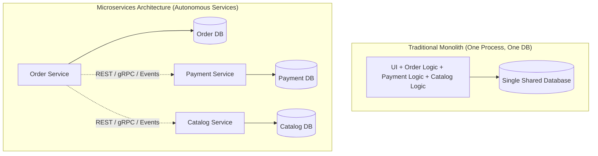

### 🎯 Core Terms to Remember
* **Monolith:** An application architecture where all components are packaged, deployed, and scaled together as a single unit.
* **Microservice:** A small, independently deployable software component responsible for a single business capability.
* **Loose Coupling:** Services know very little about each other and interact only through published contracts (APIs).
* **High Cohesion:** Code that changes together for the same business reason lives together within the same service boundary.

### 💡 Quick Pro-Tip
Never start a brand-new project with microservices on day one! Start with a **clean modular monolith**. Only split into microservices when team size grows beyond 15–20 engineers or when specific components have drastically different scaling or compliance requirements.

---

## 2. Why Must Each Microservice Have Its Own Private Database? (Database-Per-Service)

### ⚡ Direct Answer / 30-Second Pitch
> "In microservices, each service must strictly own and encapsulate its persistence store. Direct cross-database queries or shared tables are strictly forbidden because they create hidden coupling, block independent database schema migrations, and introduce distributed locking bottlenecks across teams."

### 🧠 Easy Mental Model / Everyday Analogy
* **HDFC Bank vs. ICICI Bank:**
  * Imagine you initiate an IMPS fund transfer of ₹10,000 from your HDFC account to a friend's ICICI account.
  * HDFC bank software **cannot run a direct SQL query** on ICICI's Oracle database: `UPDATE ICICI.Accounts SET Balance = Balance + 10000`.
  * That would be a security and operational nightmare! ICICI manages its own private ledger. HDFC sends a standardized network message via NPCI/IMPS, and ICICI updates its own database independently.

### 💬 Simple Explanation
If the **Order Service** and **Inventory Service** share the same physical database table:
1. When the Inventory team alters a column name (`StockCount` $\rightarrow$ `AvailableUnits`), the Order Service instantly breaks in production without warning.
2. An unindexed query written by the Order team can acquire an exclusive table lock, freezing inventory lookups for all other services.
3. You cannot choose the best database for the job (e.g., MongoDB for dynamic product catalogs, PostgreSQL for relational orders, and Redis for fast caching).

### 🎯 Core Terms to Remember
* **Database-Per-Service:** An architectural rule requiring each service to exclusively access its own private data store.
* **Shared Database Anti-Pattern:** A distributed anti-pattern where multiple microservices read and write to the same database tables.
* **Polyglot Persistence:** Using different storage engines (Relational, Document, Key-Value, Graph) optimized for each service's specific data needs.

### 💡 Quick Pro-Tip
If your interviewer asks: *"How do you show an order list containing customer names and product titles without a SQL JOIN?"*  
**Answer:** Use **API Composition** (calling the services and assembling the response in memory) or **CQRS Read Projections** (listening to Kafka events and storing pre-joined read views).

---

## 3. Why Do Traditional Distributed Database Transactions (Two-Phase Commit / 2PC) Fail in Microservices?

### ⚡ Direct Answer / 30-Second Pitch
> "Two-Phase Commit (2PC) relies on a central coordinator locking database rows across multiple network servers until all servers agree to commit. In microservices, network latency, temporary network splits, or a single slow node cause row locks to be held open indefinitely, exhausting connection pools and causing cascading system outages."

### 🧠 Easy Mental Model / Everyday Analogy
* **The College Group Dinner Bill Payment:**
  * 4 friends go to a restaurant for dinner. The bill arrives, and each person must contribute ₹500 via UPI.
  * **2PC approach:** The waiter stands at the table and says: *"Nobody leaves the table, and nobody touches their phone until all 4 UPI payments show successful on my terminal at the exact same second."*
  * If Friend 4's mobile phone runs out of battery or has no 4G signal, **everyone is trapped at the table forever**, holding up the restaurant's table!
  * **Microservices reality:** The internet is inherently unreliable. Synchronous waiting and locking across machines guarantees failure at scale.

### 💬 Simple Explanation
Traditional relational databases guarantee ACID transactions (Atomicity, Consistency, Isolation, Durability) using row locks on a single machine. 

When you stretch ACID transactions across distinct servers over HTTP or TCP (2PC):
1. **Prepare Phase:** The coordinator asks all nodes: *"Can you commit this change?"* Every node locks the affected rows.
2. **Commit Phase:** If all answer "Yes", the coordinator sends "Commit".
3. **The Trap:** If a network blip occurs between the prepare and commit phases, those database rows remain locked. New incoming customer requests queue up, connection pools exhaust in seconds, and the whole system freezes.

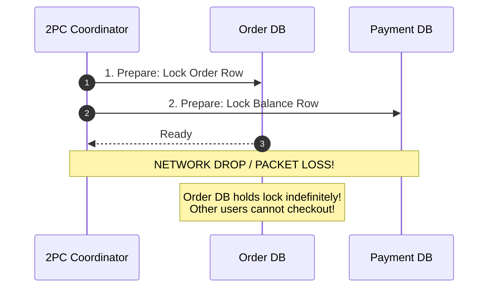

### 🎯 Core Terms to Remember
* **Two-Phase Commit (2PC):** A distributed consensus protocol with a Prepare phase and a Commit phase that holds distributed synchronous locks.
* **CAP Theorem:** Under real-world network partitions ($P$), a distributed system must choose between immediate strong Consistency ($C$) or High Availability ($A$).
* **Eventual Consistency:** Abandoning instant cross-service locking in exchange for guaranteeing that all data stores will reach consistency within a few hundred milliseconds.

### 💡 Quick Pro-Tip
Whenever an interviewer asks how to handle distributed transactions across microservices, **never suggest 2PC or distributed transactions**. State confidently that you use the **Saga Pattern** with compensating transactions.

---

## 4. What is the Saga Pattern, and What is the Difference Between Choreography and Orchestration?

### ⚡ Direct Answer / 30-Second Pitch
> "A **Saga** is a sequence of local database transactions. Each step executes in its own service database and publishes an event or message to trigger the next step. If any step fails midway, the Saga executes **compensating transactions** in reverse to undo the business impact of previously completed steps."

### 🧠 Easy Mental Model / Everyday Analogy
* **Choreography = The Chaotic Goa Trip WhatsApp Group:**
  * 4 friends plan a trip over WhatsApp without a leader.
  * Friend A texts: *"Flight tickets booked!"*
  * Friend B reads it and texts: *"Hotel booked!"*
  * Friend C reads that and tries to book rental bikes. But bike rentals are sold out!
  * Friend C texts the group: *"No bikes available, let's cancel!"*
  * Now Friend B must read that message, log into the hotel app, and cancel. Friend A must log into the airline app and cancel.
  * **Why it breaks:** If someone's phone is off, or messages arrive out of order, nobody knows the true state. For 2 friends it works; for 10 friends it is pure chaos.
* **Orchestration = The Professional Wedding Planner:**
  * You hire a wedding planner (The Orchestrator) who has a master checklist:
    1. Planner calls Caterer: *"Prepare banquet."* (Success)
    2. Planner calls DJ: *"Book music stage."* (Success)
    3. Planner calls Florist: *"Arrange orchids."* (Florist says: *"Out of stock!"*)
  * The planner immediately knows what failed. She directly calls the DJ: *"Cancel music,"* and calls the Caterer: *"Cancel banquet."*
  * **Why it wins:** One central manager tracks the exact progress, handles timeouts, and guarantees orderly rollbacks.

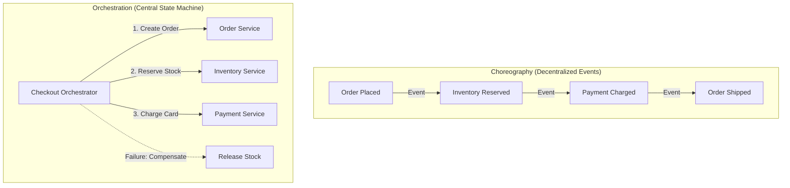

### 💬 Simple Explanation
| Feature | Choreography (Event-Driven) | Orchestration (Central Controller) |
| :--- | :--- | :--- |
| **How It Works** | Services react autonomously to events published on Kafka / RabbitMQ. | A central coordinator sends explicit commands to services. |
| **Coupling** | Very loose coupling; services don't know who consumes their events. | Orchestrator knows the participating services and their API contracts. |
| **Visibility** | Low; hard to see the current status of an order across 10 service logs. | High; the orchestrator stores the exact state in one database table. |
| **Best Used For** | Simple 2–3 step workflows (e.g., User Signs Up $\rightarrow$ Send Welcome Email). | Complex, high-stakes flows (e.g., E-Commerce Checkout, Banking Loans). |

### 🎯 Core Terms to Remember
* **Saga:** A design pattern managing distributed business transactions across multiple services using local transactions.
* **Choreography:** Decentralized Saga where services publish and listen to domain events.
* **Orchestration:** Centralized Saga where a dedicated coordinator directs the workflow step by step.

### 💡 Quick Pro-Tip
In system design interviews, recommend **Choreography** for simple asynchronous background pipelines (like onboarding emails or analytics), and recommend **Orchestration** for revenue-critical flows (like checkout, payment, or flight booking).

---

## 5. What is a Compensating Transaction, and How Does It Differ from a Database Rollback?

### ⚡ Direct Answer / 30-Second Pitch
> "A database `ROLLBACK` physically reverts uncommitted changes from the transaction log before they become permanent. A **Compensating Transaction** is a brand-new, forward transaction that semantically cancels out the business effects of an already committed transaction that occurred earlier in the Saga."

### 🧠 Easy Mental Model / Everyday Analogy
* **Eraser vs. Bank Refund:**
  * **Relational ROLLBACK = Pencil & Eraser:** You wrote a number in pencil on a notebook page. Before anyone sees it, you erase it completely. It is as if you never wrote it.
  * **Compensating Transaction = Bank Refund / Credit Note:** 
    * You purchased a pair of shoes at a showroom and swiped your card for ₹3,000. The money left your account and settled in the store's bank.
    * When you return the shoes next day, the cashier **cannot rewind time** or delete yesterday's credit card swipe record. 
    * Instead, the cashier executes a **new transaction**: swiping your card to issue a ₹3,000 **refund credit**. Both transactions remain visible on your bank statement!

### 💬 Simple Explanation
In microservices, you cannot hold an open database lock while waiting for another service across the network to respond. Each step in the Saga immediately commits to its local database:
1. **Step 1:** Inventory Service decrements stock from 10 to 9 and **commits** to SQL Server.
2. **Step 2:** Payment Service tries to charge the user's card. The bank rejects the card (insufficient funds).
3. **Compensating Action:** The Saga calls the Inventory Service with a compensating command: *"Add 1 back to the stock."* The stock goes back to 10.

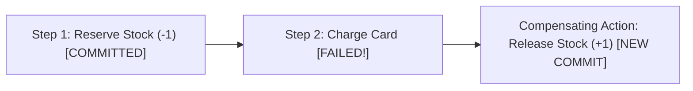

### 🎯 Core Terms to Remember
* **Compensating Transaction:** An idempotent undo action that reverses the business impact of a previously committed step.
* **Semantic Rollback:** Application-level reversal rather than low-level database engine rollback.
* **Pivot Transaction:** The definitive step in a Saga; once the pivot step succeeds (e.g., payment card charged), the Saga never rolls back—it retries until complete.

### 💡 Quick Pro-Tip
Compensating transactions must be **strictly idempotent**! If the network drops while sending the compensation request, the orchestrator will retry sending the compensation. Calling it twice must not double-refund the customer.

---

## 6. What is the Dual-Write Problem, and Why is It Dangerous?

### ⚡ Direct Answer / 30-Second Pitch
> "The Dual-Write problem occurs when an application attempts to write to a local database and publish a message to a broker (like Kafka or RabbitMQ) in the same code path. Because a database commit and a network call cannot share an atomic transaction, a server crash or network drop between the two operations leaves data permanently out of sync."

### 🧠 Easy Mental Model / Everyday Analogy
* **The Restaurant Billing Machine Glitch:**
  * You swipe your credit card for ₹1,500 at a restaurant. The payment machine beeps and prints a charge slip.
  * But right before the restaurant's billing computer saves your invoice to its local database, the power cuts out!
  * **Result:** Your bank deducted ₹1,500, but the restaurant's system shows no paid bill. The two systems are permanently out of sync.

### 💬 Simple Explanation
Consider what happens in standard junior code:
```csharp
// The Dual-Write Trap
await _orderDbContext.Orders.AddAsync(order);
await _orderDbContext.SaveChangesAsync(); // Step 1: Saves to Database

// Step 2: Publish to Kafka
await _kafkaProducer.PublishAsync("orders-topic", new OrderCreatedEvent(order.Id));
```

**Where it breaks:**
* **Scenario A:** Step 1 saves the order to SQL Server. Right before Step 2 executes, the API container runs out of memory (OOMKilled) or the Kafka cluster is temporarily unreachable. The order is stored in the DB, but Kafka never gets the message! **The warehouse never packs the order, and the customer never gets their item.**
* **Scenario B (Swapping order):** If you publish to Kafka *first*, and then Step 2 fails because of a database unique constraint violation, Kafka has already broadcasted the message. Downstream services start packing a **phantom order that does not exist in the database!**

### 🎯 Core Terms to Remember
* **Dual-Write Anti-Pattern:** Attempting to update a persistent database and publish to a message broker in the same business flow without atomic coordination.
* **State Drift:** Inconsistency where the database and the message broker hold conflicting versions of truth.
* **Phantom Event:** An event published to consumers announcing a domain state change that was rolled back or never saved.

### 💡 Quick Pro-Tip
Whenever you see a database call followed immediately by a message bus `Publish()` in code review, flag it immediately as a **Dual-Write bug**. The solution is the **Transactional Outbox Pattern**.

---

## 7. What is the Transactional Outbox Pattern, and How Does It Prevent Lost Messages?

### ⚡ Direct Answer / 30-Second Pitch
> "The Transactional Outbox Pattern solves the Dual-Write problem by writing the business entity and an outbox message record into the **same local database within a single ACID transaction**. A separate background worker or Change Data Capture (CDC) engine then reads the outbox table and reliably publishes the messages to the broker with guaranteed at-least-once delivery."

### 🧠 Easy Mental Model / Everyday Analogy
* **The Postal Outbox Tray in a Corporate Office:**
  * In a traditional corporate office, an executive writes an important approval letter.
  * Instead of leaving their desk, walking down to the street, and searching for a postal van (which might be delayed or unavailable), the executive simply drops the stamped letter into the physical **Outbox Tray** on their desk.
  * Dropping the letter into the tray is part of finishing the paperwork right at their desk.
  * Every 15 minutes, the office mail boy (the background worker) empties the Outbox tray and hands the letters to India Post. 
  * Even if the mail boy is sick for an hour, the letters are completely safe in the tray and will be delivered once he arrives.

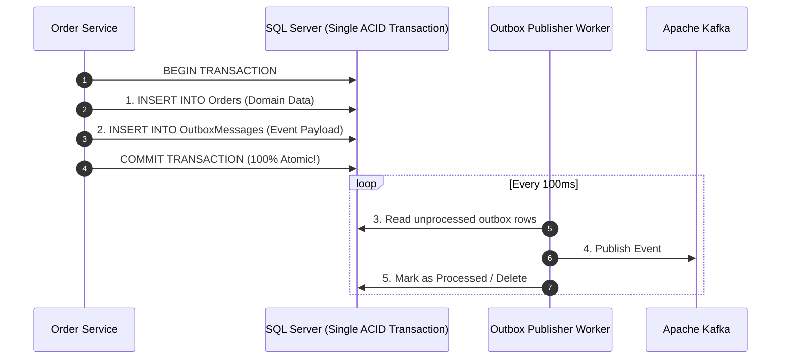

### 💬 Simple Explanation
Because both the **Order** and the **OutboxMessage** are saved in the *same local database*, the database's native ACID engine guarantees that either both are saved, or neither is saved. 

Once the data is securely committed to the database disk:
1. A background worker (like an ASP.NET Core `BackgroundService` or Debezium CDC) queries unprocessed outbox rows.
2. It sends the message to Kafka.
3. Once Kafka acknowledges receipt (`Ack`), the worker marks the outbox row as `Processed = 1` or deletes it.
4. If the server crashes during sending, the worker simply picks up the row again upon restart.

### 🎯 Core Terms to Remember
* **Transactional Outbox:** A pattern storing outgoing integration events in a dedicated relational database table within the same transaction as business data.
* **Change Data Capture (CDC):** An advanced outbox mechanism (like Debezium) that reads the database's internal transaction log (Write-Ahead Log / WAL) directly, achieving sub-millisecond dispatch without polling queries.
* **At-Least-Once Delivery:** The guarantee that a message will never be lost, though it may occasionally be delivered more than once during network retries.

### 💡 Quick Pro-Tip
Always pair the Transactional Outbox on the publisher side with the **Idempotent Consumer** pattern on the subscriber side! Because the outbox worker retries upon network glitches, consumers must safely handle occasional duplicate messages.

---

## 8. What is an Idempotent Consumer, and Why Do We Need Deduplication?

### ⚡ Direct Answer / 30-Second Pitch
> "An **Idempotent Consumer** is a message consumer designed so that processing the exact same message multiple times produces the exact same end result without duplicate side-effects (such as charging a customer twice or creating duplicate accounts)."

### 🧠 Easy Mental Model / Everyday Analogy
* **The Elevator Call Button & UPI Double-Tap:**
  * **Elevator Button:** When you press the elevator button once, the light turns on and the elevator is called. If you press it 10 more times impatiently, the elevator does not arrive 10 times—it still comes exactly once. Pressing the button is **idempotent**.
  * **UPI Payment Double-Tap:** If an app glitches and sends two identical payment requests of ₹500 with the same `TransactionReferenceId`, the banking server processes the first one and immediately recognizes the second as a duplicate, ignoring it rather than deducting ₹1,000.

### 💬 Simple Explanation
In distributed systems, networks drop packets. When a consumer finishes processing an order and sends an acknowledgment (`ACK`) back to RabbitMQ or Kafka, the network might drop that ACK.

The message broker assumes the consumer crashed, so it **re-delivers the message**. Without deduplication, the customer gets charged twice!

**How to implement consumer deduplication simply:**
1. Every event includes a unique **`MessageId`** or **`OrderId`**.
2. When the consumer receives a message, it checks a database table or Redis: *"Have I already processed `MessageId = 123`?"*
3. If yes, it immediately skips processing and acknowledges the message.
4. If no, it processes the business logic and inserts `MessageId = 123` into its processed messages table within the same local transaction.

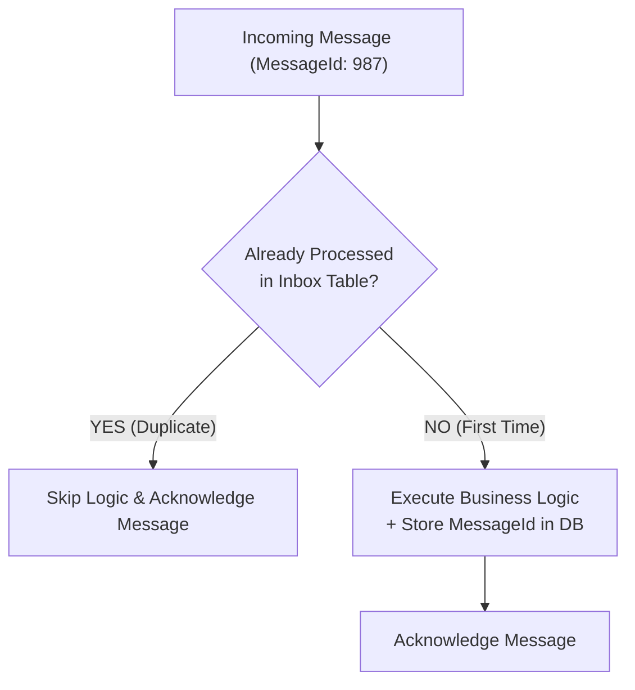

### 🎯 Core Terms to Remember
* **Idempotence:** A mathematical and software property where $f(f(x)) = f(x)$—repeating the operation yields identical state.
* **Inbox Pattern:** A pattern where a consumer records incoming message IDs in a dedicated relational table with a unique index to automatically reject duplicates.
* **At-Least-Once Delivery:** The messaging contract where messages are guaranteed not to be lost, but duplicates can occur.

### 💡 Quick Pro-Tip
In database design, creating a **Unique Constraint** on your Inbox table's `MessageId` column is the most battle-tested way to achieve deduplication. If two duplicate threads try to process the message simultaneously, the second thread fails on primary key violation and rolls back safely.

---

## 9. What is CQRS (Command Query Responsibility Segregation)?

### ⚡ Direct Answer / 30-Second Pitch
> "CQRS is an architectural pattern that separates operations that **mutate data (Commands)** from operations that **read data (Queries)** into completely separate models. This allows each side to be optimized, scaled, and secured independently."

### 🧠 Easy Mental Model / Everyday Analogy
* **The Restaurant Menu Card vs. The Kitchen Order Ticket:**
  * **Query (Reading):** You sit at a restaurant and read the printed laminated Menu Card. It has photos, prices, descriptions, and combo offers. It is pre-assembled, denormalized, and optimized for fast reading. Reading it does not change anything in the restaurant.
  * **Command (Writing):** When you place an order, the waiter writes a kitchen ticket and hands it to the chef. The chef performs complex business rules: checks if ingredients are fresh, deducts inventory, lights the stove, and cooks the dish.
  * You don't use the chef's internal inventory book to decide what to eat, and you don't use the customer menu card to cook the food!

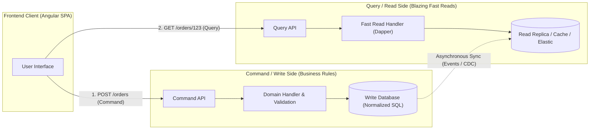

### 💬 Simple Explanation
In standard CRUD applications, the same Entity Framework `Order` class is used for both saving orders and displaying order history.
* **The Problem:** The write model requires complex relational normalization, foreign keys, validation rules, and row locks to ensure data integrity. But the read model requires joins across 8 tables just to display a list on a screen!
* **The CQRS Solution:**
  * **Commands (Write):** Handle validation, security, and rich domain logic. Saved to a normalized relational database (SQL Server / PostgreSQL).
  * **Queries (Read):** Never mutate data. Execute ultra-fast flat queries (using Dapper or Elasticsearch) reading from read replicas or cached read-models without heavy joins or locks.

### 🎯 Core Terms to Remember
* **Command:** An operation that changes system state and returns no business data (e.g., `PlaceOrderCommand`).
* **Query:** An operation that retrieves data and causes zero side effects or state mutations (e.g., `GetOrderByIdQuery`).
* **Read Projection / View Model:** A pre-computed, denormalized data view tailored specifically to what the UI needs to display.
* **MediatR:** A popular .NET library implementing the in-process mediator pattern often used to decouple Command and Query handlers.

### 💡 Quick Pro-Tip
You don't need two separate physical databases to use CQRS! You can start using CQRS inside a single database by simply separating your code into MediatR Command Handlers (using EF Core with validation) and Query Handlers (using Dapper with fast `AsNoTracking` SQL queries).

---

## 10. What is an API Gateway, and Why Do We Put One in Front of Microservices?

### ⚡ Direct Answer / 30-Second Pitch
> "An **API Gateway** is a reverse proxy server that acts as the single entry point for all client applications. It routes incoming HTTP requests to internal microservices while centralizing cross-cutting concerns like authentication, rate limiting, SSL termination, request routing, and telemetry."

### 🧠 Easy Mental Model / Everyday Analogy
* **The Luxury Hotel Reception Desk:**
  * When you enter a large 5-star hotel, you don't wander around the building knocking directly on the laundry room, the kitchen, the housekeeping closet, and the accounts office.
  * You walk up to the **Front Reception Desk (The Gateway)**:
    1. The receptionist checks your ID card and verifies your room booking (**Authentication & Authorization**).
    2. She hands you a keycard and points you to the elevator (**Routing**).
    3. If 100 people try to crowd the desk at once, the hotel security regulates the line (**Rate Limiting**).
    4. If you ask for extra towels, the receptionist calls housekeeping on the internal intercom so you don't need to know their private telephone numbers (**Reverse Proxy / Encapsulation**).

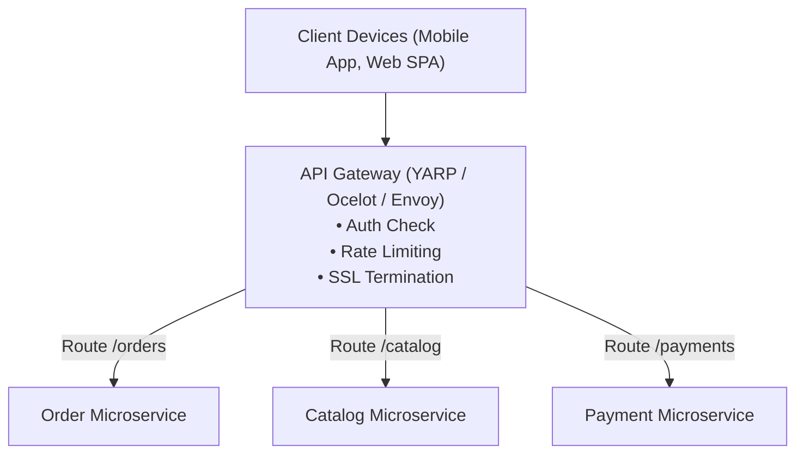

### 💬 Simple Explanation
Without an API Gateway:
1. The frontend client (e.g., Angular SPA or mobile app) must know the individual URLs and ports of 20 different microservices (`orders.company.com`, `catalog.company.com`, `billing.company.com`).
2. Every microservice must independently implement CORS, JWT token validation, SSL certificates, and IP rate limiting.
3. If you decide to split or refactor a microservice, you break the mobile app!

With an API Gateway:
* The client talks only to `api.company.com`.
* The gateway validates the JWT token once. If invalid, it rejects the request before it ever touches your backend servers.
* Modern .NET solutions use **YARP (Yet Another Reverse Proxy)**, a high-performance reverse proxy toolkit built by Microsoft.

### 🎯 Core Terms to Remember
* **API Gateway:** A reverse proxy coordinating client traffic to downstream microservices.
* **YARP (Yet Another Reverse Proxy):** Microsoft's high-throughput, modern .NET reverse proxy library.
* **SSL/TLS Termination:** Decrypting HTTPS traffic at the gateway so internal microservices communicate efficiently over fast internal networks.
* **Rate Limiting:** Restricting the number of requests a client can make per minute to prevent denial-of-service abuse.

### 💡 Quick Pro-Tip
Never put heavy business logic or database queries inside your API Gateway! Treat the gateway as an intelligent router and security checkpoint. Heavy gateway logic creates an architectural bottleneck and turns your gateway into a monolithic single point of failure.

---

## 11. Why Do Microservices Use gRPC Internally Instead of REST?

### ⚡ Direct Answer / 30-Second Pitch
> "While REST uses human-readable JSON over standard HTTP/1.1, **gRPC** uses binary protocol buffers (Protobuf) over HTTP/2. gRPC provides drastically smaller payload sizes, 5x–10x faster serialization/deserialization, multiplexed bidirectional streaming, and strictly typed interface contracts."

### 🧠 Easy Mental Model / Everyday Analogy
* **Human Postal Letter vs. Walkie-Talkie Code:**
  * **REST / JSON = Handwritten English Letter:** 
    * To send a message, you write full sentences in English on paper: `{"customerId": 101, "status": "Active"}`. 
    * It is easy for any human to read, but it has lots of unnecessary characters (quotes, curly braces, spaces), and opening the envelope takes time.
  * **gRPC / Protobuf = Military Walkie-Talkie Brevity Code:**
    * Instead of full English sentences, military officers use standard numeric codes: *"Code 10-4"*. 
    * Both sides possess the exact same codebook (`.proto` contract file). The message travels as tiny, ultra-compact binary signals over the air in a split millisecond.

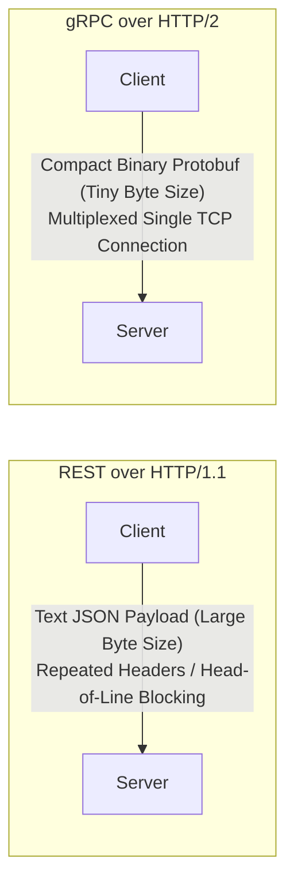

### 💬 Simple Explanation
| Feature | REST (Representational State Transfer) | gRPC (Google Remote Procedure Call) |
| :--- | :--- | :--- |
| **Data Format** | JSON (Plain Text, Human-Readable). | Protocol Buffers (Compressed Binary). |
| **Transport Protocol** | Usually HTTP/1.1 (One request per connection at a time). | HTTP/2 (Multiplexes hundreds of calls over a single TCP connection). |
| **Payload Size** | Larger (Repeats field names like `"customerId"` in every record). | Up to 70% smaller (Replaces field names with 1-byte integer tags). |
| **Performance** | Good for public internet, slower for high-throughput internal microservices. | Extremely fast with minimal CPU serialization overhead. |
| **Browser Support** | Universal native support across all web browsers. | Requires gRPC-Web proxy for standard browser calls. |
| **Where to Use** | Public APIs facing Angular SPAs and Mobile Apps. | High-frequency internal service-to-service communication. |

### 🎯 Core Terms to Remember
* **gRPC:** A high-performance, open-source universal RPC framework developed by Google.
* **Protobuf (Protocol Buffers):** A language-neutral, platform-neutral binary serialization mechanism.
* **HTTP/2 Multiplexing:** Sending multiple bidirectional requests and responses concurrently over a single shared TCP socket connection.
* **Contract-First Development:** Defining data structures and service methods in a `.proto` file before generating client and server code automatically.

### 💡 Quick Pro-Tip
In system design interviews, describe the **Hybrid Model**: Use **REST / JSON** at the outer edge (from Mobile and Angular clients to the API Gateway) for maximum browser compatibility, and use **gRPC / Protobuf** inside the private network (between microservices) for maximum speed and minimal latency.

---

## 12. What is the Circuit Breaker Pattern, and What are Its 3 States?

### ⚡ Direct Answer / 30-Second Pitch
> "The Circuit Breaker pattern prevents an application from repeatedly trying to execute an operation that is almost certain to fail. It monitors failure rates across external calls, and when failures exceed a threshold, it trips open—immediately failing subsequent requests without calling the failing downstream service—allowing the struggling service time to recover."

### 🧠 Easy Mental Model / Everyday Analogy
* **The Home Electrical Fuse / MCB (Miniature Circuit Breaker):**
  * In your house, if a short circuit occurs in a geyser or microwave, the electrical current surges dangerously.
  * Instead of letting the excessive current flow and setting your entire home on fire, the **MCB switch trips and cuts the electricity instantly**.
  * Once you unplug the faulty appliance, you manually flip the switch back, and electricity flows normally again.
  * In software: If the **Payment Gateway** is down, your API should stop hammering it with 5,000 requests/second! Trip the circuit, fail fast immediately, and let the gateway reboot.

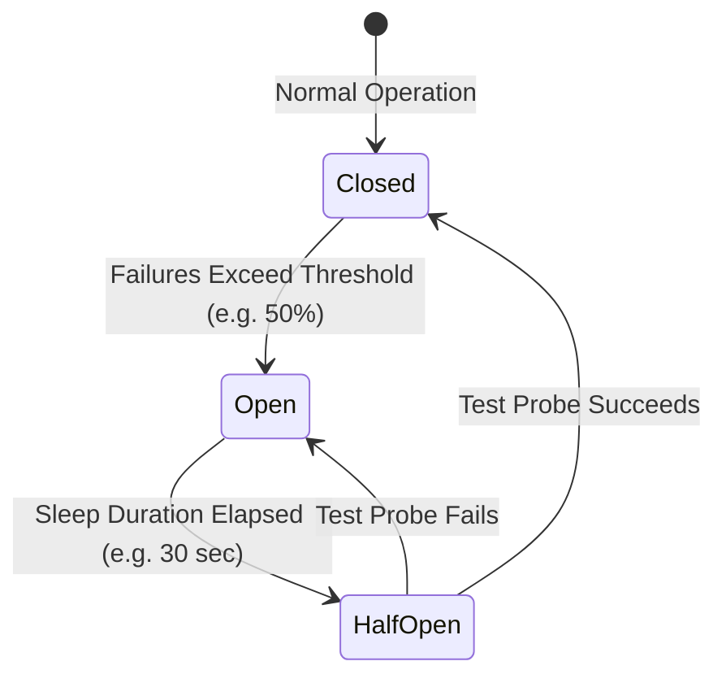

### 💬 Simple Explanation
The Circuit Breaker operates as a state machine with **3 distinct states**:
1. **Closed (Normal State):**
   * Everything is healthy. Requests pass through to the downstream service.
   * If a few calls fail, it records the errors. If errors stay below the limit (e.g., < 50%), it stays Closed.
2. **Open (Tripped State):**
   * If errors exceed the threshold within a rolling window (e.g., 50% of the last 20 calls failed), the circuit **Trips Open**.
   * For the next 30 seconds (break duration), **all incoming requests fail immediately** with an error or fallback response. The failing downstream service receives zero traffic, protecting its CPU and database from overload.
3. **Half-Open (Trial State):**
   * After the break duration expires, the circuit enters **Half-Open**.
   * It allows a small trial batch (e.g., 3 test requests) to pass through to the downstream service.
   * **If the test requests succeed:** The downstream service has recovered! The circuit resets to **Closed**.
   * **If the test requests fail:** The service is still down. The circuit immediately re-opens for another break duration.

### 🎯 Core Terms to Remember
* **Circuit Breaker:** A stability pattern that fails fast when a remote dependency is unresponsive.
* **Closed / Open / Half-Open:** The 3 fundamental operating states of the breaker state machine.
* **Fail Fast:** Immediately returning an error or fallback without wasting thread pool threads or waiting for long network timeouts.
* **Polly:** The standard resilience and transient-fault-handling library used in .NET applications.

### 💡 Quick Pro-Tip
Always combine a Circuit Breaker with a **Fallback Policy**! Instead of showing users an ugly error screen, return a graceful fallback (e.g., *"Payment system temporarily busy; we saved your order and will retry within 15 minutes"* or returning cached product listings).

---

## 13. What is Distributed Tracing and OpenTelemetry?

### ⚡ Direct Answer / 30-Second Pitch
> "Distributed Tracing tracks the complete end-to-end journey of a single user request as it traverses across multiple microservices, message queues, and databases. **OpenTelemetry** is the industry-standard observability framework that injects and propagates standardized trace headers (`traceparent`) across network boundaries to visualize latency bottlenecks and errors."

### 🧠 Easy Mental Model / Everyday Analogy
* **The Amazon / Blue Dart Courier Tracking Number:**
  * When you order a laptop from Amazon India, Amazon assigns a single unique tracking number (e.g., `AWB-987654321`).
  * As your package moves from the **Bengaluru Warehouse** $\rightarrow$ **Airport Sorting Facility** $\rightarrow$ **Delhi Hub** $\rightarrow$ **Local Delivery Van**:
    * Each facility scans that exact same barcode tracking number.
    * When you look at the app, you see a single unified timeline showing exactly how many hours the package spent at each station and where any delay occurred.
  * In microservices: The **TraceId** is that courier tracking number! It travels in the HTTP headers across all 15 microservices.

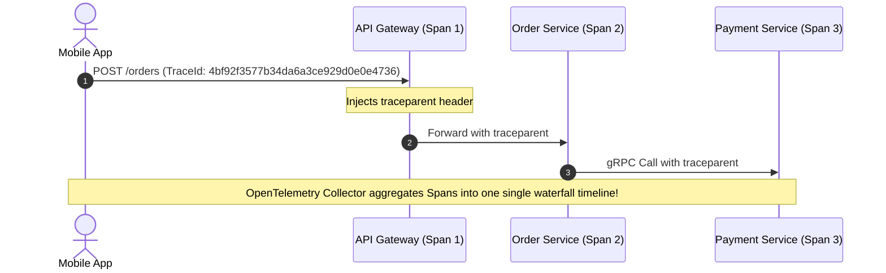

### 💬 Simple Explanation
In a monolith, if a checkout request fails, you open the single log file on the server and search for the exception stack trace.

In microservices:
1. The user clicks "Checkout".
2. The request hits the API Gateway $\rightarrow$ Order Service $\rightarrow$ Inventory Service $\rightarrow$ Payment Service $\rightarrow$ Notification Service.
3. If the request takes 4.5 seconds or fails with a 500 error, which of the 5 services caused the delay? Searching through 5 separate server logs is impossible!

**How OpenTelemetry solves it:**
* When the request enters the API Gateway, OpenTelemetry generates a unique **`TraceId`**.
* Whenever the Gateway makes an HTTP or gRPC call to another service, it attaches an HTTP header called **`traceparent`** containing that `TraceId`.
* Each individual operation inside a service is called a **Span**.
* All spans are exported to visualization tools (like Jaeger, Zipkin, or Datadog), producing a crystal-clear **waterfall diagram** showing every millisecond spent in every service and database query.

### 🎯 Core Terms to Remember
* **Distributed Tracing:** Observability method for monitoring requests flowing through distributed systems.
* **Trace:** The complete end-to-end journey of a single user transaction across all services.
* **Span:** A single unit of work within a trace (e.g., an HTTP handler execution or a SQL query) with a start and end timestamp.
* **`traceparent` Header:** The W3C standardized HTTP header format transmitting the version, trace ID, parent span ID, and trace flags.
* **OpenTelemetry (OTel):** The vendor-neutral open-source observability standard for metrics, logs, and traces.

### 💡 Quick Pro-Tip
In .NET Core, you do not need third-party logging wrappers to create traces! The built-in `System.Diagnostics.Activity` and `ActivitySource` classes natively implement the W3C OpenTelemetry distributed tracing standard.

---

## 14. High-Level Flow of an E-Commerce Checkout System (Plain English Walkthrough)

### ⚡ Direct Answer / 30-Second Pitch
> "A resilient microservices checkout decouples fast user actions from heavy backend processing. We validate the cart, place a temporary inventory hold in an in-memory store like Redis, immediately return an Order Pending response, and coordinate payment and order fulfillment asynchronously using a Saga Orchestrator and message queues."

### 🧠 Easy Mental Model / Everyday Analogy
* **The Swiggy / Zomato Food Ordering Experience:**
  * When you click "Place Order" on Swiggy during a festival rush:
    1. Swiggy does not make you wait on a spinning wheel while the restaurant accepts the order, the chef chops onions, and the delivery rider starts his bike.
    2. Instead, Swiggy immediately confirms your payment and shows: *"Order Placed! Waiting for restaurant confirmation..."*
    3. Behind the scenes, events fire: the restaurant tablet rings, the delivery rider is assigned via GPS, and if the restaurant is closed, Swiggy automatically cancels and issues an instant UPI refund.

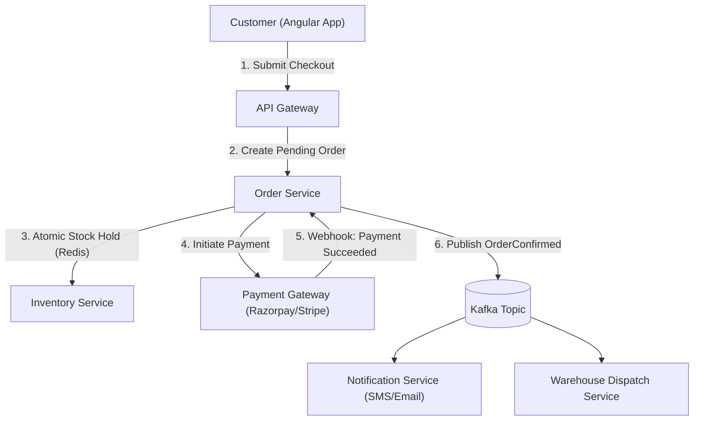

### 💬 Step-by-Step Flow
1. **User Submits Order:** Customer clicks "Buy Now" on the checkout page. The API Gateway verifies the JWT token and forwards the request to the **Order Service**.
2. **Atomic Inventory Reservation:** The Order Service asks the **Inventory Service** to reserve the item. In high-concurrency systems (like flash sales), this is done using an atomic Redis decrement script (`INCRBY -1`) to prevent overselling.
3. **Pending Order Committed:** The Order Service creates the order with `Status = "PendingPayment"` and writes an outbox message in the same database transaction.
4. **Payment Gateway Redirection:** The customer is redirected to Razorpay / Stripe to complete the 3D-Secure bank OTP.
5. **Asynchronous Webhook Receipt:** When the customer approves the OTP, the bank calls our backend **Payment Webhook**.
6. **Order Confirmation via Event Bus:** The payment service publishes an `OrderPaidEvent` to Apache Kafka. The Notification Service sends a confirmation WhatsApp/SMS, and the Warehouse Service begins packaging the product.
7. **Failure Handling (Compensating Step):** If the bank rejects the payment or the user's card fails, the orchestrator triggers a compensating event to **release the reserved inventory back to the shelf**.

### 🎯 Core Terms to Remember
* **Asynchronous Decoupling:** Separating user checkout initiation from back-office fulfillment using message queues.
* **Webhook:** An HTTP callback where an external provider (like Razorpay or Stripe) notifies our backend when an asynchronous event completes.
* **Dead-Letter Queue (DLQ):** A secondary queue where poisoned or repeatedly failing messages are parked for manual inspection without halting the main pipeline.

### 💡 Quick Pro-Tip
During high-traffic flash sales (like Flipkart Big Billion Days), never query SQL Server to check stock! Always maintain active stock counters in **Redis**, and synchronize final purchases to relational databases asynchronously via Kafka.
