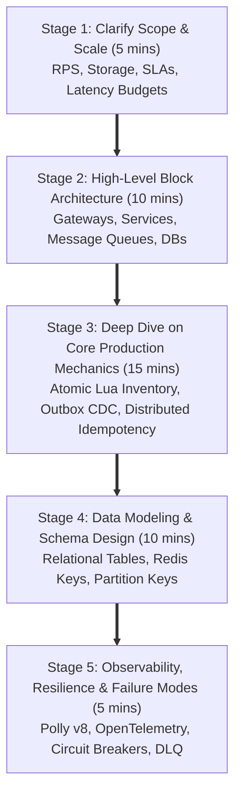
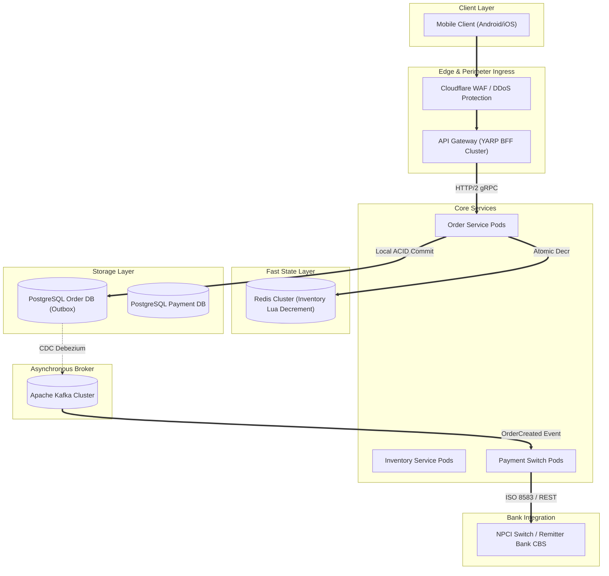

# 04. Microservices Architecture & Distributed System Design — Senior Production Engineering (Deep Dive)

> **Target Audience:** Senior Full-Stack Engineers, Tech Leads, and Distributed Systems Architects (5–10+ Years Experience) preparing for System Design (HLD/LLD), Concurrency, and Architecture rounds at Tier-1 Tech Giants, FinTech Unicorns, and GCCs in India (TCS, Infosys, Cognizant, Wipro, Accenture, Capgemini, Deloitte, EY, Persistent, Nagarro, EPAM, Wells Fargo, Walmart, Swiggy, Flipkart, PhonePe).  
> **Philosophy:** Production engineering realities over textbook theory. We dissect the Dual-Write trap, Saga coordination mechanics, Outbox patterns with CDC WAL tailing, Redis/Relational Idempotency, Polly v8 Circuit Breakers, OpenTelemetry distributed tracing, gRPC vs REST performance profiles, and a complete production HLD/LLD implementation for a 50,000 req/sec E-Commerce Checkout Engine and UPI Payment Switch.

---

---

## 1. Monolithic vs. Microservices: When to Break the Monolith & The Database-Per-Service Dilemma

### ⚡ 30-Second Senior Opening Pitch
> "A monolith should remain a monolith until team organizational friction (>25–30 engineers across multiple squads) or divergent scaling bottlenecks (e.g., flash-sale inventory bursts vs slow PDF reporting) make single deployments an unmanageable risk. When decomposing, the **Database-per-Service** pattern is non-negotiable—shared schemas create tightly coupled 'distributed monoliths'. However, this forces an engineering trade-off: we surrender single-database ACID guarantees and cross-table relational joins in favor of BASE eventual consistency, API aggregation, and asynchronous event-driven projections."

### 🎯 Exact Formal Definitions & Rubric Keywords Interviewers Want to Hear
* **Exact Formal CS / Architecture Definition:**  
  > *"Microservices Architecture is a distributed systems architectural pattern in which a software application is decomposed into a suite of small, autonomous, independently deployable services organized strictly around business capabilities (Domain-Driven Design Bounded Contexts). Each microservice encapsulates its own persistent state within a dedicated database boundary (Database-per-Service pattern) and communicates exclusively across network boundaries via lightweight, language-agnostic protocols (REST over HTTP, gRPC over HTTP/2, or asynchronous event streaming)."*
* **Rubric Keywords That Score Marks on the Interviewer's Evaluation Sheet:**
  * **Database-Per-Service Pattern:** Architectural requirement where each microservice exclusively owns and mutates its persistent store; direct cross-database queries or shared connection strings are strictly prohibited.
  * **Distributed Monolith Anti-Pattern:** A failure state where services are broken into multiple deployable processes but still share a single underlying database schema, inheriting all distributed systems latency without any decoupling benefits.
  * **Two-Phase Commit (2PC):** A blocking distributed consensus protocol with Prepare and Commit phases; infamous for latency amplification, holding open distributed locks, and single-point-of-failure coordinator stalls.
  * **CAP Theorem (Brewer's Theorem):** In the presence of a network partition (P), a distributed datastore must trade off between strong Consistency (C) and Availability (A).
  * **BASE Model:** Basically Available, Soft state, Eventual consistency—the distributed architectural counterpart to relational ACID transactions.
  * **API Composition Pattern:** An orchestration pattern where a gateway or aggregator queries multiple upstream microservices concurrently via asynchronous non-blocking calls (Task.WhenAll) to construct a composite DTO.
* **"How to Say It in Your Project" (Exact Production Experience Phrasing):**  
  > *"In our high-scale checkout platform, we enforce strict Database-per-Service boundaries where each domain service owns its PostgreSQL schema. We eliminated cross-database relational joins in favor of CQRS read projections streamed over Apache Kafka, and assemble real-time checkout screens using in-memory API Composition with strict 400ms SLA cancellation timeouts."*

### 🧠 Everyday Analogies (Mental Models for Fast Recall)
> **Joint Family Kitchen vs. Independent Apartments with Intercom:**  
> In a traditional Indian joint family kitchen (Monolith), 3 people cook on one shared gas stove and take spices from the same cupboard (Shared DB). It is fast and zero-overhead for 3 people. But when 30 family members try to cook simultaneously, people bump elbows, fights break out over stove locks, and if someone accidentally burns the single stove, nobody gets dinner.  
> Moving to independent apartment flats (Microservices) gives every family their own kitchen (Database-per-Service). Now 30 families cook at their own pace without lock contention. However, if Flat 4 needs a bowl of sugar from Flat 8, they cannot just open Flat 8's cupboard; they must ring the intercom or send a delivery message (API contract / Kafka event).

### 💻 Simple, Clean, Runnable Code Snippet (5–15 Lines)
```csharp
// Minimal API Composition: Fetch Order & Customer Tier concurrently with strict SLA deadline
public async Task<CheckoutSummaryDto> GetCheckoutSummaryAsync(Guid orderId, Guid customerId, CancellationToken ct)
{
    using var cts = CancellationTokenSource.CreateLinkedTokenSource(ct);
    cts.CancelAfter(TimeSpan.FromMilliseconds(400)); // Enforce fail-fast SLA

    var orderTask = _orderClient.GetFromJsonAsync<OrderDto>($"/orders/{orderId}", cts.Token);
    var discountTask = _customerClient.GetFromJsonAsync<decimal>($"/customers/{customerId}/discount", cts.Token);

    await Task.WhenAll(orderTask, discountTask);
    return new CheckoutSummaryDto(await orderTask, await discountTask);
}
```

### ⚠️ Senior Trap & Cross-Question (What the Interviewer Will Ask Next + Senior Rebuttal)
* **Trap 1: The "Distributed Monolith" Trap:**  
  * *Interviewer:* "Can't we just split the application into 10 microservices but let them share a single PostgreSQL database with separate schemas to keep SQL joins?"  
  * *Senior Answer:* "That is the textbook definition of a **Distributed Monolith**—the worst of both worlds. Sharing schemas across service boundaries allows Service A to lock tables needed by Service B, creates hidden database coupling, prevents independent database migrations, and means a spike in Service A's DB connections crashes Service B. Database-per-service is a strict boundary: data is exposed exclusively via documented APIs or domain events."
* **Trap 2: The Cross-Boundary Reporting Dilemma:**  
  * *Interviewer:* "If you have 10 microservices, how do you generate an executive sales dashboard joining Order, Customer, Inventory, and Shipping tables without cross-database queries?"  
  * *Senior Answer:* "Never perform 10 synchronous REST calls in real-time—that causes latency amplification and N+1 cascading timeouts. In enterprise production, we solve this via **CQRS Materialized Read Projections**. All 10 services publish domain events (`OrderPlaced`, `StockReserved`, `ShipmentDispatched`) to Kafka. A dedicated Analytics Worker consumes these streams and updates a denormalized read-optimized store (Elasticsearch, ClickHouse, or a PostgreSQL Read Replica). Executive dashboard queries hit this flat materialized view in under 20ms without touching operational OLTP databases."
* **Trap 3: When NOT to Break a Monolith:**  
  * *Interviewer:* "Under what conditions would you advise our VP of Engineering against decomposing our monolith?"  
  * *Senior Answer:* "When the domain boundaries are still fluid (early-stage MVP), the engineering team is under 20 developers, or traffic is moderate (<1,500 RPS). Microservices don't fix bad domain design; they amplify it with distributed systems tax—network latency, partial failure modes, distributed tracing overhead, and data consistency friction. A clean **Modular Monolith** with well-defined in-process boundaries is 10x faster to develop and cheaper to operate until scale demands decomposition."

### 📊 "When to Use What & What Must Be Done" Quick Decision Guide

| Trigger / Requirement / Scenario | What to Use | Why / Trade-offs | What Must Be Done (Action & Snippet) |
| :--- | :--- | :--- | :--- |
| **Early startup, MVP, team < 20 engineers, domain boundaries uncertain** | **Modular Monolith** | **Pros:** Zero network latency, instant ACID transactions, simple CI/CD, single DB.<br>**Cons:** Co-deployed units; single process crash impact. | Enforce C# internal projects/assemblies per domain; strictly prohibit cross-module direct DB access; communicate via in-memory MediatR notifications. |
| **High write throughput on discrete bounded contexts with independent squad ownership** | **Microservices with Database-per-Service** | **Pros:** Independent deployments, isolated blast radius, polyglot persistence.<br>**Cons:** Eventual consistency lag, distributed network latency. | Allocate separate DB instances per service; define contract-first gRPC/REST endpoints; forbid cross-database queries or shared connection strings. |
| **Aggregating live data from 2–3 microservices for a real-time UI screen** | **In-Memory API Composition (Task.WhenAll)** | **Pros:** Always reads real-time source of truth; zero data duplication.<br>**Cons:** Latency is bounded by the slowest service; network chatter. | Execute asynchronous parallel HTTP/gRPC calls using `Task.WhenAll` wrapped in a linked `CancellationTokenSource` with a 400ms timeout and cached fallback. |
| **Complex queries joining data across 4+ microservices (Dashboards, Search)** | **CQRS Materialized Read View (Kafka Projections)** | **Pros:** Sub-20ms queries; zero operational load on transactional OLTP databases.<br>**Cons:** Eventual consistency window (100ms–2s); storage duplication. | Stream CDC events from outbox to Kafka; subscribe with background worker; project denormalized rows into Elasticsearch, Mongo, or Postgres Read Replica. |

### 📌 Deep Technical Mechanics & Architecture
1. **The Distributed Locking Bottleneck of 2PC:**
   * In a 2PC protocol, when the coordinator sends `PREPARE`, every participant database acquires exclusive row locks (`X` locks in SQL Server / row-level locks in PostgreSQL) on the affected tables.
   * If Participant B experiences GC pauses, disk I/O queuing, or network packet drops, Participant A's locks remain held open.
   * In high-throughput systems (>1,000 req/sec), connection pools exhaust in hundreds of milliseconds, cascading into total service gridlock.
2. **Cross-Service Data Composition Strategies:**
   * **In-Memory API Composition:** The orchestrator fetches data concurrently using `Task.WhenAll`, enforcing aggressive `CancellationToken` timeouts (e.g., 300–400ms) with pre-computed fallbacks.
   * **CQRS Read Projections:** Services stream change events via Kafka/RabbitMQ into denormalized read-optimized stores (Elasticsearch or PostgreSQL read replicas) pre-joined for UI queries.
3. **Eventual Consistency Window:** Data across Domain-Driven Design (DDD) bounded contexts takes 10ms to 2000ms to converge. UIs must accommodate optimistic updates, polling, or WebSocket push notifications.

### 💼 Concrete Real-World Production Example
* **The Scenario:** In Flipkart's checkout flow (15,000 req/sec peak), the **Order Service** (PostgreSQL) needs customer loyalty discount tiers and wallet balances owned exclusively by the **Customer & Wallet Service** (SQL Server).
* **❌ Bad Junior Code (Distributed 2PC / Cross-DB Linked Server):**
  ```csharp
  // JUNIOR ANTI-PATTERN: Distributed 2PC holding cross-network row locks
  using (var scope = new TransactionScope(TransactionScopeAsyncFlowOption.Enabled))
  {
      // Acquires Exclusive Lock on SQL Server Customer table across WAN
      await _customerDbContext.DeductWalletPointsAsync(customerId, points);

      // Acquires Row Lock on Postgres Orders table
      await _orderDbContext.CreateOrderAsync(order);

      // CATASTROPHE: If network latency spikes between data centers or coordinator crashes,
      // row locks are held open indefinitely. Database connection pools exhaust in seconds!
      scope.Complete();
  }
  ```
* **✅ Senior Battle-Tested Code (API Composition with Strict Cancellation & Fallback):**
  ```csharp
  public sealed class OrderCheckoutCompositionService
  {
      private readonly HttpClient _customerClient;
      private readonly IOrderRepository _orderRepo;
      private readonly ILogger<OrderCheckoutCompositionService> _logger;

      public OrderCheckoutCompositionService(
          IHttpClientFactory clientFactory,
          IOrderRepository orderRepo,
          ILogger<OrderCheckoutCompositionService> logger)
      {
          _customerClient = clientFactory.CreateClient("CustomerService");
          _orderRepo = orderRepo;
          _logger = logger;
      }

      public async Task<CheckoutSummaryDto> AssembleCheckoutAsync(Guid customerId, Guid orderId, CancellationToken ct)
      {
          // Enforce bounded latency: fail fast within 400ms rather than tying up threads
          using var timeoutCts = CancellationTokenSource.CreateLinkedTokenSource(ct);
          timeoutCts.CancelAfter(TimeSpan.FromMilliseconds(400));

          try
          {
              var customerTask = _customerClient.GetFromJsonAsync<CustomerTierDto>(
                  $"/api/v1/customers/{customerId}/tier", timeoutCts.Token);
              var orderTask = _orderRepo.GetOrderByIdAsync(orderId, timeoutCts.Token);

              await Task.WhenAll(customerTask, orderTask);

              var customer = await customerTask;
              var order = await orderTask;

              return new CheckoutSummaryDto(order!.Id, order.TotalAmount, customer?.DiscountPercentage ?? 0m);
          }
          catch (OperationCanceledException) when (!ct.IsCancellationRequested)
          {
              // Graceful degradation: Fall back to zero-discount default rather than failing checkout
              _logger.LogWarning("CustomerService timed out. Applying zero-discount fallback for Order {OrderId}", orderId);
              var order = await _orderRepo.GetOrderByIdAsync(orderId, ct);
              return new CheckoutSummaryDto(order!.Id, order.TotalAmount, DiscountPercentage: 0m);
          }
      }
  }
  ```

### 🗣️ What to Say in the Interview
> *"In our checkout service, we strictly prohibit distributed 2PC transactions or cross-database linked queries because a network hiccup locks rows across both databases and exhausts connection pools in seconds. Instead, we use CQRS denormalized read projections synced asynchronously via Kafka, and assemble real-time views using in-memory API Composition with strict 400ms cancellation timeouts and cached fallback values."*

### ⚠️ Production Traps & Edge Cases
* **Distributed Deadlocks:** If Service A calls Service B synchronously while Service B calls Service A, circular HTTP connection pool deadlocks occur. Always enforce unidirectional call graphs.
* **Network Partition Latency:** Always pass `CancellationToken` linked to hard deadlines. Never use unbounded `HttpClient` calls in composition services.

---

## 2. Synchronous vs. Asynchronous Communication: REST vs. gRPC vs. Kafka/RabbitMQ Events

### ⚡ 30-Second Senior Opening Pitch
> "Synchronous communication (REST / gRPC) couples availability and latency—the caller must wait while the downstream service processes the request. gRPC over HTTP/2 with binary Protocol Buffers is our internal standard for low-latency East-West inter-service RPC, delivering 7–10x higher throughput and 60% smaller payloads than REST. However, asynchronous event-driven communication (Kafka / RabbitMQ) is mandatory for long-running workflows, audit events, and data replication. It decouples execution temporal boundaries, absorbs flash-sale traffic spikes through consumer backpressure, and eliminates cascading service outages."

### 🎯 Exact Formal Definitions & Rubric Keywords Interviewers Want to Hear
* **Exact Formal CS / Architecture Definition:**  
  > *"Synchronous inter-service communication couples operational availability and call latency through blocking request-response cycles over transport protocols like HTTP/1.1 or HTTP/2. Asynchronous Event-Driven communication decouples temporal boundaries using distributed, persistent message brokers (log-based publish-subscribe systems or message queues), guaranteeing at-least-once delivery, consumer-driven backpressure, and fault isolation."*
* **Rubric Keywords That Score Marks on the Interviewer's Evaluation Sheet:**
  * **HTTP/2 Binary Framing & Multiplexing:** Transmission layer splitting streams into binary frames interleaved across a single long-lived TCP socket, eliminating HTTP/1.1 head-of-line blocking.
  * **Protocol Buffers (Protobuf):** Google's contract-first binary serialization mechanism where fields are identified by compact integer tags, reducing payload size by 60–80% compared to JSON.
  * **Head-of-Line (HoL) Blocking:** A performance bottleneck where preceding slow requests delay all subsequent requests on the same TCP connection or message queue partition.
  * **Log-Structured Append-Only Broker (Apache Kafka):** A distributed, partitioned commit log optimized for sequential disk I/O, event sourcing, replayability, and extreme throughput (>1M msgs/sec).
  * **Smart Broker Topology (RabbitMQ / AMQP):** A message broker architecture utilizing exchange-to-queue routing bindings, message-level acknowledgments, and dead-letter exchanges for transactional worker dispatch.
  * **Consumer Group & Partition Key Hashing:** Kafka's parallel scaling model where messages with the same key (e.g., CustomerId) hash to the exact same partition, guaranteeing strict chronological processing order.
* **"How to Say It in Your Project" (Exact Production Experience Phrasing):**  
  > *"For low-latency East-West synchronous RPC across internal Kubernetes pods, we standardize on gRPC over HTTP/2 with binary Protobuf, achieving 7x throughput over JSON. For state mutation workflows, ledger audits, and downstream side-effects, we publish domain events to Apache Kafka partitioned by CustomerId to ensure in-order processing and consumer backpressure."*

### 🧠 Everyday Analogies (Mental Models for Fast Recall)
> **Phone Call vs. Walkie-Talkie Leased Line vs. Registered Speed Post:**  
> **REST over HTTP/1.1** is like making a phone call: you dial, wait for someone to answer, stay on hold while they check their cabinet, and if the mobile tower drops your signal, the conversation is lost.  
> **gRPC over HTTP/2** is a dedicated fiber-optic walkie-talkie channel: instant, multiplexed binary communication with low static noise, sub-millisecond voice frames, and bidirectional streaming.  
> **Kafka / RabbitMQ** is the Indian Postal Service / Registered Speed Post: you hand your parcel over to the dispatch counter, receive an immediate tracking receipt, and leave. The central sorting facility buffers and distributes millions of parcels to delivery vans at their own processing capacity. Even if the recipient's home is locked today, the parcel waits safely in the hub until delivery succeeds.

### 💻 Simple, Clean, Runnable Code Snippet (5–15 Lines)
```csharp
// 1. gRPC Synchronous East-West Call with Deadline (Fast, Contract-First)
var client = new InventoryService.InventoryServiceClient(grpcChannel);
var reply = await client.ReserveStockAsync(
    new StockRequest { Sku = "IPHONE-15", Quantity = 1 },
    deadline: DateTime.UtcNow.AddMilliseconds(250), cancellationToken: ct);

// 2. Kafka Asynchronous Event Publish (Fire-and-Forget, Decoupled)
await kafkaProducer.ProduceAsync("order-events", 
    new Message<string, string> { 
        Key = orderId.ToString(), 
        Value = JsonSerializer.Serialize(new OrderPlacedEvent(orderId, customerId)) 
    }, ct);
```

### ⚠️ Senior Trap & Cross-Question (What the Interviewer Will Ask Next + Senior Rebuttal)
* **Trap 1: The "Why Not Kafka for Everything?" Trap:**  
  * *Interviewer:* "If asynchronous event-driven messaging is so decoupled and resilient, why don't we use Kafka for everything, including user login and instant payments?"  
  * *Senior Answer:* "Kafka is an append-only distributed commit log optimized for sequential disk I/O and streaming, NOT for synchronous request-response semantics. Using Kafka for user authentication or synchronous payment checkout requires complex temporary reply topics, correlation ID matching, and polling loops, adding 150ms–500ms of artificial latency. User-facing interactions with a human waiting on the screen demand synchronous HTTP/REST or gRPC with deterministic sub-100ms SLAs."
* **Trap 2: gRPC on Public Clients:**  
  * *Interviewer:* "Why don't we use gRPC directly from our React Web SPA or Mobile App to internal microservices?"  
  * *Senior Answer:* "Web browsers cannot directly invoke gRPC services because browser JavaScript APIs do not expose low-level control over HTTP/2 framing, trailers, and binary framing. It requires gRPC-Web proxies (like Envoy) which translate HTTP/1.1 JSON into gRPC, negating performance benefits. Furthermore, REST/JSON provides universal browser compatibility, native CDN caching (via HTTP `Cache-Control` / ETags), and simple firewall traversal."
* **Trap 3: RabbitMQ vs. Apache Kafka:**  
  * *Interviewer:* "How do you decide between RabbitMQ and Apache Kafka for an Indian e-commerce checkout platform?"  
  * *Senior Answer:* "We choose **RabbitMQ** for complex transactional routing, task queues, and dead-lettering where individual messages need acknowledgment and priority (e.g., dispatching order fulfillment jobs with dead-letter exchange retries). We choose **Apache Kafka** for massive sequential event streaming (>50,000 events/sec), event sourcing, CDC stream replication, and multi-consumer event replay where consumers maintain their own partition offsets."

### 📊 "When to Use What & What Must Be Done" Quick Decision Guide

| Trigger / Requirement / Scenario | What to Use | Why / Trade-offs | What Must Be Done (Action & Snippet) |
| :--- | :--- | :--- | :--- |
| **External client ingress (Mobile Apps, Web SPAs, Third-party partner APIs)** | **RESTful API over HTTPS/JSON** | **Pros:** Universal standard; native browser support; CDN cacheable.<br>**Cons:** Higher serialization overhead; no binary compression. | Expose standard REST endpoints behind API Gateway; validate inputs with FluentValidation; return standard `ProblemDetails` RFC 7807 responses. |
| **Low-latency East-West internal RPC between microservices in private cluster** | **gRPC over HTTP/2 (Protobuf)** | **Pros:** 7–10x throughput; compact binary payloads; strongly typed IDL contract.<br>**Cons:** Requires Protobuf toolchain; binary payloads not human-readable. | Define `.proto` IDL file; generate C# client/server stubs; pass explicit `DateTime.UtcNow.AddMilliseconds(SLA)` deadline to prevent blocking. |
| **Transactional job dispatching, message routing, complex dead-letter workflows** | **RabbitMQ (AMQP 0-9-1)** | **Pros:** Smart broker routing (direct, topic, fanout); message-level ACK; priority queues.<br>**Cons:** Lower total throughput ceiling than Kafka; queue bloat under lag. | Configure durable exchanges and queues; enable manual ACKs (`autoAck: false`); attach Dead-Letter Exchange (DLX) with TTL for transient retry. |
| **High-volume event streaming, CDC WAL tailing, event replay, real-time analytics** | **Apache Kafka** | **Pros:** Massive throughput (>1M msgs/sec); log retention & replay; distributed partitioning.<br>**Cons:** Dumb broker; consumer offset management; partition rebalancing pause. | Set message key (e.g., `CustomerId`) for in-order partition hashing; use idempotent producer (`acks=all`); tune `linger.ms` and `batch.size`. |

### 📌 Deep Technical Mechanics & Architecture
1. **Serialization Benchmark: Protobuf vs. JSON:**
   * JSON serialization traverses reflection trees, converts primitive types to UTF-8 strings, and repeats schema keys (`"customerId": "8f3... "`) on every message.
   * Protobuf emits a tag byte (field number + wire type) followed by Varint-encoded payload bytes. A 1,200-byte JSON order collapses into a 180-byte binary frame, slashing CPU serialization cycles by 40%.
2. **Channel Re-use & Socket Management in .NET:**
   * Never instantiate `new GrpcChannel()` in request delegates. Register channels as Singletons in `IServiceCollection` or configure typed clients via `AddGrpcClient<TClient>()` to pool underlying HTTP/2 socket connections.
3. **Deadlines & Cancellation Propagation:**
   * Always attach deadlines to internal gRPC calls: `client.GetStockAsync(request, deadline: DateTime.UtcNow.AddMilliseconds(200))`. If the caller's cancellation token fires or the deadline expires, the gRPC pipeline cancels HTTP/2 frames immediately across the wire.

---

## 3. Distributed Transactions & The Saga Pattern: Orchestrated vs. Choreographed & The 2PC Anti-Pattern

### ⚡ 30-Second Senior Opening Pitch
> "In microservices with database-per-service, traditional Two-Phase Commit (2PC) is an anti-pattern because holding relational locks across network boundaries guarantees latency spikes, connection pool exhaustion, and single points of failure. We solve multi-service transactions using the **Saga Pattern**: a sequence of local ACID transactions where each step publishes an event or command. If any step fails, the saga executes an explicit chain of backward **compensating transactions** to reverse previously committed state, maintaining eventual consistency without distributed locks."

### 🎯 Exact Formal Definitions & Rubric Keywords Interviewers Want to Hear
* **Exact Formal CS / Architecture Definition:**  
  > *"A Saga is an architectural pattern for managing distributed transactions across decentralized microservices by decomposing a business transaction into an ordered sequence of discrete local ACID transactions. Each local transaction updates a private database and publishes a domain event or message triggering subsequent steps. If any step fails, the Saga executes compensating semantic transactions in reverse order to undo prior mutations and restore eventual consistency without distributed locking."*
* **Rubric Keywords That Score Marks on the Interviewer's Evaluation Sheet:**
  * **Saga Pattern (Garcia-Molina & Salem 1987):** Distributed transaction management design pattern coordinating multi-service workflows without two-phase locking.
  * **Compensating Semantic Transaction:** An application-level operation that semantically reverses the business effect of an already-committed local transaction (e.g., issuing a credit refund rather than an impossible DB rollback).
  * **Pivot Transaction:** The critical point of no return in a Saga. Once the pivot transaction commits (e.g., PaymentCaptured), subsequent transactions must be retriable and run to completion; compensation is no longer possible.
  * **Retriable / Idempotent Transactions:** Steps following the pivot transaction guaranteed to succeed through automatic exponential retries and idempotent deduplication.
  * **Two-Phase Commit (2PC) Blocking Anti-Pattern:** A distributed coordinator holding open cross-network locks during Prepare phase; fails under network partitions and causes connection pool exhaustion.
  * **Saga Execution Coordinator (SEC) / Orchestrator:** A centralized state machine service that commands participants, tracks workflow state, and triggers rollbacks upon failure.
  * **Choreography vs. Orchestration:** Choreography relies on peer-to-peer event listening (suitable for 2–3 steps); Orchestration uses a central controller (mandatory for 4+ complex steps).
* **"How to Say It in Your Project" (Exact Production Experience Phrasing):**  
  > *"Instead of toxic 2PC locks, our checkout workflow is managed by a centralized Saga Orchestrator state machine in .NET that coordinates inventory reservation, payment processing, and shipment dispatch. If payment fails at the pivot step, the orchestrator triggers compensating transactions (e.g., ReleaseInventoryReservation) to undo previous local transactions within seconds."*

### 🧠 Everyday Analogies (Mental Models for Fast Recall)
> **Symphony Orchestra Maestro vs. Jazz Jam Session:**  
> **Choreography (Jazz Jam):** The trumpet player finishes an improv solo and winks at the drummer; the drummer plays an 8-bar beat and nods at the bassist. For 3 instruments in a small club, it works without a leader. But with 15 musicians in an auditorium, players miss cues, circular feedback loops occur, and if the saxophonist plays the wrong chord, nobody knows who should stop playing.  
> **Orchestration (Symphony Orchestra):** The Maestro stands in front with the complete musical score (State Machine). The baton points strictly to the violinist (Order Service), waits for the note, then signals the cellist (Payment Service). If the cellist snaps a string, the maestro cuts the orchestra immediately and points his left hand to the violinist to play the undo chord (Compensating Transaction).

### 💻 Simple, Clean, Runnable Code Snippet (5–15 Lines)
```csharp
// Minimal Orchestrated Saga Step with Compensating Rollback
public async Task ProcessOrderSagaAsync(OrderState state, CancellationToken ct)
{
    if (!await _inventoryClient.ReserveStockAsync(state.OrderId, state.Items, ct))
        throw new SagaFailedException("Inventory reservation failed");

    var paymentResult = await _paymentClient.ChargeCardAsync(state.OrderId, state.Total, ct);
    if (!paymentResult.IsSuccess)
    {
        // Compensating transaction: explicitly release previously reserved stock
        await _inventoryClient.ReleaseStockAsync(state.OrderId, state.Items, CancellationToken.None);
        state.Status = OrderStatus.PaymentFailed;
        return;
    }
    state.Status = OrderStatus.Completed;
}
```

### ⚠️ Senior Trap & Cross-Question (What the Interviewer Will Ask Next + Senior Rebuttal)
* **Trap 1: The "What If Compensation Fails?" Trap:**  
  * *Interviewer:* "What happens if your compensating transaction itself fails? For example, the payment failed, but when you call `ReleaseStockAsync`, the Inventory database times out or crashes?"  
  * *Senior Answer:* "Compensating transactions **must be idempotent and guaranteed to eventually succeed**. They are backed by exponential retry policies with jitter and pushed to a Dead-Letter Queue (DLQ) if transient retries exhaust. If automated retries fail after 10 attempts over 2 hours, the saga transitions to a `ManualInterventionRequired` state, alerting the on-call DevOps/SRE squad via PagerDuty. An automated reconciliation worker scans uncompensated sagas every 15 minutes to reconcile ledger discrepancies."
* **Trap 2: Saga Isolation Anomaly (The Missing 'I' in ACID):**  
  * *Interviewer:* "Is a Saga ACID compliant? What happens if a user checks their order status while the saga is midway through?"  
  * *Senior Answer:* "Sagas provide **ACD (Atomicity, Consistency, Durability)**, but lack **Isolation (the 'I' in ACID)**. Intermediate dirty reads are visible because local transactions commit sequentially before the entire workflow finishes. We counter this using **Semantic Locks**: when stock is reserved, it is marked as `Reserved-Pending-Payment` rather than `Sold`, or we enforce pessimistic reservation expiry timers (e.g., Redis TTL of 10 minutes) so concurrent queries understand the item is in-flight."
* **Trap 3: Choosing Between Orchestration vs. Choreography:**  
  * *Interviewer:* "At Swiggy or Flipkart, would you implement food delivery checkout using Choreography or Orchestration?"  
  * *Senior Answer:* "For complex business workflows with 4 or more participants (Cart -> Coupon -> Payment -> Kitchen Dispatch -> Delivery Partner Allocation), **Orchestration** is mandatory. Choreography becomes an unmaintainable 'event pinball' where business logic is scattered across 10 repositories, circular dependencies go undetected, and end-to-end tracing is impossible. Choreography is reserved for simple 2-step decoupled reactions, such as sending a welcome email after customer registration."

### 📊 "When to Use What & What Must Be Done" Quick Decision Guide

| Trigger / Requirement / Scenario | What to Use | Why / Trade-offs | What Must Be Done (Action & Snippet) |
| :--- | :--- | :--- | :--- |
| **Simple 2-step decoupled reactions (e.g., Send SMS when user signs up)** | **Choreographed Saga (Event-Driven)** | **Pros:** Zero central coordinator overhead; fast event publishing.<br>**Cons:** Tight event dependency coupling; impossible to trace at scale. | Publish domain event to Kafka/RabbitMQ (`UserCreatedEvent`); downstream consumer listens and acts independently. |
| **Multi-step business transactions with branching logic & rollbacks (E-Commerce Checkout, Loans)** | **Orchestrated Saga (State Machine)** | **Pros:** Centralized visibility; easy to audit state transitions & compensations.<br>**Cons:** Coordinator is a central dependency; slightly higher initial setup. | Use MassTransit Automatize State Machine or MediatR Saga; persist state in PostgreSQL/SQL Server with rowversion concurrency tokens. |
| **Legacy relational DBs requiring synchronous atomic commits across 2 tables in same DB** | **Local Database Transaction (`BeginTransactionAsync`)** | **Pros:** Strict ACID; immediate consistency; zero network latency.<br>**Cons:** Limited to a single database schema; cannot cross microservice boundaries. | Wrap operations in a standard single-database ACID transaction: `using var tx = await db.Database.BeginTransactionAsync(ct);`. |
| **Preventing dirty reads during in-flight Saga executions** | **Semantic Locking / Reservation Pattern** | **Pros:** Eliminates race conditions without distributed database locks.<br>**Cons:** Requires explicit business state modeling (`Reserved`, `Active`, `Released`). | Add `Status` and `ExpiresAtUtc` columns to resources; set status to `Reserved`; automatically reclaim expired reservations via cron worker. |

### 📌 Deep Technical Mechanics & Architecture
1. **Compensating Transactions vs. Relational Rollbacks:**
   * A relational rollback (`ROLLBACK TRAN`) undoes uncommitted dirty writes from the SQL transaction log buffer.
   * A compensating transaction executes *after* the local transaction has fully committed and is visible to the entire world. It cannot delete history; it must issue an offsetting business action (e.g., `INSERT INTO Ledger (CreditAmount)` instead of `DELETE`).
2. **State Machine Persistence:**
   * Saga orchestrators must persist their current state (`State`, `CorrelationId`, `Version`) to durable storage before issuing external commands.
   * In .NET, MassTransit uses optimistic locking (`Version` property) on the Saga state row. If two events arrive concurrently for the same saga instance, one is retried via concurrency conflict detection.

### 💼 Concrete Real-World Production Example
* **The Scenario:** In Flipkart's Checkout Flow, an order requires: 1) Reserving Inventory, 2) Debiting Wallet/Card, 3) Dispatching Order. If payment fails, inventory reservation must be compensated.
* **❌ Bad Junior Code (Chaining Synchronous REST Calls with No Rollbacks):**
  ```csharp
  // JUNIOR ANTI-PATTERN: If Payment throws an unhandled exception or times out,
  // the inventory is left permanently locked. The customer is charged or stock is ghosted!
  public async Task CheckoutAsync(OrderRequest req)
  {
      await _inventoryClient.PostAsJsonAsync("/api/stock/reserve", req.Items);
      await _paymentClient.PostAsJsonAsync("/api/payments/charge", req.PaymentDetails);
      await _orderClient.PostAsJsonAsync("/api/orders/confirm", req.OrderId);
  }
  ```
* **✅ Senior Battle-Tested Code (Production MassTransit Saga State Machine):**
  ```csharp
  public class OrderSagaInstance : SagaStateMachineInstance
  {
      public Guid CorrelationId { get; set; }
      public string CurrentState { get; set; } = string.Empty;
      public Guid OrderId { get; set; }
      public decimal TotalAmount { get; set; }
      public int Version { get; set; } // Optimistic Concurrency Token
  }

  public class OrderSagaStateMachine : MassTransitStateMachine<OrderSagaInstance>
  {
      public State StockReserved { get; private set; } = null!;
      public State Completed { get; private set; } = null!;
      public State Failed { get; private set; } = null!;

      public Event<OrderSubmittedEvent> OrderSubmitted { get; private set; } = null!;
      public Event<StockReservedEvent> StockReservedEvt { get; private set; } = null!;
      public Event<PaymentFailedEvent> PaymentFailedEvt { get; private set; } = null!;

      public OrderSagaStateMachine()
      {
          InstanceState(x => x.CurrentState);

          Initially(
              When(OrderSubmitted)
                  .Then(ctx => ctx.Saga.OrderId = ctx.Message.OrderId)
                  .Publish(ctx => new ReserveStockCommand(ctx.Saga.OrderId))
                  .TransitionTo(StockReserved));

          During(StockReserved,
              When(PaymentFailedEvt)
                  // Pivot failed: Trigger backward compensating transaction
                  .Publish(ctx => new ReleaseStockCommand(ctx.Saga.OrderId))
                  .TransitionTo(Failed));
      }
  }
  ```

### 🗣️ What to Say in the Interview
> *"We avoid distributed 2PC across microservices because cross-boundary resource locking degrades throughput exponentially. Instead, we implement an Orchestrated Saga using MassTransit state machines backed by PostgreSQL. The orchestrator tracks state transitions, idempotently executes commands, and triggers compensating events if downstream services fail, guaranteeing eventual consistency without tying up database connection pools."*

### ⚠️ Production Traps & Edge Cases
* **Out-of-Order Message Arrivals:** In high-volume systems, a `PaymentFailedEvent` can arrive *before* the saga has even processed the `OrderSubmittedEvent` due to consumer concurrency. MassTransit handles this via correlation ID lookups and deferred message scheduling.
* **Zombie Sagas:** Always attach a timeout event (`ScheduleSchedule`) to saga instances. If payment status is neither confirmed nor rejected within 15 minutes, auto-expire the saga and release reserved inventory.

---

## 4. The Transactional Outbox Pattern & The Dual-Write Trap: CDC & Debezium vs. Polling Publisher

### ⚡ 30-Second Senior Opening Pitch
> "The **Dual-Write Trap** occurs whenever a service writes to an application database and publishes an event to Kafka in separate network calls—no matter the order, if a failure occurs between them, the system enters permanent state inconsistency. The **Transactional Outbox Pattern** solves this by writing both the domain mutation and the outgoing event into the same database schema within a single local ACID transaction. An asynchronous background relay or Change Data Capture (CDC / Debezium) pipeline then tails the outbox table and guarantees **At-Least-Once** delivery to the message broker."

### 🎯 Exact Formal Definitions & Rubric Keywords Interviewers Want to Hear
* **Exact Formal CS / Architecture Definition:**  
  > *"The Transactional Outbox is an enterprise distributed integration pattern that guarantees atomic consistency between local database state mutations and asynchronous message broker publishing. It persists the domain entity state and an outbox message record within the same local ACID transaction, subsequently relaying outbox messages to the broker via asynchronous Change Data Capture (CDC WAL tailing) or transaction-log polling, achieving guaranteed at-least-once delivery."*
* **Rubric Keywords That Score Marks on the Interviewer's Evaluation Sheet:**
  * **Dual-Write Dilemma:** The distributed systems impossibility of writing to two distinct systems (database commit + broker publish) atomically without a distributed coordinator.
  * **Write-Ahead Log (WAL) Tailing:** Asynchronously reading the low-level disk commit log of a database (PostgreSQL WAL, MySQL Binlog, SQL Server CDC) with zero query load on the database engine.
  * **Change Data Capture (CDC) & Debezium:** An open-source distributed platform that transforms database transaction log entries into real-time Apache Kafka event streams.
  * **Polling Publisher with FOR UPDATE SKIP LOCKED:** Relational polling query allowing concurrent background workers to batch-read outbox rows without blocking each other.
  * **At-Least-Once Delivery Guarantee:** Messaging guarantee ensuring zero message loss, but acknowledging that network retries may produce duplicate deliveries that consumers must deduplicate.
  * **Ghost Records & Split-Brain Inconsistency:** Data corruption states where database records exist without corresponding published domain events, or vice versa.
* **"How to Say It in Your Project" (Exact Production Experience Phrasing):**  
  > *"To eliminate the Dual-Write trap where a database commit succeeds but message publishing to Kafka fails, we persist outbound domain events into an OutboxMessages table in the same local EF Core transaction. An asynchronous Debezium CDC worker tails the PostgreSQL WAL log directly to publish events to Kafka with zero polling overhead and guaranteed at-least-once delivery."*

### 🧠 Everyday Analogies (Mental Models for Fast Recall)
> **SBI Bank Carbon-Copy Cash Deposit Slip:**  
> When you deposit cash at an SBI or HDFC counter, the teller doesn't deposit the money into the vault and then attempt to remember to send you an SMS from their personal phone 5 minutes later. If their phone battery dies, you'd never get the receipt even though your money is gone.  
> Instead, they stamp a two-part **carbon-copy deposit voucher** in a single physical motion: the original slip goes into the bank's internal ledger drawer (Domain Table) and the carbon duplicate goes into the dispatch tray (Outbox Table). Even if the branch power cuts out right after, the dispatch tray contains the verifiable proof to be processed as soon as the power returns.

### 💻 Simple, Clean, Runnable Code Snippet (5–15 Lines)
```csharp
// Minimal Transactional Outbox: Write Order & OutboxMessage in a single ACID commit
public async Task PlaceOrderAsync(Order order, AppDbContext db, CancellationToken ct)
{
    using var tx = await db.Database.BeginTransactionAsync(ct);
    db.Orders.Add(order);
    db.OutboxMessages.Add(new OutboxMessage {
        Id = Guid.NewGuid(),
        EventType = nameof(OrderPlacedEvent),
        Payload = JsonSerializer.Serialize(new OrderPlacedEvent(order.Id, order.TotalAmount)),
        CreatedAtUtc = DateTime.UtcNow
    });
    await db.SaveChangesAsync(ct);
    await tx.CommitAsync(ct); // Both guaranteed to persist together or neither
}
```

### ⚠️ Senior Trap & Cross-Question (What the Interviewer Will Ask Next + Senior Rebuttal)
* **Trap 1: The "Why Not Try/Catch?" Trap:**  
  * *Interviewer:* "Can't we just wrap `_db.SaveChangesAsync()` and `_bus.Publish()` in a standard C# `try/catch` block and roll back if publishing fails?"  
  * *Senior Answer:* "No! If `SaveChangesAsync()` succeeds and the database commits, but the network drops or the application pod is killed by the Kubernetes OOM killer *before* `_bus.Publish()` completes, the transaction is committed in the database, but the event is permanently lost. Conversely, if you publish to the broker first and the database save fails, downstream services will process phantom events for orders that never existed. Two separate network resources cannot be coordinated without 2PC or the Outbox pattern."
* **Trap 2: Debezium CDC vs. Polling Background Worker:**  
  * *Interviewer:* "At 25,000 requests/sec, would you use a C# `BackgroundService` polling the Outbox table or Debezium Change Data Capture (CDC)?"  
  * *Senior Answer:* "At scale, polling workers running `SELECT * FROM Outbox WHERE ProcessedAt IS NULL FOR UPDATE SKIP LOCKED` cause severe relational database CPU contention, table bloat, and vacuuming delays. **Debezium CDC** is the enterprise standard: it connects directly to the PostgreSQL Write-Ahead Log (WAL) or SQL Server Change Tracking via Kafka Connect. It extracts mutations asynchronously in sub-10ms with virtually zero query overhead on the operational database engine."
* **Trap 3: The Outbox Delivery Guarantee:**  
  * *Interviewer:* "Does the Transactional Outbox pattern provide Exactly-Once delivery to Kafka?"  
  * *Senior Answer:* "No! The Outbox pattern guarantees **At-Least-Once** delivery. If the publisher sends the message to Kafka and receives an ACK, but crashes before marking `ProcessedAtUtc` in the database, the record will be picked up again upon restart and republished. Therefore, every consumer downstream MUST implement the **Idempotent Consumer Pattern** to deduplicate incoming messages."

### 📊 "When to Use What & What Must Be Done" Quick Decision Guide

| Trigger / Requirement / Scenario | What to Use | Why / Trade-offs | What Must Be Done (Action & Snippet) |
| :--- | :--- | :--- | :--- |
| **High throughput (>5,000 req/sec) event publishing without DB CPU polling overhead** | **CDC Engine (Debezium + Kafka Connect)** | **Pros:** Sub-10ms latency; zero DB polling query overhead; tails DB WAL directly.<br>**Cons:** Requires Kafka Connect cluster infrastructure & WAL configuration. | Enable `wal_level = logical` in PostgreSQL; configure Debezium connector targeting `OutboxMessages` table with outbox router SMT. |
| **Low-to-medium throughput (<1,000 req/sec) where extra infrastructure is undesirable** | **C# Polling BackgroundService with `SKIP LOCKED`** | **Pros:** Zero third-party infra; 100% managed within standard ASP.NET Core codebase.<br>**Cons:** Adds read/write query load on OLTP database; 500ms–2s polling lag. | Run `SELECT * FROM Outbox WHERE ProcessedAtUtc IS NULL ORDER BY CreatedAtUtc LIMIT 100 FOR UPDATE SKIP LOCKED`; publish; mark processed. |
| **Directly saving entities and publishing domain events across network without outbox** | **❌ Dual-Write Anti-Pattern (PROHIBITED)** | **Pros:** None.<br>**Cons:** Silent data loss; ghost events; permanent distributed state desynchronization. | Never call broker publish and database save as separate uncoordinated steps. Refactor to Outbox pattern immediately. |

### 📌 Deep Technical Mechanics & Architecture
1. **The Anatomy of a Dual-Write Failure:**
   * Step 1: Service saves `Order` entity to PostgreSQL via EF Core (`db.SaveChanges()`).
   * Step 2: Service attempts `producer.ProduceAsync("order-created", msg)`.
   * Step 3: Network partition, pod crash, or Kafka broker timeout occurs.
   * Result: Order is physically committed in database, but inventory and payment services never hear about it. Order is frozen in limbo forever.
2. **Postgres `SKIP LOCKED` Mechanics for Polling Workers:**
   * A naive `SELECT * FROM Outbox WHERE ProcessedAt IS NULL LIMIT 50` causes all background worker pods to acquire locks on the exact same rows, generating deadlocks and thread contention.
   * `FOR UPDATE SKIP LOCKED` instructs the database engine to skip already-locked rows and fetch the next available batch immediately, enabling linear horizontal scaling across worker replicas.

### 💼 Concrete Real-World Production Example
* **The Scenario:** In Flipkart's Order Service, publishing an `OrderPlaced` event to Kafka must never be skipped if the order is saved.
* **✅ Senior Battle-Tested Code (Outbox Background Worker with `SKIP LOCKED`):**
  ```csharp
  public class OutboxPublisherWorker : BackgroundService
  {
      private readonly IServiceScopeFactory _scopeFactory;
      private readonly IProducer<string, string> _kafkaProducer;
      private readonly ILogger<OutboxPublisherWorker> _logger;

      public OutboxPublisherWorker(
          IServiceScopeFactory scopeFactory,
          IProducer<string, string> kafkaProducer,
          ILogger<OutboxPublisherWorker> logger)
      {
          _scopeFactory = scopeFactory;
          _kafkaProducer = kafkaProducer;
          _logger = logger;
      }

      protected override async Task ExecuteAsync(CancellationToken stoppingToken)
      {
          while (!stoppingToken.IsCancellationRequested)
          {
              try
              {
                  using var scope = _scopeFactory.CreateScope();
                  var db = scope.ServiceProvider.GetRequiredService<OrderDbContext>();

                  // Atomic lock and fetch using raw SQL SKIP LOCKED to prevent duplicate processing
                  var messages = await db.OutboxMessages
                      .FromSqlRaw(@"SELECT * FROM ""OutboxMessages"" 
                                    WHERE ""ProcessedAtUtc"" IS NULL 
                                    ORDER BY ""CreatedAtUtc"" 
                                    LIMIT 50 FOR UPDATE SKIP LOCKED")
                      .ToListAsync(stoppingToken);

                  foreach (var msg in messages)
                  {
                      await _kafkaProducer.ProduceAsync("order-events", 
                          new Message<string, string> { Key = msg.Id.ToString(), Value = msg.Payload }, stoppingToken);
                      
                      msg.ProcessedAtUtc = DateTime.UtcNow;
                  }

                  if (messages.Count > 0)
                      await db.SaveChangesAsync(stoppingToken);
                  else
                      await Task.Delay(500, stoppingToken); // Backoff when queue is drained
              }
              catch (Exception ex) when (!stoppingToken.IsCancellationRequested)
              {
                  _logger.LogError(ex, "Error processing transactional outbox batch");
                  await Task.Delay(2000, stoppingToken);
              }
          }
      }
  }
  ```

### 🗣️ What to Say in the Interview
> *"We strictly prohibit dual writes in our services. Every state change and domain event is written atomically to PostgreSQL in a single database transaction using the Transactional Outbox pattern. A Debezium CDC pipeline tails the PostgreSQL Write-Ahead Log to publish events to Kafka with at-least-once guarantees, ensuring zero dropped messages and sub-10ms propagation latency without polling the database."*

### ⚠️ Production Traps & Edge Cases
* **Outbox Table Bloat:** If processed records are not pruned, outbox tables grow into hundreds of millions of rows, degrading query indexes and table vacuuming. Implement a rolling partition strategy or a daily cleanup cron job: `DELETE FROM OutboxMessages WHERE ProcessedAtUtc < NOW() - INTERVAL '3 days'`.
* **Outbox Sequence Ordering:** Partition keys in Kafka must match business keys (e.g., `CustomerId` or `OrderId`) so that events for a single entity land on the same Kafka partition and maintain chronological order.

---

## 5. Distributed Idempotency: HTTP Idempotency-Key Header, Database Constraints & Redis SET NX EX

### ⚡ 30-Second Senior Opening Pitch
> "Because distributed networks, message brokers, and mobile clients operate under **At-Least-Once delivery**, duplicate requests and retried events are inevitable. Distributed Idempotency guarantees that processing an identical request multiple times produces the exact same system state as processing it once. We implement a multi-tiered defense: an **HTTP Idempotency-Key** at the API Gateway using **Redis `SET NX EX`** for sub-millisecond concurrent lock acquisition and deduplication, backed by a **Database Inbox Table with a UNIQUE constraint** to guarantee ACID-level persistence deduplication."

### 🎯 Exact Formal Definitions & Rubric Keywords Interviewers Want to Hear
* **Exact Formal CS / Architecture Definition:**  
  > *"Distributed Idempotency is a property of distributed API endpoints and event consumers ensuring that applying identical operations or messages multiple times produces the exact same system state and returns identical response representations as a single invocation, neutralizing network retries, duplicate deliveries, and concurrent client requests."*
* **Rubric Keywords That Score Marks on the Interviewer's Evaluation Sheet:**
  * **Idempotency Key (IETF Draft / RFC 9457):** A unique UUID generated by the client and transmitted via HTTP headers (Idempotency-Key) to identify repeat attempts of a mutating operation.
  * **Distributed Deduplication Window:** A defined TTL window (e.g., 24–48 hours) during which a distributed system caches idempotency keys and precomputed response payloads.
  * **Redis SET NX EX (Atomic Set If Not Exists with TTL):** An atomic Redis command used as an in-flight distributed mutex lock to reject concurrent duplicate requests.
  * **Unique Database Constraint (UNIQUE INDEX):** The ultimate database safety net enforcing uniqueness on (IdempotencyKey, TenantId) at the storage engine level.
  * **Inbox Pattern:** An asynchronous consumer integration pattern where received message IDs are persisted to an InboxTable within the processing transaction to prevent duplicate execution.
  * **Two-Phase Atomic Reservation:** State progression pattern: transitioning an idempotency record from In-Flight / Pending to Processed alongside response caching.
* **"How to Say It in Your Project" (Exact Production Experience Phrasing):**  
  > *"For payment capture endpoints and Kafka webhook consumers, we enforce distributed idempotency using client-generated Idempotency-Key UUIDs. We acquire an atomic Redis lock with SET NX EX 120 to block duplicate in-flight requests, and back it with a database unique index constraint on (IdempotencyKey, TenantId) to safely deduplicate retried operations permanently."*

### 🧠 Everyday Analogies (Mental Models for Fast Recall)
> **UPI 12-Digit UTR (Unique Transaction Reference) Number:**  
> Imagine you are paying ₹500 at a local Kirana store via Google Pay or PhonePe. The shop has poor mobile connectivity. You tap 'Pay' and your screen spins. Thinking the app froze, you furiously tap 'Pay' three more times.  
> If the National Payments Corporation of India (NPCI) and your bank did not enforce idempotency, your account would be debited 4 times (₹2,000). But because your mobile client generated a single 12-digit UPI UTR / Idempotency Key before sending the first packet, the banking switch checks its persistent index on subsequent retries, sees the UTR is already processed, and instantly responds: *'Payment already completed!'* without debiting a single extra rupee.

### 💻 Simple, Clean, Runnable Code Snippet (5–15 Lines)
```csharp
// Minimal Redis Idempotency: Atomic SET NX EX check before mutating state
public async Task<bool> TryAcquireIdempotencyKeyAsync(IDatabase redis, string idempotencyKey)
{
    // SET key value EX 120 NX -> returns true ONLY if key did not exist
    bool acquired = await redis.StringSetAsync(
        $"idempotency:{idempotencyKey}", 
        "IN_PROGRESS", 
        TimeSpan.FromMinutes(2), 
        When.NotExists);

    return acquired; // If false, duplicate request is already in-flight or completed
}
```

### ⚠️ Senior Trap & Cross-Question (What the Interviewer Will Ask Next + Senior Rebuttal)
* **Trap 1: The "Redis Only" Deduplication Vulnerability:**  
  * *Interviewer:* "Why can't we rely solely on Redis `SET NX` for payment idempotency in our banking or e-commerce platform?"  
  * *Senior Answer:* "Redis is an in-memory cache, not an ACID audit store. If Redis crashes, fails over to a replica with un-synced replication lag, or experiences memory eviction under load, the idempotency key disappears. If a duplicate payment request arrives at that exact moment, a catastrophic double charge occurs. In production FinTech, Redis is used as an **ingress speed bump** to reject concurrent in-flight duplicates, but the database **Inbox Table with a `UNIQUE INDEX (IdempotencyKey)`** is the ultimate, non-negotiable source of truth."
* **Trap 2: The "In-Progress" Retry Concurrency:**  
  * *Interviewer:* "What should your API return if a retry arrives with the same `Idempotency-Key` while the first request is still processing inside a database transaction?"  
  * *Senior Answer:* "Never return a premature HTTP 200 OK with empty data! Returning 200 before completion leads clients to assume processing finished successfully. Return an **HTTP 409 Conflict** with a `Retry-After: 3` header or hold the connection asynchronously until the lock is released. Once the initial request commits, subsequent identical requests must return the cached response payload (stored in Redis or the Inbox table) with an `Idempotent-Replay: true` header."
* **Trap 3: Database Unique Constraint Exception Handling:**  
  * *Interviewer:* "How does your code differentiate between a fatal database connection crash and a duplicate idempotency key violation in EF Core?"  
  * *Senior Answer:* "We inspect the underlying database exception error code inside the `DbUpdateException`. For PostgreSQL, error code `23505` signifies `unique_violation`; for SQL Server, error numbers `2601` and `2627` signify unique constraint or primary key violations. When caught, we do NOT throw a 500 error; we log it as an idempotent replay, query the existing record by idempotency key, and return the previously generated success DTO."

### 📊 "When to Use What & What Must Be Done" Quick Decision Guide

| Trigger / Requirement / Scenario | What to Use | Why / Trade-offs | What Must Be Done (Action & Snippet) |
| :--- | :--- | :--- | :--- |
| **Public API endpoints where mobile apps or web clients retry on network drops** | **HTTP `Idempotency-Key` Header + Redis `SET NX`** | **Pros:** Sub-millisecond duplicate rejection; stops redundant execution before entering service layer.<br>**Cons:** Requires distributed Redis cache with TTL management. | Check header in ASP.NET Core middleware; call `redis.StringSetAsync(key, "LOCKED", ttl, When.NotExists)`; reject with 409 if false. |
| **Transactional event consumers (Kafka / RabbitMQ) updating relational DBs** | **Database Inbox Table with `UNIQUE INDEX`** | **Pros:** 100% ACID consistency; zero chance of double execution even during broker crashes.<br>**Cons:** Adds one insert query per incoming message within the business transaction. | Insert `new InboxMessage { MessageId = msg.Id }` inside the same DbContext transaction; catch `23505 / 2627` unique constraint violation. |
| **High-volume analytics, log streams, clickstream tracking** | **Natural Idempotency (Upsert / `ON CONFLICT DO UPDATE`)** | **Pros:** Zero separate locking infrastructure; fast relational execution.<br>**Cons:** Only works when mutations are naturally commutative (e.g., setting a status flag or counter). | Use PostgreSQL `INSERT INTO UserViews (...) ON CONFLICT (UserId, PageId) DO UPDATE SET ViewCount = ViewCount + 1`. |

### 📌 Deep Technical Mechanics & Architecture
1. **The Double-Check Deduplication Pipeline:**
   * Step 1 (Ingress Fast-Reject): Redis `SET NX EX` blocks concurrent identical requests from burning CPU and database connection pool resources.
   * Step 2 (Persistent ACID Guard): The relational database's `Inbox` table acts as the final arbiter. Even if Redis loses its data during a failover, the database engine enforces serialization via unique B-tree index traversal.
2. **PostgreSQL Unique Violation Handling:**
   * When two concurrent database transactions attempt to insert the same `IdempotencyKey` into a table with a unique index, PostgreSQL places the second transaction in a lock-wait state until the first commits. Once the first commits, the second immediately fails with SQLSTATE `23505`.

### 💼 Concrete Real-World Production Example
* **The Scenario:** In Flipkart's Order Processing Consumer, receiving duplicate `OrderPlacedEvent` messages from Kafka must never create duplicate fulfillment jobs or double-charge points.
* **✅ Senior Battle-Tested Code (Idempotent Consumer with Inbox & Redis):**
  ```csharp
  public class IdempotentOrderConsumer : IConsumer<OrderPlacedEvent>
  {
      private readonly OrderDbContext _dbContext;
      private readonly IDatabase _redis;
      private readonly ILogger<IdempotentOrderConsumer> _logger;

      public IdempotentOrderConsumer(OrderDbContext dbContext, IConnectionMultiplexer multiplexer, ILogger<IdempotentOrderConsumer> logger)
      {
          _dbContext = dbContext;
          _redis = multiplexer.GetDatabase();
          _logger = logger;
      }

      public async Task Consume(ConsumeContext<OrderPlacedEvent> context)
      {
          var messageId = context.MessageId.ToString() ?? context.Message.OrderId.ToString();
          var redisKey = $"inbox:{messageId}";

          // Step 1: Redis Fast Ingress Check
          if (!await _redis.StringSetAsync(redisKey, "PROCESSING", TimeSpan.FromMinutes(10), When.NotExists))
          {
              _logger.LogWarning("Duplicate event detected in cache. Skipping {MessageId}", messageId);
              return;
          }

          // Step 2: Relational ACID Transaction with Inbox Table
          using var tx = await _dbContext.Database.BeginTransactionAsync();
          try
          {
              _dbContext.InboxMessages.Add(new InboxMessage {
                  MessageId = messageId,
                  ReceivedAtUtc = DateTime.UtcNow
              });

              // Execute Business Domain Logic
              var order = await _dbContext.Orders.FindAsync(context.Message.OrderId);
              if (order != null)
              {
                  order.MarkAsProcessing();
              }

              await _dbContext.SaveChangesAsync();
              await tx.CommitAsync();
              await _redis.StringSetAsync(redisKey, "COMPLETED", TimeSpan.FromHours(24));
          }
          catch (DbUpdateException ex) when (IsUniqueConstraintViolation(ex))
          {
              _logger.LogWarning("Idempotency unique constraint tripped for {MessageId}. Skipping safely.", messageId);
              await tx.RollbackAsync();
          }
      }

      private static bool IsUniqueConstraintViolation(DbUpdateException ex) =>
          ex.InnerException is Npgsql.PostgresException pgEx && pgEx.SqlState == "23505";
  }
  ```

### 🗣️ What to Say in the Interview
> *"We achieve guaranteed idempotency using a two-tier strategy. At the API Gateway, we check the client's HTTP Idempotency-Key using Redis `SET NX EX` to reject duplicate in-flight requests in sub-milliseconds. Within our backend services and Kafka consumers, we persist an Inbox table within the business ACID transaction. If a duplicate message arrives due to broker redelivery, the database's unique constraint trips, rolling back the transaction safely without side-effects."*

### ⚠️ Production Traps & Edge Cases
* **Key Expiration Window (TTL):** Never set Redis idempotency key TTLs to infinite—this leads to unbounded Redis RAM consumption. Set TTLs to 24–48 hours, which comfortably covers the maximum retry window of client apps and Kafka consumer retry policies.
* **Non-Deterministic Payloads:** If a client sends an existing `Idempotency-Key` with a *different* request payload (e.g., different item count), reject the request with **HTTP 422 Unprocessable Entity** because re-using an idempotency key for conflicting inputs indicates client tampering or a major UI bug.

---

## 6. API Gateway Pattern: Ocelot, YARP & Azure API Management (Routing, Auth Offload, Rate Limiting & Aggregation)

### ⚡ 30-Second Senior Opening Pitch
> "An **API Gateway** serves as the single perimeter ingress and reverse-proxy for public traffic, shielding internal microservices from direct internet exposure. It centralizes cross-cutting perimeter concerns: TLS termination, OAuth2/OIDC JWT validation, distributed rate limiting, and request routing/aggregation. While Ocelot was widely used in legacy .NET, Microsoft's **YARP (Yet Another Reverse Proxy)** is our modern enterprise standard, delivering up to 4x higher throughput and 5x lower memory allocations by building directly on Kestrel's HTTP/2 and HTTP/3 socket pipelines."

### 🎯 Exact Formal Definitions & Rubric Keywords Interviewers Want to Hear
* **Exact Formal CS / Architecture Definition:**  
  > *"An API Gateway is an architectural facade and reverse proxy positioned at the system perimeter between external clients and internal microservices. It encapsulates service routing, SSL/TLS termination, authentication/authorization offloading, distributed rate limiting, request transformation, and response aggregation into a centralized ingress layer."*
* **Rubric Keywords That Score Marks on the Interviewer's Evaluation Sheet:**
  * **Reverse Proxy Facade:** An intermediary server terminating client connections, hiding internal service IP topologies, and routing requests dynamically based on URL patterns.
  * **Backend-For-Frontend (BFF) Pattern:** Deploying dedicated gateway variants tailored to specific client user experiences (e.g., Mobile BFF vs. Desktop Web BFF vs. Third-Party B2B Gateway).
  * **Token Bucket / Leaky Bucket Algorithms:** Rate limiting algorithms enforcing burst capacity and smooth traffic shaping across client IP or user claims.
  * **TLS/SSL Termination:** Decrypting HTTPS traffic at the gateway edge and routing cleartext or mTLS traffic inside the trusted private Kubernetes network.
  * **YARP (Yet Another Reverse Proxy):** Microsoft's high-performance, asynchronous reverse proxy library built directly on ASP.NET Core Kestrel middleware.
  * **Auth Offloading & Header Transformation:** Validating JWT signatures at the edge, stripping sensitive bearer tokens, and injecting trusted internal headers (X-User-Id, X-Tenant-Id, X-Roles) downstream.
* **"How to Say It in Your Project" (Exact Production Experience Phrasing):**  
  > *"We deployed Microsoft YARP as our production API Gateway in front of 20+ microservices, offloading JWT cryptographic validation and client rate limiting using Redis-backed Token Bucket algorithms. This prevents unauthorized traffic from penetrating the internal network and shields backend services from request spikes."*

### 🧠 Everyday Analogies (Mental Models for Fast Recall)
> **Bangalore Tech Park Security Gate & Boom Barrier:**  
> When cabs and visitors arrive at Manyata or Bagmane Tech Park, they cannot drive directly to the 5th floor of Tower 3. They stop at the **Main Perimeter Gate**:  
> 1. The security guards check badges and government IDs (**Auth Offloading & JWT Validation**).  
> 2. The boom barrier limits the influx so only 20 cars enter per minute, preventing a traffic jam inside (**Rate Limiting**).  
> 3. The directional board routes delivery cabs to the loading dock and employees to Tower 2 (**Dynamic Reverse Proxy Routing**).  
> Internal engineering desks don't need their own armed security guards at every single workstation.

### 💻 Simple, Clean, Runnable Code Snippet (5–15 Lines)
```csharp
// Minimal Enterprise YARP Configuration with Distributed Rate Limiting in .NET 8
var builder = WebApplication.CreateBuilder(args);
builder.Services.AddReverseProxy()
    .LoadFromConfig(builder.Configuration.GetSection("ReverseProxy"));

builder.Services.AddRateLimiter(opt => opt.AddFixedWindowLimiter("gateway-limiter", cfg => {
    cfg.PermitLimit = 5000;
    cfg.Window = TimeSpan.FromSeconds(1);
    cfg.QueueLimit = 100;
}));

var app = builder.Build();
app.UseRateLimiter();
app.MapReverseProxy();
app.Run();
```

### ⚠️ Senior Trap & Cross-Question (What the Interviewer Will Ask Next + Senior Rebuttal)
* **Trap 1: The "Why YARP Over Ocelot?" Trap:**  
  * *Interviewer:* "We still have Ocelot in our legacy microservices repository. Why should we migrate to YARP?"  
  * *Senior Answer:* "Ocelot is built on top of high-level ASP.NET Core middleware abstractions with significant per-request memory allocation, lack of native HTTP/3 support, and throughput bottlenecks under high load (>10,000 RPS). YARP was built in collaboration between the .NET team and Bing/Azure teams to handle millions of requests per second. It streams HTTP requests directly between Kestrel sockets without buffering request bodies in memory, cutting latency by 75% and eliminating Large Object Heap (LOH) allocations."
* **Trap 2: Cloud Managed (APIM) vs. Self-Hosted (YARP):**  
  * *Interviewer:* "When should we choose Azure API Management (APIM) instead of hosting YARP inside our Kubernetes cluster?"  
  * *Senior Answer:* "We choose **Azure APIM** at the organizational perimeter (Edge Gateway) when we require turnkey developer portals, API key monetization, external third-party partner onboarding, and global cross-region traffic routing with automated WAF integration. We choose **YARP** inside our private Kubernetes cluster as a **BFF (Backend-For-Frontend)** or internal gateway because YARP runs containerized with zero cloud per-call licensing fees, provides sub-millisecond internal routing, and allows customized C# middleware for proprietary token exchange."
* **Trap 3: The Gateway Monolith & SPOF Anti-Pattern:**  
  * *Interviewer:* "How do you prevent the API Gateway from becoming a single point of failure (SPOF) or a giant bottleneck?"  
  * *Senior Answer:* "First, the gateway must be 100% stateless, deployed across multiple Kubernetes availability zones behind an L4/L7 Cloud Load Balancer (Azure ALB / AWS NLB) with Horizontal Pod Autoscaling (HPA) triggered on CPU and connection counts. Second, we implement the **Backend-For-Frontend (BFF)** pattern: instead of one massive monolithic gateway handling Web, Mobile, and Public B2B APIs, we deploy dedicated, lightweight gateway instances per client type, completely isolating blast radiuses."

### 📊 "When to Use What & What Must Be Done" Quick Decision Guide

| Trigger / Requirement / Scenario | What to Use | Why / Trade-offs | What Must Be Done (Action & Snippet) |
| :--- | :--- | :--- | :--- |
| **High-throughput internal cluster routing, BFF micro-gateways in .NET** | **YARP (Yet Another Reverse Proxy)** | **Pros:** Exceptional raw throughput; zero memory buffering; full C# middleware extensibility.<br>**Cons:** Self-managed infrastructure; no built-in developer portal. | Add `Yarp.ReverseProxy` NuGet; configure route clusters in `appsettings.json`; hook into ASP.NET Core authentication and rate limiting pipelines. |
| **External third-party monetization, developer portals, enterprise WAF ingress** | **Azure API Management (APIM)** | **Pros:** Turnkey developer portal; declarative XML policies; native Azure Monitor integration.<br>**Cons:** Higher latency than in-cluster YARP; significant cloud licensing cost. | Deploy APIM in Azure; configure inbound policies for JWT validation, IP filtering, and rate limiting by subscription key. |
| **Legacy .NET Core microservices with existing Ocelot JSON route configs** | **Ocelot (Maintenance Mode)** | **Pros:** Familiar declarative configuration for legacy projects.<br>**Cons:** Deprecated performance characteristics; higher GC allocations under load. | Plan phased migration to YARP; avoid performing heavy request aggregations inside Ocelot middleware. |
| **Polyglot Kubernetes service mesh ingress across Java, Go, and .NET pods** | **Envoy / Kong / Istio Gateway** | **Pros:** Language-agnostic; industry standard for massive Kubernetes meshes.<br>**Cons:** Requires Go/C++/Lua knowledge for custom filters; complex YAML configuration. | Deploy Envoy as Kubernetes Ingress Controller; manage routing using Kubernetes Ingress or Gateway API CRDs. |

### 📌 Deep Technical Mechanics & Architecture
1. **YARP Zero-Allocation Reverse Proxy Pipeline:**
   * Unlike legacy proxies that buffer the incoming `HttpRequest.Body` stream into memory before forwarding, YARP connects Kestrel’s input pipe directly to `SocketsHttpHandler`’s output pipe using System.IO.Pipelines.
   * This results in zero LOH allocations even when streaming 50MB file uploads or high-volume JSON payloads.
2. **Authentication Offloading with Header Stripping:**
   * The Gateway validates the incoming `Authorization: Bearer <JWT>` against Azure AD / Keycloak JWKS endpoints.
   * If valid, it extracts `sub`, `roles`, and `tenant_id`, injecting them into custom headers (`X-Authenticated-User`, `X-User-Roles`).
   * **Security Critical:** The gateway MUST explicitly sanitize and strip any incoming `X-Authenticated-User` headers sent by external clients to prevent header spoofing attacks.

### 💼 Concrete Real-World Production Example
* **The Scenario:** In Flipkart's Mobile App gateway, routing requests to Order Service while validating JWTs and enforcing per-client rate limits.
* **✅ Senior Battle-Tested Code (YARP Configuration & Route Mapping):**
  ```json
  {
    "ReverseProxy": {
      "Routes": {
        "order-route": {
          "ClusterId": "order-cluster",
          "Match": {
            "Path": "/api/v1/orders/{**catch-all}"
          },
          "RateLimiterPolicy": "gateway-limiter",
          "Transforms": [
            { "PathRemovePrefix": "/api/v1" },
            { "RequestHeader": "X-Forwarded-Gateway", "Set": "Flipkart-Mobile-BFF" }
          ]
        }
      },
      "Clusters": {
        "order-cluster": {
          "HttpRequest": {
            "Version": "2.0"
          },
          "Destinations": {
            "destination1": {
              "Address": "https://order-service.internal:5001"
            }
          }
        }
      }
    }
  }
  ```

### 🗣️ What to Say in the Interview
> *"We utilize YARP as our containerized Backend-for-Frontend gateway in Kubernetes. It offloads JWT verification, strips spoofed internal headers, and enforces Redis-backed sliding window rate limits. Internal traffic is routed to downstream microservices over HTTP/2 gRPC, eliminating edge serialization overhead and isolating our internal network topology from public exposure."*

### ⚠️ Production Traps & Edge Cases
* **Connection Pooling Exhaustion (`MaxConnectionsPerServer`):** When proxying to downstream clusters, ensure YARP’s `SocketsHttpHandler.MaxConnectionsPerServer` is tuned (default is unbounded in .NET, but can exhaust downstream socket buffers). Set pooled connection lifetimes (`PooledConnectionLifetime = TimeSpan.FromMinutes(2)`) to allow smooth DNS failover in Kubernetes when pod IPs change.
* **Request Header Spoofing:** Always configure a gateway middleware transform to unconditionally drop any client-supplied headers prefixed with `X-Internal-` or `X-User-Id` before adding verified claims.

---

## 7. Circuit Breaker & Resilience Architecture with Polly

### ⚡ 30-Second Senior Opening Pitch
> "In high-throughput microservices, transient network partitions and downstream degradation will happen. Polly v8 completely revamps .NET resilience with a zero-allocation, high-performance `ResiliencePipelineBuilder`. We combine five core defense strategies into a defense-in-depth pipeline: **Timeouts** to prevent thread pool exhaustion, **Exponential Retries with Full Jitter** to eliminate thundering-herd retry storms, **Circuit Breakers** to fail fast when downstream dependencies fail, **Concurrency Limiters (Bulkheads)** to prevent cascading resource starvation, and **Fallbacks** for graceful degradation."

### 🎯 Exact Formal Definitions & Rubric Keywords Interviewers Want to Hear
* **Exact Formal CS / Architecture Definition:**  
  > *"The Circuit Breaker is a stability and fault-tolerance design pattern that detects distributed service failures or latency degradation and temporarily halts outgoing requests to the failing dependency once a failure threshold is crossed. By shedding load and failing fast, it prevents cascading connection pool exhaustion and resource starvation across the microservices mesh."*
* **Rubric Keywords That Score Marks on the Interviewer's Evaluation Sheet:**
  * **Circuit Breaker State Transitions:** Closed (traffic flows normally; failures counted) -> Open (threshold exceeded; requests fail fast instantly without I/O) -> Half-Open (break duration expires; canary trial requests test dependency recovery).
  * **Failure Rate Threshold:** The percentage of failed or timed-out requests (e.g., >50%) within a sampling window that triggers circuit trip.
  * **Minimum Throughput Sampling Window:** The minimum volume of requests (e.g., 20 calls in 30 seconds) required before evaluating the failure ratio to prevent spurious trips.
  * **Break Duration:** The sleep window (e.g., 30s) during which the circuit remains Open to give the downstream service time to recover.
  * **Polly v8 Resilience Pipelines:** The modern .NET high-performance resilience engine providing zero-allocation execution strategies configured via ResiliencePipelineBuilder.
  * **Hedging Strategy:** Resilience pattern issuing parallel backup requests if the primary request takes longer than a p95 latency SLA, returning whichever response arrives first.
* **"How to Say It in Your Project" (Exact Production Experience Phrasing):**  
  > *"Using Polly v8 in .NET, we wrapped all downstream HTTP integrations in a unified Resilience Pipeline combining a 2-second Timeout, 3-attempt Exponential Backoff with Jitter, and a Circuit Breaker configured to trip open if >50% of requests fail across a 30-second window. During outages, requests fail fast within 1ms, preventing thread pool exhaustion."*

### 🧠 Everyday Analogies (Mental Models for Fast Recall)
> **Home MCB (Miniature Circuit Breaker) & Voltage Stabilizer:**  
> In an Indian home during a monsoon lightning storm, when voltage spikes hit the neighborhood transformer, your main **MCB switch trips immediately**.  
> It does not keep attempting to force 440 volts of electricity into your ₹80,000 smart TV and refrigerator every 10 milliseconds—if it did, the compressor would burn to ashes (**Thundering Herd / Retry Storm**).  
> Instead, it flips to the **OPEN state**, cutting power instantly to protect appliances (**Fail Fast**). It waits for 60 seconds. You cautiously flip it halfway (**HALF-OPEN state**) to test with a low-current bulb; if the bulb burns steady, you flip it back to **CLOSED state**, restoring full household power.

### 💻 Simple, Clean, Runnable Code Snippet (5–15 Lines)
```csharp
// Minimal Polly v8 Resilience Pipeline: Retry with Jitter + Circuit Breaker + Timeout
var pipeline = new ResiliencePipelineBuilder<HttpResponseMessage>()
    .AddTimeout(TimeSpan.FromSeconds(2))
    .AddRetry(new RetryStrategyOptions<HttpResponseMessage> {
        MaxRetryAttempts = 3,
        Delay = TimeSpan.FromMilliseconds(200),
        BackoffType = DelayBackoffType.Exponential,
        UseJitter = true // Mandatory to prevent synchronized retry storms
    })
    .AddCircuitBreaker(new HttpCircuitBreakerStrategyOptions {
        FailureRatio = 0.5,
        SamplingDuration = TimeSpan.FromSeconds(10),
        MinimumThroughput = 8,
        BreakDuration = TimeSpan.FromSeconds(30)
    })
    .Build();
```

### ⚠️ Senior Trap & Cross-Question (What the Interviewer Will Ask Next + Senior Rebuttal)
* **Trap 1: The "Retry Storm without Jitter" Disaster:**  
  * *Interviewer:* "What is 'Jitter' in exponential retry, and what happens in production at 50,000 RPS if you forget to enable it?"  
  * *Senior Answer:* "Without jitter, if downstream Payment Gateway encounters a 2-second blip, 10,000 calling microservice pods will all retry simultaneously at exactly 1.0s, 2.0s, and 4.0s intervals. This creates synchronized tidal waves of requests (**The Thundering Herd / Retry Storm**), spiking traffic 10x above normal capacity and ensuring the downstream dependency can never recover. Jitter adds randomized mathematical variance (e.g., $Delay \pm 30\%$) to each pod's delay, desynchronizing incoming traffic and smoothing the load curve to let downstream services recover."
* **Trap 2: The Strategy Ordering Trap in Polly v8:**  
  * *Interviewer:* "In what exact sequence must you register strategies inside a Polly v8 pipeline builder?"  
  * *Senior Answer:* "Strategies execute in the order they are added from the outside in:  
    1. **Fallback (Outermost):** Catches all unhandled failures to return a cached default DTO.  
    2. **Total Timeout:** Guarantees the entire user-facing operation aborts if total time exceeds the SLA.  
    3. **Retry with Jitter:** Retries transient failures within the timeout window.  
    4. **Circuit Breaker:** Tracks success/failure ratios of individual execution attempts.  
    5. **Concurrency Limiter (Bulkhead):** Protects thread pools by capping concurrent calls.  
    6. **Attempt Timeout (Innermost):** Caps each individual attempt (e.g., 500ms per HTTP call)."
* **Trap 3: Polly v7 vs. Polly v8 Architecture:**  
  * *Interviewer:* "Why did the .NET runtime team rewrite Polly into Polly v8?"  
  * *Senior Answer:* "Polly v7 relied on `PolicyWrap`, delegate allocations, and class hierarchies that allocated garbage collector memory on every single execution path, hurting p99 latency in high-throughput engines. Polly v8 is a ground-up redesign unified with Microsoft's `Microsoft.Extensions.Resilience`. It uses zero-allocation struct-based telemetry, native async/await ValueTask pipelines, and a unified `ResiliencePipelineBuilder` that delivers up to 10x higher throughput with zero GC pressure."

### 📊 "When to Use What & What Must Be Done" Quick Decision Guide

| Trigger / Requirement / Scenario | What to Use | Why / Trade-offs | What Must Be Done (Action & Snippet) |
| :--- | :--- | :--- | :--- |
| **Downstream service suffering prolonged outage or high failure rate (>50%)** | **Circuit Breaker Strategy** | **Pros:** Fails fast immediately; prevents caller thread starvation; lets downstream heal.<br>**Cons:** Temporarily rejects all traffic during open state window. | Configure `HttpCircuitBreakerStrategyOptions`: set `FailureRatio: 0.5`, `SamplingDuration: 10s`, `BreakDuration: 30s`; attach on-break telemetry. |
| **Transient network glitches, HTTP 503 Service Unavailable, dropped TCP packets** | **Exponential Retry with Full Jitter** | **Pros:** Self-heals transient blips without user-facing errors.<br>**Cons:** Amplifies traffic if misconfigured without jitter. | Set `BackoffType: DelayBackoffType.Exponential`, `UseJitter: true`, `MaxRetryAttempts: 3`, `Delay: 200ms`; only retry on idempotent operations or 5xx/408 codes. |
| **Downstream service slow/unresponsive (hanging HTTP sockets, slow DB queries)** | **Timeout Strategy** | **Pros:** Frees caller thread resources; enforces hard SLAs.<br>**Cons:** Cancels requests that might have eventually finished. | Add `.AddTimeout(TimeSpan.FromMilliseconds(500))`; ensure downstream client accepts and propagates `CancellationToken`. |
| **Isolating resource pools to prevent one slow dependency from crashing the whole service** | **Concurrency Limiter (Bulkhead)** | **Pros:** Quarantines failures; bounds max active concurrent threads per dependency.<br>**Cons:** Rejects excess incoming requests when capacity limit is breached. | Add `.AddConcurrencyLimiter(permitLimit: 50, queueLimit: 10)`; reject excess calls immediately with 429 or fallback. |
| **User-facing UI where partial data is acceptable (e.g., product recommendations)** | **Fallback Strategy** | **Pros:** Guarantees graceful degradation; zero user-facing 500 errors.<br>**Cons:** May return stale or reduced-fidelity default data. | Add `.AddFallback(new FallbackStrategyOptions<T> { FallbackAction = args => Outcome.FromResultAsValueTask(cachedDefault) })`. |

### 📌 Deep Technical Mechanics & Architecture
1. **The Circuit Breaker Sampling Window:**
   * Polly v8 calculates the `FailureRatio` only after `MinimumThroughput` is reached during the `SamplingDuration`.
   * For example, if minimum throughput is 10 calls, and 2 out of 3 calls fail, the breaker will NOT open prematurely. Once 10 calls occur and 5 fail (50%), the breaker trips to OPEN.
2. **Graceful Fallback vs. Unhandled Exception Propagation:**
   * Fallback strategies must only be applied to non-critical read paths (e.g., fetching product reviews or loyalty tier discounts).
   * For critical transactional mutations (e.g., charging credit cards or reserving stock), a fallback MUST NEVER pretend the operation succeeded. It must propagate the domain failure so the Saga orchestrator can trigger compensation.

---

## 8. CQRS & MediatR Pipeline Architecture in .NET

### ⚡ 30-Second Senior Opening Pitch
> "Command Query Responsibility Segregation (CQRS) separates operations that mutate data (**Commands**) from operations that read data (**Queries**). Decoupling the write model (optimized for domain validations, invariant enforcement, and normalized relational storage) from the read model (optimized for flat, denormalized, sub-millisecond queries) eliminates relational lock contention and allows independent scaling. MediatR enables this in .NET via in-process dispatching and reusable **Pipeline Behaviors** that cleanly encapsulate logging, fluent validation, and performance tracing across all business use cases."

### 🎯 Exact Formal Definitions & Rubric Keywords Interviewers Want to Hear
* **Exact Formal CS / Architecture Definition:**  
  > *"Command Query Responsibility Segregation (CQRS) is an architectural pattern that strictly bifurcates read and write operations into distinct data models, optimization strategies, and execution paths. Mutations execute via Commands through transactional domain pipelines, while queries execute via lightweight, projection-optimized read pipelines bypassing domain entities."*
* **Rubric Keywords That Score Marks on the Interviewer's Evaluation Sheet:**
  * **CQRS (Command Query Responsibility Segregation):** Architectural bifurcation of writes (Commands mutating state) and reads (Queries returning denormalized data) into discrete pipelines.
  * **MediatR Pipeline Behavior (IPipelineBehavior):** The .NET implementation of the Chain of Responsibility pattern wrapping in-process command execution with cross-cutting handlers (validation, logging, transactions).
  * **In-Process Mediator Pattern:** Decoupling sending controllers from receiving business logic handlers, enforcing single-responsibility and testability.
  * **Domain Model vs Read DTO Projection:** Commands mutate rich DDD aggregate roots via EF Core with full encapsulation; Queries read flat DTOs directly via raw SQL / Dapper with zero change-tracking overhead.
  * **FluentValidation Cross-Cutting Filter:** Executing strongly typed business validation rules prior to command handler invocation, rejecting malformed requests with 400 Bad Request.
  * **Eventual Consistency Projection Lag:** The latency window in distributed CQRS between a Command commit and the asynchronous read store projection update.
* **"How to Say It in Your Project" (Exact Production Experience Phrasing):**  
  > *"In our core service, we implemented CQRS using MediatR pipeline behaviors to decouple business handlers from cross-cutting concerns. Commands pass through a pipeline executing FluentValidation, OpenTelemetry tracing, and database transaction scopes before reaching handlers, while Queries bypass domain entities to read directly via Dapper for maximum throughput."*

### 🧠 Everyday Analogies (Mental Models for Fast Recall)
> **SBI Bank Branch Cashier Desk vs. Passbook Printing Kiosk:**  
> In a busy bank branch, depositing ₹2,00,000 cash or initiating an RTGS wire transfer (**Command**) requires visiting the teller window. The teller checks PAN cards, matches signatures, validates balances, and locks the ledger drawer (**Heavy Domain Invariants & ACID Locks**).  
> If customers who only wanted to check their last 5 transactions had to stand in that exact same cashier line, the branch would collapse in queues. Instead, the bank places automated **Passbook Printing Kiosks** in the lobby (**Query**): customers scan their barcode, and the kiosk prints from a read-only replicated database instantly without touching the cashier's ledger.

### 💻 Simple, Clean, Runnable Code Snippet (5–15 Lines)
```csharp
// Minimal CQRS: Write Command via EF Core vs. Read Query via Dapper
public record CreateOrderCommand(Guid CustomerId, decimal Amount) : IRequest<Guid>;
public class CreateOrderHandler(OrderWriteDbContext db) : IRequestHandler<CreateOrderCommand, Guid> {
    public async Task<Guid> Handle(CreateOrderCommand cmd, CancellationToken ct) {
        var order = new Order(cmd.CustomerId, cmd.Amount);
        db.Orders.Add(order);
        await db.SaveChangesAsync(ct);
        return order.Id;
    }
}

public record GetOrderSummaryQuery(Guid OrderId) : IRequest<OrderSummaryDto?>;
public class GetOrderSummaryHandler(IDbConnection db) : IRequestHandler<GetOrderSummaryQuery, OrderSummaryDto?> {
    public Task<OrderSummaryDto?> Handle(GetOrderSummaryQuery qry, CancellationToken ct) =>
        db.QueryFirstOrDefaultAsync<OrderSummaryDto>("SELECT Id, TotalAmount FROM Orders WHERE Id = @OrderId", qry);
}
```

### ⚠️ Senior Trap & Cross-Question (What the Interviewer Will Ask Next + Senior Rebuttal)
* **Trap 1: The "Two Physical Databases" Misconception:**  
  * *Interviewer:* "Does implementing CQRS require maintaining two separate physical databases (e.g., PostgreSQL for writes and MongoDB for reads)?"  
  * *Senior Answer:* "No! CQRS is a **logical architectural pattern**, not an infrastructure mandate. In 90% of production workloads, CQRS is implemented against a **single PostgreSQL or SQL Server database**: we use EF Core on the Command write path to enforce domain invariants and change tracking, and lightweight **Dapper or EF Core `.AsNoTracking()`** on the Query path to execute flat, high-speed SQL queries. Moving to separate physical stores (e.g., Postgres for writes, Elasticsearch for reads via Kafka projections) is only justified when read-to-write ratios exceed 100:1 or when complex multi-service aggregations demand materialized views."
* **Trap 2: The MediatR "Code Smells & Indirection" Trap:**  
  * *Interviewer:* "What are the biggest pitfalls of MediatR, and why are some tech leads banning it in enterprise projects?"  
  * *Senior Answer:* "The two biggest anti-patterns are:  
    1. **Loss of Static Navigation / Spaghetti Indirection:** In a massive codebase with 500 handlers, finding who processes an event requires global string searching rather than standard IDE navigation (`F12 / Go to Definition`).  
    2. **Command Chaining Inside Handlers:** Handlers dispatching other commands inside a nested cascade of MediatR calls. This destroys transaction boundaries, creates hidden race conditions, and makes unit testing impossible. Handlers must be pure leaf nodes; orchestration belongs in a Saga state machine or API composition layer."
* **Trap 3: Read-Your-Own-Writes Eventual Inconsistency:**  
  * *Interviewer:* "If you use separate physical read and write databases with asynchronous Kafka projections, how do you prevent the UI bug where a customer places an order, gets redirected to their order list, and sees an empty list because the read database hasn't synced yet?"  
  * *Senior Answer:* "We use three battle-tested strategies:  
    1. **Command Direct Response:** Return the newly created Order DTO directly from the POST response so the frontend renders it optimistically in memory without querying the read database immediately.  
    2. **Read-Your-Own-Writes Session Token:** On write, return a replication sync token (`LSN / Version`). If the user reads within 2 seconds, route the read query to the primary write database; after 2 seconds, route to read replicas.  
    3. **WebSocket Push:** The frontend displays a loading spinner until the read model consumer pushes an `OrderProjected` notification via SignalR."

### 📊 "When to Use What & What Must Be Done" Quick Decision Guide

| Trigger / Requirement / Scenario | What to Use | Why / Trade-offs | What Must Be Done (Action & Snippet) |
| :--- | :--- | :--- | :--- |
| **High read-to-write ratio (50:1), same database, need to eliminate complex ORM overhead** | **Single-DB CQRS (EF Core Writes + Dapper Reads)** | **Pros:** Immediate consistency; 5x faster reads; zero sync infrastructure.<br>**Cons:** Shares underlying database connection pool and CPU. | Use EF Core `DbContext` for `ICommand` handlers; inject `IDbConnection` with Dapper for `IQuery` handlers with raw SQL. |
| **Ultra-high search/read scale, multi-field faceted filtering (e-commerce catalog, dashboards)** | **Dual-DB CQRS (Postgres Writes + Elasticsearch Reads)** | **Pros:** Sub-10ms full-text search; read traffic never impacts operational writes.<br>**Cons:** Eventual consistency window (100ms–2s); Kafka sync pipeline overhead. | Save to Postgres; stream CDC outbox events to Kafka; consumer indexes denormalized documents into Elasticsearch. |
| **Simple CRUD domain with 1:1 mapping between HTTP endpoints and DB tables** | **Standard Service / Repository Pattern** | **Pros:** Minimal boilerplate; direct IDE code navigation; fastest development.<br>**Cons:** Tightly couples reads and writes; prone to fat entity models. | Standard ASP.NET Core controllers calling domain service classes directly without MediatR indirection. |
| **Financial ledgers, regulatory audits requiring complete immutable history of every change** | **Event Sourcing (CQRS + EventStoreDB)** | **Pros:** Complete historical audit trail; time-travel debugging; reconstruct past state.<br>**Cons:** Steep learning curve; complex schema migrations; requires snapshotting. | Append domain events to append-only event stream; project current state into read models via projection handlers. |

### 📌 Deep Technical Mechanics & Architecture
1. **MediatR Pipeline Behaviors (The Modern C# Cross-Cutting Interceptor):**
   * Instead of polluting controllers or handlers with `if (!validator.IsValid) return BadRequest()`, MediatR executes behaviors in a Russian-doll pipeline.
   * A FluentValidation behavior inspects incoming requests, executes registered `IValidator<T>` rules, and aborts execution before hitting the database if validation fails.
2. **Dapper vs. EF Core Read Performance Mechanics:**
   * EF Core queries allocate change trackers, entity state snapshots, and relational expression trees.
   * Dapper executes raw parameterized SQL directly against `NpgsqlCommand` / `SqlCommand`, deserializing byte streams straight into property setters via IL-generated delegates, achieving near-native ADO.NET performance with zero memory bloat.

### 💼 Concrete Real-World Production Example
* **The Scenario:** In Flipkart's Order Service, validating orders and enforcing timing metrics transparently across all commands.
* **✅ Senior Battle-Tested Code (MediatR Validation & Timing Pipeline Behavior):**
  ```csharp
  public class LoggingBehavior<TRequest, TResponse> : IPipelineBehavior<TRequest, TResponse>
      where TRequest : notnull
  {
      private readonly ILogger<LoggingBehavior<TRequest, TResponse>> _logger;
      public LoggingBehavior(ILogger<LoggingBehavior<TRequest, TResponse>> logger) => _logger = logger;

      public async Task<TResponse> Handle(TRequest request, RequestHandlerDelegate<TResponse> next, CancellationToken ct)
      {
          var sw = Stopwatch.StartNew();
          _logger.LogInformation("Handling {RequestName}", typeof(TRequest).Name);
          var response = await next();
          sw.Stop();
          
          if (sw.ElapsedMilliseconds > 500)
              _logger.LogWarning("Long-running query detected: {RequestName} took {ElapsedMs}ms", typeof(TRequest).Name, sw.ElapsedMilliseconds);

          return response;
      }
  }
  ```

### 🗣️ What to Say in the Interview
> *"We apply CQRS to decouple our transactional write paths from our high-throughput read paths. Commands execute through MediatR pipeline behaviors that enforce FluentValidation and performance logging before mutating state in PostgreSQL via EF Core. Queries bypass ORM change trackers entirely, using Dapper to query read replicas directly into flat UI DTOs, reducing read latency by 60% and eliminating database locking contention."*

### ⚠️ Production Traps & Edge Cases
* **Command Mutation of Query Results:** A query handler must never alter database state, increment view counters, or touch write contexts. Keep command and query database connection strings completely separated in dependency injection.
* **Entity Leakage to UI:** Never return internal EF Core domain entities (`Order`, `OrderItem`) from query handlers. Always return immutable DTOs (`record OrderSummaryDto`) to prevent over-fetching and avoid exposing internal database column schemas to clients.

---

## 9. Distributed Tracing & Observability: Correlation ID Header, OpenTelemetry & W3C Trace Context

### ⚡ 30-Second Senior Opening Pitch
> "In a distributed microservice topology where a single client click traverses 8 internal services and 2 message brokers, debugging without distributed tracing is impossible. **OpenTelemetry (OTel)** is our cloud-native, vendor-agnostic standard for unifying the three pillars of observability: **Traces, Metrics, and Structured Logs**. By automatically propagating the **W3C `traceparent`** context header across HTTP and Kafka boundaries, we stitch disparate log lines and database queries into a single distributed flame graph with microsecond-level latency breakdowns."

### 🎯 Exact Formal Definitions & Rubric Keywords Interviewers Want to Hear
* **Exact Formal CS / Architecture Definition:**  
  > *"Distributed Tracing is an observability technique that tracks the lifecycle, causality, and latency profile of a user request as it traverses across distributed microservice boundaries. It propagates standard context headers (trace identifiers and parent span identifiers) across asynchronous network boundaries to assemble a directed acyclic graph (DAG) of spans."*
* **Rubric Keywords That Score Marks on the Interviewer's Evaluation Sheet:**
  * **W3C Trace Context Standard (RFC 7230 / W3C Recommendation):** Universal specification standardizing distributed tracing HTTP headers: traceparent (version, trace-id, parent-id, flags) and tracestate.
  * **Trace ID & Span ID:** A globally unique 32-hex-character identifier for the entire request journey (Trace ID) and a 16-hex-character identifier for each distinct unit of work (Span ID).
  * **OpenTelemetry (OTel) SDK & Collector:** The CNCF vendor-neutral observability framework providing instrumentation APIs, SDKs, and telemetry collectors for traces, metrics, and logs.
  * **System.Diagnostics.Activity & ActivitySource:** The built-in, high-performance .NET runtime abstraction representing distributed spans with zero external SDK runtime dependency.
  * **Context Propagation / Baggage:** Injecting and extracting trace contexts across HTTP headers, gRPC metadata, and Kafka message headers during East-West calls.
  * **High-Cardinality Attribute Caution:** Ensuring span tags contain low-cardinality metadata (TenantId, StatusCode) while banning high-cardinality values (passwords, raw payloads) to prevent memory bloat and APM billing spikes.
* **"How to Say It in Your Project" (Exact Production Experience Phrasing):**  
  > *"We instrumented all microservices with OpenTelemetry and W3C traceparent headers propagated automatically by .NET HttpClient and ASP.NET Core middleware. When an error occurs in production, we query the exact 32-character Trace ID in Grafana Tempo to visualize the complete end-to-end flamegraph spanning API Gateway, Order Service, and Kafka consumers."*

### 🧠 Everyday Analogies (Mental Models for Fast Recall)
> **India Post Speed Post Tracking Consignment Number:**  
> When you dispatch an important parcel from Pune to New Delhi via Speed Post, India Post stamps a unique 13-character **Consignment Number** (e.g., `EM123456789IN`) on the box.  
> As the parcel moves from Pune local post office -> Mumbai airport sorting hub -> Delhi central cargo terminal -> Local delivery postman, **every single station clerk scans the exact same barcode**.  
> If the parcel gets delayed for 3 days in Mumbai, you don't call 50 different post offices asking who lost it. You type the Consignment Number into the website and immediately see the exact timestamp and transit hub where it sat idle. That consignment number is your **Distributed Trace ID**.

### 💻 Simple, Clean, Runnable Code Snippet (5–15 Lines)
```csharp
// Minimal OpenTelemetry Distributed Tracing Setup in .NET 8 Program.cs
builder.Services.AddOpenTelemetry()
    .WithTracing(tracing => tracing
        .AddSource("Flipkart.CheckoutEngine")
        .AddAspNetCoreInstrumentation()
        .AddHttpClientInstrumentation()
        .AddEntityFrameworkCoreInstrumentation()
        .AddOtlpExporter(opt => opt.Endpoint = new Uri("http://otel-collector:4317")));
```

### ⚠️ Senior Trap & Cross-Question (What the Interviewer Will Ask Next + Senior Rebuttal)
* **Trap 1: The W3C `traceparent` Header Format:**  
  * *Interviewer:* "What is the exact wire format of the W3C `traceparent` header, and what does each field mean?"  
  * *Senior Answer:* "The W3C `traceparent` header is a 4-part hyphen-delimited string: `version-trace_id-parent_id-trace_flags`  
    * Example: `00-4bf92f3577b34da6a3ce929d0e0e4736-00f067aa0ba902b7-01`  
    * `00`: Current W3C specification version.  
    * `4bf92f3577b34da6a3ce929d0e0e4736`: 16-byte (32-hex char) **Trace ID**, globally unique across all services for this entire transaction.  
    * `00f067aa0ba902b7`: 8-byte (16-hex char) **Parent Span ID**, identifying the specific caller hop.  
    * `01`: 8-bit **Trace Flags**; `01` means sampled (recorded to telemetry backend), `00` means not sampled."
* **Trap 2: Tracing Across Asynchronous Message Brokers (Kafka / RabbitMQ):**  
  * *Interviewer:* "HTTP automatically propagates headers via `HttpClientInstrumentation`. How do you propagate trace context across an asynchronous Kafka message?"  
  * *Senior Answer:* "We inject the current `Activity.Current` context into the Kafka `Headers` collection when publishing:  
    `Propagators.DefaultTextMapPropagator.Inject(new PropagationContext(Activity.Current.Context, Baggage.Current), msg.Headers, (headers, key, val) => headers.Add(key, Encoding.UTF8.GetBytes(val)));`  
    On the consumer side, the worker extracts the `traceparent` byte array from the message headers before creating a new `Activity`, explicitly passing the extracted `ActivityContext` as the parent. This bridges the trace across the asynchronous broker hop without breaking the distributed flame graph."
* **Trap 3: High-Scale Tracing Storage Exhaustion (Head vs. Tail Sampling):**  
  * *Interviewer:* "At 50,000 requests/sec, recording 100% of traces will crash Jaeger/Datadog and generate terabytes of disk bloat. How do you manage tracing at scale?"  
  * *Senior Answer:* "We implement **Head-based and Tail-based Sampling**:  
    1. **Head-Based Sampling (at pod ingress):** In normal conditions, we record only 2% to 5% of successful HTTP 200 requests (`TraceIdRatioBasedSampler(0.05)`).  
    2. **Tail-Based Sampling (at the OpenTelemetry Collector):** The OTel Collector buffers trace spans for 5 seconds. If any span within a trace ends with an unhandled exception, HTTP 5xx, or latency exceeding 1,500ms, the collector overrides the sampling decision and retains **100% of the failed trace**, guaranteeing zero missed production incidents while cutting telemetry storage costs by 95%."

### 📊 "When to Use What & What Must Be Done" Quick Decision Guide

| Trigger / Requirement / Scenario | What to Use | Why / Trade-offs | What Must Be Done (Action & Snippet) |
| :--- | :--- | :--- | :--- |
| **Cloud-native distributed tracing across multi-language microservices (.NET, Java, Go)** | **OpenTelemetry (OTel) + W3C TraceContext** | **Pros:** Vendor-neutral; automatic instrumentation; universal industry standard.<br>**Cons:** Requires OpenTelemetry Collector infrastructure. | Add `OpenTelemetry.Extensions.Hosting`; enable ASP.NET Core & HttpClient instrumentation; export via OTLP gRPC to Collector. |
| **Simple single-service or small 2-service systems needing basic log correlation** | **Custom Correlation ID Middleware** | **Pros:** Zero third-party infra; simple string header (`X-Correlation-Id`).<br>**Cons:** Does not provide distributed flame graphs, span hierarchy, or latency visualization. | Middleware reads `X-Correlation-ID` or generates `Guid.NewGuid()`; pushes into `Serilog.Context.LogContext.PushProperty("CorrelationId", id)`. |
| **High-throughput application logs with structured querying (Elasticsearch, Seq)** | **Structured Logging (Serilog / OpenSearch)** | **Pros:** Rich querying by indexed fields (UserId, OrderId); human-readable.<br>**Cons:** Heavy disk usage if log volume is not pruned; lacks end-to-end timing flame graphs. | Configure Serilog with JSON formatter; enrich logs with `CorrelationId` and `TraceId` from `Activity.Current`. |
| **Turnkey enterprise APM with automated root-cause analysis & code profiling** | **Enterprise APM Agents (Datadog, Dynatrace, New Relic)** | **Pros:** Zero-code bytecode instrumentation; automated heap and CPU flame graphs.<br>**Cons:** High per-host licensing cost; proprietary agent dependencies. | Install vendor agent daemon on Kubernetes nodes; set environment variables `CORECLR_ENABLE_PROFILING=1`. |

### 📌 Deep Technical Mechanics & Architecture
1. **The .NET `System.Diagnostics.Activity` API:**
   * In modern .NET, OpenTelemetry is built directly on native BCL types: `ActivitySource` replaces tracers, and `Activity` replaces spans.
   * Creating a span requires zero memory allocation when no listener is active:
     ```csharp
     private static readonly ActivitySource CheckoutSource = new("Flipkart.CheckoutEngine");
     using var activity = CheckoutSource.StartActivity("ReserveInventory");
     activity?.SetTag("order.id", orderId);
     ```
2. **Context Leakage Prevention:**
   * Async/await preserves `AsyncLocal<T>` flow across thread hops, so `Activity.Current` flows automatically across asynchronous tasks.
   * However, when creating background fire-and-forget worker tasks (`Task.Run`), explicitly capture the parent activity context to prevent the background task from detaching from the distributed trace tree.

### 💼 Concrete Real-World Production Example
* **The Scenario:** In Flipkart's Checkout Flow, passing trace context over HTTP and correlating logs.
* **✅ Senior Battle-Tested Code (Distributed Tracing Middleware & Logging Scope):**
  ```csharp
  public class TraceContextMiddleware
  {
      private readonly RequestDelegate _next;
      public TraceContextMiddleware(RequestDelegate next) => _next = next;

      public async Task InvokeAsync(HttpContext context, ILogger<TraceContextMiddleware> logger)
      {
          var traceId = Activity.Current?.TraceId.ToString() ?? context.TraceIdentifier;
          
          // Inject into response header for client-side troubleshooting
          context.Response.Headers["X-Trace-Id"] = traceId;

          using (logger.BeginScope(new Dictionary<string, object> {
              ["TraceId"] = traceId,
              ["SpanId"] = Activity.Current?.SpanId.ToString() ?? string.Empty
          }))
          {
              await _next(context);
          }
      }
  }
  ```

### 🗣️ What to Say in the Interview
> *"We standardize on OpenTelemetry with W3C TraceContext across all microservices. Every HTTP request and Kafka event propagates the `traceparent` header. Spans are enriched with business tags such as `order.id` and `customer.id`. Telemetry streams via OTLP to an OpenTelemetry Collector that enforces tail-based sampling, capturing 100% of errors and latencies over 1 second while keeping storage costs predictable."*

### ⚠️ Production Traps & Edge Cases
* **High-Cardinality Tags in Metrics:** Never inject high-cardinality fields (like `OrderId`, `Email`, or `CreditCardNumber`) as metric dimensions/tags—this causes exponential memory explosions in Prometheus/Mimir. High-cardinality values belong exclusively in Traces and Structured Logs.
* **PII Leakage in Spans:** Never record sensitive customer data (passwords, UPI PINs, Aadhaar numbers) in span attributes or baggage headers, as trace data is typically accessible to all engineering squads in centralized APM dashboards.

---

## 10. 5-Stage System Design Interview Framework for Indian Rounds (Flipkart Flash Sale & UPI Payment Architecture)

In Tier-1 Indian engineering interviews (Flipkart, Swiggy, Zepto, PhonePe, Walmart, Wells Fargo, Amazon India), you have exactly **45 minutes** to design an entire distributed system. Interviewers look for architectural maturity, production failure awareness, and quantifiable numbers.



---

### Stage 1: Clarify Scope & Calculate Scale Numbers (First 5 Minutes)
Never jump to drawing boxes. Start by establishing the non-functional requirements (NFRs) and traffic estimates:

#### 1. Scenario A: Flipkart Big Billion Days Flash Sale
* **Peak Traffic:** 50,000 Checkout Requests/sec (RPS) at 12:00:00 AM IST.
* **Inventory Constraints:** 10,000 units of iPhone 15 at 50% discount. Overselling is a multi-crore legal and brand disaster.
* **Latency SLA:** p99 latency < 250ms for checkout confirmation.
* **Availability:** 99.99% (Maximum allowable downtime: 4.3 seconds during the flash sale).
* **Storage Calculation:**
  * 50,000 orders/sec $	imes$ 1 KB per order payload = 50 MB/sec ingestion.
  * Over a 2-hour sale window: 50 MB/sec $	imes$ 7,200s $pprox$ 360 GB of order data.

#### 2. Scenario B: UPI Payment Processing Switch (PhonePe / GPay)
* **Peak Traffic:** 10,000 transactions/sec (TPS).
* **Latency SLA:** End-to-end response < 2.0 seconds (Hard NPCI bank timeout).
* **Reliability:** 100% zero-drop guarantee. Even if downstream bank core banking servers (CBS) drop packets, transactions must be safely queued and reconciled.
* **Deduplication:** 100% idempotent based on 12-digit UPI UTR.

---

### Stage 2: High-Level Block Architecture (Next 10 Minutes)
Draw the end-to-end flow from client to persistent stores:



---

### Stage 3: Deep Dive on Core Production Mechanics & Failure Modes (Next 15 Minutes)
This is where 80% of candidates fail. You must explain how the system survives under extreme stress:

#### 1. Preventing Overselling via Atomic Redis Lua Script:
Relational database queries (`UPDATE Inventory SET Stock = Stock - 1 WHERE Stock > 0`) cannot handle 50,000 concurrent requests on a single row without massive row-lock queues and deadlocks.  
We pre-load stock counts into **Redis Cluster** and execute an atomic Lua script that decrements in sub-milliseconds:

```lua
-- Atomic Lua Script executed on Redis (Sub-1ms execution)
-- KEYS[1]: Item stock key (e.g., "stock:item_99")
-- ARGV[1]: Quantity to reserve (e.g., "1")
local stock = tonumber(redis.call('get', KEYS[1]))
local quantity = tonumber(ARGV[1])

if stock == nil then
    return -1 -- Item not found
end

if stock >= quantity then
    redis.call('decrby', KEYS[1], quantity)
    return 1 -- Reservation Successful
else
    return 0 -- Insufficient Stock (Sold Out)
end
```

#### 2. Dual-Write Elimination via Debezium CDC:
The Order Service never calls Kafka directly. It writes the order and outbox record to PostgreSQL in one local ACID transaction. Debezium streams outbox records into Kafka in sub-10ms.

#### 3. Handling UPI Bank Switch Timeouts:
When communicating with the Remitter Bank CBS via NPCI, bank connections frequently drop after 2 seconds. The Payment Switch must NEVER mark the transaction as failed immediately. It transitions the payment to `PENDING` and triggers an automated reconciliation polling worker that queries the NPCI UPI transaction status API every 30 seconds for 5 minutes before determining final success or compensation.

---

### Stage 4: Data Modeling & Schema Design (Next 10 Minutes)

```sql
-- PostgreSQL Order Schema
CREATE TABLE orders (
    id UUID PRIMARY KEY,
    customer_id UUID NOT NULL,
    total_amount NUMERIC(12,2) NOT NULL,
    status VARCHAR(32) NOT NULL,
    idempotency_key VARCHAR(64) NOT NULL,
    created_at_utc TIMESTAMP WITH TIME ZONE NOT NULL DEFAULT NOW()
);
CREATE UNIQUE INDEX uq_orders_idempotency ON orders(idempotency_key);

-- Transactional Outbox Schema
CREATE TABLE outbox_messages (
    id UUID PRIMARY KEY,
    aggregate_id VARCHAR(64) NOT NULL,
    event_type VARCHAR(128) NOT NULL,
    payload JSONB NOT NULL,
    created_at_utc TIMESTAMP WITH TIME ZONE NOT NULL DEFAULT NOW(),
    processed_at_utc TIMESTAMP WITH TIME ZONE NULL
);
CREATE INDEX idx_outbox_unprocessed ON outbox_messages(created_at_utc) WHERE processed_at_utc IS NULL;

-- Distributed Deduplication Inbox Schema
CREATE TABLE inbox_messages (
    message_id VARCHAR(128) PRIMARY KEY,
    consumer_name VARCHAR(64) NOT NULL,
    received_at_utc TIMESTAMP WITH TIME ZONE NOT NULL DEFAULT NOW()
);
```

---

### Stage 5: Observability, Resilience & Bottlenecks (Final 5 Minutes)
Conclude with operational maturity:
1. **Polly v8 Resilience:** API Gateway wraps downstream service calls in Polly v8 pipelines combining a 2-second timeout, 3 exponential retries with jitter, and a circuit breaker that trips if error rate exceeds 50%.
2. **OpenTelemetry Propagation:** W3C `traceparent` headers flow across API Gateway -> Order Service -> Kafka Headers -> Payment Switch -> NPCI HTTP request.
3. **Graceful Degradation:** If the Product Recommendation Engine goes down, the API Gateway returns a cached static default list rather than failing the checkout page.

---

## 11. Advanced Production Reference: End-to-End Orchestrator LLD & Complete Polly v8 Enterprise Pipelines

This section contains complete, production-grade implementations of the core distributed architectural components for senior engineering reference.

---

### 11.1 Complete Production Checkout Saga Orchestrator (C#)

```csharp
using System;
using System.Threading;
using System.Threading.Tasks;
using Microsoft.Extensions.Logging;

namespace Enterprise.DistributedSystems.Saga
{
    public enum SagaState { Initial, StockReserved, PaymentCaptured, Completed, Compensating, Failed }

    public record OrderCheckoutContext(Guid OrderId, Guid CustomerId, decimal Amount, string Sku, int Quantity);

    public interface IInventoryClient
    {
        Task<bool> ReserveStockAsync(Guid orderId, string sku, int qty, CancellationToken ct);
        Task ReleaseStockAsync(Guid orderId, string sku, int qty, CancellationToken ct);
    }

    public interface IPaymentClient
    {
        Task<bool> ChargePaymentAsync(Guid orderId, decimal amount, CancellationToken ct);
        Task RefundPaymentAsync(Guid orderId, decimal amount, CancellationToken ct);
    }

    public class CheckoutSagaOrchestrator
    {
        private readonly IInventoryClient _inventory;
        private readonly IPaymentClient _payment;
        private readonly ILogger<CheckoutSagaOrchestrator> _logger;

        public CheckoutSagaOrchestrator(
            IInventoryClient inventory,
            IPaymentClient payment,
            ILogger<CheckoutSagaOrchestrator> logger)
        {
            _inventory = inventory;
            _payment = payment;
            _logger = logger;
        }

        public async Task<bool> ExecuteSagaAsync(OrderCheckoutContext ctx, CancellationToken ct)
        {
            var currentState = SagaState.Initial;
            _logger.LogInformation("Starting Checkout Saga for Order {OrderId}", ctx.OrderId);

            // Step 1: Reserve Inventory
            bool stockOk = await _inventory.ReserveStockAsync(ctx.OrderId, ctx.Sku, ctx.Quantity, ct);
            if (!stockOk)
            {
                _logger.LogWarning("Saga Aborted: Stock reservation failed for {OrderId}", ctx.OrderId);
                return false;
            }
            currentState = SagaState.StockReserved;

            // Step 2: Charge Payment (Pivot Transaction)
            bool paymentOk = false;
            try
            {
                paymentOk = await _payment.ChargePaymentAsync(ctx.OrderId, ctx.Amount, ct);
            }
            catch (Exception ex)
            {
                _logger.LogError(ex, "Payment step threw exception for Order {OrderId}", ctx.OrderId);
            }

            if (!paymentOk)
            {
                // Pivot Failed: Execute Backward Compensation
                _logger.LogWarning("Payment failed for Order {OrderId}. Initiating compensation...", ctx.OrderId);
                currentState = SagaState.Compensating;

                // Guaranteed compensation with CancellationToken.None to prevent cancellation drops
                await _inventory.ReleaseStockAsync(ctx.OrderId, ctx.Sku, ctx.Quantity, CancellationToken.None);
                
                currentState = SagaState.Failed;
                return false;
            }

            currentState = SagaState.PaymentCaptured;
            _logger.LogInformation("Checkout Saga Completed Successfully for Order {OrderId}", ctx.OrderId);
            return true;
        }
    }
}
```

---

### 11.2 Complete Polly v8 Enterprise Resilience Pipeline Builder (C#)

```csharp
using System;
using System.Net.Http;
using Microsoft.Extensions.DependencyInjection;
using Microsoft.Extensions.Logging;
using Polly;
using Polly.CircuitBreaker;
using Polly.Retry;
using Polly.Timeout;

namespace Enterprise.DistributedSystems.Resilience
{
    public static class ResilienceConfiguration
    {
        public static IServiceCollection AddProductionResilience(this IServiceCollection services)
        {
            services.AddResiliencePipeline<string, HttpResponseMessage>("EnterpriseHttpPipeline", (builder, context) =>
            {
                var logger = context.ServiceProvider.GetRequiredService<ILoggerFactory>()
                    .CreateLogger("ResilienceTelemetry");

                // Strategy 1: Total Pipeline Timeout (Outermost)
                builder.AddTimeout(new TimeoutStrategyOptions
                {
                    Timeout = TimeSpan.FromSeconds(5),
                    OnTimeout = args =>
                    {
                        logger.LogError("Total pipeline timeout exceeded 5s for {Key}", args.Context.OperationKey);
                        return default;
                    }
                });

                // Strategy 2: Exponential Retry with Full Jitter
                builder.AddRetry(new RetryStrategyOptions<HttpResponseMessage>
                {
                    MaxRetryAttempts = 3,
                    Delay = TimeSpan.FromMilliseconds(200),
                    BackoffType = DelayBackoffType.Exponential,
                    UseJitter = true,
                    ShouldHandle = new PredicateCheck<RetryPredicateArguments<HttpResponseMessage>>(args =>
                    {
                        var response = args.Outcome.Result;
                        return ValueTask.FromResult(
                            args.Outcome.Exception is HttpRequestException ||
                            (response != null && (int)response.StatusCode >= 500));
                    }),
                    OnRetry = args =>
                    {
                        logger.LogWarning("Retry attempt #{Attempt} after delay {Delay}ms for {Key}", 
                            args.AttemptNumber, args.RetryDelay.TotalMilliseconds, args.Context.OperationKey);
                        return default;
                    }
                });

                // Strategy 3: Circuit Breaker
                builder.AddCircuitBreaker(new HttpCircuitBreakerStrategyOptions
                {
                    FailureRatio = 0.5,
                    SamplingDuration = TimeSpan.FromSeconds(10),
                    MinimumThroughput = 8,
                    BreakDuration = TimeSpan.FromSeconds(30),
                    OnOpened = args =>
                    {
                        logger.LogCritical("CIRCUIT BREAKER TRIPPED TO OPEN! Duration: {BreakDuration}s. Reason: {Outcome}", 
                            args.BreakDuration.TotalSeconds, args.Outcome.Exception?.Message);
                        return default;
                    },
                    OnClosed = _ =>
                    {
                        logger.LogInformation("Circuit breaker reset to CLOSED state.");
                        return default;
                    }
                });

                // Strategy 4: Attempt Timeout (Innermost)
                builder.AddTimeout(new TimeoutStrategyOptions
                {
                    Timeout = TimeSpan.FromMilliseconds(800)
                });
            });

            return services;
        }
    }
}
```

---

### 11.3 Production Redis Lua Script for Atomic Inventory Reservation

```csharp
// C# StackExchange.Redis Integration for Atomic Inventory Reservation
public async Task<bool> ReserveStockAtomicAsync(IDatabase redis, string sku, int quantity)
{
    const string luaScript = @"
        local stock = tonumber(redis.call('get', KEYS[1]))
        local qty = tonumber(ARGV[1])
        if stock == nil then return -1 end
        if stock >= qty then
            redis.call('decrby', KEYS[1], qty)
            return 1
        else
            return 0
        end";

    var result = (int)await redis.ScriptEvaluateAsync(
        luaScript,
        keys: new RedisKey[] { $"stock:{sku}" },
        values: new RedisValue[] { quantity });

    return result == 1;
}
```
