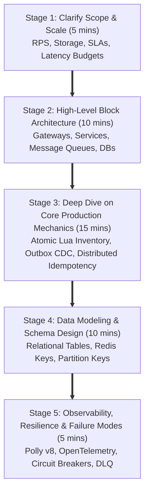
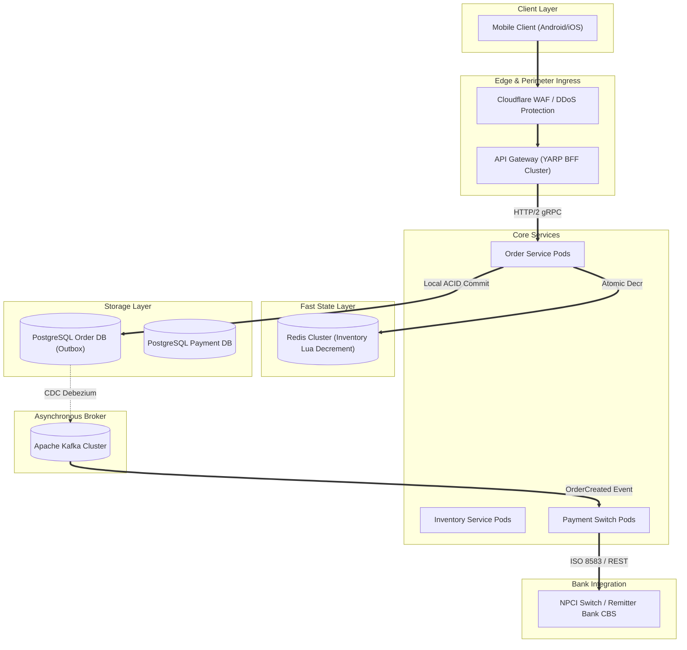

# 04. Microservices Architecture & Distributed System Design — Senior Production Engineering (Deep Dive)

> **Target Audience:** Senior Full-Stack Engineers, Tech Leads, and Distributed Systems Architects (5–10+ Years Experience) preparing for System Design (HLD/LLD), Concurrency, and Architecture rounds at Tier-1 Tech Giants, FinTech Unicorns, and GCCs in India.  
> **Standard:** Speakable Senior English v1 (SSE-1) Standard Format. Concise 30–45 second spoken answers, scored industry keywords, intuitive mental models, 5–15 line runnable code snippets, and structured comparison matrices.

---

# TABLE OF CONTENTS
- [Q1: When should an enterprise break a monolith into microservices, and how do you handle the database-per-service dilemma?](#q1-when-should-an-enterprise-break-a-monolith-into-microservices-and-how-do-you-handle-the-database-per-service-dilemma)
- [Q2: How do you choose between synchronous REST, gRPC, and asynchronous event-driven messaging?](#q2-how-do-you-choose-between-synchronous-rest-grpc-and-asynchronous-event-driven-messaging)
- [Q3: How do you coordinate distributed transactions across microservices without Two-Phase Commit?](#q3-how-do-you-coordinate-distributed-transactions-across-microservices-without-two-phase-commit)
- [Q4: What is the Transactional Outbox pattern, and how does Change Data Capture solve the dual-write problem?](#q4-what-is-the-transactional-outbox-pattern-and-how-does-change-data-capture-solve-the-dual-write-problem)
- [Q5: How do you guarantee distributed idempotency across multiple API instances and event consumers?](#q5-how-do-you-guarantee-distributed-idempotency-across-multiple-api-instances-and-event-consumers)
- [Q6: How do you design an API Gateway layer for routing, auth offload, and rate limiting with YARP?](#q6-how-do-you-design-an-api-gateway-layer-for-routing-auth-offload-and-rate-limiting-with-yarp)
- [Q7: How do you implement resilience pipelines with Polly v8 circuit breakers and exponential backoff?](#q7-how-do-you-implement-resilience-pipelines-with-polly-v8-circuit-breakers-and-exponential-backoff)
- [Q8: How do you architect CQRS and MediatR pipeline behaviors in .NET to segregate reads and writes?](#q8-how-do-you-architect-cqrs-and-mediatr-pipeline-behaviors-in-net-to-segregate-reads-and-writes)
- [Q9: How do you implement end-to-end distributed tracing across microservices with OpenTelemetry and W3C Trace Context?](#q9-how-do-you-implement-end-to-end-distributed-tracing-across-microservices-with-opentelemetry-and-w3c-trace-context)
- [10. 5-Stage System Design Interview Framework for Indian Rounds](#10-5-stage-system-design-interview-framework-for-indian-rounds-flipkart-flash-sale--upi-payment-architecture)
- [11. Advanced Production Reference: End-to-End Orchestrator LLD & Complete Polly v8 Enterprise Pipelines](#11-advanced-production-reference-end-to-end-orchestrator-lld--complete-polly-v8-enterprise-pipelines)

---

## Q1: When should an enterprise break a monolith into microservices, and how do you handle the database-per-service dilemma?
*Commonly asked at: Flipkart, Walmart, Swiggy, Morgan Stanley*

**⚡ One-line answer**
**Microservices decomposition** means breaking a monolith into autonomous services when team coordination overhead and divergent scaling bottlenecks emerge.

**🗣️ Spoken answer (30–45 seconds)**
An enterprise should first build a **modular monolith**, a single deployable process with strictly enforced in-process domain boundaries. We decompose into microservices only when team coordination friction or divergent scaling bottlenecks emerge. During decomposition, every service encapsulates a **bounded context**, which is an autonomous domain boundary isolating domain models and data. We strictly enforce **database-per-service**, meaning persistence encapsulation ensuring each microservice exclusively owns its database. Sharing databases creates a coupled distributed monolith. Instead of cross-database joins, we assemble data using asynchronous event projections.

**🎯 Terms the interviewer listens for**
- ⭐ **Modular monolith** — single deployable process with strictly enforced in-process domain boundaries
- ⭐ **Database-per-service** — persistence encapsulation ensuring each microservice exclusively owns its database
- ⭐ **Bounded context** — autonomous domain boundary isolating domain models and ubiquitous language
- **Distributed monolith** — anti-pattern where separate microservices share a single coupled database
- **API composition** — in-memory aggregation querying multiple services concurrently via network calls
- **Polyglot persistence** — selecting optimal database engines tailored for specific domain requirements

**🧠 Memory hook**
A joint family kitchen where cooks bump into each other versus separate apartments where each family cooks independently in their own kitchen.

**💻 Code**
```csharp
// ❌ Cross-database join across distinct domain entities
var items = await db.Orders.FromSqlRaw("SELECT * FROM Orders o JOIN Inventory i ON ...").ToListAsync();

// ✅ In-memory API composition with fail-fast SLA timeout
using var cts = new CancellationTokenSource(TimeSpan.FromMilliseconds(400));
var orderTask = _orderClient.GetFromJsonAsync<OrderDto>($"/orders/{id}", cts.Token);
var tierTask = _customerClient.GetFromJsonAsync<TierDto>($"/customers/{cId}", cts.Token);
await Task.WhenAll(orderTask, tierTask);
```

**⚠️ Likely follow-up**
*Q: How do you build cross-service reporting dashboards without direct SQL joins?*
A: Publish domain events over Kafka whenever entities mutate [CQRS materialized projections]. A background projection worker consumes these event streams and updates a flat, denormalized reporting database like ClickHouse or Elasticsearch. Reporting queries hit this flat read view in milliseconds without loading operational transactional databases.

**📊 Quick comparison**
| Architecture | Deployment Unit | Database Boundary | Scaling Profile | Operational Cost |
| :--- | :--- | :--- | :--- | :--- |
| Monolith | Single application process | Single shared schema | Scale entire process | Lowest initial complexity |
| Modular Monolith | Single application process | Logical module schemas | Single unit deployment | Low operational overhead |
| Microservices | Autonomous separate processes | Strict database per service | Scale individual services | High operational overhead |

**🔬 Under the hood (optional)**
Enforcing database boundaries trades local pointer-based memory joins for socket-level serialization. Cross-service calls incur TCP connection setup, HTTP/2 framing, and context switching overhead. Mitigate this by using in-memory caches and pre-computed projections.

---

## Q2: How do you choose between synchronous REST, gRPC, and asynchronous event-driven messaging?
*Commonly asked at: Swiggy, Uber, JPMorgan, Zepto*

**⚡ One-line answer**
**Protocol selection** means choosing REST for public clients, gRPC for low-latency internal RPCs, and asynchronous messaging for decoupled workflows.

**🗣️ Spoken answer (30–45 seconds)**
We choose communication protocols based on clients and coupling. Public clients use REST over JSON for firewall compatibility. For internal microservices, we prefer gRPC over HTTP/2. It uses **Protocol Buffers**, a compact binary serialization format packing structured data efficiently. It also provides **HTTP/2 multiplexing**, which is sending multiple concurrent requests bidirectionally over a single persistent TCP connection. For decoupled workflows, we use event streaming with **at-least-once delivery**, a messaging reliability guarantee ensuring published events arrive without loss, eliminating temporal coupling and absorbing sudden traffic bursts.

**🎯 Terms the interviewer listens for**
- ⭐ **Protocol Buffers** — compact binary serialization format packing strongly typed structured data efficiently
- ⭐ **HTTP/2 multiplexing** — sending multiple concurrent requests bidirectionally over a single TCP connection
- ⭐ **At-least-once delivery** — messaging reliability guarantee ensuring published events are delivered without loss
- **Head-of-line blocking** — queue transmission bottleneck where slow requests delay subsequent packet delivery
- **Consumer backpressure** — flow control mechanism regulating message consumption based on worker capacity
- **Temporal coupling** — synchronous dependency where callers block until downstream callees respond

**🧠 Memory hook**
Public postal letters for clients, military radio codes for internal cockpit crew, and warehouse conveyor belts for bulk shipping.

**💻 Code**
```csharp
// ❌ Synchronous chaining creates fragile temporal coupling
var inv = await _restClient.PostAsync("/reserve", content);

// ✅ High-throughput binary RPC for internal synchronous calls
var reply = await _grpcClient.ReserveStockAsync(new StockRequest { ItemId = id });

// ✅ Asynchronous domain event publication for decoupled processing
await _eventBus.PublishAsync(new OrderPlacedEvent(order.Id), ct);
```

**⚠️ Likely follow-up**
*Q: What is the primary drawback of using gRPC for public web applications?*
A: Web browsers cannot directly manipulate raw HTTP/2 frames or enforce trailing headers required by gRPC. They require an intermediary translation gateway [gRPC-Web proxy]. For public APIs, JSON over REST remains standard due to universal browser support and simple edge caching.

**📊 Quick comparison**
| Protocol | Transport | Serialization | Coupling | Primary Use Case |
| :--- | :--- | :--- | :--- | :--- |
| REST | HTTP/1.1 or HTTP/2 | Text-based JSON | Synchronous temporal | Public client APIs |
| gRPC | Strictly HTTP/2 | Binary Protocol Buffers | Synchronous temporal | Internal service mesh |
| Event Bus | TCP (Kafka/AMQP) | Binary or JSON payload | Decoupled asynchronous | Multi-service business workflows |

**🔬 Under the hood (optional)**
HTTP/2 multiplexing splits messages into binary frames tagged with a stream identifier. Multiple logical requests share one physical TCP connection, eliminating TCP slow-start handshakes and reducing kernel socket descriptor counts under high concurrency.

---

## Q3: How do you coordinate distributed transactions across microservices without Two-Phase Commit?
*Commonly asked at: Wells Fargo, Walmart, Morgan Stanley, Swiggy*

**⚡ One-line answer**
**Saga pattern** means coordinating distributed transactions as ordered local ACID steps with compensating actions on intermediate failure.

**🗣️ Spoken answer (30–45 seconds)**
We coordinate distributed transactions using the **Saga pattern**, a sequence of local database transactions updating services and publishing events. Two-Phase Commit is avoided because holding network locks exhausts connection pools during partitions. In complex workflows, we choose **Saga orchestration**, a central coordinator executing workflow steps and triggering compensating transactions using an explicit state machine. If any intermediate step fails, the orchestrator executes a **compensating transaction**, which is a semantic undo action reversing the business impact of committed writes. Forward progress relies on idempotent retries to achieve eventual consistency.

**🎯 Terms the interviewer listens for**
- ⭐ **Saga pattern** — sequence of local database transactions updating services and publishing events
- ⭐ **Saga orchestration** — central coordinator executing workflow steps and triggering compensating transactions
- ⭐ **Compensating transaction** — semantic undo action reversing the business impact of committed writes
- **Idempotent retries** — repeating operations safely without duplicate business side effects
- **Two-Phase Commit** — blocking consensus protocol holding distributed row locks across network boundaries
- **Semantic lock** — application-level status flag preventing concurrent conflicting entity modifications

**🧠 Memory hook**
Booking a vacation: flight, hotel, and rental car; if the car rental fails, the coordinator cancels and refunds the hotel and flight.

**💻 Code**
```csharp
// ❌ Distributed transaction holding network locks across databases
using var scope = new TransactionScope(TransactionScopeAsyncFlowOption.Enabled);
await db1.ExecuteAsync(); await db2.ExecuteAsync(); scope.Complete();

// ✅ Saga orchestrator executing forward steps with compensating actions
public async Task RunCheckoutSagaAsync(OrderState state, CancellationToken ct) {
    if (!await _paymentClient.ChargeAsync(state.Id, state.Total, ct)) {
        await _inventoryClient.ReleaseReservationAsync(state.Id, ct);
    }
}
```

**⚠️ Likely follow-up**
*Q: How does a Saga handle a failure during a compensating transaction?*
A: Compensating transactions must never be abandoned. The orchestrator repeats the compensation using automatic retries with exponential backoff [idempotent retries]. If the downstream service remains permanently unreachable, the failure raises an alert to a dead-letter management queue for administrative operator intervention.

**📊 Quick comparison**
| Dimension | Two-Phase Commit (2PC) | Saga Pattern |
| :--- | :--- | :--- |
| Locking | Synchronous distributed row locks | Local database transactions only |
| Consistency | Immediate ACID consistency | Eventual BASE consistency |
| Availability | Low during network partitions | High availability across services |
| Coordination | Distributed transaction manager | Orchestrator state machine |
| Error Handling | Automatic database rollback | Business compensating transactions |

**🔬 Under the hood (optional)**
Because Sagas commit local database transactions immediately, they lack ACID isolation. Other transactions can view intermediate state. Systems employ semantic locks, like marking an order as PendingPayment, ensuring concurrent workflows do not alter mutable balances prematurely.

---

## Q4: What is the Transactional Outbox pattern, and how does Change Data Capture solve the dual-write problem?
*Commonly asked at: PhonePe, Flipkart, Barclays, Infosys*

**⚡ One-line answer**
**Transactional outbox** means persisting business entities and outbound events together in one local database transaction.

**🗣️ Spoken answer (30–45 seconds)**
Writing to a database and Kafka in separate steps creates the **dual-write problem**, meaning writing to database and broker without distributed atomic guarantees. Crashes between writes drop events or create phantom state. To prevent inconsistency, we implement the **transactional outbox**, persisting business entities and outbound events in one local database transaction. Next, we use **Change Data Capture**, which is streaming database log changes directly into message brokers automatically. By tailing the transaction log, Debezium streams events to Kafka with sub-second latency and zero polling overhead on production tables.

**🎯 Terms the interviewer listens for**
- ⭐ **Transactional outbox** — persisting business entities and outbound events in one database transaction
- ⭐ **Dual-write problem** — writing to database and message broker without distributed atomic guarantees
- ⭐ **Change Data Capture** — streaming database log changes directly into message brokers automatically
- **Transaction log tailing** — reading database write-ahead log files to capture state mutations asynchronously
- **At-least-once delivery** — messaging reliability guarantee ensuring published records arrive without loss
- **SKIP LOCKED** — SQL concurrency clause allowing worker pods to skip locked records

**🧠 Memory hook**
Writing both the check and the counterfoil stub in the same chequebook before tearing off and mailing the payment.

**💻 Code**
```csharp
// ❌ Dual-write vulnerability: crash between steps loses messages
await _orderDb.SaveChangesAsync(ct);
await _kafkaProducer.ProduceAsync("orders", orderEvent, ct);

// ✅ Save entity and outbox message atomically
using var tx = await _orderDb.Database.BeginTransactionAsync(ct);
_orderDb.Orders.Add(order);
_orderDb.OutboxMessages.Add(new OutboxMessage("OrderPlaced", orderJson));
await _orderDb.SaveChangesAsync(ct);
await tx.CommitAsync(ct);
```

**⚠️ Likely follow-up**
*Q: Why prefer log-based Change Data Capture over periodic outbox table polling?*
A: Polling requires recurring SQL queries that consume database CPU and I/O [polling query tax]. In contrast, log-based CDC [Change Data Capture] reads the write-ahead log asynchronously at the storage engine layer, achieving sub-second event streaming with zero query overhead on operational tables.

**📊 Quick comparison**
| Approach | Event Latency | Database CPU Impact | Operational Overhead |
| :--- | :--- | :--- | :--- |
| Direct Publish | Immediate | Zero database overhead | High risk of data loss |
| Polling Publisher | 1 to 5 seconds | Periodic index query load | Low infrastructure complexity |
| Log Tailing (CDC) | Sub-100 milliseconds | Near zero query impact | Requires Debezium / Kafka Connect |

**🔬 Under the hood (optional)**
Debezium parses PostgreSQL Write-Ahead Logs (WAL) using the test_decoding or pgoutput logical replication plugins. It extracts outbox table mutations from the log stream before they hit physical heap blocks, converting them into JSON Kafka messages without locking database tables.

---

## Q5: How do you guarantee distributed idempotency across multiple API instances and event consumers?
*Commonly asked at: Swiggy, Zepto, Razorpay, Wells Fargo*

**⚡ One-line answer**
**Distributed idempotency** means guaranteeing repeated operations produce identical system state without duplicate side effects across distributed instances.

**🗣️ Spoken answer (30–45 seconds)**
We guarantee idempotency across tiers. At the ingress tier, incoming HTTP requests carry an **idempotency key**, a unique client-supplied token used to detect and deduplicate incoming requests. The gateway runs an **atomic cache check**, which is fast in-memory validation using Redis SET NX to claim keys with a TTL. For event consumers, we implement the **inbox pattern**, a database deduplication table tracking processed message identifiers within local transactions. If a duplicate arrives, the unique constraint aborts the insert, ensuring the consumer skips business logic and avoids double billing.

**🎯 Terms the interviewer listens for**
- ⭐ **Idempotency key** — unique client-supplied token used to detect and deduplicate requests
- ⭐ **Inbox pattern** — database deduplication table tracking processed message identifiers within transactions
- ⭐ **Atomic cache check** — fast in-memory validation using Redis SET NX claiming keys
- **At-least-once delivery** — messaging guarantee ensuring messages arrive, allowing potential duplicate deliveries
- **Unique constraint violation** — database error thrown when inserting an existing primary key
- **Natural deduplication** — using business domain primary keys to enforce unique persistence integrity

**🧠 Memory hook**
A bank UPI Reference Number (RRN); tapping 'Pay' three times sends the same RRN, so the bank charges your account only once.

**💻 Code**
```csharp
// ❌ Duplicate execution: charges card on every retry delivery
await _paymentGateway.ChargeCardAsync(req.Amount);

// ✅ Atomic check-and-set using Redis key with 24-hour expiration
var acquired = await _redis.StringSetAsync(
    $"idempotency:{key}", "IN_FLIGHT", TimeSpan.FromHours(24), When.NotExists);
if (!acquired) return Conflict("Duplicate request currently processing.");
```

**⚠️ Likely follow-up**
*Q: What happens if an API instance crashes while processing an in-flight key?*
A: If a node crashes mid-operation, the key remains marked in flight until its expiration timeout elapses [TTL expiration]. To recover faster, services store progress checkpoints in a database inbox table, allowing retries to detect the crashed state and safely resume or fail the operation.

**📊 Quick comparison**
| Layer | Mechanism | Latency | Consistency Level |
| :--- | :--- | :--- | :--- |
| Edge / Gateway | Redis SET NX with TTL | Sub-millisecond | Ephemeral cache consistency |
| Relational Inbox | Database Unique Constraint | 5 to 15 ms | Strict relational ACID |
| Entity Primary Key | Natural domain constraint | Zero extra cost | Storage engine integrity |

**🔬 Under the hood (optional)**
Redis executes `SET key val NX EX 86400` in a single-threaded event loop, ensuring atomic evaluation without thread locks. In SQL Server and PostgreSQL, unique clustered indexes reject duplicate inserts by checking B-Tree leaf pages, throwing errors 2627 or 23505 immediately.

---

## Q6: How do you design an API Gateway layer for routing, auth offload, and rate limiting with YARP?
*Commonly asked at: Cognizant, Infosys, Capgemini, Accenture*

**⚡ One-line answer**
**YARP** is a high-performance reverse proxy toolkit for ASP.NET Core routing client requests and centralizing edge concerns.

**🗣️ Spoken answer (30–45 seconds)**
In modern .NET architectures, we implement our edge gateway using **YARP**, a high-performance Microsoft toolkit for building .NET reverse proxy gateways. Placing YARP at the edge shields backend services and centralizes **authentication offload**, meaning validating security tokens at the network perimeter before routing requests internally. This simplifies downstream services by passing pre-validated user claims. Furthermore, the gateway enforces **rate limiting**, which is throttling incoming requests per client IP to protect service capacity using sliding-window algorithms in Redis. This prevents denial-of-service spikes and ensures predictable backend latency.

**🎯 Terms the interviewer listens for**
- ⭐ **YARP** — high-performance Microsoft toolkit for building .NET reverse proxy gateways
- ⭐ **Authentication offload** — validating security tokens at network perimeter before routing requests
- ⭐ **Rate limiting** — throttling incoming requests per client IP to protect service capacity
- **Reverse proxy** — intermediate edge gateway forwarding client traffic to backend destination services
- **BFF pattern** — backend-for-frontend gateways tailored specifically for mobile or web clients
- **TLS termination** — decrypting HTTPS certificates at edge to reduce internal backend overhead

**🧠 Memory hook**
An airport main security gate; passengers present boarding passes and clear security once before proceeding to individual boarding gates.

**💻 Code**
```csharp
// ❌ Microservices individually duplicate CORS and token validation
app.UseCors(); app.UseAuthentication();

// ✅ YARP gateway centralized routing and rate limiting configuration
builder.Services.AddReverseProxy()
    .LoadFromConfig(builder.Configuration.GetSection("ReverseProxy"));
builder.Services.AddRateLimiter(options => options.AddFixedWindowLimiter("api", ...));
app.MapReverseProxy();
```

**⚠️ Likely follow-up**
*Q: How do you prevent the API Gateway from becoming an organizational bottleneck?*
A: Keep the gateway strictly focused on routing, security, and throttling [dumb proxy principle]. Avoid embedding business validation or domain workflows into gateway code. If different client applications require custom aggregation, implement dedicated gateways per team [Backend-for-Frontend / BFF pattern].

**📊 Quick comparison**
| Feature | Edge Gateway (YARP) | Backend Microservice |
| :--- | :--- | :--- |
| Security | Validates JWT tokens and TLS | Authorizes domain-level permissions |
| Routing | Path and header-based matching | Executes internal business workflows |
| Throttling | Enforces IP rate limiters | Enforces business quota policies |
| State | Completely stateless proxy | Owns persistent domain state |
| Scaling | Scales with public client traffic | Scales with domain-specific load |

**🔬 Under the hood (optional)**
YARP leverages ASP.NET Core `System.IO.Pipelines` and memory pooling. Request and response byte streams transfer between client and destination sockets with zero intermediate buffer copies, eliminating Large Object Heap fragmentation and keeping latency overhead under one millisecond.

---

## Q7: How do you implement resilience pipelines with Polly v8 circuit breakers and exponential backoff?
*Commonly asked at: Barclays, Morgan Stanley, Wells Fargo, Walmart*

**⚡ One-line answer**
**Polly resilience pipeline** means a composable strategy combining timeouts, retries with jitter, and circuit breakers to prevent cascading collapse.

**🗣️ Spoken answer (30–45 seconds)**
We build resilience using a **Polly resilience pipeline**, a composable strategy pipeline executing retries, timeouts, and circuit breakers. First, a strict timeout aborts hung network calls. Next, retries use **exponential backoff with jitter**, which is progressively increasing retry delays randomized to avoid synchronized spikes. This prevents thundering herd retries. If downstream error rates exceed fifty percent, the **circuit breaker**, a stability mechanism tripping open to block calls during downstream failure spikes, isolates the failing service. This shields thread pools from exhaustion while downstream dependencies recover.

**🎯 Terms the interviewer listens for**
- ⭐ **Polly resilience pipeline** — composable strategy pipeline executing retries, timeouts, and circuit breakers
- ⭐ **Exponential backoff with jitter** — progressively increasing retry delays randomized to avoid synchronized spikes
- ⭐ **Circuit breaker** — stability mechanism tripping open to block calls during failure spikes
- **Bulkhead isolation** — limiting concurrent calls to isolate resource consumption across dependencies
- **Thundering herd** — multiple clients retrying simultaneously and crashing recovering dependencies
- **Fail-fast** — terminating unresponsive operations immediately without holding worker threads

**🧠 Memory hook**
Electrical fuses in a house tripping open during a power surge, protecting household electronics from catching fire.

**💻 Code**
```csharp
// ❌ Uncontrolled retries without backoff cause thundering herd storms
while (!res.IsSuccessStatusCode) res = await client.GetAsync(url);

// ✅ Polly v8 pipeline with backoff and breaker
var pipeline = new ResiliencePipelineBuilder<HttpResponseMessage>()
    .AddTimeout(TimeSpan.FromSeconds(2))
    .AddRetry(new RetryStrategyOptions<HttpResponseMessage> {
        BackoffType = DelayBackoffType.Exponential, UseJitter = true })
    .AddCircuitBreaker(new HttpCircuitBreakerStrategyOptions { FailureRatio = 0.5 })
    .Build();
```

**⚠️ Likely follow-up**
*Q: Why is adding jitter to exponential backoff critical in microservices?*
A: Without jitter, all failing client instances retry at the exact same synchronized intervals [synchronized thundering herd]. Adding full randomization [jitter] spreads outgoing retry requests across different millisecond intervals, smoothing traffic spikes and allowing struggling database or API servers to recover.

**📊 Quick comparison**
| Resilience Strategy | Purpose | Trigger Condition | Primary Risk Mitigated |
| :--- | :--- | :--- | :--- |
| Timeout | Enforces maximum wait limit | Latency threshold exceeded | Thread pool exhaustion |
| Exponential Backoff | Spaces out retry intervals | Transient 5xx HTTP errors | Network glitch recovery |
| Circuit Breaker | Blocks downstream traffic | High failure ratio | Cascading service collapse |
| Bulkhead | Limits concurrent requests | High concurrent executions | Resource starvation across APIs |

**🔬 Under the hood (optional)**
Polly v8 was redesigned for zero allocations using structs and memory-efficient delegates. In the Open circuit breaker state, incoming requests fail within nanoseconds by checking atomic memory state counters, without allocating tasks or dispatching ThreadPool worker threads.

---

## Q8: How do you architect CQRS and MediatR pipeline behaviors in .NET to segregate reads and writes?
*Commonly asked at: Wells Fargo, EPAM, LTIMindtree, Nagarro*

**⚡ One-line answer**
**CQRS** means segregating write commands from read queries, using MediatR pipeline behaviors for cross-cutting validation and telemetry.

**🗣️ Spoken answer (30–45 seconds)**
We architect systems using **CQRS**, an architectural pattern separating command write operations from query read operations. Commands modify domain state using Entity Framework Core within strict transactional boundaries. Queries retrieve presentation DTOs directly from views using Dapper, bypassing ORM change-tracking overhead. In .NET, we organize this with a **MediatR pipeline behavior**, which is in-process middleware intercepting commands for validation, logging, and metrics. Before handlers execute, we run **FluentValidation**, a strongly-typed rule engine validating command inputs before domain execution. This guarantees domain models process only verified business commands.

**🎯 Terms the interviewer listens for**
- ⭐ **CQRS** — architectural pattern separating command write operations from query read operations
- ⭐ **MediatR pipeline behavior** — in-process middleware intercepting commands for validation, logging, and metrics
- ⭐ **FluentValidation** — strongly-typed rule engine validating command inputs before domain execution
- **Command handler** — application service executing business mutations and maintaining domain invariants
- **Query handler** — optimized read service retrieving presentation models without change tracking
- **Denormalized projection** — pre-computed database view structured for sub-millisecond query retrieval

**🧠 Memory hook**
A restaurant kitchen where chefs focus purely on cooking meals, while waiters deliver ready-made plates from display counters to customers.

**💻 Code**
```csharp
// ❌ Controller mixing validation, logging, and EF updates
public async Task<IActionResult> Post(OrderDto dto) { /* 100 lines */ }

// ✅ MediatR pipeline behavior enforcing input validation automatically
public class ValidationBehavior<TReq, TRes> : IPipelineBehavior<TReq, TRes>
    where TReq : notnull {
    private readonly IEnumerable<IValidator<TReq>> _validators;
    public async Task<TRes> Handle(TReq req, RequestHandlerDelegate<TRes> next, CancellationToken ct) {
        var context = new ValidationContext<TReq>(req);
        await Task.WhenAll(_validators.Select(v => v.ValidateAsync(context, ct)));
        return await next();
    }
}
```

**⚠️ Likely follow-up**
*Q: How do you handle eventual consistency lag when users query data they just wrote?*
A: After submitting a command, the frontend can optimistically render the expected update [optimistic UI update]. Alternatively, the write endpoint returns the newly generated entity ID and version, allowing subsequent queries to check the read replica or poll until data convergence completes.

**📊 Quick comparison**
| Dimension | Command Model | Query Model |
| :--- | :--- | :--- |
| Purpose | Modify state, enforce rules | Retrieve data for UI display |
| Data Access | Rich domain entities with EF Core | Fast SQL queries via Dapper |
| Tracking | ChangeTracker enabled for updates | Change tracking disabled (AsNoTracking) |
| Consistency | Strict ACID within bounded context | Eventual consistency via read models |
| Scalability | Optimized for write transactional safety | Scaled horizontally via read replicas |

**🔬 Under the hood (optional)**
MediatR pipeline behaviors construct a delegate chain using nested function pointers. When `IMediator.Send` is invoked, each registered behavior executes in dependency injection registration order before calling the inner handler, allocating minimal intermediate state.

---

## Q9: How do you implement end-to-end distributed tracing across microservices with OpenTelemetry and W3C Trace Context?
*Commonly asked at: Swiggy, JPMorgan, Nagarro, EPAM*

**⚡ One-line answer**
**Distributed tracing** means propagating correlation identifiers across service hops to track requests, measure latencies, and pinpoint errors.

**🗣️ Spoken answer (30–45 seconds)**
We implement observability using **OpenTelemetry**, a vendor-neutral observability framework standardizing traces, metrics, and logs. At the gateway, the system generates a global Trace ID. Outgoing calls propagate this metadata using **W3C Trace Context**, which is a standard HTTP header format propagating traceparent and tracestate across networks. Within services, every database query or remote call creates a child **Span**, a single named, timed operation representing a contiguous segment of execution. An OTLP exporter streams these correlated spans to Jaeger to identify latency bottlenecks instantly.

**🎯 Terms the interviewer listens for**
- ⭐ **OpenTelemetry** — vendor-neutral observability framework standardizing traces, metrics, and application logs
- ⭐ **W3C Trace Context** — standard HTTP header format propagating traceparent and tracestate across networks
- ⭐ **Span** — single named, timed operation representing a contiguous segment of execution
- **Trace ID** — unique identifier linking all operations in an end-to-end journey
- **Context propagation** — injecting and extracting trace metadata across network protocol boundaries
- **OTLP exporter** — network protocol streaming batch telemetry to centralized observability backends

**🧠 Memory hook**
An international postal tracking number; the master tracking code stays constant, while each airport sorting facility adds its local transit scan.

**💻 Code**
```csharp
// ❌ Disconnected logs cannot correlate across service hops
_logger.LogError("Payment failed for customer {Id}", customerId);

// ✅ OpenTelemetry automatic W3C traceparent context propagation
builder.Services.AddOpenTelemetry()
    .WithTracing(tracing => tracing
        .AddAspNetCoreInstrumentation()
        .AddHttpClientInstrumentation()
        .AddEntityFrameworkCoreInstrumentation()
        .AddOtlpExporter(opt => opt.Endpoint = new Uri("http://jaeger:4317")));
```

**⚠️ Likely follow-up**
*Q: What is the performance overhead of distributed tracing, and how do you reduce it?*
A: Full trace collection creates network and storage overhead under heavy traffic. Systems configure head-based or tail-based sampling [probabilistic sampling]. For example, recording ten percent of successful requests while capturing all failing requests ensures full error visibility while keeping CPU and storage overhead negligible.

**📊 Quick comparison**
| Telemetry Signal | Information Captured | Primary Use Case | Storage Overhead |
| :--- | :--- | :--- | :--- |
| Distributed Trace | Request path across network hops | Latency bottlenecks and root cause | Moderate to high (mitigated by sampling) |
| Structured Log | Detailed localized event timestamp | In-depth component diagnostics | High volume, short retention |
| Metric | Aggregated numeric counters/gauges | Real-time alerting and dashboards | Very low, highly compressible |

**🔬 Under the hood (optional)**
The W3C `traceparent` header format is `00-4bf92f3577b34da6a3ce929d0e0e4736-00f067aa0ba902b7-01`. The runtime parses this ASCII string into 16-byte trace and 8-byte span buffers. When sampling flag `01` is active, the runtime records span start and end timestamps using high-resolution hardware timers.

---

## 10. 5-Stage System Design Interview Framework for Indian Rounds (Flipkart Flash Sale & UPI Payment Architecture)

In Tier-1 Indian engineering interviews (Flipkart, Swiggy, Zepto, PhonePe, Walmart, Wells Fargo, Amazon India), you have exactly **45 minutes** to design an entire distributed system. Interviewers look for architectural maturity, production failure awareness, and quantifiable numbers.



---

### Stage 1: Clarify Scope & Calculate Scale Numbers (First 5 Minutes)
Never jump to drawing boxes. Start by establishing the non-functional requirements (NFRs) and traffic estimates:

#### 1. Scenario A: Flipkart Big Billion Days Flash Sale
* **Peak Traffic:** 50,000 Checkout Requests/sec (RPS) at 12:00:00 AM IST.
* **Inventory Constraints:** 10,000 units of iPhone 15 at 50% discount. Overselling is a multi-crore legal and brand disaster.
* **Latency SLA:** p99 latency < 250ms for checkout confirmation.
* **Availability:** 99.99% (Maximum allowable downtime: 4.3 seconds during the flash sale).
* **Storage Calculation:**
  * 50,000 orders/sec $	imes$ 1 KB per order payload = 50 MB/sec ingestion.
  * Over a 2-hour sale window: 50 MB/sec $	imes$ 7,200s $pprox$ 360 GB of order data.

#### 2. Scenario B: UPI Payment Processing Switch (PhonePe / GPay)
* **Peak Traffic:** 10,000 transactions/sec (TPS).
* **Latency SLA:** End-to-end response < 2.0 seconds (Hard NPCI bank timeout).
* **Reliability:** complete zero-drop guarantee. Even if downstream bank core banking servers (CBS) drop packets, transactions must be safely queued and reconciled.
* **Deduplication:** complete idempotent based on 12-digit UPI UTR.

---

### Stage 2: High-Level Block Architecture (Next 10 Minutes)
Draw the end-to-end flow from client to persistent stores:



---

### Stage 3: Deep Dive on Core Production Mechanics & Failure Modes (Next 15 Minutes)
This is where 80% of candidates fail. You must explain how the system survives under extreme stress:

#### 1. Preventing Overselling via Atomic Redis Lua Script:
Relational database queries (`UPDATE Inventory SET Stock = Stock - 1 WHERE Stock > 0`) cannot handle 50,000 concurrent requests on a single row without massive row-lock queues and deadlocks.  
We pre-load stock counts into **Redis Cluster** and execute an atomic Lua script that decrements in sub-milliseconds:

```lua
-- Atomic Lua Script executed on Redis (Sub-1ms execution)
-- KEYS[1]: Item stock key (e.g., "stock:item_99")
-- ARGV[1]: Quantity to reserve (e.g., "1")
local stock = tonumber(redis.call('get', KEYS[1]))
local quantity = tonumber(ARGV[1])

if stock == nil then
    return -1 -- Item not found
end

if stock >= quantity then
    redis.call('decrby', KEYS[1], quantity)
    return 1 -- Reservation Successful
else
    return 0 -- Insufficient Stock (Sold Out)
end
```

#### 2. Dual-Write Elimination via Debezium CDC:
The Order Service never calls Kafka directly. It writes the order and outbox record to PostgreSQL in one local ACID transaction. Debezium streams outbox records into Kafka in sub-10ms.

#### 3. Handling UPI Bank Switch Timeouts:
When communicating with the Remitter Bank CBS via NPCI, bank connections frequently drop after 2 seconds. The Payment Switch must NEVER mark the transaction as failed immediately. It transitions the payment to `PENDING` and triggers an automated reconciliation polling worker that queries the NPCI UPI transaction status API every 30 seconds for 5 minutes before determining final success or compensation.

---

### Stage 4: Data Modeling & Schema Design (Next 10 Minutes)

```sql
-- PostgreSQL Order Schema
CREATE TABLE orders (
    id UUID PRIMARY KEY,
    customer_id UUID NOT NULL,
    total_amount NUMERIC(12,2) NOT NULL,
    status VARCHAR(32) NOT NULL,
    idempotency_key VARCHAR(64) NOT NULL,
    created_at_utc TIMESTAMP WITH TIME ZONE NOT NULL DEFAULT NOW()
);
CREATE UNIQUE INDEX uq_orders_idempotency ON orders(idempotency_key);

-- Transactional Outbox Schema
CREATE TABLE outbox_messages (
    id UUID PRIMARY KEY,
    aggregate_id VARCHAR(64) NOT NULL,
    event_type VARCHAR(128) NOT NULL,
    payload JSONB NOT NULL,
    created_at_utc TIMESTAMP WITH TIME ZONE NOT NULL DEFAULT NOW(),
    processed_at_utc TIMESTAMP WITH TIME ZONE NULL
);
CREATE INDEX idx_outbox_unprocessed ON outbox_messages(created_at_utc) WHERE processed_at_utc IS NULL;

-- Distributed Deduplication Inbox Schema
CREATE TABLE inbox_messages (
    message_id VARCHAR(128) PRIMARY KEY,
    consumer_name VARCHAR(64) NOT NULL,
    received_at_utc TIMESTAMP WITH TIME ZONE NOT NULL DEFAULT NOW()
);
```

---

### Stage 5: Observability, Resilience & Bottlenecks (Final 5 Minutes)
Conclude with operational maturity:
1. **Polly v8 Resilience:** API Gateway wraps downstream service calls in Polly v8 pipelines combining a 2-second timeout, 3 exponential retries with jitter, and a circuit breaker that trips if error rate exceeds 50%.
2. **OpenTelemetry Propagation:** W3C `traceparent` headers flow across API Gateway -> Order Service -> Kafka Headers -> Payment Switch -> NPCI HTTP request.
3. **Graceful Degradation:** If the Product Recommendation Engine goes down, the API Gateway returns a cached static default list rather than failing the checkout page.

---

## 11. Advanced Production Reference: End-to-End Orchestrator LLD & Complete Polly v8 Enterprise Pipelines

This section contains complete, production-grade implementations of the core distributed architectural components for senior engineering reference.

---

### 11.1 Complete Production Checkout Saga Orchestrator (C#)

```csharp
using System;
using System.Threading;
using System.Threading.Tasks;
using Microsoft.Extensions.Logging;

namespace Enterprise.DistributedSystems.Saga
{
    public enum SagaState { Initial, StockReserved, PaymentCaptured, Completed, Compensating, Failed }

    public record OrderCheckoutContext(Guid OrderId, Guid CustomerId, decimal Amount, string Sku, int Quantity);

    public interface IInventoryClient
    {
        Task<bool> ReserveStockAsync(Guid orderId, string sku, int qty, CancellationToken ct);
        Task ReleaseStockAsync(Guid orderId, string sku, int qty, CancellationToken ct);
    }

    public interface IPaymentClient
    {
        Task<bool> ChargePaymentAsync(Guid orderId, decimal amount, CancellationToken ct);
        Task RefundPaymentAsync(Guid orderId, decimal amount, CancellationToken ct);
    }

    public class CheckoutSagaOrchestrator
    {
        private readonly IInventoryClient _inventory;
        private readonly IPaymentClient _payment;
        private readonly ILogger<CheckoutSagaOrchestrator> _logger;

        public CheckoutSagaOrchestrator(
            IInventoryClient inventory,
            IPaymentClient payment,
            ILogger<CheckoutSagaOrchestrator> logger)
        {
            _inventory = inventory;
            _payment = payment;
            _logger = logger;
        }

        public async Task<bool> ExecuteSagaAsync(OrderCheckoutContext ctx, CancellationToken ct)
        {
            var currentState = SagaState.Initial;
            _logger.LogInformation("Starting Checkout Saga for Order {OrderId}", ctx.OrderId);

            // Step 1: Reserve Inventory
            bool stockOk = await _inventory.ReserveStockAsync(ctx.OrderId, ctx.Sku, ctx.Quantity, ct);
            if (!stockOk)
            {
                _logger.LogWarning("Saga Aborted: Stock reservation failed for {OrderId}", ctx.OrderId);
                return false;
            }
            currentState = SagaState.StockReserved;

            // Step 2: Charge Payment (Pivot Transaction)
            bool paymentOk = false;
            try
            {
                paymentOk = await _payment.ChargePaymentAsync(ctx.OrderId, ctx.Amount, ct);
            }
            catch (Exception ex)
            {
                _logger.LogError(ex, "Payment step threw exception for Order {OrderId}", ctx.OrderId);
            }

            if (!paymentOk)
            {
                // Pivot Failed: Execute Backward Compensation
                _logger.LogWarning("Payment failed for Order {OrderId}. Initiating compensation...", ctx.OrderId);
                currentState = SagaState.Compensating;

                // Guaranteed compensation with CancellationToken.None to prevent cancellation drops
                await _inventory.ReleaseStockAsync(ctx.OrderId, ctx.Sku, ctx.Quantity, CancellationToken.None);
                
                currentState = SagaState.Failed;
                return false;
            }

            currentState = SagaState.PaymentCaptured;
            _logger.LogInformation("Checkout Saga Completed Successfully for Order {OrderId}", ctx.OrderId);
            return true;
        }
    }
}
```

---

### 11.2 Complete Polly v8 Enterprise Resilience Pipeline Builder (C#)

```csharp
using System;
using System.Net.Http;
using Microsoft.Extensions.DependencyInjection;
using Microsoft.Extensions.Logging;
using Polly;
using Polly.CircuitBreaker;
using Polly.Retry;
using Polly.Timeout;

namespace Enterprise.DistributedSystems.Resilience
{
    public static class ResilienceConfiguration
    {
        public static IServiceCollection AddProductionResilience(this IServiceCollection services)
        {
            services.AddResiliencePipeline<string, HttpResponseMessage>("EnterpriseHttpPipeline", (builder, context) =>
            {
                var logger = context.ServiceProvider.GetRequiredService<ILoggerFactory>()
                    .CreateLogger("ResilienceTelemetry");

                // Strategy 1: Total Pipeline Timeout (Outermost)
                builder.AddTimeout(new TimeoutStrategyOptions
                {
                    Timeout = TimeSpan.FromSeconds(5),
                    OnTimeout = args =>
                    {
                        logger.LogError("Total pipeline timeout exceeded 5s for {Key}", args.Context.OperationKey);
                        return default;
                    }
                });

                // Strategy 2: Exponential Retry with Full Jitter
                builder.AddRetry(new RetryStrategyOptions<HttpResponseMessage>
                {
                    MaxRetryAttempts = 3,
                    Delay = TimeSpan.FromMilliseconds(200),
                    BackoffType = DelayBackoffType.Exponential,
                    UseJitter = true,
                    ShouldHandle = new PredicateCheck<RetryPredicateArguments<HttpResponseMessage>>(args =>
                    {
                        var response = args.Outcome.Result;
                        return ValueTask.FromResult(
                            args.Outcome.Exception is HttpRequestException ||
                            (response != null && (int)response.StatusCode >= 500));
                    }),
                    OnRetry = args =>
                    {
                        logger.LogWarning("Retry attempt #{Attempt} after delay {Delay}ms for {Key}", 
                            args.AttemptNumber, args.RetryDelay.TotalMilliseconds, args.Context.OperationKey);
                        return default;
                    }
                });

                // Strategy 3: Circuit Breaker
                builder.AddCircuitBreaker(new HttpCircuitBreakerStrategyOptions
                {
                    FailureRatio = 0.5,
                    SamplingDuration = TimeSpan.FromSeconds(10),
                    MinimumThroughput = 8,
                    BreakDuration = TimeSpan.FromSeconds(30),
                    OnOpened = args =>
                    {
                        logger.LogCritical("CIRCUIT BREAKER TRIPPED TO OPEN! Duration: {BreakDuration}s. Reason: {Outcome}", 
                            args.BreakDuration.TotalSeconds, args.Outcome.Exception?.Message);
                        return default;
                    },
                    OnClosed = _ =>
                    {
                        logger.LogInformation("Circuit breaker reset to CLOSED state.");
                        return default;
                    }
                });

                // Strategy 4: Attempt Timeout (Innermost)
                builder.AddTimeout(new TimeoutStrategyOptions
                {
                    Timeout = TimeSpan.FromMilliseconds(800)
                });
            });

            return services;
        }
    }
}
```

---

### 11.3 Production Redis Lua Script for Atomic Inventory Reservation

```csharp
// C# StackExchange.Redis Integration for Atomic Inventory Reservation
public async Task<bool> ReserveStockAtomicAsync(IDatabase redis, string sku, int quantity)
{
    const string luaScript = @"
        local stock = tonumber(redis.call('get', KEYS[1]))
        local qty = tonumber(ARGV[1])
        if stock == nil then return -1 end
        if stock >= qty then
            redis.call('decrby', KEYS[1], qty)
            return 1
        else
            return 0
        end";

    var result = (int)await redis.ScriptEvaluateAsync(
        luaScript,
        keys: new RedisKey[] { $"stock:{sku}" },
        values: new RedisValue[] { quantity });

    return result == 1;
}
```
