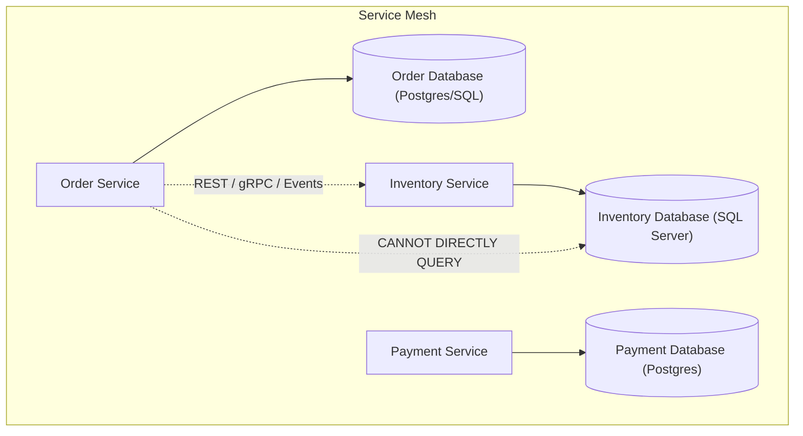
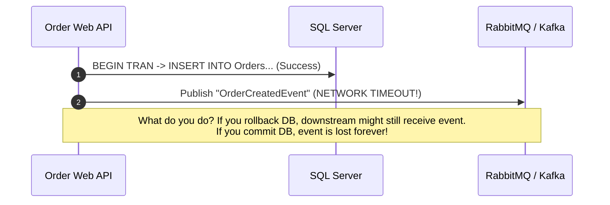
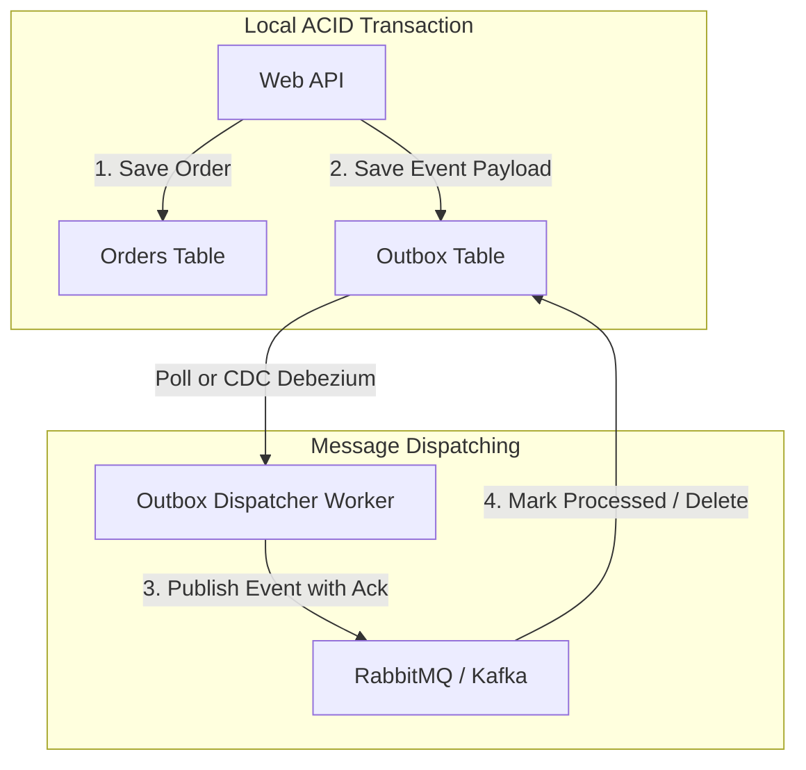
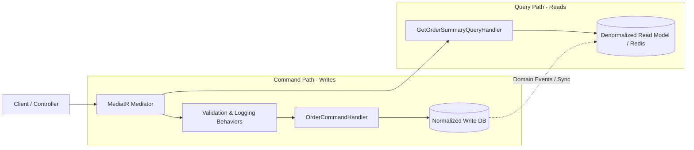
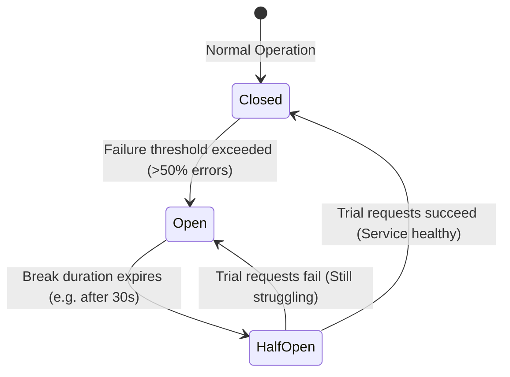
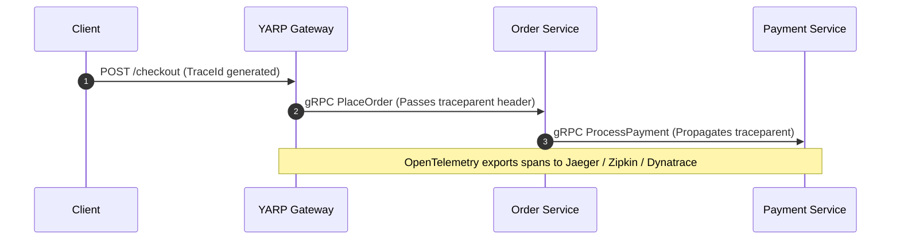
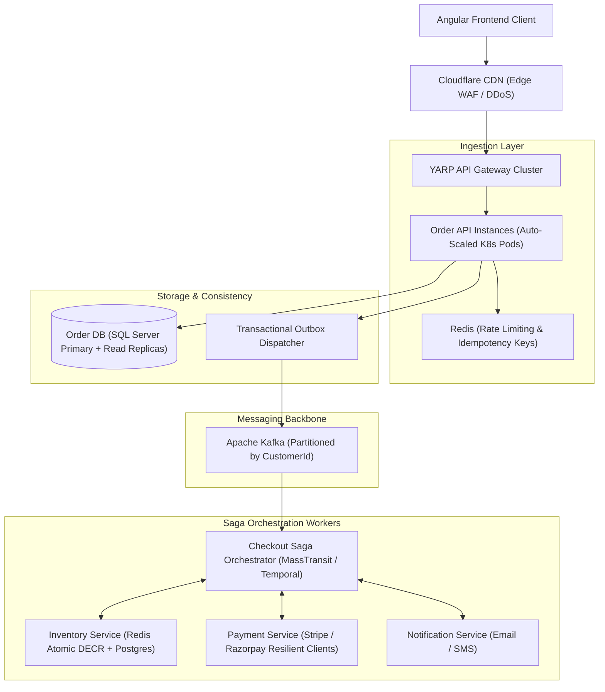
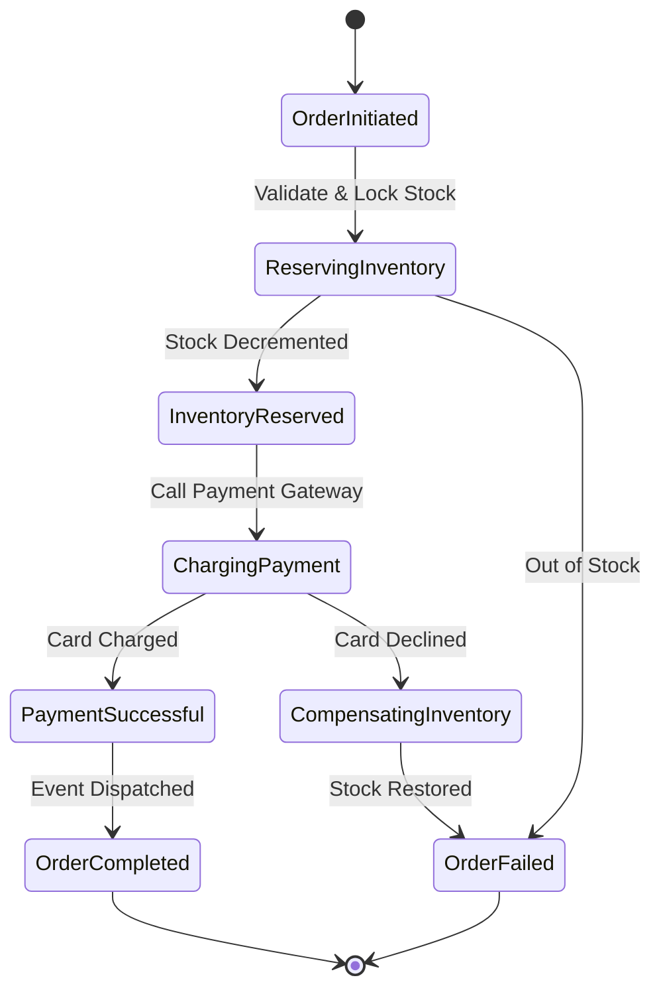

# 04. Microservices Architecture & Distributed System Design for Senior Engineers (6+ YOE)

> **Target Audience:** Senior Full-Stack Engineers & Distributed Systems Architects (6+ Years Experience) preparing for HLD/LLD System Design rounds in Tier-1 Indian tech companies, Fintech unicorns, and global capability centers (GCCs like Wells Fargo, Morgan Stanley, JPMorgan, Walmart, Target, Swiggy, Zepto).  
> **Philosophy:** Production realities over theoretical hype. We cover the Dual-Write trap, Saga coordination mechanics, Outbox patterns, Idempotency, Circuit Breakers, OpenTelemetry distributed tracing, gRPC vs REST performance profiles, and a complete production HLD/LLD design for an E-Commerce Checkout & Payment Engine.

---

## 1. Distributed Data Patterns & The Database-Per-Service Dilemma

### 1.1 The Database-Per-Service Principle

* **⚡ 30-Second Interview Pitch (Say this first):**
  > "In microservices, each service must strictly own and encapsulate its private database—no other service is ever permitted to query or mutate its tables directly. This guarantees independent deployability and loose coupling, but forces us to abandon traditional SQL JOINs and single-database ACID transactions in favor of eventual consistency."

* **🧠 Everyday Indian Analogy (Never forget this):**
  * Think of **HDFC Bank and ICICI Bank**. 
  * HDFC cannot directly run a SQL query on ICICI's database to deduct money for an NEFT or UPI transfer. 
  * Each bank encapsulates its own ledger. They communicate strictly through well-defined APIs and banking networks (NPCI / IMPS / UPI) with asynchronous settlements.

* **🎯 Must-Know Technical Terms & Buzzwords (The "Senior Interview Rubric"):**
  * **Database-Per-Service Pattern:** An architectural pattern where each microservice exclusively owns, mutates, and encapsulates its persistence store, prohibiting cross-boundary database queries.
  * **Shared Database Anti-Pattern:** A distributed anti-pattern where multiple services query or write to common database tables, creating tight operational coupling and breaking independent schema migrations.
  * **Eventual Consistency:** A distributed consistency model guaranteeing that, in the absence of new mutations, all distributed replicas or read models will eventually converge to the same state.
  * **BASE Model:** An acronym for *Basically Available, Soft state, Eventual consistency*—the distributed systems paradigm contrasting with traditional ACID guarantees.
  * **Two-Phase Commit (2PC):** A synchronous distributed consensus protocol with a *Prepare Phase* (voting and resource locking) and a *Commit Phase*; notorious for latency amplification and coordinator Single Points of Failure (SPOF).
  * **CAP Theorem:** Formulated by Eric Brewer, stating that a distributed datastore can provide at most two of three guarantees: *Consistency*, *Availability*, and *Partition Tolerance* (under real-world network partitions $P$, you must choose between $C$ and $A$).
  * **API Composition Pattern:** An aggregation pattern where an API gateway or orchestrator service issues parallel in-memory calls across multiple microservices to assemble a consolidated response DTO.



#### 📌 Deep Technical Mechanics & Architecture:
1. **Elimination of Distributed ACID Transactions:** Two-Phase Commit (2PC) does not scale horizontally across network boundaries. During network latency spikes or coordinator node crashes, 2PC holds synchronous database row locks indefinitely, exhausting connection pools and directly violating the CAP theorem's availability guarantee ($A$).
2. **Cross-Service Data Aggregation / Joins:** Relational `JOIN` operations across distinct physical databases (`SELECT * FROM Orders o JOIN Inventory i ON ...`) are physically impossible. Data composition must be resolved via in-memory API Composition, CQRS denormalized read projections, or asynchronous event stream replication.
3. **Eventual Consistency & Bounded Contexts:** Data across Domain-Driven Design (DDD) bounded contexts requires latency windows (typically 10ms to 2000ms) to synchronize. Systems must be engineered with optimistic UI updates and semantic dirty-read countermeasures.

#### 💼 Concrete Real-World Production Example:
* **The Scenario:** In Flipkart's checkout flow (15,000 req/sec peak), the **Order Service** (PostgreSQL) needs customer loyalty discount tiers and wallet balances owned exclusively by the **Customer & Wallet Service** (SQL Server).
* **❌ Bad Production Architecture / Code (The Junior Anti-Pattern):**
  Attempting a distributed cross-database query via SQL Server Linked Server or wrapping both databases in a `System.Transactions.TransactionScope` (Two-Phase Commit).
  ```csharp
  // JUNIOR ANTI-PATTERN: Distributed 2PC transaction holding cross-network row locks!
  using (var scope = new TransactionScope(TransactionScopeAsyncFlowOption.Enabled))
  {
      // Acquires Exclusive Lock on SQL Server Customer table across WAN
      await _customerDbContext.DeductWalletPointsAsync(customerId, points);

      // Acquires Row Lock on Postgres Orders table
      await _orderDbContext.CreateOrderAsync(order);

      // CATASTROPHE: If network latency spikes between data centers or coordinator crashes,
      // row locks are held open indefinitely. Database connection pools exhaust in seconds!
      scope.Complete();
  }
  ```
* **✅ Senior Battle-Tested Code / Architecture (The Production Fix):**
  Decouple persistence using **CQRS Denormalized Read Projections** synced asynchronously via Kafka, paired with in-memory **API Composition** with strict timeouts:
  ```csharp
  public sealed class OrderCheckoutCompositionService
  {
      private readonly HttpClient _customerClient;
      private readonly IOrderRepository _orderRepo;
      private readonly ILogger<OrderCheckoutCompositionService> _logger;

      public OrderCheckoutCompositionService(
          IHttpClientFactory clientFactory,
          IOrderRepository orderRepo,
          ILogger<OrderCheckoutCompositionService> logger)
      {
          _customerClient = clientFactory.CreateClient("CustomerService");
          _orderRepo = orderRepo;
          _logger = logger;
      }

      public async Task<CheckoutSummaryDto> AssembleCheckoutAsync(Guid customerId, Guid orderId, CancellationToken ct)
      {
          // Bound timeout using CancellationTokenSource (Fail fast within 400ms)
          using var timeoutCts = CancellationTokenSource.CreateLinkedTokenSource(ct);
          timeoutCts.CancelAfter(TimeSpan.FromMilliseconds(400));

          try
          {
              // Parallel asynchronous fetch without cross-database locks
              var customerTask = _customerClient.GetFromJsonAsync<CustomerTierDto>($"/api/v1/customers/{customerId}/tier", timeoutCts.Token);
              var orderTask = _orderRepo.GetOrderByIdAsync(orderId, timeoutCts.Token);

              await Task.WhenAll(customerTask, orderTask);

              var customer = await customerTask;
              var order = await orderTask;

              return new CheckoutSummaryDto(order!.Id, order.TotalAmount, customer?.DiscountPercentage ?? 0m);
          }
          catch (OperationCanceledException) when (!ct.IsCancellationRequested)
          {
              // Graceful degradation: Fall back to default discount tier rather than crashing checkout
              _logger.LogWarning("CustomerService timed out. Applying zero-discount fallback for Order {OrderId}", orderId);
              var order = await _orderRepo.GetOrderByIdAsync(orderId, ct);
              return new CheckoutSummaryDto(order!.Id, order.TotalAmount, DiscountPercentage: 0m);
          }
      }
  }
  ```
* **🗣️ What to Say in the Interview:**
  > *"In our checkout service, we strictly prohibit distributed 2PC transactions or cross-database linked queries because a network hiccup locks rows across both databases and exhausts connection pools in seconds. Instead, we use CQRS denormalized read projections synced asynchronously via Kafka, and assemble real-time views using in-memory API Composition with strict 400ms cancellation timeouts and cached fallback values."*

---

### 1.2 The Saga Pattern: Orchestration vs. Choreography

* **⚡ 30-Second Interview Pitch (Say this first):**
  > "A Saga is a sequence of local database transactions where each step updates a local database and publishes an event or message that triggers the next step in another service. If any step fails midway, the Saga runs compensating transactions in reverse to gracefully undo the business effects of previous committed steps."

* **🧠 The Goa Trip Analogy (Never forget this):**
  * **Choreography (The Chaotic WhatsApp Group):** 
    * 4 friends plan a Goa trip over WhatsApp. Person A books flights and texts: *"Flight booked!"* Person B reads it and books the villa: *"Villa booked!"* Person C reads that and books rental bikes.
    * **Why it breaks:** For 2-3 friends, it works. But with 10 people, if Person C cannot find bikes, someone forgets to read the chat, or two people book duplicate villas simultaneously, it descends into pure chaos. No single person knows the true master state.
  * **Orchestration (The Professional Wedding / Tour Planner):**
    * You hire a dedicated tour manager (Orchestrator). The planner follows a strict checklist:
      1. Calls airline: *"Book tickets."* (Success)
      2. Calls hotel: *"Reserve rooms."* (Success)
      3. Calls caterer: *"Prepare banquet."* (Caterer says: *"Out of food!"*)
    * The planner immediately executes rollback actions: Calls hotel: *"Cancel room reservation and refund money,"* then calls airline: *"Cancel tickets."*
    * **Why it wins:** Total visibility, a centralized state machine, clear timeout handling, and zero circular event dependencies.

* **🎯 Must-Know Technical Terms & Buzzwords (The "Senior Interview Rubric"):**
  * **Saga Pattern:** A distributed design pattern that manages long-running business transactions by decomposing them into an ordered sequence of discrete, local ACID transactions.
  * **Compensating Transaction:** An idempotent semantic undo operation that reverses the business impact of a previously committed local transaction (forward-recovery mechanism, not an engine-level rollback).
  * **Orchestration-based Saga:** A centralized coordination approach where a dedicated workflow orchestrator (state machine such as Temporal, MassTransit Automatonymous, or AWS Step Functions) explicitly commands service participants.
  * **Choreography-based Saga:** A decentralized, event-driven approach where microservices autonomously react to published domain events without central direction or coordination.
  * **Pivot Transaction:** The critical boundary step in a Saga; once the pivot transaction commits successfully, the Saga is guaranteed to run to completion without compensating rollbacks.
  * **Retryable Transaction:** Transactions following the pivot step that are guaranteed to eventually succeed through retries, backoff, and idempotent consumers.
  * **Semantic Lock Countermeasure:** Application-level dirty-read protection (e.g., setting entity status to `Pending` or `PaymentInFlight`) to compensate for the Saga pattern's lack of ACID Isolation ($I$).

```mermaid
flowchart LR
    subgraph Choreography (Decentralized Events)
        O1["Order Created Event"] --> I1["Inventory Reserves Stock"]
        I1 --> P1["Payment Charges Card"]
        P1 --> F1["Fulfillment Dispatches"]
    end
```

```mermaid
flowchart TD
    subgraph Orchestration (Central Controller)
        SO["Saga Orchestrator (Order Coordinator)"]
        SO -->|1. Create Order| ODB[Order Service]
        SO -->|2. Reserve Inventory| IS[Inventory Service]
        SO -->|3. Process Payment| PS[Payment Service]
        SO -.->|Failure: Compensate| IS_COMP["Cancel Stock Reservation"]
    end
```

| Dimension | Choreography (Event-Driven) | Orchestration (State Machine) |
| :--- | :--- | :--- |
| **Coordination** | Decentralized; each service listens and reacts to pub/sub domain events. | Centralized; a dedicated coordinator manages execution state and commands. |
| **Coupling** | Loosely coupled; services know only domain events. | Tighter coupling between orchestrator and downstream service contracts. |
| **Visibility & Debugging** | Hard to debug; tracing saga progress requires searching across multiple service logs. | High visibility; current saga state is stored in one database table or workflow engine. |
| **Cyclic Dependencies** | High risk of accidental circular event chains as features grow. | Zero cyclic dependencies; the workflow follows a deterministic state machine. |
| **When to Use** | Simple 2 to 3 step workflows (e.g., User Registered $\rightarrow$ Send Welcome Email). | Complex, high-stakes financial flows (e.g., E-Commerce Checkout, Loan Processing). |

#### Compensating Transactions: Forward Undoing
* Unlike a relational database `ROLLBACK` which physically reverts uncommitted rows using the transaction log, a compensating transaction is a **new forward transaction** that semantically cancels out the previous step.
* **Real-world example:** You cannot un-send an SMS or un-execute an approved credit card charge. Instead, your compensating transaction issues a **refund credit** and sends an **order cancellation SMS**.

#### 📌 Deep Technical Mechanics & Architecture:
1. **The 3 Transaction Types in a Saga:**
   * **Compensatable Transactions:** Steps that precede the pivot and can be undone semantically if a subsequent step fails (e.g., reserving seats, placing temporary card holds).
   * **Pivot Transaction:** The definitive boundary point. If the pivot transaction commits successfully, the saga is guaranteed to run forward to completion. If it fails, all preceding compensatable transactions must roll back. In financial workflows, **charging the payment card** is almost always the pivot.
   * **Retryable Transactions:** Steps following the pivot step (e.g., sending confirmation SMS, generating tax invoices) that are idempotent and guaranteed to eventually succeed via retries and DLQs.
2. **ACID Isolation ($I$) Deficiency & Semantic Locks:**
   * Because each local step commits immediately to its private database, concurrent requests can observe intermediate, uncommitted saga states (Distributed Dirty Reads).
   * **Countermeasure (Semantic Lock):** Mark entity records with intermediate states (e.g., `OrderStatus = PendingPaymentVerification`) to prevent secondary modifications until the orchestrator reaches a terminal state.

#### 💼 Concrete Real-World Production Example:
* **The Scenario:** A MakeMyTrip vacation booking package totaling ₹45,000 comprising an IndiGo flight (₹25,000) and a Taj Hotel room reservation (₹20,000).
* **❌ Bad Production Architecture / Code (Choreography Disaster):**
  Relying on decentralized events without an orchestrator or correlation ID:
  ```csharp
  // JUNIOR ANTI-PATTERN: Choreographed events with unhandled partial failures
  public class FlightBookedConsumer : IConsumer<FlightBookedEvent>
  {
      public async Task Consume(ConsumeContext<FlightBookedEvent> context)
      {
          // Flight was booked. Now independently triggers hotel booking...
          await _bus.Publish(new BookHotelCommand(context.Message.BookingId, context.Message.HotelId));
          // PROBLEM: If hotel booking service fails or runs out of rooms,
          // who tells the flight service to cancel? If the compensation event gets lost,
          // the customer is charged ₹25,000 for a flight they cannot use!
      }
  }
  ```
* **✅ Senior Battle-Tested Code / Architecture (Orchestration State Machine):**
  A centralized, resilient orchestrator that tracks state and deterministically invokes compensating REST/gRPC actions upon failure:
  ```csharp
  public sealed class VacationBookingSagaOrchestrator
  {
      private readonly IFlightBookingClient _flightClient;
      private readonly IHotelBookingClient _hotelClient;
      private readonly IPaymentGatewayClient _paymentClient;
      private readonly IBookingRepository _bookingRepo;
      private readonly ILogger<VacationBookingSagaOrchestrator> _logger;

      public VacationBookingSagaOrchestrator(
          IFlightBookingClient flightClient,
          IHotelBookingClient hotelClient,
          IPaymentGatewayClient paymentClient,
          IBookingRepository bookingRepo,
          ILogger<VacationBookingSagaOrchestrator> logger)
      {
          _flightClient = flightClient;
          _hotelClient = hotelClient;
          _paymentClient = paymentClient;
          _bookingRepo = bookingRepo;
          _logger = logger;
      }

      public async Task<bool> BookVacationPackageAsync(Guid sagaId, VacationRequest request, CancellationToken ct)
      {
          _logger.LogInformation("Starting Vacation Saga {SagaId}", sagaId);
          string? flightPnr = null;
          string? hotelReservationId = null;

          try
          {
              // Step 1: Compensatable Transaction - Reserve Flight
              var flightRes = await _flightClient.ReserveFlightAsync(request.FlightDetails, ct);
              if (!flightRes.Success) throw new SagaStepException("Flight reservation failed: " + flightRes.Error);
              flightPnr = flightRes.Pnr;
              await _bookingRepo.SaveStepStateAsync(sagaId, "FlightReserved", flightPnr, ct);

              // Step 2: Compensatable Transaction - Reserve Hotel
              var hotelRes = await _hotelClient.ReserveRoomAsync(request.HotelDetails, ct);
              if (!hotelRes.Success) throw new SagaStepException("Hotel reservation failed: " + hotelRes.Error);
              hotelReservationId = hotelRes.ReservationId;
              await _bookingRepo.SaveStepStateAsync(sagaId, "HotelReserved", hotelReservationId, ct);

              // Step 3: PIVOT TRANSACTION - Charge Credit Card
              var payRes = await _paymentClient.ChargeCustomerAsync(request.CustomerId, request.TotalAmount, ct);
              if (!payRes.Success) throw new SagaStepException("Payment authorization failed: " + payRes.Error);

              // Step 4: Retryable Transaction - Mark Confirmed
              await _bookingRepo.MarkBookingConfirmedAsync(sagaId, flightPnr, hotelReservationId, ct);
              _logger.LogInformation("Vacation Saga {SagaId} succeeded.", sagaId);
              return true;
          }
          catch (Exception ex)
          {
              _logger.LogError(ex, "Saga {SagaId} failed. Executing semantic compensations in reverse...", sagaId);
              await CompensateAsync(sagaId, flightPnr, hotelReservationId, CancellationToken.None);
              await _bookingRepo.MarkBookingFailedAsync(sagaId, ex.Message, CancellationToken.None);
              return false;
          }
      }

      private async Task CompensateAsync(Guid sagaId, string? flightPnr, string? hotelReservationId, CancellationToken ct)
      {
          // Undo in exact reverse order
          if (!string.IsNullOrEmpty(hotelReservationId))
          {
              try { await _hotelClient.CancelReservationAsync(hotelReservationId, ct); }
              catch (Exception ex) { _logger.LogCritical(ex, "CRITICAL: Manual intervention needed. Failed to cancel hotel {HotelRes}", hotelReservationId); }
          }

          if (!string.IsNullOrEmpty(flightPnr))
          {
              try { await _flightClient.CancelFlightAsync(flightPnr, ct); }
              catch (Exception ex) { _logger.LogCritical(ex, "CRITICAL: Manual intervention needed. Failed to cancel flight PNR {Pnr}", flightPnr); }
          }
      }
  }
  ```
* **🗣️ What to Say in the Interview:**
  > *"For complex multi-entity transactions like travel package bookings, we avoid choreography because accidental event loops and lost compensation messages cause data inconsistency. Instead, we use an Orchestration Saga with a durable state machine. If the hotel reservation or payment fails, the orchestrator deterministically fires semantic compensating transactions in reverse order to cancel flight reservations, while maintaining semantic locks on intermediate records."*

---

## 2. The Transactional Outbox Pattern & The Dual-Write Trap

### 2.1 The Dual-Write Problem

* **⚡ 30-Second Interview Pitch (Say this first):**
  > "The Dual-Write problem happens whenever an application tries to write to a database and publish to a message broker in the same business flow. Because a database transaction and a network message cannot share an atomic commit, network or server crashes will inevitably leave one system updated while the other is lost forever."

* **🧠 The Restaurant Bill & POS Swipe Machine Analogy:**
  * Imagine a restaurant billing counter during an internet glitch.
  * The waiter swipes your credit card for ₹2,000 (Payment succeeds), but before the billing computer can save the invoice, the restaurant's power cuts out!
  * **Result:** Your bank deducted ₹2,000, but the restaurant's system shows no record of payment.
  * In code: If you save to SQL Server first, but your API crashes before publishing to Kafka $\rightarrow$ **The event is lost forever**. If you publish to Kafka first, but SQL Server fails on unique constraint violation $\rightarrow$ **Downstream consumers fulfill phantom orders that do not exist!**

* **🎯 Must-Know Technical Terms & Buzzwords (The "Senior Interview Rubric"):**
  * **Dual-Write Anti-Pattern:** The dangerous practice of attempting to update a persistent datastore and publish to a distributed message broker in the same code path without atomic transactional coordination.
  * **Distributed Data Inconsistency / State Drift:** A catastrophic failure state where the relational database and the message broker contain divergent, conflicting views of business truth due to uncoordinated partial failures.
  * **Phantom Event:** An event published to downstream consumers announcing a domain state change whose local database transaction subsequently failed or rolled back, causing invalid downstream side-effects.
  * **At-Least-Once Delivery vs. Non-Atomic Failures:** While brokers can guarantee at-least-once transport, publishing before or after a local commit guarantees either data loss or phantom messages without an atomic outbox.



#### 💼 Concrete Real-World Production Example:
* **The Scenario:** In Swiggy's food ordering service (10,000 orders/minute lunchtime peak), an order must be committed to the SQL database and an `OrderPlacedEvent` must be dispatched to Apache Kafka so restaurants and delivery riders can start preparing the meal.
* **❌ Bad Production Architecture / Code (The Junior Dual-Write Trap):**
  ```csharp
  // JUNIOR ANTI-PATTERN: Dual-Write bug causing ghost orders or dropped food deliveries
  public async Task<Guid> PlaceOrderJuniorAsync(CreateOrderRequest req)
  {
      var order = new Order(req.CustomerId, req.RestaurantId, req.Items, req.TotalAmount);
      
      // Step 1: Write to database
      await _orderDbContext.Orders.AddAsync(order);
      await _orderDbContext.SaveChangesAsync();

      // CATASTROPHE ZONE: If the API container is OOMKilled here, or if the Kafka broker
      // experiences a brief TCP retransmit timeout, this line throws an exception!
      // RESULT: The customer's card was charged and order sits in SQL Server,
      // but the event was NEVER published to Kafka! The restaurant never receives the food order!
      await _kafkaProducer.ProduceAsync("orders-topic", new OrderPlacedEvent(order.Id));

      return order.Id;
  }
  ```
* **🗣️ What to Say in the Interview:**
  > *"Whenever code writes to a database and publishes to a message broker in the same flow without an atomic transaction, you have the Dual-Write trap. If the broker is unreachable or the process crashes between lines, state diverges. We solve this by writing both the domain entity and an outbox message into the same local ACID transaction, and let CDC Debezium or a polling worker stream it with at-least-once guarantees."*

---

### 2.2 The Transactional Outbox Solution

* **⚡ 30-Second Interview Pitch (Say this first):**
  > "To solve the dual-write problem, we write both the business entity and an outbox message record into the **same local ACID database transaction**. A separate background worker or Change Data Capture (CDC) process then polls the outbox table and publishes events to the broker with guaranteed at-least-once delivery."

* **🧠 The Cheque Book & Counterfoil Analogy:**
  * When writing a bank cheque to pay someone, you write the cheque *and* simultaneously fill in the counterfoil slip in your cheque book before tearing out the cheque.
  * Both records are bound inside the physical cheque book. If your pen runs out of ink before writing both, neither is issued!
  * Later, your accountant (background dispatcher) reviews the counterfoils and reconciles payments one by one.

* **🎯 Must-Know Technical Terms & Buzzwords (The "Senior Interview Rubric"):**
  * **Transactional Outbox Pattern:** A reliable distributed messaging pattern where domain state mutations and corresponding integration event payloads are persisted atomically within the *same local ACID database transaction*.
  * **Change Data Capture (CDC):** An asynchronous event-driven data integration technique that reads the database engine's native transaction log / Write-Ahead Log (WAL) to stream table changes directly to Kafka without query-based polling overhead.
  * **Transaction Log Tailing / WAL Miner:** The low-level CDC mechanism (e.g., Debezium, SQL Server CDC, Postgres `pgoutput`) that extracts commits from the write-ahead log with sub-millisecond latency and zero read-lock impact on transactional tables.
  * **Poller / Publisher Worker:** An application-level worker (e.g., ASP.NET Core `BackgroundService`) that periodically polls the outbox table using batching, indexing, and optimistic/pessimistic locking (`SKIP LOCKED` / `READPAST`).
  * **Guaranteed At-Least-Once Publishing:** The operational guarantee that outbox records are only marked as processed or deleted *after* receiving a confirmed broker acknowledgment (ACK).



#### How It Works (Step-by-Step Distributed Mechanics):
1. **Atomic Local Write:** The API opens a standard database transaction. It writes the `Order` to the `Orders` table AND inserts a JSON payload of `OrderCreatedEvent` into an `OutboxMessages` table. Both commit or both roll back together under local ACID isolation.
2. **Asynchronous Dispatch (Worker or CDC):** A background `IHostedService` worker (or Debezium streaming database WAL logs) reads unprocessed outbox rows (`ProcessedOnUtc IS NULL`).
3. **Broker Publish & Acknowledgment:** The worker publishes the event to Kafka/RabbitMQ. Once the broker sends back an acknowledgment (ACK), the worker marks the row as `ProcessedOnUtc = DateTime.UtcNow`.
4. **Guaranteed Delivery & Retry Semantics:** If the network or broker crashes midway, the outbox record remains unprocessed (`ProcessedOnUtc == null`) and will be retried on the next poll cycle. Multi-worker deployments must use `WITH (UPDLOCK, READPAST)` in SQL Server or `FOR UPDATE SKIP LOCKED` in PostgreSQL to prevent competing workers from publishing duplicate batches.

---

### 2.3 Production Implementation & High-Concurrency Poller

#### Production Outbox Database Schema (SQL Server / PostgreSQL)
```sql
-- SQL Server Outbox Schema with high-speed Polling Index
CREATE TABLE dbo.OutboxMessages (
    Id UNIQUEIDENTIFIER NOT NULL CONSTRAINT PK_OutboxMessages PRIMARY KEY NONCLUSTERED,
    EventType NVARCHAR(256) NOT NULL,
    Payload NVARCHAR(MAX) NOT NULL,
    OccurredOnUtc DATETIME2(7) NOT NULL,
    ProcessedOnUtc DATETIME2(7) NULL,
    Error NVARCHAR(MAX) NULL,
    RetryCount INT NOT NULL CONSTRAINT DF_OutboxMessages_RetryCount DEFAULT 0
);

-- Filtered Index: Keeps index tiny by indexing ONLY pending records
CREATE NONCLUSTERED INDEX IX_OutboxMessages_Pending
    ON dbo.OutboxMessages (OccurredOnUtc)
    INCLUDE (Id, EventType, Payload, RetryCount)
    WHERE ProcessedOnUtc IS NULL;
```

#### Production C# Outbox Publisher (Concurrency-Safe Multi-Pod Worker)
```csharp
public sealed class OutboxMessage
{
    public Guid Id { get; init; } = Guid.NewGuid();
    public string EventType { get; init; } = default!;
    public string Payload { get; init; } = default!;
    public DateTime OccurredOnUtc { get; init; } = DateTime.UtcNow;
    public DateTime? ProcessedOnUtc { get; set; }
    public string? Error { get; set; }
    public int RetryCount { get; set; }
}

public sealed class OutboxPublisherBackgroundService : BackgroundService
{
    private readonly IServiceScopeFactory _scopeFactory;
    private readonly IMessageProducer _producer;
    private readonly ILogger<OutboxPublisherBackgroundService> _logger;

    public OutboxPublisherBackgroundService(
        IServiceScopeFactory scopeFactory,
        IMessageProducer producer,
        ILogger<OutboxPublisherBackgroundService> logger)
    {
        _scopeFactory = scopeFactory;
        _producer = producer;
        _logger = logger;
    }

    protected override async Task ExecuteAsync(CancellationToken stoppingToken)
    {
        // PeriodicTimer provides efficient, allocation-free polling intervals
        using var timer = new PeriodicTimer(TimeSpan.FromSeconds(2));

        while (!stoppingToken.IsCancellationRequested && await timer.WaitForNextTickAsync(stoppingToken))
        {
            try
            {
                await ProcessPendingMessagesAsync(stoppingToken);
            }
            catch (Exception ex)
            {
                _logger.LogError(ex, "Fatal error processing transactional outbox messages.");
            }
        }
    }

    private async Task ProcessPendingMessagesAsync(CancellationToken ct)
    {
        using var scope = _scopeFactory.CreateScope();
        var context = scope.ServiceProvider.GetRequiredService<AppDbContext>();

        // Multi-pod concurrency safety:
        // In SQL Server, use raw SQL with UPDLOCK, READPAST to skip locked rows being processed by other pods.
        // In PostgreSQL, use: SELECT * FROM "OutboxMessages" WHERE "ProcessedOnUtc" IS NULL ORDER BY "OccurredOnUtc" LIMIT 50 FOR UPDATE SKIP LOCKED;
        var pendingMessages = await context.OutboxMessages
            .FromSqlRaw(@"
                SELECT TOP (50) * 
                FROM dbo.OutboxMessages WITH (UPDLOCK, READPAST)
                WHERE ProcessedOnUtc IS NULL AND RetryCount < 5
                ORDER BY OccurredOnUtc ASC")
            .ToListAsync(ct);

        if (pendingMessages.Count == 0) return;

        foreach (var msg in pendingMessages)
        {
            try
            {
                await _producer.PublishAsync(msg.EventType, msg.Payload, ct);
                msg.ProcessedOnUtc = DateTime.UtcNow;
            }
            catch (Exception ex)
            {
                msg.RetryCount++;
                msg.Error = ex.Message;
                _logger.LogWarning(ex, "Failed to publish outbox message {MessageId}. Retry count: {RetryCount}", msg.Id, msg.RetryCount);
            }
        }

        // Commit processed timestamps atomically
        await context.SaveChangesAsync(ct);
    }
}
```

* **🗣️ What to Say in the Interview:**
  > *"When running outbox worker pods across 10 Kubernetes replicas, a naive `SELECT TOP 50` causes thread lockups or duplicate deliveries because all pods fetch the exact same batch. We resolve this by using SQL Server's `WITH (UPDLOCK, READPAST)` or Postgres `FOR UPDATE SKIP LOCKED`, allowing each pod to grab an exclusive lock on its batch while other pods skip past and grab the next batch. In hyper-scale systems, we replace polling entirely with Debezium CDC which tails the database WAL log with sub-millisecond latency and zero query overhead."*

---

## 3. Idempotent Consumer Pattern: Deduplication Mechanics

* **⚡ 30-Second Interview Pitch (Say this first):**
  > "Because enterprise message brokers like Kafka, RabbitMQ, and Azure Service Bus guarantee **at-least-once delivery**, network timeouts will inevitably cause duplicate messages to be delivered. Downstream consumers must be strictly idempotent—meaning processing the same message 10 times yields the exact same state as processing it once."

* **🧠 The Indian UPI Reference Number (RRN) Analogy:**
  * When you transfer ₹1,000 via Google Pay or PhonePe, the app generates a unique **12-digit UPI Reference Number / RRN**.
  * If your cellular network drops just as you tap 'Pay', the app automatically retries the payment request 3 times.
  * The receiving bank doesn't deduct ₹1,000 three times. It checks the RRN against its processed ledger: *"RRN 403912984112 already processed. Return Success immediately."* Zero double-charges!

* **🎯 Must-Know Technical Terms & Buzzwords (The "Senior Interview Rubric"):**
  * **Idempotent Consumer Pattern:** An enterprise messaging pattern guaranteeing that processing duplicate deliveries of the same message produces identical domain state without duplicate side-effects ($f(f(x)) = f(x)$).
  * **Idempotency Key / Deterministic UUID:** A unique synthetic identifier (UUID v4/v7) or natural business composite key passed in message headers to track and deduplicate execution attempts.
  * **Distributed Lock / Atomic Check-and-Set (CAS):** A concurrency primitive (e.g., Redis `SET key value NX EX` or `StringSetAsync(..., When.NotExists)`) executing existence verification and lock acquisition in a single atomic instruction.
  * **Relational Unique Index Deduplication:** Enforcing message deduplication at the RDBMS storage engine layer via an `InboxMessages` table with a `UNIQUE CONSTRAINT (MessageId)` to deterministically roll back duplicate attempts.
  * **At-Least-Once vs. Effectively-Once Semantics:** The distributed systems reality that network transport is fundamentally at-least-once, while "effectively-once" end-to-end processing is achieved entirely through consumer idempotency.
  * **Dead Letter Queue (DLQ) & Poison Pill:** A segregated queue where permanently failing or malformed messages are shunted after exceeding a configured `MaxRetryThreshold` to avoid consumer loop starvation.

* **⚠️ Common Junior Mistake:**
  * Writing non-atomic check-then-act code:
    ```csharp
    // JUNIOR ANTI-PATTERN: Prone to concurrency race condition!
    if (!await _repo.ExistsAsync(message.Id))
    {
        await _paymentService.ChargeCustomerAsync(message.Amount);
        await _repo.MarkProcessedAsync(message.Id);
    }
    ```
  * Under heavy load, two consumer threads receive duplicate messages at the exact same millisecond. Both execute `ExistsAsync`, both get `false`, and the customer's credit card is charged twice!

* **✅ Senior Production Fix: Redis Distributed Atomic Check-and-Set**

```csharp
public sealed class IdempotentConsumer<TMessage> where TMessage : IIdentifiableMessage
{
    private readonly IConnectionMultiplexer _redis;
    private readonly ILogger<IdempotentConsumer<TMessage>> _logger;

    public IdempotentConsumer(IConnectionMultiplexer redis, ILogger<IdempotentConsumer<TMessage>> logger)
    {
        _redis = redis;
        _logger = logger;
    }

    public async Task ConsumeAsync(TMessage message, Func<TMessage, Task> handleAction)
    {
        var db = _redis.GetDatabase();
        var idempotencyKey = $"idempotency:msg:{message.Id}";

        // SET key value NX EX: Atomic Check-and-Set with 24-hour expiration in a single Redis command
        var acquired = await db.StringSetAsync(
            idempotencyKey,
            "IN_PROGRESS",
            TimeSpan.FromHours(24),
            When.NotExists);

        if (!acquired)
        {
            _logger.LogInformation("Duplicate message detected: {MessageId}. Skipping processing.", message.Id);
            return;
        }

        try
        {
            await handleAction(message);
            // Mark completed with extended retention for historical deduplication
            await db.StringSetAsync(idempotencyKey, "PROCESSED", TimeSpan.FromDays(7));
        }
        catch (Exception ex)
        {
            // If processing failed, delete key to allow automatic retry from the broker redelivery queue
            await db.KeyDeleteAsync(idempotencyKey);
            _logger.LogError(ex, "Failed to process message {MessageId}. Lock released for retry.", message.Id);
            throw;
        }
    }
}
```

##### Pattern B: Relational Inbox Deduplication via Storage Engine Unique Constraints
```sql
-- SQL Server Inbox Table for guaranteed exactly-once semantic execution
CREATE TABLE dbo.InboxMessages (
    MessageId UNIQUEIDENTIFIER NOT NULL CONSTRAINT PK_InboxMessages PRIMARY KEY CLUSTERED,
    ConsumerGroup NVARCHAR(100) NOT NULL,
    ReceivedOnUtc DATETIME2(7) NOT NULL,
    ProcessedOnUtc DATETIME2(7) NOT NULL
);
```

```csharp
public async Task ProcessPaymentWebhookWithInboxAsync(PaymentWebhookDto webhook, CancellationToken ct)
{
    using var transaction = await _dbContext.Database.BeginTransactionAsync(IsolationLevel.ReadCommitted, ct);
    try
    {
        // 1. Insert into Inbox. If duplicate, PK constraint violation throws immediately!
        _dbContext.InboxMessages.Add(new InboxMessage
        {
            MessageId = webhook.EventId,
            ConsumerGroup = "PaymentOrderProcessor",
            ReceivedOnUtc = DateTime.UtcNow,
            ProcessedOnUtc = DateTime.UtcNow
        });

        // 2. Perform business logic inside the same transaction
        var order = await _dbContext.Orders.FindAsync(new object[] { webhook.OrderId }, ct);
        order!.MarkPaid(webhook.TransactionReference);

        await _dbContext.SaveChangesAsync(ct);
        await transaction.CommitAsync(ct);
    }
    catch (DbUpdateException ex) when (ex.InnerException?.Message.Contains("PK_InboxMessages") == true)
    {
        // Duplicate delivery caught deterministically at storage layer
        _logger.LogInformation("Inbox duplicate detected for EventId {EventId}. Skipping without error.", webhook.EventId);
        await transaction.RollbackAsync(ct);
    }
}
```

* **📌 Deep Technical Mechanics & Failure Modes:**
  1. **Poison Pill Elimination:** If a corrupted message throws unhandled deserialization exceptions, an un-capped retry loop will loop forever. We configure dead-letter queues (DLQs) with `MaxDeliveryCount = 5` and exponential redelivery backoff.
  2. **Storage vs Redis Trade-off:** Redis CAS is sub-millisecond and handles 100,000 req/sec at ingress, but carries eviction risk during Redis failovers. The SQL `InboxMessages` table provides 100% strict ACID deduplication guaranteed by database engine unique constraints.

* **🗣️ What to Say in the Interview:**
  > *"Because message brokers operate on at-least-once transport, downstream consumers must enforce idempotency. In our payment ingestion pipeline, when Stripe retried webhooks 5 times due to network timeouts, we used an atomic Redis `SETNX` lock with a 24-hour TTL at the ingress tier, backed by an `InboxMessages` table with a unique primary key constraint inside our database transaction. This guaranteed zero duplicate wallet top-ups with sub-millisecond deduplication."*

---

## 4. CQRS & MediatR Pipeline Architecture in .NET

* **⚡ 30-Second Interview Pitch (Say this first):**
  > "CQRS splits an application into two distinct paths: **Commands** that mutate state, execute business validation, and emit events without returning domain data; and **Queries** that bypass domain entities and tracking entirely to fetch DTOs directly from read replicas or caches for maximum throughput."

* **🧠 The IRCTC Tatkal Booking Analogy (Never forget this):**
  * **Command (Booking a Tatkal Ticket):** Requires strict row locks, quota limits, payment gateway verification, and ticket seat allocation. Heavy validation, transactional writes, emits PNR confirmation events.
  * **Query (Millions Checking PNR Status / Train Running Status):** Passengers constantly check if their train is on time. This path needs zero locks, zero domain validation, and zero entity tracking. It reads directly from high-speed read replicas or Redis caches. If both shared the same model, millions of status queries would lock the Tatkal booking engine!

* **🎯 Must-Know Technical Terms & Buzzwords (The "Senior Interview Rubric"):**
  * **CQRS (Command Query Responsibility Segregation):** An architectural pattern separating mutative write operations (Commands) from side-effect-free read operations (Queries) into isolated data models and code pipelines.
  * **Command Pipeline:** The write-side execution flow responsible for validating business invariants, applying domain state changes, committing ACID transactions, and publishing domain events.
  * **Query Projection / Denormalized Read Model:** The read-side data structure optimized strictly for screen layouts and API responses (e.g., PostgreSQL read replicas, Redis key-value caches, or Elasticsearch indexes) without join complexity.
  * **MediatR Pipeline Behavior:** An implementation of the Decorator / Chain of Responsibility pattern (`IPipelineBehavior<TRequest, TResponse>`) wrapping handlers to execute cross-cutting concerns (e.g., FluentValidation, OpenTelemetry tracing, distributed profiling).
  * **Event Sourcing:** An architectural pattern often combined with CQRS where changes to application state are stored as an immutable sequence of domain events rather than mutating rows in-place.
  * **Read-Model Sync & Eventual Consistency Lag:** The propagation delay between a command writing to the primary database and the projection worker updating read replicas or cache indices.



### Production MediatR Pipeline Behavior: Validation
Cross-cutting concerns (logging, performance metrics, FluentValidation) are decoupled from controllers and business handlers using MediatR pipeline behaviors:

```csharp
public sealed class ValidationBehavior<TRequest, TResponse> : IPipelineBehavior<TRequest, TResponse>
    where TRequest : notnull
{
    private readonly IEnumerable<IValidator<TRequest>> _validators;

    public ValidationBehavior(IEnumerable<IValidator<TRequest>> validators)
    {
        _validators = validators;
    }

    public async Task<TResponse> Handle(
        TRequest request, 
        RequestHandlerDelegate<TResponse> next, 
        CancellationToken cancellationToken)
    {
        if (!_validators.Any())
        {
            return await next();
        }

        var context = new ValidationContext<TRequest>(request);
        var validationResults = await Task.WhenAll(
            _validators.Select(v => v.ValidateAsync(context, cancellationToken)));

        var failures = validationResults
            .SelectMany(r => r.Errors)
            .Where(f => f != null)
            .ToList();

        if (failures.Count != 0)
        {
            throw new ValidationException(failures);
        }

        return await next();
    }
}
```

#### 💼 Concrete Real-World Production Example:
* **The Scenario:** In an e-commerce platform during flash sales (100,000 reads/sec for catalog items and order tracking vs 3,000 write orders/sec).
* **❌ Bad Production Architecture / Code (Monolithic ORM Bottleneck):**
  Using a single EF Core tracking `DbContext` for both commands and high-speed queries:
  ```csharp
  // JUNIOR ANTI-PATTERN: Heavy tracking query on Write DB locking rows and allocating massive heap
  public async Task<OrderSummaryDto> GetOrderSummaryJunior(Guid orderId)
  {
      // 1. Tracks every entity in ChangeTracker (huge GC Gen 0/1 memory allocation)
      // 2. Issues 4-table SQL JOIN on Primary Transactional Database
      // 3. Shared locks block concurrent write transactions
      var order = await _dbContext.Orders
          .Include(o => o.Items).ThenInclude(i => i.Product)
          .Include(o => o.Payments)
          .Include(o => o.Shipments)
          .FirstOrDefaultAsync(o => o.Id == orderId);

      return new OrderSummaryDto(order!.Id, order.Status.ToString(), order.TotalAmount);
  }
  ```
* **✅ Senior Battle-Tested Code / Architecture (Clean CQRS Separation):**

##### Command Handler: Rich Domain Validation & Event Sourcing
```csharp
public sealed record PlaceOrderCommand(Guid CustomerId, List<OrderItemDto> Items) : IRequest<Guid>;

public sealed class PlaceOrderCommandHandler : IRequestHandler<PlaceOrderCommand, Guid>
{
    private readonly IOrderWriteRepository _repo;
    private readonly IEventBus _bus;

    public PlaceOrderCommandHandler(IOrderWriteRepository repo, IEventBus bus)
    {
        _repo = repo;
        _bus = bus;
    }

    public async Task<Guid> Handle(PlaceOrderCommand command, CancellationToken ct)
    {
        var order = Order.Create(command.CustomerId, command.Items);
        await _repo.SaveAsync(order, ct);
        await _bus.PublishAsync(new OrderPlacedDomainEvent(order.Id), ct);
        return order.Id;
    }
}
```

##### Query Handler: Ultra-Fast Dapper Query on Read Replica
```csharp
public sealed record GetOrderSummaryQuery(Guid OrderId) : IRequest<OrderSummaryDto?>;

public sealed class GetOrderSummaryQueryHandler : IRequestHandler<GetOrderSummaryQuery, OrderSummaryDto?>
{
    private readonly IDbConnectionFactory _connectionFactory;

    public GetOrderSummaryQueryHandler(IDbConnectionFactory connectionFactory)
    {
        _connectionFactory = connectionFactory;
    }

    public async Task<OrderSummaryDto?> Handle(GetOrderSummaryQuery query, CancellationToken ct)
    {
        // Direct read from Read Replica using Dapper (zero EF Core tracking overhead, sub-millisecond)
        using var connection = _connectionFactory.CreateReadOnlyConnection();
        const string sql = @"
            SELECT o.Id, o.Status, o.TotalAmount, o.CreatedAtUtc, c.Name AS CustomerName
            FROM ReadOnlyOrdersView o
            JOIN Customers c ON o.CustomerId = c.Id
            WHERE o.Id = @OrderId";

        return await connection.QuerySingleOrDefaultAsync<OrderSummaryDto>(
            new CommandDefinition(sql, new { query.OrderId }, cancellationToken: ct));
    }
}
```

* **🗣️ What to Say in the Interview:**
  > *"We implemented CQRS to solve database bottlenecking where 100,000 status queries per second were contending for locks with mutative checkout commands. On the write side, MediatR commands route through validation behaviors into domain aggregates on the primary database; on the read side, queries bypass EF Core change tracking completely, querying denormalized views on read replicas via Dapper, cutting P99 read latency from 450ms down to 12ms."*

---

## 5. API Gateways & gRPC Internal Communication

### 5.1 YARP (Yet Another Reverse Proxy) vs. Ocelot

* **⚡ 30-Second Interview Pitch (Say this first):**
  > "YARP is Microsoft's modern, cloud-native reverse proxy built directly on ASP.NET Core Kestrel sockets. It delivers high-throughput routing with near-zero memory allocations and native HTTP/3 support, completely replacing older community gateways like Ocelot that suffer from heavy per-request allocations."

* **🧠 The City Metro Transit Interchange Analogy:**
  * Think of **Rajiv Chowk (Delhi) or Majestic (Bengaluru)** metro stations.
  * Commuters arrive from all parts of the city (external clients). The interchange doesn't let individual city auto-rickshaws drive onto the train tracks.
  * Instead, the interchange security screens commuters (Auth/SSL), guides them to specific platforms (Path Routing), and batches them into high-speed, high-capacity underground express trains (Internal Microservices Mesh).

* **🎯 Must-Know Technical Terms & Buzzwords (The "Senior Interview Rubric"):**
  * **Reverse Proxy / Ingress Gateway:** An edge architectural component that sits between public clients and private microservice clusters to terminate TLS/SSL, enforce rate limits, authenticate tokens, and route requests.
  * **YARP (Yet Another Reverse Proxy):** Microsoft's modular, highly performant reverse proxy library built natively upon ASP.NET Core Kestrel infrastructure, utilizing `System.IO.Pipelines` for near-zero heap allocations.
  * **Active vs. Passive Health Probing:** Proactive background heartbeat pings (Active) versus live request error-ratio monitoring (Passive) used by YARP to dynamically evict unhealthy pod destinations.
  * **Backend-For-Frontend (BFF) Pattern:** Architectural pattern creating dedicated gateway instances tailored specifically to client device capabilities (e.g., Mobile BFF vs. Desktop Angular BFF).
  * **Zero-Allocation Socket Pipeline:** Kestrel's low-level memory architecture that reads raw TCP byte streams into pooled memory buffers (`MemoryPool<byte>`), avoiding garbage collector pressure under 100K+ concurrent requests.

* **Comparison Breakdown:**
  * **YARP:** Backed officially by Microsoft. Powered by ASP.NET Core Kestrel infrastructure. Capable of handling hundreds of thousands of concurrent connections with minimal memory overhead, zero-allocation socket pipelines, active health checks, and native HTTP/3 support.
  * **Ocelot:** Legacy community library built on top of older ASP.NET middleware pipelines with noticeable per-request heap allocations. Modern enterprise architectures strongly favor YARP.

#### 💼 Concrete Real-World Production Example (YARP Gateway):
* **The Scenario:** Edge Ingress gateway routing 40,000 concurrent requests/sec across 15 backend microservices on Kubernetes.
* **❌ Bad Configuration / Legacy Gateway Trap:**
  Using legacy Ocelot with heavy per-request object allocations that saturate the Gen 2 GC heap, triggering 2-second Stop-The-World freezes and 504 Gateway Timeouts during flash sale traffic bursts.
* **✅ Senior Battle-Tested Configuration (Production YARP `appsettings.json`):**
  ```json
  {
    "ReverseProxy": {
      "Routes": {
        "order-route": {
          "ClusterId": "order-cluster",
          "Match": {
            "Path": "/api/v1/orders/{**catch-all}"
          },
          "Transforms": [
            { "PathRemovePrefix": "/api/v1" },
            { "RequestHeader": "X-Forwarded-Host", "Append": "gateway.flipkart.com" }
          ]
        }
      },
      "Clusters": {
        "order-cluster": {
          "LoadBalancingPolicy": "PowerOfTwoChoices",
          "HttpRequest": {
            "ActivityContextHeaders": "CorrelationContext",
            "Timeout": "00:00:05"
          },
          "HealthCheck": {
            "Active": {
              "Enabled": true,
              "Interval": "00:00:10",
              "Timeout": "00:00:02",
              "Policy": "ConsecutiveFailures",
              "Path": "/healthz/live"
            }
          },
          "Destinations": {
            "order-pod-1": { "Address": "http://order-service-1.mesh:8080" },
            "order-pod-2": { "Address": "http://order-service-2.mesh:8080" }
          }
        }
      }
    }
  }
  ```
* **🗣️ What to Say in the Interview:**
  > *"We migrated our edge API gateway from Ocelot to Microsoft YARP because YARP operates directly on Kestrel's `System.IO.Pipelines` with zero heap allocations. Under 40,000 concurrent socket connections, YARP dropped our gateway CPU usage by 65% and eradicated Gen 2 GC Stop-The-World pauses, using active health checks to dynamically evict crashed Kubernetes pods in under 2 seconds."*

---

### 5.2 Internal gRPC vs. External REST

* **⚡ 30-Second Interview Pitch (Say this first):**
  > "We expose REST/JSON APIs at the public boundary for universal web and mobile browser compatibility, but use gRPC over HTTP/2 with binary Protobuf for all internal service-to-service communication. This cuts payload sizes by up to 80% and yields 7x to 10x faster throughput with sub-millisecond latencies."

* **🧠 The Airport Terminal vs. Cockpit Radio Analogy:**
  * **External REST (The Passenger Terminal):** Passengers speak various languages, read signs in plain English text, and ask questions at information desks. It is flexible, human-readable, and supported by every device on earth.
  * **Internal gRPC (The Air Traffic Control Radio):** Once inside the runway, pilots and controllers communicate using ultra-terse, highly structured, binary-like brevity codes over dedicated high-frequency channels. No wasted words, ultra-low latency, and strictly enforced protocols.

* **🎯 Must-Know Technical Terms & Buzzwords (The "Senior Interview Rubric"):**
  * **gRPC (gRPC Remote Procedure Call):** An open-source, high-performance universal RPC framework developed by Google that leverages HTTP/2 transport and Protocol Buffers.
  * **Protocol Buffers (Protobuf):** A language-neutral, platform-neutral binary serialization format utilizing strictly defined `.proto` Interface Definition Language (IDL) files with integer field tags.
  * **HTTP/2 Multiplexing:** Transport protocol capability that interleaves multiple concurrent request/response streams across a single physical TCP connection, eliminating application-layer Head-of-Line (HoL) blocking.
  * **HPACK Header Compression:** The HTTP/2 compression algorithm that indexes and compresses repetitive request headers, slashing network payload overhead across service meshes.
  * **gRPC-Web Proxy:** A browser translation layer (e.g., Envoy or Kestrel gRPC-Web middleware) that translates browser-initiated HTTP/1.1 or fetch requests into binary HTTP/2 gRPC frames.
  * **Bidirectional Streaming RPC:** A gRPC communication mode where client and server stream a sequence of messages concurrently over a single persistent TCP stream.

```mermaid
flowchart LR
    Client["Browser / Angular Frontend"] -->|HTTPS / JSON / REST| Gateway["YARP API Gateway"]
    Gateway -->|HTTP/2 / Protobuf (gRPC)| ServiceA["Order Microservice"]
    ServiceA -->|HTTP/2 / Protobuf (gRPC)| ServiceB["Payment Microservice"]
```

| Dimension | REST (Public Edge) | gRPC (Internal Mesh) |
| :--- | :--- | :--- |
| **Transport Protocol** | HTTP/1.1 or HTTP/2 | Strictly **HTTP/2** (Multiplexing multiple requests over 1 TCP connection, bidirectional streaming) |
| **Data Serialization** | Text-based JSON (Large string payloads, heavy CPU parsing) | Binary **Protobuf** (Compact byte representation, ultra-fast serialization) |
| **Browser Compatibility** | Native support in 100% of web browsers | Requires gRPC-Web proxy for browser consumption |
| **Contract Definition** | OpenAPI / Swagger (Advisory, optional) | Strictly enforced `.proto` IDL compiler contract |
| **Performance** | Standard throughput | Up to **7x to 10x faster throughput** with sub-millisecond latencies |

#### 💼 Concrete Real-World Production Example (Internal gRPC Mesh):
* **The Scenario:** Order Service querying Pricing & Inventory microservices at 25,000 calls/sec to calculate dynamic item discounts.
* **❌ Bad Production Code (Synchronous REST with JSON):**
  ```csharp
  // JUNIOR ANTI-PATTERN: Heavy JSON deserialization, HTTP/1.1 socket contention
  public async Task<PriceResponse> GetPriceRestAsync(string sku, CancellationToken ct)
  {
      // 1. Text payload overhead: JSON field names repeated millions of times
      // 2. High CPU usage parsing JSON strings into objects
      // 3. No deadline enforcement: downstream hang freezes caller thread
      var response = await _httpClient.GetAsync($"/api/prices/{sku}", ct);
      return await response.Content.ReadFromJsonAsync<PriceResponse>(cancellationToken: ct);
  }
  ```
* **✅ Senior Battle-Tested Code (Protobuf Contract & gRPC Client with Deadlines):**

##### Protobuf IDL Contract (`pricing.proto`):
```protobuf
syntax = "proto3";

option csharp_namespace = "Ecommerce.Pricing.Grpc";

service PricingService {
  rpc CalculatePrice (PriceRequest) returns (PriceResponse);
}

message PriceRequest {
  string sku = 1;
  int32 quantity = 2;
  string customer_tier = 3;
}

message PriceResponse {
  string sku = 1;
  int64 unit_price_cents = 2;
  int64 discount_cents = 3;
}
```

##### C# Production gRPC Client Invocation:
```csharp
public sealed class PricingGrpcClientService
{
    private readonly PricingService.PricingServiceClient _client;
    private readonly ILogger<PricingGrpcClientService> _logger;

    public PricingGrpcClientService(
        PricingService.PricingServiceClient client,
        ILogger<PricingGrpcClientService> logger)
    {
        _client = client;
        _logger = logger;
    }

    public async Task<PriceResponse> GetPriceAsync(string sku, int qty, string tier, CancellationToken ct)
    {
        // Enforce strict 250ms deadline propagation across inter-service hops
        var deadline = DateTime.UtcNow.AddMilliseconds(250);

        var headers = new Metadata
        {
            { "x-client-request-id", Guid.NewGuid().ToString() }
        };

        try
        {
            return await _client.CalculatePriceAsync(
                new PriceRequest { Sku = sku, Quantity = qty, CustomerTier = tier },
                headers: headers,
                deadline: deadline,
                cancellationToken: ct);
        }
        catch (RpcException ex) when (ex.StatusCode == StatusCode.DeadlineExceeded)
        {
            _logger.LogWarning("PricingService timed out after 250ms for SKU {Sku}. Applying base price fallback.", sku);
            return new PriceResponse { Sku = sku, UnitPriceCents = 1000, DiscountCents = 0 };
        }
    }
}
```

* **🗣️ What to Say in the Interview:**
  > *"At our public ingress we serve REST/JSON for browser client compatibility, but all internal service-to-service communication is strictly gRPC over HTTP/2 Protobuf. By multiplexing concurrent calls over single TCP connections and replacing JSON with binary tags, we cut network payload size by 78%, lowered CPU serialization overhead by 60%, and enforced strict 250ms deadlines to eliminate inter-service thread hanging."*

---

## 6. Circuit Breaker & Resilience Architecture with Polly

* **⚡ 30-Second Interview Pitch (Say this first):**
  > "The Circuit Breaker pattern prevents a struggling downstream service from causing a catastrophic cascading collapse across the entire microservices cluster. When downstream failures cross a defined threshold, the circuit trips 'Open' to fail fast immediately without hogging threads, then enters 'Half-Open' to safely test if the downstream service has recovered."

* **🧠 The Home Electrical MCB Analogy (Never forget this):**
  * In your home apartment, if a water geyser short-circuits, the **Miniature Circuit Breaker (MCB)** in your distribution box immediately flips down (trips).
  * This cuts electricity to the faulty bathroom before the electrical wires inside the walls overheat and set the whole building on fire!
  * Once the geyser is repaired, you manually flip the switch back up. Polly acts as your software MCB for remote HTTP and database calls.

* **🎯 Must-Know Technical Terms & Buzzwords (The "Senior Interview Rubric"):**
  * **Circuit Breaker Pattern:** A distributed systems stability pattern that wraps remote calls to monitor failure rates and fail fast when downstream services are degraded, protecting callers and targets alike.
  * **Tri-State Finite State Machine:** The 3-phase lifecycle governing circuit state:
    * **Closed (Healthy):** Invocations pass through unimpeded; failures are sampled across a sliding time window.
    * **Open (Tripped / Failing Fast):** Invocations fail immediately with a fallback or exception without attempting network I/O, giving struggling dependencies breathing room to recover.
    * **Half-Open (Canary Probe):** Invocations are metered in trial mode after a reset timeout expires; successful trial calls close the circuit, while any failure trips it back open.
  * **Cascading Failure:** A domino failure mode where latency or crashes in a low-level service back up upstream thread pools and connection queues, eventually collapsing the entire application mesh.
  * **Bulkhead Pattern:** A resource isolation pattern that segregates thread pools, memory limits, and HTTP connection pools across dependencies to guarantee that one failing service cannot monopolize shared system resources.
  * **Retry Storm / Thundering Herd:** A dangerous feedback loop where thousands of concurrent clients retry failing requests simultaneously, drowning the recovering downstream service in multiplicative traffic.
  * **Exponential Backoff with Full Jitter:** A mathematical retry algorithm that increases backoff delay exponentially ($t = 2^n \times \text{delay}$) while adding randomized noise to desynchronize retry spikes across competing threads.
  * **Fallback Strategy:** A graceful degradation mechanism returning cached, default, or degraded responses when a circuit breaker is open or calls time out.



### The 3 States Under the Hood:
1. **Closed (Normal):** All requests pass through. Failures are measured over a sliding time window.
2. **Open (Tripped):** When error rates cross the threshold (e.g., > 50% failures in 10 seconds), the circuit trips. All subsequent calls **fail immediately** (returning a fallback or custom error) without attempting any network connection. Downstream services get breathing room to recover.
3. **Half-Open (Trial Probe):** After a sleep duration (e.g., 30 seconds), the circuit lets a limited number of test calls through. If they succeed, it returns to **Closed**. If any test call fails, it immediately flips back to **Open**.

#### 💼 Concrete Real-World Production Example (Resilience Pipeline):
* **The Scenario:** In Flipkart's Big Billion Day sale, the downstream **Payment Gateway (Razorpay/HDFC)** suffers an 8-second latency degradation due to banking switch saturation while 10,000 checkout requests/sec hit the Order Service.
* **❌ Bad Production Architecture / Code (Junior Retry Storm & Thread Starvation):**
  ```csharp
  // JUNIOR ANTI-PATTERN: Fixed un-jittered retries inducing self-inflicted DDoS
  public async Task<HttpResponseMessage> ChargeJuniorAsync(PaymentRequest req)
  {
      for (int attempt = 1; attempt <= 5; attempt++)
      {
          try
          {
              // 1. Blocks on 8-second timeout across 10,000 threads -> ThreadPool starvation!
              return await _httpClient.PostAsJsonAsync("/charge", req);
          }
          catch (Exception)
          {
              // 2. Synchronous delay synchronized across all threads -> Thundering herd!
              await Task.Delay(1000); 
          }
      }
      throw new PaymentException("Payment gateway unreachable.");
  }
  ```
* **✅ Senior Battle-Tested Code / Architecture (Polly v8 Multi-Layer Pipeline):**
  ```csharp
  // Program.cs - Polly v8 Resilience Pipeline in ASP.NET Core
  builder.Services.AddHttpClient("PaymentGateway", client =>
  {
      client.BaseAddress = new Uri("https://api.razorpay.com/v1/");
      client.Timeout = TimeSpan.FromSeconds(5);
  })
  .AddResilienceHandler("payment-resilience-pipeline", pipelineBuilder =>
  {
      // 1. Bulkhead Concurrency Limiter: Prevent unbounded concurrent outbound connections
      pipelineBuilder.AddConcurrencyLimiter(new HttpConcurrencyLimiterStrategyOptions
      {
          PermitLimit = 100,
          QueueLimit = 50
      });

      // 2. Timeout per attempt: Never let a single HTTP call hang longer than 2.5 seconds
      pipelineBuilder.AddTimeout(TimeSpan.FromMilliseconds(2500));

      // 3. Retry with Exponential Backoff + Full Jitter (Desynchronizes retry waves)
      pipelineBuilder.AddRetry(new HttpRetryStrategyOptions
      {
          MaxRetryAttempts = 3,
          BackoffType = DelayBackoffType.Exponential,
          UseJitter = true,
          Delay = TimeSpan.FromMilliseconds(200),
          ShouldHandle = new PredicateBuilder<HttpResponseMessage>()
              .HandleResult(res => (int)res.StatusCode >= 500 || res.StatusCode == HttpStatusCode.RequestTimeout)
      });

      // 4. Circuit Breaker: Trip open if 50% of requests fail over a 15-second sliding window
      pipelineBuilder.AddCircuitBreaker(new HttpCircuitBreakerStrategyOptions
      {
          FailureRatio = 0.5,
          SamplingDuration = TimeSpan.FromSeconds(15),
          MinimumThroughput = 20,
          BreakDuration = TimeSpan.FromSeconds(30)
      });
  });
  ```
* **🗣️ What to Say in the Interview:**
  > *"When our downstream payment partner experienced an 8-second latency brownout during peak sales, thousands of unthrottled retries were threatening to exhaust our ASP.NET Core ThreadPool. We configured a Polly v8 pipeline combining a 100-concurrency bulkhead limiter, exponential backoff with full jitter, and a circuit breaker tripping at 50% failure ratio over 15 seconds. This failed fast in under 2 milliseconds, returned a graceful 'Payment In Flight' status to users, and gave Razorpay breathing room to recover without taking down our API cluster."*

---

## 7. Distributed Tracing & Observability with OpenTelemetry

### 7.1 W3C TraceContext: `traceparent` Standard

* **⚡ 30-Second Interview Pitch (Say this first):**
  > "In a distributed system where a single user click traverses 10+ microservices, OpenTelemetry propagates the standardized W3C `traceparent` header across all HTTP and gRPC hops. This links every log, metric, and database query to one global Trace ID, enabling sub-second root-cause diagnosis across our entire cluster."

* **🧠 The Amazon / Speed Post Tracking ID Analogy:**
  * When you order a laptop online, it is assigned a single **Air Waybill / Tracking Number** (`4bf92f...`).
  * As the package moves from the Bangalore warehouse $\rightarrow$ Mumbai air hub $\rightarrow$ local courier van, each facility logs its local work under a sub-checkpoint (Span ID).
  * If your package is delayed, you don't call 5 separate warehouse managers—you look up the single tracking number on the dashboard and instantly see the exact 2-hour delay at the Mumbai hub.

* **🎯 Must-Know Technical Terms & Buzzwords (The "Senior Interview Rubric"):**
  * **Distributed Tracing:** An observability discipline capturing the execution timing and causality DAG (Directed Acyclic Graph) of distributed requests across microservice networks.
  * **W3C TraceContext Specification:** An open W3C standard defining the `traceparent` and `tracestate` headers to ensure vendor-neutral distributed context propagation.
  * **Trace ID:** A 16-byte (32-character hexadecimal) globally unique identifier that unifies every span and log generated across all microservices for a single end-to-end user transaction.
  * **Span ID & Parent Span ID:** An 8-byte (16-character hexadecimal) identifier representing an individual contiguous unit of work (e.g., handling an HTTP request, executing an EF Core SQL query, or publishing a Kafka message).
  * **Context Propagation:** The mechanism of serializing tracing headers into outbound protocol envelopes (HTTP headers, gRPC metadata, AMQP/Kafka message headers) and deserializing them on the downstream receiver.
  * **Baggage:** A W3C mechanism for carrying cross-cutting, user-defined contextual key-value pairs (e.g., `tenantId`, `customerId`) alongside the trace context across all downstream hops.
  * **OpenTelemetry Protocol (OTLP):** A standardized, vendor-neutral telemetry transport protocol over gRPC/Protobuf or HTTP/JSON used to export traces, metrics, and logs to collectors (e.g., Jaeger, Zipkin, Dynatrace, Datadog).

```
traceparent: 00-4bf92f3577b34da6a3ce929d0e0e4736-00f067aa0ba902b7-01
             │  └──────────────┬───────────────┘ └───────┬────────┘ └─┬┘
          Version           Trace ID                 Span ID        Flags
           (00)        (32 Hex Characters)      (16 Hex Chars)   (01 = Sampled)
```



---

### 7.2 Production OpenTelemetry Setup in .NET Core

```csharp
// Program.cs
builder.Services.AddOpenTelemetry()
    .ConfigureResource(resource => resource.AddService("OrderService"))
    .WithTracing(tracing =>
    {
        tracing
            .AddSource("OrderService.CustomActivitySource")
            .AddAspNetCoreInstrumentation(opts =>
            {
                opts.RecordException = true;
            })
            .AddHttpClientInstrumentation(opts =>
            {
                // Injects W3C traceparent automatically into outbound HTTP headers
                opts.RecordException = true;
            })
            .AddEntityFrameworkCoreInstrumentation(opts =>
            {
                // Capture raw SQL text for query-level latency correlation in Jaeger
                opts.SetDbStatementForText = true;
            })
            .AddOtlpExporter(opts =>
            {
                opts.Endpoint = new Uri("http://jaeger-collector:4317");
            });
    })
    .WithMetrics(metrics =>
    {
        metrics
            .AddAspNetCoreInstrumentation()
            .AddRuntimeInstrumentation()
            .AddOtlpExporter();
    });
```

#### 💼 Concrete Real-World Production Example (Distributed Diagnostics):
* **The Scenario:** A high-value customer checkout triggers an HTTP 500 error in a cluster with 5 microservices (Gateway $\rightarrow$ Order $\rightarrow$ Payment $\rightarrow$ Fraud $\rightarrow$ Inventory) running across 60 Kubernetes pods.
* **❌ Bad Production Logging (The Uncorrelated Log Trap):**
  ```csharp
  // JUNIOR ANTI-PATTERN: Disconnected log messages lacking global Trace ID
  _logger.LogError("Payment failed for customer {CustomerId}", customerId);
  // Across 60 pods emitting 50,000 log lines per second, discovering which specific 
  // HTTP call caused which downstream SQL timeout requires hours of manual grepping!
  ```
* **✅ Senior Battle-Tested Code (Manual Activity & Baggage Enrichment):**
  ```csharp
  public static class TelemetryDiagnostics
  {
      public static readonly ActivitySource Source = new("OrderService.CustomActivitySource", "1.0.0");
  }

  public async Task ProcessOrderTelemetryAsync(Guid orderId, Guid customerId, Func<Task> executeAction)
  {
      // Creates an OpenTelemetry span linked directly to ambient W3C traceparent
      using var activity = TelemetryDiagnostics.Source.StartActivity("ProcessOrderExecution", ActivityKind.Internal);

      // Attach high-cardinality business context searchable in Jaeger / Datadog
      activity?.SetTag("order.id", orderId.ToString());
      activity?.SetTag("customer.id", customerId.ToString());

      try
      {
          await executeAction();
          activity?.SetStatus(ActivityStatusCode.Ok);
      }
      catch (Exception ex)
      {
          // Automatically sets span status to ERROR and records full stack trace
          activity?.SetStatus(ActivityStatusCode.Error, ex.Message);
          activity?.RecordException(ex);
          throw;
      }
  }
  ```
* **🗣️ What to Say in the Interview:**
  > *"When diagnosing production errors across our 15 microservices, we never rely on searching logs by timestamp. We use OpenTelemetry with W3C `traceparent` headers propagated across HTTP, gRPC, and Kafka boundaries. In Jaeger, entering a single Trace ID shows the entire causality waterfall—from the gateway ingress down to the exact SQL query and millisecond latency of a failing payment call."*

---

## 8. High-Level Design (HLD): E-Commerce Checkout & Payment Engine

### 8.1 System Requirements (The Indian Flash Sale Scenario)
* **Scale Target:** 50,000 requests/sec peak traffic during flash sales (e.g., Big Billion Days / Great Indian Festival).
* **Guarantees:** Strict zero double charges, zero inventory overselling, sub-second P99 user latency, and guaranteed system recovery during downstream payment gateway brownouts.

* **🎯 Must-Know Technical Terms & Buzzwords (The "Senior Interview Rubric"):**
  * **Flash Sale Ingress Buffering:** Decoupling high-concurrency client write bursts from disk storage by buffering requests in memory (Redis atomic counters) and streaming logs (Kafka).
  * **Kafka Partitioning Strategy & Total Ordering:** Hashing messages by partition key (`CustomerId`) to guarantee total strict sequential ordering per user while distributing load across hundreds of broker partitions.
  * **Redis Atomic `DECR` & Lua Scripting:** Single-threaded, sub-millisecond atomic memory primitives that eliminate race conditions and prevent inventory overselling without touching relational database locks.
  * **Write-Behind Caching (Write-Back):** Architectural pattern where updates are committed immediately to an ultra-fast cache and flushed asynchronously to disk storage in batches.
  * **Cache Stampede (Thundering Herd) Mitigation:** Employing distributed locks (Redlock) or probabilistic early recomputation (XFetch) to prevent thousands of simultaneous queries from overwhelming the primary database on cache expiration.
  * **Read-Write Splitting:** Topology directing mutative writes to a primary database instance while spreading read-heavy traffic across multiple asynchronous read replicas.

### 8.2 Architecture Diagram



#### Senior Architectural Talking Points:
1. **Handling 50K Peak Requests Without Crashing SQL Server:**
   * Do not let 50,000 checkout requests directly lock rows in SQL Server!
   * Use **Redis Atomic Lua Scripts** for inventory reservation at the ingress tier. If Redis stock drops below 0, return *"Out of Stock"* in sub-milliseconds without touching the primary database.
2. **Preserving Order per Customer via Kafka Partitioning:**
   * Kafka topics are partitioned using **`CustomerId` as the partition key**. This guarantees that all transactions for a single user are processed sequentially by the same consumer pod, eliminating race conditions while allowing parallel processing across millions of unique customers.
3. **Idempotency at the Gateway & API:**
   * The Angular client generates a unique `X-Idempotency-Key` (UUID v4) on checkout button click. Redis validates this key before the request is even queued.

#### 💼 Concrete Real-World Production Example (High-Concurrency Inventory Ingress):
* **The Scenario:** 50,000 flash sale customers compete for 500 iPhone 16 units within 30 seconds.
* **❌ Bad Production Architecture / Code (SQL Row Lock Saturation):**
  ```sql
  -- JUNIOR ANTI-PATTERN: Direct SQL update under 50,000 concurrent requests
  UPDATE Products 
  SET AvailableStock = AvailableStock - 1 
  WHERE Id = @ProductId AND AvailableStock > 0;
  -- CATASTROPHE: 50,000 concurrent transactions fight for the exact same clustered index row lock!
  -- Results in massive PAGELATCH_EX contention, lock escalation, deadlocks, and connection pool exhaustion.
  ```
* **✅ Senior Battle-Tested Code (Redis Atomic Lua Scripting):**
  ```csharp
  public sealed class RedisInventoryIngressService
  {
      private readonly IConnectionMultiplexer _redis;
      private const string ReserveStockScript = @"
          local stock = redis.call('GET', KEYS[1])
          if not stock or tonumber(stock) < tonumber(ARGV[1]) then
              return 0
          else
              redis.call('DECRBY', KEYS[1], ARGV[1])
              return 1
          end";

      public RedisInventoryIngressService(IConnectionMultiplexer redis) => _redis = redis;

      public async Task<bool> TryReserveIngressStockAsync(string sku, int quantity)
      {
          var db = _redis.GetDatabase();
          var key = $"inventory:stock:{sku}";

          // Executes atomically in single-threaded Redis engine in single-digit microseconds!
          var result = (int)await db.ScriptEvaluateAsync(
              ReserveStockScript, 
              new RedisKey[] { key }, 
              new RedisValue[] { quantity });

          return result == 1;
      }
  }
  ```
* **🗣️ What to Say in the Interview:**
  > *"During our 50,000 req/sec flash sale, we never allow write requests to hammer relational database row locks directly. We buffer the ingress tier using a single-threaded Redis Lua script that checks and decrements available inventory atomically in single-digit microseconds. If stock reaches zero, 49,500 requests fail fast at the memory layer in 5 milliseconds, while only the 500 successful reservations are published to Kafka partitioned by `CustomerId` for asynchronous settlement."*

---

## 9. Low-Level Design (LLD): Checkout Saga Orchestrator

### 9.1 State Machine Lifecycle

* **🎯 Must-Know Technical Terms & Buzzwords (The "Senior Interview Rubric"):**
  * **Finite State Machine (FSM):** A mathematical model of computation composed of discrete states, explicit transition triggers, and actions (e.g., `OrderInitiated` $\rightarrow$ `ReservingInventory` $\rightarrow$ `PaymentCharged`).
  * **Semantic Compensation Action:** A domain-specific compensatory method (e.g., `ReleaseStockAsync`) executed upon failure to semantically reverse previously committed local actions without requiring physical transaction rollbacks.
  * **Durable State Machine Execution:** The persistent tracking of current state machine instance status in durable storage (e.g., PostgreSQL or MongoDB) enabling crash recovery and zero duplicate step executions upon service restarts.
  * **Step Idempotency Token:** A correlation token attached to each command dispatch ensuring that repeated execution of an individual saga activity step does not result in duplicate side-effects.



---

### 9.2 Complete Production Orchestrator Implementation

```csharp
public enum CheckoutState
{
    Initiated,
    InventoryReserved,
    PaymentCharged,
    Completed,
    Failed
}

public sealed class CheckoutSagaOrchestrator
{
    private readonly IInventoryClient _inventoryClient;
    private readonly IPaymentClient _paymentClient;
    private readonly IOrderRepository _orderRepo;
    private readonly ILogger<CheckoutSagaOrchestrator> _logger;

    public CheckoutSagaOrchestrator(
        IInventoryClient inventoryClient,
        IPaymentClient paymentClient,
        IOrderRepository orderRepo,
        ILogger<CheckoutSagaOrchestrator> logger)
    {
        _inventoryClient = inventoryClient;
        _paymentClient = paymentClient;
        _orderRepo = orderRepo;
        _logger = logger;
    }

    public async Task<bool> ExecuteSagaAsync(Guid orderId, Guid customerId, decimal totalAmount, List<OrderItem> items, CancellationToken ct)
    {
        _logger.LogInformation("Starting Checkout Saga for Order {OrderId}", orderId);

        // Step 1: Reserve Inventory (Compensatable Step)
        var inventorySuccess = await _inventoryClient.ReserveStockAsync(orderId, items, ct);
        if (!inventorySuccess)
        {
            _logger.LogWarning("Inventory reservation failed for Order {OrderId}. Aborting saga.", orderId);
            await _orderRepo.UpdateStatusAsync(orderId, CheckoutState.Failed, "Insufficient stock", ct);
            return false;
        }

        // Step 2: Attempt Payment (PIVOT TRANSACTION)
        var paymentResult = await _paymentClient.ProcessChargeAsync(orderId, customerId, totalAmount, ct);
        if (!paymentResult.IsSuccess)
        {
            _logger.LogWarning("Payment failed for Order {OrderId}. Initiating compensation...", orderId);

            // =========================================================================
            // COMPENSATING TRANSACTION: Restore inventory stock
            // =========================================================================
            await _inventoryClient.ReleaseStockAsync(orderId, items, ct);
            await _orderRepo.UpdateStatusAsync(orderId, CheckoutState.Failed, paymentResult.ErrorMessage, ct);
            return false;
        }

        // Step 3: Complete Saga (Retryable Step)
        await _orderRepo.UpdateStatusAsync(orderId, CheckoutState.Completed, "Order confirmed successfully", ct);
        _logger.LogInformation("Checkout Saga completed successfully for Order {OrderId}", orderId);
        return true;
    }
}
```

* **📌 Deep Technical Mechanics:**
  1. **Durable Saga State & Pod Crash Recovery:** In production, saga instances are persisted to disk (e.g., MassTransit Automatonymous with PostgreSQL or Temporal workflows). If a pod is terminated during Step 2, the newly scheduled pod inspects the saga state table (`CurrentState = InventoryReserved`), queries the payment gateway with the deterministic `OrderId` idempotency key, and resumes without re-decrementing inventory.
  2. **Deadlock Prevention in Compensation:** Compensating transactions must always be designed to be idempotent and retryable; if `ReleaseStockAsync` fails due to a network glitch, the saga scheduler retries with exponential backoff until acknowledged.

* **🗣️ What to Say in the Interview:**
  > *"In our Checkout Saga Orchestrator, we designate payment as the Pivot Transaction. Before payment, inventory reservation is a compensatable step; if the card charge fails, the orchestrator immediately triggers a semantic undo via `ReleaseStockAsync`. If the orchestrator pod itself dies during payment processing, our durable state machine recovers from Postgres on pod reboot, queries the payment gateway using the OrderId idempotency key, and transitions deterministically without duplicate charges."*

---

## 10. Senior System Design Checklist & Interview Defense

When asked to design a distributed system in an Indian tech senior interview, structure your answer using this **5-stage framework**:

### Stage 1: Clarify Scope & Calculate Scale Numbers (First 5 Minutes)
* **Functional Scope:** What are the 2-3 core features? (e.g., Place order, check payment status). Do not design the entire universe.
* **Non-Functional Requirements:**
  * Read vs. Write Ratio (e.g., 90:10 for catalog browsing, 50:50 for checkout).
  * Peak Throughput: 50,000 TPS.
  * Latency SLAs: P99 < 200ms.
  * Availability: 99.99% (Four Nines $\rightarrow$ max 52 minutes downtime per year).

### Stage 2: High-Level Block Architecture (Next 10 Minutes)
* Draw the end-to-end data flow: CDN (Cloudflare) $\rightarrow$ API Gateway (YARP) $\rightarrow$ Core Services on Kubernetes $\rightarrow$ Cache (Redis) $\rightarrow$ Storage (SQL Server Primary + Read Replicas) $\rightarrow$ Messaging (Kafka/RabbitMQ).
* Explain protocol choices immediately: *"REST for public mobile/web clients, gRPC for high-throughput internal microservice hops."*

### Stage 3: Deep Dive on Data Integrity & Failure Modes (Next 15 Minutes)
* **How you handle the Dual-Write trap:** Walk through the Transactional Outbox pattern with atomic local DB commits.
* **How you handle network drops during payment:** Explain the Saga Orchestrator state machine and compensating transactions.
* **How you prevent double charges:** Explain Redis distributed check-and-set idempotency keys based on client request IDs.
* **How you prevent cascading crashes:** Explain Polly circuit breakers with exponential backoff and jitter.

### Stage 4: Data Modeling & Schema Design (Next 10 Minutes)
* Present clean database entities, primary key choices (UUID v7 vs bigint identity), clustering keys, and read-replica denormalization.

### Stage 5: Observability & Bottlenecks (Final 5 Minutes)
* **Distributed Tracing:** Explain W3C `traceparent` headers passed across HTTP/gRPC boundaries to Jaeger/Zipkin.
* **Scale Bottlenecks:** Explain database sharding, horizontal pod autoscaling (HPA), and Redis cache stampede protection.
