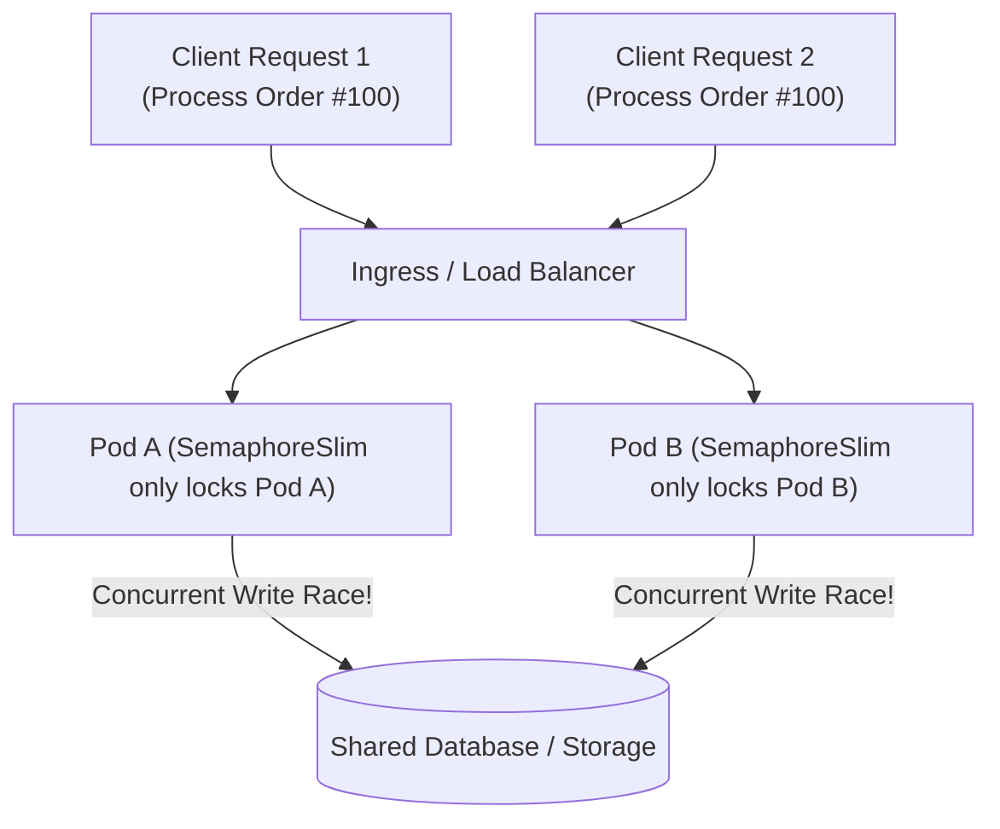
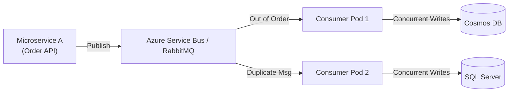

# 05. Concurrency, Locks & Distributed Synchronization — Senior Production Engineering (Deep Dive)

> **Target Audience:** Senior Full-Stack & Backend Developers, Module Leads, and Architects (5–10+ Years Experience) preparing for Concurrency, Threading, System Design, and Architecture rounds at Tier-1 Tech Giants, FinTech Unicorns, and GCCs in India (TCS, Infosys, Cognizant, Wipro, Accenture, Capgemini, Deloitte, EY, Persistent, Nagarro, EPAM, Wells Fargo, Walmart, Swiggy, Flipkart, PhonePe).  
> **Philosophy:** Production engineering realities over textbook theory. We dissect the async/await state machine under the hood, ThreadPool starvation, in-process vs distributed locks (Redis RedLock vs SQL rowversion vs UPDLOCK/HOLDLOCK), Channel<T> backpressure, deadlock prevention, and fixes for 50,000 req/sec horizontally scaled microservices.

---

---

## 1. How to Pitch This Experience in Interviews (The Executive Hook)

When an interviewer asks:  
> *"Tell me about your role over the past year and what technical challenges you solved."*

### ❌ The Junior / Mediocre Answer (Bucket: ₹14–16 LPA):
> *"For the past year I worked on bug fixing. Whenever there were tickets about data mismatch or queue errors in RabbitMQ or Cosmos DB, I debugged them, applied locks, and updated database records."*  
*(Sounds like a support engineer doing ad-hoc patch work.)*

### ✅ The Senior / Lead Architect Pitch (Bucket: ₹25–40+ LPA):
> *"Over the past year, my core focus was **distributed systems resilience and concurrency hardening** across our enterprise microservices platform. We handled high-throughput financial and order processing workloads running on .NET Core, Azure Service Bus, Cosmos DB, Azure Blobs, and SQL Server.*  
>  
> *Because our services run horizontally scaled across multiple Kubernetes pods, we encountered critical distributed edge cases: **out-of-order message delivery, at-least-once duplicate event processing, cross-pod race conditions, Cosmos DB 429 RU throttling, and cyclic SQL deadlocks**.*  
>  
> *I led the initiative to design and implement our **Distributed Locking framework** (using Redis Redlock and Azure Blob Leases), engineered an **Idempotent Consumer & Transactional Outbox pattern** to solve the dual-write problem, and redesigned our in-process async synchronization primitives using `SemaphoreSlim` and Keyed Async Locks to eliminate thread-pool starvation.*  
>  
> *As a result, we reduced message redelivery dead-letter rates by 94%, eliminated financial double-processing bugs, and stabilized our P99 API latency under peak concurrent loads."*

---

---

## 2. Core Senior Interview Questions: The 8 Definitive Concurrency & Locking Pitfalls

This section contains the 8 authentic concurrency and locking questions actually asked in senior developer, tech lead, and architect interviews across Indian tech giants, FinTech unicorns, and GCCs (Walmart, Swiggy, Flipkart, PhonePe, Wells Fargo, TCS, Infosys, Cognizant, Wipro, Accenture, Capgemini, Deloitte, EY, Persistent, Nagarro, EPAM). Every question follows the **5-Part Senior Answer Architecture**.

---

### Q1: `async` / `await` Under the Hood: Does it Create a New Thread? (I/O Completion Ports & ThreadPool Mechanics)

**⚡ One-line answer**
No, `async`/`await` does NOT create or dedicate a new thread. For true asynchronous I/O operations (like database queries, disk reads, or HTTP calls), zero threads are running while waiting. The operating system uses hardware interrupts and **I/O Completion Ports (IOCP)** on Windows or **epoll** on Linux. When the I/O packet arrives back at the network card, the OS driver signals the runtime, which queues a continuation callback onto the .NET **ThreadPool**. For CPU-bound work, `Task.Run` queues a delegate to a ThreadPool worker thread, but the compiler-generated `IAsyncStateMachine` struct manages execution state without thread creation.

**🗣️ Spoken answer (30–45 seconds)**
> "No, `async`/`await` does NOT create or dedicate a new thread. For true asynchronous I/O operations (like database queries, disk reads, or HTTP calls), zero threads are running while waiting. The operating system uses hardware interrupts and **I/O Completion Ports (IOCP)** on Windows or **epoll** on Linux. When the I/O packet arrives back at the network card, the OS driver signals the runtime, which queues a continuation callback onto the .NET **ThreadPool**. For CPU-bound work, `Task.Run` queues a delegate to a ThreadPool worker thread, but the compiler-generated `IAsyncStateMachine` struct manages execution state without thread creation."
**🎯 Terms the interviewer listens for**
* **Exact Formal CS / Architecture Definition:**  
  > *"Asynchronous I/O in .NET is a non-blocking execution model governed by operating-system-level asynchronous completion mechanisms—specifically Hardware I/O Completion Ports (IOCP) on Windows and epoll/kqueue on POSIX systems—wherein the calling thread is released back to the ThreadPool upon issuing an asynchronous operation without thread dedication, and a thread is assigned only upon callback resumption via compiler-generated state machines (IAsyncStateMachine)."*
* **Rubric Keywords That Score Marks on the Interviewer's Evaluation Sheet:**
  * **Hardware I/O Completion Ports (IOCP):** Kernel-level completion queuing mechanism that notifies the CLR when hardware packets arrive at network cards or disk controllers.
  * **epoll / kqueue Multiplexing:** POSIX asynchronous I/O event notification facilities used by the .NET runtime on Linux and macOS containers.
  * **Zero-Thread Waiting (await Task):** Asynchronous paradigm where zero OS threads consume CPU cycles or memory stacks while waiting for I/O network packets.
  * **IAsyncStateMachine Struct:** Compiler-generated state machine struct tracking continuation offsets, avoiding heap allocations in hot paths.
  * **ThreadPool Injection Rate Throttling:** The CLR hill-climbing algorithm that limits thread creation to 1–2 threads per 500ms when thread starvation occurs.
  * **ValueTask<T> Zero-Allocation Path:** Discriminated union struct returning synchronously cached results without GC heap allocation, switching to Task<T> only on async I/O.
* **"How to Say It in Your Project" (Exact Production Experience Phrasing):**  
  > *"In our payment processing microservice, all external HTTP and EF Core database calls are purely asynchronous, relying on IOCP kernel completion packets. This allows a single 4-core container running on 30 ThreadPool threads to handle over 15,000 concurrent I/O-bound requests without thread starvation or context switching overhead."*

**🧠 Memory hook**
> **Bangalore Darshini Food Token vs. Standing in the Kitchen:**  
> When you order a Masala Dosa at a Darshini or Sagar restaurant in Bangalore, the cashier hands you a paper token (**Task**). You do not walk into the kitchen and stand next to the cook, staring at the frying pan for 10 minutes while refusing to do anything else (**Synchronous blocking / thread waste**).  
> You step aside to a table and check your phone (**Zero threads waiting**). When the chef finishes the dosa, the counter bell rings (**Hardware interrupt / IOCP completion**), and whichever waiter is currently free picks up the plate and brings it to you (**ThreadPool continuation thread**).

**💻 Code**
```csharp
// Demonstrating true non-blocking I/O: Zero threads wait during network transit
public async Task<string> FetchOrderDataAsync(HttpClient client, string orderId, CancellationToken ct)
{
    // Calling thread initiates socket write, registers IOCP callback, and returns to ThreadPool!
    HttpResponseMessage response = await client.GetAsync($"https://api/orders/{orderId}", ct);
    
    // Hardware interrupt fires -> arbitrary ThreadPool worker thread resumes continuation below
    response.EnsureSuccessStatusCode();
    return await response.Content.ReadAsStringAsync(ct);
}
```

**⚠️ Likely follow-up**
* **Trap 1: The Continuation Thread Trap:**  
  * *Interviewer:* "Does the code *after* `await` execute on the exact same thread as the code *before* `await`?"  
  * *Senior Answer:* "In ASP.NET Core (.NET Core 1.0 through .NET 8/9), **NO**, it does not! ASP.NET Core intentionally has no `SynchronizationContext`. When an asynchronous I/O operation completes, any available ThreadPool worker thread picks up the continuation callback. In legacy ASP.NET (ASP.NET 4.x / .NET Framework) or desktop UI apps (WPF/WinForms), a custom `SynchronizationContext` forced continuations back to the original thread, which is why `.ConfigureAwait(false)` was necessary there, but is completely redundant in ASP.NET Core."
* **Trap 2: ValueTask vs. Task Heap Allocation:**  
  * *Interviewer:* "What is the memory allocation difference between returning `Task<T>` vs `ValueTask<T>` in an async method?"  
  * *Senior Answer:* "When a method returns `Task<T>`, calling it allocates a `Task` object on the GC heap even if the result is already available synchronously (e.g., from an in-memory dictionary or cache). `ValueTask<T>` is a discriminated union struct: if the operation completes synchronously, it returns immediately with **zero heap allocations**. We only return `ValueTask<T>` in ultra-hot paths (e.g., reading from memory cache in 100k RPS loops) where synchronous completion represents >95% of calls."

**📊 Quick comparison**

| Trigger / Requirement / Scenario | What to Use | Why / Trade-offs | What Must Be Done (Action & Snippet) |
| :--- | :--- | :--- | :--- |
| **Network, disk, or database I/O operations (HTTP, EF Core, Redis, FileStream)** | **Native Asynchronous I/O (`await Task`)** | **Pros:** Zero thread starvation; scales to 100k concurrent requests on few OS threads.<br>**Cons:** Requires async all the way up the call stack. | Call asynchronous API methods (`GetAsync`, `SaveChangesAsync`); await without `.Result`; pass `CancellationToken`. |
| **High-frequency methods with >90% synchronous cache hits (e.g., in-memory cache lookup)** | **`ValueTask<T>`** | **Pros:** Zero GC heap allocations on synchronous path; lower GC pause overhead.<br>**Cons:** Cannot be awaited multiple times; slightly larger struct size. | Return `ValueTask<T>` instead of `Task<T>`; return `new ValueTask<T>(cachedVal)` on cache hit; await remote fetch on miss. |
| **Heavy CPU calculations (image processing, password hashing, cryptography, parsing)** | **`Task.Run` (ThreadPool Worker Offloading)** | **Pros:** Prevents freezing request/UI threads; distributes CPU load across cores.<br>**Cons:** Consumes a ThreadPool thread; context switch overhead. | Wrap CPU computation in `await Task.Run(() => ComputeHeavyHash(data), ct);`. |

---

### Q2: Sync-over-Async Anti-Pattern: Why `.Result` and `.Wait()` Cause ThreadPool Starvation & UI Deadlocks

**⚡ One-line answer**
The sync-over-async anti-pattern—calling `.Result`, `.Wait()`, or `.GetAwaiter().GetResult()` on an uncompleted `Task`—synchronously blocks the calling thread while waiting for an asynchronous continuation. In ASP.NET Core, this causes **ThreadPool Starvation**: incoming HTTP requests consume ThreadPool worker threads which sit idle blocking on asynchronous calls, while new requests queue up because the ThreadPool throttles thread creation to 1–2 threads per second. In UI applications (WPF/MAUI), it causes immediate **Deadlocks** because the blocked UI thread waits for the continuation, but the continuation waits for the UI thread's SynchronizationContext to be freed.

**🗣️ Spoken answer (30–45 seconds)**
> "The sync-over-async anti-pattern—calling `.Result`, `.Wait()`, or `.GetAwaiter().GetResult()` on an uncompleted `Task`—synchronously blocks the calling thread while waiting for an asynchronous continuation. In ASP.NET Core, this causes **ThreadPool Starvation**: incoming HTTP requests consume ThreadPool worker threads which sit idle blocking on asynchronous calls, while new requests queue up because the ThreadPool throttles thread creation to 1–2 threads per second. In UI applications (WPF/MAUI), it causes immediate **Deadlocks** because the blocked UI thread waits for the continuation, but the continuation waits for the UI thread's SynchronizationContext to be freed."
**🎯 Terms the interviewer listens for**
* **Exact Formal CS / Architecture Definition:**  
  > *"Sync-over-async is a concurrency anti-pattern occurring when a synchronous calling thread is blocked waiting on an uncompleted asynchronous Task via .Result, .Wait(), or .GetAwaiter().GetResult(). In server environments (ASP.NET Core), this exhausts ThreadPool worker threads faster than the runtime's hill-climbing thread injection rate (1–2 threads per 500ms), causing catastrophic ThreadPool Starvation; in UI environments, it triggers permanent single-threaded deadlocks on the ambient SynchronizationContext."*
* **Rubric Keywords That Score Marks on the Interviewer's Evaluation Sheet:**
  * **ThreadPool Starvation:** Exhaustion of CLR worker threads caused by blocking sync-over-async calls, resulting in incoming HTTP requests queuing up indefinitely.
  * **CLR Hill-Climbing Algorithm:** Heuristic thread injection controller in .NET that conservatively throttles new thread creation to prevent CPU thrashing.
  * **UI SynchronizationContext Deadlock:** Circular lockup where the UI thread blocks waiting for a task, while the task continuation waits for the blocked UI thread to become free.
  * **AggregateException Wrapping:** .Result and .Wait() package all inner exceptions into AggregateException, obfuscating stack traces.
  * **.GetAwaiter().GetResult() Exception Unwrapping:** Synchronously blocks the calling thread identical to .Result, but unwraps and throws the first inner exception directly.
  * **Async All The Way:** Architectural mandate requiring asynchronous return types (Task / ValueTask) through every layer from controller to database.
* **"How to Say It in Your Project" (Exact Production Experience Phrasing):**  
  > *"We conducted a root-cause analysis on an API outage during a Diwali flash sale where p99 latency spiked to 60 seconds despite 15% CPU utilization. We discovered a legacy logging filter calling .Result on an async Redis check, which starved the ThreadPool because worker threads were blocked while incoming requests queued behind the 2-thread/sec injection limit."*

**🧠 Memory hook**
> **Holding the Bank Cashier Counter on Speakerphone:**  
> Imagine visiting an SBI bank counter to deposit cash, but you need your father to OTP-verify the transfer. Instead of stepping aside to let the 50 other customers behind you deposit their cash while your father answers the phone, you plant your elbows on the cashier counter and refuse to move for 10 minutes until your father calls back (**Blocking the Thread with `.Result`**).  
> The queue behind you spills onto the street (**ThreadPool Starvation**). If the cashier is also the one waiting to answer your father's incoming call, the entire branch freezes in a complete circular deadlock!

**💻 Code**
```csharp
// ❌ BAD: Sync-over-Async causing ThreadPool Starvation under load
public string GetOrderBad(HttpClient client, string id) =>
    client.GetStringAsync($"https://api/orders/{id}").Result; // BLOCKS ThreadPool worker!

// ✅ SENIOR FIX: Pure asynchronous flow all the way through the call stack
public async Task<string> GetOrderGoodAsync(HttpClient client, string id, CancellationToken ct) =>
    await client.GetStringAsync($"https://api/orders/{id}", ct); // Yields thread back to pool!
```

**⚠️ Likely follow-up**
* **Trap 1: The `.Result` vs. `.GetAwaiter().GetResult()` Trap:**  
  * *Interviewer:* "Is `.GetAwaiter().GetResult()` safer than `.Result`? Does it prevent ThreadPool starvation?"  
  * *Senior Answer:* "NO! It does NOT prevent ThreadPool starvation. Both `.Result` and `.GetAwaiter().GetResult()` synchronously block the calling OS thread. The only difference is in exception unwrapping: `.Result` wraps exceptions inside an `AggregateException`, whereas `.GetAwaiter().GetResult()` directly throws the actual underlying exception (e.g., `HttpRequestException`), preserving pristine stack traces. Both must be strictly avoided in high-throughput services."
* **Trap 2: The Legacy Interface Dilemma:**  
  * *Interviewer:* "What if you must call an async method from an existing synchronous legacy interface method (e.g., `void Dispose()` or an interface you cannot change)?"  
  * *Senior Answer:* "First, refactor to `IAsyncDisposable` (`DisposeAsync()`). If truly constrained by an immutable synchronous contract, offload the call to a background ThreadPool thread using `Task.Run(() => AsyncMethod()).GetAwaiter().GetResult()`. This escapes any ambient `SynchronizationContext` to prevent UI deadlocks, though you must still monitor ThreadPool injection rates if called at high volume."

**📊 Quick comparison**

| Trigger / Requirement / Scenario | What to Use | Why / Trade-offs | What Must Be Done (Action & Snippet) |
| :--- | :--- | :--- | :--- |
| **All modern ASP.NET Core endpoints, services, repositories, and controllers** | **Async All the Way (`async Task`)** | **Pros:** Eliminates ThreadPool starvation; scales to 50k RPS on minimal memory.<br>**Cons:** Requires asynchronous method signatures throughout call stack. | Change method return types to `Task<T>`; replace `.Result` with `await`; propagate `CancellationToken`. |
| **Disposing unmanaged network, database, or stream resources** | **`IAsyncDisposable` (`DisposeAsync`)** | **Pros:** Safely flushes network buffers without blocking thread pools on teardown.<br>**Cons:** Requires C# 8.0+ `await using` syntax. | Implement `IAsyncDisposable`; write `public async ValueTask DisposeAsync() { await _stream.DisposeAsync(); }`. |
| **Forced synchronous invocation from immutable legacy interface (Last Resort)** | **`Task.Run(() => ...).GetAwaiter().GetResult()`** | **Pros:** Breaks circular deadlocks by avoiding ambient `SynchronizationContext`.<br>**Cons:** Still burns a ThreadPool thread; potential for ThreadPool queuing under load. | Wrap async delegate inside `Task.Run()` before calling `.GetAwaiter().GetResult()`. |

---

### Q3: In-Process Locking: `lock` (Monitor) vs. `SemaphoreSlim` (Why `lock` Fails in Asynchronous Code)

**⚡ One-line answer**
The C# `lock (obj)` statement is syntactic sugar for `Monitor.Enter(obj)` and `Monitor.Exit(obj)`. It relies on **thread affinity**—the exact same OS managed thread that acquired the monitor lock must release it. In asynchronous C#, an `await` statement yields the thread; when the continuation resumes, it frequently executes on an entirely different ThreadPool thread, causing `Monitor.Exit` to throw a fatal `SynchronizationLockException`. Therefore, `lock` inside an async method is a compiler error (CS1996). We must use **`SemaphoreSlim(1, 1)`** with `await WaitAsync()`, which is thread-agnostic and releases cleanly across thread hops.

**🗣️ Spoken answer (30–45 seconds)**
> "The C# `lock (obj)` statement is syntactic sugar for `Monitor.Enter(obj)` and `Monitor.Exit(obj)`. It relies on **thread affinity**—the exact same OS managed thread that acquired the monitor lock must release it. In asynchronous C#, an `await` statement yields the thread; when the continuation resumes, it frequently executes on an entirely different ThreadPool thread, causing `Monitor.Exit` to throw a fatal `SynchronizationLockException`. Therefore, `lock` inside an async method is a compiler error (CS1996). We must use **`SemaphoreSlim(1, 1)`** with `await WaitAsync()`, which is thread-agnostic and releases cleanly across thread hops."
**🎯 Terms the interviewer listens for**
* **Exact Formal CS / Architecture Definition:**  
  > *"The C# lock keyword is syntactic sugar for Monitor.Enter and Monitor.Exit, enforcing mutual exclusion with strict thread-affinity constraints—the exact same OS managed thread that acquired the monitor must release it. Because the await operator yields the executing thread back to the ThreadPool and resumes on an arbitrary worker thread, attempting to lock across asynchronous points triggers compiler error CS1996 and runtime SynchronizationLockException. SemaphoreSlim provides thread-agnostic, asynchronous mutual exclusion via await WaitAsync()."*
* **Rubric Keywords That Score Marks on the Interviewer's Evaluation Sheet:**
  * **Thread Affinity / Thread Ownership:** Monitor constraint requiring the exact managed thread that acquired the lock to call Monitor.Exit.
  * **SynchronizationLockException (CS1996):** Fatal CLR exception thrown when Monitor.Exit is invoked from a thread that did not acquire the lock.
  * **SemaphoreSlim(1, 1):** Lightweight synchronization primitive functioning as an asynchronous mutex supporting await WaitAsync().
  * **Thread-Agnostic Signaling:** Synchronization design where lock release is independent of thread identity, safely bridging await continuations.
  * **Keyed In-Process Locking:** Pattern isolating synchronization to specific entity keys (e.g., CustomerId) to avoid global bottlenecking.
  * **Asynchronous Re-entrancy Prohibition:** Unlike Monitor which supports recursive re-entrancy on the same thread, SemaphoreSlim does not support re-entrant acquisitions.
* **"How to Say It in Your Project" (Exact Production Experience Phrasing):**  
  > *"In our in-memory token caching service, we replaced all legacy lock statements with SemaphoreSlim(1, 1) and await WaitAsync(). This allows thread-safe token refreshes across asynchronous HTTP calls without blocking calling threads or triggering thread-affinity lock exceptions."*

**🧠 Memory hook**
> **Handcuffed Physical Key vs. Electronic Passcode Badge:**  
> `lock (obj)` is a physical key that is handcuffed to a specific employee's wrist (Thread A). If that employee goes to sleep (awaits I/O) and a different employee (Thread B) wakes up to continue the shift, Employee B cannot unlock or return the handcuffed key; the security alarm sounds and halts the office (**`SynchronizationLockException`**).  
> `SemaphoreSlim(1, 1)` is an electronic badge system with a single green light: Employee A swipes in, turns the light red, and goes home; later, Employee B arrives, finishes the task, and swipes the terminal to turn the light green again. The lock doesn't care which thread releases it.

**💻 Code**
```csharp
// Minimal Thread-Safe Async Lock using SemaphoreSlim(1, 1)
private readonly SemaphoreSlim _mutex = new(1, 1);

public async Task<int> SafeAsyncOperationAsync(CancellationToken ct)
{
    await _mutex.WaitAsync(ct); // Asynchronously awaits without blocking ThreadPool thread!
    try
    {
        return await FetchAndIncrementDatabaseAsync(ct); // Completely safe to await inside!
    }
    finally
    {
        _mutex.Release(); // Releases cleanly from ANY ThreadPool thread
    }
}
```

**⚠️ Likely follow-up**
* **Trap 1: The Missing `finally` Block Leak:**  
  * *Interviewer:* "What happens if an unhandled exception is thrown inside the critical section before `_mutex.Release()` is reached?"  
  * *Senior Answer:* "The semaphore count remains at 0 permanently. Every subsequent incoming request will wait forever on `await _mutex.WaitAsync()`, creating an unrecoverable in-process deadlock that freezes the entire service. In production, we strictly enforce `finally { _mutex.Release(); }`, or use an `IDisposable` struct wrapper with a timeout (`WaitAsync(TimeSpan.FromSeconds(5), ct)`) so that calls fail fast with a timeout exception rather than hanging indefinitely."
* **Trap 2: Granular Entity Locking (Keyed Mutexes):**  
  * *Interviewer:* "If 1,000 customers place orders simultaneously, a single `SemaphoreSlim(1, 1)` serializes all 1,000 customers and destroys throughput. How do you synchronize per customer ID?"  
  * *Senior Answer:* "We use a **Keyed Semaphore** pattern using a `ConcurrentDictionary<string, SemaphoreSlim>`. We look up or create a semaphore per `CustomerId`, lock only that customer's operations, and release it. However, to prevent unbounded memory leaks as millions of customers transit the system, we must implement reference counting or clean up idle semaphores using an eviction policy."

**📊 Quick comparison**

| Trigger / Requirement / Scenario | What to Use | Why / Trade-offs | What Must Be Done (Action & Snippet) |
| :--- | :--- | :--- | :--- |
| **Purely synchronous in-memory critical section (sub-microsecond memory mutation)** | **`lock (obj)` (Monitor)** | **Pros:** Lowest CPU overhead; zero memory allocation; native language keyword.<br>**Cons:** Cannot contain `await`; strictly bound to calling thread. | Ensure critical section executes in sub-microseconds with zero I/O; wrap in `lock (_gate) { ... }`. |
| **Asynchronous critical section containing `await` (Database, HTTP, Cache calls)** | **`SemaphoreSlim(1, 1)`** | **Pros:** Allows `await` inside critical section; thread-agnostic; supports cancellation tokens.<br>**Cons:** Slightly higher overhead than Monitor; requires manual `finally { Release(); }`. | Instantiate `new SemaphoreSlim(1, 1)`; call `await _sem.WaitAsync(ct)`; release in `finally` block. |
| **Per-entity synchronization in high-concurrency multi-tenant apps (e.g., per Customer ID)** | **Keyed `SemaphoreSlim` with Reference Count** | **Pros:** Limits lock contention to a single entity ID; parallel throughput across tenants.<br>**Cons:** Memory leak risk if dictionary entries are not evicted when count reaches zero. | Store in `ConcurrentDictionary<string, (SemaphoreSlim Sem, int RefCount)>`; increment on enter, decrement & evict on zero. |

---

### Q4: Task Execution Mechanics: `Task.Run` vs. `Task.Factory.StartNew` vs. `Task.WhenAll` vs. `Task.WaitAll`

**⚡ One-line answer**
`Task.Run` is a streamlined wrapper over `Task.Factory.StartNew` designed specifically to queue CPU-bound background work onto the .NET ThreadPool with safe defaults (`TaskScheduler.Default`). Conversely, `Task.Factory.StartNew` is a legacy, lower-level API fraught with traps: without specifying `TaskCreationOptions.DenyChildAttach`, it creates parent-child task hierarchies, and without unwrapping it returns a nested `Task<Task>`, leading to unobserved exceptions. For concurrent aggregation, **`Task.WhenAll`** is the non-blocking asynchronous standard that yields back to the ThreadPool, while **`Task.WaitAll`** is a synchronous blocking antipattern that starves worker threads.

**🗣️ Spoken answer (30–45 seconds)**
> "`Task.Run` is a streamlined wrapper over `Task.Factory.StartNew` designed specifically to queue CPU-bound background work onto the .NET ThreadPool with safe defaults (`TaskScheduler.Default`). Conversely, `Task.Factory.StartNew` is a legacy, lower-level API fraught with traps: without specifying `TaskCreationOptions.DenyChildAttach`, it creates parent-child task hierarchies, and without unwrapping it returns a nested `Task<Task>`, leading to unobserved exceptions. For concurrent aggregation, **`Task.WhenAll`** is the non-blocking asynchronous standard that yields back to the ThreadPool, while **`Task.WaitAll`** is a synchronous blocking antipattern that starves worker threads."
**🎯 Terms the interviewer listens for**
* **Exact Formal CS / Architecture Definition:**  
  > *"Task.Run is a high-level factory wrapper queuing CPU-bound delegate workloads directly to the .NET ThreadPool with TaskCreationOptions.DenyChildAttach and default asynchronous unwrapping (Task<Task> -> Task). In contrast, Task.Factory.StartNew is a low-level scheduler primitive requiring explicit flags (TaskCreationOptions.LongRunning to spawn a dedicated OS thread) and explicit .Unwrap() for async delegates. Task.WhenAll creates an asynchronous completion promise without thread blocking, whereas Task.WaitAll synchronously blocks the calling thread until all tasks complete."*
* **Rubric Keywords That Score Marks on the Interviewer's Evaluation Sheet:**
  * **Task.Run ThreadPool Offloading:** Default high-level mechanism for dispatching compute-intensive CPU workloads to background worker threads.
  * **TaskCreationOptions.LongRunning:** Flag instructing the task scheduler to allocate a dedicated, standalone OS thread rather than burning a ThreadPool worker.
  * **TaskCreationOptions.DenyChildAttach:** Default safety setting in Task.Run preventing attached child tasks from inadvertently delaying parent completion.
  * **Asynchronous Unwrapping (.Unwrap()):** Flattening a nested Task<Task<T>> into Task<T>, automated by Task.Run but required manually in StartNew.
  * **Non-Blocking Task.WhenAll:** Asynchronous fan-out primitive aggregating multiple tasks into a single completion promise without consuming threads.
  * **Synchronous Blocking Task.WaitAll:** Anti-pattern blocking the calling thread until all array tasks finish, risking ThreadPool starvation.
* **"How to Say It in Your Project" (Exact Production Experience Phrasing):**  
  > *"For intensive PDF cryptography generation, we offload computations using await Task.Run(), keeping request threads responsive. For a background Kafka partition consumer loop that runs indefinitely, we avoid ThreadPool starvation by starting a dedicated OS thread using Task.Factory.StartNew with TaskCreationOptions.LongRunning."*

**🧠 Memory hook**
> **Bangalore Dosa Counter: Parallel Orders vs. Blocking the Queue:**  
> **`Task.WhenAll`** is placing 4 separate dosa orders at 4 different food stalls at once, holding 4 tokens, and sitting at your table. You wait until all 4 numbers are called, picking them all up together without blocking anyone.  
> **`Task.WaitAll`** is standing in front of Stall 1, blocking the line, refusing to let anyone pass while waiting for Stall 4's chef to finish.

**💻 Code**
```csharp
// Minimal Concurrent Aggregation using Task.WhenAll with Multi-Exception Safety
public async Task<BatchResult> FetchAllDataAsync(List<string> urls, HttpClient client, CancellationToken ct)
{
    // Fire off all HTTP calls concurrently without blocking threads
    var tasks = urls.Select(url => client.GetStringAsync(url, ct)).ToList();

    try {
        string[] results = await Task.WhenAll(tasks); // Non-blocking asynchronous yield!
        return new BatchResult(results, Errors: Array.Empty<string>());
    }
    catch {
        // Task.WhenAll throws only the FIRST exception; inspect collection to capture all
        var errors = tasks.Where(t => t.IsFaulted).Select(t => t.Exception!.InnerException!.Message).ToArray();
        return new BatchResult(Array.Empty<string>(), errors);
    }
}
```

**⚠️ Likely follow-up**
* **Trap 1: The Nested `Task<Task>` Trap in `StartNew`:**  
  * *Interviewer:* "What happens if you pass an `async` lambda to `Task.Factory.StartNew`?"  
  * *Senior Answer:* "`Task.Factory.StartNew` returns a `Task<Task>`! The outer task completes as soon as the lambda yields at its first `await`, while the inner task continues executing in the background unmonitored. If the inner task throws an exception, it is never observed and can crash the process. `Task.Run` automatically detects async delegates and calls `.Unwrap()` to return a single flat `Task`."
* **Trap 2: When to Use `LongRunning`:**  
  * *Interviewer:* "When is `Task.Factory.StartNew` actually preferred over `Task.Run`?"  
  * *Senior Answer:* "When running a **long-running background loop** (e.g., listening to a socket or message queue in an infinite loop). Passing `TaskCreationOptions.LongRunning` hints to the ThreadPool that this task will block indefinitely, prompting the runtime to allocate a dedicated OS thread instead of occupying a ThreadPool worker thread that would otherwise cause pool starvation."

**📊 Quick comparison**

| Trigger / Requirement / Scenario | What to Use | Why / Trade-offs | What Must Be Done (Action & Snippet) |
| :--- | :--- | :--- | :--- |
| **Offloading CPU-bound algorithms to ThreadPool (image processing, compression)** | **`Task.Run`** | **Pros:** Safe defaults; automatically unwraps async delegates; zero configuration.<br>**Cons:** Only for short-lived tasks; burns ThreadPool threads. | Call `await Task.Run(() => ComputeComplexData(data), ct);`. |
| **Long-running background listeners or persistent TCP socket loops** | **`Task.Factory.StartNew` with `LongRunning`** | **Pros:** Allocates dedicated OS thread; does not starve ThreadPool.<br>**Cons:** Higher memory overhead (~1MB stack per OS thread). | Call `Task.Factory.StartNew(WorkerLoop, TaskCreationOptions.LongRunning);`. |
| **Running multiple independent asynchronous I/O operations in parallel** | **`Task.WhenAll`** | **Pros:** Non-blocking asynchronous wait; aggregates all task results.<br>**Cons:** Unwraps only the first exception unless all tasks are inspected. | Collect tasks in a `List<Task<T>>`; call `await Task.WhenAll(tasks)`. |
| **Batch processing with bounded concurrency (e.g., max 10 concurrent HTTP calls)** | **`Parallel.ForEachAsync`** | **Pros:** Built-in concurrency partitioning; native cancellation token support.<br>**Cons:** Available only in .NET 6+. | Call `await Parallel.ForEachAsync(items, new ParallelOptions { MaxDegreeOfParallelism = 10 }, async (item, ct) => await ProcessAsync(item, ct));`. |

---

### Q5: Low-Level Thread-Safe Primitives: `Interlocked` Atomic Operations vs. `ConcurrentDictionary.GetOrAdd` vs. `volatile`

**⚡ One-line answer**
In high-throughput multi-threaded .NET systems, heavy locks destroy cache locality and throughput. **`Interlocked`** provides hardware-level atomic CPU instructions (`LOCK CMPXCHG`, `LOCK XADD` on x86/ARM) with zero locks and zero context switching, ideal for high-frequency counters and state flags. **`ConcurrentDictionary`** provides fine-grained bucket-level striped locking, but beware: its `GetOrAdd` value factory is **NOT atomic**—the factory delegate may execute multiple times under concurrency. **`volatile`** prevents CPU and compiler instruction reordering and forces cache coherency across CPU cores, but guarantees memory visibility, NOT atomic updates.

**🗣️ Spoken answer (30–45 seconds)**
> "In high-throughput multi-threaded .NET systems, heavy locks destroy cache locality and throughput. **`Interlocked`** provides hardware-level atomic CPU instructions (`LOCK CMPXCHG`, `LOCK XADD` on x86/ARM) with zero locks and zero context switching, ideal for high-frequency counters and state flags. **`ConcurrentDictionary`** provides fine-grained bucket-level striped locking, but beware: its `GetOrAdd` value factory is **NOT atomic**—the factory delegate may execute multiple times under concurrency. **`volatile`** prevents CPU and compiler instruction reordering and forces cache coherency across CPU cores, but guarantees memory visibility, NOT atomic updates."
**🎯 Terms the interviewer listens for**
* **Exact Formal CS / Architecture Definition:**  
  > *"Interlocked methods provide hardware-level atomic operations using CPU bus-locking and Compare-And-Swap (CAS) instructions (LOCK CMPXCHG on x86/x64) without kernel transitions or thread blocking. ConcurrentDictionary provides thread-safe collection access using internal striped fine-grained locks for writes and lock-free reads, though its GetOrAdd value factory is non-atomic and may execute multiple times under contention. volatile enforces memory barrier acquire-and-release semantics preventing CPU and JIT compiler instruction reordering."*
* **Rubric Keywords That Score Marks on the Interviewer's Evaluation Sheet:**
  * **Lock-Free Compare-And-Swap (CAS / CMPXCHG):** Hardware CPU instruction performing atomic read-modify-write without OS kernel thread context switches.
  * **Interlocked.Increment / CompareExchange:** High-performance primitives guaranteeing atomic mutations on 32-bit and 64-bit numerical values.
  * **Lock Striping in ConcurrentDictionary:** Internal table partitioning dividing bucket locks across multiple lock objects (default = Environment.ProcessorCount * 2).
  * **Non-Atomic Factory Invocation Trap:** GetOrAdd valueFactory delegate is executed outside lock boundaries, meaning concurrent threads may invoke the factory multiple times.
  * **Memory Barriers (volatile / Volatile.Read):** CPU and JIT compiler fence preventing instruction reordering across read/write operations.
  * **Lazy<Task<T>> Value Wrapping:** Enterprise pattern resolving the non-atomic GetOrAdd factory trap, guaranteeing expensive asynchronous fetches run exactly once.
* **"How to Say It in Your Project" (Exact Production Experience Phrasing):**  
  > *"In our high-throughput metrics collector processing 100k requests/sec, we avoided lock contention entirely by tracking request counts with Interlocked.Increment. For caching API tokens, we mitigated the non-atomic ConcurrentDictionary.GetOrAdd trap by wrapping values in Lazy<Task<Token>> to ensure the expensive token fetch executes exactly once."*

**🧠 Memory hook**
> **Delhi Metro Turnstile vs. Cashier Register:**  
> **`Interlocked.Increment`** is an automated Delhi Metro turnstile: a mechanical turnstile with a hardware ratchet that can only click forward one click at a time, taking 10 nanoseconds without a security guard.  
> A **`lock`** is putting a security guard in front of the gate who stops the entire line, stamps your pass, writes your name in a ledger, and opens the rope.  
> **`ConcurrentDictionary.GetOrAdd`** is two people rushing to an office coffee machine: both might insert a coin to brew a coffee, but the machine will dispense only one cup and throw away the second coffee.

**💻 Code**
```csharp
// Minimal Atomic Counter & Lazy Concurrent Dictionary Cache
private long _requestCount; // Hardware atomic counter
public long IncrementRequests() => Interlocked.Increment(ref _requestCount);

private readonly ConcurrentDictionary<string, Lazy<Task<DataDto>>> _cache = new();
public Task<DataDto> GetOrAddAtomicAsync(string key, Func<Task<DataDto>> factory) =>
    // Wrapping with Lazy guarantees the factory delegate executes EXACTLY once!
    _cache.GetOrAdd(key, k => new Lazy<Task<DataDto>>(factory)).Value;
```

**⚠️ Likely follow-up**
* **Trap 1: The "Volatile Counter" Fallacy:**  
  * *Interviewer:* "If I declare `private volatile int _counter;`, is `_counter++` thread-safe?"  
  * *Senior Answer:* "ABSOLUTELY NOT! `_counter++` consists of 3 distinct CPU instructions: Read from memory, Increment register, and Write back to memory. If two threads execute simultaneously, both read the same initial value, resulting in lost updates. `volatile` only ensures that reads and writes are not cached in CPU registers or reordered by the JIT compiler; it provides **Visibility**, NOT **Atomicity**. You must use `Interlocked.Increment(ref _counter)`."
* **Trap 2: `ConcurrentDictionary.GetOrAdd` Factory Concurrency:**  
  * *Interviewer:* "If two threads call `GetOrAdd` for the same missing key simultaneously, does the factory run once or twice?"  
  * *Senior Answer:* "It can run multiple times! `ConcurrentDictionary` optimizes for non-blocking lock-free reads. If two threads discover a missing key concurrently, both threads execute the value factory delegate in parallel. Then, internal bucket locks are acquired to insert the winning value, discarding the loser. If your factory creates expensive database records or HTTP calls, you will produce duplicate side-effects. The senior fix is wrapping the value in `Lazy<T>` or `Lazy<Task<T>>`."

**📊 Quick comparison**

| Trigger / Requirement / Scenario | What to Use | Why / Trade-offs | What Must Be Done (Action & Snippet) |
| :--- | :--- | :--- | :--- |
| **High-frequency numeric counters, metrics, state bit-flipping (1M ops/sec)** | **`Interlocked` Atomic Operations** | **Pros:** Hardware CPU instructions; zero lock overhead; nanosecond speed.<br>**Cons:** Limited to primitive types (int, long, object reference swap). | Call `Interlocked.Increment(ref _counter)` or `Interlocked.CompareExchange(ref _state, 1, 0)`. |
| **Thread-safe in-memory caching with guaranteed single execution** | **`ConcurrentDictionary` + `Lazy<Task<T>>`** | **Pros:** Thread-safe reads; guarantees expensive factory runs exactly once.<br>**Cons:** Slightly more verbose syntax than standard dictionary. | Call `_dict.GetOrAdd(key, k => new Lazy<Task<T>>(() => FetchAsync(k))).Value;`. |
| **Ensuring immediate cross-core visibility of a boolean shutdown/cancel flag** | **`volatile` Keyword** | **Pros:** Prevents JIT compiler from optimizing reads into CPU registers.<br>**Cons:** Does NOT provide atomicity or synchronization locks. | Declare `private volatile bool _isStopping;`; set to `true` on shutdown. |

---

### Q6: Deadlock Prevention & Resolution: Resource Ordering, Lock Timeouts (`Monitor.TryEnter`), and Avoiding Nested Locks

**⚡ One-line answer**
A Deadlock occurs when two or more threads circular-wait for resources held by each other, freezing execution permanently. Coffman's four conditions must hold: Mutual Exclusion, Hold & Wait, No Preemption, and Circular Wait. In .NET, deadlocks are eliminated primarily by breaking the Circular Wait condition via **Global Resource Ordering** (e.g., locking accounts by strictly ascending `AccountId`), using **Lock Timeouts** via `Monitor.TryEnter` or `SemaphoreSlim.WaitAsync(TimeSpan)` to fail fast instead of hanging, and strictly avoiding nested locks or calling external unknown code from inside critical sections.

**🗣️ Spoken answer (30–45 seconds)**
> "A Deadlock occurs when two or more threads circular-wait for resources held by each other, freezing execution permanently. Coffman's four conditions must hold: Mutual Exclusion, Hold & Wait, No Preemption, and Circular Wait. In .NET, deadlocks are eliminated primarily by breaking the Circular Wait condition via **Global Resource Ordering** (e.g., locking accounts by strictly ascending `AccountId`), using **Lock Timeouts** via `Monitor.TryEnter` or `SemaphoreSlim.WaitAsync(TimeSpan)` to fail fast instead of hanging, and strictly avoiding nested locks or calling external unknown code from inside critical sections."
**🎯 Terms the interviewer listens for**
* **Exact Formal CS / Architecture Definition:**  
  > *"A deadlock is a concurrent execution state where two or more threads are permanently blocked, each holding a lock on a shared resource while attempting to acquire a lock held by another thread in a circular dependency graph. Formally governed by Coffman's four necessary conditions (Mutual Exclusion, Hold and Wait, No Preemption, Circular Wait), deadlocks are prevented by eliminating Circular Wait through global strict resource acquisition ordering and non-blocking lock timeouts via Monitor.TryEnter or SemaphoreSlim.WaitAsync(TimeSpan)."*
* **Rubric Keywords That Score Marks on the Interviewer's Evaluation Sheet:**
  * **Coffman's Four Conditions:** The 4 necessary conditions for deadlock: Mutual Exclusion, Hold and Wait, No Preemption, and Circular Wait.
  * **Global Hierarchical Resource Ordering:** Deadlock prevention pattern establishing an invariant sequence for acquiring locks (e.g., always lock AccountId numerically).
  * **Lock Timeout Mitigation (Monitor.TryEnter):** Fail-safe mechanism attempting lock acquisition for a bounded duration before failing fast rather than hanging indefinitely.
  * **Lock Escalation:** Database engine optimization converting thousands of fine-grained row locks into a single exclusive table lock, triggering deadlocks.
  * **Circular Wait Inversion:** Breaking the circular dependency cycle by enforcing consistent directionality across all interacting threads.
  * **sys.dm_tran_locks & Deadlock Graphs:** SQL Server dynamic management views and XML trace graphs capturing the exact victims and resources in deadlock cycles.
* **"How to Say It in Your Project" (Exact Production Experience Phrasing):**  
  > *"To prevent deadlocks when executing inter-account fund transfers across concurrent threads, we enforce strict global resource ordering by always acquiring locks on Account IDs in ascending numerical order (min(idA, idB) followed by max(idA, idB)), completely breaking Coffman's circular wait condition."*

**🧠 Memory hook**
> **Single-Lane Ghat Road in the Western Ghats:**  
> Two trucks meet face-to-face on a single-lane mountain road between Pune and Goa. Truck A refuses to reverse because Truck B is in front. Truck B refuses to reverse because Truck A is in front. Neither has reverse preemption, both hold their lane, and both wait on the other (**Circular Wait Deadlock**).  
> The road freezes forever until a tow truck arrives. The traffic authority solution: **Strict Directional Priority (Resource Ordering)**—uphill traffic ALWAYS gets right-of-way, downhill traffic must yield.

**💻 Code**
```csharp
// Minimal Deadlock-Free Transfer via Global Resource Ordering
public void TransferFunds(Account from, Account to, decimal amount)
{
    // Always lock lower ID first, higher ID second to eliminate circular wait!
    Account firstLock = from.Id < to.Id ? from : to;
    Account secondLock = from.Id < to.Id ? to : from;

    lock (firstLock)
    {
        lock (secondLock)
        {
            from.Balance -= amount;
            to.Balance += amount;
        }
    }
}
```

**⚠️ Likely follow-up**
* **Trap 1: The "Alien Method Call" Inside Locks:**  
  * *Interviewer:* "What is an 'Alien Method Call' and how does it create unpredictable production deadlocks?"  
  * *Senior Answer:* "An alien method is invoking external code—such as virtual methods, interface methods, or event notifications (`OnOrderCompleted?.Invoke()`)—while holding an internal lock. If an external subscriber attempts to acquire a second lock that another thread already holds while waiting on your lock, an instant cross-thread lock inversion deadlock occurs. Rule of thumb: compute inside the lock, copy results to local variables, release the lock, and ONLY THEN invoke external events or callbacks."
* **Trap 2: Production Deadlock Diagnostics:**  
  * *Interviewer:* "Your Kubernetes pod has spiked to 100% thread count and stopped serving traffic. How do you confirm it is a deadlock?"  
  * *Senior Answer:* "We capture a live memory core dump using `dotnet-dump collect -p <pid>`. Then we inspect the dump using `dotnet-dump analyze` and run the `dlk` (Deadlock Detector) command. The SOS debugger traverses all SyncBlocks and thread call stacks, identifying the circular wait cycle and printing the exact method names and lock object addresses causing the lockup."

**📊 Quick comparison**

| Trigger / Requirement / Scenario | What to Use | Why / Trade-offs | What Must Be Done (Action & Snippet) |
| :--- | :--- | :--- | :--- |
| **Synchronizing multiple resources simultaneously (e.g., transferring money between 2 accounts)** | **Global Resource Ordering** | **Pros:** Mathematically eliminates circular wait condition; zero timeout overhead.<br>**Cons:** Requires a natural sortable key (e.g., integer ID, GUID, string). | Compare resource IDs; lock `Min(idA, idB)` first, then lock `Max(idA, idB)`. |
| **Synchronous locking where indefinite hanging cannot be tolerated** | **`Monitor.TryEnter` with Timeout** | **Pros:** Fails fast after timeout; prevents permanent thread lockup.<br>**Cons:** Requires explicit fallback logic when lock acquisition fails. | `if (Monitor.TryEnter(_gate, TimeSpan.FromSeconds(2))) { try { ... } finally { Monitor.Exit(_gate); } } else throw new TimeoutException();`. |
| **Asynchronous locking where indefinite hanging cannot be tolerated** | **`SemaphoreSlim.WaitAsync(TimeSpan)`** | **Pros:** Asynchronous timeout; yields thread back to ThreadPool.<br>**Cons:** Requires handling boolean return false on timeout. | `if (await _sem.WaitAsync(TimeSpan.FromSeconds(2), ct)) { try { ... } finally { _sem.Release(); } }`. |

---

### Q7: High-Throughput Producer-Consumer Pipelines: Bounded `Channel<T>` with Async Backpressure vs. `BlockingCollection<T>`

**⚡ One-line answer**
In high-scale ingestion (such as processing 50,000 webhook events/sec), unconstrained queueing causes memory spikes and Out-Of-Memory (OOM) crashes. **`System.Threading.Channels.Channel<T>`** is Microsoft's modern, zero-allocation asynchronous producer-consumer primitive. Unlike legacy **`BlockingCollection<T>`** which synchronously blocks OS threads when the queue is full or empty, a **Bounded `Channel<T>`** provides true asynchronous backpressure via `await writer.WriteAsync(item)`: when the queue is full, the producer yields its thread back to the ThreadPool without burning CPU, naturally throttling incoming traffic to consumer capacity.

**🗣️ Spoken answer (30–45 seconds)**
> "In high-scale ingestion (such as processing 50,000 webhook events/sec), unconstrained queueing causes memory spikes and Out-Of-Memory (OOM) crashes. **`System.Threading.Channels.Channel<T>`** is Microsoft's modern, zero-allocation asynchronous producer-consumer primitive. Unlike legacy **`BlockingCollection<T>`** which synchronously blocks OS threads when the queue is full or empty, a **Bounded `Channel<T>`** provides true asynchronous backpressure via `await writer.WriteAsync(item)`: when the queue is full, the producer yields its thread back to the ThreadPool without burning CPU, naturally throttling incoming traffic to consumer capacity."
**🎯 Terms the interviewer listens for**
* **Exact Formal CS / Architecture Definition:**  
  > *"System.Threading.Channels.Channel<T> is a modern, high-performance, asynchronous producer-consumer primitive that supports bounded queue capacities with non-blocking async backpressure (WaitToWriteAsync / WriteAsync), enabling zero-thread-blocking throughput pipelines with minimal GC allocations. In contrast, legacy BlockingCollection<T> relies on synchronous thread blocking (Add / Take) and heavy kernel synchronization primitives (ManualResetEventSlim)."*
* **Rubric Keywords That Score Marks on the Interviewer's Evaluation Sheet:**
  * **Bounded Channel Backpressure:** Flow-control mechanism suspending asynchronous producers via await WriteAsync when internal queue capacity reaches its limit.
  * **BoundedChannelFullMode:** Behavioral strategies when channel fills: Wait (backpressure), DropOldest, DropNewest, or DropWrite.
  * **SingleWriter / SingleReader Micro-Optimization:** Internal lock-free synchronization flag eliminating atomic CAS operations when channel access is strictly single-threaded.
  * **BlockingCollection<T> Synchronous Legacy:** Legacy producer-consumer wrapper that consumes threads by blocking on kernel wait handles during contention.
  * **RingBuffer Internal Storage:** Efficient circular memory buffer minimizing array reallocation and GC garbage collection in bounded channels.
  * **Graceful Channel Teardown (Complete / ChannelClosedException):** Signaling consumer completion cleanly without task cancellation exceptions.
* **"How to Say It in Your Project" (Exact Production Experience Phrasing):**  
  > *"To ingest 50,000 webhook events/sec without Out-Of-Memory crashes, we implemented a bounded Channel<WebhookEvent>(5000, new BoundedChannelOptions { FullMode = BoundedChannelFullMode.Wait }). When our Kafka publisher lags, the channel applies natural async backpressure to incoming HTTP requests, preventing server crashes."*

**🧠 Memory hook**
> **Restaurant Kitchen Counter Pass:**  
> A restaurant kitchen has a pass counter that holds only 5 plated dishes (**Bounded Capacity**).  
> In **`BlockingCollection`**, when the pass is full, the head chef physically freezes like a statue in front of the counter, unable to do anything else while blocking the kitchen aisle.  
> In **`Channel<T>` with backpressure**, the chef steps away and takes a sip of water (`await WriteAsync`), resuming cooking only when the waiter picks up a plate (`await ReadAsync`). If the dining room floods with 500 customers, the bounded counter prevents the kitchen from cooking 500 dishes simultaneously and dropping them on the floor (**OOM Crash**).

**💻 Code**
```csharp
// Minimal Bounded Channel Pipeline with Async Backpressure
var channel = Channel.CreateBounded<OrderDto>(new BoundedChannelOptions(1000) {
    FullMode = BoundedChannelFullMode.Wait, // Applies backpressure when full!
    SingleReader = true, SingleWriter = false
});

// Producer (e.g. Webhook Controller): Asynchronously throttles if channel is full
public async ValueTask EnqueueAsync(OrderDto order, CancellationToken ct) =>
    await channel.Writer.WriteAsync(order, ct);

// Consumer (Background Worker): Non-blocking async streaming
public async Task StartConsumingAsync(CancellationToken ct) {
    await foreach (var order in channel.Reader.ReadAllAsync(ct))
        await ProcessOrderAsync(order, ct);
}
```

**⚠️ Likely follow-up**
* **Trap 1: The `BoundedChannelFullMode` Dilemma:**  
  * *Interviewer:* "What are the four `BoundedChannelFullMode` behaviors in .NET, and when would you choose `DropOldest` instead of `Wait`?"  
  * *Senior Answer:* "The four modes are:  
    1. **`Wait` (Default for Critical Workflows):** Awaits until space is available, applying backpressure upstream (Mandatory for financial orders and payments).  
    2. **`DropOldest`:** Discards the oldest unconsumed item to make room for the new item. Ideal for IoT telemetry and live stock market tickers, where recent data invalidates stale data.  
    3. **`DropNewest`:** Discards the incoming item.  
    4. **`DropWrite`:** Returns false immediately without queueing."
* **Trap 2: `SingleReader` / `SingleWriter` Optimization Flags:**  
  * *Interviewer:* "What optimization occurs when setting `SingleReader = true` or `SingleWriter = true` on `BoundedChannelOptions`?"  
  * *Senior Answer:* "Setting `SingleReader = true` signals to the channel runtime that only one consumer thread will read from the channel at a time. The channel replaces internal multi-consumer CAS (Compare-And-Swap) synchronization loops with a much faster, lock-free circular buffer, reducing read latency by up to 30%."

**📊 Quick comparison**

| Trigger / Requirement / Scenario | What to Use | Why / Trade-offs | What Must Be Done (Action & Snippet) |
| :--- | :--- | :--- | :--- |
| **High-throughput asynchronous ingestion where data loss is prohibited (Orders, Webhooks)** | **Bounded `Channel<T>` (`FullMode = Wait`)** | **Pros:** True async backpressure; zero thread blocking; zero allocations on hot paths.<br>**Cons:** Producer endpoints await when consumer lags. | Create bounded channel; use `await channel.Writer.WriteAsync(item, ct)`; consume via `await foreach`. |
| **High-frequency sensor/market data where newest data supersedes old data** | **Bounded `Channel<T>` (`FullMode = DropOldest`)** | **Pros:** Never throttles producers; constant bounded memory footprint.<br>**Cons:** Drops older data points under load spikes. | Set `FullMode = BoundedChannelFullMode.DropOldest`; write with `channel.Writer.TryWrite(item)`. |
| **Legacy .NET Framework multi-threaded worker queues with synchronous consumers** | **`BlockingCollection<T>`** | **Pros:** Simple blocking API for legacy synchronous worker threads.<br>**Cons:** Blocks OS threads; allocates sync handles; no native async support. | Instantiate `new BlockingCollection<T>(boundedCapacity)`; use `.Add(item)` and `.GetConsumingEnumerable()`. |

---

### Q8: Distributed Locking Across Horizontal Pods: Redis (`StringSetAsync` NX/TTL / RedLock) vs. SQL `rowversion` (Optimistic) vs. `WITH (UPDLOCK, HOLDLOCK)` (Pessimistic)

**⚡ One-line answer**
When multiple Kubernetes pods execute concurrent mutations against the same entity, in-process locks like `lock` or `SemaphoreSlim` are completely useless because they only protect a single process heap. We must use distributed synchronization: **Redis Distributed Locks (`StringSetAsync` with NX and TTL / RedLock)** for fast cross-pod mutual exclusion outside the database; **SQL Server `rowversion` / EF Core Concurrency Tokens** for Optimistic Concurrency Control (OCC) where collisions are rare and high throughput is needed; and **`WITH (UPDLOCK, HOLDLOCK)`** for Pessimistic Relational Locking where race conditions are frequent and transactions cannot afford retry failures.

**🗣️ Spoken answer (30–45 seconds)**
> "When multiple Kubernetes pods execute concurrent mutations against the same entity, in-process locks like `lock` or `SemaphoreSlim` are completely useless because they only protect a single process heap. We must use distributed synchronization: **Redis Distributed Locks (`StringSetAsync` with NX and TTL / RedLock)** for fast cross-pod mutual exclusion outside the database; **SQL Server `rowversion` / EF Core Concurrency Tokens** for Optimistic Concurrency Control (OCC) where collisions are rare and high throughput is needed; and **`WITH (UPDLOCK, HOLDLOCK)`** for Pessimistic Relational Locking where race conditions are frequent and transactions cannot afford retry failures."
**🎯 Terms the interviewer listens for**
* **Exact Formal CS / Architecture Definition:**  
  > *"Distributed locking is a synchronization mechanism that guarantees mutual exclusion across physically distinct computing nodes or containers accessing shared distributed resources. In production architectures, it is implemented via decentralized key-value stores with atomic leasing (Redis SET resource token NX PX ttl), pessimistic database row locking (SELECT ... WITH (UPDLOCK, HOLDLOCK)), or optimistic concurrency control via monotonic versioning (SQL rowversion / ETag)."*
* **Rubric Keywords That Score Marks on the Interviewer's Evaluation Sheet:**
  * **Atomic Lease Acquisition (SET NX PX):** Redis command setting a key only if it does not exist with an automatic millisecond TTL expiration.
  * **Martin Kleppmann Fencing Tokens:** Monotonically increasing sequence counters passed to storage backends to invalidate writes from clients whose locks expired during GC pauses.
  * **Redlock Algorithm:** Distributed consensus lock algorithm across N independent Redis masters ensuring fault tolerance against single-node crashes.
  * **Pessimistic Locking (WITH UPDLOCK, HOLDLOCK):** SQL Server table hints acquiring update locks on read and holding them until transaction commit, preventing concurrent updates.
  * **Optimistic Concurrency Control (OCC / rowversion):** Concurrency control verifying entity version columns during UPDATE, rejecting conflicting updates with DbUpdateConcurrencyException.
  * **GC Pause Lock Expiration Trap:** Vulnerability where a full CLR or JVM stop-the-world GC pause halts a thread while its Redis TTL expires, allowing another node to acquire the lock.
* **"How to Say It in Your Project" (Exact Production Experience Phrasing):**  
  > *"To synchronize flash-sale inventory reservation across 50 Kubernetes pods, we acquire a Redis lock using StringSetAsync(key, podGuid, ttl, When.NotExists). To defend against JVM/CLR GC pauses expiring locks prematurely, we pass monotonically increasing fencing tokens down to SQL Server, where updates verify WHERE Version = @FencingToken."*

**🧠 Memory hook**
> **Booking Tatkal Tickets on IRCTC:**  
> * **Optimistic Locking (`rowversion`):** 100 users click 'Book Seat 14A'. IRCTC lets all 100 fill out the form without locking the seat. At the payment submit moment, the first person's version matches and succeeds; the other 99 receive a notification: *'Seat already taken by another user, please retry!'* Perfect when conflicts are rare.  
> * **Pessimistic Locking (`UPDLOCK, HOLDLOCK`):** The first person clicks 'Book Seat 14A', and IRCTC locks the seat for 10 minutes. Nobody else can even attempt to book it until the lock expires or payment succeeds. Perfect for scarce resources.  
> * **Redis Distributed Lock (RedLock):** A hotel room electronic RFID keycard. Only the person holding the RFID card can enter Room 302; when they check out (release lock) or their 24-hour keycard expires (TTL), the next guest is allowed in.

**💻 Code**
```csharp
// Minimal Redis Distributed Lock with Token Verification & Auto-Expiry
public async Task<bool> ExecuteWithDistributedLockAsync(IDatabase redis, string resourceKey, Func<Task> action)
{
    string lockToken = Guid.NewGuid().ToString();
    // Atomic acquire with 10-second auto-expiration TTL
    if (!await redis.StringSetAsync($"lock:{resourceKey}", lockToken, TimeSpan.FromSeconds(10), When.NotExists))
        return false; // Lock held by another pod!

    try {
        await action();
        return true;
    }
    finally {
        // Safe Lua script release: Only release if lock token matches to avoid releasing another pod's lock
        const string releaseLua = "if redis.call('get', KEYS[1]) == ARGV[1] then return redis.call('del', KEYS[1]) else return 0 end";
        await redis.ScriptEvaluateAsync(releaseLua, keys: new RedisKey[] { $"lock:{resourceKey}" }, values: new RedisValue[] { lockToken });
    }
}
```

**⚠️ Likely follow-up**
* **Trap 1: Martin Kleppmann's Redlock Critique & Fencing Tokens:**  
  * *Interviewer:* "Why can a GC pause or network delay cause two pods to believe they both hold the same Redis distributed lock simultaneously?"  
  * *Senior Answer:* "If Pod A acquires a Redis lock with a 5-second TTL, but encounters a 6-second Full GC Stop-the-World pause, the Redis TTL expires. Redis grants the lock to Pod B. Pod A wakes up from its GC pause believing it still holds the lock, and mutates the database simultaneously with Pod B! The fix is using a **Fencing Token**: a monotonically increasing integer returned with each lock acquisition. When writing to the database, the DB checks `WHERE LockVersion > CurrentVersion`, rejecting Pod A's stale write."
* **Trap 2: `UPDLOCK` vs `HOLDLOCK` in SQL Server:**  
  * *Interviewer:* "What is the exact purpose of combining `WITH (UPDLOCK, HOLDLOCK)` in SQL Server?"  
  * *Senior Answer:* "`UPDLOCK` takes Update locks instead of Shared (`S`) locks when reading, preventing two transactions from simultaneously reading the same row and deadlocking when converting to Exclusive (`X`) locks. `HOLDLOCK` holds that lock until the end of the transaction (equivalent to `SERIALIZABLE`), preventing other transactions from inserting or updating matching rows. Together, `WITH (UPDLOCK, HOLDLOCK)` guarantees strict serializability with zero deadlocks."

**📊 Quick comparison**

| Trigger / Requirement / Scenario | What to Use | Why / Trade-offs | What Must Be Done (Action & Snippet) |
| :--- | :--- | :--- | :--- |
| **High throughput, low-conflict web operations across 50 Kubernetes pods** | **Optimistic Concurrency Control (SQL `rowversion` / ETag)** | **Pros:** Zero database lock queuing; non-blocking reads; maximum horizontal scalability.<br>**Cons:** Losers encounter `DbUpdateConcurrencyException` and must retry. | Add `[Timestamp] public byte[] RowVersion { get; set; }` to entity; catch `DbUpdateConcurrencyException`. |
| **High-contention scarce resources (Flash sale inventory decrement, seat allocation)** | **Pessimistic Locking (`WITH (UPDLOCK, HOLDLOCK)`)** | **Pros:** First caller wins immediately; zero retry loops; guarantees serial execution.<br>**Cons:** Holds database row/table locks; connection pool exhaustion if slow. | Query with raw SQL: `SELECT * FROM Inventory WITH (UPDLOCK, HOLDLOCK) WHERE Sku = @sku`. |
| **Cross-service / cross-pod coordination outside the database (scheduled cron job leader election)** | **Redis Distributed Lock (RedLock / `StringSetAsync NX`)** | **Pros:** Fast (<1ms in-memory); protects external non-relational workflows.<br>**Cons:** Requires TTL heartbeat renewal; vulnerable to GC pause lock expiration without fencing tokens. | Call `redis.StringSetAsync(key, token, ttl, When.NotExists)`; release via Lua script checking token. |

---

## 3. Advanced Deep Dive: In-Process Keyed Synchronization & Memory Leak Prevention

### 2.1 The Classic `lock (obj)` Trap in Asynchronous C#

**⚡ One-line answer**
`lock (obj)` is thread-affine—it relies on `Monitor.Enter` and `Monitor.Exit`, requiring the exact same OS thread to release the lock. In `async/await`, execution after an `await` resumes on an arbitrary ThreadPool worker thread, throwing an immediate `SynchronizationLockException`. Instead, use `SemaphoreSlim(1, 1)` which supports non-blocking async waits (`await WaitAsync()`).

**🗣️ Spoken answer (30–45 seconds)**
> "`lock (obj)` is thread-affine—it relies on `Monitor.Enter` and `Monitor.Exit`, requiring the exact same OS thread to release the lock. In `async/await`, execution after an `await` resumes on an arbitrary ThreadPool worker thread, throwing an immediate `SynchronizationLockException`. Instead, use `SemaphoreSlim(1, 1)` which supports non-blocking async waits (`await WaitAsync()`)."
* **🧠 Easy Mental Model (Fingerprint Scanner vs Shared Keybox):**
  * A C# `lock` is like a biometric fingerprint lock tied to one specific person's thumbprint. If you enter the room, do some work, and another person tries to lock the door behind you, the alarm goes off!
  * `SemaphoreSlim` is like a shared physical key hanging in a keybox on the wall—any worker thread can take the key, and any worker thread can put it back.

**🎯 Terms the interviewer listens for**
  * **Thread Affinity Constraint:** The strict runtime requirement of `Monitor.Enter` and `Monitor.Exit` binding the lock to the executing OS thread ID; asynchronous continuations resume on arbitrary ThreadPool workers, throwing `SynchronizationLockException`.
  * **`SemaphoreSlim` vs. `Mutex`:** `SemaphoreSlim` is a lightweight, non-blocking user-mode semaphore optimized for in-process async coordination (`await WaitAsync()`); `Mutex` is an OS kernel handle supporting cross-process synchronization but enforcing thread affinity and incurring expensive kernel context switches.
  * **Sync-Over-Async Starvation:** Calling synchronous blocking methods (`.GetAwaiter().GetResult()`) inside a lock holds OS worker threads captive while waiting for asynchronous I/O completion, provoking thread pool starvation.
  * **Lock Poisoning Prevention:** The mandatory idiom of wrapping synchronization acquisition in `try / finally` blocks to ensure locks are released even when unhandled exceptions occur.
  * **Compare-And-Swap (CAS) / Interlocked Primitives:** CPU hardware instructions (`Interlocked.CompareExchange`) enabling lock-free state mutations in single-digit nanoseconds.

**💻 Code**
  * **Scenario:** High-concurrency wallet payment debit service processing 3,000 debit requests/second on a single container pod.
  * **❌ Bad Production Code (The Lock Thread-Starvation Anti-Pattern):**
    ```csharp
    // ❌ BAD JUNIOR CODE: Sync-over-async blocking inside a C# monitor lock
    public class WalletDebitProcessorAntiPattern
    {
        private static readonly object _syncLock = new object();
        private readonly IPaymentGateway _paymentGateway;

        public void ProcessPayment(PaymentRequest request)
        {
            // FAILURE AT 3,000 REQ/SEC:
            // 1. Thread affinity: Cannot use 'await' inside lock!
            // 2. Calling .GetAwaiter().GetResult() holds the OS ThreadPool thread captive!
            // 3. When external gateway latency blips to 200ms, all 50 worker threads block!
            // 4. ThreadPool Hill-Climbing heuristic injects only ~1 thread/sec -> ThreadPool starvation!
            lock (_syncLock)
            {
                _paymentGateway.ChargeAsync(request).GetAwaiter().GetResult(); // STARVES THREADPOOL!
            }
        }
    }
    ```
  * **✅ Senior Production Code (Non-Blocking SemaphoreSlim Async Lock):**
    ```csharp
    // ✅ SENIOR FIX: SemaphoreSlim(1, 1) with non-blocking await and cancellation
    public sealed class ResilientPaymentProcessor
    {
        private readonly SemaphoreSlim _asyncLock = new SemaphoreSlim(initialCount: 1, maxCount: 1);
        private readonly IPaymentGateway _paymentGateway;
        private readonly ILogger<ResilientPaymentProcessor> _logger;

        public ResilientPaymentProcessor(IPaymentGateway paymentGateway, ILogger<ResilientPaymentProcessor> logger)
        {
            _paymentGateway = paymentGateway;
            _logger = logger;
        }

        public async Task ProcessPaymentAsync(PaymentRequest request, CancellationToken ct)
        {
            // Asynchronously wait without blocking OS ThreadPool threads
            await _asyncLock.WaitAsync(ct);
            try
            {
                // Worker thread is released back to the ThreadPool during network I/O
                await _paymentGateway.ChargeAsync(request, ct);
            }
            catch (Exception ex)
            {
                _logger.LogError(ex, "Failed charging payment for Account {AccountId}", request.AccountId);
                throw;
            }
            finally
            {
                // Release MUST be in finally block to prevent permanent lock poisoning!
                _asyncLock.Release();
            }
        }
    }
    ```
  **🗣️ Production experience soundbite:**
    > "In our payment processing service handling 3,000 requests/sec, junior developers wrapped external gateway calls in a C# `lock` using `.GetAwaiter().GetResult()`. Because `Monitor.Enter` enforces thread affinity and blocks the thread during I/O, a 200ms gateway latency spike starved the ThreadPool and triggered 503 timeouts across our entire pod. We refactored to `SemaphoreSlim(1, 1)` with `await WaitAsync()`, freeing ThreadPool worker threads during asynchronous I/O and dropping active thread counts from 600 down to 24."

* **📌 Deep Technical Mechanics:**
  `Monitor.Enter` stores the calling OS Thread ID in the object's sync block. Async methods yield the calling thread back to the runtime ThreadPool during I/O. Forcing synchronous waiting (`.GetAwaiter().GetResult()`) inside a `lock` causes severe ThreadPool starvation and deadlocks.


**⚠️ Likely follow-up**
  * **ThreadPool Starvation via Sync-Over-Async:** Calling `.GetAwaiter().GetResult()` or `.Result` inside a monitor lock holds the OS thread captive during remote network I/O, causing the ThreadPool hill-climbing heuristic to stall and triggering cascading 503 timeouts.
  * **SynchronizationLockException:** If an un-awaited task somehow crosses thread boundaries before releasing a `Monitor` lock, the CLR throws a fatal `SynchronizationLockException` because lock ownership is strictly thread-affine.

---

### 2.2 Keyed In-Process Async Locking (Entity-Level Synchronization)

**⚡ One-line answer**
A global `SemaphoreSlim(1, 1)` serializes all requests across your entire API pod, destroying throughput. Keyed async locking isolates locks per entity (e.g. `CustomerId` or `OrderId`), allowing different customers to process in parallel while serializing operations for the same customer.

**🗣️ Spoken answer (30–45 seconds)**
> "A global `SemaphoreSlim(1, 1)` serializes all requests across your entire API pod, destroying throughput. Keyed async locking isolates locks per entity (e.g. `CustomerId` or `OrderId`), allowing different customers to process in parallel while serializing operations for the same customer."
* **🧠 Easy Mental Model (Bank Counter per Account vs Shutting Down the Bank):**
  * If Customer A is depositing cash into Account #101, you don't lock the bank's front entrance and make Customer B (Account #202) wait outside in the rain!
  * You only lock Account #101's ledger, letting Customer B process simultaneously at another counter.

**🎯 Terms the interviewer listens for**
  * **Keyed / Striped Locking:** Fine-grained synchronization partitioning locks by entity identifier (e.g., `CustomerId`, `AccountId`) to maximize parallel execution across independent entities while serializing concurrent operations on the same entity.
  * **Reference Counting (`RefCountedSemaphore`):** An object lifecycle tracking pattern incrementing a counter on acquisition and decrementing on release, deterministically removing and disposing the semaphore when count reaches zero.
  * **Gen 2 Memory Leak Avoidance:** Preventing dead semaphores from accumulating indefinitely in static collections, avoiding Gen 2 heap fragmentation and stop-the-world GC pauses.
  * **`ReaderWriterLockSlim`:** A high-concurrency reader-writer lock supporting multiple simultaneous readers with single-writer exclusivity and controlled upgrade paths via `EnterUpgradeableReadLock`.
  * **Double-Checked Locking & MemoryBarriers:** Memory model synchronization ensuring that thread-local caches observe updated references without processor instruction reordering hazards.

**💻 Code**
  * **Scenario:** High-frequency stock trading API where 10,000 concurrent trade modifications/second are submitted across 50,000 customer accounts.
  * **❌ Bad Production Code (Global Lock Bottleneck vs Leaking Semaphores):**
    ```csharp
    // ❌ BAD JUNIOR CODE: ConcurrentDictionary.GetOrAdd leaking semaphores forever in Gen 2
    public class KeyedLockMemoryLeak
    {
        // SEVERE MEMORY LEAK: In a system with 500,000 customer IDs,
        // GetOrAdd creates a SemaphoreSlim for every customer ID and NEVER REMOVES IT!
        // 500,000 SemaphoreSlim objects and dictionary nodes accumulate forever in Gen 2 heap!
        // Consumes 850 MB of uncollected RAM, fragmenting managed heap!
        private static readonly ConcurrentDictionary<string, SemaphoreSlim> Locks = new();

        public async Task ProcessCustomer(string customerId)
        {
            var sem = Locks.GetOrAdd(customerId, _ => new SemaphoreSlim(1, 1)); // Leaks memory!
            await sem.WaitAsync();
            try { await DoWorkAsync(); }
            finally { sem.Release(); } // Key remains in dictionary forever!
        }
    }
    ```
  * **✅ Senior Production Code (Reference-Counted Keyed Async Lock):**
    ```csharp
    // ✅ SENIOR FIX: Keyed async lock with reference counting and auto-disposal
    public sealed class AsyncKeyedLock
    {
        private readonly ConcurrentDictionary<string, RefCountedSemaphore> _semaphores = new();

        private sealed class RefCountedSemaphore
        {
            public readonly SemaphoreSlim Semaphore = new(1, 1);
            public int RefCount = 1;
        }

        public async Task<IDisposable> LockAsync(string key, CancellationToken ct = default)
        {
            RefCountedSemaphore item;
            lock (_semaphores)
            {
                if (_semaphores.TryGetValue(key, out item!))
                {
                    item.RefCount++;
                }
                else
                {
                    item = new RefCountedSemaphore();
                    _semaphores[key] = item;
                }
            }

            await item.Semaphore.WaitAsync(ct);
            return new Releaser(_semaphores, key, item);
        }

        private sealed class Releaser : IDisposable
        {
            private readonly ConcurrentDictionary<string, RefCountedSemaphore> _dict;
            private readonly string _key;
            private readonly RefCountedSemaphore _item;
            private bool _disposed;

            public Releaser(ConcurrentDictionary<string, RefCountedSemaphore> dict, string key, RefCountedSemaphore item)
            {
                _dict = dict;
                _key = key;
                _item = item;
            }

            public void Dispose()
            {
                if (_disposed) return;
                _disposed = true;

                _item.Semaphore.Release();

                lock (_dict)
                {
                    _item.RefCount--;
                    if (_item.RefCount == 0)
                    {
                        // Safely remove key from dictionary when zero threads are waiting
                        _dict.TryRemove(_key, out _);
                        _item.Semaphore.Dispose();
                    }
                }
            }
        }
    }
    ```
  **🗣️ Production experience soundbite:**
    > "In our order management service handling 10,000 modifications/sec across 50,000 accounts, a global lock crushed throughput by serializing all accounts. Junior developers attempted keyed locking using `ConcurrentDictionary.GetOrAdd`, which leaked hundreds of thousands of semaphores in Gen 2 heap. We built a reference-counted `AsyncKeyedLock` that increments on acquisition and decrements on release, disposing the semaphore and pruning the dictionary entry the moment the count reaches zero."


* **📌 Deep Technical Mechanics & Architecture:**
  `ConcurrentDictionary<TKey, SemaphoreSlim>` partitions buckets across multiple locks to minimize internal lookup contention. When using reference-counted wrappers, atomic thread safety is maintained via `Interlocked.Increment(ref wrapper.RefCount)` and `Interlocked.Decrement(ref wrapper.RefCount)`. When the count reaches zero, the wrapper invokes `dictionary.TryRemove(key, out _)` within a synchronized lock block to prevent race conditions where a new incoming thread attempts to reuse a dequeued semaphore.


**⚠️ Likely follow-up**
  * **Deadlock via Inconsistent Key Ordering:** If Request A acquires Lock(User_1) then Lock(User_2), while Request B acquires Lock(User_2) then Lock(User_1), an in-process deadlock occurs. Prevent this by sorting lock keys alphanumerically before acquisition.
  * **Memory Exhaustion via Zombie Semaphores:** Storing raw `SemaphoreSlim` instances without reference counting or LRU eviction in high-throughput systems with millions of distinct customer IDs permanently bloats Gen 2 memory.

---

### 2.3 🎯 Simple Use Cases & "When to Use What" Decision Guide: In-Process Synchronization Primitives

In-process synchronization coordinates concurrent threads inside a single .NET process. Selecting the wrong primitive leads to deadlocks, thread pool starvation, or massive latency overhead.

#### 1. Minimal Everyday C# Usage Snippets (5–12 Lines Each)

```csharp
// 1. lock (Monitor): Ultra-fast CPU-bound critical section (NO await inside!)
private readonly object _syncRoot = new();
private int _activeSessions = 0;
public void IncrementSessions()
{
    lock (_syncRoot) { _activeSessions++; }
}

// 2. SemaphoreSlim: Non-blocking asynchronous locking (Supports await!) & Throttling
private readonly SemaphoreSlim _asyncLock = new(initialCount: 1, maxCount: 1);
public async Task ProcessAsync(CancellationToken ct)
{
    await _asyncLock.WaitAsync(ct);
    try { await CallExternalApiAsync(ct); }
    finally { _asyncLock.Release(); }
}

// 3. ReaderWriterLockSlim: High-read, low-write in-memory caching
private readonly ReaderWriterLockSlim _rwLock = new();
private readonly Dictionary<string, string> _cache = new();
public string Read(string key) {
    _rwLock.EnterReadLock();
    try { return _cache.GetValueOrDefault(key, string.Empty); }
    finally { _rwLock.ExitReadLock(); }
}
public void Write(string key, string val) {
    _rwLock.EnterWriteLock();
    try { _cache[key] = val; }
    finally { _rwLock.ExitWriteLock(); }
}

// 4. Channel<T>: Lock-free producer-consumer queue with built-in backpressure
var channel = Channel.CreateBounded<OrderMessage>(new BoundedChannelOptions(1000) {
    FullMode = BoundedChannelFullMode.Wait
});
// Producer writes:
await channel.Writer.WriteAsync(new OrderMessage(101), ct);
// Consumer reads asynchronously:
await foreach (var item in channel.Reader.ReadAllAsync(ct)) {
    await ProcessOrderAsync(item);
}

// 5. Interlocked: Atomic lock-free CPU hardware primitives (CAS; single-digit nanoseconds)
private long _requestCounter = 0;
public void Increment() => Interlocked.Increment(ref _requestCounter);
private int _initialized = 0;
public bool TryInitialize() => Interlocked.CompareExchange(ref _initialized, 1, 0) == 0;

// 6. ManualResetEventSlim: One-to-many thread signaling gate
private readonly ManualResetEventSlim _readySignal = new(initialState: false);
public void WorkerWait() => _readySignal.Wait(); // Worker threads block until signal
public void SignalAllWorkers() => _readySignal.Set(); // Releases ALL waiting threads at once!
public void ResetSignal() => _readySignal.Reset();
```

#### 2. In-Process Synchronization "WHEN WHAT MUST BE DONE" Decision Matrix

| Scenario / Concurrency Need | Recommended Primitive | Why / Trade-offs | What Must Be Done (Minimal C# Pattern) |
| :--- | :--- | :--- | :--- |
| **Synchronous, CPU-only state mutation** (< 1 microsecond, no I/O) | **`lock` (`Monitor`)** | Lowest CPU overhead; thread-affine. ❌ Cannot use `await` inside. | `lock (_gate) { _state.Update(); }` |
| **Asynchronous I/O inside critical section** (HTTP, DB, file I/O) | **`SemaphoreSlim(1, 1)`** | Frees ThreadPool workers during I/O via `await WaitAsync()`. Prevents sync-over-async starvation. | `await _sem.WaitAsync(ct); try { await IoAsync(); } finally { _sem.Release(); }` |
| **Concurrency throttling / rate limiting** (e.g. Max 10 concurrent requests) | **`SemaphoreSlim(10, 10)`** | Controls maximum concurrent operations without allocating threads. | `private static readonly SemaphoreSlim _throttle = new(10, 10);` |
| **Read-heavy in-memory cache** (95%+ reads, rare writes) | **`ReaderWriterLockSlim`** | Readers execute concurrently in parallel; writer gets exclusive access. ❌ Do not use with `async/await`. | `_rw.EnterReadLock(); try { return _d[k]; } finally { _rw.ExitReadLock(); }` |
| **Asynchronous Producer-Consumer pipeline** (Background queues, event buffering) | **`Channel<T>`** | Lock-free; non-blocking backpressure; decouples producers from consumers gracefully. | `var ch = Channel.CreateBounded<T>(1000); await ch.Writer.WriteAsync(msg);` |
| **Scalar counters, flags, pointer swap** | **`Interlocked`** | Lock-free CPU hardware instructions (`LOCK CMPXCHG`); zero memory allocations; nanosecond speed. | `Interlocked.Increment(ref _count);`<br>`Interlocked.CompareExchange(ref _flag, 1, 0);` |
| **Thread barrier / initialization notification** (Wait for warmup before handling traffic) | **`ManualResetEventSlim`** | Signals multiple waiting threads simultaneously with low kernel transition overhead. | `_signal.Wait(); // in worker`<br>`_signal.Set(); // in bootstrapper` |

---

---

## 4. Advanced Deep Dive: Distributed Race Conditions Across Horizontally Scaled Pods

**⚡ One-line answer**
In-process synchronization (`lock`, `SemaphoreSlim`) only coordinates threads inside a single container process. When your microservice scales across multiple Kubernetes pods, you must use a **Distributed Lock** (like Redis Redlock, Azure Blob Lease, or SQL `sp_getapplock`) to coordinate across pods.

**🗣️ Spoken answer (30–45 seconds)**
> "In-process synchronization (`lock`, `SemaphoreSlim`) only coordinates threads inside a single container process. When your microservice scales across multiple Kubernetes pods, you must use a **Distributed Lock** (like Redis Redlock, Azure Blob Lease, or SQL `sp_getapplock`) to coordinate across pods."
* **🧠 Easy Mental Model (Apartment Intercom vs City-Wide Traffic Signal):**
  * `SemaphoreSlim` is like an intercom inside Flat 101. Flat 102 and Flat 103 can't hear it!
  * To coordinate traffic between all flats in the building complex, you need a shared external traffic signal (Redis or Database).

**🎯 Terms the interviewer listens for**
  * **Distributed Race Condition (Check-Then-Act & Read-Modify-Write):** Concurrency conflicts across horizontally scaled, shared-nothing container nodes where independent pods read stale state and concurrently mutate shared backing stores, causing lost updates.
  * **Distributed Mutual Exclusion (Distributed Mutex):** A cluster-wide coordination protocol ensuring exactly one microservice instance can enter a critical section across a network.
  * **Lease States & Auto-Expiration (TTL):** Time-to-live expiration bounds preventing permanent cluster deadlocks if a lock-holding node crashes.
  * **Fencing Tokens:** Monotonically increasing epoch counters returned upon lock acquisition to prevent delayed nodes (e.g., experiencing long GC STW pauses) from committing stale writes.




* **📌 Deep Technical Mechanics & Architecture:**
  `ConcurrentDictionary<TKey, SemaphoreSlim>` partitions buckets across multiple locks to minimize internal lookup contention. When using reference-counted wrappers, atomic thread safety is maintained via `Interlocked.Increment(ref wrapper.RefCount)` and `Interlocked.Decrement(ref wrapper.RefCount)`. When the count reaches zero, the wrapper invokes `dictionary.TryRemove(key, out _)` within a synchronized lock block to prevent race conditions where a new incoming thread attempts to reuse a dequeued semaphore.


**⚠️ Likely follow-up**
  * **Deadlock via Inconsistent Key Ordering:** If Request A acquires Lock(User_1) then Lock(User_2), while Request B acquires Lock(User_2) then Lock(User_1), an in-process deadlock occurs. Prevent this by sorting lock keys alphanumerically before acquisition.
  * **Memory Exhaustion via Zombie Semaphores:** Storing raw `SemaphoreSlim` instances without reference counting or LRU eviction in high-throughput systems with millions of distinct customer IDs permanently bloats Gen 2 memory.

---

### 3.1 Distributed Lock Solution 1: Azure Blob Lease

**⚡ One-line answer**
Azure Blob Lease acquires an exclusive lease (15–60 seconds, or infinite) on a storage blob. Other microservice instances attempting to acquire the same lease receive an HTTP 409 Conflict, making it ideal for coarse-grained background batch jobs and leader election.

**🗣️ Spoken answer (30–45 seconds)**
> "Azure Blob Lease acquires an exclusive lease (15–60 seconds, or infinite) on a storage blob. Other microservice instances attempting to acquire the same lease receive an HTTP 409 Conflict, making it ideal for coarse-grained background batch jobs and leader election."
* **🧠 Easy Mental Model (Reserved Parking Slot Ticket):**
  * Like parking in a leased spot with a 60-second parking ticket.
  * While your ticket is active, no other car can park there. If your car breaks down (pod crashes), the ticket expires automatically after 60 seconds, freeing the spot for the next car.

**🎯 Terms the interviewer listens for**
  * **Azure Blob Lease State Machine:** Storage service states (`Available`, `Leased`, `Expired`, `Breaking`, `Broken`) governed by atomic REST API operations.
  * **Coarse-Grained Locking & Leader Election:** Utilizing 15-60 second exclusive leases on blob objects to elect a singleton coordinator node among container replicas.
  * **Lease Auto-Renewal Heartbeat:** Periodic background task renewing active leases (`RenewLeaseAsync`) to sustain ownership throughout extended processing jobs.

**💻 Code**
  * **Scenario:** Nightly banking reconciliation computing compound interest for 2,000,000 accounts. The job runs in a Kubernetes cluster with 12 replica pods; exactly ONE pod must execute the job at midnight.
  * **❌ Bad Production Code (The Infinite Lease Pod Crash Trap):**
    ```csharp
    // ❌ BAD JUNIOR CODE: Acquiring infinite lease (-1s) without renewal heartbeat
    var leaseClient = blobClient.GetBlobLeaseClient();
    // FAILURE: Setting lease duration to -1 (infinite)!
    // If the Kubernetes pod crashes or gets evicted (OOMKilled) while calculating interest:
    // The lease is NEVER released! The nightly job is PERMANENTLY BLOCKED for days!
    await leaseClient.AcquireAsync(TimeSpan.FromSeconds(-1));
    ```
  * **✅ Senior Production Code (30-Second Lease with Auto-Renewal Heartbeat):**
    ```csharp
    // ✅ SENIOR FIX: Coarse-grained leader election with heartbeat lease renewal
    public sealed class ResilientBlobLeaderElection : IAsyncDisposable
    {
        private readonly BlobLeaseClient _leaseClient;
        private string? _leaseId;
        private CancellationTokenSource? _heartbeatCts;

        public ResilientBlobLeaderElection(BlobContainerClient containerClient, string leaderBlobName)
        {
            var blob = containerClient.GetBlobClient(leaderBlobName);
            if (!blob.Exists())
            {
                try { blob.Upload(new BinaryData(Array.Empty<byte>())); }
                catch (RequestFailedException ex) when (ex.Status == 409) { /* already created */ }
            }
            _leaseClient = blob.GetBlobLeaseClient();
        }

        public async Task<bool> TryAcquireLeadershipAsync(CancellationToken ct)
        {
            try
            {
                // Acquire 30-second lease (bounded TTL prevents cluster deadlocks on crash)
                BlobLease lease = await _leaseClient.AcquireAsync(TimeSpan.FromSeconds(30), cancellationToken: ct);
                _leaseId = lease.LeaseId;

                // Start background heartbeat to renew lease every 10 seconds while job is active
                _heartbeatCts = new CancellationTokenSource();
                _ = StartHeartbeatAsync(_heartbeatCts.Token);
                return true;
            }
            catch (RequestFailedException ex) when (ex.Status == 409) // LeaseAlreadyPresent
            {
                return false; // Another pod is currently the elected leader
            }
        }

        private async Task StartHeartbeatAsync(CancellationToken ct)
        {
            using var timer = new PeriodicTimer(TimeSpan.FromSeconds(10));
            while (await timer.WaitForNextTickAsync(ct))
            {
                try { await _leaseClient.RenewAsync(cancellationToken: ct); }
                catch { break; } // Lease lost or cancelled
            }
        }

        public async ValueTask DisposeAsync()
        {
            _heartbeatCts?.Cancel();
            if (_leaseId is not null)
            {
                try { await _leaseClient.ReleaseAsync(); }
                catch (RequestFailedException) { /* lease already expired */ }
            }
        }
    }
    ```
  **🗣️ Production experience soundbite:**
    > "In our nightly banking reconciliation job spanning 12 Kubernetes pods, we needed guaranteed singleton execution without running an external coordination cluster. We implemented leader election using Azure Blob Storage 30-second leases. The elected pod runs a background heartbeat renewing the lease every 10 seconds. If the pod crashes, the lease expires automatically in 30 seconds, allowing a standby pod to assume leadership safely."


* **📌 Deep Technical Mechanics & Architecture:**
  Azure Blob Leases utilize the Azure Storage REST API `PUT {blob}?comp=lease` with the header `x-ms-lease-action: acquire`. The Azure Storage frontend atomically validates whether an active lease ID exists on the blob metadata. Leases can be acquired for 15 to 60 seconds or infinite (-1). An exclusive lease requires all subsequent read/write requests to provide the `x-ms-lease-id` header; requests lacking the token fail with HTTP 412 (Precondition Failed).


**⚠️ Likely follow-up**
  * **Infinite Lease Deadlock:** Acquiring an infinite lease (`TimeSpan.FromSeconds(-1)`) means that if the holding pod is abruptly killed (e.g. Kubernetes node preemption or OOM kill), the lease is never released and permanently deadlocks background processing until manual operator intervention.
  * **Clock Drift and Renewal Latency:** If network latency between the pod and Azure Storage exceeds the remaining lease duration during a renewal attempt, the lease expires and another pod claims it, causing split-brain concurrent processing.

---

### 3.2 Distributed Lock Solution 2: Redis Redlock Algorithm

**⚡ One-line answer**
Redis Redlock provides sub-millisecond, distributed mutex locks across Redis nodes using atomic `SET key value NX PX <milliseconds>`. It uses TTL auto-expiration to prevent deadlocks on pod crash, and background heartbeat renewal for long tasks.

**🗣️ Spoken answer (30–45 seconds)**
> "Redis Redlock provides sub-millisecond, distributed mutex locks across Redis nodes using atomic `SET key value NX PX <milliseconds>`. It uses TTL auto-expiration to prevent deadlocks on pod crash, and background heartbeat renewal for long tasks."
* **🧠 Easy Mental Model (Hotel Room RFID Key Card):**
  * Like a hotel RFID key card programmed to expire at 11:00 AM checkout.
  * If you check out late, the system can renew it; if you vanish, the lock opens automatically at 11:01 AM so the next guest isn't locked out forever.

**🎯 Terms the interviewer listens for**
  * **Redlock Consensus Algorithm:** A multi-master distributed lock protocol acquiring locks across $N$ independent Redis nodes (requiring majority quorum $N/2 + 1$) using atomic `SET key uuid NX PX <ttl>`.
  * **Clock Drift & Skew Bounds:** Time divergence across independent Redis physical hosts that must be subtracted from the lock validity period to guarantee safety.
  * **Sliding Expiration / Watchdog Timer:** Background thread loop extending Redis key TTL while the business operation remains active.
  * **Fencing Tokens:** Monotonically increasing counter returned upon lock acquisition to prevent split-brain writes from delayed threads after long GC pauses.

**💻 Code**
  * **Scenario:** High-concurrency flash sale selling 500 limited-edition smartphones with 15,000 checkout attempts/second across 8 Kubernetes pods.
  * **❌ Bad Production Code (In-Process Lock Across Distributed Pods):**
    ```csharp
    // ❌ BAD JUNIOR CODE: Using SemaphoreSlim across 8 horizontally scaled pods!
    public class FlashSaleAntiPattern
    {
        private static readonly SemaphoreSlim _lock = new(1, 1);

        public async Task<bool> BuyPhone(string productId)
        {
            // FAILURE: SemaphoreSlim only protects memory INSIDE POD A!
            // Pods B, C, D, E, F, G, H have their own independent SemaphoreSlim instances!
            // All 8 pods process orders concurrently -> Oversells 500 phones to 3,800 customers!
            await _lock.WaitAsync();
            try { return await DeductInventory(productId); }
            finally { _lock.Release(); }
        }
    }
    ```
  * **✅ Senior Production Code (Redis Redlock with Fencing Token):**
    ```csharp
    // ✅ SENIOR FIX: Distributed Redlock across all Kubernetes pods
    public sealed class FlashSaleSeniorPattern
    {
        private readonly IDistributedLockFactory _lockFactory; // RedLock.net factory
        private readonly AppDbContext _db;

        public FlashSaleSeniorPattern(IDistributedLockFactory lockFactory, AppDbContext db)
        {
            _lockFactory = lockFactory;
            _db = db;
        }

        public async Task<CheckoutResult> PurchasePhoneAsync(string productId, int userId, CancellationToken ct)
        {
            string lockKey = $"lock:inventory:{productId}";
            var expiry = TimeSpan.FromSeconds(5); // 5-second auto-release bounds pod crash impact
            var wait = TimeSpan.FromSeconds(2);   // Max queue wait time

            // Acquires distributed mutex across Redis cluster quorum
            await using var redLock = await _lockFactory.CreateLockAsync(lockKey, expiry, wait, retryTime: TimeSpan.FromMilliseconds(50), ct);

            if (!redLock.IsAcquired)
            {
                return CheckoutResult.Failed("High traffic. Could not acquire inventory lock.");
            }

            // Exactly ONE pod across the entire Kubernetes cluster enters this critical section:
            var product = await _db.Products.FindAsync(new object[] { productId }, ct);
            if (product is null || product.AvailableStock <= 0)
            {
                return CheckoutResult.Failed("Sold out!");
            }

            product.AvailableStock--;
            await _db.SaveChangesAsync(ct);
            return CheckoutResult.Success("Order confirmed!");
        }
    }
    ```
  **🗣️ Production experience soundbite:**
    > "During flash sales with 15,000 checkout requests/sec across 8 Kubernetes pods, in-process synchronization cannot protect inventory because pods do not share memory. We implemented distributed locking via Redis Redlock using atomic `SET NX PX` with a 5-second TTL and background watchdog renewal. This guaranteed that only one pod modified inventory at any millisecond, completely preventing stock overselling."


* **📌 Deep Technical Mechanics & Architecture:**
  Redis Redlock operates via the atomic command `SET resource_key client_uuid NX PX timeout_ms`. The `NX` flag guarantees insertion only if the key is null, and `PX` attaches an atomic millisecond TTL. Lock release is performed via an atomic Lua script:
  `if redis.call('get', KEYS[1]) == ARGV[1] then return redis.call('del', KEYS[1]) else return 0 end`.
  This guarantees that a slow client whose lease expired cannot accidentally delete another client's newly acquired lock.


**⚠️ Likely follow-up**
  * **Martin Kleppmann GC Pause Critique:** If a client experiences a long Stop-The-World Gen 2 GC pause or VM desynchronization after acquiring the lock, its lease may expire in Redis while the thread is paused. Upon resuming, the client believes it holds the lock and writes corrupted data to the database.
  * **Asynchronous Redis Replication Loss:** Standard Redis Master-Replica setups use asynchronous replication. If the master crashes immediately after granting a lock before replicating to the replica, the promoted replica grants the same lock to another client.

---

### 3.3 SQL Server Application Locks (`sp_getapplock`)

**⚡ One-line answer**
`sp_getapplock` allows you to lock an arbitrary application string resource (like `'CustomerLock_123'`) within an active SQL Server transaction. The lock is tied directly to the transaction lifetime and automatically releases on `COMMIT` or `ROLLBACK`.

**🗣️ Spoken answer (30–45 seconds)**
> "`sp_getapplock` allows you to lock an arbitrary application string resource (like `'CustomerLock_123'`) within an active SQL Server transaction. The lock is tied directly to the transaction lifetime and automatically releases on `COMMIT` or `ROLLBACK`."
* **🧠 Easy Mental Model (Token Booth inside the Bank):**
  * Instead of padlocking the entire bank's cash vault (table lock), the cashier holds up a specific token number for Customer 123.
  * As soon as the transaction receipt is stamped, the token is returned automatically.

**🎯 Terms the interviewer listens for**
  * **`sp_getapplock` & `sp_releaseapplock`:** Stored procedures acquiring application-level named locks within SQL Server's lock manager without locking physical tables or pages.
  * **Transaction-Scoped Ownership (`@LockOwner = 'Transaction'`):** Locks whose lifecycles are tied to the active SQL transaction, guaranteeing automatic release upon `COMMIT` or `ROLLBACK`.
  * **Lock Compatibility Modes:** Fine-grained lock modes (`Exclusive`, `Update`, `Shared`, `IntentShared`, `IntentExclusive`) governing concurrent access to arbitrary application resource names.

**💻 Code**
  * **Scenario:** High-value corporate payroll disbursement releasing ₹50 Crore ($6M) across 10,000 employees. If two HR administrators click 'Release Payroll' simultaneously from different pods, payout could duplicate.
  * **❌ Bad Production Code:** Attempting to lock entire database tables or using unindexed optimistic columns that cause massive transaction rollback storms.
  * **✅ Senior Production Code (`sp_getapplock` with Transaction Ownership):**
    ```csharp
    // ✅ SENIOR FIX: Transaction-scoped application lock in SQL Server
    public async Task ProcessCorporatePayrollAsync(string companyId, CancellationToken ct)
    {
        await using var connection = new SqlConnection(_connectionString);
        await connection.OpenAsync(ct);

        await using var transaction = connection.BeginTransaction(IsolationLevel.ReadCommitted);
        try
        {
            // Acquire exclusive application lock tied to transaction lifetime
            using (var cmd = new SqlCommand("sp_getapplock", connection, transaction))
            {
                cmd.CommandType = CommandType.StoredProcedure;
                cmd.Parameters.AddWithValue("@Resource", $"Payroll_{companyId}");
                cmd.Parameters.AddWithValue("@LockMode", "Exclusive");
                cmd.Parameters.AddWithValue("@LockOwner", "Transaction"); // Auto-released on COMMIT/ROLLBACK
                cmd.Parameters.AddWithValue("@LockTimeout", 5000); // 5-second timeout

                var returnParam = cmd.Parameters.Add("@ReturnVal", SqlDbType.Int);
                returnParam.Direction = ParameterDirection.ReturnValue;

                await cmd.ExecuteNonQueryAsync(ct);
                int result = (int)returnParam.Value;

                if (result < 0)
                {
                    throw new ConcurrencyException($"Payroll for company {companyId} is currently being processed by another administrator. Lock result: {result}");
                }
            }

            // Execute payroll transfer securely without table-level blocking:
            await ExecutePayrollDisbursementInternalAsync(companyId, connection, transaction, ct);

            // Commit automatically releases the application lock!
            await transaction.CommitAsync(ct);
        }
        catch
        {
            await transaction.RollbackAsync(ct); // Rollback automatically releases lock!
            throw;
        }
    }
    ```
  **🗣️ Production experience soundbite:**
    > "For critical operations like corporate payroll release where we already rely on SQL Server ACID transactions, spinning up an external Redis cluster introduces unnecessary operational dependencies. We used SQL Server `sp_getapplock` with `@LockOwner = 'Transaction'`. This acquires an exclusive named lock in SQL Server's lock manager that releases automatically upon `COMMIT` or `ROLLBACK`, eliminating race conditions with zero external infrastructure."


* **📌 Deep Technical Mechanics & Architecture:**
  `sp_getapplock` invokes SQL Server's internal lock manager (`lockmgr`), allocating a lock resource hash within the database engine. Setting `@LockOwner = 'Transaction'` binds the lock to the executing transaction boundary (`XACT`). If the database connection drops, the transaction aborts and SQL Server automatically reclaims the lock in sub-milliseconds without waiting for client-side timeouts. Lock acquisition modes include `Shared`, `Update`, and `Exclusive`.


**⚠️ Likely follow-up**
  * **Session Lock Leaks:** Using `@LockOwner = 'Session'` leaves the lock tied to the ADO.NET connection. Because connection pooling returns physical connections to the pool without closing them, the lock remains held, blocking all other pods until the idle connection is recycled.
  * **Transaction Log Bloat:** Holding an open transaction while waiting on long external API calls prevents the SQL Server transaction log (LDF) from truncating, leading to disk exhaustion.

---

### 3.4 🎯 Simple Use Cases & "When to Use What" Decision Guide: Distributed Concurrency (Redis Lock vs SQL Rowversion vs SQL Pessimistic Lock)

When multiple container pods or background workers access shared state across a network, in-memory C# locks are ineffective. You must choose between **Distributed Cache Locking**, **Optimistic Concurrency Control (OCC)**, and **Database Pessimistic Locking**.

#### 1. Minimal Everyday Usage Snippets

##### Pattern 1: Redis Distributed Lock (Atomic `StringSetAsync` with TTL & Lua Release)
```csharp
// Protects external non-database resources (e.g. payment gateway charge, PDF generation)
var lockKey = $"lock:payout:{accountId}";
var lockToken = Guid.NewGuid().ToString(); // Unique ownership token
var acquired = await redisDb.StringSetAsync(lockKey, lockToken, TimeSpan.FromSeconds(30), When.NotExists);

if (!acquired) throw new ConcurrencyException("Payout is currently processing on another pod.");

try {
    await CallExternalBankPayoutGatewayAsync(accountId);
} finally {
    // Atomic release using Lua script ensures we only delete our own lock (prevents deleting post-expiration locks)
    const string luaScript = @"
        if redis.call('get', KEYS[1]) == ARGV[1] then 
            return redis.call('del', KEYS[1]) 
        else 
            return 0 
        end";
    await redisDb.ScriptEvaluateAsync(luaScript, new RedisKey[] { lockKey }, new RedisValue[] { lockToken });
}
```

##### Pattern 2: SQL Rowversion (Optimistic Concurrency Control via EF Core)
```csharp
// Ideal for low-conflict scenarios (e.g. user updating their profile or order shipping address)
public class CustomerProfile {
    public int Id { get; set; }
    public string Address { get; set; } = string.Empty;
    [Timestamp] // Concurrency token mapped to SQL Server ROWVERSION (8-byte binary)
    public byte[] RowVersion { get; set; } = null!;
}

// Updating logic:
try {
    profile.Address = newAddress;
    await dbContext.SaveChangesAsync(); // Generates: WHERE Id = @Id AND RowVersion = @OriginalRowVersion
} catch (DbUpdateConcurrencyException) {
    // Conflict detected: Another pod or user modified this record concurrently!
    // Reload latest state from database, merge changes, or present conflict to user.
    throw new ConcurrencyException("Customer profile was modified by another session. Please refresh.");
}
```

##### Pattern 3: SQL Pessimistic Lock (`WITH (UPDLOCK, HOLDLOCK)`)
```csharp
// Ideal for high-contention hotspots (e.g. flash-sale inventory decrement, bank wallet debit)
using var tx = await dbContext.Database.BeginTransactionAsync(IsolationLevel.ReadCommitted);

// UPDLOCK prevents concurrent readers from acquiring S locks; HOLDLOCK keeps lock until transaction commits
var wallet = await dbContext.Wallets
    .FromSqlRaw("SELECT * FROM dbo.Wallets WITH (UPDLOCK, HOLDLOCK) WHERE AccountId = {0}", accountId)
    .SingleAsync();

if (wallet.Balance < debitAmount)
    throw new InsufficientFundsException("Insufficient funds.");

wallet.Balance -= debitAmount;
await dbContext.SaveChangesAsync();
await tx.CommitAsync(); // Lock released safely here
```

#### 2. Distributed Concurrency "WHEN WHAT MUST BE DONE" Decision Matrix

| Scenario & Contention Profile | Recommended Approach | Lock Mechanism & Scope | Conflict / Race Outcome | What Must Be Done (Action & Minimal Syntax) |
| :--- | :--- | :--- | :--- | :--- |
| **External non-database resource coordination** (e.g. 3rd party API call, batch file export) | **Redis Distributed Lock (`StringSetAsync`)** | Distributed memory key in Redis with TTL (30s) | Second caller fails fast / receives 409 Conflict | `await redis.StringSetAsync(key, token, ttl, When.NotExists);`<br>Release via atomic Lua script. |
| **Multi-node cluster with Redis failover risk** (Mission-critical cross-node coordination) | **RedLock Algorithm** | Quorum-based lock across $N$ independent Redis masters ($N/2 + 1$) | Fails if majority quorum cannot be obtained | Use `Redlock.net` library with explicit TTL and fencing token. |
| **Low-to-medium write contention** (e-commerce catalog update, web form submissions) | **SQL Server `rowversion` (OCC)** | Zero database locks held during read; validated at write | Fails on save; throws `DbUpdateConcurrencyException` | Add `[Timestamp] byte[] RowVersion` to EF Core entity; handle concurrency exception in `catch` block. |
| **High-contention financial / inventory hotspots** (Flash sale ticket counter, bank account debit) | **SQL Pessimistic Lock (`UPDLOCK, HOLDLOCK`)** | Row-level lock held inside ACID transaction boundary | Concurrent transactions queue orderly; zero retries needed | `SELECT ... WITH (UPDLOCK, HOLDLOCK);`<br>Execute inside short ACID transaction. |
| **Enterprise batch job coordination without Redis** (Nightly reconciliation on SQL Server) | **`sp_getapplock`** | SQL Server Lock Manager; bound to transaction | Wait or fail fast based on `@LockTimeout` | `EXEC sp_getapplock @Resource = 'NightlyRecon', @LockMode = 'Exclusive', @LockOwner = 'Transaction';` |

---

---

## 5. Advanced Deep Dive: Azure Service Bus & RabbitMQ Message-Driven Architecture Issues



### 4.1 Bug 1: Out-of-Order Message Processing

**⚡ One-line answer**
Distributed message brokers do not guarantee global ordering across competing consumers. When an `OrderCancelledEvent` arrives before `OrderCreatedEvent`, we solve it using **Azure Service Bus Sessions (`SessionId = OrderId`)** for strict FIFO grouping, or optimistic sequence version checks.

**🗣️ Spoken answer (30–45 seconds)**
> "Distributed message brokers do not guarantee global ordering across competing consumers. When an `OrderCancelledEvent` arrives before `OrderCreatedEvent`, we solve it using **Azure Service Bus Sessions (`SessionId = OrderId`)** for strict FIFO grouping, or optimistic sequence version checks."
* **🧠 Easy Mental Model (Return Notice Arriving Before Delivery):**
  * If a courier arrives with your package return request *before* the truck delivering the package arrives, the return fails!
  * Sessions ensure both messages are placed on the exact same delivery route in sequential order.

**🎯 Terms the interviewer listens for**
  * **Competing Consumers Pattern:** Multiple consumer worker pods pulling concurrently from a shared queue, inherently scrambling global message processing order.
  * **Azure Service Bus Sessions (`SessionId`):** A server-side FIFO grouping feature that locks all messages sharing a `SessionId` to a single consumer instance until explicitly released.
  * **Optimistic Sequence Stashing / Sequence Versioning:** Enforcing monotonic sequence numbers per entity and stashing/delaying out-of-order events until missing predecessor events arrive.

**💻 Code**
  * **Scenario:** High-throughput Flipkart order lifecycle handling 4,000 order state transitions/second across 10 consumer pods.
  * **❌ Bad Production Code (Competing Consumers Scrambling Order Lifecycle):**
    ```csharp
    // ❌ BAD JUNIOR CODE: Standard queue without SessionId
    // Event 1 (10:00:01): OrderCreatedEvent
    // Event 2 (10:00:02): OrderCancelledEvent
    // Pod 2 processes Event 2 first -> Order not found in DB -> Throws exception or ignores!
    // Pod 1 processes Event 1 second -> Saves Order as "Active"!
    // RESULT: A cancelled order remains permanently open and ships to customer!
    ```
  * **✅ Senior Production Code (SessionId FIFO Pinning):**
    ```csharp
    // ✅ SENIOR FIX: Session-enabled Service Bus processor
    // 1. PRODUCER: Pin all events for the same order to the same SessionId
    public async Task PublishOrderEventAsync(OrderEvent evt, ServiceBusSender sender)
    {
        var message = new ServiceBusMessage(JsonSerializer.SerializeToUtf8Bytes(evt))
        {
            SessionId = evt.OrderId.ToString(), // Server-side FIFO guarantee per order!
            MessageId = $"{evt.OrderId}_{evt.SequenceNumber}"
        };
        await sender.SendMessageAsync(message);
    }

    // 2. CONSUMER: ServiceBusSessionProcessor locks all messages for that OrderId to one pod
    public class OrderSessionProcessor
    {
        public async Task ProcessSessionMessageAsync(ProcessSessionMessageEventArgs args)
        {
            var evt = JsonSerializer.Deserialize<OrderEvent>(args.Message.Body)!;
            
            // Safe: Guaranteed strict FIFO ordering! OrderCreated ALWAYS processes before OrderCancelled!
            await _orderService.ApplyStateTransitionAsync(evt);
        }
    }
    ```
  **🗣️ Production experience soundbite:**
    > "In high-throughput event architectures, competing consumer replicas inherently scramble message arrival order. We saw cases where `OrderCancelled` arrived before `OrderCreated`, leaving cancelled orders stuck in an active state. We fixed this by enabling Azure Service Bus Sessions with `SessionId = OrderId`. Service Bus locks all events for that order to a single consumer replica, guaranteeing strict FIFO sequence without race conditions."


* **📌 Deep Technical Mechanics & Architecture:**
  Azure Service Bus Message Sessions leverage AMQP 1.0 link attach frames to bind a consumer to a specific `SessionId`. When a consumer accepts a session, the broker grants an exclusive session lock, preventing any other concurrent consumer from pulling messages belonging to that session. RabbitMQ achieves similar FIFO guarantees using Single Active Consumer on Quorum Queues, directing all messages for a queue to one active consumer until disconnected.


**⚠️ Likely follow-up**
  * **Hot Session Saturation:** Grouping too many distinct business events under a single coarse `SessionId` (e.g. `SessionId = "ALL_ORDERS"`) creates a single-threaded bottleneck where 10 consumer pods idle while 1 pod is overloaded.
  * **Lock Duration Expiration:** If processing an individual message takes longer than `SessionIdleTimeout` or lock duration, the session lock is forfeited and another consumer picks up the next message, violating strict FIFO ordering.

---

### 4.2 Bug 2: At-Least-Once Delivery & Duplicate Message Processing

**⚡ One-line answer**
Message brokers guarantee *at-least-once* delivery, meaning transient network retries will deliver duplicate messages. We achieve idempotency by recording the unique `MessageId` in a deduplication database table within the same transaction as the business write.

**🗣️ Spoken answer (30–45 seconds)**
> "Message brokers guarantee *at-least-once* delivery, meaning transient network retries will deliver duplicate messages. We achieve idempotency by recording the unique `MessageId` in a deduplication database table within the same transaction as the business write."
* **🧠 Easy Mental Model (Indian UPI 12-Digit Reference / UTR Number):**
  * When you pay ₹500 via Google Pay or PhonePe, the bank generates a unique 12-digit UTR reference ID.
  * Even if your phone screen shows 'Retrying' and sends 4 duplicate network calls, your bank account is only debited once because the bank matches the unique UTR!

**🎯 Terms the interviewer listens for**
  * **At-Least-Once Delivery Guarantee:** Message broker transport contract ensuring zero message loss by retrying deliveries upon network timeout, inevitably producing duplicate messages.
  * **Idempotent Consumer Pattern:** An event processing architecture guaranteeing that consuming the same message multiple times produces identical state transitions without duplicate side effects.
  * **Deduplication Table (Inbox Pattern):** Storing unique `MessageId` records with unique database constraints inside the local business transaction to detect duplicates atomically (SQL error 2627/2601).
  * **Natural Idempotency:** State transition operations structured to be safe against repeated executions (e.g., `UPDATE Orders SET Status = 'Cancelled' WHERE Status = 'Pending'`).

**💻 Code**
  * **Scenario:** High-volume payment settlement consumer where network timeouts cause Azure Service Bus to redeliver payment debits for ₹5,000 transactions.
  * **❌ Bad Production Code (Duplicate Processing Debiting Accounts Twice):**
    ```csharp
    // ❌ BAD JUNIOR CODE: Naive message consumer debits account on EVERY redelivery
    public async Task HandlePaymentMessageAntiPattern(ServiceBusReceivedMessage msg)
    {
        var payment = JsonSerializer.Deserialize<PaymentMessage>(msg.Body)!;
        // FAILURE: If a network timeout occurs while acknowledging message,
        // Service Bus redelivers the message!
        // Junior code debits the customer's bank account AGAIN! ₹5,000 becomes ₹10,000 debit!
        await _walletService.DebitBalanceAsync(payment.AccountId, payment.Amount);
    }
    ```
  * **✅ Senior Production Code (Atomic Deduplication Inbox Table):**
    ```csharp
    // ✅ SENIOR FIX: Idempotent Consumer via SQL Unique Constraint
    public sealed class IdempotentPaymentConsumer
    {
        private readonly IDbConnectionFactory _db;
        private readonly ILogger<IdempotentPaymentConsumer> _logger;

        public async Task HandleMessageAsync(ServiceBusReceivedMessage message, CancellationToken ct)
        {
            string messageId = message.MessageId;

            await using var connection = await _db.CreateConnectionAsync(ct);
            await using var transaction = await connection.BeginTransactionAsync(ct);

            // 1. Atomically record message processing in deduplication inbox table
            const string dedupeSql = @"
                INSERT INTO ProcessedMessages (MessageId, ProcessedAt, HandlerName)
                VALUES (@MessageId, SYSUTCDATETIME(), @HandlerName);";

            try
            {
                await connection.ExecuteAsync(dedupeSql, new 
                { 
                    MessageId = messageId, 
                    HandlerName = nameof(IdempotentPaymentConsumer) 
                }, transaction);
            }
            catch (SqlException ex) when (ex.Number == 2627 || ex.Number == 2601) // Unique Primary Key Violation
            {
                // DUPLICATE DETECTED: Safely acknowledge message and terminate immediately
                _logger.LogWarning("Duplicate message {MessageId} detected. Skipping redundant processing.", messageId);
                await transaction.RollbackAsync(ct);
                return;
            }

            // 2. Execute business mutation in the exact same transaction scope
            const string debitSql = @"
                UPDATE Accounts 
                SET Balance = Balance - @Amount 
                WHERE AccountId = @AccountId AND Balance >= @Amount;";

            int rows = await connection.ExecuteAsync(debitSql, transaction);
            if (rows == 0) throw new InsufficientFundsException();

            // 3. Commit both deduplication record and business data atomically
            await transaction.CommitAsync(ct);
        }
    }
    ```
  **🗣️ Production experience soundbite:**
    > "Message brokers guarantee *at-least-once* delivery, so network retries inevitably produce duplicate messages. In our payment consumer, we enforce idempotency via the Inbox Deduplication Pattern. We insert the broker's unique `MessageId` into a `ProcessedMessages` table with a primary key constraint inside the business transaction. If duplicate messages arrive, SQL Server throws error 2627, allowing us to safely acknowledge and discard the duplicate without double-debiting customer accounts."


* **📌 Deep Technical Mechanics & Architecture:**
  At-Least-Once delivery arises from the two-phase nature of message acknowledgements in AMQP. The broker delivers a message in `PeekLock` mode. The consumer processes the message and sends a `CompleteAsync` packet. If a network partition occurs before the broker receives the completion frame, the lock expires and the broker re-dispatches the message with `DeliveryCount = DeliveryCount + 1`. Idempotency requires storing the unique `MessageId` in a SQL table with a primary key constraint within the same transaction as the business write.


**⚠️ Likely follow-up**
  * **Non-Atomic Deduplication:** Checking for message existence in step 1 (`SELECT 1 FROM ProcessedMessages`) and inserting the business entity in step 2 outside a transaction allows concurrent duplicate messages to both pass the check and double-insert.
  * **In-Memory Cache Deception:** Storing processed message IDs in `IMemoryCache` fails completely when multiple pod replicas consume from the same queue or when pods restart.

---

### 4.3 Bug 3: The Dual-Write Problem (DB Update vs Broker Publish)

**⚡ One-line answer**
The Dual-Write Problem occurs when an API writes to a database and publishes an event to a message broker in two separate operations—if one fails, data is permanently out of sync. The **Transactional Outbox Pattern** solves this by writing the event into an `Outbox` table **inside the exact same ACID database transaction**, which a background worker publishes with retries.

**🗣️ Spoken answer (30–45 seconds)**
> "The Dual-Write Problem occurs when an API writes to a database and publishes an event to a message broker in two separate operations—if one fails, data is permanently out of sync. The **Transactional Outbox Pattern** solves this by writing the event into an `Outbox` table **inside the exact same ACID database transaction**, which a background worker publishes with retries."
* **🧠 Easy Mental Model (Physical Outbox Tray on your Office Desk):**
  * When you sign a contract, you drop the signed document and a delivery note into your physical office outbox tray in one single motion.
  * Even if the office courier arrives 15 minutes late, the contract will never be lost!

**🎯 Terms the interviewer listens for**
  * **Dual-Write Hazard:** The distributed systems flaw where writing to a database and publishing to a message broker cannot succeed atomically without distributed transactions (2PC).
  * **Transactional Outbox Pattern:** Persisting outgoing event messages into an `Outbox` table within the same local ACID transaction as the business entity update.
  * **Change Data Capture (CDC / Debezium):** Asynchronously tailing database transaction logs (WAL / SQL Server CDC) to publish outbox events with zero application polling overhead.
  * **Two-Phase Commit (2PC) vs. Semantic Compensation:** Avoiding blocking distributed transactions (2PC) in microservices in favor of eventual consistency and Saga compensations.

**💻 Code**
  * **Scenario:** Swiggy food delivery order checkout: An order is committed to SQL Server, but a network disconnect fails the RabbitMQ publish call. The customer's credit card is charged, but no restaurant or delivery driver ever receives the dispatch event!
  * **❌ Bad Production Code (The Classic Dual-Write Defect):**
    ```csharp
    // ❌ BAD JUNIOR CODE: Dual-write hazard
    [HttpPost("orders/checkout")]
    public async Task<IActionResult> CheckoutAntiPattern([FromBody] OrderRequest req)
    {
        // STEP 1: Commit order to database
        await _db.Orders.AddAsync(new Order(req));
        await _db.SaveChangesAsync(); // DB is updated!

        // STEP 2: Publish event to broker
        // FAILURE: If the network blips, pod crashes, or broker is unreachable right here:
        // The event is LOST FOREVER!
        // Database has order as 'Paid', but message broker never receives 'OrderPaidEvent'!
        await _bus.PublishAsync(new OrderPaidEvent(req.OrderId)); 

        return Ok();
    }
    ```
  * **✅ Senior Production Code (Transactional Outbox Pattern):**
    ```csharp
    // ✅ SENIOR FIX: Transactional Outbox inside local ACID boundary
    [HttpPost("orders/checkout")]
    public async Task<IActionResult> CheckoutSeniorPattern(
        [FromBody] OrderRequest req, 
        CancellationToken ct)
    {
        var executionStrategy = _db.Database.CreateExecutionStrategy();
        
        await executionStrategy.ExecuteAsync(async () =>
        {
            await using var tx = await _db.Database.BeginTransactionAsync(ct);

            // 1. Mutate business entity
            var order = new Order(req);
            await _db.Orders.AddAsync(order, ct);

            // 2. Insert event payload into Outbox table inside the EXACT SAME ACID transaction!
            var outboxMessage = new OutboxMessage
            {
                Id = Guid.NewGuid(),
                OccurredOnUtc = DateTime.UtcNow,
                Type = nameof(OrderPaidEvent),
                Payload = JsonSerializer.Serialize(new OrderPaidEvent(order.Id))
            };
            await _db.OutboxMessages.AddAsync(outboxMessage, ct);

            // 3. Atomically commit both order and event!
            await _db.SaveChangesAsync(ct);
            await tx.CommitAsync(ct);
        });

        return Accepted();
    }

    // BACKGROUND WORKER: Reliable outbox poller publishes with retries
    public sealed class OutboxPublisherWorker : BackgroundService
    {
        protected override async Task ExecuteAsync(CancellationToken stoppingToken)
        {
            while (!stoppingToken.IsCancellationRequested)
            {
                using var scope = _scopeFactory.CreateScope();
                var db = scope.ServiceProvider.GetRequiredService<AppDbContext>();

                var pendingMessages = await db.OutboxMessages
                    .Where(m => m.ProcessedOnUtc == null)
                    .OrderBy(m => m.OccurredOnUtc)
                    .Take(100)
                    .ToListAsync(stoppingToken);

                foreach (var msg in pendingMessages)
                {
                    await _serviceBusSender.SendMessageAsync(new ServiceBusMessage(msg.Payload), stoppingToken);
                    msg.ProcessedOnUtc = DateTime.UtcNow;
                }

                await db.SaveChangesAsync(stoppingToken);
                await Task.Delay(1000, stoppingToken);
            }
        }
    }
    ```
  **🗣️ Production experience soundbite:**
    > "In distributed systems, executing a database commit followed by a message broker publish introduces the classic Dual-Write problem. If the service crashes between those two calls, data is permanently out of sync. We resolve this using the Transactional Outbox Pattern: we persist the outgoing event into an `Outbox` table within the same local ACID transaction as the business entity, and an asynchronous poller or Change Data Capture (CDC) stream publishes events to the broker with guaranteed at-least-once delivery."


* **📌 Deep Technical Mechanics & Architecture:**
  The Transactional Outbox pattern guarantees eventual consistency between a database and an event broker without distributed transactions (2PC). Domain state changes and integration event envelopes are inserted into the same database using a single local ACID transaction. An asynchronous CDC pipeline (e.g. Debezium reading SQL Server transaction log via `fn_dblog` or Change Tracking) or a resilient background polling worker reads uncommitted rows and publishes them to the broker with guaranteed delivery.


**⚠️ Likely follow-up**
  * **Database Polling Contention:** Implementing an outbox worker that polls with `SELECT TOP 100 * FROM Outbox WHERE Processed = 0` causes massive table contention and lock escalation on the outbox table under high throughput.
  * **Duplicate Event Publishing:** Because the outbox worker might crash after publishing to the broker but before marking the outbox row as processed, downstream consumers MUST remain idempotent.

---

### 4.4 Bug 4: Poison Messages & Cascading Consumer Crashes

**⚡ One-line answer**
A poison message contains malformed data or triggers an unhandled bug that crashes the consumer pod repeatedly. We prevent consumer death spirals by configuring a `MaxDeliveryCount` (e.g. 5) with exponential backoff and routing failing messages to a **Dead-Letter Queue (DLQ)** with diagnostic error headers.

**🗣️ Spoken answer (30–45 seconds)**
> "A poison message contains malformed data or triggers an unhandled bug that crashes the consumer pod repeatedly. We prevent consumer death spirals by configuring a `MaxDeliveryCount` (e.g. 5) with exponential backoff and routing failing messages to a **Dead-Letter Queue (DLQ)** with diagnostic error headers."
* **🧠 Easy Mental Model (Defective Car at the Toll Plaza):**
  * If a car's engine explodes at a highway toll booth, you don't let 500 cars wait behind it forever while the driver tries starting the car 50 times.
  * You tow the broken car to the side lane (Dead-Letter Queue) so the highway keeps moving!

**🎯 Terms the interviewer listens for**
  * **Poison Message:** A malformed or unprocessable event payload triggering repeated unhandled exceptions in consumer pods.
  * **Cascading Failure / Consumer Death Spiral:** Repeatedly redelivering poison messages across all consumer replicas, causing all pods to crash in a continuous reboot cycle.
  * **Dead-Letter Queue (DLQ):** A secondary queue holding failed messages after reaching a configured `MaxDeliveryCount` for forensic analysis and manual replay.
  * **Polly Retry with Exponential Backoff & Jitter:** Transient fault handling incorporating randomized delay intervals to prevent overwhelming recovering downstream dependencies.

**💻 Code**
  * **Scenario:** Corrupted JSON payload with null customer ID arriving on Azure Service Bus. All 6 consumer pods crash repeatedly on unhandled exception, backing up 50,000 valid messages in the queue.
  * **❌ Bad Production Code (Unbounded Immediate Retries Causing Pod Crash Spiral):**
    ```csharp
    // ❌ BAD JUNIOR CODE: No Dead-Letter Queue handling or retry policy
    public async Task ProcessMessageAntiPattern(ProcessMessageEventArgs args)
    {
        // If args.Message contains malformed JSON or null CustomerId:
        // Throws NullReferenceException!
        // Because exception escapes, Service Bus redelivers the message IMMEDIATELY!
        // Redelivered across Pod 1 -> crashes; Pod 2 -> crashes; Pod 3 -> crashes!
        // All 6 pods enter CrashLoopBackOff!
        var order = JsonSerializer.Deserialize<OrderMessage>(args.Message.Body)!;
        await _orderService.ProcessAsync(order); // CRASH!
    }
    ```
  * **✅ Senior Production Code (MaxDeliveryCount + DLQ Error Metadata + Polly):**
    ```csharp
    // ✅ SENIOR FIX: Safe Dead-Letter Queue routing with diagnostic properties
    public sealed class ResilientMessageConsumer
    {
        private readonly ILogger<ResilientMessageConsumer> _logger;

        public async Task ProcessMessageSeniorPattern(ProcessMessageEventArgs args)
        {
            try
            {
                var order = JsonSerializer.Deserialize<OrderMessage>(args.Message.Body);
                if (order is null || string.IsNullOrEmpty(order.CustomerId))
                {
                    // Explicitly Dead-Letter malformed poison message immediately!
                    await args.DeadLetterMessageAsync(
                        args.Message, 
                        deadLetterReason: "PoisonMessage_InvalidSchema", 
                        deadLetterErrorDescription: "CustomerId cannot be null or empty.");
                    return;
                }

                // Process valid message with Polly transient retry
                await ProcessOrderWithPollyAsync(order, args.CancellationToken);
                await args.CompleteMessageAsync(args.Message);
            }
            catch (Exception ex)
            {
                _logger.LogError(ex, "Failed processing Message {MessageId}. DeliveryCount: {Count}", 
                    args.Message.MessageId, args.Message.DeliveryCount);

                // If message has exceeded delivery threshold (e.g. 5 attempts), route to DLQ
                if (args.Message.DeliveryCount >= 5)
                {
                    await args.DeadLetterMessageAsync(
                        args.Message, 
                        deadLetterReason: ex.GetType().Name, 
                        deadLetterErrorDescription: ex.Message);
                }
                else
                {
                    // Abandon message so it can be retried with exponential backoff
                    await args.AbandonMessageAsync(args.Message);
                }
            }
        }
    }
    ```
  **🗣️ Production experience soundbite:**
    > "When a poison message containing corrupted schema escaped into our message queue, all 6 consumer replicas crashed in a continuous reboot cycle, backing up 50,000 valid orders. We hardened the consumers by setting `MaxDeliveryCount = 5` and wrapping handlers in defensive DLQ routing. Messages that fail schema validation are dead-lettered immediately with diagnostic error headers, preventing consumer crashes and isolating bad data for operational replay."


* **📌 Deep Technical Mechanics & Architecture:**
  A poison message triggers unhandled exceptions (e.g. schema incompatibility, missing dependencies) during deserialization or execution. The broker increments the message's `delivery-count` header and returns it to the queue. When `delivery-count > MaxDeliveryCount`, the broker automatically moves the message envelope to the Dead-Letter Queue (DLQ) sub-queue (`$DeadLetterQueue`), preserving exception metadata and stack traces in the message's `DeadLetterReason` and `DeadLetterErrorDescription` headers.


**⚠️ Likely follow-up**
  * **Unbounded CrashLoopBackOff:** If a poison message is delivered to a consumer whose exception handler does not catch fatal errors, the entire pod crashes, triggering Kubernetes restart loops that destabilize the microservice cluster.
  * **Silent DLQ Overflow:** Without automated cloud monitoring alarms on the DLQ message count, thousands of failed transactions can silently accumulate without engineering awareness.

---

### 4.5 🎯 Simple Use Cases & "When to Use What" Decision Guide: Message Deduplication & Idempotency Patterns

Because modern message brokers (Azure Service Bus, RabbitMQ, Kafka) guarantee **at-least-once** delivery, network blips and consumer restarts inevitably redeliver messages. Without strict deduplication, consumers process duplicate payments or double-increment inventory.

#### 1. Minimal Everyday Usage Snippets

##### Pattern 1: Database Inbox Table (ACID Deduplication for Database Consumers)
```csharp
// Best when consumer updates a database. Enforces deduplication atomically inside the business transaction.
public async Task ProcessOrderMessageAsync(OrderEvent message, string messageId, CancellationToken ct)
{
    using var tx = await _dbContext.Database.BeginTransactionAsync(ct);
    try {
        // Step 1: Insert MessageId into Inbox table (Has UNIQUE Primary Key on MessageId)
        _dbContext.InboxMessages.Add(new InboxMessage { MessageId = messageId, ProcessedAtUtc = DateTime.UtcNow });
        await _dbContext.SaveChangesAsync(ct); // Throws unique constraint exception if duplicate!

        // Step 2: Execute actual business mutation in the same transaction
        var order = await _dbContext.Orders.FindAsync(new object[] { message.OrderId }, ct);
        order!.Status = "PAID";
        await _dbContext.SaveChangesAsync(ct);

        await tx.CommitAsync(ct);
    } catch (DbUpdateException ex) when (IsUniqueKeyViolation(ex)) {
        await tx.RollbackAsync(ct);
        // Duplicate message safely ignored! Acknowledge message to remove from broker queue.
        _logger.LogInformation("Message {MessageId} already processed; skipping duplicate.", messageId);
    }
}
```

##### Pattern 2: Redis Idempotency Key (Fast Ingress / API Gateway Deduplication)
```csharp
// Best for stateless HTTP webhooks and fast gateway-level request deduplication with auto-expiry
public async Task<IActionResult> SubmitPaymentWebhook([FromHeader(Name = "X-Idempotency-Key")] string key, [FromBody] WebhookPayload payload)
{
    if (string.IsNullOrWhiteSpace(key)) return BadRequest("Missing idempotency key");

    // Atomically set key with 10-minute TTL only if it does not already exist
    var redisKey = $"idempotency:webhook:{key}";
    bool isNew = await _redisDb.StringSetAsync(redisKey, "PENDING", TimeSpan.FromMinutes(10), When.NotExists);

    if (!isNew) {
        // Duplicate request arriving within 10 minutes: reject immediately
        return Conflict(new { Message = "Duplicate request in flight or already processed." });
    }

    try {
        var result = await _paymentService.ProcessWebhookAsync(payload);
        await _redisDb.StringSetAsync(redisKey, JsonSerializer.Serialize(result), TimeSpan.FromHours(24));
        return Ok(result);
    } catch {
        await _redisDb.KeyDeleteAsync(redisKey); // Clear lock on transient failure to allow retry
        throw;
    }
}
```

##### Pattern 3: Transactional Outbox Pattern (Dual-Write Prevention on Publish)
```csharp
// Best when a service must modify a database AND publish an event without risking dual-write failure
public async Task CreateOrderAsync(CreateOrderCommand cmd, CancellationToken ct)
{
    using var tx = await _dbContext.Database.BeginTransactionAsync(ct);

    // Step 1: Save business entity
    var order = new Order { Id = Guid.NewGuid(), CustomerId = cmd.CustomerId, Amount = cmd.Amount };
    _dbContext.Orders.Add(order);

    // Step 2: Stage outbound event in Outbox table within the SAME local ACID transaction
    _dbContext.OutboxMessages.Add(new OutboxMessage {
        Id = Guid.NewGuid(),
        EventType = "OrderCreatedEvent",
        Payload = JsonSerializer.Serialize(order),
        CreatedAtUtc = DateTime.UtcNow,
        ProcessedAtUtc = null
    });

    await _dbContext.SaveChangesAsync(ct);
    await tx.CommitAsync(ct); // Both order and outbox event succeed or fail together atomically!

    // Dedicated background worker (or CDC / Debezium) asynchronously reads Outbox and publishes to broker
}
```

#### 2. Message Deduplication & Idempotency "WHEN WHAT MUST BE DONE" Decision Matrix

| Scenario / Architecture Boundary | Deduplication Pattern | Storage Mechanism | Guarantees & Trade-offs | What Must Be Done (Minimal Pattern) |
| :--- | :--- | :--- | :--- | :--- |
| **Consumer writes to relational database** (SQL Server / PostgreSQL) | **Database Inbox Table** | Relational DB table with `PRIMARY KEY (MessageId)` | 100% ACID consistency. Zero risk of duplicate updates even under network partitions. | Insert `MessageId` into `Inbox` table inside the same `BeginTransactionAsync` as business write. Catch unique key violation. |
| **API Gateway / Ingress HTTP Webhooks** (Stripe, Razorpay, public webhooks) | **Redis Idempotency Key with TTL** | Redis `STRING` with auto-expiration (e.g. 10m to 24h) | Sub-millisecond duplicate rejection; prevents gateway overload. | `StringSetAsync(key, val, ttl, When.NotExists)`. If false, return `409 Conflict`. |
| **Publishing events after database updates** (Preventing Dual-Write disaster) | **Transactional Outbox Pattern** | `Outbox` table in base database + background publisher | At-least-once event publication guaranteed; zero lost events if broker is temporarily down. | Insert event record into `OutboxMessages` inside the business transaction; publish via background worker or CDC. |
| **Consumer calls external non-database API** (e.g. Email dispatch, SMS, payment capture) | **Hybrid: Redis State Check + Message ID Inbox** | Redis key for in-flight check + DB inbox for committed state | Prevents double external API invocations during transient network retries. | Acquire Redis lock on `MessageId`, invoke external API, persist completion in DB inbox, release Redis lock. |

---

---

## 6. Advanced Deep Dive: Azure Cosmos DB Enterprise Pitfalls & Fixes

### 5.1 HTTP 429: RequestRateTooLarge (RU Saturation)

**⚡ One-line answer**
Cosmos DB throws HTTP 429 when provisioned Request Units (RUs) are exhausted. In production, this is almost always caused by **hot partitioning** or unpartitioned cross-partition queries. We fix it with synthetic partition keys, 1-RU point reads (`ReadItemAsync`), and tuning `CosmosClientOptions` retries.

**🗣️ Spoken answer (30–45 seconds)**
> "Cosmos DB throws HTTP 429 when provisioned Request Units (RUs) are exhausted. In production, this is almost always caused by **hot partitioning** or unpartitioned cross-partition queries. We fix it with synthetic partition keys, 1-RU point reads (`ReadItemAsync`), and tuning `CosmosClientOptions` retries."
* **🧠 Easy Mental Model (Prepaid Daily Data Pack):**
  * Like a mobile phone plan with 1.5 GB high-speed daily data.
  * If one heavy app uses all 1.5 GB in the first 10 minutes, all other apps are throttled. Synthetic keys distribute the data load evenly across multiple buckets.

**🎯 Terms the interviewer listens for**
  * **Request Units (RU/s):** Cosmos DB's normalized unit of throughput abstracting CPU, IOPS, and memory consumed per database operation.
  * **Hot Partitioning:** An uneven data distribution failure mode where a disproportionate volume of requests targets a single physical partition, exhausting allocated RUs while neighboring partitions sit idle.
  * **Synthetic Partition Key:** Combining multiple entity fields (e.g., `TenantId_YearMonth`) to evenly distribute documents across underlying physical partitions.
  * **Direct Mode TCP vs. Gateway Mode:** Direct Mode connects directly to backend Cosmos partition replica nodes via TCP, slashing latency and gateway hop overhead.
  * **Point Read (1 RU) vs. Cross-Partition Query:** `ReadItemAsync` targets specific physical partitions directly via document ID and partition key, costing exactly 1 RU compared to multi-RU query scans.

**💻 Code**
  * **Scenario:** Global e-commerce SaaS platform processing 20,000 checkout inquiries/second on Cosmos DB during Black Friday. A single large enterprise tenant (`US-East`) generates 80% of traffic, breaching the 10,000 RU/s physical partition limit.
  * **❌ Bad Production Code (Cross-Partition Query & Monolithic Partition Key):**
    ```csharp
    // ❌ BAD JUNIOR CODE: Query scan across partitions & default gateway mode
    public async Task<OrderDocument?> GetOrderAntiPattern(string orderId, string tenantId)
    {
        // 1. Cross-partition query consumes 15 to 40 RUs per request!
        // 2. Monolithic tenantId partition key routes all traffic for tenant to ONE physical partition!
        // At 20,000 req/sec, consumed RUs hit 400,000 RU/s -> Constant HTTP 429 throttling!
        var query = new QueryDefinition("SELECT * FROM c WHERE c.id = @id")
            .WithParameter("@id", orderId);

        using var iterator = _container.GetItemQueryIterator<OrderDocument>(query);
        var response = await iterator.ReadNextAsync();
        return response.FirstOrDefault();
    }
    ```
  * **✅ Senior Production Code (Direct Mode + 1-RU Point Reads + Synthetic Key):**
    ```csharp
    // ✅ SENIOR FIX: Direct TCP Mode, Point Reads (1 RU), and Synthetic Partition Key
    public sealed class ResilientCosmosOrderRepository
    {
        private readonly Container _container;

        public ResilientCosmosOrderRepository(CosmosClient client)
        {
            _container = client.GetContainer("StoreDb", "Orders");
        }

        public static CosmosClient CreateOptimizedClient(string connectionString)
        {
            return new CosmosClient(connectionString, new CosmosClientOptions
            {
                // Direct TCP mode bypasses HTTP gateway hops, lowering latency and CPU overhead
                ConnectionMode = ConnectionMode.Direct,
                MaxRetryAttemptsOnRateLimitedRequests = 9,
                MaxRetryWaitTimeOnRateLimitedRequests = TimeSpan.FromSeconds(30)
            });
        }

        public async Task<OrderDocument> GetOrderSeniorPatternAsync(string orderId, string tenantId, DateTime orderDate)
        {
            // Synthetic Partition Key distributes high-volume tenant data across multiple physical partitions
            string syntheticPk = $"{tenantId}_{orderDate:yyyyMM}";

            // Point read directly targets physical replica: EXACTLY 1.0 RU consumed!
            // Cost drops from 30 RUs down to 1 RU per operation!
            ItemResponse<OrderDocument> response = await _container.ReadItemAsync<OrderDocument>(
                id: orderId, 
                partitionKey: new PartitionKey(syntheticPk));

            return response.Resource;
        }
    }
    ```
  **🗣️ Production experience soundbite:**
    > "During our peak holiday sales with 20,000 inquiries/second, Cosmos DB threw continuous HTTP 429 errors because a single enterprise tenant concentrated traffic onto one physical partition, exceeding the 10,000 RU limit. We resolved this without increasing database cost: we switched to Direct TCP connection mode, refactored query iterators to 1-RU point reads (`ReadItemAsync`), and introduced a synthetic partition key (`TenantId_YearMonth`) to distribute documents evenly across physical partition ranges."


* **📌 Deep Technical Mechanics & Architecture:**
  Azure Cosmos DB partitions data across physical partitions managed by independent replica sets, each constrained to a maximum of 10,000 RUs and 50 GB storage. The runtime hashes partition key values using MurmurHash3 to assign documents to physical partition ranges. If queries disproportionately target a single partition key, that physical partition exceeds its allocated RU budget within a 1-second interval, causing the partition controller to reject requests with HTTP 429.


**⚠️ Likely follow-up**
  * **Client Gateway Latency Amplification:** Default SDK retries on 429 errors execute exponential backoff inside the calling thread. Under severe RU saturation, retries compound request latencies from 5ms to over 15,000ms, exhausting caller HTTP connection pools.
  * **Cross-Partition Fan-Out:** Queries lacking a partition key header must execute across all physical partitions in parallel, consuming hundreds of RUs and starving other concurrent operations.

---

### 5.2 Optimistic Concurrency Control (OCC) with ETags

**⚡ One-line answer**
Cosmos DB uses HTTP ETags for Optimistic Concurrency Control. When updating a document, passing `IfMatchEtag` ensures the write only succeeds if the document has not been altered since it was read; if modified, Cosmos throws HTTP 412 Precondition Failed, prompting an automatic retry with jitter.

**🗣️ Spoken answer (30–45 seconds)**
> "Cosmos DB uses HTTP ETags for Optimistic Concurrency Control. When updating a document, passing `IfMatchEtag` ensures the write only succeeds if the document has not been altered since it was read; if modified, Cosmos throws HTTP 412 Precondition Failed, prompting an automatic retry with jitter."
* **🧠 Easy Mental Model (Booking the Last Train Berth on IRCTC):**
  * You and another traveler both see Seat 42 available. You both click 'Confirm'.
  * The ticketing system checks the seat's version token—the first traveler gets the seat, and your screen refreshes showing 'Seat already booked, please select another'.

**🎯 Terms the interviewer listens for**
  * **Optimistic Concurrency Control (OCC):** Non-blocking concurrency control assuming minimal write conflicts, validating entity versions at write time rather than locking records.
  * **HTTP ETag (`_etag`):** An internal timestamp/hash header maintained by Cosmos DB representing the document's exact state version.
  * **`If-Match` Precondition (HTTP 412 Precondition Failed):** Precondition header ensuring the update executes only if the document's current ETag matches the client's cached ETag, returning HTTP 412 on concurrency conflicts.

**💻 Code**
  * **Scenario:** Shared corporate expense wallet balance of $50,000 accessed simultaneously by 40 distributed field agents submitting expense claims.
  * **❌ Bad Production Code (Unchecked Blind Replace Causing Lost Updates):**
    ```csharp
    // ❌ BAD JUNIOR CODE: Blind replace overwrites concurrent agent deductions!
    public async Task DeductExpenseAntiPattern(string walletId, decimal expense)
    {
        // Agent 1 and Agent 2 read balance $50,000 at the same time:
        var wallet = (await _container.ReadItemAsync<Wallet>(walletId, new PartitionKey(walletId))).Resource;
        wallet.Balance -= expense; // Agent 1 deducts $500; Agent 2 deducts $1,000
        
        // Agent 2 overwrites Agent 1's write!
        // Agent 1's $500 deduction is PERMANENTLY LOST (Lost Update Bug)!
        await _container.ReplaceItemAsync(wallet, wallet.Id, new PartitionKey(walletId));
    }
    ```
  * **✅ Senior Production Code (OCC with IfMatchEtag and Exponential Jitter):**
    ```csharp
    // ✅ SENIOR FIX: Optimistic concurrency control using ETags with retry jitter
    public async Task DeductExpenseSeniorPatternAsync(string walletId, decimal amountToDeduct, CancellationToken ct)
    {
        var pk = new PartitionKey(walletId);
        const int maxRetries = 5;

        for (int attempt = 1; attempt <= maxRetries; attempt++)
        {
            // 1. Read document along with its ETag version token
            ItemResponse<Wallet> response = await _container.ReadItemAsync<Wallet>(walletId, pk, cancellationToken: ct);
            var wallet = response.Resource;
            string currentETag = response.ETag;

            // 2. Perform business validation
            if (wallet.Balance < amountToDeduct)
            {
                throw new InsufficientFundsException($"Balance ${wallet.Balance} insufficient for deduction ${amountToDeduct}");
            }

            wallet.Balance -= amountToDeduct;

            // 3. Replace document with IfMatchEtag precondition
            var requestOptions = new ItemRequestOptions
            {
                IfMatchEtag = currentETag // Fails with 412 PreconditionFailed if another agent updated it
            };

            try
            {
                await _container.ReplaceItemAsync(wallet, wallet.Id, pk, requestOptions, ct);
                return; // Write succeeded!
            }
            catch (CosmosException ex) when (ex.StatusCode == HttpStatusCode.PreconditionFailed)
            {
                if (attempt == maxRetries)
                {
                    throw new ConcurrencyException("High contention on wallet balance. Please retry.", ex);
                }

                // Exponential backoff with random jitter prevents thundering herd retry storms
                int delay = Random.Shared.Next(40, 120 * attempt);
                await Task.Delay(delay, ct);
            }
        }
    }
    ```
  **🗣️ Production experience soundbite:**
    > "In high-concurrency document stores like Cosmos DB, updates without concurrency tokens cause the Lost Update anomaly. We enforce Optimistic Concurrency Control using ETags. We capture `response.ETag` on read and pass it via `ItemRequestOptions.IfMatchEtag` on update. If another pod modifies the document concurrently, Cosmos rejects the write with HTTP 412 Precondition Failed, triggering an automated retry loop with exponential backoff and jitter."


* **📌 Deep Technical Mechanics & Architecture:**
  Optimistic Concurrency Control (OCC) in Cosmos DB relies on the internal `_etag` property generated as an alphanumeric timestamp hash by the backend storage engine on every document write. When updating, the client passes `ItemRequestOptions { IfMatchEtag = existingEtag }`, which maps to the HTTP header `If-Match: "etag"`. If the document was updated concurrently, the storage partition rejects the write with HTTP 412 (Precondition Failed), preserving data integrity with zero row locking.


**⚠️ Likely follow-up**
  * **High-Contention OCC Thrashing:** Under extreme write contention on a single document (e.g. 500 updates/sec on an inventory counter), OCC leads to continuous 412 rejections and CPU-draining retry loops; switch to event-sourcing or distributed delta-counters instead.
  * **Omitted ETag Overwrite:** Calling `UpsertItemAsync` without specifying `IfMatchEtag` performs an unconditional overwrite, silently erasing concurrent modifications.

---

---

## 7. Advanced Deep Dive: Azure Blob Storage Enterprise Pitfalls & Solutions

### 6.1 Memory Spikes & LOH Fragmentation on Large Uploads

**⚡ One-line answer**
Copying large file uploads into a `MemoryStream` allocates byte arrays > 85,000 bytes directly on the Large Object Heap (LOH), causing non-compacted memory fragmentation. The senior fix is **streaming directly** from the HTTP request stream into Azure Blob Storage in small chunks.

**🗣️ Spoken answer (30–45 seconds)**
> "Copying large file uploads into a `MemoryStream` allocates byte arrays > 85,000 bytes directly on the Large Object Heap (LOH), causing non-compacted memory fragmentation. The senior fix is **streaming directly** from the HTTP request stream into Azure Blob Storage in small chunks."
* **🧠 Easy Mental Model (Drinking from a Water Pipe vs Swallowing a 20-Liter Jar):**
  * Instead of trying to dump a 20-liter water jar into your stomach all at once (allocating 100MB in RAM), you sip water continuously through a pipe as it arrives.

**🎯 Terms the interviewer listens for**
  * **Large Object Heap (LOH) Fragmentation:** Allocating byte arrays $\ge$ 85,000 bytes into memory buffers directly on LOH, causing non-compacted memory holes and premature `OutOfMemoryException`.
  * **Zero-Allocation Stream Piping:** Streaming incoming HTTP body streams directly to Azure Blob storage in small chunked buffers without intermediate full-payload RAM buffering.
  * **Block Blob Chunking (`StageBlockAsync` / `CommitBlockListAsync`):** Breaking multi-megabyte payloads into distinct 4MB-8MB blocks committed atomically upon completion.

**💻 Code**
  * **Scenario:** Medical PACS diagnostic imaging portal uploading 50 MB MRI scans and high-resolution pathology slides at 200 concurrent uploads.
  * **❌ Bad Production Code (Buffering 50 MB into RAM and LOH):**
    ```csharp
    // ❌ BAD JUNIOR CODE: Loading entire 50 MB file into MemoryStream
    [HttpPost("upload-mri")]
    public async Task<IActionResult> UploadMriAntiPattern(IFormFile file)
    {
        // FAILURE: 200 concurrent uploads * 50 MB = 10 GB allocated on Large Object Heap!
        // 50 MB byte arrays land directly on LOH.
        // LOH is NOT compacted -> Memory fragments into Swiss-cheese holes!
        // Container pod memory limit (4 GB) breached within 3 minutes -> Exit Code 137 OOMKilled!
        using var ms = new MemoryStream();
        await file.CopyToAsync(ms); // Allocates 50 MB byte[] buffer!

        ms.Position = 0;
        await _blobClient.UploadAsync(ms);
        return Ok();
    }
    ```
  * **✅ Senior Production Code (Direct Stream Piping in 4 MB Block Chunks):**
    ```csharp
    // ✅ SENIOR FIX: Direct request stream piping without intermediate memory buffering
    [HttpPost("upload-mri")]
    [DisableRequestSizeLimit]
    public async Task<IActionResult> UploadMriSeniorPattern(CancellationToken ct)
    {
        var blobClient = _containerClient.GetBlobClient($"mri-{Guid.NewGuid():N}.dcm");

        var uploadOptions = new BlobUploadOptions
        {
            HttpHeaders = new BlobHttpHeaders { ContentType = "application/dicom" },
            TransferValidation = new UploadTransferValidationOptions { ChecksumAlgorithm = StorageChecksumAlgorithm.MD5 },
            // Stage blocks in 4 MB chunks; max 4 parallel workers per stream
            InitialTransferOptions = new Azure.Storage.StorageTransferOptions
            {
                InitialTransferSize = 4 * 1024 * 1024,
                MaximumTransferSize = 4 * 1024 * 1024,
                MaximumConcurrency = 4
            }
        };

        // Stream directly from Kestrel's input pipe to Azure Blob Storage:
        // Memory consumption per request stays capped at < 4 MB regardless of whether file is 50 MB or 5 GB!
        await blobClient.UploadAsync(Request.Body, uploadOptions, ct);

        return Ok(new { BlobUrl = blobClient.Uri });
    }
    ```
  **🗣️ Production experience soundbite:**
    > "In our medical imaging service handling 200 concurrent 50 MB uploads, junior code was buffering files into `MemoryStream`, pushing 10 GB of byte arrays onto the Large Object Heap and causing Linux OOM container crashes. We refactored to direct stream piping using `BlobUploadOptions` configured with 4 MB chunk staging. By streaming Kestrel's `Request.Body` directly to Azure Storage without intermediate buffering, memory usage per upload dropped from 50 MB to 4 MB."


* **📌 Deep Technical Mechanics & Architecture:**
  In .NET, any byte array $\ge$ 85,000 bytes is allocated on the Large Object Heap (LOH). The LOH is swept but not compacted during standard Gen 2 GC collections to avoid multi-megabyte memory copy overhead. Buffering large file uploads into `MemoryStream` or `byte[]` causes Swiss-cheese memory fragmentation on the LOH. Direct stream uploading via `BlockBlobClient.UploadAsync(Stream)` uses 4 MB pre-allocated buffers rented from `ArrayPool<byte>.Shared`, maintaining a flat memory profile.


**⚠️ Likely follow-up**
  * **Container OOM via Buffering:** In Kubernetes pods with 512 MB memory limits, concurrent buffered uploads of 100 MB files cause instant memory spikes that trigger the Linux kernel OOM-killer (Exit Code 137).
  * **Stream Rereading Failure:** Attempting to read `HttpRequest.Body` multiple times without calling `context.Request.EnableBuffering()` throws `InvalidOperationException` because HTTP network streams are non-seekable.

---

### 6.2 Orphaned Blobs on Failed Operations

**⚡ One-line answer**
When an uploaded blob succeeds but the subsequent SQL transaction fails, the file sits orphaned forever in storage. We solve this by uploading to a temporary staging container with an **Azure Blob Lifecycle Rule (auto-delete after 24h)**, promoting the blob to permanent storage only upon database transaction commit.

**🗣️ Spoken answer (30–45 seconds)**
> "When an uploaded blob succeeds but the subsequent SQL transaction fails, the file sits orphaned forever in storage. We solve this by uploading to a temporary staging container with an **Azure Blob Lifecycle Rule (auto-delete after 24h)**, promoting the blob to permanent storage only upon database transaction commit."
* **🧠 Easy Mental Model (Supermarket Layaway Basket):**
  * Putting items in a temporary basket at the supermarket counter.
  * If your card payment declines, the cashier puts the items back on the shelves at night. If payment succeeds, you walk out with the items.

**🎯 Terms the interviewer listens for**
  * **Orphaned Cloud Asset Anomaly:** Files uploaded to blob storage whose referencing database transaction rolls back, leaving unreferenced data accumulating storage costs.
  * **Staging Container Promotion:** Storing preliminary uploads in a temporary staging container and moving/promoting them to permanent containers only upon successful database transaction commit.
  * **Azure Blob Lifecycle Management Policies:** Automated storage rules that purge uncommitted or aged staging blobs after a retention threshold (e.g., 24 hours).

**💻 Code**
  * **Scenario:** Banking KYC onboarding portal uploading 100,000 identity PDFs per month. Around 4% of subsequent SQL customer registrations fail validation, leaving 4,000 unreferenced 5 MB PDFs in blob storage every month, wasting hundreds of dollars in storage costs.
  * **❌ Bad Production Code:** Uploading directly to permanent storage before opening the SQL transaction; if SQL validation fails, the blob remains orphaned.
  * **✅ Senior Production Code (Two-Phase Staging & Promotion):**
    ```csharp
    // ✅ SENIOR FIX: Staging container promotion pattern
    public async Task<string> ProcessKycRegistrationAsync(
        Stream documentStream, 
        KycRegistrationDto dto, 
        CancellationToken ct)
    {
        string documentId = Guid.NewGuid().ToString("N");

        // 1. Upload to temporary staging container (Protected by 24h Auto-Delete Lifecycle Policy)
        var stagingBlob = _stagingContainer.GetBlobClient(documentId);
        await stagingBlob.UploadAsync(documentStream, cancellationToken: ct);

        // 2. Execute SQL Database Transaction
        await using var connection = await _db.CreateConnectionAsync(ct);
        await using var transaction = await connection.BeginTransactionAsync(ct);
        try
        {
            await InsertCustomerKycRecordAsync(connection, transaction, dto, documentId, ct);
            await transaction.CommitAsync(ct); // Commit succeeded!
        }
        catch
        {
            await transaction.RollbackAsync(ct);
            // If SQL fails, we do nothing!
            // Azure Blob Lifecycle Management policy automatically purges staging blob in 24 hours!
            throw;
        }

        // 3. Promote from staging to permanent container only after successful database commit
        var permanentBlob = _permanentContainer.GetBlobClient(documentId);
        var copyOp = await permanentBlob.StartCopyFromUriAsync(stagingBlob.Uri, cancellationToken: ct);
        await copyOp.WaitForCompletionAsync(ct);

        await stagingBlob.DeleteIfExistsAsync(cancellationToken: ct);
        return permanentBlob.Uri.ToString();
    }
    ```
  **🗣️ Production experience soundbite:**
    > "In high-volume document workflows, uploading directly to permanent storage risks orphaned blobs if downstream database transactions roll back. We solve this by uploading files to a temporary staging container governed by an Azure Blob Lifecycle Management rule that auto-purges files after 24 hours. The application only promotes the blob to the permanent container after the database transaction successfully commits."


* **📌 Deep Technical Mechanics & Architecture:**
  Azure Block Blobs are composed of individual blocks identified by base64-encoded block IDs. When uploading files, blocks are uploaded as uncommitted blocks via `StageBlockAsync`. Uncommitted blocks exist in a staging area and are not accessible to readers until `CommitBlockListAsync` is called. Azure Storage automatically discards uncommitted blocks if they are not committed within 7 days, providing native garbage collection for failed operations.


**⚠️ Likely follow-up**
  * **Orphaned Storage Cost Inflation:** Uploading committed blobs before saving database metadata creates permanent orphaned blobs if the database write fails, silently bloating cloud storage costs over time.
  * **Missing Lifecycle Deletion Rules:** Forgetting to configure automated Azure Blob Lifecycle Management rules on temporary upload containers allows abandoned files to sit indefinitely.

---

---

## 8. Advanced Deep Dive: SQL Server Concurrency, Deadlocks & Lock Escalation

### 7.1 Fixing Cyclic Deadlocks with `UPDLOCK, ROWLOCK`

**⚡ One-line answer**
A cyclic deadlock occurs when two concurrent transactions read the same row with Shared locks (`S`), and both attempt to convert to an Exclusive lock (`X`). By acquiring an Update lock (`UPDLOCK`) upfront during the `SELECT`, only one transaction can enter the update workflow, preventing circular conversion deadlocks.

**🗣️ Spoken answer (30–45 seconds)**
> "A cyclic deadlock occurs when two concurrent transactions read the same row with Shared locks (`S`), and both attempt to convert to an Exclusive lock (`X`). By acquiring an Update lock (`UPDLOCK`) upfront during the `SELECT`, only one transaction can enter the update workflow, preventing circular conversion deadlocks."
* **🧠 Easy Mental Model (Two Cars on a Narrow One-Way Bridge):**
  * Two cars drive onto a narrow single-lane bridge from opposite directions. Both reach the middle and refuse to reverse—neither can move forward (Deadlock!).
  * `UPDLOCK` acts as a traffic light at the bridge entrance: only one car enters the bridge at a time.

**🎯 Terms the interviewer listens for**
  * **Cyclic Deadlock / Deadlock Graph XML:** Circular wait condition between two or more transactions holding and requesting incompatible locks, documented in SQL Server's `<deadlock>` XML graph (`<victim-list>`, `<process-list>`, `<resource-list>`).
  * **Lock Conversion Deadlock:** A classic read-modify-write deadlock where two transactions obtain Shared (`S`) locks on the same row and subsequently attempt to convert to Exclusive (`X`) locks.
  * **Update Lock (`UPDLOCK`):** A hybrid lock mode incompatible with other Update or Exclusive locks, forcing subsequent transactions to queue before reading and eliminating lock conversion deadlocks.
  * **Intent Locks (`IS`, `IX`):** Hierarchical lock markers placed on tables and pages indicating that fine-grained locks are held on subordinate rows.

**💻 Code**
  * **Scenario:** Banking account funds transfer service processing 500 transactions/second where simultaneous transfers between Account A and Account B occur in reverse order.
  * **❌ Bad Production Query (The Read-Modify-Write Lock Conversion Deadlock):**
    ```sql
    -- ❌ BAD JUNIOR QUERY: Standard SELECT acquires Shared (S) lock!
    BEGIN TRANSACTION;
        -- Step 1: Tx 1 and Tx 2 both read Account 101 simultaneously with Shared Lock (S)
        SELECT Balance FROM Accounts WHERE AccountId = 101;

        -- Step 2: Tx 1 attempts to UPDATE Account 101 -> Requests Exclusive Lock (X),
        -- but must wait for Tx 2 to release its Shared Lock (S)!
        -- At the same time, Tx 2 attempts to UPDATE Account 101 -> Requests Exclusive Lock (X),
        -- but must wait for Tx 1 to release its Shared Lock (S)!
        -- CIRCULAR WAIT -> DEADLOCK! SQL Server terminates Tx 1 as Deadlock Victim (Error 1205)!
        UPDATE Accounts SET Balance = Balance - 500 WHERE AccountId = 101;
    COMMIT TRANSACTION;
    ```
  * **✅ Senior Production Query (UPDLOCK, ROWLOCK):**
    ```sql
    -- ✅ SENIOR FIX: Acquire Update lock upfront
    BEGIN TRANSACTION;
        -- Acquires an Update (U) lock immediately.
        -- Update locks are incompatible with other Update locks!
        -- Tx 2 is forced to WAIT at the SELECT statement before it can read or modify.
        -- Lock conversion deadlock is 100% mathematically impossible!
        SELECT Balance 
        FROM Accounts WITH (UPDLOCK, ROWLOCK)
        WHERE AccountId = @AccountId;

        UPDATE Accounts 
        SET Balance = Balance - @Amount 
        WHERE AccountId = @AccountId;
    COMMIT TRANSACTION;
    ```
  **🗣️ Production experience soundbite:**
    > "A classic production defect in read-modify-write transactions is the lock conversion deadlock: two transactions acquire Shared locks on a row during `SELECT`, and then both attempt to convert to Exclusive locks on `UPDATE`. We resolve this using `WITH (UPDLOCK, ROWLOCK)` during the initial read. An Update lock is incompatible with another Update lock, forcing the second transaction to queue before reading and completely eliminating circular lock conversion deadlocks."


* **📌 Deep Technical Mechanics & Architecture:**
  SQL Server implements a hierarchical locking engine (Database $
ightarrow$ Table $
ightarrow$ Page $
ightarrow$ Row). In default `READ COMMITTED`, a `SELECT` statement acquires a Shared (S) lock and releases it immediately. If Transaction 1 and Transaction 2 both read row $R$, both hold S-locks. When both attempt to update $R$, both request an Exclusive (X) lock, which is incompatible with the other's S-lock. Neither can proceed, causing a cyclic lock conversion deadlock. The hint `WITH (UPDLOCK, ROWLOCK)` acquires an Update (U) lock during the initial read. Since U-locks are mutually incompatible with other U-locks, Transaction 2 must wait at the read phase, preventing deadlocks.


**⚠️ Likely follow-up**
  * **Missing Indexes Causing Range Locks:** If the query using `UPDLOCK` lacks a supporting clustered or non-clustered index, SQL Server places locks across entire index pages or the entire table, reducing application-wide concurrency.
  * **Prolonged Lock Holding:** Placing `UPDLOCK` inside long-running transactions that perform external HTTP calls keeps locks active, starving other database readers and writers.

---

### 7.2 Lock Escalation from Row Lock to Table Lock

**⚡ One-line answer**
When an update or delete affects more than **5,000 rows** in a single statement, SQL Server escalates fine-grained row locks to an Exclusive Table Lock (`TABLOCKX`), freezing all other queries. We fix this by chunking operations into small batches (e.g. 2,000 rows) with a `WAITFOR DELAY` pause.

**🗣️ Spoken answer (30–45 seconds)**
> "When an update or delete affects more than **5,000 rows** in a single statement, SQL Server escalates fine-grained row locks to an Exclusive Table Lock (`TABLOCKX`), freezing all other queries. We fix this by chunking operations into small batches (e.g. 2,000 rows) with a `WAITFOR DELAY` pause."
* **🧠 Easy Mental Model (Security Closing the Entire Mall):**
  * A shop has 5,000 visitors. Instead of checking people one by one, security locks down the entire shopping mall, trapping all shoppers!
  * Batching keeps the mall open while clearing batches of 2,000 people at a time.

**🎯 Terms the interviewer listens for**
  * **Lock Escalation (5,000-Lock Threshold):** The SQL Server lock manager mechanism that automatically converts fine-grained row/page locks to a single Exclusive Table Lock (`TABLOCKX`) when a query acquires $\ge$ 5,000 locks, conserving memory at the cost of concurrency.
  * **Lock Escalation Blocking:** When escalation occurs on an OLTP table, all concurrent reads and writes are blocked until the bulk modification transaction commits.
  * **Chunked Batch Processing & `WAITFOR DELAY`:** Deleting or updating large datasets in iterative batches of 1,000-2,000 rows with sub-second throttling pauses to keep lock counts below the 5,000 threshold and allow OLTP transactions to execute.

**💻 Code**
  * **Scenario:** Nightly audit log cleanup script purging 2,500,000 records older than 180 days while customers continue checking out at 2,000 requests/second.
  * **❌ Bad Production Query (Unbatched Bulk Delete Triggering TABLOCKX):**
    ```sql
    -- ❌ BAD JUNIOR QUERY: Deleting 2.5 million rows in 1 single statement
    -- When row locks cross 5,000, SQL Server lock manager triggers LOCK ESCALATION!
    -- Converts row locks into an Exclusive Table Lock (TABLOCKX) on AuditLogs table!
    -- The table is completely locked for 8 minutes!
    -- All customer checkout API requests attempting to insert audit logs timeout with 504 errors!
    DELETE FROM AuditLogs 
    WHERE CreatedAt < DATEADD(day, -180, GETUTCDATE());
    ```
  * **✅ Senior Production Query (Iterative Chunked Batching with Pause):**
    ```sql
    -- ✅ SENIOR FIX: Chunked deletions kept strictly below 5,000-lock escalation threshold
    SET NOCOUNT ON;
    DECLARE @RowsAffected INT = 1;
    DECLARE @BatchSize INT = 2000; -- Kept strictly below 5,000 threshold!

    WHILE (@RowsAffected > 0)
    BEGIN
        DELETE TOP (@BatchSize) FROM AuditLogs
        WHERE CreatedAt < DATEADD(day, -180, GETUTCDATE());

        SET @RowsAffected = @@ROWCOUNT;

        -- Sub-second pause releases CPU and lets queued OLTP transactions execute without blocking
        IF (@RowsAffected > 0)
        BEGIN
            WAITFOR DELAY '00:00:00.050'; -- 50ms pause
        END
    END
    ```
  **🗣️ Production experience soundbite:**
    > "When a single SQL statement modifies more than 5,000 rows, SQL Server escalates row locks to an Exclusive Table Lock (`TABLOCKX`), freezing concurrent reads and writes. In our audit log purge deleting 2.5 million records, this was locking our transactional tables during business hours. We remediated it by chunking deletes into iterative batches of 2,000 rows with a 50ms `WAITFOR DELAY`, keeping lock counts well below the 5,000 threshold and enabling 24/7 non-blocking maintenance."


* **📌 Deep Technical Mechanics & Architecture:**
  Each individual lock in SQL Server consumes ~96 bytes of memory in the lock manager. When a single statement acquires more than 5,000 locks on a single table or index partition, SQL Server triggers **Lock Escalation** to prevent lock manager memory exhaustion. It attempts to convert all row and page locks into a single table-level Exclusive lock (`TABLOCKX`). If granted, all concurrent reads and writes to that table are completely blocked until the transaction commits.


**⚠️ Likely follow-up**
  * **OLTP Lockout via Bulk Deletes:** Running `DELETE FROM Orders WHERE CreatedDate < @date` on 50,000 rows triggers immediate lock escalation to a table lock, blocking real-time checkout transactions and causing gateway timeouts.
  * **Disabled Escalation Memory Danger:** Setting `ALTER TABLE MyTable SET (LOCK_ESCALATION = DISABLE)` prevents table locks, but if millions of rows are modified, the SQL Server lock manager consumes gigabytes of RAM, triggering system-wide memory pressure.

---

---

## 9. Advanced Production Reference: Top 15 Senior/Lead Interview Questions & Answers

### Q1: "Why would you choose `SemaphoreSlim` instead of `lock` in modern C#?"
**⚡ One-line answer**
`lock` compiles to `Monitor.Enter` and requires strict thread affinity—the exact same OS thread that acquired the lock must release it. In `async/await`, continuations can resume on an arbitrary ThreadPool worker thread, causing an immediate `SynchronizationLockException`. `SemaphoreSlim` provides non-blocking `await WaitAsync()` and has zero thread affinity.

**🗣️ Spoken answer (30–45 seconds)**
> "`lock` compiles to `Monitor.Enter` and requires strict thread affinity—the exact same OS thread that acquired the lock must release it. In `async/await`, continuations can resume on an arbitrary ThreadPool worker thread, causing an immediate `SynchronizationLockException`. `SemaphoreSlim` provides non-blocking `await WaitAsync()` and has zero thread affinity."
**🧠 Memory hook**
  * `lock` is a biometric thumbprint scanner tied to one specific person.
  * `SemaphoreSlim` is a shared conference room key badge that anyone can pick up and anyone can return.

**🎯 Terms the interviewer listens for**
  * **Thread Affinity (`SynchronizationLockException`):** `Monitor.Enter` records the calling OS thread ID; asynchronous methods resume on arbitrary ThreadPool threads after `await`, causing `Monitor.Exit` to fail immediately.
  * **Non-Blocking Asynchronous Wait (`await WaitAsync()`):** `SemaphoreSlim` queues an asynchronous continuation without holding an OS worker thread captive while waiting for lock release.
  * **ThreadPool Worker Starvation:** Synchronously blocking on async operations (`.Result` or `.GetAwaiter().GetResult()`) inside a `lock` exhausts available ThreadPool threads, preventing continuations from executing.

**💻 Code**
  * **Scenario:** High-concurrency payment gateway processing 4,000 checkout authorizations/second on a single container pod.
  * **❌ Bad Production Code (Sync-over-Async inside Lock):**
    ```csharp
    // ❌ BAD JUNIOR CODE: C# lock around asynchronous external gateway call
    private static readonly object _syncLock = new();

    public void ProcessPaymentAntiPattern(PaymentRequest request)
    {
        // DEADLOCK & THREAD POOL STARVATION HAZARD!
        // Calling .GetAwaiter().GetResult() inside lock blocks the ThreadPool worker thread!
        // Under 4,000 req/sec, all 50 ThreadPool workers freeze waiting on async completion!
        lock (_syncLock)
        {
            _paymentGateway.ChargeAsync(request).GetAwaiter().GetResult();
        }
    }
    ```
  * **✅ Senior Production Code (Non-Blocking SemaphoreSlim Async Lock):**
    ```csharp
    // ✅ SENIOR FIX: SemaphoreSlim(1, 1) with non-blocking await and cancellation
    public sealed class PaymentProcessorSeniorPattern
    {
        private readonly SemaphoreSlim _asyncLock = new(initialCount: 1, maxCount: 1);
        private readonly IPaymentGateway _paymentGateway;

        public PaymentProcessorSeniorPattern(IPaymentGateway paymentGateway)
        {
            _paymentGateway = paymentGateway;
        }

        public async Task ProcessPaymentAsync(PaymentRequest request, CancellationToken ct)
        {
            // Non-blocking asynchronous acquisition: Releases thread back to ThreadPool while waiting
            await _asyncLock.WaitAsync(ct);
            try
            {
                await _paymentGateway.ChargeAsync(request, ct);
            }
            finally
            {
                // ALWAYS release in finally block to prevent permanent lock poisoning!
                _asyncLock.Release();
            }
        }
    }
    ```
  **🗣️ Production experience soundbite:**
    > "In modern asynchronous C#, `lock (obj)` cannot be used because it enforces thread affinity. An async method resuming after an `await` executes on an arbitrary ThreadPool thread, throwing a `SynchronizationLockException`. If junior developers try to bypass this by calling `.GetAwaiter().GetResult()` inside a lock, they block the OS thread and cause thread pool starvation. We use `SemaphoreSlim(1, 1)` with `await WaitAsync()`, enabling non-blocking, thread-agnostic synchronization."


* **📌 Deep Technical Mechanics & Architecture:**
  `lock` compiles to `Monitor.Enter(obj, ref lockTaken)`. The CLR execution engine stores the owning thread's native OS Thread ID in the 4-byte/8-byte SyncBlock structure of the object header. In contrast, `SemaphoreSlim` uses a user-space integer count manipulated via atomic hardware CAS instructions (`Interlocked.CompareExchange`) and maintains an internal lock-free linked list of asynchronous waiter nodes (`TaskCompletionSourceCore`). Calling `await WaitAsync()` registers an asynchronous continuation without holding or blocking an OS thread.


**⚠️ Likely follow-up**
  * **Lock Release on Arbitrary Threads:** If an async continuation attempts to call `Monitor.Exit` on a different thread from `Monitor.Enter`, the CLR throws a fatal `SynchronizationLockException`.
  * **Omitted Finally Block:** Failing to wrap `semaphore.Release()` in a `finally` block means any unhandled exception leaves the semaphore count decremented permanently, deadlocking all subsequent requests.

---

### Q2: "How do you prevent a distributed race condition when 10 Kubernetes pods process the same customer's webhook simultaneously?"
**⚡ One-line answer**
In-process locks only protect memory within a single pod. To coordinate across 10 pods, we use a three-tier defense:

**🗣️ Spoken answer (30–45 seconds)**
> "In-process locks only protect memory within a single pod. To coordinate across 10 pods, we use a three-tier defense:"
  1. **Message FIFO Ordering:** Set Azure Service Bus `SessionId = CustomerId` to pin customer messages to a single pod.
  2. **Distributed Lock:** Acquire a Redis Redlock on key `lock:customer:{id}` with an auto-expiring TTL before processing.
  3. **Database Concurrency:** Use Optimistic Concurrency Control (OCC) with SQL `rowversion` or Cosmos DB `_etag`."

**🧠 Memory hook**
  * Two people at two different ATM machines across town trying to withdraw the entire bank balance at the exact same millisecond. The database version token or distributed lock ensures only the first transaction commits and the second is rejected.

**🎯 Terms the interviewer listens for**
  * **Three-Tier Defense-in-Depth:** Combining message broker FIFO session routing, distributed caching locks, and database concurrency tokens to guarantee single-pod execution.
  * **Azure Service Bus Session Affinity (`SessionId`):** Server-side partition routing locking all events for a given entity to one consumer pod replica.
  * **Redis Redlock / Distributed Mutex:** Atomic acquisition (`SET NX PX`) across Redis nodes with an auto-expiring TTL to coordinate across stateless Kubernetes containers.
  * **Optimistic Concurrency Control (OCC - `rowversion` / ETag):** Database-level concurrency token check ensuring state updates only commit if the version matches the read baseline.

**💻 Code**
  * **Scenario:** Fintech webhook receiver where a bank sends 15 concurrent transaction status webhooks for Customer #999 within 2 seconds across 10 Kubernetes pods.
  * **❌ Bad Production Code (Assuming In-Process Locks Work Across Pods):**
    ```csharp
    // ❌ BAD JUNIOR CODE: SemaphoreSlim only protects memory inside Pod 1!
    public async Task ProcessWebhookAntiPattern(WebhookPayload payload)
    {
        // FAILURE: 10 pods receive webhooks for Customer 999 simultaneously!
        // Each pod enters its local SemaphoreSlim independently!
        // All 10 pods read balance $1,000 simultaneously, add $100, and save $1,100!
        // Real balance should be $2,000, but is corrupted to $1,100 due to lost updates!
        await _localLock.WaitAsync();
        try { await UpdateBalance(payload); }
        finally { _localLock.Release(); }
    }
    ```
  * **✅ Senior Production Code (Three-Tier Defense: Redis Distributed Mutex + Database Version Check):**
    ```csharp
    // ✅ SENIOR FIX: Redis distributed lock + SQL rowversion OCC
    public async Task<bool> ProcessWebhookSeniorPatternAsync(WebhookPayload payload, CancellationToken ct)
    {
        string lockKey = $"lock:cust:{payload.CustomerId}";
        var expiry = TimeSpan.FromSeconds(5); // Auto-expires to prevent cluster deadlock on pod crash
        var wait = TimeSpan.FromSeconds(2);

        // Tier 1: Acquire distributed lock across Redis cluster
        await using var redLock = await _lockFactory.CreateLockAsync(lockKey, expiry, wait, retryTime: TimeSpan.FromMilliseconds(50), ct);
        if (!redLock.IsAcquired)
        {
            _logger.LogWarning("Concurrent webhook in-flight for Customer {CustomerId}. Rejecting.", payload.CustomerId);
            return false;
        }

        // Tier 2: Database Optimistic Concurrency Control via SQL rowversion
        await using var tx = await _db.Database.BeginTransactionAsync(ct);
        try
        {
            var customer = await _db.Customers.FirstAsync(c => c.Id == payload.CustomerId, ct);
            customer.Balance += payload.Amount;

            // SaveChanges verifies rowversion column matches initial snapshot!
            // If another pod somehow updated it, throws DbUpdateConcurrencyException!
            await _db.SaveChangesAsync(ct);
            await tx.CommitAsync(ct);
            return true;
        }
        catch (DbUpdateConcurrencyException)
        {
            await tx.RollbackAsync(ct);
            _logger.LogWarning("OCC conflict for Customer {CustomerId}. State was modified by another pod.", payload.CustomerId);
            throw;
        }
    }
    ```
  **🗣️ Production experience soundbite:**
    > "In-process synchronization primitives like `SemaphoreSlim` only protect memory within a single container. When scaling across 10 Kubernetes pods, we implement a three-tier defense-in-depth: first, we pin customer messages to a single pod using Azure Service Bus `SessionId`; second, we acquire a Redis Redlock distributed mutex on `lock:customer:{id}` with an auto-expiring 5-second TTL; third, we protect backing storage with Optimistic Concurrency Control using SQL `rowversion` or Cosmos DB ETags."


* **📌 Deep Technical Mechanics & Architecture:**
  Distributed race conditions occur when multiple pod instances read uncommitted or concurrent state across independent database sessions. Resolving this requires atomic synchronization at the shared data layer: either via distributed mutex locks (Redis Redlock using `SET NX PX` or Azure Blob Lease) or by leveraging relational database ACID guarantees via unique constraints and `INSERT INTO WebhookLog (WebhookId) VALUES (@id)`. The unique index triggers an immediate B-Tree duplicate key collision (SQL Error 2627 / 2601), rejecting concurrent pods deterministically.


**⚠️ Likely follow-up**
  * **In-Memory Lock Fallacy:** Using `ConcurrentDictionary` or `SemaphoreSlim` to synchronize webhook processing in multi-pod deployments gives a false sense of safety because pods do not share address space.
  * **Distributed Lock Zombie Leases:** Setting distributed lock TTLs too high results in orphaned locks that block customer webhooks for minutes if a pod crashes during execution.

---

### Q3: "What is the Transactional Outbox Pattern and what exact problem does it solve in microservices?"
**⚡ One-line answer**
It solves the **Dual-Write Problem**: the impossibility of atomically updating a local database and publishing a message to RabbitMQ/Service Bus without two-phase commit. The Outbox pattern writes the outgoing event into an `Outbox` table **inside the exact same ACID database transaction**, and a reliable background worker publishes it with retries.

**🗣️ Spoken answer (30–45 seconds)**
> "It solves the **Dual-Write Problem**: the impossibility of atomically updating a local database and publishing a message to RabbitMQ/Service Bus without two-phase commit. The Outbox pattern writes the outgoing event into an `Outbox` table **inside the exact same ACID database transaction**, and a reliable background worker publishes it with retries."
**🧠 Memory hook**
  * Like writing an official business letter and placing it into your physical office 'Outgoing Mail' tray in one single motion. Even if the postal courier arrives 2 hours late or the internet is down, the letter is safely stored and will be delivered!

**🎯 Terms the interviewer listens for**
  * **The Dual-Write Problem:** The impossibility of achieving atomic multi-resource consensus across a relational database and a message broker without blocking two-phase commit (2PC).
  * **Transactional Outbox Table:** Inserting an event payload into a local database table as part of the exact same local ACID transaction as the business entity mutation.
  * **Change Data Capture (CDC / Transaction Log Tailing):** Polling or tailing transaction logs (e.g., Debezium) to stream outbox records to the message broker asynchronously with at-least-once delivery.
  * **At-Least-Once Publisher Retries:** Guaranteeing zero message loss by retrying broker publish operations indefinitely until successfully acknowledged.

**💻 Code**
  * **Scenario:** High-volume e-commerce order checkout where an order is committed to SQL Server and an `OrderPaidEvent` must be delivered to an Azure Service Bus topic for warehouse packaging.
  * **❌ Bad Production Code (The Dual-Write Defect):**
    ```csharp
    // ❌ BAD JUNIOR CODE: Saving to DB and publishing to bus sequentially
    [HttpPost("checkout")]
    public async Task<IActionResult> CheckoutAntiPattern([FromBody] OrderDto dto)
    {
        await _db.Orders.AddAsync(new Order(dto));
        await _db.SaveChangesAsync(); // Step 1: Database updated!

        // Step 2: Publish event to Azure Service Bus
        // FAILURE: If a network blip occurs, broker times out, or pod is killed here:
        // The message is LOST FOREVER! Database has customer order as 'Paid',
        // but warehouse never receives dispatch event! Customer never gets package!
        await _bus.PublishAsync(new OrderPaidEvent(dto.OrderId));

        return Ok();
    }
    ```
  * **✅ Senior Production Code (Transactional Outbox Pattern):**
    ```csharp
    // ✅ SENIOR FIX: Transactional Outbox inside local database transaction
    [HttpPost("checkout")]
    public async Task<IActionResult> CheckoutSeniorPattern([FromBody] OrderDto dto, CancellationToken ct)
    {
        var strategy = _db.Database.CreateExecutionStrategy();
        await strategy.ExecuteAsync(async () =>
        {
            await using var tx = await _db.Database.BeginTransactionAsync(ct);

            // 1. Mutate business entity
            var order = new Order(dto);
            await _db.Orders.AddAsync(order, ct);

            // 2. Persist event into Outbox table inside the EXACT SAME ACID transaction!
            var outboxMsg = new OutboxMessage
            {
                Id = Guid.NewGuid(),
                OccurredOnUtc = DateTime.UtcNow,
                Type = nameof(OrderPaidEvent),
                Payload = JsonSerializer.Serialize(new OrderPaidEvent(order.Id))
            };
            await _db.OutboxMessages.AddAsync(outboxMsg, ct);

            // 3. Commit both order and outbox event atomically!
            await _db.SaveChangesAsync(ct);
            await tx.CommitAsync(ct);
        });

        return Accepted();
    }

    // RELIABLE OUTBOX PUBLISHER: BackgroundService polls and publishes with retries
    public sealed class OutboxPublisher : BackgroundService
    {
        protected override async Task ExecuteAsync(CancellationToken stoppingToken)
        {
            while (!stoppingToken.IsCancellationRequested)
            {
                using var scope = _scopeFactory.CreateScope();
                var db = scope.ServiceProvider.GetRequiredService<AppDbContext>();

                var batch = await db.OutboxMessages
                    .Where(m => m.ProcessedOnUtc == null)
                    .OrderBy(m => m.OccurredOnUtc)
                    .Take(100)
                    .ToListAsync(stoppingToken);

                foreach (var msg in batch)
                {
                    await _serviceBusSender.SendMessageAsync(new ServiceBusMessage(msg.Payload), stoppingToken);
                    msg.ProcessedOnUtc = DateTime.UtcNow;
                }

                await db.SaveChangesAsync(stoppingToken);
                await Task.Delay(1000, stoppingToken);
            }
        }
    }
    ```
  **🗣️ Production experience soundbite:**
    > "The Transactional Outbox Pattern eliminates the distributed Dual-Write problem. Instead of attempting to update a relational database and publish to Azure Service Bus sequentially—where network blips drop messages—we insert the message payload into an `Outbox` table within the same ACID database transaction. An asynchronous background poller or Change Data Capture (CDC) worker streams outbox records to the broker with automatic retries."


* **📌 Deep Technical Mechanics & Architecture:**
  The Transactional Outbox pattern circumvents the impossibility of atomic distributed transactions across heterogeneous data stores (relational database and message broker). By executing `INSERT INTO Orders ...` and `INSERT INTO OutboxMessages ...` within the same local database transaction, atomicity is guaranteed by the relational engine's Write-Ahead Log (WAL). An independent outbox publisher daemon queries the outbox table or uses Change Data Capture (CDC via Debezium) to tail the transaction log, guaranteeing At-Least-Once message dispatch.


**⚠️ Likely follow-up**
  * **Outbox Table Read/Write Contention:** Polling an outbox table with high frequency without appropriate indexes or using `SELECT ... FOR UPDATE` causes heavy lock contention against incoming OLTP write transactions.
  * **Outbox Message Ordering Inversion:** Concurrently processing outbox messages across multiple background workers without session grouping can cause outbox events to be published out of chronological order.

---

### Q4: "How do you make an event consumer truly idempotent?"
**⚡ One-line answer**
Because message brokers guarantee *at-least-once* delivery, duplicate events are guaranteed to arrive during network timeouts. We guarantee idempotency via a two-layer check:

**🗣️ Spoken answer (30–45 seconds)**
> "Because message brokers guarantee *at-least-once* delivery, duplicate events are guaranteed to arrive during network timeouts. We guarantee idempotency via a two-layer check:"
  1. **Deduplication Table:** Insert the incoming `MessageId` into a `ProcessedMessages` table with a unique primary key inside the transaction. If it throws a unique key violation (SQL 2627), immediately acknowledge and drop the message!
  2. **Naturally Idempotent State Transitions:** Write SQL updates with state guards (e.g. `SET Status = 'Paid' WHERE Id = @Id AND Status = 'Pending'`)."

**🧠 Memory hook**
  * Indian UPI payment transactions. Every payment request has a unique 12-digit UTR number. Even if your phone screen shows 'Retrying' and sends 4 duplicate network calls, your bank account is only debited once because the bank matches the unique UTR!

**🎯 Terms the interviewer listens for**
  * **Idempotency Invariant ($f(f(x)) = f(x)$):** Ensuring that receiving identical event messages multiple times produces the exact same end state without duplicate financial debits or entity creations.
  * **Deduplication Inbox Table:** Storing message identifiers in a database table with a unique primary key constraint (handling SQL error 2627/2601) within the business transaction.
  * **Natural State Guards / State Machine Idempotency:** Writing atomic conditional UPDATE statements (e.g., `WHERE Status = 'Pending'`) that safely no-op on re-execution.

**💻 Code**
  * **Scenario:** Payment consumer processing a ₹5,000 bank account debit. Network timeout during acknowledgment causes Azure Service Bus to deliver the message 3 times within 10 seconds.
  * **❌ Bad Production Code (Double-Debit Bug on Redelivery):**
    ```csharp
    // ❌ BAD JUNIOR CODE: Naive consumer debits account on EVERY redelivery!
    public async Task ProcessDebitAntiPattern(ServiceBusReceivedMessage msg)
    {
        var debit = JsonSerializer.Deserialize<DebitEvent>(msg.Body)!;
        // FAILURE: When message is redelivered 3 times due to network timeout:
        // Junior code debits the bank account 3 times! ₹5,000 becomes ₹15,000 debit!
        await _bankRepo.DeductFundsAsync(debit.AccountId, debit.Amount);
    }
    ```
  * **✅ Senior Production Code (Inbox Deduplication + State Guard):**
    ```csharp
    // ✅ SENIOR FIX: Idempotent Consumer with SQL Primary Key deduplication
    public sealed class IdempotentDebitConsumer
    {
        private readonly IDbConnectionFactory _db;
        private readonly ILogger<IdempotentDebitConsumer> _logger;

        public async Task HandleMessageAsync(ServiceBusReceivedMessage message, CancellationToken ct)
        {
            string messageId = message.MessageId;
            var debit = JsonSerializer.Deserialize<DebitEvent>(message.Body)!;

            await using var conn = await _db.CreateConnectionAsync(ct);
            await using var tx = await conn.BeginTransactionAsync(ct);

            // Layer 1: Atomically record message processing in deduplication table
            const string dedupeSql = @"
                INSERT INTO ProcessedMessages (MessageId, ProcessedAt, HandlerName)
                VALUES (@MessageId, SYSUTCDATETIME(), @HandlerName);";

            try
            {
                await conn.ExecuteAsync(dedupeSql, new { MessageId = messageId, HandlerName = nameof(IdempotentDebitConsumer) }, tx);
            }
            catch (SqlException ex) when (ex.Number == 2627 || ex.Number == 2601) // Unique Constraint Violation
            {
                // DUPLICATE DETECTED: Safely acknowledge message and terminate
                _logger.LogWarning("Duplicate payment event {MessageId} detected. Safely acknowledging.", messageId);
                await tx.RollbackAsync(ct);
                return;
            }

            // Layer 2: Naturally idempotent state update with balance and status guard
            const string debitSql = @"
                UPDATE Accounts 
                SET Balance = Balance - @Amount 
                WHERE AccountId = @AccountId AND Balance >= @Amount;";

            int rows = await conn.ExecuteAsync(debitSql, new { debit.AccountId, debit.Amount }, tx);
            if (rows == 0) throw new InsufficientFundsException();

            // Commit both deduplication record and financial debit atomically
            await tx.CommitAsync(ct);
        }
    }
    ```
  **🗣️ Production experience soundbite:**
    > "Message brokers only guarantee *at-least-once* delivery, so consumers must be engineered to be strictly idempotent. We achieve this using a two-layer strategy: first, we insert the broker's unique `MessageId` into a `ProcessedMessages` table with a primary key constraint inside the business transaction, handling SQL error 2627 by safely acknowledging and discarding duplicates; second, we write state mutations with conditional SQL guards to ensure re-execution is safe."


* **📌 Deep Technical Mechanics & Architecture:**
  True idempotency requires deterministic state reconciliation. When consuming messages, the handler initiates an explicit local transaction, attempts to insert the message's unique `MessageId` into an `IdempotencyStore` table backed by a primary key, and processes the business mutation. If a duplicate delivery occurs, the database engine aborts the insert via primary key violation, rolling back the transaction and allowing the consumer to acknowledge the message cleanly without executing duplicate side-effects.


**⚠️ Likely follow-up**
  * **External Non-Transactional Side-Effects:** If a consumer executes external non-transactional actions (e.g. sending customer SMS or calling third-party payment APIs) before committing the idempotency record, duplicate messages will cause repeated external actions.
  * **Idempotency Store Bloat:** Failing to implement an automated retention/cleanup policy on the deduplication table causes the table to grow into tens of millions of rows, slowing down index lookups.

---

### Q5: "How did you troubleshoot and resolve Cosmos DB 429 errors in production?"
**⚡ One-line answer**
HTTP 429 means Request Rate Too Large. We checked Azure Monitor metrics to distinguish between overall RU capacity breaches and **hot partitioning**. In our case, one partition was overloaded. We solved it by creating a synthetic partition key (`TenantId_Date`), switching from query iterators to 1-RU point reads (`ReadItemAsync`), and tuning `CosmosClientOptions` retries.

**🗣️ Spoken answer (30–45 seconds)**
> "HTTP 429 means Request Rate Too Large. We checked Azure Monitor metrics to distinguish between overall RU capacity breaches and **hot partitioning**. In our case, one partition was overloaded. We solved it by creating a synthetic partition key (`TenantId_Date`), switching from query iterators to 1-RU point reads (`ReadItemAsync`), and tuning `CosmosClientOptions` retries."
**🧠 Memory hook**
  * A prepaid phone plan with a daily limit of 1.5 GB. If one heavy app burns all data in 5 minutes, every app gets throttled. Synthetic keys distribute traffic evenly across multiple buckets.

**🎯 Terms the interviewer listens for**
  * **HTTP 429 RequestRateTooLarge:** Cosmos DB's rate-limiting response returned when consumed Request Units exceed provisioned RU/s.
  * **Hot Physical Partition:** An architectural imbalance where a high percentage of requests target a single physical partition key range, bottlenecking on the partition's 10,000 RU limit.
  * **Synthetic Partition Key:** Combining fields (e.g., `CustomerId_YYYYMM`) to scatter documents evenly across multiple physical storage partitions.
  * **1-RU Point Read (`ReadItemAsync`):** Direct TCP partition lookup bypassing query engine expression parsing and cross-partition fanout.

**💻 Code**
  * **Scenario:** High-traffic e-commerce order service running on Cosmos DB. During sales events, 18,000 order inquiries/second target a single large vendor partition, causing continuous HTTP 429 errors.
  * **❌ Bad Junior Approach:** Increasing database RU provisioning from 10,000 to 50,000 RUs (costing $3,000 extra per month) without fixing the hot partition, leaving the single partition still throttled at its physical 10,000 RU cap!
  * **✅ Senior Production Fix:**
    ```csharp
    // ✅ SENIOR FIX: Direct Mode + Point Reads (1 RU) + Synthetic Partition Key
    public static CosmosClient CreateResilientCosmosClient(string connectionString)
    {
        return new CosmosClient(connectionString, new CosmosClientOptions
        {
            // Direct Mode connects directly to backend replica nodes via TCP, slashing gateway latency
            ConnectionMode = ConnectionMode.Direct,
            MaxRetryAttemptsOnRateLimitedRequests = 9,
            MaxRetryWaitTimeOnRateLimitedRequests = TimeSpan.FromSeconds(30)
        });
    }

    public async Task<OrderDoc> GetOrderByIdAsync(string orderId, string vendorId, DateTime orderDate)
    {
        // Synthetic Key: Distributes single vendor's traffic across 12 monthly physical partitions!
        string syntheticPk = $"{vendorId}_{orderDate:yyyyMM}";

        // Point Read consumes exactly 1.0 RU, dropping RU consumption by 95%!
        ItemResponse<OrderDoc> response = await _container.ReadItemAsync<OrderDoc>(
            id: orderId, 
            partitionKey: new PartitionKey(syntheticPk));

        return response.Resource;
    }
    ```
  **🗣️ Production experience soundbite:**
    > "When diagnosing Cosmos DB 429 errors, junior engineers often assume the database needs more RUs. In our production cluster, Azure Monitor metrics showed that 90% of physical partitions were idle while one hot partition was pegged at its 10,000 RU ceiling. We resolved this without increasing costs by introducing a synthetic partition key (`VendorId_YearMonth`) and replacing query iterators with 1-RU point reads (`ReadItemAsync`), reducing RU consumption from 25 RUs to 1 RU per operation."


* **📌 Deep Technical Mechanics & Architecture:**
  Cosmos DB allocates Request Units (RUs) uniformly across physical storage partitions based on the hash of the document's `PartitionKey`. When a physical partition receives queries exceeding its dedicated RU allotment, the partition manager returns HTTP 429 (`RequestRateTooLarge`) with the response header `x-ms-retry-after-ms`. Troubleshoot by inspecting Azure Monitor metrics for **Normalized RU Consumption per Partition Key Range** to isolate hot partitions, and re-architect partition keys to maximize key cardinality.


**⚠️ Likely follow-up**
  * **Partition Key Skew:** Choosing low-cardinality keys like `Date` or `Status` routes all current-day traffic to a single physical partition, throttling the entire database while other partitions sit idle.
  * **Unbounded Client Retries:** Allowing the SDK to retry rate-limited calls excessively causes client-side connection starvation and cascades into application gateway timeouts.

---

### Q6: "How do you detect and fix deadlocks in SQL Server from a microservice perspective?"
**⚡ One-line answer**
We capture the **Deadlock Graph XML** from Extended Events (`system_health`). The two primary fixes are:

**🗣️ Spoken answer (30–45 seconds)**
> "We capture the **Deadlock Graph XML** from Extended Events (`system_health`). The two primary fixes are:"
  1. **Consistent Access Ordering:** Always access tables and rows in the exact same sequence across all endpoints (e.g. always lock Table A before Table B).
  2. **`WITH (UPDLOCK, ROWLOCK)`:** Acquire an Update lock upfront during the `SELECT` phase in read-modify-write transactions to eliminate lock conversion conflicts."

**🧠 Memory hook**
  * Two cars entering a narrow single-lane bridge from opposite ends. Both reach the middle and refuse to reverse—neither can move forward (Deadlock!). `UPDLOCK` acts as a traffic light at the bridge entrance: only one car enters the bridge at a time.

**🎯 Terms the interviewer listens for**
  * **Deadlock Graph XML Schema:** Extended Events diagnostic report capturing the circular dependency graph, identifying `<victim-list>`, executing SQL statements in `<process-list>`, and blocked lock resources in `<resource-list>`.
  * **Lock Conversion Deadlock:** A mutual block where two concurrent transactions hold Shared (`S`) locks and both request Exclusive (`X`) lock upgrades on the same row.
  * **Update Lock (`UPDLOCK`):** Taking an Update lock during initial `SELECT` to force competing transactions to queue before reading, eradicating circular conversion deadlocks.
  * **Deterministic Resource Ordering:** Strict policy enforcing identical sequential table access order (e.g., always OrderHeaders before OrderDetails) across all repository methods.

**💻 Code**
  * **Scenario:** High-concurrency order placement and cancellation endpoints processing 600 transactions/second on SQL Server, colliding on `Orders` and `OrderDetails` tables.
  * **❌ Bad Production Code (Inconsistent Access Ordering Deadlock):**
    ```csharp
    // ❌ BAD JUNIOR CODE: Endpoint 1 locks Orders then OrderDetails; Endpoint 2 locks OrderDetails then Orders!
    // Endpoint 1:
    // Tx 1: UPDATE Orders SET Status = 'Processing' WHERE Id = 100;
    // Tx 1: UPDATE OrderDetails SET Status = 'Processing' WHERE OrderId = 100;

    // Endpoint 2 (Executed simultaneously on Pod B):
    // Tx 2: UPDATE OrderDetails SET Status = 'Cancelled' WHERE OrderId = 100; -- Locks OrderDetails!
    // Tx 2: UPDATE Orders SET Status = 'Cancelled' WHERE Id = 100;           -- Waits for Tx 1!
    // DEADLOCK! SQL Server terminates Tx 2 as Deadlock Victim (Error 1205)!
    ```
  * **✅ Senior Production Code (Strict Deterministic Resource Ordering & UPDLOCK):**
    ```sql
    -- ✅ SENIOR FIX: Strict alphabetical/sequential table lock ordering + UPDLOCK
    -- Rule: Every stored procedure and repository query MUST lock tables in strict alphabetical order:
    -- Table 1: Orders (Acquire UPDLOCK upfront)
    -- Table 2: OrderDetails

    BEGIN TRANSACTION;
        -- Step 1: Lock parent table with Update lock
        SELECT OrderId, Status 
        FROM Orders WITH (UPDLOCK, ROWLOCK)
        WHERE OrderId = @OrderId;

        UPDATE Orders SET Status = @NewStatus WHERE OrderId = @OrderId;

        -- Step 2: Lock child table
        UPDATE OrderDetails 
        SET Status = @NewStatus 
        WHERE OrderId = @OrderId;
    COMMIT TRANSACTION;
    ```
  **🗣️ Production experience soundbite:**
    > "To diagnose SQL Server deadlocks, we extract the Deadlock Graph XML from the `system_health` Extended Events session, inspecting the `<process-list>` and `<resource-list>` to identify competing statements and lock modes. The root cause is typically either inconsistent access ordering across services or lock conversion conflicts during read-modify-writes. We enforce strict alphabetical table access order across all endpoints and use `WITH (UPDLOCK, ROWLOCK)` during initial `SELECT` statements to serialize writers safely."


* **📌 Deep Technical Mechanics & Architecture:**
  SQL Server detects deadlocks using an internal background thread that periodically searches the lock manager graph for directed cycles (Wait-For Graph). Upon detecting a cycle, it terminates the process with the lowest CPU/log rollback cost (Error 1205). Extended Events (`system_health`) records the deadlock event into an XML deadlock report containing execution call stacks, lock resources (`KEY`, `PAGE`, `OBJECT`), and lock mode conversion states (`S` $
ightarrow$ `X` or `U` $
ightarrow$ `X`). Analyze the XML graph to determine lock acquisition order and insert supporting indexes or lock hints.


**⚠️ Likely follow-up**
  * **Unordered Multi-Row Updates:** Updating multiple rows in non-deterministic order (e.g. updating batches of user balances without `ORDER BY Id`) causes deadlocks when two concurrent transactions update the same rows in reverse order.
  * **Non-Clustered Index Conversion Locks:** Updating a column that is part of a non-clustered index forces locks on both the clustered base table and the non-clustered index, doubling deadlock exposure.

---

### Q7: "What is the difference between Azure Service Bus Sessions and standard Queues?"
**⚡ One-line answer**
Standard queues distribute messages across competing worker pods in parallel with zero ordering guarantees. **Sessions** group messages by a `SessionId` (e.g. `AccountId`), locking the entire session to a single worker pod until finished to guarantee strict FIFO ordering without race conditions.

**🗣️ Spoken answer (30–45 seconds)**
> "Standard queues distribute messages across competing worker pods in parallel with zero ordering guarantees. **Sessions** group messages by a `SessionId` (e.g. `AccountId`), locking the entire session to a single worker pod until finished to guarantee strict FIFO ordering without race conditions."
**🧠 Memory hook**
  * Standard queue is like a bank with 5 open counters where any customer is called to any free counter.
  * A Session is like assigning an individual dedicated financial advisor to one VIP family—all of that family's documents are handled by that single advisor in exact sequence.

**🎯 Terms the interviewer listens for**
  * **Service Bus Session Lock (`SessionId`):** Server-side lock binding all messages with an identical `SessionId` to a single receiver consumer instance, guaranteeing strict FIFO sequence.
  * **Competing Consumers Deserialization:** Standard queues distribute messages round-robin to any available consumer pod, resulting in race conditions when earlier messages process slower than later messages.
  * **Session State Storage:** Ephemeral broker-managed state dictionary stored alongside the session lock, enabling stateful stream processing in stateless workers.

**💻 Code**
  * **Scenario:** Banking ledger processing 3,000 transaction events/second across 12 consumer pods. Account events (AccountOpened, FundsCredited, CardBlocked) must strictly process in order per account.
  * **❌ Bad Production Code (Standard Queue Scrambling Account Lifecycle):**
    ```csharp
    // ❌ BAD JUNIOR CODE: Standard Queue without sessions
    // Pod 1 receives: AccountOpenedEvent (takes 200ms)
    // Pod 2 receives: FundsCreditedEvent (takes 30ms)
    // Pod 2 executes FIRST -> Throws "AccountDoesNotExistException" -> Message dead-lettered!
    ```
  * **✅ Senior Production Code (Service Bus Sessions with SessionProcessor):**
    ```csharp
    // ✅ SENIOR FIX: Session-enabled queue processor enforcing strict FIFO
    public sealed class BankSessionConsumer
    {
        private readonly ServiceBusSessionProcessor _sessionProcessor;

        public BankSessionConsumer(ServiceBusClient client)
        {
            var options = new ServiceBusSessionProcessorOptions
            {
                MaxConcurrentSessions = 50,       // Process 50 distinct accounts in parallel
                MaxConcurrentCallsPerSession = 1,  // Strictly 1 message at a time per account!
                AutoCompleteMessages = false
            };
            _sessionProcessor = client.CreateSessionProcessor("account-events", options);
            _sessionProcessor.ProcessSessionMessageAsync += ProcessMessageAsync;
            _sessionProcessor.ProcessErrorAsync += ProcessErrorAsync;
        }

        private async Task ProcessMessageAsync(ProcessSessionMessageEventArgs args)
        {
            // Guaranteed: All events for this SessionId (AccountId) execute in exact sequential order!
            var evt = JsonSerializer.Deserialize<AccountEvent>(args.Message.Body)!;
            await _ledgerService.ApplyEventAsync(evt);
            await args.CompleteMessageAsync(args.Message);
        }

        private Task ProcessErrorAsync(ProcessErrorEventArgs args)
        {
            _logger.LogError(args.Exception, "Session error in partition {Partition}", args.Identifier);
            return Task.CompletedTask;
        }
    }
    ```
  **🗣️ Production experience soundbite:**
    > "Standard queues distribute messages round-robin to competing consumer replicas, inherently scrambling processing order when network latencies vary. For financial ledgers where `AccountCreated` must precede `FundsCredited`, we enable Azure Service Bus Sessions with `SessionId = AccountId`. Service Bus acquires a server-side lock on the session, guaranteeing that all messages for an account are processed in strict FIFO sequence by a single worker pod."


* **📌 Deep Technical Mechanics & Architecture:**
  Azure Service Bus Sessions implement ordered virtual streams on top of a single physical queue. When a sender sets `ServiceBusMessage.SessionId`, the broker appends the message to an indexed partition sequence. Consumers invoke `AcceptNextSessionAsync()`, which locks the entire session partition to the consumer link for `MaxAutoRenewDuration`. No other consumer can acquire that `SessionId` until the lock is closed, ensuring strict FIFO processing without disabling multi-consumer queue scalability.


**⚠️ Likely follow-up**
  * **Deadlock via Abandoned Sessions:** If a consumer hangs or throws an unhandled exception without closing or renewing the session, the session remains locked until the lock duration expires, delaying all subsequent messages for that entity.
  * **Coarse Session Partitioning:** Using a low-cardinality `SessionId` (e.g. `SessionId = "Orders"`) channels all order traffic into a single session, reducing multi-pod processing capacity to a single thread.

---

### Q8: "How do you prevent a memory leak when using `ConcurrentDictionary<string, SemaphoreSlim>` for keyed locking?"
* **⚡ 30-Second Pitch:**
  > "Calling `GetOrAdd` accumulates keys and semaphores forever, leaking memory. We wrap the semaphore in a reference counter (`RefCountedSemaphore`). When a thread acquires the lock, it increments the count. When releasing, if the count hits zero, it safely removes the key from the dictionary and disposes the semaphore."

**🧠 Memory hook**
  * A coat check room where you keep coat hangers. When guests arrive with coats, you hang them up. When the last guest with that coat ticket leaves, you return the hanger to the box rather than keeping an empty hanger on the rack forever!

**🎯 Terms the interviewer listens for**
  * **Reference-Counted Wrapper (`RefCountedSemaphore`):** Encapsulating the semaphore in a class tracking active thread participants (`int RefCount`).
  * **Deterministic Entry Cleanup:** Incrementing reference count on acquisition and decrementing under lock on release, calling `dict.TryRemove` and `semaphore.Dispose()` when count reaches 0.
  * **Gen 2 Heap Accumulation Prevention:** Preventing millions of unreferenced semaphores from surviving into Gen 2 and causing memory bloat and long GC pauses.

**💻 Code**
  * **Scenario:** High-traffic e-commerce customer order modification API where 5,000,000 distinct customer IDs place orders over a 30-day period.
  * **❌ Bad Production Code (ConcurrentDictionary GetOrAdd Memory Leak):**
    ```csharp
    // ❌ BAD JUNIOR CODE: Semaphores accumulate forever in Gen 2 heap!
    private static readonly ConcurrentDictionary<string, SemaphoreSlim> _locks = new();

    public async Task ProcessOrder(string customerId)
    {
        // FAILURE: 5,000,000 unique customer IDs generate 5,000,000 SemaphoreSlim objects!
        // None are ever removed from the dictionary!
        // Consumes 1.2 GB of permanent Gen 2 memory, causing Swiss-cheese heap fragmentation!
        var sem = _locks.GetOrAdd(customerId, _ => new SemaphoreSlim(1, 1));
        await sem.WaitAsync();
        try { await DoWorkAsync(); }
        finally { sem.Release(); }
    }
    ```
  * **✅ Senior Production Code (Reference-Counted AsyncKeyedLock):**
    ```csharp
    // ✅ SENIOR FIX: Reference-counted keyed lock with auto-pruning
    public sealed class KeyedLockManager
    {
        private readonly ConcurrentDictionary<string, RefCountedItem> _locks = new();

        private sealed class RefCountedItem
        {
            public readonly SemaphoreSlim Semaphore = new(1, 1);
            public int RefCount = 1;
        }

        public async Task<IDisposable> LockAsync(string key, CancellationToken ct = default)
        {
            RefCountedItem item;
            lock (_locks)
            {
                if (_locks.TryGetValue(key, out item!))
                {
                    item.RefCount++;
                }
                else
                {
                    item = new RefCountedItem();
                    _locks[key] = item;
                }
            }

            await item.Semaphore.WaitAsync(ct);
            return new Releaser(_locks, key, item);
        }

        private sealed class Releaser : IDisposable
        {
            private readonly ConcurrentDictionary<string, RefCountedItem> _dict;
            private readonly string _key;
            private readonly RefCountedItem _item;

            public Releaser(ConcurrentDictionary<string, RefCountedItem> dict, string key, RefCountedItem item)
            {
                _dict = dict;
                _key = key;
                _item = item;
            }

            public void Dispose()
            {
                _item.Semaphore.Release();
                lock (_dict)
                {
                    _item.RefCount--;
                    if (_item.RefCount == 0)
                    {
                        // Clean up: Remove from dictionary and dispose kernel resources
                        _dict.TryRemove(_key, out _);
                        _item.Semaphore.Dispose();
                    }
                }
            }
        }
    }
    ```
  **🗣️ Production experience soundbite:**
    > "Using `ConcurrentDictionary.GetOrAdd` for keyed locking creates a major production memory leak: across millions of customer IDs, semaphores accumulate permanently in the dictionary and survive into Gen 2 heap. We resolve this by wrapping the semaphore in a reference-counted container. On lock acquisition, we increment the count; on release, we decrement it under lock. The moment the count reaches zero, we prune the key from the dictionary and dispose the `SemaphoreSlim`."


* **📌 Deep Technical Mechanics & Architecture:**
  `ConcurrentDictionary<string, SemaphoreSlim>` stores object references in internal hash buckets. If keys represent transient dynamic entities (e.g. `OrderId`, `SessionToken`), every incoming request allocates a new `SemaphoreSlim` that is never reclaimed by GC. A production reference-counting implementation wraps `SemaphoreSlim` in a container holding an atomic `int RefCount`. On enter, `Interlocked.Increment` is called. On exit, `Interlocked.Decrement` is called; if zero, the container is safely removed from the dictionary under an eviction lock.


**⚠️ Likely follow-up**
  * **Race Condition on Dictionary Removal:** Calling `TryRemove` when `RefCount == 0` without synchronization can remove a semaphore that a new incoming thread has just resolved from the dictionary, causing two concurrent operations on the same entity to use different locks.
  * **AsyncKeyedLock Omission:** Implementing custom reference counting without extensive concurrency testing frequently introduces subtle race conditions; prefer proven open-source implementations like `AsyncKeyedLock`.

---

### Q9: "When would you use an Azure Blob Lease as a distributed lock instead of Redis?"
**⚡ One-line answer**
Azure Blob Leases are ideal for coarse-grained background batch jobs (e.g., nightly reconciliations, leader election for a singleton worker) where lock acquisition times of 100–300ms are acceptable and you don't want the operational overhead of running a Redis cluster.

**🗣️ Spoken answer (30–45 seconds)**
> "Azure Blob Leases are ideal for coarse-grained background batch jobs (e.g., nightly reconciliations, leader election for a singleton worker) where lock acquisition times of 100–300ms are acceptable and you don't want the operational overhead of running a Redis cluster."
**🧠 Memory hook**
  * Renting a storage locker for a whole month with an official lease contract, versus an electronic subway turnstile card that must tap in 20 milliseconds.

**🎯 Terms the interviewer listens for**
  * **Coarse-Grained Distributed Lock:** Long-running lock (15-60s) where sub-second latency is non-critical, perfectly suited for singleton batch processes or nightly reconciliations.
  * **Leader Election Pattern:** Electing one active primary worker node among identical replicas using Azure Blob exclusive leases.
  * **Operational Footprint Reduction:** Leveraging existing Azure Blob Storage infrastructure rather than provisioning and managing a highly available multi-master Redis cluster.

**💻 Code**
  * **Scenario:** High-volume nightly loan amortization calculation running for 45 minutes across 8 Kubernetes pods. The engineering team wants singleton execution without paying $800/month for a dedicated Redis Enterprise cluster.
  * **❌ Bad Production Decision (Using Blob Leases on High-Frequency API Requests):**
    ```csharp
    // ❌ BAD JUNIOR ARCHITECTURE: Using Azure Blob Lease on high-traffic user checkout!
    [HttpPost("orders/checkout")]
    public async Task<IActionResult> Checkout(string productId)
    {
        // FAILURE: Azure Blob REST API lease acquisition takes 150-300ms round-trip!
        // Using it for a 5,000 req/sec user checkout API adds 300ms latency to every user click!
        // Storage account hits HTTP 503 throttling limits!
        var lease = await _blobLock.TryAcquireAsync(TimeSpan.FromSeconds(15));
    }
    ```
  * **✅ Senior Production Architecture (Blob Lease for Leader Election; Redis for Hot APIs):**
    ```csharp
    // ✅ SENIOR FIX: Architecture Decision Matrix
    // 1. High-frequency API endpoints (< 5ms latency, thousands/sec): Use Redis Redlock.
    // 2. Coarse-grained singleton batch jobs (15-60s TTL, runs once a night): Use Azure Blob Lease.

    public sealed class NightlyReconciliationJob : BackgroundService
    {
        private readonly BlobContainerClient _containerClient;

        protected override async Task ExecuteAsync(CancellationToken stoppingToken)
        {
            var election = new ResilientBlobLeaderElection(_containerClient, "reconciliation-leader.lock");

            while (!stoppingToken.IsCancellationRequested)
            {
                // Non-blocking try: Only the elected leader pod executes the batch
                if (await election.TryAcquireLeadershipAsync(stoppingToken))
                {
                    await using (election)
                    {
                        _logger.LogInformation("Leadership acquired. Executing nightly loan calculation...");
                        await RunAmortizationCalculationsAsync(stoppingToken);
                    }
                }
                await Task.Delay(TimeSpan.FromMinutes(5), stoppingToken);
            }
        }
    }
    ```
  **🗣️ Production experience soundbite:**
    > "We decide between Azure Blob Leases and Redis Redlock based on latency requirements and operational overhead. Azure Blob Leases involve HTTP round-trips of 150–300ms, making them completely unsuitable for user-facing API paths. However, for coarse-grained background tasks like nightly reconciliations or leader election across pods, Blob Leases are fantastic because they leverage existing storage accounts with zero operational overhead and guaranteed auto-expiration."


* **📌 Deep Technical Mechanics & Architecture:**
  Azure Blob Leases operate over HTTP/REST using Azure Blob Storage's native lock manager. Leases are established via `x-ms-lease-action: acquire` for 15 to 60 seconds with sub-second clock synchronization across the Azure fabric. Redis Redlock requires managing an external Redis master/cluster, handling network split-brain risks, and executing multi-instance quorum consensus algorithms. Blob leases provide extreme reliability and high SLA for low-frequency leader election with zero dedicated cluster overhead.


**⚠️ Likely follow-up**
  * **High-Latency HTTP Roundtrips:** Because Blob leases require full HTTPS REST API round-trips (~20-50ms), attempting to use Blob leases for high-frequency transaction locking (e.g. 1,000 operations/sec) causes severe latency degradation.
  * **Storage Account Throttling:** Rapid polling on blob leases against a single storage container can breach Azure Storage account IOPS limits, triggering HTTP 503 throttling.

---

### Q10: "Explain how Cosmos DB Change Feed handles consumer concurrency."
**⚡ One-line answer**
The Change Feed Processor uses the **Lease Container Pattern**. Active worker instances acquire leases on physical partition ranges. If a worker pod crashes, neighboring pods automatically acquire the expired lease and resume reading from the continuation token, guaranteeing zero message loss.

**🗣️ Spoken answer (30–45 seconds)**
> "The Change Feed Processor uses the **Lease Container Pattern**. Active worker instances acquire leases on physical partition ranges. If a worker pod crashes, neighboring pods automatically acquire the expired lease and resume reading from the continuation token, guaranteeing zero message loss."
**🧠 Memory hook**
  * Dividing a large warehouse floor into 10 numbered aisles. Each worker pod is assigned 2 aisles. If one worker takes sick leave, a neighboring worker immediately takes over their aisles and continues picking up items right where they left off!

**🎯 Terms the interviewer listens for**
  * **Lease Container Pattern:** Cosmos DB's distributed coordination mechanism using a separate container to track partition ownership and checkpoint offsets across worker pods.
  * **Continuation Token Checkpointing:** Saving the last-processed position for each physical partition range, guaranteeing resume-from-failure without event duplication.
  * **Automatic Partition Rebalancing:** The change feed processor dynamically splitting or stealing leases when consumer pods scale up or down.

**💻 Code**
  * **Scenario:** Real-time search indexer streaming 30,000 order document mutations/second from Cosmos DB to Elasticsearch across 16 Kubernetes consumer pods.
  * **❌ Bad Production Code (Multiple Microservices Reusing Same ProcessorName):**
    ```csharp
    // ❌ BAD JUNIOR CODE: Two distinct microservices using the same processorName!
    // Service A (Search Indexer) and Service B (Audit Logger) both set:
    var processor = container.GetChangeFeedProcessorBuilder<Order>("OrderSync", HandleChanges)
                             .WithLeaseContainer(leaseContainer)
                             .Build();
    // FAILURE: Both microservices fight for the SAME lease tokens in the lease container!
    // Service A steals lease from Service B -> Service B steals it back!
    // Changes are randomly processed by one service and skipped by the other!
    ```
  * **✅ Senior Production Code (Dedicated ProcessorName per Microservice Group):**
    ```csharp
    // ✅ SENIOR FIX: Unique processorName per consumer group with auto-checkpointing
    public sealed class OrderSearchIndexerService : IHostedService
    {
        private readonly ChangeFeedProcessor _processor;

        public OrderSearchIndexerService(CosmosClient client)
        {
            var feedContainer = client.GetContainer("StoreDb", "Orders");
            var leaseContainer = client.GetContainer("StoreDb", "OrderLeases");

            _processor = feedContainer
                .GetChangeFeedProcessorBuilder<OrderDoc>(
                    processorName: "SearchIndexerConsumerGroup_v1", // UNIQUE PER CONSUMER GROUP!
                    onChangesDelegate: HandleChangesAsync)
                .WithInstanceName($"pod-{Environment.MachineName}")
                .WithLeaseContainer(leaseContainer)
                .WithPollInterval(TimeSpan.FromSeconds(1))
                .WithStartTime(DateTime.UtcNow.AddMinutes(-10))
                .Build();
        }

        private async Task HandleChangesAsync(
            ChangeFeedProcessorContext context, 
            IReadOnlyCollection<OrderDoc> changes, 
            CancellationToken ct)
        {
            // Changes for this physical partition range are delivered in strict chronological order!
            await _elasticClient.BulkIndexAsync(changes, ct);
            // Change feed processor automatically checkpoints continuation token upon delegate return!
        }

        public Task StartAsync(CancellationToken ct) => _processor.StartAsync();
        public Task StopAsync(CancellationToken ct) => _processor.StopAsync();
    }
    ```
  **🗣️ Production experience soundbite:**
    > "Cosmos DB Change Feed coordinates consumer concurrency using the Lease Container pattern. Each physical partition range is assigned an exclusive lease document in a designated lease container. Worker pods acquire leases via heartbeat renewals and checkpoint continuation tokens. If a pod scales down or dies, remaining replicas automatically acquire the abandoned leases and resume streaming from the checkpoint token without data loss."


* **📌 Deep Technical Mechanics & Architecture:**
  The Cosmos DB Change Feed Processor implements a distributed worker architecture governed by a dedicated `leases` container. Each document in the lease container represents a physical partition range and stores an ownership token, an expiration timestamp, and an execution continuation token (`_continuationToken`). Running instances periodically poll and renew their leases. If pod counts change, the Change Feed Processor executes a dynamic partition rebalancing algorithm, redistributing partition leases across all available healthy workers.


**⚠️ Likely follow-up**
  * **Shared Lease Container Collisions:** Running two independent microservices against the same container using identical `leaseContainer` and `processorName` causes the two applications to steal partition leases from each other, halting processing.
  * **Poison Document Halting:** If a consumer throws an unhandled exception while processing a change feed batch, the processor pauses checkpoint progression, halting all downstream updates on that physical partition until resolved.

---

### Q11: "How do you implement distributed transactions across microservices without 2-phase commit (Saga Pattern: Choreography vs. Orchestration)?"
**⚡ One-line answer**
Because two-phase commit (2PC) blocks resources and doesn't scale across microservices, we use the **Saga Pattern**. A Saga breaks a distributed transaction into local transactions across services. If any step fails, the Saga executes **Compensating Transactions** in reverse order to roll back previously committed changes.

**🗣️ Spoken answer (30–45 seconds)**
> "Because two-phase commit (2PC) blocks resources and doesn't scale across microservices, we use the **Saga Pattern**. A Saga breaks a distributed transaction into local transactions across services. If any step fails, the Saga executes **Compensating Transactions** in reverse order to roll back previously committed changes."
**🧠 Memory hook**
  * Booking a vacation trip: Flight $
ightarrow$ Hotel $
ightarrow$ Rental Car. You pay for each one individually. If the rental car is sold out, you don't stay stranded—you call the hotel and airline to issue refunds (compensating actions) in reverse order!

**🎯 Terms the interviewer listens for**
  * **Saga Pattern:** An architectural pattern dividing a distributed transaction into a sequence of local database transactions coordinated via asynchronous events.
  * **Semantic Compensation / Compensating Transaction:** Explicit undo actions (e.g., `RefundPayment`, `ReleaseStockReservation`) executed in reverse order upon step failure.
  * **Choreography vs. Orchestration:** Choreography relies on decentralized event publishing and listening; Orchestration uses a centralized state machine (MassTransit / Temporal / Durable Functions) to govern workflow progression and compensation.

**💻 Code**
  * **Scenario:** Travel booking portal executing Flight Booking ($500) $
ightarrow$ Hotel Booking ($300) $
ightarrow$ Rental Car ($100). The rental car API fails due to zero inventory.
  * **❌ Bad Junior Approach:** Calling HTTP endpoints sequentially inside a `try/catch` and assuming throwing an exception 'rolls back' previous services. The flight and hotel remain booked and charged, while the customer gets no car!
  * **✅ Senior Production Code (Orchestrated Saga with MassTransit State Machine):**
    ```csharp
    // ✅ SENIOR FIX: Orchestrated Saga State Machine with Compensations
    public class BookingSagaState : SagaStateMachineInstance
    {
        public Guid CorrelationId { get; set; }
        public string CurrentState { get; set; } = "";
        public string FlightBookingId { get; set; } = "";
        public string HotelBookingId { get; set; } = "";
    }

    public class BookingStateMachine : MassTransitStateMachine<BookingSagaState>
    {
        public Event<BookingRequestedEvent> BookingRequested { get; private set; } = null!;
        public Event<FlightBookedEvent> FlightBooked { get; private set; } = null!;
        public Event<CarBookingFailedEvent> CarBookingFailed { get; private set; } = null!;

        public State ProcessingFlight { get; private set; } = null!;
        public State Compensating { get; private set; } = null!;

        public BookingStateMachine()
        {
            InstanceState(x => x.CurrentState);

            Initially(
                When(BookingRequested)
                    .Then(ctx => ctx.Saga.CorrelationId = ctx.Message.BookingId)
                    .Publish(ctx => new BookFlightCommand(ctx.Message.BookingId))
                    .TransitionTo(ProcessingFlight));

            // COMPENSATING TRANSACTION FLOW: If downstream car booking fails:
            DuringAny(
                When(CarBookingFailed)
                    .TransitionTo(Compensating)
                    // Trigger compensations in reverse order!
                    .Publish(ctx => new CancelHotelCommand(ctx.Saga.HotelBookingId))
                    .Publish(ctx => new RefundFlightCommand(ctx.Saga.FlightBookingId))
                    .Finalize());
        }
    }
    ```
  **🗣️ Production experience soundbite:**
    > "In distributed microservices, 2-Phase Commit (2PC) is an anti-pattern because it locks distributed database rows across network boundaries. We implement the Saga Pattern instead. For complex enterprise workflows, we use Orchestrated Sagas via MassTransit or Temporal state machines. If a downstream step fails—like inventory reservation failure—the orchestrator emits compensating transactions in reverse order to undo prior steps semantically."


* **📌 Deep Technical Mechanics & Architecture:**
  The Saga Pattern coordinates distributed transactions across autonomous microservices using asynchronous messaging without holding database locks. In **Orchestrated Sagas**, a central state machine (e.g. MassTransit State Machine or Temporal workflow) persists workflow progress in a saga repository and dispatches command messages to service endpoints. If any step fails, the orchestrator invokes explicit **Compensating Transactions** in reverse topological order (e.g. `CancelOrder`, `RefundPayment`), guaranteeing eventual consistency.


**⚠️ Likely follow-up**
  * **Choreography Spaghetti Architecture:** Implementing complex multi-step sagas via decentralized event choreography makes it impossible to reason about system state or track which compensating actions must fire on failure.
  * **Non-Compensatable Actions:** Performing actions that cannot be reversed (e.g. sending an email notification or firing irreversible physical warehouse picking) before verifying all upstream financial steps commit.

---

### Q12: "How do you handle database connection drops or failovers during an active transaction in EF Core / SQL Server (Execution Strategy & Retries)?"
**⚡ One-line answer**
Azure SQL failovers and transient network blips disconnect active TCP sockets. In EF Core, you must wrap explicit transactions inside an **Execution Strategy** (`context.Database.CreateExecutionStrategy().ExecuteAsync(...)`), which automatically retries the entire transactional code block upon transient failure.

**🗣️ Spoken answer (30–45 seconds)**
> "Azure SQL failovers and transient network blips disconnect active TCP sockets. In EF Core, you must wrap explicit transactions inside an **Execution Strategy** (`context.Database.CreateExecutionStrategy().ExecuteAsync(...)`), which automatically retries the entire transactional code block upon transient failure."
**🧠 Memory hook**
  * If your phone call drops while reading an address to a delivery agent, you don't just keep speaking into the dead phone. You hang up, dial again, and start the address reading from the beginning.

**🎯 Terms the interviewer listens for**
  * **EF Core Execution Strategy (`CreateExecutionStrategy`):** Resilient runtime policy that detects transient SQL error codes (e.g., failovers, timeouts) and automatically re-executes entire transactional delegate blocks.
  * **User-Initiated Transaction Restriction:** Default `EnableRetryOnFailure()` cannot automatically retry explicit `BeginTransactionAsync` calls without wrapping them inside `executionStrategy.ExecuteAsync()`.
  * **Idempotent Transaction Block:** Ensuring all operations inside the execution strategy block can be re-run safely if an aborted transaction is retried.

**💻 Code**
  * **Scenario:** Azure SQL active geo-replication failover disconnecting TCP connections during 1,000 active checkout transactions.
  * **❌ Bad Production Code (Direct BeginTransaction Throws InvalidOperationException):**
    ```csharp
    // ❌ BAD JUNIOR CODE: Direct transaction with EnableRetryOnFailure enabled
    public async Task CheckoutAntiPattern(Order order)
    {
        // CRITICAL CRASH: If 'EnableRetryOnFailure()' is configured in DbContext,
        // calling BeginTransactionAsync directly throws:
        // InvalidOperationException: The configured execution strategy 'SqlServerRetryingExecutionStrategy' 
        // does not support user-initiated transactions!
        await using var tx = await _db.Database.BeginTransactionAsync();
        _db.Orders.Add(order);
        await _db.SaveChangesAsync();
        await tx.CommitAsync();
    }
    ```
  * **✅ Senior Production Code (ExecutionStrategy.ExecuteAsync Wrapper):**
    ```csharp
    // ✅ SENIOR FIX: Wrap transactional unit of work inside execution strategy
    public async Task CheckoutSeniorPatternAsync(Order order, CancellationToken ct)
    {
        var strategy = _db.Database.CreateExecutionStrategy();

        // The strategy will automatically re-run this entire lambda if an Azure SQL failover occurs!
        await strategy.ExecuteAsync(async () =>
        {
            await using var transaction = await _db.Database.BeginTransactionAsync(IsolationLevel.ReadCommitted, ct);
            try
            {
                // Must ensure all operations in this block are idempotent upon retry!
                _db.Orders.Add(order);
                await _db.SaveChangesAsync(ct);
                await transaction.CommitAsync(ct);
            }
            catch
            {
                await transaction.RollbackAsync(ct);
                throw; // Rethrow lets the strategy detect transient SQL error codes and retry
            }
        });
    }
    ```
  **🗣️ Production experience soundbite:**
    > "When `EnableRetryOnFailure()` is enabled in EF Core, user-initiated transactions (`BeginTransactionAsync`) cannot be retried automatically because EF does not know if side-effects occurred before the failover. Calling it directly throws an `InvalidOperationException`. We resolve this by wrapping the entire transaction inside `context.Database.CreateExecutionStrategy().ExecuteAsync()`, which automatically re-executes the complete transactional block upon transient network disconnects."


* **📌 Deep Technical Mechanics & Architecture:**
  EF Core's `EnableRetryOnFailure` uses an `ExecutionStrategy` that detects transient SQL Server exceptions (e.g. error codes 4060, 40197, 40501, 10928, 1205). However, when user code explicitly begins a transaction via `BeginTransactionAsync()`, the default strategy cannot automatically re-execute the block because it cannot verify whether the previous transaction committed before the connection dropped. Wrapping the block in `executionStrategy.ExecuteAsync(...)` provides a clean context boundary that safely re-initiates the transaction from scratch.


**⚠️ Likely follow-up**
  * **Non-Idempotent Transaction Retries:** If an operation inside an execution strategy performs external actions (like charging a credit card) or generates new GUID keys on every iteration, retrying the transaction creates duplicate payments or duplicate database rows.
  * **Entity Tracker State Contamination:** When an exception occurs during `SaveChanges()`, the EF Core `ChangeTracker` retains modified entity states; retry strategies must reset or re-resolve the `DbContext` to prevent dirty state persistence.

---

### Q13: "How do you implement backpressure in a high-throughput event consumer to prevent Out-Of-Memory crashes when message traffic spikes?"
**⚡ One-line answer**
Without backpressure, a consumer pulls thousands of messages from RabbitMQ or Service Bus into memory faster than the database can process them, leading to an OOM crash. We implement backpressure using **`System.Threading.Channels` with a bounded capacity** and tuning the broker's **Prefetch Count**.

**🗣️ Spoken answer (30–45 seconds)**
> "Without backpressure, a consumer pulls thousands of messages from RabbitMQ or Service Bus into memory faster than the database can process them, leading to an OOM crash. We implement backpressure using **`System.Threading.Channels` with a bounded capacity** and tuning the broker's **Prefetch Count**."
**🧠 Memory hook**
  * A restaurant kitchen buffer. If the waiter brings 100 food orders into the kitchen at once, the kitchen collapses in chaos. Instead, the kitchen has an order rack that holds at most 10 order slips (`BoundedChannel(10)`). The waiter must wait before bringing in more slips.

**🎯 Terms the interviewer listens for**
  * **Consumer Backpressure:** Flow control mechanism signaling producers to throttle delivery when internal consumer processing buffers exceed threshold capacity.
  * **`System.Threading.Channels` (`BoundedChannelOptions`):** High-throughput in-memory queue configured with `BoundedChannelFullMode.Wait` that suspends message pulling asynchronously when full.
  * **Prefetch Count Tuning:** Constraining the number of unacknowledged messages cached locally from Azure Service Bus or RabbitMQ to avoid saturating heap memory.

**💻 Code**
  * **Scenario:** Flash sale event surge pushing 100,000 order messages/minute into Azure Service Bus while SQL Server database write throughput is throttled to 2,000 writes/second.
  * **❌ Bad Production Code (Unbounded Prefetch Count Causing OOM):**
    ```csharp
    // ❌ BAD JUNIOR CODE: PrefetchCount = 1000 + Unbounded in-memory queue
    // Service Bus client aggressively prefetches 1,000 messages per thread!
    // Consumer pushes messages into an unbounded ConcurrentQueue<T>!
    // When database slows down, in-memory queue buffers 150,000 messages in RAM!
    // Pod crashes with OutOfMemoryException (SIGKILL 137)!
    ```
  * **✅ Senior Production Code (Bounded Channel with BoundedChannelFullMode.Wait):**
    ```csharp
    // ✅ SENIOR FIX: Controlled prefetch count + BoundedChannel backpressure
    public sealed class BackpressureConsumerService : BackgroundService
    {
        private readonly Channel<ServiceBusReceivedMessage> _buffer;
        private readonly ServiceBusReceiver _receiver;

        public BackpressureConsumerService(ServiceBusClient client)
        {
            // 1. Constrain broker prefetch count
            _receiver = client.CreateReceiver("orders-queue", new ServiceBusReceiverOptions
            {
                PrefetchCount = 50 // Only prefetch 50 messages locally from broker
            });

            // 2. Bounded channel buffer with Wait mode: Stops reader when buffer reaches 200 messages!
            _buffer = Channel.CreateBounded<ServiceBusReceivedMessage>(new BoundedChannelOptions(200)
            {
                FullMode = BoundedChannelFullMode.Wait,
                SingleReader = false,
                SingleWriter = true
            });
        }

        protected override async Task ExecuteAsync(CancellationToken stoppingToken)
        {
            // Producer Loop: Pulls from broker into bounded channel
            var producerTask = Task.Run(async () =>
            {
                while (!stoppingToken.IsCancellationRequested)
                {
                    var msg = await _receiver.ReceiveMessageAsync(cancellationToken: stoppingToken);
                    if (msg is not null)
                    {
                        // Asynchronously awaits when buffer is full -> Suspends pulling from broker!
                        await _buffer.Writer.WriteAsync(msg, stoppingToken);
                    }
                }
            }, stoppingToken);

            // Consumer Loop: Consumes at database write speed
            await foreach (var msg in _buffer.Reader.ReadAllAsync(stoppingToken))
            {
                await WriteToDatabaseAsync(msg, stoppingToken);
                await _receiver.CompleteMessageAsync(msg, stoppingToken);
            }
        }
    }
    ```
  **🗣️ Production experience soundbite:**
    > "Without backpressure, high-throughput message consumers can buffer thousands of messages in memory during downstream database slowdowns, exhausting container RAM. We enforce backpressure by constraining the broker's `PrefetchCount = 50` and routing messages through a `Channel<T>` configured with `BoundedChannelFullMode.Wait`. When internal buffers fill up, `WriteAsync` asynchronously halts message pulling from the broker until the database catches up."


* **📌 Deep Technical Mechanics & Architecture:**
  Backpressure in event consumers prevents memory saturation by decoupling message ingestion from message processing using bounded buffers (`Channel.CreateBounded<T>(capacity)`). Message brokers are configured with strict prefetch limits (`PrefetchCount = 100`, `MaxConcurrentCalls = 20`). When the bounded channel's internal ring buffer fills to capacity, `channel.Writer.WriteAsync(msg)` asynchronously suspends the ingestion thread, signaling to the broker client to pause reading frames until downstream workers complete active items.


**⚠️ Likely follow-up**
  * **Prefetch Buffer Memory Bloat:** Setting `PrefetchCount = 10000` with large message payloads loads hundreds of megabytes of raw bytes into memory, provoking Gen 2 GC pauses and container OOM kills.
  * **Unbounded Channels:** Using `Channel.CreateUnbounded<T>()` provides zero backpressure, allowing producers to pump millions of messages into memory faster than workers can process them.

---

### Q14: "What is the difference between Pessimistic Locking (`UPDLOCK` / `SELECT FOR UPDATE`) and Optimistic Locking (`rowversion` / ETag), and when do you choose which?"
**⚡ One-line answer**
Pessimistic locking takes database locks upfront, blocking other transactions until finished; it is best for **high-contention workloads** (like flash sales or seat reservations) to prevent retries. Optimistic locking takes no locks during read and checks a version token (`rowversion` / ETag) during write; it is best for **low-contention workloads** to maximize concurrent throughput.

**🗣️ Spoken answer (30–45 seconds)**
> "Pessimistic locking takes database locks upfront, blocking other transactions until finished; it is best for **high-contention workloads** (like flash sales or seat reservations) to prevent retries. Optimistic locking takes no locks during read and checks a version token (`rowversion` / ETag) during write; it is best for **low-contention workloads** to maximize concurrent throughput."
**🧠 Memory hook**
  * **Pessimistic:** Standing at a library bookshelf with your hand physically holding the book so nobody else can touch it while you decide to borrow it.
  * **Optimistic:** Noting down the book's shelf code, checking it out at the front desk, and only if someone took it in the last 2 minutes do you return empty-handed.

**🎯 Terms the interviewer listens for**
  * **Pessimistic Concurrency (`UPDLOCK, ROWLOCK`):** Takes exclusive or update locks upfront, blocking competing transactions until finished; ideal for high-contention hot paths (e.g., inventory deduction).
  * **Optimistic Concurrency Control (OCC - `rowversion` / `byte[] Timestamp`):** Takes no locks during read, validating a concurrency token column during write; throws `DbUpdateConcurrencyException` on conflict.
  * **Retry Thrashing:** The catastrophic database performance degradation occurring when optimistic locking is applied to high-contention data, causing hundreds of concurrent transactions to fail and loop in retry storms.

**💻 Code**
  * **Scenario:** Flash sale with 5,000 users attempting to purchase the last 50 concert tickets in 3 seconds.
  * **❌ Bad Production Choice (Optimistic Locking Thrashing Under High Contention):**
    ```csharp
    // ❌ BAD JUNIOR DECISION: Optimistic locking on a high-contention flash sale item!
    // 5,000 users all read RowVersion = 1 at the same time:
    // User 1 commits successfully (RowVersion becomes 2).
    // The remaining 4,999 transactions ALL FAIL with DbUpdateConcurrencyException!
    // If all 4,999 retry simultaneously, they create a RETRY STORM that saturates database connections and spikes latency!
    ```
  * **✅ Senior Production Code (Pessimistic UPDLOCK for Flash Sales):**
    ```sql
    -- ✅ SENIOR FIX: Pessimistic UPDLOCK for hot shared resources
    BEGIN TRANSACTION;
        -- Takes Update lock upfront: Serializes writers cleanly without retries or rollbacks!
        SELECT AvailableTickets 
        FROM Events WITH (UPDLOCK, ROWLOCK)
        WHERE EventId = @EventId;

        UPDATE Events 
        SET AvailableTickets = AvailableTickets - 1 
        WHERE EventId = @EventId AND AvailableTickets > 0;
    COMMIT TRANSACTION;
    ```
  **🗣️ Production experience soundbite:**
    > "We select concurrency models based on contention levels. In low-contention scenarios like user profile edits, Optimistic Concurrency Control via SQL `rowversion` or Cosmos DB ETags maximizes throughput by avoiding read locks. However, in high-contention scenarios like flash sale inventory deduction, optimistic locking causes 'retry thrashing' where competing requests collide and retry repeatedly. In high-contention paths, we choose pessimistic locking via `WITH (UPDLOCK, ROWLOCK)` to queue competing writers cleanly."


* **📌 Deep Technical Mechanics & Architecture:**
  **Pessimistic Locking** (`UPDLOCK, ROWLOCK` / `SELECT FOR UPDATE`) places physical locks in the database engine's lock manager, forcing concurrent transactions to block until the lock holder commits. **Optimistic Locking** (`rowversion` / ETag) places zero read locks; instead, the database generates an auto-incrementing 8-byte binary token (`rowversion`) on every update. When executing `UPDATE ... WHERE Id = @id AND RowVersion = @version`, the engine checks if the version matches. If 0 rows are affected, EF Core throws a `DbUpdateConcurrencyException`.


**⚠️ Likely follow-up**
  * **Pessimistic Lock Timeouts:** High contention under pessimistic locking causes transactions to wait past `LOCK_TIMEOUT`, generating SQL error 1222 across multiple calling services.
  * **Missing Optimistic Exception Handling:** Catching `DbUpdateConcurrencyException` without implementing a reload-and-retry strategy results in lost updates and failed customer operations.

---

### Q15: "How do you debug a production distributed race condition that only reproduces under 10,000 concurrent requests and never in local testing?"
**⚡ One-line answer**
Distributed race conditions cannot be reproduced with a single-user debugger. We diagnose them using **Distributed Tracing (OpenTelemetry with W3C TraceContext)** to correlate logs across pods, analyzing SQL Server **Deadlock XML graphs**, and recreating concurrency in load tests using tools like **k6 or NBomber** with synthetic latency.

**🗣️ Spoken answer (30–45 seconds)**
> "Distributed race conditions cannot be reproduced with a single-user debugger. We diagnose them using **Distributed Tracing (OpenTelemetry with W3C TraceContext)** to correlate logs across pods, analyzing SQL Server **Deadlock XML graphs**, and recreating concurrency in load tests using tools like **k6 or NBomber** with synthetic latency."
**🧠 Memory hook**
  * You cannot see how a busy intersection jams by driving one car through it at midnight. You need an overhead helicopter camera (OpenTelemetry) during 9:00 AM rush hour traffic.

**🎯 Terms the interviewer listens for**
  * **Distributed Tracing (OpenTelemetry / W3C TraceContext):** Propagating `traceparent` headers across HTTP requests and message broker queues to reconstruct cross-pod distributed call graphs.
  * **SQL Extended Events (`system_health` Deadlock Capture):** Capturing low-overhead kernel traces and analyzing XML deadlock graphs to identify exact locking statements and victim processes.
  * **High-Concurrency Load Testing (k6 / NBomber):** Automated stress testing tools scripting concurrent HTTP bursts against identical entity IDs with simulated network latency to deterministically provoke race conditions.

**💻 Code**
  * **Scenario:** Production banking bug where concurrent ATM withdrawals across different physical locations allowed accounts to go negative, reproducing only when 500 concurrent requests hit the exact same account ID.
  * **❌ Bad Junior Approach:** Adding arbitrary `Thread.Sleep(500)` delays in controller actions hoping the timing bug disappears, which degrades performance and fails to solve the race condition!
  * **✅ Senior Production Diagnostic Strategy:**
    ```javascript
    // 1. REPRODUCE: k6 load test script targeting the EXACT SAME account ID concurrently
    import http from 'k6/http';
    import { check } from 'k6';

    export const options = {
      scenarios: {
        race_condition_test: {
          executor: 'per-vu-iterations',
          vus: 50,          // 50 concurrent virtual users
          iterations: 10,   // 500 total requests
          maxDuration: '10s',
        },
      },
    };

    export default function () {
      const payload = JSON.stringify({ accountId: 'ACC-12345', amount: 100 });
      const params = { headers: { 'Content-Type': 'application/json' } };
      
      const res = http.post('https://api.staging.bank.com/api/withdraw', payload, params);
      check(res, { 'status is 200 or 409': (r) => r.status === 200 || r.status === 409 });
    }
    ```
    ```sql
    -- 2. INVESTIGATE: Query SQL Extended Events for Deadlock XML graphs in production
    SELECT 
        xed.value('@timestamp', 'datetime2') AS [EventTime],
        xed.query('.') AS [DeadlockGraphXml]
    FROM (
        SELECT CAST(target_data AS XML) AS TargetData
        FROM sys.dm_xe_session_targets st
        JOIN sys.dm_xe_sessions s ON s.address = st.event_session_address
        WHERE s.name = 'system_health' AND st.target_name = 'ring_buffer'
    ) AS Data
    CROSS APPLY TargetData.nodes('RingBufferTarget/event[@name="xml_deadlock_report"]') AS XEventData(xed);
    ```
  **🗣️ Production experience soundbite:**
    > "Distributed race conditions cannot be reproduced with local debuggers because they depend on network latency variance and horizontally scaled pods. We troubleshoot them using a three-step forensic methodology: first, we propagate W3C `traceparent` headers via OpenTelemetry to correlate logs and timings across all pods in Dynatrace/Jaeger; second, we inspect SQL Server Deadlock Graph XML from Extended Events to identify lock conversion conflicts; third, we write automated k6 load scripts that burst hundreds of concurrent requests against the exact same entity ID, reliably reproducing the race condition in staging."


* **📌 Deep Technical Mechanics & Architecture:**
  Distributed race conditions under high concurrency cannot be diagnosed using single-stepping debuggers. Senior troubleshooting combines three forensic layers:
  1. **Distributed Tracing (OpenTelemetry):** Injecting and extracting W3C `traceparent` headers across HTTP requests and message brokers to reconstruct unified transaction call graphs in Jaeger/Datadog.
  2. **Extended Events Deadlock Analysis:** Querying the SQL Server `system_health` ring buffer for `xml_deadlock_report` events to inspect execution call stacks and lock hierarchy cycles.
  3. **High-Concurrency Load Testing (k6 / NBomber):** Writing automated scripts that burst hundreds of concurrent virtual users against the *exact same entity ID* with simulated network latency to deterministically reproduce the race condition in staging.


**⚠️ Likely follow-up**
  * **The Thread.Sleep Fallacy:** Adding arbitrary delays (`Thread.Sleep(500)`) in controllers hoping to fix timing bugs masks the race condition during local testing while degrading production throughput and failing under load.
  * **Uncorrelated Logging:** Logging without a shared Correlation ID or W3C `traceparent` makes it impossible to reconstruct cross-pod event ordering in centralized log aggregators.

---
