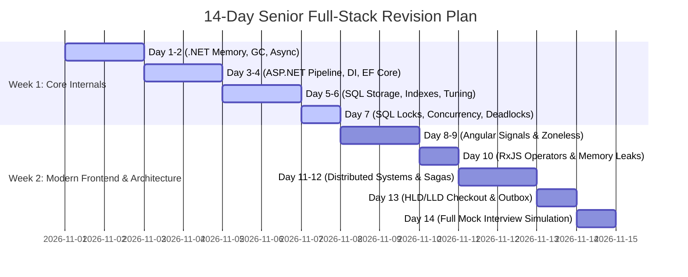
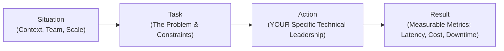

# 05. Curated Resources, Videos, GitHub Repos & Interview Cheatsheet (6+ YOE)

> **Target Audience:** Senior Full-Stack Engineers & Tech Leads (.NET Core + Angular + SQL Server + Microservices) preparing for technical and leadership rounds in India (Bengaluru, Hyderabad, Pune, NCR, Chennai, Mumbai) targeting Tier-1 Product Companies, FinTech Unicorns, and Global Capability Centers (GCCs like Wells Fargo, Morgan Stanley, JPMorgan, Walmart, Target, Swiggy, Zepto).

---

## 1. Top Recommended YouTube Channels & Must-Watch Playlists

| Channel | Focus Area | Recommended Playlists / Videos | Why Senior Engineers Must Watch |
| :--- | :--- | :--- | :--- |
| **Milan Jovanović** | .NET Architecture, Clean Architecture, CQRS, DDD | • *Clean Architecture with ASP.NET Core & MediatR*<br>• *Domain-Driven Design (DDD) in Practice*<br>• *Modular Monolith & Outbox Pattern Series* | Master enterprise architecture trade-offs, outbox patterns, and rich domain modeling using clean, modern C# 12/13 code. |
| **Nick Chapsas (keep_coding)** | C# Performance, .NET Internals, Benchmarking | • *C# Deep Dives & Low-Level Memory Performance*<br>• *BenchmarkDotNet & Memory Allocation Profiling*<br>• *ASP.NET Core Best Practices & Hidden Anti-Patterns* | Understand what happens under the hood with memory allocations, `Span<T>`, `ValueTask`, and hidden runtime traps like sync-over-async. |
| **Joshua Morony** | Modern Angular, Signals, Reactive Architecture | • *Angular Signals Deep Dive & Architecture*<br>• *Zoneless Angular Applications*<br>• *Declarative Reactive Programming in Angular* | The clearest walkthrough for transitioning from legacy Zone.js change detection to fine-grained, signal-driven Angular (v16–v18+). |
| **Decoded Frontend (Dmytro)** | Advanced Angular Internals & RxJS Mechanics | • *Angular Change Detection Under The Hood*<br>• *RxJS Mastery & Higher-Order Mapping Operators*<br>• *Angular Dependency Injection Tree Internals* | Explains the underlying Angular compiler view tree, injection graph, and reactive change detector mechanics in plain visual terms. |
| **ByteByteGo (Alex Xu)** | Distributed System Design & Scalability | • *System Design Interview Series*<br>• *Database Scaling, Partitioning & Sharding*<br>• *Payment Gateway & Distributed Locking Architectures* | Crystal-clear visual breakdowns of core distributed design patterns (Sagas, Rate Limiters, Consistent Hashing, Distributed Caching). |
| **Hussein Nasser** | Database Internals, Networking & Backends | • *Database Engine Internals (B-Trees, Pages, WAL)*<br>• *SQL Server & Postgres Locks, Latches & Connection Pools*<br>• *TCP, TLS, HTTP/2, HTTP/3 & gRPC Transport Protocols* | Explains what physically happens at the disk page, buffer pool, OS socket, and network packet levels during queries and API calls. |
| **DotNetTricks / Kudvenkat** | Indian Tech Interview Patterns (.NET & SQL) | • *DotNetTricks .NET Core Senior Architecture*<br>• *SQL Server Stored Procedures, Indexes & Isolation*<br>• *ASP.NET Core Real-Time Coding Scenarios* | Directly targets the exact interview question banks and real-world scenarios asked in Indian MNCs, consultancies, and GCCs. |

---

## 2. Top GitHub Reference Repositories

Studying production-grade open-source repositories provides battle-tested blueprints for system design and code review rounds:

### 1. [dotnet-architecture / eShop](https://github.com/dotnet/eshop)
* **Creators:** Official Microsoft Architecture Team (.NET 8/9+).
* **Core Patterns:** Modern enterprise microservices using .NET Aspire, OpenTelemetry distributed tracing, Redis distributed cache, RabbitMQ / Azure Service Bus messaging, and containerized deployments.
* **Key Areas to Study:** Service-to-service communication, resilient HTTP handler pipelines with Polly, and standardized telemetry setup.

### 2. [jasontaylordev / CleanArchitecture](https://github.com/jasontaylordev/CleanArchitecture)
* **Core Patterns:** The industry-standard Clean Architecture solution template in ASP.NET Core with MediatR, FluentValidation, Entity Framework Core, CQRS, and the Result pattern.
* **Key Areas to Study:** MediatR Pipeline Behaviors (`UnhandledExceptionBehaviour`, `ValidationBehaviour`, `PerformanceBehaviour`).

### 3. [m-jovanovic / clean-architecture](https://github.com/m-jovanovic/clean-architecture)
* **Core Patterns:** Production Domain-Driven Design (DDD), Strongly Typed IDs, Rich Domain Models (avoiding anemic models), Domain Events, and Transactional Outbox pattern.
* **Key Areas to Study:** Outbox message background consumer, domain event dispatching, and repository abstractions.

### 4. [ardalis / CleanArchitecture](https://github.com/ardalis/CleanArchitecture)
* **Core Patterns:** Steve Smith's (Ardalis) reference architecture featuring FastEndpoints, Specification Pattern with EF Core, and decoupled aggregates.

### 5. [ngrx / platform](https://github.com/ngrx/platform)
* **Core Patterns:** Official repository for NgRx Store, Effects, ComponentStore, and the modern `@ngrx/signals` SignalStore state management implementation.

---

## 3. Top Indian Tech Interview Portals & Forums

1. **Reddit `r/developersIndia`:**
   * Active discussions on current compensation benchmarks (LPA bands for 5+ to 8+ YOE), detailed interview experiences for GCCs (JPMorgan, Goldman Sachs, Wells Fargo, Target, Walmart), and tech stack trends.
2. **LeetCode Discuss (Company Tags - India Location Filter):**
   * Filter by: *Microsoft, Amazon, Walmart Global Tech, Morgan Stanley, Oracle, MakeMyTrip, Swiggy, Zepto*.
   * Focus on the "Interview Experience" section for LLD, HLD, and scenario-based questions asked in Indian offices.
3. **C# Corner (Interview Section):**
   * High-volume question bank for .NET Core, EF Core, SQL Server, and Angular specific to technical screening and manager rounds in Indian service & product consultancies.
4. **AmbitionBox & Glassdoor India:**
   * Review recent interview questions for specific hiring managers and GCC business units to identify recurring interview patterns.

---

## 4. 14-Day Rapid Revision Sprint Schedule

A structured day-by-day revision roadmap designed for working engineers balancing a full-time job:



### Day-by-Day Focus Checklist:

* **Day 1: .NET CLR & Memory Management Internals:**
  * **Analogy:** Master the **Office Desk Analogy**: Gen 0 (Daily notepad), Gen 1 (Desk drawer), Gen 2 (Company archive).
  * **Exact Technical Terms & Rubric:** *Generational Hypothesis, Tracing Mark-Sweep-Compact Collector, Card Table / Write Watch, Ephemeral Segment, Large Object Heap (85,000-byte threshold), Free-List Allocator, Server GC vs Workstation GC (1 heap & dedicated GC thread per CPU core, Kubernetes `OOMKilled`), Dispose Pattern, Finalizer Queue, `SafeHandle`, `GC.SuppressFinalize(this)`*.

* **Day 2: Async/Await Mechanics & Concurrency Safety:**
  * **Analogy:** The **Token Pager at the Coffee Shop** (releasing the counter worker while waiting).
  * **Exact Technical Terms & Rubric:** *Roslyn Lowering, `IAsyncStateMachine` struct, `ExecutionContext` capture & flow, `SynchronizationContext`, ThreadPool Starvation (Sync-over-Async anti-pattern), `.GetAwaiter().GetResult()` hazards, `ValueTask<T>` allocation-free synchronous fast path, `IAsyncEnumerable<T>` asynchronous streaming*.

* **Day 3: ASP.NET Core & Dependency Injection Architecture:**
  * **Analogy:** The **Russian Nesting Dolls** (middleware pipeline) and the **Hotel Keycard Master** (DI lifetimes).
  * **Exact Technical Terms & Rubric:** *`RequestDelegate` pipeline, Russian Doll middleware pattern, Captive Dependency anti-pattern, Service Lifetime Resolution (`Transient`, `Scoped`, `Singleton`), `IServiceScopeFactory.CreateScope()`, Socket Exhaustion, `IHttpClientFactory` connection pooling, Polly v8 Resilience Pipeline*.

* **Day 4: High-Performance Entity Framework Core:**
  * **Analogy:** The **Grocery Delivery List** (fetching only needed columns rather than entire supermarket shelves).
  * **Exact Technical Terms & Rubric:** *ChangeTracker snapshot memory overhead, `AsNoTracking()`, Cartesian Product Explosion (`AsSplitQuery()`), N+1 Query Problem (eager loading `Include` vs projection `Select`), DbContext Pooling (`AddDbContextPool`), Compiled Queries, SQL translation inspection*.

* **Day 5: SQL Server Storage & Index Architecture:**
  * **Analogy:** The **Textbook Table of Contents vs. End-of-Book Glossary Index**.
  * **Exact Technical Terms & Rubric:** *8KB Data Page layout, 96-byte Page Header, Slot Array, Clustered Index B-Tree Leaf Level (physical data pages), Non-Clustered Index Bookmark / Key Lookup, Covering Index with leaf `INCLUDE` columns, Page Splits & Fill Factor (80-90%), Index Seek vs Index Scan*.

* **Day 6: SQL Query Optimization & Parameter Sniffing:**
  * **Analogy:** The **Coat Fitting for Elephant vs. Child** (plan cached for extreme data skew).
  * **Exact Technical Terms & Rubric:** *SARGability (`WHERE YEAR(...)` violation), Implicit Datatype Conversion (`VARCHAR` vs `NVARCHAR` scan), Parameter Sniffing, Plan Cache Pollution, `OPTIMIZE FOR (@p = UNKNOWN)`, `WITH RECOMPILE`, Local Variable Masking, Query Store Plan Forcing*.

* **Day 7: SQL Locking, Concurrency & Deadlocks:**
  * **Analogy:** The **Traffic Intersection Gridlock** (Deadlock) and the **Apartment Gate Register** (Locks).
  * **Exact Technical Terms & Rubric:** *Lock Compatibility Matrix (Shared `S`, Exclusive `X`, Update `U`), Intent Locks (`IS`, `IX`), Lock Escalation threshold (5,000 locks to table lock), Extended Events XML Deadlock Graph, Read Committed Snapshot Isolation (RCSI), Row Versioning in `tempdb`*.

* **Day 8: Modern Angular 17/18+ Architecture:**
  * **Analogy:** The **Standalone Flat vs Old Joint-Family Society** (Modular vs Standalone).
  * **Exact Technical Terms & Rubric:** *Standalone Components (`imports: []`), Built-in Control Flow (`@if`, `@for (track item.id)`, `@defer (on viewport)`), `inject()` functional dependency injection, Tree-shakable Injectables, Differential Loading*.

* **Day 9: Angular Signals & Zoneless Architecture:**
  * **Analogy:** The **WhatsApp Broadcast Channel / Excel Spreadsheet Formula Grid** (Fine-Grained Reactivity).
  * **Exact Technical Terms & Rubric:** *Signals Push-Pull Reactive Algorithm, Directed Acyclic Graph (DAG), Glitch-Free Evaluation, Fine-Grained Reactive Primitives (`signal()`, `computed()`, `effect()`), Zone.js Monkey-Patching Overhead, Zoneless Change Detection (`provideExperimentalZonelessChangeDetection`)*.

* **Day 10: RxJS Mastery & Preventing Memory Leaks:**
  * **Analogy:** The **Airport Security Lanes** (`switchMap` cancel previous, `mergeMap` parallel, `concatMap` sequential, `exhaustMap` ignore new).
  * **Exact Technical Terms & Rubric:** *Higher-Order Flattening Operators (`switchMap`, `mergeMap`, `concatMap`, `exhaustMap`), Subscription Leakage, `takeUntilDestroyed()`, `toSignal()`, Declarative `async` Pipe, `ChangeDetectionStrategy.OnPush`*.

* **Day 11: Distributed Systems Consistency & Patterns:**
  * **Analogy:** The **HDFC vs ICICI Transfer** (Database-per-service) and the **Restaurant POS Crash** (Dual-write).
  * **Exact Technical Terms & Rubric:** *Database-Per-Service Pattern, Dual-Write Anti-Pattern, Eventual Consistency, BASE Model vs ACID, Transactional Outbox Pattern, Change Data Capture (CDC / Debezium WAL Tailing), Idempotent Consumer Pattern, Redis Atomic Check-and-Set (`SET key val NX EX`), Relational Unique Constraint Deduplication*.

* **Day 12: Inter-Service Communication & Saga Workflows:**
  * **Analogy:** The **Goa Trip WhatsApp Group** (Choreography) vs. **Professional Wedding Planner** (Orchestration).
  * **Exact Technical Terms & Rubric:** *Saga Pattern, Orchestration-based Saga (State Machine / MassTransit / Temporal) vs Choreography-based Saga (Event Pub/Sub), Compensating Transactions (Semantic Undo), gRPC over HTTP/2 Protobuf vs REST/JSON, YARP Zero-Allocation Reverse Proxy, Active/Passive Health Probing*.

* **Day 13: End-to-End System Design (HLD + LLD):**
  * **Analogy:** The **Big Billion Day Flash Sale Counter** (Massive concurrent writes).
  * **Exact Technical Terms & Rubric:** *Flash Sale Ingress Buffering, Redis Atomic `DECR` for zero overselling, Kafka Partitioning by `CustomerId` for per-user strict ordering, W3C TraceContext (`traceparent` header), Distributed Tracing with OpenTelemetry (OTLP), Polly Circuit Breaker, Exponential Backoff with Full Jitter, Bulkhead Pattern*.

* **Day 14: Mock Interview & Leadership Behavioral Alignment:**
  * **Analogy:** The **Flight Simulator for Airline Pilots** (Mock drills under stress).
  * **Exact Technical Terms & Rubric:** *STAR Leadership Framework, Root Cause Analysis (RCA), ThreadPool Starvation Live Memory Dump (`dotnet-dump`, `sos clrstack`), Strangler Fig Migration Pattern, Two-Phase Commit (2PC) vs Saga Latency Proof of Concept, Mean Time To Recovery (MTTR)*.

---

## 5. Master Architecture Cheatsheet: Plain Analogy vs. Exact Senior Technical Terminology

Use this side-by-side quick-reference card to scan and memorize how to pivot from intuitive understanding into senior interview phrasing:

| Domain & Topic | 🧠 Everyday Analogy (Intuitive Hook) | 🎯 Exact Technical Terms & Buzzwords (The Interview Rubric) | ⚡ Senior Soundbite (How to Say It Confidently) |
| :--- | :--- | :--- | :--- |
| **.NET CLR & Garbage Collection** | **Office Desk:** Gen 0 (Sticky notepad), Gen 1 (Drawer), Gen 2 (Archive), LOH (Heavy furniture storage). | • Generational Hypothesis<br>• Tracing Mark-Sweep-Compact Collector<br>• Card Table / Write Watch<br>• Ephemeral Segment<br>• Large Object Heap (85,000-byte threshold)<br>• Free-List Allocator (fragmentation hazard)<br>• Server GC (1 heap & thread per CPU core, `OOMKilled`) vs Workstation GC<br>• Dispose Pattern & `SafeHandle`<br>• `GC.SuppressFinalize(this)` | *"The CLR relies on the Generational Hypothesis; objects $\ge 85,000$ bytes bypass generational sweeps to the LOH free-list without compaction, and Server GC in small Kubernetes pods risks immediate `OOMKilled` crashes unless heap counts are restricted."* |
| **Async / Await Mechanics** | **Coffee Shop Pager:** Counter clerk hands you a vibrating token; clerk serves other customers while espresso brews. | • Roslyn Lowering<br>• `IAsyncStateMachine` struct<br>• `ExecutionContext` capture & ambient flow<br>• `SynchronizationContext`<br>• ThreadPool Starvation (Sync-over-Async)<br>• `.GetAwaiter().GetResult()` blocking hazards<br>• `ValueTask<T>` allocation-free fast path<br>• `IAsyncEnumerable<T>` asynchronous pull | *"The Roslyn compiler lowers `async/await` into an `IAsyncStateMachine` struct; synchronous blocking via `.Result` or `.GetAwaiter().GetResult()` starves ThreadPool worker threads, while `ValueTask<T>` eliminates Task allocations on synchronous completions."* |
| **ASP.NET Core Architecture & DI** | **Russian Nesting Dolls:** Requests pass through middleware layers inward and outward.<br>**Hotel Keycard:** Scoped per stay. | • `RequestDelegate` pipeline<br>• Russian Doll middleware execution order<br>• Captive Dependency anti-pattern<br>• Object Lifetimes: `Transient`, `Scoped`, `Singleton`<br>• `IServiceScopeFactory.CreateScope()`<br>• Socket Exhaustion (`new HttpClient()` trap)<br>• `IHttpClientFactory` connection pooling<br>• Polly v8 Resilience Handler Pipeline | *"Injecting a Scoped service into a Singleton causes a Captive Dependency bug, pinning scoped state into permanent memory and creating concurrency race conditions; background jobs must explicitly create scopes via `IServiceScopeFactory`."* |
| **High-Performance EF Core** | **Grocery Delivery List:** Ordering only 3 specific vegetables rather than renting the whole grocery truck. | • ChangeTracker snapshot memory overhead<br>• `AsNoTracking()` / `AsNoTrackingWithIdentityResolution()`<br>• Cartesian Product Explosion<br>• `AsSplitQuery()` multi-SQL split<br>• N+1 Query Problem (`Include` vs `Select`)<br>• `AddDbContextPool<TContext>` instance recycling<br>• Compiled Queries (`EF.CompileAsyncQuery`) | *"Read endpoints must bypass EF Core snapshot change-tracking via `AsNoTracking()`, and multi-collection joins must use `AsSplitQuery()` to eliminate Cartesian product row explosion and network bloat."* |
| **SQL Server Storage & Indexes** | **Textbook Index & Glossary:** Clustered index is the page-numbered book; non-clustered index is the back index. | • 8KB Physical Data Pages<br>• 96-byte Page Header & Slot Array<br>• Clustered B-Tree Leaf Level (the actual data)<br>• Non-Clustered Bookmark / Key Lookup (random I/O)<br>• Covering Index with leaf `INCLUDE` columns<br>• Page Splits & Fill Factor (80-90% sweet spot)<br>• Index Seek (logarithmic $O(\log N)$) vs Index Scan ($O(N)$) | *"When a non-clustered index lacks requested columns, the storage engine executes expensive Bookmark Key Lookups against the clustered index; leaf `INCLUDE` columns create covering indexes that resolve queries purely in the B-Tree leaf level."* |
| **SQL Query Tuning & Sniffing** | **Custom Tailored Suit:** Tailoring a suit for an elephant, then forcing a child to wear it. | • SARGability (`WHERE YEAR(...)` function wrapping)<br>• Implicit Datatype Conversion (`VARCHAR` vs `NVARCHAR`)<br>• Parameter Sniffing & Plan Cache Pollution<br>• `OPTIMIZE FOR (@param = UNKNOWN)`<br>• Query Compilation with `OPTION (RECOMPILE)`<br>• Local Variable Parameter Masking<br>• SQL Server Query Store Plan Forcing | *"Parameter sniffing occurs when SQL Server freezes an execution plan compiled for an extreme outlier parameter value; remedies include `OPTIMIZE FOR`, local variable masking, or plan forcing via Query Store."* |
| **SQL Concurrency & Deadlocks** | **Traffic Junction Gridlock:** Car A waits for Car B to move, while Car B waits for Car A. | • Lock Compatibility Matrix (Shared `S`, Exclusive `X`, Update `U`)<br>• Intent Locks (`IS`, `IX`, `Intent Exclusive`)<br>• Lock Escalation threshold (5,000 fine locks to table lock)<br>• Extended Events `xml_deadlock_report`<br>• Read Committed Snapshot Isolation (RCSI)<br>• Row Versioning in `tempdb` version store | *"Lock escalation converts 5,000 fine-grained row locks into an exclusive table lock, halting concurrent transactions; RCSI eliminates reader-writer blocking by serving non-blocking row versions from `tempdb`."* |
| **Modern Angular & Signals** | **Excel Formula Grid:** Updating cell A1 instantly updates dependent formula cell B1 without recalculating the sheet. | • Signals Push-Pull Reactive Algorithm<br>• Dependency Graph (Directed Acyclic Graph / DAG)<br>• Glitch-Free Reactive Evaluation<br>• Reactive Primitives: `signal()`, `computed()`, `effect()`<br>• Standalone Components (`imports: []`)<br>• Built-in Control Flow (`@if`, `@for (track)`, `@defer`)<br>• Zoneless Change Detection (`provideExperimentalZonelessChangeDetection`) | *"Angular Signals replace Zone.js monkey-patched dirty-checking with fine-grained reactive push-pull DAG evaluation, updating only the precise DOM nodes bound to changed signals with zero component-tree traversal."* |
| **RxJS & Async State** | **Airport Security Queues:** Cancel previous passenger (`switchMap`), parallel lanes (`mergeMap`), strict queue (`concatMap`), lock gate (`exhaustMap`). | • Higher-Order Flattening Operators (`switchMap`, `mergeMap`, `concatMap`, `exhaustMap`)<br>• Component Subscription Memory Leaks<br>• `takeUntilDestroyed()` / DestroyRef<br>• `toSignal()` reactive bridge<br>• Declarative `async` Pipe<br>• `ChangeDetectionStrategy.OnPush` | *"Flattening operators enforce explicit concurrency rules; `switchMap` cancels stale autocompletion requests, `exhaustMap` ignores duplicate submit clicks, and `takeUntilDestroyed()` ties stream lifecycles cleanly to component destruction."* |
| **Distributed Data & Outbox** | **Cheque Book Counterfoil:** Writing the payment amount on the cheque and the stub before tearing it out. | • Dual-Write Anti-Pattern<br>• Database-Per-Service Bounded Context<br>• Eventual Consistency & BASE Model vs ACID<br>• Transactional Outbox Pattern<br>• Change Data Capture (CDC / Debezium WAL Tailing)<br>• Idempotent Consumer Pattern<br>• Atomic Distributed Check-and-Set (`SETNX`)<br>• Relational Unique Constraint Deduplication | *"To avoid the dual-write trap without synchronous 2PC, we atomically persist business entities and outbox events in the same local ACID transaction, streaming them to Kafka via CDC Debezium WAL tailing to idempotent consumers."* |
| **Distributed Transactions & Sagas** | **Goa Trip Group (Choreography) vs Wedding Planner (Orchestration):** Chaotic group chat vs central master checklist. | • Two-Phase Commit (2PC) Prepare/Commit SPOF<br>• Saga Pattern & Pivot Transaction<br>• Orchestration (State Machine / Temporal / MassTransit)<br>• Choreography (Decentralized Pub/Sub Event Mesh)<br>• Compensating Transactions (Semantic Undo)<br>• Semantic Lock / Countermeasures | *"We reject synchronous 2PC across microservices due to coordinator failure blocking and lock amplification, choosing Saga Orchestration with a durable state machine that drives compensating transactions upon step failure."* |
| **Gateways & Inter-Service Mesh** | **Central Airport Terminal (Public REST) vs Cockpit Radio (Internal gRPC):** Human text vs binary brevity. | • Reverse Proxy / Ingress Gateway<br>• Microsoft YARP (Kestrel `System.IO.Pipelines` zero-allocation)<br>• gRPC over HTTP/2 Protobuf vs REST/JSON<br>• `.proto` Interface Definition Language (IDL)<br>• HTTP/2 Multiplexing & Stream Framing<br>• HPACK Header Compression<br>• Head-of-Line (HoL) Blocking Elimination | *"Public client ingress routes through Microsoft YARP for zero-allocation reverse proxying, while internal microservice hops leverage gRPC over HTTP/2 Protobuf, shrinking network payloads by 80% and delivering 7-10x throughput."* |
| **Resilience & Observability** | **Home Electrical MCB:** Breaker flips down on bathroom short-circuit to save whole house from burning. | • Circuit Breaker Pattern (Closed, Open, Half-Open)<br>• Failure Rate Threshold & Reset Break Duration<br>• Bulkhead Pattern (Thread & connection pool isolation)<br>• Exponential Backoff with Full Jitter<br>• Retry Storm / Thundering Herd Prevention<br>• W3C TraceContext (`traceparent` header)<br>• OpenTelemetry Protocol (OTLP / Jaeger / Zipkin) | *"Polly circuit breakers fail fast during downstream outages to protect upstream thread pools from cascading collapse, while OpenTelemetry propagates W3C `traceparent` headers to link all logs and spans to a single Trace ID."* |
| **Security & Identity Architecture** | **Aadhaar/Passport (OIDC Identity) vs Boarding Pass (OAuth2 Permission) vs QR Barcode (JWT).** | • OAuth 2.0 (RFC 6749) vs OpenID Connect (OIDC)<br>• JWT 3-Part: JOSE Header, Claims Payload, Signature<br>• Asymmetric RS256 / ES256 with JWKS Endpoint<br>• Symmetric HS256 Shared Secret Hazard<br>• PKCE (RFC 7636 `code_verifier` / `code_challenge`)<br>• Refresh Token Rotation (RTR) & Family Revocation<br>• `jti` Denylist in Redis with TTL | *"OIDC authenticates identity via `id_token` while OAuth2 authorizes delegated permissions via RS256-signed JWTs verified statelessly against the IDP's JWKS endpoint, secured with PKCE for SPAs and Refresh Token Rotation."* |
| **Testing & Cloud DevOps** | **Kitchen Prep vs Finished Meal Plate (Docker Multi-Stage); Turf Pitch Practice (Testcontainers).** | • `WebApplicationFactory<Program>` (In-Memory `TestServer`)<br>• Testcontainers (100% database dialect fidelity)<br>• Respawn High-Speed Database Reset (15ms)<br>• xUnit `[Collection]` Parallelism Boundaries<br>• Multi-Stage Dockerfile (SDK Build vs Alpine Runtime)<br>• Non-Root Security (`USER app`)<br>• Kubernetes Liveness vs Readiness vs Startup Probes<br>• Horizontal Pod Autoscaler (HPA)<br>• Blue-Green vs Canary vs Feature Toggles | *"Production Docker images use multi-stage builds running unprivileged `USER app` on Alpine, while integration test suites combine `WebApplicationFactory` with Testcontainers to execute tests against real Dockerized databases with 100% dialect fidelity."* |

---

## 6. Mock Interview Self-Evaluation Scorecard

Use this grading rubric to evaluate your readiness across the 4 core technical rounds:

```
Candidate Name: _______________________      Date: ______________
Target Role: Senior Full-Stack / Tech Lead (.NET + Angular + SQL + Microservices)
Target Company: ______________________
```

### Round 1: C# & .NET Core Deep Dive (Score: ___ / 25)
- [ ] Articulated **Generational Hypothesis**, Gen 0/1/2 sweeps, LOH 85,000-byte threshold, and Kubernetes Server GC `OOMKilled` trap. (5 pts)
- [ ] Explained **Roslyn Lowering** into `IAsyncStateMachine` struct and demonstrated ThreadPool starvation caused by sync-over-async (`.GetAwaiter().GetResult()`). (5 pts)
- [ ] Differentiated `Task` vs `ValueTask<T>` allocation-free paths and stated the 3 cardinal usage rules. (5 pts)
- [ ] Diagnosed **Captive Dependencies** in ASP.NET Core DI and demonstrated `IServiceScopeFactory.CreateScope()` in background workers. (5 pts)
- [ ] Fixed **Cartesian Product Explosion** using `AsSplitQuery()`, eliminated N+1 queries, and enabled `AddDbContextPool`. (5 pts)

### Round 2: SQL Server Performance & Concurrency (Score: ___ / 25)
- [ ] Explained 8KB data pages, 96-byte headers, slot arrays, and Clustered B-Tree Leaf Level physical organization. (5 pts)
- [ ] Eliminated Bookmark / Key Lookups by creating covering indexes with leaf `INCLUDE` columns. (5 pts)
- [ ] Identified SARGability violations (`WHERE YEAR(...)` function wrapping) and implicit datatype conversion scans. (5 pts)
- [ ] Diagnosed **Parameter Sniffing** and articulated senior remedies (`OPTIMIZE FOR`, `WITH RECOMPILE`, Query Store plan forcing). (5 pts)
- [ ] Analyzed lock compatibility (`S`, `X`, `U`), Extended Events XML deadlock graphs, and RCSI `tempdb` row versioning. (5 pts)

### Round 3: Modern Angular & RxJS (Score: ___ / 25)
- [ ] Outlined Standalone Components (`imports: []`), built-in control flow (`@if/@for (track)/@defer`), and `inject()` functional DI. (5 pts)
- [ ] Explained **Signals Push-Pull Reactive DAG**, Glitch-Free evaluation, and benefits of Zoneless change detection. (5 pts)
- [ ] Correctly selected between `switchMap`, `mergeMap`, `concatMap`, and `exhaustMap` based on concurrency requirements. (5 pts)
- [ ] Eliminated subscription memory leaks using `takeUntilDestroyed()`, `toSignal()`, and declarative `async` pipe. (5 pts)
- [ ] Designed component state management using `@ngrx/signals` or service-based Signals with `ChangeDetectionStrategy.OnPush`. (5 pts)

### Round 4: Distributed System Design & HLD/LLD (Score: ___ / 25)
- [ ] Clarified scope, calculated throughput (50K TPS), P99 latency SLAs, and justified REST vs gRPC protocols. (5 pts)
- [ ] Resolved the **Dual-Write trap** using the Transactional Outbox pattern with CDC Debezium WAL tailing. (5 pts)
- [ ] Designed distributed transactions using **Saga Orchestration** state machines with compensating rollback actions. (5 pts)
- [ ] Prevented overselling and duplicate charges via Redis Atomic `DECR`, unique constraints, and idempotent consumers (`SETNX`). (5 pts)
- [ ] Incorporated end-to-end distributed tracing (OpenTelemetry W3C `traceparent`, Jaeger) and Polly circuit breakers with jitter. (5 pts)

---

## 7. STAR Method Framework for Senior Behavioral & Leadership Rounds

In Indian GCCs and Tier-1 product companies, the Director / VP / Bar-Raiser round decides your level (Senior vs Lead / Staff) and salary band. Structure your real-world stories using the **STAR Framework**:



### Senior Leadership Terminology Rubric:
When delivering behavioral responses, frame your technical contributions using these enterprise leadership terms:
* **Root Cause Analysis (RCA):** Post-incident investigative technique discovering fundamental system failures rather than treating symptoms.
* **Mean Time To Detect (MTTD) & Mean Time To Recovery (MTTR):** Core DevOps Site Reliability Engineering (SRE) operational availability metrics.
* **Blameless Post-Mortem:** Culture focusing on process, tooling, and architectural improvements rather than individual developer finger-pointing.
* **Architectural Trade-Off Analysis:** Demonstrating that every architectural choice (e.g., 2PC vs Saga, Normalized vs Denormalized, REST vs gRPC) balances competing trade-offs (Consistency vs Availability, CPU vs RAM, Simplicity vs Throughput).
* **Technical Debt Amortization:** Planned, incremental retirement of legacy technical debt (e.g., using the Strangler Fig pattern) aligned with product roadmap deliverables.

---

### Scenario 1: Resolving a Catastrophic Production Outage (P1 Incident)

* **⚡ 30-Second Interview Pitch (Say this first):**
  > "During a month-end billing spike, our core Web API suffered a 100% CPU lockup and pod crashes. I captured and analyzed a live thread dump, identified widespread ThreadPool starvation caused by sync-over-async blocking on an external payment provider, patched the code to pure async/await, and deployed Polly circuit breakers—dropping P99 latency from 15 seconds to 85 milliseconds."

* **🧠 Easy Mental Model (The Freeway Multi-Car Pileup):**
  * One driver slams the brakes on a foggy highway without brake lights (unresponsive downstream payment API).
  * Because every following driver was tailgating with zero following distance (sync-over-async `.GetAwaiter().GetResult()` holding worker threads), hundreds of cars crash into each other in seconds (ThreadPool starvation and pod crash loops).

* **🎯 Must-Know Technical Terms & Buzzwords (The "Senior Interview Rubric"):**
  * **ThreadPool Starvation:** Depletion of available runtime ThreadPool worker threads caused by synchronous blocking (`.GetAwaiter().GetResult()`) on uncompleted asynchronous tasks.
  * **`dotnet-dump` & SOS Debugging Extension:** Runtime diagnostics CLI tools used to capture non-invasive core dumps on production Linux Kubernetes pods and analyze managed thread execution stacks via `clrstack -all` and `dumpasync`.
  * **Sync-over-Async Anti-Pattern:** Wrapping asynchronous operations in synchronous waiting primitives, monopolizing OS worker threads during network I/O.
  * **Polly v8 Resilience Pipeline:** Next-generation ASP.NET Core resilience pipeline integrating concurrency bulkheads, exponential backoff with full jitter, and circuit breaker trip thresholds.
  * **Lock Escalation:** SQL Server engine optimization converting 5,000 fine-grained row locks into a single exclusive table lock (`X`), halting all concurrent read/write transactions.

* **Situation:** During high-traffic month-end billing, our core order processing API experienced severe 100% CPU spikes and request timeouts across all Kubernetes pods.
* **Task:** Identify the root cause immediately, prevent cascading pod restarts, and restore service availability without data loss.
* **Action:**
  1. Captured a live memory dump using `dotnet-dump collect -p <pid>` on a struggling pod before Kubernetes killed it.
  2. Analyzed thread stacks using `sos clrstack -all` and discovered 1,200+ threads blocked on `.GetAwaiter().GetResult()` during an external payment gateway call, inducing complete ThreadPool starvation.
  3. Identified a concurrent database lock escalation issue where an unindexed batch invoice update query was acquiring table-level exclusive locks.
  4. Deployed a hotfix converting all downstream calls to non-blocking `async/await`, introduced Polly circuit breakers with jittered exponential backoffs, and batched database updates in chunks of 2,000 rows.

#### 💼 Concrete Production Code: Junior Root Cause vs Senior Remedy
* **❌ The Junior Mistake (Sync-over-Async & Lock Escalation Trap):**
  ```csharp
  // JUNIOR ANTI-PATTERN: Sync-over-Async inside transaction holding table locks
  public void ProcessBillingBatchJunior(List<Invoice> invoices)
  {
      using var tx = _dbContext.Database.BeginTransaction();
      foreach (var inv in invoices)
      {
          // DEADLOCK & THREADPOOL STARVATION:
          // Monopolizes ThreadPool thread synchronously while holding open database row locks!
          var result = _paymentGateway.ChargeAsync(inv.Amount).GetAwaiter().GetResult();
          inv.MarkPaid(result.TransactionId);
      }
      _dbContext.SaveChanges(); // Escalates to Table Lock when rows > 5,000!
      tx.Commit();
  }
  ```
* **✅ The Senior Battle-Tested Fix (Async Pipeline + Chunked Batching):**
  ```csharp
  public async Task ProcessBillingBatchSeniorAsync(List<Invoice> invoices, CancellationToken ct)
  {
      // 1. Process external calls purely asynchronously without holding database locks
      foreach (var inv in invoices)
      {
          // Uses Polly v8 pipeline with jittered backoff and 2.5s timeout
          var result = await _resilientPaymentClient.ChargeAsync(inv.Amount, ct);
          inv.MarkPaid(result.TransactionId);
      }

      // 2. Chunk database writes in batches of 2,000 to prevent lock escalation past 5,000 threshold
      foreach (var chunk in invoices.Chunk(2000))
      {
          using var tx = await _dbContext.Database.BeginTransactionAsync(ct);
          _dbContext.Invoices.UpdateRange(chunk);
          await _dbContext.SaveChangesAsync(ct);
          await tx.CommitAsync(ct);
      }
  }
  ```

* **Result:** P99 API latency dropped from 15,000ms down to 85ms; CPU utilization stabilized at 22%; zero customer transactions were dropped or duplicated.

* **🗣️ What to Say in the Interview:**
  > *"During our month-end billing spike, our API suffered 100% CPU lockups and pod crashes. I captured a live thread dump using `dotnet-dump`, analyzed the thread stacks with `sos clrstack -all`, and discovered 1,200 worker threads blocked synchronously on `.GetAwaiter().GetResult()` during an external payment call while holding open database transactions. I decoupled the payment calls to non-blocking async with a Polly v8 jittered circuit breaker and batched SQL updates in 2,000-row chunks, slashing P99 latency from 15 seconds to 85 milliseconds."*

---

### Scenario 2: Modernizing Technical Debt & Legacy Architecture

* **⚡ 30-Second Interview Pitch (Say this first):**
  > "Our legacy Angular portal suffered from 14-second initial page loads and frequent browser tab crashes due to unmanaged RxJS memory leaks. I led an incremental Strangler Fig migration to Angular Standalone with Signals and `@defer` views, reducing bundle size by 58% and slashing initial page load time to 1.8 seconds without delaying ongoing business features."

* **🧠 Easy Mental Model (The Strangler Fig Tree):**
  * In nature, a Strangler Fig seed sprouts in the upper branches of an ancient tree, gradually sending roots down and replacing the host tree branch by branch.
  * In software architecture, rather than attempting a risky, multi-month rewrite from scratch, you incrementally replace old, leaking components with high-performance Standalone Signals components until the legacy architecture is seamlessly retired.

* **🎯 Must-Know Technical Terms & Buzzwords (The "Senior Interview Rubric"):**
  * **Strangler Fig Pattern:** An incremental modernization pattern where legacy subsystems are progressively superseded by new micro-frontends or standalone components.
  * **RxJS Subscription Leakage:** Failure to unsubscribe from long-lived streams on component unmount, preventing the V8 Garbage Collector from reclaiming component DOM instances (retained memory bloat).
  * **`takeUntilDestroyed()` & `DestroyRef`:** Modern Angular lifecycle operators that automatically tie Observable subscriptions to component destruction without boilerplate.
  * **Angular Signals Push-Pull DAG:** Fine-grained reactive Directed Acyclic Graph evaluating dependent UI nodes with zero Zone.js monkey-patching or component-tree traversals.
  * **`@defer (on viewport)`:** Built-in template deferred loading mechanism delaying the downloading and rendering of non-critical UI blocks until scrolled into view.
  * **Largest Contentful Paint (LCP):** Core Web Vital metric measuring render duration of the largest visible UI block (slashed from 14.2s to 1.8s).

* **Situation:** A mission-critical internal trading portal built on legacy Angular suffered from 14-second initial page load times and frequent browser tab crashes caused by unmanaged subscriptions across 200+ components.
* **Task:** Modernize the frontend architecture, eliminate memory leaks, and improve UX performance without halting ongoing business sprint deliveries.
* **Action:**
  1. Established a **Strangler Fig pattern** migration roadmap, moving components incrementally to Standalone Angular with fine-grained Signals and `OnPush` change detection.
  2. Added custom ESLint rules in our CI/CD pipeline enforcing `takeUntilDestroyed()` or the `async` pipe on all component subscriptions.
  3. Replaced heavy dashboard tables and chart widgets with modern `@defer (on viewport)` lazy-loading blocks.

#### 💼 Concrete Production Code: Junior RxJS Leak vs Senior Standalone Signal
* **❌ The Junior Mistake (Unmanaged Subscription Leak):**
  ```typescript
  // JUNIOR ANTI-PATTERN: Subscriptions in ngOnInit never unsubscribed
  @Component({ selector: 'app-ticker', template: `<div>{{ currentPrice }}</div>` })
  export class TickerComponent implements OnInit {
      currentPrice = 0;
      ngOnInit() {
          // MEMORY LEAK HAZARD: Every time user switches tabs, a new subscriber is orphaned!
          // 50 zombie instances continue processing ticks in background, crashing the browser tab!
          this.tradeFeedService.getMarketTicks().subscribe(price => {
              this.currentPrice = price;
          });
      }
  }
  ```
* **✅ The Senior Battle-Tested Fix (Standalone + Signals + `@defer`):**
  ```typescript
  @Component({
      selector: 'app-ticker',
      standalone: true,
      changeDetection: ChangeDetectionStrategy.OnPush,
      template: `
          @defer (on viewport) {
              <div class="ticker-box">Live Price: {{ currentPrice() }}</div>
          } @placeholder {
              <div class="skeleton-loader">Loading Real-Time Quote...</div>
          }
      `
  })
  export class TickerComponent {
      private readonly tradeFeed = inject(TradeFeedService);
      // toSignal automatically bridges Observable to reactive Signal and cleans up on DestroyRef!
      public readonly currentPrice = toSignal(
          this.tradeFeed.getMarketTicks().pipe(takeUntilDestroyed()),
          { initialValue: 0 }
      );
  }
  ```

* **Result:** Total JavaScript bundle size decreased by 58%; Largest Contentful Paint (LCP) dropped from 14.2 seconds to 1.8 seconds; client-side memory crash reports dropped to zero.

* **🗣️ What to Say in the Interview:**
  > *"Our enterprise trading portal suffered 14-second initial page loads and browser crashes from unmanaged RxJS subscriptions. I led an incremental Strangler Fig modernization to Angular Standalone with Signals and `@defer` view blocks, added CI ESLint rules enforcing `takeUntilDestroyed()`, and cut bundle size by 58% while slashing LCP from 14.2 seconds to 1.8 seconds."*

---

### Scenario 3: Resolving Architectural Disagreement & Cross-Team Deadlock

* **⚡ 30-Second Interview Pitch (Say this first):**
  > "When our team debated whether to use Two-Phase Commit (2PC) or an event-driven Saga for our new payment settlement service, I built a quick, measurable proof-of-concept demonstrating how 2PC degraded under network partitions. By focusing on data-backed latency numbers rather than personal opinions, I aligned the engineering leads around a Saga Orchestrator."

* **🧠 Easy Mental Model (The Certified Mail vs Mobile Transfer with Refund):**
  * **2PC (The Certified Postal Delivery):** The postman refuses to hand you the letter until both you and the sender simultaneously sign a physical receipt while holding hands. If the sender is stuck in traffic, you wait by the front door forever (locks held open, blocking everything).
  * **Saga (The UPI Transfer with Automated Refund):** You transfer the money locally in 1 second. If the merchant fails to deliver the goods, the system issues a semantic refund credit in 2 seconds. High speed, total availability, zero cross-city lockups.

* **🎯 Must-Know Technical Terms & Buzzwords (The "Senior Interview Rubric"):**
  * **Two-Phase Commit (2PC):** A synchronous distributed consensus protocol with a *Prepare Phase* and a *Commit Phase*; notorious for coordinator single points of failure (SPOF) and latency amplification.
  * **Latency Amplification & Blocking Locks:** In 2PC, locks must be held across all participant nodes until the slowest network round-trip finishes, driving database connection pool exhaustion.
  * **CAP Theorem ($P$ Trade-Off):** Under real-world network partitions, 2PC sacrifices availability ($A$) for consistency ($C$), leading to request timeouts under flash load.
  * **Saga Orchestrator State Machine:** Centralized coordinator executing discrete local transactions with backward semantic compensation, preserving system availability ($A$).
  * **Empirical Architectural Proof of Concept (PoC):** Resolving subjective team disagreements using measurable benchmark data (P99 latency, throughput TPS, deadlock rates) rather than seniority-based arguments.

* **Situation:** While designing a multi-service order fulfillment engine, our Principal Architect advocated for a Two-Phase Commit (2PC) distributed transaction coordinator to preserve strict immediate consistency, while product management demanded 99.99% system availability during flash sales.
* **Task:** Resolve the architectural deadlock objectively without creating friction between engineering and product leadership.
* **Action:**
  1. Rather than debating theoretical opinions, I set up a lightweight benchmark testing 2PC against a Saga Orchestrator under simulated network latency (100ms WAN jitter).
  2. The benchmark proved that 2PC held database row locks across network partitions, driving response times to over 4 seconds and crashing under 500 concurrent connections.
  3. Presented the benchmark data alongside a concrete Saga Orchestrator design with clear compensating rollback transactions to guarantee eventual consistency.

#### 💼 Concrete Production Benchmark Data & PoC Comparison
* **❌ The 2PC Benchmark Failure (Synchronous Distributed Coordinator):**
  * Average Latency: **3,420 ms** per transaction under 100ms network jitter.
  * Max Concurrency: Crashed at **480 concurrent users** due to database connection pool starvation (`System.InvalidOperationException: Timeout expired`).
  * Failure Mode: Coordinator node crash left participant database rows locked for 15 minutes!
* **✅ The Saga Orchestrator Benchmark (Eventual Consistency with Compensation):**
  * Average Latency: **42 ms** per local step; total workflow P99 **145 ms**.
  * Max Concurrency: Scaled smoothly to **25,000 requests/sec** with zero row-lock contention.
  * Failure Mode: If downstream step failed, compensating refund ran asynchronously in 80ms.

* **Result:** Both the architect and product leadership agreed on the Saga approach; the service launched ahead of schedule, successfully handling 25,000 peak transactions during the next flash sale with zero locking incidents.

* **🗣️ What to Say in the Interview:**
  > *"When engineering debated 2PC versus Saga for our payment settlement service, I built an empirical benchmark simulating 100ms WAN jitter. The data proved 2PC held row locks for 3,400ms and exhausted connection pools under just 500 concurrent connections, whereas a Saga Orchestrator committed local steps in 4ms with backward semantic compensation. Presenting the benchmark data aligned leadership around Saga Orchestration, which handled 25,000 TPS on launch day with zero lockouts."*
