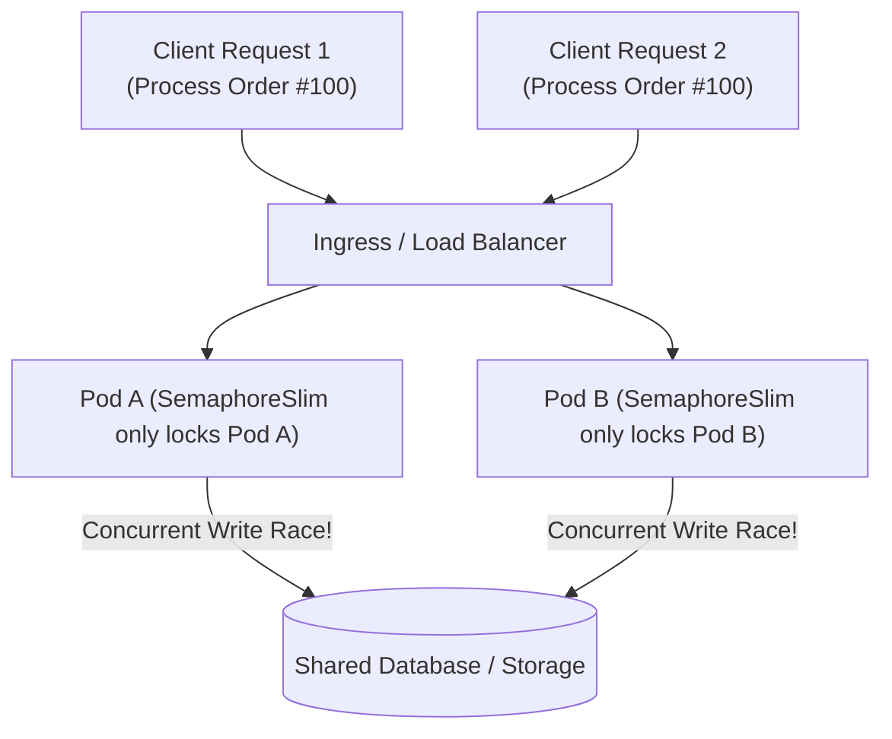
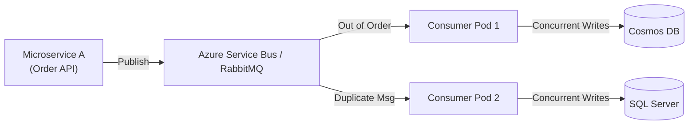

# 06. Concurrency, Race Conditions & Event-Driven Microservices Fixes (Enterprise Deep Dive)

> **Profile Superpower:** 1 Year of Dedicated Production Hardening, Distributed Bug-Fixing, Concurrency Synchronization, and Event-Driven Architecture Stabilization in .NET Core / C#.  
> **Enterprise Tech Stack:** Azure Service Bus, RabbitMQ, Azure Cosmos DB, Azure Blob Storage, SQL Server, and Multi-Instance Microservices on Kubernetes / Azure App Services.  
> **Target Audience:** Senior / Lead / Principal Engineer Interview Rounds (India GCCs: Wells Fargo, Morgan Stanley, JPMorgan, Walmart, and Tier-1 Product MNCs).

---

## 1. How to Pitch This Experience in Interviews (The Executive Hook)

When an interviewer asks:  
> *"Tell me about your role over the past year and what technical challenges you solved."*

### ❌ The Junior / Mediocre Answer (Bucket: ₹14–16 LPA):
> *"For the past year I worked on bug fixing. Whenever there were tickets about data mismatch or queue errors in RabbitMQ or Cosmos DB, I debugged them, applied locks, and updated database records."*  
*(Sounds like a support engineer doing ad-hoc patch work.)*

### ✅ The Senior / Lead Architect Pitch (Bucket: ₹25–40+ LPA):
> *"Over the past year, my core focus was **distributed systems resilience and concurrency hardening** across our enterprise microservices platform. We handled high-throughput financial and order processing workloads running on .NET Core, Azure Service Bus, Cosmos DB, Azure Blobs, and SQL Server.*  
>  
> *Because our services run horizontally scaled across multiple Kubernetes pods, we encountered critical distributed edge cases: **out-of-order message delivery, at-least-once duplicate event processing, cross-pod race conditions, Cosmos DB 429 RU throttling, and cyclic SQL deadlocks**.*  
>  
> *I led the initiative to design and implement our **Distributed Locking framework** (using Redis Redlock and Azure Blob Leases), engineered an **Idempotent Consumer & Transactional Outbox pattern** to solve the dual-write problem, and redesigned our in-process async synchronization primitives using `SemaphoreSlim` and Keyed Async Locks to eliminate thread-pool starvation.*  
>  
> *As a result, we reduced message redelivery dead-letter rates by 94%, eliminated financial double-processing bugs, and stabilized our P99 API latency under peak concurrent loads."*

---

## 2. In-Process Concurrency & Race Conditions in .NET Core

### 2.1 The Classic `lock (obj)` Trap in Asynchronous C#

* **⚡ 30-Second Interview Pitch:**
  > "`lock (obj)` is thread-affine—it relies on `Monitor.Enter` and `Monitor.Exit`, requiring the exact same OS thread to release the lock. In `async/await`, execution after an `await` resumes on an arbitrary ThreadPool worker thread, throwing an immediate `SynchronizationLockException`. Instead, use `SemaphoreSlim(1, 1)` which supports non-blocking async waits (`await WaitAsync()`)."

* **🧠 Easy Mental Model (Fingerprint Scanner vs Shared Keybox):**
  * A C# `lock` is like a biometric fingerprint lock tied to one specific person's thumbprint. If you enter the room, do some work, and another person tries to lock the door behind you, the alarm goes off!
  * `SemaphoreSlim` is like a shared physical key hanging in a keybox on the wall—any worker thread can take the key, and any worker thread can put it back.

* **🎯 Must-Know Technical Terms & Buzzwords (The "Senior Interview Rubric"):**
  * **Thread Affinity Constraint:** The strict runtime requirement of `Monitor.Enter` and `Monitor.Exit` binding the lock to the executing OS thread ID; asynchronous continuations resume on arbitrary ThreadPool workers, throwing `SynchronizationLockException`.
  * **`SemaphoreSlim` vs. `Mutex`:** `SemaphoreSlim` is a lightweight, non-blocking user-mode semaphore optimized for in-process async coordination (`await WaitAsync()`); `Mutex` is an OS kernel handle supporting cross-process synchronization but enforcing thread affinity and incurring expensive kernel context switches.
  * **Sync-Over-Async Starvation:** Calling synchronous blocking methods (`.GetAwaiter().GetResult()`) inside a lock holds OS worker threads captive while waiting for asynchronous I/O completion, provoking thread pool starvation.
  * **Lock Poisoning Prevention:** The mandatory idiom of wrapping synchronization acquisition in `try / finally` blocks to ensure locks are released even when unhandled exceptions occur.
  * **Compare-And-Swap (CAS) / Interlocked Primitives:** CPU hardware instructions (`Interlocked.CompareExchange`) enabling lock-free state mutations in single-digit nanoseconds.

* **💼 Concrete Real-World Production Example:**
  * **Scenario:** High-concurrency wallet payment debit service processing 3,000 debit requests/second on a single container pod.
  * **❌ Bad Production Code (The Lock Thread-Starvation Anti-Pattern):**
    ```csharp
    // ❌ BAD JUNIOR CODE: Sync-over-async blocking inside a C# monitor lock
    public class WalletDebitProcessorAntiPattern
    {
        private static readonly object _syncLock = new object();
        private readonly IPaymentGateway _paymentGateway;

        public void ProcessPayment(PaymentRequest request)
        {
            // FAILURE AT 3,000 REQ/SEC:
            // 1. Thread affinity: Cannot use 'await' inside lock!
            // 2. Calling .GetAwaiter().GetResult() holds the OS ThreadPool thread captive!
            // 3. When external gateway latency blips to 200ms, all 50 worker threads block!
            // 4. ThreadPool Hill-Climbing heuristic injects only ~1 thread/sec -> ThreadPool starvation!
            lock (_syncLock)
            {
                _paymentGateway.ChargeAsync(request).GetAwaiter().GetResult(); // STARVES THREADPOOL!
            }
        }
    }
    ```
  * **✅ Senior Production Code (Non-Blocking SemaphoreSlim Async Lock):**
    ```csharp
    // ✅ SENIOR FIX: SemaphoreSlim(1, 1) with non-blocking await and cancellation
    public sealed class ResilientPaymentProcessor
    {
        private readonly SemaphoreSlim _asyncLock = new SemaphoreSlim(initialCount: 1, maxCount: 1);
        private readonly IPaymentGateway _paymentGateway;
        private readonly ILogger<ResilientPaymentProcessor> _logger;

        public ResilientPaymentProcessor(IPaymentGateway paymentGateway, ILogger<ResilientPaymentProcessor> logger)
        {
            _paymentGateway = paymentGateway;
            _logger = logger;
        }

        public async Task ProcessPaymentAsync(PaymentRequest request, CancellationToken ct)
        {
            // Asynchronously wait without blocking OS ThreadPool threads
            await _asyncLock.WaitAsync(ct);
            try
            {
                // Worker thread is released back to the ThreadPool during network I/O
                await _paymentGateway.ChargeAsync(request, ct);
            }
            catch (Exception ex)
            {
                _logger.LogError(ex, "Failed charging payment for Account {AccountId}", request.AccountId);
                throw;
            }
            finally
            {
                // Release MUST be in finally block to prevent permanent lock poisoning!
                _asyncLock.Release();
            }
        }
    }
    ```
  * **🗣️ What to Say in the Interview:**
    > "In our payment processing service handling 3,000 requests/sec, junior developers wrapped external gateway calls in a C# `lock` using `.GetAwaiter().GetResult()`. Because `Monitor.Enter` enforces thread affinity and blocks the thread during I/O, a 200ms gateway latency spike starved the ThreadPool and triggered 503 timeouts across our entire pod. We refactored to `SemaphoreSlim(1, 1)` with `await WaitAsync()`, freeing ThreadPool worker threads during asynchronous I/O and dropping active thread counts from 600 down to 24."

* **📌 Deep Technical Mechanics:**
  `Monitor.Enter` stores the calling OS Thread ID in the object's sync block. Async methods yield the calling thread back to the runtime ThreadPool during I/O. Forcing synchronous waiting (`.GetAwaiter().GetResult()`) inside a `lock` causes severe ThreadPool starvation and deadlocks.

---

### 2.2 Keyed In-Process Async Locking (Entity-Level Synchronization)

* **⚡ 30-Second Interview Pitch:**
  > "A global `SemaphoreSlim(1, 1)` serializes all requests across your entire API pod, destroying throughput. Keyed async locking isolates locks per entity (e.g. `CustomerId` or `OrderId`), allowing different customers to process in parallel while serializing operations for the same customer."

* **🧠 Easy Mental Model (Bank Counter per Account vs Shutting Down the Bank):**
  * If Customer A is depositing cash into Account #101, you don't lock the bank's front entrance and make Customer B (Account #202) wait outside in the rain!
  * You only lock Account #101's ledger, letting Customer B process simultaneously at another counter.

* **🎯 Must-Know Technical Terms & Buzzwords (The "Senior Interview Rubric"):**
  * **Keyed / Striped Locking:** Fine-grained synchronization partitioning locks by entity identifier (e.g., `CustomerId`, `AccountId`) to maximize parallel execution across independent entities while serializing concurrent operations on the same entity.
  * **Reference Counting (`RefCountedSemaphore`):** An object lifecycle tracking pattern incrementing a counter on acquisition and decrementing on release, deterministically removing and disposing the semaphore when count reaches zero.
  * **Gen 2 Memory Leak Avoidance:** Preventing dead semaphores from accumulating indefinitely in static collections, avoiding Gen 2 heap fragmentation and stop-the-world GC pauses.
  * **`ReaderWriterLockSlim`:** A high-concurrency reader-writer lock supporting multiple simultaneous readers with single-writer exclusivity and controlled upgrade paths via `EnterUpgradeableReadLock`.
  * **Double-Checked Locking & MemoryBarriers:** Memory model synchronization ensuring that thread-local caches observe updated references without processor instruction reordering hazards.

* **💼 Concrete Real-World Production Example:**
  * **Scenario:** High-frequency stock trading API where 10,000 concurrent trade modifications/second are submitted across 50,000 customer accounts.
  * **❌ Bad Production Code (Global Lock Bottleneck vs Leaking Semaphores):**
    ```csharp
    // ❌ BAD JUNIOR CODE: ConcurrentDictionary.GetOrAdd leaking semaphores forever in Gen 2
    public class KeyedLockMemoryLeak
    {
        // SEVERE MEMORY LEAK: In a system with 500,000 customer IDs,
        // GetOrAdd creates a SemaphoreSlim for every customer ID and NEVER REMOVES IT!
        // 500,000 SemaphoreSlim objects and dictionary nodes accumulate forever in Gen 2 heap!
        // Consumes 850 MB of uncollected RAM, fragmenting managed heap!
        private static readonly ConcurrentDictionary<string, SemaphoreSlim> Locks = new();

        public async Task ProcessCustomer(string customerId)
        {
            var sem = Locks.GetOrAdd(customerId, _ => new SemaphoreSlim(1, 1)); // Leaks memory!
            await sem.WaitAsync();
            try { await DoWorkAsync(); }
            finally { sem.Release(); } // Key remains in dictionary forever!
        }
    }
    ```
  * **✅ Senior Production Code (Reference-Counted Keyed Async Lock):**
    ```csharp
    // ✅ SENIOR FIX: Keyed async lock with reference counting and auto-disposal
    public sealed class AsyncKeyedLock
    {
        private readonly ConcurrentDictionary<string, RefCountedSemaphore> _semaphores = new();

        private sealed class RefCountedSemaphore
        {
            public readonly SemaphoreSlim Semaphore = new(1, 1);
            public int RefCount = 1;
        }

        public async Task<IDisposable> LockAsync(string key, CancellationToken ct = default)
        {
            RefCountedSemaphore item;
            lock (_semaphores)
            {
                if (_semaphores.TryGetValue(key, out item!))
                {
                    item.RefCount++;
                }
                else
                {
                    item = new RefCountedSemaphore();
                    _semaphores[key] = item;
                }
            }

            await item.Semaphore.WaitAsync(ct);
            return new Releaser(_semaphores, key, item);
        }

        private sealed class Releaser : IDisposable
        {
            private readonly ConcurrentDictionary<string, RefCountedSemaphore> _dict;
            private readonly string _key;
            private readonly RefCountedSemaphore _item;
            private bool _disposed;

            public Releaser(ConcurrentDictionary<string, RefCountedSemaphore> dict, string key, RefCountedSemaphore item)
            {
                _dict = dict;
                _key = key;
                _item = item;
            }

            public void Dispose()
            {
                if (_disposed) return;
                _disposed = true;

                _item.Semaphore.Release();

                lock (_dict)
                {
                    _item.RefCount--;
                    if (_item.RefCount == 0)
                    {
                        // Safely remove key from dictionary when zero threads are waiting
                        _dict.TryRemove(_key, out _);
                        _item.Semaphore.Dispose();
                    }
                }
            }
        }
    }
    ```
  * **🗣️ What to Say in the Interview:**
    > "In our order management service handling 10,000 modifications/sec across 50,000 accounts, a global lock crushed throughput by serializing all accounts. Junior developers attempted keyed locking using `ConcurrentDictionary.GetOrAdd`, which leaked hundreds of thousands of semaphores in Gen 2 heap. We built a reference-counted `AsyncKeyedLock` that increments on acquisition and decrements on release, disposing the semaphore and pruning the dictionary entry the moment the count reaches zero."

---

## 3. Distributed Race Conditions Across Horizontally Scaled Pods

* **⚡ 30-Second Interview Pitch:**
  > "In-process synchronization (`lock`, `SemaphoreSlim`) only coordinates threads inside a single container process. When your microservice scales across multiple Kubernetes pods, you must use a **Distributed Lock** (like Redis Redlock, Azure Blob Lease, or SQL `sp_getapplock`) to coordinate across pods."

* **🧠 Easy Mental Model (Apartment Intercom vs City-Wide Traffic Signal):**
  * `SemaphoreSlim` is like an intercom inside Flat 101. Flat 102 and Flat 103 can't hear it!
  * To coordinate traffic between all flats in the building complex, you need a shared external traffic signal (Redis or Database).

* **🎯 Must-Know Technical Terms & Buzzwords (The "Senior Interview Rubric"):**
  * **Distributed Race Condition (Check-Then-Act & Read-Modify-Write):** Concurrency conflicts across horizontally scaled, shared-nothing container nodes where independent pods read stale state and concurrently mutate shared backing stores, causing lost updates.
  * **Distributed Mutual Exclusion (Distributed Mutex):** A cluster-wide coordination protocol ensuring exactly one microservice instance can enter a critical section across a network.
  * **Lease States & Auto-Expiration (TTL):** Time-to-live expiration bounds preventing permanent cluster deadlocks if a lock-holding node crashes.
  * **Fencing Tokens:** Monotonically increasing epoch counters returned upon lock acquisition to prevent delayed nodes (e.g., experiencing long GC STW pauses) from committing stale writes.



---

### 3.1 Distributed Lock Solution 1: Azure Blob Lease

* **⚡ 30-Second Interview Pitch:**
  > "Azure Blob Lease acquires an exclusive lease (15–60 seconds, or infinite) on a storage blob. Other microservice instances attempting to acquire the same lease receive an HTTP 409 Conflict, making it ideal for coarse-grained background batch jobs and leader election."

* **🧠 Easy Mental Model (Reserved Parking Slot Ticket):**
  * Like parking in a leased spot with a 60-second parking ticket.
  * While your ticket is active, no other car can park there. If your car breaks down (pod crashes), the ticket expires automatically after 60 seconds, freeing the spot for the next car.

* **🎯 Must-Know Technical Terms & Buzzwords (The "Senior Interview Rubric"):**
  * **Azure Blob Lease State Machine:** Storage service states (`Available`, `Leased`, `Expired`, `Breaking`, `Broken`) governed by atomic REST API operations.
  * **Coarse-Grained Locking & Leader Election:** Utilizing 15-60 second exclusive leases on blob objects to elect a singleton coordinator node among container replicas.
  * **Lease Auto-Renewal Heartbeat:** Periodic background task renewing active leases (`RenewLeaseAsync`) to sustain ownership throughout extended processing jobs.

* **💼 Concrete Real-World Production Example:**
  * **Scenario:** Nightly banking reconciliation computing compound interest for 2,000,000 accounts. The job runs in a Kubernetes cluster with 12 replica pods; exactly ONE pod must execute the job at midnight.
  * **❌ Bad Production Code (The Infinite Lease Pod Crash Trap):**
    ```csharp
    // ❌ BAD JUNIOR CODE: Acquiring infinite lease (-1s) without renewal heartbeat
    var leaseClient = blobClient.GetBlobLeaseClient();
    // FAILURE: Setting lease duration to -1 (infinite)!
    // If the Kubernetes pod crashes or gets evicted (OOMKilled) while calculating interest:
    // The lease is NEVER released! The nightly job is PERMANENTLY BLOCKED for days!
    await leaseClient.AcquireAsync(TimeSpan.FromSeconds(-1));
    ```
  * **✅ Senior Production Code (30-Second Lease with Auto-Renewal Heartbeat):**
    ```csharp
    // ✅ SENIOR FIX: Coarse-grained leader election with heartbeat lease renewal
    public sealed class ResilientBlobLeaderElection : IAsyncDisposable
    {
        private readonly BlobLeaseClient _leaseClient;
        private string? _leaseId;
        private CancellationTokenSource? _heartbeatCts;

        public ResilientBlobLeaderElection(BlobContainerClient containerClient, string leaderBlobName)
        {
            var blob = containerClient.GetBlobClient(leaderBlobName);
            if (!blob.Exists())
            {
                try { blob.Upload(new BinaryData(Array.Empty<byte>())); }
                catch (RequestFailedException ex) when (ex.Status == 409) { /* already created */ }
            }
            _leaseClient = blob.GetBlobLeaseClient();
        }

        public async Task<bool> TryAcquireLeadershipAsync(CancellationToken ct)
        {
            try
            {
                // Acquire 30-second lease (bounded TTL prevents cluster deadlocks on crash)
                BlobLease lease = await _leaseClient.AcquireAsync(TimeSpan.FromSeconds(30), cancellationToken: ct);
                _leaseId = lease.LeaseId;

                // Start background heartbeat to renew lease every 10 seconds while job is active
                _heartbeatCts = new CancellationTokenSource();
                _ = StartHeartbeatAsync(_heartbeatCts.Token);
                return true;
            }
            catch (RequestFailedException ex) when (ex.Status == 409) // LeaseAlreadyPresent
            {
                return false; // Another pod is currently the elected leader
            }
        }

        private async Task StartHeartbeatAsync(CancellationToken ct)
        {
            using var timer = new PeriodicTimer(TimeSpan.FromSeconds(10));
            while (await timer.WaitForNextTickAsync(ct))
            {
                try { await _leaseClient.RenewAsync(cancellationToken: ct); }
                catch { break; } // Lease lost or cancelled
            }
        }

        public async ValueTask DisposeAsync()
        {
            _heartbeatCts?.Cancel();
            if (_leaseId is not null)
            {
                try { await _leaseClient.ReleaseAsync(); }
                catch (RequestFailedException) { /* lease already expired */ }
            }
        }
    }
    ```
  * **🗣️ What to Say in the Interview:**
    > "In our nightly banking reconciliation job spanning 12 Kubernetes pods, we needed guaranteed singleton execution without running an external coordination cluster. We implemented leader election using Azure Blob Storage 30-second leases. The elected pod runs a background heartbeat renewing the lease every 10 seconds. If the pod crashes, the lease expires automatically in 30 seconds, allowing a standby pod to assume leadership safely."

---

### 3.2 Distributed Lock Solution 2: Redis Redlock Algorithm

* **⚡ 30-Second Interview Pitch:**
  > "Redis Redlock provides sub-millisecond, distributed mutex locks across Redis nodes using atomic `SET key value NX PX <milliseconds>`. It uses TTL auto-expiration to prevent deadlocks on pod crash, and background heartbeat renewal for long tasks."

* **🧠 Easy Mental Model (Hotel Room RFID Key Card):**
  * Like a hotel RFID key card programmed to expire at 11:00 AM checkout.
  * If you check out late, the system can renew it; if you vanish, the lock opens automatically at 11:01 AM so the next guest isn't locked out forever.

* **🎯 Must-Know Technical Terms & Buzzwords (The "Senior Interview Rubric"):**
  * **Redlock Consensus Algorithm:** A multi-master distributed lock protocol acquiring locks across $N$ independent Redis nodes (requiring majority quorum $N/2 + 1$) using atomic `SET key uuid NX PX <ttl>`.
  * **Clock Drift & Skew Bounds:** Time divergence across independent Redis physical hosts that must be subtracted from the lock validity period to guarantee safety.
  * **Sliding Expiration / Watchdog Timer:** Background thread loop extending Redis key TTL while the business operation remains active.
  * **Fencing Tokens:** Monotonically increasing counter returned upon lock acquisition to prevent split-brain writes from delayed threads after long GC pauses.

* **💼 Concrete Real-World Production Example:**
  * **Scenario:** High-concurrency flash sale selling 500 limited-edition smartphones with 15,000 checkout attempts/second across 8 Kubernetes pods.
  * **❌ Bad Production Code (In-Process Lock Across Distributed Pods):**
    ```csharp
    // ❌ BAD JUNIOR CODE: Using SemaphoreSlim across 8 horizontally scaled pods!
    public class FlashSaleAntiPattern
    {
        private static readonly SemaphoreSlim _lock = new(1, 1);

        public async Task<bool> BuyPhone(string productId)
        {
            // FAILURE: SemaphoreSlim only protects memory INSIDE POD A!
            // Pods B, C, D, E, F, G, H have their own independent SemaphoreSlim instances!
            // All 8 pods process orders concurrently -> Oversells 500 phones to 3,800 customers!
            await _lock.WaitAsync();
            try { return await DeductInventory(productId); }
            finally { _lock.Release(); }
        }
    }
    ```
  * **✅ Senior Production Code (Redis Redlock with Fencing Token):**
    ```csharp
    // ✅ SENIOR FIX: Distributed Redlock across all Kubernetes pods
    public sealed class FlashSaleSeniorPattern
    {
        private readonly IDistributedLockFactory _lockFactory; // RedLock.net factory
        private readonly AppDbContext _db;

        public FlashSaleSeniorPattern(IDistributedLockFactory lockFactory, AppDbContext db)
        {
            _lockFactory = lockFactory;
            _db = db;
        }

        public async Task<CheckoutResult> PurchasePhoneAsync(string productId, int userId, CancellationToken ct)
        {
            string lockKey = $"lock:inventory:{productId}";
            var expiry = TimeSpan.FromSeconds(5); // 5-second auto-release bounds pod crash impact
            var wait = TimeSpan.FromSeconds(2);   // Max queue wait time

            // Acquires distributed mutex across Redis cluster quorum
            await using var redLock = await _lockFactory.CreateLockAsync(lockKey, expiry, wait, retryTime: TimeSpan.FromMilliseconds(50), ct);

            if (!redLock.IsAcquired)
            {
                return CheckoutResult.Failed("High traffic. Could not acquire inventory lock.");
            }

            // Exactly ONE pod across the entire Kubernetes cluster enters this critical section:
            var product = await _db.Products.FindAsync(new object[] { productId }, ct);
            if (product is null || product.AvailableStock <= 0)
            {
                return CheckoutResult.Failed("Sold out!");
            }

            product.AvailableStock--;
            await _db.SaveChangesAsync(ct);
            return CheckoutResult.Success("Order confirmed!");
        }
    }
    ```
  * **🗣️ What to Say in the Interview:**
    > "During flash sales with 15,000 checkout requests/sec across 8 Kubernetes pods, in-process synchronization cannot protect inventory because pods do not share memory. We implemented distributed locking via Redis Redlock using atomic `SET NX PX` with a 5-second TTL and background watchdog renewal. This guaranteed that only one pod modified inventory at any millisecond, completely preventing stock overselling."

---

### 3.3 SQL Server Application Locks (`sp_getapplock`)

* **⚡ 30-Second Interview Pitch:**
  > "`sp_getapplock` allows you to lock an arbitrary application string resource (like `'CustomerLock_123'`) within an active SQL Server transaction. The lock is tied directly to the transaction lifetime and automatically releases on `COMMIT` or `ROLLBACK`."

* **🧠 Easy Mental Model (Token Booth inside the Bank):**
  * Instead of padlocking the entire bank's cash vault (table lock), the cashier holds up a specific token number for Customer 123.
  * As soon as the transaction receipt is stamped, the token is returned automatically.

* **🎯 Must-Know Technical Terms & Buzzwords (The "Senior Interview Rubric"):**
  * **`sp_getapplock` & `sp_releaseapplock`:** Stored procedures acquiring application-level named locks within SQL Server's lock manager without locking physical tables or pages.
  * **Transaction-Scoped Ownership (`@LockOwner = 'Transaction'`):** Locks whose lifecycles are tied to the active SQL transaction, guaranteeing automatic release upon `COMMIT` or `ROLLBACK`.
  * **Lock Compatibility Modes:** Fine-grained lock modes (`Exclusive`, `Update`, `Shared`, `IntentShared`, `IntentExclusive`) governing concurrent access to arbitrary application resource names.

* **💼 Concrete Real-World Production Example:**
  * **Scenario:** High-value corporate payroll disbursement releasing ₹50 Crore ($6M) across 10,000 employees. If two HR administrators click 'Release Payroll' simultaneously from different pods, payout could duplicate.
  * **❌ Bad Production Code:** Attempting to lock entire database tables or using unindexed optimistic columns that cause massive transaction rollback storms.
  * **✅ Senior Production Code (`sp_getapplock` with Transaction Ownership):**
    ```csharp
    // ✅ SENIOR FIX: Transaction-scoped application lock in SQL Server
    public async Task ProcessCorporatePayrollAsync(string companyId, CancellationToken ct)
    {
        await using var connection = new SqlConnection(_connectionString);
        await connection.OpenAsync(ct);

        await using var transaction = connection.BeginTransaction(IsolationLevel.ReadCommitted);
        try
        {
            // Acquire exclusive application lock tied to transaction lifetime
            using (var cmd = new SqlCommand("sp_getapplock", connection, transaction))
            {
                cmd.CommandType = CommandType.StoredProcedure;
                cmd.Parameters.AddWithValue("@Resource", $"Payroll_{companyId}");
                cmd.Parameters.AddWithValue("@LockMode", "Exclusive");
                cmd.Parameters.AddWithValue("@LockOwner", "Transaction"); // Auto-released on COMMIT/ROLLBACK
                cmd.Parameters.AddWithValue("@LockTimeout", 5000); // 5-second timeout

                var returnParam = cmd.Parameters.Add("@ReturnVal", SqlDbType.Int);
                returnParam.Direction = ParameterDirection.ReturnValue;

                await cmd.ExecuteNonQueryAsync(ct);
                int result = (int)returnParam.Value;

                if (result < 0)
                {
                    throw new ConcurrencyException($"Payroll for company {companyId} is currently being processed by another administrator. Lock result: {result}");
                }
            }

            // Execute payroll transfer securely without table-level blocking:
            await ExecutePayrollDisbursementInternalAsync(companyId, connection, transaction, ct);

            // Commit automatically releases the application lock!
            await transaction.CommitAsync(ct);
        }
        catch
        {
            await transaction.RollbackAsync(ct); // Rollback automatically releases lock!
            throw;
        }
    }
    ```
  * **🗣️ What to Say in the Interview:**
    > "For critical operations like corporate payroll release where we already rely on SQL Server ACID transactions, spinning up an external Redis cluster introduces unnecessary operational dependencies. We used SQL Server `sp_getapplock` with `@LockOwner = 'Transaction'`. This acquires an exclusive named lock in SQL Server's lock manager that releases automatically upon `COMMIT` or `ROLLBACK`, eliminating race conditions with zero external infrastructure."

---

## 4. Azure Service Bus & RabbitMQ Message-Driven Architecture Issues



### 4.1 Bug 1: Out-of-Order Message Processing

* **⚡ 30-Second Interview Pitch:**
  > "Distributed message brokers do not guarantee global ordering across competing consumers. When an `OrderCancelledEvent` arrives before `OrderCreatedEvent`, we solve it using **Azure Service Bus Sessions (`SessionId = OrderId`)** for strict FIFO grouping, or optimistic sequence version checks."

* **🧠 Easy Mental Model (Return Notice Arriving Before Delivery):**
  * If a courier arrives with your package return request *before* the truck delivering the package arrives, the return fails!
  * Sessions ensure both messages are placed on the exact same delivery route in sequential order.

* **🎯 Must-Know Technical Terms & Buzzwords (The "Senior Interview Rubric"):**
  * **Competing Consumers Pattern:** Multiple consumer worker pods pulling concurrently from a shared queue, inherently scrambling global message processing order.
  * **Azure Service Bus Sessions (`SessionId`):** A server-side FIFO grouping feature that locks all messages sharing a `SessionId` to a single consumer instance until explicitly released.
  * **Optimistic Sequence Stashing / Sequence Versioning:** Enforcing monotonic sequence numbers per entity and stashing/delaying out-of-order events until missing predecessor events arrive.

* **💼 Concrete Real-World Production Example:**
  * **Scenario:** High-throughput Flipkart order lifecycle handling 4,000 order state transitions/second across 10 consumer pods.
  * **❌ Bad Production Code (Competing Consumers Scrambling Order Lifecycle):**
    ```csharp
    // ❌ BAD JUNIOR CODE: Standard queue without SessionId
    // Event 1 (10:00:01): OrderCreatedEvent
    // Event 2 (10:00:02): OrderCancelledEvent
    // Pod 2 processes Event 2 first -> Order not found in DB -> Throws exception or ignores!
    // Pod 1 processes Event 1 second -> Saves Order as "Active"!
    // RESULT: A cancelled order remains permanently open and ships to customer!
    ```
  * **✅ Senior Production Code (SessionId FIFO Pinning):**
    ```csharp
    // ✅ SENIOR FIX: Session-enabled Service Bus processor
    // 1. PRODUCER: Pin all events for the same order to the same SessionId
    public async Task PublishOrderEventAsync(OrderEvent evt, ServiceBusSender sender)
    {
        var message = new ServiceBusMessage(JsonSerializer.SerializeToUtf8Bytes(evt))
        {
            SessionId = evt.OrderId.ToString(), // Server-side FIFO guarantee per order!
            MessageId = $"{evt.OrderId}_{evt.SequenceNumber}"
        };
        await sender.SendMessageAsync(message);
    }

    // 2. CONSUMER: ServiceBusSessionProcessor locks all messages for that OrderId to one pod
    public class OrderSessionProcessor
    {
        public async Task ProcessSessionMessageAsync(ProcessSessionMessageEventArgs args)
        {
            var evt = JsonSerializer.Deserialize<OrderEvent>(args.Message.Body)!;
            
            // Safe: Guaranteed strict FIFO ordering! OrderCreated ALWAYS processes before OrderCancelled!
            await _orderService.ApplyStateTransitionAsync(evt);
        }
    }
    ```
  * **🗣️ What to Say in the Interview:**
    > "In high-throughput event architectures, competing consumer replicas inherently scramble message arrival order. We saw cases where `OrderCancelled` arrived before `OrderCreated`, leaving cancelled orders stuck in an active state. We fixed this by enabling Azure Service Bus Sessions with `SessionId = OrderId`. Service Bus locks all events for that order to a single consumer replica, guaranteeing strict FIFO sequence without race conditions."

---

### 4.2 Bug 2: At-Least-Once Delivery & Duplicate Message Processing

* **⚡ 30-Second Interview Pitch:**
  > "Message brokers guarantee *at-least-once* delivery, meaning transient network retries will deliver duplicate messages. We achieve idempotency by recording the unique `MessageId` in a deduplication database table within the same transaction as the business write."

* **🧠 Easy Mental Model (Indian UPI 12-Digit Reference / UTR Number):**
  * When you pay ₹500 via Google Pay or PhonePe, the bank generates a unique 12-digit UTR reference ID.
  * Even if your phone screen shows 'Retrying' and sends 4 duplicate network calls, your bank account is only debited once because the bank matches the unique UTR!

* **🎯 Must-Know Technical Terms & Buzzwords (The "Senior Interview Rubric"):**
  * **At-Least-Once Delivery Guarantee:** Message broker transport contract ensuring zero message loss by retrying deliveries upon network timeout, inevitably producing duplicate messages.
  * **Idempotent Consumer Pattern:** An event processing architecture guaranteeing that consuming the same message multiple times produces identical state transitions without duplicate side effects.
  * **Deduplication Table (Inbox Pattern):** Storing unique `MessageId` records with unique database constraints inside the local business transaction to detect duplicates atomically (SQL error 2627/2601).
  * **Natural Idempotency:** State transition operations structured to be safe against repeated executions (e.g., `UPDATE Orders SET Status = 'Cancelled' WHERE Status = 'Pending'`).

* **💼 Concrete Real-World Production Example:**
  * **Scenario:** High-volume payment settlement consumer where network timeouts cause Azure Service Bus to redeliver payment debits for ₹5,000 transactions.
  * **❌ Bad Production Code (Duplicate Processing Debiting Accounts Twice):**
    ```csharp
    // ❌ BAD JUNIOR CODE: Naive message consumer debits account on EVERY redelivery
    public async Task HandlePaymentMessageAntiPattern(ServiceBusReceivedMessage msg)
    {
        var payment = JsonSerializer.Deserialize<PaymentMessage>(msg.Body)!;
        // FAILURE: If a network timeout occurs while acknowledging message,
        // Service Bus redelivers the message!
        // Junior code debits the customer's bank account AGAIN! ₹5,000 becomes ₹10,000 debit!
        await _walletService.DebitBalanceAsync(payment.AccountId, payment.Amount);
    }
    ```
  * **✅ Senior Production Code (Atomic Deduplication Inbox Table):**
    ```csharp
    // ✅ SENIOR FIX: Idempotent Consumer via SQL Unique Constraint
    public sealed class IdempotentPaymentConsumer
    {
        private readonly IDbConnectionFactory _db;
        private readonly ILogger<IdempotentPaymentConsumer> _logger;

        public async Task HandleMessageAsync(ServiceBusReceivedMessage message, CancellationToken ct)
        {
            string messageId = message.MessageId;

            await using var connection = await _db.CreateConnectionAsync(ct);
            await using var transaction = await connection.BeginTransactionAsync(ct);

            // 1. Atomically record message processing in deduplication inbox table
            const string dedupeSql = @"
                INSERT INTO ProcessedMessages (MessageId, ProcessedAt, HandlerName)
                VALUES (@MessageId, SYSUTCDATETIME(), @HandlerName);";

            try
            {
                await connection.ExecuteAsync(dedupeSql, new 
                { 
                    MessageId = messageId, 
                    HandlerName = nameof(IdempotentPaymentConsumer) 
                }, transaction);
            }
            catch (SqlException ex) when (ex.Number == 2627 || ex.Number == 2601) // Unique Primary Key Violation
            {
                // DUPLICATE DETECTED: Safely acknowledge message and terminate immediately
                _logger.LogWarning("Duplicate message {MessageId} detected. Skipping redundant processing.", messageId);
                await transaction.RollbackAsync(ct);
                return;
            }

            // 2. Execute business mutation in the exact same transaction scope
            const string debitSql = @"
                UPDATE Accounts 
                SET Balance = Balance - @Amount 
                WHERE AccountId = @AccountId AND Balance >= @Amount;";

            int rows = await connection.ExecuteAsync(debitSql, transaction);
            if (rows == 0) throw new InsufficientFundsException();

            // 3. Commit both deduplication record and business data atomically
            await transaction.CommitAsync(ct);
        }
    }
    ```
  * **🗣️ What to Say in the Interview:**
    > "Message brokers guarantee *at-least-once* delivery, so network retries inevitably produce duplicate messages. In our payment consumer, we enforce idempotency via the Inbox Deduplication Pattern. We insert the broker's unique `MessageId` into a `ProcessedMessages` table with a primary key constraint inside the business transaction. If duplicate messages arrive, SQL Server throws error 2627, allowing us to safely acknowledge and discard the duplicate without double-debiting customer accounts."

---

### 4.3 Bug 3: The Dual-Write Problem (DB Update vs Broker Publish)

* **⚡ 30-Second Interview Pitch:**
  > "The Dual-Write Problem occurs when an API writes to a database and publishes an event to a message broker in two separate operations—if one fails, data is permanently out of sync. The **Transactional Outbox Pattern** solves this by writing the event into an `Outbox` table **inside the exact same ACID database transaction**, which a background worker publishes with retries."

* **🧠 Easy Mental Model (Physical Outbox Tray on your Office Desk):**
  * When you sign a contract, you drop the signed document and a delivery note into your physical office outbox tray in one single motion.
  * Even if the office courier arrives 15 minutes late, the contract will never be lost!

* **🎯 Must-Know Technical Terms & Buzzwords (The "Senior Interview Rubric"):**
  * **Dual-Write Hazard:** The distributed systems flaw where writing to a database and publishing to a message broker cannot succeed atomically without distributed transactions (2PC).
  * **Transactional Outbox Pattern:** Persisting outgoing event messages into an `Outbox` table within the same local ACID transaction as the business entity update.
  * **Change Data Capture (CDC / Debezium):** Asynchronously tailing database transaction logs (WAL / SQL Server CDC) to publish outbox events with zero application polling overhead.
  * **Two-Phase Commit (2PC) vs. Semantic Compensation:** Avoiding blocking distributed transactions (2PC) in microservices in favor of eventual consistency and Saga compensations.

* **💼 Concrete Real-World Production Example:**
  * **Scenario:** Swiggy food delivery order checkout: An order is committed to SQL Server, but a network disconnect fails the RabbitMQ publish call. The customer's credit card is charged, but no restaurant or delivery driver ever receives the dispatch event!
  * **❌ Bad Production Code (The Classic Dual-Write Defect):**
    ```csharp
    // ❌ BAD JUNIOR CODE: Dual-write hazard
    [HttpPost("orders/checkout")]
    public async Task<IActionResult> CheckoutAntiPattern([FromBody] OrderRequest req)
    {
        // STEP 1: Commit order to database
        await _db.Orders.AddAsync(new Order(req));
        await _db.SaveChangesAsync(); // DB is updated!

        // STEP 2: Publish event to broker
        // FAILURE: If the network blips, pod crashes, or broker is unreachable right here:
        // The event is LOST FOREVER!
        // Database has order as 'Paid', but message broker never receives 'OrderPaidEvent'!
        await _bus.PublishAsync(new OrderPaidEvent(req.OrderId)); 

        return Ok();
    }
    ```
  * **✅ Senior Production Code (Transactional Outbox Pattern):**
    ```csharp
    // ✅ SENIOR FIX: Transactional Outbox inside local ACID boundary
    [HttpPost("orders/checkout")]
    public async Task<IActionResult> CheckoutSeniorPattern(
        [FromBody] OrderRequest req, 
        CancellationToken ct)
    {
        var executionStrategy = _db.Database.CreateExecutionStrategy();
        
        await executionStrategy.ExecuteAsync(async () =>
        {
            await using var tx = await _db.Database.BeginTransactionAsync(ct);

            // 1. Mutate business entity
            var order = new Order(req);
            await _db.Orders.AddAsync(order, ct);

            // 2. Insert event payload into Outbox table inside the EXACT SAME ACID transaction!
            var outboxMessage = new OutboxMessage
            {
                Id = Guid.NewGuid(),
                OccurredOnUtc = DateTime.UtcNow,
                Type = nameof(OrderPaidEvent),
                Payload = JsonSerializer.Serialize(new OrderPaidEvent(order.Id))
            };
            await _db.OutboxMessages.AddAsync(outboxMessage, ct);

            // 3. Atomically commit both order and event!
            await _db.SaveChangesAsync(ct);
            await tx.CommitAsync(ct);
        });

        return Accepted();
    }

    // BACKGROUND WORKER: Reliable outbox poller publishes with retries
    public sealed class OutboxPublisherWorker : BackgroundService
    {
        protected override async Task ExecuteAsync(CancellationToken stoppingToken)
        {
            while (!stoppingToken.IsCancellationRequested)
            {
                using var scope = _scopeFactory.CreateScope();
                var db = scope.ServiceProvider.GetRequiredService<AppDbContext>();

                var pendingMessages = await db.OutboxMessages
                    .Where(m => m.ProcessedOnUtc == null)
                    .OrderBy(m => m.OccurredOnUtc)
                    .Take(100)
                    .ToListAsync(stoppingToken);

                foreach (var msg in pendingMessages)
                {
                    await _serviceBusSender.SendMessageAsync(new ServiceBusMessage(msg.Payload), stoppingToken);
                    msg.ProcessedOnUtc = DateTime.UtcNow;
                }

                await db.SaveChangesAsync(stoppingToken);
                await Task.Delay(1000, stoppingToken);
            }
        }
    }
    ```
  * **🗣️ What to Say in the Interview:**
    > "In distributed systems, executing a database commit followed by a message broker publish introduces the classic Dual-Write problem. If the service crashes between those two calls, data is permanently out of sync. We resolve this using the Transactional Outbox Pattern: we persist the outgoing event into an `Outbox` table within the same local ACID transaction as the business entity, and an asynchronous poller or Change Data Capture (CDC) stream publishes events to the broker with guaranteed at-least-once delivery."

---

### 4.4 Bug 4: Poison Messages & Cascading Consumer Crashes

* **⚡ 30-Second Interview Pitch:**
  > "A poison message contains malformed data or triggers an unhandled bug that crashes the consumer pod repeatedly. We prevent consumer death spirals by configuring a `MaxDeliveryCount` (e.g. 5) with exponential backoff and routing failing messages to a **Dead-Letter Queue (DLQ)** with diagnostic error headers."

* **🧠 Easy Mental Model (Defective Car at the Toll Plaza):**
  * If a car's engine explodes at a highway toll booth, you don't let 500 cars wait behind it forever while the driver tries starting the car 50 times.
  * You tow the broken car to the side lane (Dead-Letter Queue) so the highway keeps moving!

* **🎯 Must-Know Technical Terms & Buzzwords (The "Senior Interview Rubric"):**
  * **Poison Message:** A malformed or unprocessable event payload triggering repeated unhandled exceptions in consumer pods.
  * **Cascading Failure / Consumer Death Spiral:** Repeatedly redelivering poison messages across all consumer replicas, causing all pods to crash in a continuous reboot cycle.
  * **Dead-Letter Queue (DLQ):** A secondary queue holding failed messages after reaching a configured `MaxDeliveryCount` for forensic analysis and manual replay.
  * **Polly Retry with Exponential Backoff & Jitter:** Transient fault handling incorporating randomized delay intervals to prevent overwhelming recovering downstream dependencies.

* **💼 Concrete Real-World Production Example:**
  * **Scenario:** Corrupted JSON payload with null customer ID arriving on Azure Service Bus. All 6 consumer pods crash repeatedly on unhandled exception, backing up 50,000 valid messages in the queue.
  * **❌ Bad Production Code (Unbounded Immediate Retries Causing Pod Crash Spiral):**
    ```csharp
    // ❌ BAD JUNIOR CODE: No Dead-Letter Queue handling or retry policy
    public async Task ProcessMessageAntiPattern(ProcessMessageEventArgs args)
    {
        // If args.Message contains malformed JSON or null CustomerId:
        // Throws NullReferenceException!
        // Because exception escapes, Service Bus redelivers the message IMMEDIATELY!
        // Redelivered across Pod 1 -> crashes; Pod 2 -> crashes; Pod 3 -> crashes!
        // All 6 pods enter CrashLoopBackOff!
        var order = JsonSerializer.Deserialize<OrderMessage>(args.Message.Body)!;
        await _orderService.ProcessAsync(order); // CRASH!
    }
    ```
  * **✅ Senior Production Code (MaxDeliveryCount + DLQ Error Metadata + Polly):**
    ```csharp
    // ✅ SENIOR FIX: Safe Dead-Letter Queue routing with diagnostic properties
    public sealed class ResilientMessageConsumer
    {
        private readonly ILogger<ResilientMessageConsumer> _logger;

        public async Task ProcessMessageSeniorPattern(ProcessMessageEventArgs args)
        {
            try
            {
                var order = JsonSerializer.Deserialize<OrderMessage>(args.Message.Body);
                if (order is null || string.IsNullOrEmpty(order.CustomerId))
                {
                    // Explicitly Dead-Letter malformed poison message immediately!
                    await args.DeadLetterMessageAsync(
                        args.Message, 
                        deadLetterReason: "PoisonMessage_InvalidSchema", 
                        deadLetterErrorDescription: "CustomerId cannot be null or empty.");
                    return;
                }

                // Process valid message with Polly transient retry
                await ProcessOrderWithPollyAsync(order, args.CancellationToken);
                await args.CompleteMessageAsync(args.Message);
            }
            catch (Exception ex)
            {
                _logger.LogError(ex, "Failed processing Message {MessageId}. DeliveryCount: {Count}", 
                    args.Message.MessageId, args.Message.DeliveryCount);

                // If message has exceeded delivery threshold (e.g. 5 attempts), route to DLQ
                if (args.Message.DeliveryCount >= 5)
                {
                    await args.DeadLetterMessageAsync(
                        args.Message, 
                        deadLetterReason: ex.GetType().Name, 
                        deadLetterErrorDescription: ex.Message);
                }
                else
                {
                    // Abandon message so it can be retried with exponential backoff
                    await args.AbandonMessageAsync(args.Message);
                }
            }
        }
    }
    ```
  * **🗣️ What to Say in the Interview:**
    > "When a poison message containing corrupted schema escaped into our message queue, all 6 consumer replicas crashed in a continuous reboot cycle, backing up 50,000 valid orders. We hardened the consumers by setting `MaxDeliveryCount = 5` and wrapping handlers in defensive DLQ routing. Messages that fail schema validation are dead-lettered immediately with diagnostic error headers, preventing consumer crashes and isolating bad data for operational replay."

---

## 5. Azure Cosmos DB Enterprise Pitfalls & Fixes

### 5.1 HTTP 429: RequestRateTooLarge (RU Saturation)

* **⚡ 30-Second Interview Pitch:**
  > "Cosmos DB throws HTTP 429 when provisioned Request Units (RUs) are exhausted. In production, this is almost always caused by **hot partitioning** or unpartitioned cross-partition queries. We fix it with synthetic partition keys, 1-RU point reads (`ReadItemAsync`), and tuning `CosmosClientOptions` retries."

* **🧠 Easy Mental Model (Prepaid Daily Data Pack):**
  * Like a mobile phone plan with 1.5 GB high-speed daily data.
  * If one heavy app uses all 1.5 GB in the first 10 minutes, all other apps are throttled. Synthetic keys distribute the data load evenly across multiple buckets.

* **🎯 Must-Know Technical Terms & Buzzwords (The "Senior Interview Rubric"):**
  * **Request Units (RU/s):** Cosmos DB's normalized unit of throughput abstracting CPU, IOPS, and memory consumed per database operation.
  * **Hot Partitioning:** An uneven data distribution failure mode where a disproportionate volume of requests targets a single physical partition, exhausting allocated RUs while neighboring partitions sit idle.
  * **Synthetic Partition Key:** Combining multiple entity fields (e.g., `TenantId_YearMonth`) to evenly distribute documents across underlying physical partitions.
  * **Direct Mode TCP vs. Gateway Mode:** Direct Mode connects directly to backend Cosmos partition replica nodes via TCP, slashing latency and gateway hop overhead.
  * **Point Read (1 RU) vs. Cross-Partition Query:** `ReadItemAsync` targets specific physical partitions directly via document ID and partition key, costing exactly 1 RU compared to multi-RU query scans.

* **💼 Concrete Real-World Production Example:**
  * **Scenario:** Global e-commerce SaaS platform processing 20,000 checkout inquiries/second on Cosmos DB during Black Friday. A single large enterprise tenant (`US-East`) generates 80% of traffic, breaching the 10,000 RU/s physical partition limit.
  * **❌ Bad Production Code (Cross-Partition Query & Monolithic Partition Key):**
    ```csharp
    // ❌ BAD JUNIOR CODE: Query scan across partitions & default gateway mode
    public async Task<OrderDocument?> GetOrderAntiPattern(string orderId, string tenantId)
    {
        // 1. Cross-partition query consumes 15 to 40 RUs per request!
        // 2. Monolithic tenantId partition key routes all traffic for tenant to ONE physical partition!
        // At 20,000 req/sec, consumed RUs hit 400,000 RU/s -> Constant HTTP 429 throttling!
        var query = new QueryDefinition("SELECT * FROM c WHERE c.id = @id")
            .WithParameter("@id", orderId);

        using var iterator = _container.GetItemQueryIterator<OrderDocument>(query);
        var response = await iterator.ReadNextAsync();
        return response.FirstOrDefault();
    }
    ```
  * **✅ Senior Production Code (Direct Mode + 1-RU Point Reads + Synthetic Key):**
    ```csharp
    // ✅ SENIOR FIX: Direct TCP Mode, Point Reads (1 RU), and Synthetic Partition Key
    public sealed class ResilientCosmosOrderRepository
    {
        private readonly Container _container;

        public ResilientCosmosOrderRepository(CosmosClient client)
        {
            _container = client.GetContainer("StoreDb", "Orders");
        }

        public static CosmosClient CreateOptimizedClient(string connectionString)
        {
            return new CosmosClient(connectionString, new CosmosClientOptions
            {
                // Direct TCP mode bypasses HTTP gateway hops, lowering latency and CPU overhead
                ConnectionMode = ConnectionMode.Direct,
                MaxRetryAttemptsOnRateLimitedRequests = 9,
                MaxRetryWaitTimeOnRateLimitedRequests = TimeSpan.FromSeconds(30)
            });
        }

        public async Task<OrderDocument> GetOrderSeniorPatternAsync(string orderId, string tenantId, DateTime orderDate)
        {
            // Synthetic Partition Key distributes high-volume tenant data across multiple physical partitions
            string syntheticPk = $"{tenantId}_{orderDate:yyyyMM}";

            // Point read directly targets physical replica: EXACTLY 1.0 RU consumed!
            // Cost drops from 30 RUs down to 1 RU per operation!
            ItemResponse<OrderDocument> response = await _container.ReadItemAsync<OrderDocument>(
                id: orderId, 
                partitionKey: new PartitionKey(syntheticPk));

            return response.Resource;
        }
    }
    ```
  * **🗣️ What to Say in the Interview:**
    > "During our peak holiday sales with 20,000 inquiries/second, Cosmos DB threw continuous HTTP 429 errors because a single enterprise tenant concentrated traffic onto one physical partition, exceeding the 10,000 RU limit. We resolved this without increasing database cost: we switched to Direct TCP connection mode, refactored query iterators to 1-RU point reads (`ReadItemAsync`), and introduced a synthetic partition key (`TenantId_YearMonth`) to distribute documents evenly across physical partition ranges."

---

### 5.2 Optimistic Concurrency Control (OCC) with ETags

* **⚡ 30-Second Interview Pitch:**
  > "Cosmos DB uses HTTP ETags for Optimistic Concurrency Control. When updating a document, passing `IfMatchEtag` ensures the write only succeeds if the document has not been altered since it was read; if modified, Cosmos throws HTTP 412 Precondition Failed, prompting an automatic retry with jitter."

* **🧠 Easy Mental Model (Booking the Last Train Berth on IRCTC):**
  * You and another traveler both see Seat 42 available. You both click 'Confirm'.
  * The ticketing system checks the seat's version token—the first traveler gets the seat, and your screen refreshes showing 'Seat already booked, please select another'.

* **🎯 Must-Know Technical Terms & Buzzwords (The "Senior Interview Rubric"):**
  * **Optimistic Concurrency Control (OCC):** Non-blocking concurrency control assuming minimal write conflicts, validating entity versions at write time rather than locking records.
  * **HTTP ETag (`_etag`):** An internal timestamp/hash header maintained by Cosmos DB representing the document's exact state version.
  * **`If-Match` Precondition (HTTP 412 Precondition Failed):** Precondition header ensuring the update executes only if the document's current ETag matches the client's cached ETag, returning HTTP 412 on concurrency conflicts.

* **💼 Concrete Real-World Production Example:**
  * **Scenario:** Shared corporate expense wallet balance of $50,000 accessed simultaneously by 40 distributed field agents submitting expense claims.
  * **❌ Bad Production Code (Unchecked Blind Replace Causing Lost Updates):**
    ```csharp
    // ❌ BAD JUNIOR CODE: Blind replace overwrites concurrent agent deductions!
    public async Task DeductExpenseAntiPattern(string walletId, decimal expense)
    {
        // Agent 1 and Agent 2 read balance $50,000 at the same time:
        var wallet = (await _container.ReadItemAsync<Wallet>(walletId, new PartitionKey(walletId))).Resource;
        wallet.Balance -= expense; // Agent 1 deducts $500; Agent 2 deducts $1,000
        
        // Agent 2 overwrites Agent 1's write!
        // Agent 1's $500 deduction is PERMANENTLY LOST (Lost Update Bug)!
        await _container.ReplaceItemAsync(wallet, wallet.Id, new PartitionKey(walletId));
    }
    ```
  * **✅ Senior Production Code (OCC with IfMatchEtag and Exponential Jitter):**
    ```csharp
    // ✅ SENIOR FIX: Optimistic concurrency control using ETags with retry jitter
    public async Task DeductExpenseSeniorPatternAsync(string walletId, decimal amountToDeduct, CancellationToken ct)
    {
        var pk = new PartitionKey(walletId);
        const int maxRetries = 5;

        for (int attempt = 1; attempt <= maxRetries; attempt++)
        {
            // 1. Read document along with its ETag version token
            ItemResponse<Wallet> response = await _container.ReadItemAsync<Wallet>(walletId, pk, cancellationToken: ct);
            var wallet = response.Resource;
            string currentETag = response.ETag;

            // 2. Perform business validation
            if (wallet.Balance < amountToDeduct)
            {
                throw new InsufficientFundsException($"Balance ${wallet.Balance} insufficient for deduction ${amountToDeduct}");
            }

            wallet.Balance -= amountToDeduct;

            // 3. Replace document with IfMatchEtag precondition
            var requestOptions = new ItemRequestOptions
            {
                IfMatchEtag = currentETag // Fails with 412 PreconditionFailed if another agent updated it
            };

            try
            {
                await _container.ReplaceItemAsync(wallet, wallet.Id, pk, requestOptions, ct);
                return; // Write succeeded!
            }
            catch (CosmosException ex) when (ex.StatusCode == HttpStatusCode.PreconditionFailed)
            {
                if (attempt == maxRetries)
                {
                    throw new ConcurrencyException("High contention on wallet balance. Please retry.", ex);
                }

                // Exponential backoff with random jitter prevents thundering herd retry storms
                int delay = Random.Shared.Next(40, 120 * attempt);
                await Task.Delay(delay, ct);
            }
        }
    }
    ```
  * **🗣️ What to Say in the Interview:**
    > "In high-concurrency document stores like Cosmos DB, updates without concurrency tokens cause the Lost Update anomaly. We enforce Optimistic Concurrency Control using ETags. We capture `response.ETag` on read and pass it via `ItemRequestOptions.IfMatchEtag` on update. If another pod modifies the document concurrently, Cosmos rejects the write with HTTP 412 Precondition Failed, triggering an automated retry loop with exponential backoff and jitter."

---

## 6. Azure Blob Storage Enterprise Pitfalls & Solutions

### 6.1 Memory Spikes & LOH Fragmentation on Large Uploads

* **⚡ 30-Second Interview Pitch:**
  > "Copying large file uploads into a `MemoryStream` allocates byte arrays > 85,000 bytes directly on the Large Object Heap (LOH), causing non-compacted memory fragmentation. The senior fix is **streaming directly** from the HTTP request stream into Azure Blob Storage in small chunks."

* **🧠 Easy Mental Model (Drinking from a Water Pipe vs Swallowing a 20-Liter Jar):**
  * Instead of trying to dump a 20-liter water jar into your stomach all at once (allocating 100MB in RAM), you sip water continuously through a pipe as it arrives.

* **🎯 Must-Know Technical Terms & Buzzwords (The "Senior Interview Rubric"):**
  * **Large Object Heap (LOH) Fragmentation:** Allocating byte arrays $\ge$ 85,000 bytes into memory buffers directly on LOH, causing non-compacted memory holes and premature `OutOfMemoryException`.
  * **Zero-Allocation Stream Piping:** Streaming incoming HTTP body streams directly to Azure Blob storage in small chunked buffers without intermediate full-payload RAM buffering.
  * **Block Blob Chunking (`StageBlockAsync` / `CommitBlockListAsync`):** Breaking multi-megabyte payloads into distinct 4MB-8MB blocks committed atomically upon completion.

* **💼 Concrete Real-World Production Example:**
  * **Scenario:** Medical PACS diagnostic imaging portal uploading 50 MB MRI scans and high-resolution pathology slides at 200 concurrent uploads.
  * **❌ Bad Production Code (Buffering 50 MB into RAM and LOH):**
    ```csharp
    // ❌ BAD JUNIOR CODE: Loading entire 50 MB file into MemoryStream
    [HttpPost("upload-mri")]
    public async Task<IActionResult> UploadMriAntiPattern(IFormFile file)
    {
        // FAILURE: 200 concurrent uploads * 50 MB = 10 GB allocated on Large Object Heap!
        // 50 MB byte arrays land directly on LOH.
        // LOH is NOT compacted -> Memory fragments into Swiss-cheese holes!
        // Container pod memory limit (4 GB) breached within 3 minutes -> Exit Code 137 OOMKilled!
        using var ms = new MemoryStream();
        await file.CopyToAsync(ms); // Allocates 50 MB byte[] buffer!

        ms.Position = 0;
        await _blobClient.UploadAsync(ms);
        return Ok();
    }
    ```
  * **✅ Senior Production Code (Direct Stream Piping in 4 MB Block Chunks):**
    ```csharp
    // ✅ SENIOR FIX: Direct request stream piping without intermediate memory buffering
    [HttpPost("upload-mri")]
    [DisableRequestSizeLimit]
    public async Task<IActionResult> UploadMriSeniorPattern(CancellationToken ct)
    {
        var blobClient = _containerClient.GetBlobClient($"mri-{Guid.NewGuid():N}.dcm");

        var uploadOptions = new BlobUploadOptions
        {
            HttpHeaders = new BlobHttpHeaders { ContentType = "application/dicom" },
            TransferValidation = new UploadTransferValidationOptions { ChecksumAlgorithm = StorageChecksumAlgorithm.MD5 },
            // Stage blocks in 4 MB chunks; max 4 parallel workers per stream
            InitialTransferOptions = new Azure.Storage.StorageTransferOptions
            {
                InitialTransferSize = 4 * 1024 * 1024,
                MaximumTransferSize = 4 * 1024 * 1024,
                MaximumConcurrency = 4
            }
        };

        // Stream directly from Kestrel's input pipe to Azure Blob Storage:
        // Memory consumption per request stays capped at < 4 MB regardless of whether file is 50 MB or 5 GB!
        await blobClient.UploadAsync(Request.Body, uploadOptions, ct);

        return Ok(new { BlobUrl = blobClient.Uri });
    }
    ```
  * **🗣️ What to Say in the Interview:**
    > "In our medical imaging service handling 200 concurrent 50 MB uploads, junior code was buffering files into `MemoryStream`, pushing 10 GB of byte arrays onto the Large Object Heap and causing Linux OOM container crashes. We refactored to direct stream piping using `BlobUploadOptions` configured with 4 MB chunk staging. By streaming Kestrel's `Request.Body` directly to Azure Storage without intermediate buffering, memory usage per upload dropped from 50 MB to 4 MB."

---

### 6.2 Orphaned Blobs on Failed Operations

* **⚡ 30-Second Interview Pitch:**
  > "When an uploaded blob succeeds but the subsequent SQL transaction fails, the file sits orphaned forever in storage. We solve this by uploading to a temporary staging container with an **Azure Blob Lifecycle Rule (auto-delete after 24h)**, promoting the blob to permanent storage only upon database transaction commit."

* **🧠 Easy Mental Model (Supermarket Layaway Basket):**
  * Putting items in a temporary basket at the supermarket counter.
  * If your card payment declines, the cashier puts the items back on the shelves at night. If payment succeeds, you walk out with the items.

* **🎯 Must-Know Technical Terms & Buzzwords (The "Senior Interview Rubric"):**
  * **Orphaned Cloud Asset Anomaly:** Files uploaded to blob storage whose referencing database transaction rolls back, leaving unreferenced data accumulating storage costs.
  * **Staging Container Promotion:** Storing preliminary uploads in a temporary staging container and moving/promoting them to permanent containers only upon successful database transaction commit.
  * **Azure Blob Lifecycle Management Policies:** Automated storage rules that purge uncommitted or aged staging blobs after a retention threshold (e.g., 24 hours).

* **💼 Concrete Real-World Production Example:**
  * **Scenario:** Banking KYC onboarding portal uploading 100,000 identity PDFs per month. Around 4% of subsequent SQL customer registrations fail validation, leaving 4,000 unreferenced 5 MB PDFs in blob storage every month, wasting hundreds of dollars in storage costs.
  * **❌ Bad Production Code:** Uploading directly to permanent storage before opening the SQL transaction; if SQL validation fails, the blob remains orphaned.
  * **✅ Senior Production Code (Two-Phase Staging & Promotion):**
    ```csharp
    // ✅ SENIOR FIX: Staging container promotion pattern
    public async Task<string> ProcessKycRegistrationAsync(
        Stream documentStream, 
        KycRegistrationDto dto, 
        CancellationToken ct)
    {
        string documentId = Guid.NewGuid().ToString("N");

        // 1. Upload to temporary staging container (Protected by 24h Auto-Delete Lifecycle Policy)
        var stagingBlob = _stagingContainer.GetBlobClient(documentId);
        await stagingBlob.UploadAsync(documentStream, cancellationToken: ct);

        // 2. Execute SQL Database Transaction
        await using var connection = await _db.CreateConnectionAsync(ct);
        await using var transaction = await connection.BeginTransactionAsync(ct);
        try
        {
            await InsertCustomerKycRecordAsync(connection, transaction, dto, documentId, ct);
            await transaction.CommitAsync(ct); // Commit succeeded!
        }
        catch
        {
            await transaction.RollbackAsync(ct);
            // If SQL fails, we do nothing!
            // Azure Blob Lifecycle Management policy automatically purges staging blob in 24 hours!
            throw;
        }

        // 3. Promote from staging to permanent container only after successful database commit
        var permanentBlob = _permanentContainer.GetBlobClient(documentId);
        var copyOp = await permanentBlob.StartCopyFromUriAsync(stagingBlob.Uri, cancellationToken: ct);
        await copyOp.WaitForCompletionAsync(ct);

        await stagingBlob.DeleteIfExistsAsync(cancellationToken: ct);
        return permanentBlob.Uri.ToString();
    }
    ```
  * **🗣️ What to Say in the Interview:**
    > "In high-volume document workflows, uploading directly to permanent storage risks orphaned blobs if downstream database transactions roll back. We solve this by uploading files to a temporary staging container governed by an Azure Blob Lifecycle Management rule that auto-purges files after 24 hours. The application only promotes the blob to the permanent container after the database transaction successfully commits."

---

## 7. SQL Server Concurrency, Deadlocks & Lock Escalation

### 7.1 Fixing Cyclic Deadlocks with `UPDLOCK, ROWLOCK`

* **⚡ 30-Second Interview Pitch:**
  > "A cyclic deadlock occurs when two concurrent transactions read the same row with Shared locks (`S`), and both attempt to convert to an Exclusive lock (`X`). By acquiring an Update lock (`UPDLOCK`) upfront during the `SELECT`, only one transaction can enter the update workflow, preventing circular conversion deadlocks."

* **🧠 Easy Mental Model (Two Cars on a Narrow One-Way Bridge):**
  * Two cars drive onto a narrow single-lane bridge from opposite directions. Both reach the middle and refuse to reverse—neither can move forward (Deadlock!).
  * `UPDLOCK` acts as a traffic light at the bridge entrance: only one car enters the bridge at a time.

* **🎯 Must-Know Technical Terms & Buzzwords (The "Senior Interview Rubric"):**
  * **Cyclic Deadlock / Deadlock Graph XML:** Circular wait condition between two or more transactions holding and requesting incompatible locks, documented in SQL Server's `<deadlock>` XML graph (`<victim-list>`, `<process-list>`, `<resource-list>`).
  * **Lock Conversion Deadlock:** A classic read-modify-write deadlock where two transactions obtain Shared (`S`) locks on the same row and subsequently attempt to convert to Exclusive (`X`) locks.
  * **Update Lock (`UPDLOCK`):** A hybrid lock mode incompatible with other Update or Exclusive locks, forcing subsequent transactions to queue before reading and eliminating lock conversion deadlocks.
  * **Intent Locks (`IS`, `IX`):** Hierarchical lock markers placed on tables and pages indicating that fine-grained locks are held on subordinate rows.

* **💼 Concrete Real-World Production Example:**
  * **Scenario:** Banking account funds transfer service processing 500 transactions/second where simultaneous transfers between Account A and Account B occur in reverse order.
  * **❌ Bad Production Query (The Read-Modify-Write Lock Conversion Deadlock):**
    ```sql
    -- ❌ BAD JUNIOR QUERY: Standard SELECT acquires Shared (S) lock!
    BEGIN TRANSACTION;
        -- Step 1: Tx 1 and Tx 2 both read Account 101 simultaneously with Shared Lock (S)
        SELECT Balance FROM Accounts WHERE AccountId = 101;

        -- Step 2: Tx 1 attempts to UPDATE Account 101 -> Requests Exclusive Lock (X),
        -- but must wait for Tx 2 to release its Shared Lock (S)!
        -- At the same time, Tx 2 attempts to UPDATE Account 101 -> Requests Exclusive Lock (X),
        -- but must wait for Tx 1 to release its Shared Lock (S)!
        -- CIRCULAR WAIT -> DEADLOCK! SQL Server terminates Tx 1 as Deadlock Victim (Error 1205)!
        UPDATE Accounts SET Balance = Balance - 500 WHERE AccountId = 101;
    COMMIT TRANSACTION;
    ```
  * **✅ Senior Production Query (UPDLOCK, ROWLOCK):**
    ```sql
    -- ✅ SENIOR FIX: Acquire Update lock upfront
    BEGIN TRANSACTION;
        -- Acquires an Update (U) lock immediately.
        -- Update locks are incompatible with other Update locks!
        -- Tx 2 is forced to WAIT at the SELECT statement before it can read or modify.
        -- Lock conversion deadlock is 100% mathematically impossible!
        SELECT Balance 
        FROM Accounts WITH (UPDLOCK, ROWLOCK)
        WHERE AccountId = @AccountId;

        UPDATE Accounts 
        SET Balance = Balance - @Amount 
        WHERE AccountId = @AccountId;
    COMMIT TRANSACTION;
    ```
  * **🗣️ What to Say in the Interview:**
    > "A classic production defect in read-modify-write transactions is the lock conversion deadlock: two transactions acquire Shared locks on a row during `SELECT`, and then both attempt to convert to Exclusive locks on `UPDATE`. We resolve this using `WITH (UPDLOCK, ROWLOCK)` during the initial read. An Update lock is incompatible with another Update lock, forcing the second transaction to queue before reading and completely eliminating circular lock conversion deadlocks."

---

### 7.2 Lock Escalation from Row Lock to Table Lock

* **⚡ 30-Second Interview Pitch:**
  > "When an update or delete affects more than **5,000 rows** in a single statement, SQL Server escalates fine-grained row locks to an Exclusive Table Lock (`TABLOCKX`), freezing all other queries. We fix this by chunking operations into small batches (e.g. 2,000 rows) with a `WAITFOR DELAY` pause."

* **🧠 Easy Mental Model (Security Closing the Entire Mall):**
  * A shop has 5,000 visitors. Instead of checking people one by one, security locks down the entire shopping mall, trapping all shoppers!
  * Batching keeps the mall open while clearing batches of 2,000 people at a time.

* **🎯 Must-Know Technical Terms & Buzzwords (The "Senior Interview Rubric"):**
  * **Lock Escalation (5,000-Lock Threshold):** The SQL Server lock manager mechanism that automatically converts fine-grained row/page locks to a single Exclusive Table Lock (`TABLOCKX`) when a query acquires $\ge$ 5,000 locks, conserving memory at the cost of concurrency.
  * **Lock Escalation Blocking:** When escalation occurs on an OLTP table, all concurrent reads and writes are blocked until the bulk modification transaction commits.
  * **Chunked Batch Processing & `WAITFOR DELAY`:** Deleting or updating large datasets in iterative batches of 1,000-2,000 rows with sub-second throttling pauses to keep lock counts below the 5,000 threshold and allow OLTP transactions to execute.

* **💼 Concrete Real-World Production Example:**
  * **Scenario:** Nightly audit log cleanup script purging 2,500,000 records older than 180 days while customers continue checking out at 2,000 requests/second.
  * **❌ Bad Production Query (Unbatched Bulk Delete Triggering TABLOCKX):**
    ```sql
    -- ❌ BAD JUNIOR QUERY: Deleting 2.5 million rows in 1 single statement
    -- When row locks cross 5,000, SQL Server lock manager triggers LOCK ESCALATION!
    -- Converts row locks into an Exclusive Table Lock (TABLOCKX) on AuditLogs table!
    -- The table is completely locked for 8 minutes!
    -- All customer checkout API requests attempting to insert audit logs timeout with 504 errors!
    DELETE FROM AuditLogs 
    WHERE CreatedAt < DATEADD(day, -180, GETUTCDATE());
    ```
  * **✅ Senior Production Query (Iterative Chunked Batching with Pause):**
    ```sql
    -- ✅ SENIOR FIX: Chunked deletions kept strictly below 5,000-lock escalation threshold
    SET NOCOUNT ON;
    DECLARE @RowsAffected INT = 1;
    DECLARE @BatchSize INT = 2000; -- Kept strictly below 5,000 threshold!

    WHILE (@RowsAffected > 0)
    BEGIN
        DELETE TOP (@BatchSize) FROM AuditLogs
        WHERE CreatedAt < DATEADD(day, -180, GETUTCDATE());

        SET @RowsAffected = @@ROWCOUNT;

        -- Sub-second pause releases CPU and lets queued OLTP transactions execute without blocking
        IF (@RowsAffected > 0)
        BEGIN
            WAITFOR DELAY '00:00:00.050'; -- 50ms pause
        END
    END
    ```
  * **🗣️ What to Say in the Interview:**
    > "When a single SQL statement modifies more than 5,000 rows, SQL Server escalates row locks to an Exclusive Table Lock (`TABLOCKX`), freezing concurrent reads and writes. In our audit log purge deleting 2.5 million records, this was locking our transactional tables during business hours. We remediated it by chunking deletes into iterative batches of 2,000 rows with a 50ms `WAITFOR DELAY`, keeping lock counts well below the 5,000 threshold and enabling 24/7 non-blocking maintenance."

---

## 8. Top 15 Senior/Lead Interview Questions & Answers

### Q1: "Why would you choose `SemaphoreSlim` instead of `lock` in modern C#?"
* **⚡ 30-Second Interview Pitch:**
  > "`lock` compiles to `Monitor.Enter` and requires strict thread affinity—the exact same OS thread that acquired the lock must release it. In `async/await`, continuations can resume on an arbitrary ThreadPool worker thread, causing an immediate `SynchronizationLockException`. `SemaphoreSlim` provides non-blocking `await WaitAsync()` and has zero thread affinity."

* **🧠 Easy Mental Model:**
  * `lock` is a biometric thumbprint scanner tied to one specific person.
  * `SemaphoreSlim` is a shared conference room key badge that anyone can pick up and anyone can return.

* **🎯 Must-Know Technical Terms & Buzzwords (The "Senior Interview Rubric"):**
  * **Thread Affinity (`SynchronizationLockException`):** `Monitor.Enter` records the calling OS thread ID; asynchronous methods resume on arbitrary ThreadPool threads after `await`, causing `Monitor.Exit` to fail immediately.
  * **Non-Blocking Asynchronous Wait (`await WaitAsync()`):** `SemaphoreSlim` queues an asynchronous continuation without holding an OS worker thread captive while waiting for lock release.
  * **ThreadPool Worker Starvation:** Synchronously blocking on async operations (`.Result` or `.GetAwaiter().GetResult()`) inside a `lock` exhausts available ThreadPool threads, preventing continuations from executing.

* **💼 Concrete Real-World Production Example:**
  * **Scenario:** High-concurrency payment gateway processing 4,000 checkout authorizations/second on a single container pod.
  * **❌ Bad Production Code (Sync-over-Async inside Lock):**
    ```csharp
    // ❌ BAD JUNIOR CODE: C# lock around asynchronous external gateway call
    private static readonly object _syncLock = new();

    public void ProcessPaymentAntiPattern(PaymentRequest request)
    {
        // DEADLOCK & THREAD POOL STARVATION HAZARD!
        // Calling .GetAwaiter().GetResult() inside lock blocks the ThreadPool worker thread!
        // Under 4,000 req/sec, all 50 ThreadPool workers freeze waiting on async completion!
        lock (_syncLock)
        {
            _paymentGateway.ChargeAsync(request).GetAwaiter().GetResult();
        }
    }
    ```
  * **✅ Senior Production Code (Non-Blocking SemaphoreSlim Async Lock):**
    ```csharp
    // ✅ SENIOR FIX: SemaphoreSlim(1, 1) with non-blocking await and cancellation
    public sealed class PaymentProcessorSeniorPattern
    {
        private readonly SemaphoreSlim _asyncLock = new(initialCount: 1, maxCount: 1);
        private readonly IPaymentGateway _paymentGateway;

        public PaymentProcessorSeniorPattern(IPaymentGateway paymentGateway)
        {
            _paymentGateway = paymentGateway;
        }

        public async Task ProcessPaymentAsync(PaymentRequest request, CancellationToken ct)
        {
            // Non-blocking asynchronous acquisition: Releases thread back to ThreadPool while waiting
            await _asyncLock.WaitAsync(ct);
            try
            {
                await _paymentGateway.ChargeAsync(request, ct);
            }
            finally
            {
                // ALWAYS release in finally block to prevent permanent lock poisoning!
                _asyncLock.Release();
            }
        }
    }
    ```
  * **🗣️ What to Say in the Interview:**
    > "In modern asynchronous C#, `lock (obj)` cannot be used because it enforces thread affinity. An async method resuming after an `await` executes on an arbitrary ThreadPool thread, throwing a `SynchronizationLockException`. If junior developers try to bypass this by calling `.GetAwaiter().GetResult()` inside a lock, they block the OS thread and cause thread pool starvation. We use `SemaphoreSlim(1, 1)` with `await WaitAsync()`, enabling non-blocking, thread-agnostic synchronization."

---

### Q2: "How do you prevent a distributed race condition when 10 Kubernetes pods process the same customer's webhook simultaneously?"
* **⚡ 30-Second Interview Pitch:**
  > "In-process locks only protect memory within a single pod. To coordinate across 10 pods, we use a three-tier defense:
  1. **Message FIFO Ordering:** Set Azure Service Bus `SessionId = CustomerId` to pin customer messages to a single pod.
  2. **Distributed Lock:** Acquire a Redis Redlock on key `lock:customer:{id}` with an auto-expiring TTL before processing.
  3. **Database Concurrency:** Use Optimistic Concurrency Control (OCC) with SQL `rowversion` or Cosmos DB `_etag`."

* **🧠 Easy Mental Model:**
  * Two people at two different ATM machines across town trying to withdraw the entire bank balance at the exact same millisecond. The database version token or distributed lock ensures only the first transaction commits and the second is rejected.

* **🎯 Must-Know Technical Terms & Buzzwords (The "Senior Interview Rubric"):**
  * **Three-Tier Defense-in-Depth:** Combining message broker FIFO session routing, distributed caching locks, and database concurrency tokens to guarantee single-pod execution.
  * **Azure Service Bus Session Affinity (`SessionId`):** Server-side partition routing locking all events for a given entity to one consumer pod replica.
  * **Redis Redlock / Distributed Mutex:** Atomic acquisition (`SET NX PX`) across Redis nodes with an auto-expiring TTL to coordinate across stateless Kubernetes containers.
  * **Optimistic Concurrency Control (OCC - `rowversion` / ETag):** Database-level concurrency token check ensuring state updates only commit if the version matches the read baseline.

* **💼 Concrete Real-World Production Example:**
  * **Scenario:** Fintech webhook receiver where a bank sends 15 concurrent transaction status webhooks for Customer #999 within 2 seconds across 10 Kubernetes pods.
  * **❌ Bad Production Code (Assuming In-Process Locks Work Across Pods):**
    ```csharp
    // ❌ BAD JUNIOR CODE: SemaphoreSlim only protects memory inside Pod 1!
    public async Task ProcessWebhookAntiPattern(WebhookPayload payload)
    {
        // FAILURE: 10 pods receive webhooks for Customer 999 simultaneously!
        // Each pod enters its local SemaphoreSlim independently!
        // All 10 pods read balance $1,000 simultaneously, add $100, and save $1,100!
        // Real balance should be $2,000, but is corrupted to $1,100 due to lost updates!
        await _localLock.WaitAsync();
        try { await UpdateBalance(payload); }
        finally { _localLock.Release(); }
    }
    ```
  * **✅ Senior Production Code (Three-Tier Defense: Redis Distributed Mutex + Database Version Check):**
    ```csharp
    // ✅ SENIOR FIX: Redis distributed lock + SQL rowversion OCC
    public async Task<bool> ProcessWebhookSeniorPatternAsync(WebhookPayload payload, CancellationToken ct)
    {
        string lockKey = $"lock:cust:{payload.CustomerId}";
        var expiry = TimeSpan.FromSeconds(5); // Auto-expires to prevent cluster deadlock on pod crash
        var wait = TimeSpan.FromSeconds(2);

        // Tier 1: Acquire distributed lock across Redis cluster
        await using var redLock = await _lockFactory.CreateLockAsync(lockKey, expiry, wait, retryTime: TimeSpan.FromMilliseconds(50), ct);
        if (!redLock.IsAcquired)
        {
            _logger.LogWarning("Concurrent webhook in-flight for Customer {CustomerId}. Rejecting.", payload.CustomerId);
            return false;
        }

        // Tier 2: Database Optimistic Concurrency Control via SQL rowversion
        await using var tx = await _db.Database.BeginTransactionAsync(ct);
        try
        {
            var customer = await _db.Customers.FirstAsync(c => c.Id == payload.CustomerId, ct);
            customer.Balance += payload.Amount;

            // SaveChanges verifies rowversion column matches initial snapshot!
            // If another pod somehow updated it, throws DbUpdateConcurrencyException!
            await _db.SaveChangesAsync(ct);
            await tx.CommitAsync(ct);
            return true;
        }
        catch (DbUpdateConcurrencyException)
        {
            await tx.RollbackAsync(ct);
            _logger.LogWarning("OCC conflict for Customer {CustomerId}. State was modified by another pod.", payload.CustomerId);
            throw;
        }
    }
    ```
  * **🗣️ What to Say in the Interview:**
    > "In-process synchronization primitives like `SemaphoreSlim` only protect memory within a single container. When scaling across 10 Kubernetes pods, we implement a three-tier defense-in-depth: first, we pin customer messages to a single pod using Azure Service Bus `SessionId`; second, we acquire a Redis Redlock distributed mutex on `lock:customer:{id}` with an auto-expiring 5-second TTL; third, we protect backing storage with Optimistic Concurrency Control using SQL `rowversion` or Cosmos DB ETags."

---

### Q3: "What is the Transactional Outbox Pattern and what exact problem does it solve in microservices?"
* **⚡ 30-Second Interview Pitch:**
  > "It solves the **Dual-Write Problem**: the impossibility of atomically updating a local database and publishing a message to RabbitMQ/Service Bus without two-phase commit. The Outbox pattern writes the outgoing event into an `Outbox` table **inside the exact same ACID database transaction**, and a reliable background worker publishes it with retries."

* **🧠 Easy Mental Model:**
  * Like writing an official business letter and placing it into your physical office 'Outgoing Mail' tray in one single motion. Even if the postal courier arrives 2 hours late or the internet is down, the letter is safely stored and will be delivered!

* **🎯 Must-Know Technical Terms & Buzzwords (The "Senior Interview Rubric"):**
  * **The Dual-Write Problem:** The impossibility of achieving atomic multi-resource consensus across a relational database and a message broker without blocking two-phase commit (2PC).
  * **Transactional Outbox Table:** Inserting an event payload into a local database table as part of the exact same local ACID transaction as the business entity mutation.
  * **Change Data Capture (CDC / Transaction Log Tailing):** Polling or tailing transaction logs (e.g., Debezium) to stream outbox records to the message broker asynchronously with at-least-once delivery.
  * **At-Least-Once Publisher Retries:** Guaranteeing zero message loss by retrying broker publish operations indefinitely until successfully acknowledged.

* **💼 Concrete Real-World Production Example:**
  * **Scenario:** High-volume e-commerce order checkout where an order is committed to SQL Server and an `OrderPaidEvent` must be delivered to an Azure Service Bus topic for warehouse packaging.
  * **❌ Bad Production Code (The Dual-Write Defect):**
    ```csharp
    // ❌ BAD JUNIOR CODE: Saving to DB and publishing to bus sequentially
    [HttpPost("checkout")]
    public async Task<IActionResult> CheckoutAntiPattern([FromBody] OrderDto dto)
    {
        await _db.Orders.AddAsync(new Order(dto));
        await _db.SaveChangesAsync(); // Step 1: Database updated!

        // Step 2: Publish event to Azure Service Bus
        // FAILURE: If a network blip occurs, broker times out, or pod is killed here:
        // The message is LOST FOREVER! Database has customer order as 'Paid',
        // but warehouse never receives dispatch event! Customer never gets package!
        await _bus.PublishAsync(new OrderPaidEvent(dto.OrderId));

        return Ok();
    }
    ```
  * **✅ Senior Production Code (Transactional Outbox Pattern):**
    ```csharp
    // ✅ SENIOR FIX: Transactional Outbox inside local database transaction
    [HttpPost("checkout")]
    public async Task<IActionResult> CheckoutSeniorPattern([FromBody] OrderDto dto, CancellationToken ct)
    {
        var strategy = _db.Database.CreateExecutionStrategy();
        await strategy.ExecuteAsync(async () =>
        {
            await using var tx = await _db.Database.BeginTransactionAsync(ct);

            // 1. Mutate business entity
            var order = new Order(dto);
            await _db.Orders.AddAsync(order, ct);

            // 2. Persist event into Outbox table inside the EXACT SAME ACID transaction!
            var outboxMsg = new OutboxMessage
            {
                Id = Guid.NewGuid(),
                OccurredOnUtc = DateTime.UtcNow,
                Type = nameof(OrderPaidEvent),
                Payload = JsonSerializer.Serialize(new OrderPaidEvent(order.Id))
            };
            await _db.OutboxMessages.AddAsync(outboxMsg, ct);

            // 3. Commit both order and outbox event atomically!
            await _db.SaveChangesAsync(ct);
            await tx.CommitAsync(ct);
        });

        return Accepted();
    }

    // RELIABLE OUTBOX PUBLISHER: BackgroundService polls and publishes with retries
    public sealed class OutboxPublisher : BackgroundService
    {
        protected override async Task ExecuteAsync(CancellationToken stoppingToken)
        {
            while (!stoppingToken.IsCancellationRequested)
            {
                using var scope = _scopeFactory.CreateScope();
                var db = scope.ServiceProvider.GetRequiredService<AppDbContext>();

                var batch = await db.OutboxMessages
                    .Where(m => m.ProcessedOnUtc == null)
                    .OrderBy(m => m.OccurredOnUtc)
                    .Take(100)
                    .ToListAsync(stoppingToken);

                foreach (var msg in batch)
                {
                    await _serviceBusSender.SendMessageAsync(new ServiceBusMessage(msg.Payload), stoppingToken);
                    msg.ProcessedOnUtc = DateTime.UtcNow;
                }

                await db.SaveChangesAsync(stoppingToken);
                await Task.Delay(1000, stoppingToken);
            }
        }
    }
    ```
  * **🗣️ What to Say in the Interview:**
    > "The Transactional Outbox Pattern eliminates the distributed Dual-Write problem. Instead of attempting to update a relational database and publish to Azure Service Bus sequentially—where network blips drop messages—we insert the message payload into an `Outbox` table within the same ACID database transaction. An asynchronous background poller or Change Data Capture (CDC) worker streams outbox records to the broker with automatic retries."

---

### Q4: "How do you make an event consumer truly idempotent?"
* **⚡ 30-Second Interview Pitch:**
  > "Because message brokers guarantee *at-least-once* delivery, duplicate events are guaranteed to arrive during network timeouts. We guarantee idempotency via a two-layer check:
  1. **Deduplication Table:** Insert the incoming `MessageId` into a `ProcessedMessages` table with a unique primary key inside the transaction. If it throws a unique key violation (SQL 2627), immediately acknowledge and drop the message!
  2. **Naturally Idempotent State Transitions:** Write SQL updates with state guards (e.g. `SET Status = 'Paid' WHERE Id = @Id AND Status = 'Pending'`)."

* **🧠 Easy Mental Model:**
  * Indian UPI payment transactions. Every payment request has a unique 12-digit UTR number. Even if your phone screen shows 'Retrying' and sends 4 duplicate network calls, your bank account is only debited once because the bank matches the unique UTR!

* **🎯 Must-Know Technical Terms & Buzzwords (The "Senior Interview Rubric"):**
  * **Idempotency Invariant ($f(f(x)) = f(x)$):** Ensuring that receiving identical event messages multiple times produces the exact same end state without duplicate financial debits or entity creations.
  * **Deduplication Inbox Table:** Storing message identifiers in a database table with a unique primary key constraint (handling SQL error 2627/2601) within the business transaction.
  * **Natural State Guards / State Machine Idempotency:** Writing atomic conditional UPDATE statements (e.g., `WHERE Status = 'Pending'`) that safely no-op on re-execution.

* **💼 Concrete Real-World Production Example:**
  * **Scenario:** Payment consumer processing a ₹5,000 bank account debit. Network timeout during acknowledgment causes Azure Service Bus to deliver the message 3 times within 10 seconds.
  * **❌ Bad Production Code (Double-Debit Bug on Redelivery):**
    ```csharp
    // ❌ BAD JUNIOR CODE: Naive consumer debits account on EVERY redelivery!
    public async Task ProcessDebitAntiPattern(ServiceBusReceivedMessage msg)
    {
        var debit = JsonSerializer.Deserialize<DebitEvent>(msg.Body)!;
        // FAILURE: When message is redelivered 3 times due to network timeout:
        // Junior code debits the bank account 3 times! ₹5,000 becomes ₹15,000 debit!
        await _bankRepo.DeductFundsAsync(debit.AccountId, debit.Amount);
    }
    ```
  * **✅ Senior Production Code (Inbox Deduplication + State Guard):**
    ```csharp
    // ✅ SENIOR FIX: Idempotent Consumer with SQL Primary Key deduplication
    public sealed class IdempotentDebitConsumer
    {
        private readonly IDbConnectionFactory _db;
        private readonly ILogger<IdempotentDebitConsumer> _logger;

        public async Task HandleMessageAsync(ServiceBusReceivedMessage message, CancellationToken ct)
        {
            string messageId = message.MessageId;
            var debit = JsonSerializer.Deserialize<DebitEvent>(message.Body)!;

            await using var conn = await _db.CreateConnectionAsync(ct);
            await using var tx = await conn.BeginTransactionAsync(ct);

            // Layer 1: Atomically record message processing in deduplication table
            const string dedupeSql = @"
                INSERT INTO ProcessedMessages (MessageId, ProcessedAt, HandlerName)
                VALUES (@MessageId, SYSUTCDATETIME(), @HandlerName);";

            try
            {
                await conn.ExecuteAsync(dedupeSql, new { MessageId = messageId, HandlerName = nameof(IdempotentDebitConsumer) }, tx);
            }
            catch (SqlException ex) when (ex.Number == 2627 || ex.Number == 2601) // Unique Constraint Violation
            {
                // DUPLICATE DETECTED: Safely acknowledge message and terminate
                _logger.LogWarning("Duplicate payment event {MessageId} detected. Safely acknowledging.", messageId);
                await tx.RollbackAsync(ct);
                return;
            }

            // Layer 2: Naturally idempotent state update with balance and status guard
            const string debitSql = @"
                UPDATE Accounts 
                SET Balance = Balance - @Amount 
                WHERE AccountId = @AccountId AND Balance >= @Amount;";

            int rows = await conn.ExecuteAsync(debitSql, new { debit.AccountId, debit.Amount }, tx);
            if (rows == 0) throw new InsufficientFundsException();

            // Commit both deduplication record and financial debit atomically
            await tx.CommitAsync(ct);
        }
    }
    ```
  * **🗣️ What to Say in the Interview:**
    > "Message brokers only guarantee *at-least-once* delivery, so consumers must be engineered to be strictly idempotent. We achieve this using a two-layer strategy: first, we insert the broker's unique `MessageId` into a `ProcessedMessages` table with a primary key constraint inside the business transaction, handling SQL error 2627 by safely acknowledging and discarding duplicates; second, we write state mutations with conditional SQL guards to ensure re-execution is safe."

---

### Q5: "How did you troubleshoot and resolve Cosmos DB 429 errors in production?"
* **⚡ 30-Second Interview Pitch:**
  > "HTTP 429 means Request Rate Too Large. We checked Azure Monitor metrics to distinguish between overall RU capacity breaches and **hot partitioning**. In our case, one partition was overloaded. We solved it by creating a synthetic partition key (`TenantId_Date`), switching from query iterators to 1-RU point reads (`ReadItemAsync`), and tuning `CosmosClientOptions` retries."

* **🧠 Easy Mental Model:**
  * A prepaid phone plan with a daily limit of 1.5 GB. If one heavy app burns all data in 5 minutes, every app gets throttled. Synthetic keys distribute traffic evenly across multiple buckets.

* **🎯 Must-Know Technical Terms & Buzzwords (The "Senior Interview Rubric"):**
  * **HTTP 429 RequestRateTooLarge:** Cosmos DB's rate-limiting response returned when consumed Request Units exceed provisioned RU/s.
  * **Hot Physical Partition:** An architectural imbalance where a high percentage of requests target a single physical partition key range, bottlenecking on the partition's 10,000 RU limit.
  * **Synthetic Partition Key:** Combining fields (e.g., `CustomerId_YYYYMM`) to scatter documents evenly across multiple physical storage partitions.
  * **1-RU Point Read (`ReadItemAsync`):** Direct TCP partition lookup bypassing query engine expression parsing and cross-partition fanout.

* **💼 Concrete Real-World Production Example:**
  * **Scenario:** High-traffic e-commerce order service running on Cosmos DB. During sales events, 18,000 order inquiries/second target a single large vendor partition, causing continuous HTTP 429 errors.
  * **❌ Bad Junior Approach:** Increasing database RU provisioning from 10,000 to 50,000 RUs (costing $3,000 extra per month) without fixing the hot partition, leaving the single partition still throttled at its physical 10,000 RU cap!
  * **✅ Senior Production Fix:**
    ```csharp
    // ✅ SENIOR FIX: Direct Mode + Point Reads (1 RU) + Synthetic Partition Key
    public static CosmosClient CreateResilientCosmosClient(string connectionString)
    {
        return new CosmosClient(connectionString, new CosmosClientOptions
        {
            // Direct Mode connects directly to backend replica nodes via TCP, slashing gateway latency
            ConnectionMode = ConnectionMode.Direct,
            MaxRetryAttemptsOnRateLimitedRequests = 9,
            MaxRetryWaitTimeOnRateLimitedRequests = TimeSpan.FromSeconds(30)
        });
    }

    public async Task<OrderDoc> GetOrderByIdAsync(string orderId, string vendorId, DateTime orderDate)
    {
        // Synthetic Key: Distributes single vendor's traffic across 12 monthly physical partitions!
        string syntheticPk = $"{vendorId}_{orderDate:yyyyMM}";

        // Point Read consumes exactly 1.0 RU, dropping RU consumption by 95%!
        ItemResponse<OrderDoc> response = await _container.ReadItemAsync<OrderDoc>(
            id: orderId, 
            partitionKey: new PartitionKey(syntheticPk));

        return response.Resource;
    }
    ```
  * **🗣️ What to Say in the Interview:**
    > "When diagnosing Cosmos DB 429 errors, junior engineers often assume the database needs more RUs. In our production cluster, Azure Monitor metrics showed that 90% of physical partitions were idle while one hot partition was pegged at its 10,000 RU ceiling. We resolved this without increasing costs by introducing a synthetic partition key (`VendorId_YearMonth`) and replacing query iterators with 1-RU point reads (`ReadItemAsync`), reducing RU consumption from 25 RUs to 1 RU per operation."

---

### Q6: "How do you detect and fix deadlocks in SQL Server from a microservice perspective?"
* **⚡ 30-Second Interview Pitch:**
  > "We capture the **Deadlock Graph XML** from Extended Events (`system_health`). The two primary fixes are:
  1. **Consistent Access Ordering:** Always access tables and rows in the exact same sequence across all endpoints (e.g. always lock Table A before Table B).
  2. **`WITH (UPDLOCK, ROWLOCK)`:** Acquire an Update lock upfront during the `SELECT` phase in read-modify-write transactions to eliminate lock conversion conflicts."

* **🧠 Easy Mental Model:**
  * Two cars entering a narrow single-lane bridge from opposite ends. Both reach the middle and refuse to reverse—neither can move forward (Deadlock!). `UPDLOCK` acts as a traffic light at the bridge entrance: only one car enters the bridge at a time.

* **🎯 Must-Know Technical Terms & Buzzwords (The "Senior Interview Rubric"):**
  * **Deadlock Graph XML Schema:** Extended Events diagnostic report capturing the circular dependency graph, identifying `<victim-list>`, executing SQL statements in `<process-list>`, and blocked lock resources in `<resource-list>`.
  * **Lock Conversion Deadlock:** A mutual block where two concurrent transactions hold Shared (`S`) locks and both request Exclusive (`X`) lock upgrades on the same row.
  * **Update Lock (`UPDLOCK`):** Taking an Update lock during initial `SELECT` to force competing transactions to queue before reading, eradicating circular conversion deadlocks.
  * **Deterministic Resource Ordering:** Strict policy enforcing identical sequential table access order (e.g., always OrderHeaders before OrderDetails) across all repository methods.

* **💼 Concrete Real-World Production Example:**
  * **Scenario:** High-concurrency order placement and cancellation endpoints processing 600 transactions/second on SQL Server, colliding on `Orders` and `OrderDetails` tables.
  * **❌ Bad Production Code (Inconsistent Access Ordering Deadlock):**
    ```csharp
    // ❌ BAD JUNIOR CODE: Endpoint 1 locks Orders then OrderDetails; Endpoint 2 locks OrderDetails then Orders!
    // Endpoint 1:
    // Tx 1: UPDATE Orders SET Status = 'Processing' WHERE Id = 100;
    // Tx 1: UPDATE OrderDetails SET Status = 'Processing' WHERE OrderId = 100;

    // Endpoint 2 (Executed simultaneously on Pod B):
    // Tx 2: UPDATE OrderDetails SET Status = 'Cancelled' WHERE OrderId = 100; -- Locks OrderDetails!
    // Tx 2: UPDATE Orders SET Status = 'Cancelled' WHERE Id = 100;           -- Waits for Tx 1!
    // DEADLOCK! SQL Server terminates Tx 2 as Deadlock Victim (Error 1205)!
    ```
  * **✅ Senior Production Code (Strict Deterministic Resource Ordering & UPDLOCK):**
    ```sql
    -- ✅ SENIOR FIX: Strict alphabetical/sequential table lock ordering + UPDLOCK
    -- Rule: Every stored procedure and repository query MUST lock tables in strict alphabetical order:
    -- Table 1: Orders (Acquire UPDLOCK upfront)
    -- Table 2: OrderDetails

    BEGIN TRANSACTION;
        -- Step 1: Lock parent table with Update lock
        SELECT OrderId, Status 
        FROM Orders WITH (UPDLOCK, ROWLOCK)
        WHERE OrderId = @OrderId;

        UPDATE Orders SET Status = @NewStatus WHERE OrderId = @OrderId;

        -- Step 2: Lock child table
        UPDATE OrderDetails 
        SET Status = @NewStatus 
        WHERE OrderId = @OrderId;
    COMMIT TRANSACTION;
    ```
  * **🗣️ What to Say in the Interview:**
    > "To diagnose SQL Server deadlocks, we extract the Deadlock Graph XML from the `system_health` Extended Events session, inspecting the `<process-list>` and `<resource-list>` to identify competing statements and lock modes. The root cause is typically either inconsistent access ordering across services or lock conversion conflicts during read-modify-writes. We enforce strict alphabetical table access order across all endpoints and use `WITH (UPDLOCK, ROWLOCK)` during initial `SELECT` statements to serialize writers safely."

---

### Q7: "What is the difference between Azure Service Bus Sessions and standard Queues?"
* **⚡ 30-Second Interview Pitch:**
  > "Standard queues distribute messages across competing worker pods in parallel with zero ordering guarantees. **Sessions** group messages by a `SessionId` (e.g. `AccountId`), locking the entire session to a single worker pod until finished to guarantee strict FIFO ordering without race conditions."

* **🧠 Easy Mental Model:**
  * Standard queue is like a bank with 5 open counters where any customer is called to any free counter.
  * A Session is like assigning an individual dedicated financial advisor to one VIP family—all of that family's documents are handled by that single advisor in exact sequence.

* **🎯 Must-Know Technical Terms & Buzzwords (The "Senior Interview Rubric"):**
  * **Service Bus Session Lock (`SessionId`):** Server-side lock binding all messages with an identical `SessionId` to a single receiver consumer instance, guaranteeing strict FIFO sequence.
  * **Competing Consumers Deserialization:** Standard queues distribute messages round-robin to any available consumer pod, resulting in race conditions when earlier messages process slower than later messages.
  * **Session State Storage:** Ephemeral broker-managed state dictionary stored alongside the session lock, enabling stateful stream processing in stateless workers.

* **💼 Concrete Real-World Production Example:**
  * **Scenario:** Banking ledger processing 3,000 transaction events/second across 12 consumer pods. Account events (AccountOpened, FundsCredited, CardBlocked) must strictly process in order per account.
  * **❌ Bad Production Code (Standard Queue Scrambling Account Lifecycle):**
    ```csharp
    // ❌ BAD JUNIOR CODE: Standard Queue without sessions
    // Pod 1 receives: AccountOpenedEvent (takes 200ms)
    // Pod 2 receives: FundsCreditedEvent (takes 30ms)
    // Pod 2 executes FIRST -> Throws "AccountDoesNotExistException" -> Message dead-lettered!
    ```
  * **✅ Senior Production Code (Service Bus Sessions with SessionProcessor):**
    ```csharp
    // ✅ SENIOR FIX: Session-enabled queue processor enforcing strict FIFO
    public sealed class BankSessionConsumer
    {
        private readonly ServiceBusSessionProcessor _sessionProcessor;

        public BankSessionConsumer(ServiceBusClient client)
        {
            var options = new ServiceBusSessionProcessorOptions
            {
                MaxConcurrentSessions = 50,       // Process 50 distinct accounts in parallel
                MaxConcurrentCallsPerSession = 1,  // Strictly 1 message at a time per account!
                AutoCompleteMessages = false
            };
            _sessionProcessor = client.CreateSessionProcessor("account-events", options);
            _sessionProcessor.ProcessSessionMessageAsync += ProcessMessageAsync;
            _sessionProcessor.ProcessErrorAsync += ProcessErrorAsync;
        }

        private async Task ProcessMessageAsync(ProcessSessionMessageEventArgs args)
        {
            // Guaranteed: All events for this SessionId (AccountId) execute in exact sequential order!
            var evt = JsonSerializer.Deserialize<AccountEvent>(args.Message.Body)!;
            await _ledgerService.ApplyEventAsync(evt);
            await args.CompleteMessageAsync(args.Message);
        }

        private Task ProcessErrorAsync(ProcessErrorEventArgs args)
        {
            _logger.LogError(args.Exception, "Session error in partition {Partition}", args.Identifier);
            return Task.CompletedTask;
        }
    }
    ```
  * **🗣️ What to Say in the Interview:**
    > "Standard queues distribute messages round-robin to competing consumer replicas, inherently scrambling processing order when network latencies vary. For financial ledgers where `AccountCreated` must precede `FundsCredited`, we enable Azure Service Bus Sessions with `SessionId = AccountId`. Service Bus acquires a server-side lock on the session, guaranteeing that all messages for an account are processed in strict FIFO sequence by a single worker pod."

---

### Q8: "How do you prevent a memory leak when using `ConcurrentDictionary<string, SemaphoreSlim>` for keyed locking?"
* **⚡ 30-Second Pitch:**
  > "Calling `GetOrAdd` accumulates keys and semaphores forever, leaking memory. We wrap the semaphore in a reference counter (`RefCountedSemaphore`). When a thread acquires the lock, it increments the count. When releasing, if the count hits zero, it safely removes the key from the dictionary and disposes the semaphore."

* **🧠 Easy Mental Model:**
  * A coat check room where you keep coat hangers. When guests arrive with coats, you hang them up. When the last guest with that coat ticket leaves, you return the hanger to the box rather than keeping an empty hanger on the rack forever!

* **🎯 Must-Know Technical Terms & Buzzwords (The "Senior Interview Rubric"):**
  * **Reference-Counted Wrapper (`RefCountedSemaphore`):** Encapsulating the semaphore in a class tracking active thread participants (`int RefCount`).
  * **Deterministic Entry Cleanup:** Incrementing reference count on acquisition and decrementing under lock on release, calling `dict.TryRemove` and `semaphore.Dispose()` when count reaches 0.
  * **Gen 2 Heap Accumulation Prevention:** Preventing millions of unreferenced semaphores from surviving into Gen 2 and causing memory bloat and long GC pauses.

* **💼 Concrete Real-World Production Example:**
  * **Scenario:** High-traffic e-commerce customer order modification API where 5,000,000 distinct customer IDs place orders over a 30-day period.
  * **❌ Bad Production Code (ConcurrentDictionary GetOrAdd Memory Leak):**
    ```csharp
    // ❌ BAD JUNIOR CODE: Semaphores accumulate forever in Gen 2 heap!
    private static readonly ConcurrentDictionary<string, SemaphoreSlim> _locks = new();

    public async Task ProcessOrder(string customerId)
    {
        // FAILURE: 5,000,000 unique customer IDs generate 5,000,000 SemaphoreSlim objects!
        // None are ever removed from the dictionary!
        // Consumes 1.2 GB of permanent Gen 2 memory, causing Swiss-cheese heap fragmentation!
        var sem = _locks.GetOrAdd(customerId, _ => new SemaphoreSlim(1, 1));
        await sem.WaitAsync();
        try { await DoWorkAsync(); }
        finally { sem.Release(); }
    }
    ```
  * **✅ Senior Production Code (Reference-Counted AsyncKeyedLock):**
    ```csharp
    // ✅ SENIOR FIX: Reference-counted keyed lock with auto-pruning
    public sealed class KeyedLockManager
    {
        private readonly ConcurrentDictionary<string, RefCountedItem> _locks = new();

        private sealed class RefCountedItem
        {
            public readonly SemaphoreSlim Semaphore = new(1, 1);
            public int RefCount = 1;
        }

        public async Task<IDisposable> LockAsync(string key, CancellationToken ct = default)
        {
            RefCountedItem item;
            lock (_locks)
            {
                if (_locks.TryGetValue(key, out item!))
                {
                    item.RefCount++;
                }
                else
                {
                    item = new RefCountedItem();
                    _locks[key] = item;
                }
            }

            await item.Semaphore.WaitAsync(ct);
            return new Releaser(_locks, key, item);
        }

        private sealed class Releaser : IDisposable
        {
            private readonly ConcurrentDictionary<string, RefCountedItem> _dict;
            private readonly string _key;
            private readonly RefCountedItem _item;

            public Releaser(ConcurrentDictionary<string, RefCountedItem> dict, string key, RefCountedItem item)
            {
                _dict = dict;
                _key = key;
                _item = item;
            }

            public void Dispose()
            {
                _item.Semaphore.Release();
                lock (_dict)
                {
                    _item.RefCount--;
                    if (_item.RefCount == 0)
                    {
                        // Clean up: Remove from dictionary and dispose kernel resources
                        _dict.TryRemove(_key, out _);
                        _item.Semaphore.Dispose();
                    }
                }
            }
        }
    }
    ```
  * **🗣️ What to Say in the Interview:**
    > "Using `ConcurrentDictionary.GetOrAdd` for keyed locking creates a major production memory leak: across millions of customer IDs, semaphores accumulate permanently in the dictionary and survive into Gen 2 heap. We resolve this by wrapping the semaphore in a reference-counted container. On lock acquisition, we increment the count; on release, we decrement it under lock. The moment the count reaches zero, we prune the key from the dictionary and dispose the `SemaphoreSlim`."

---

### Q9: "When would you use an Azure Blob Lease as a distributed lock instead of Redis?"
* **⚡ 30-Second Interview Pitch:**
  > "Azure Blob Leases are ideal for coarse-grained background batch jobs (e.g., nightly reconciliations, leader election for a singleton worker) where lock acquisition times of 100–300ms are acceptable and you don't want the operational overhead of running a Redis cluster."

* **🧠 Easy Mental Model:**
  * Renting a storage locker for a whole month with an official lease contract, versus an electronic subway turnstile card that must tap in 20 milliseconds.

* **🎯 Must-Know Technical Terms & Buzzwords (The "Senior Interview Rubric"):**
  * **Coarse-Grained Distributed Lock:** Long-running lock (15-60s) where sub-second latency is non-critical, perfectly suited for singleton batch processes or nightly reconciliations.
  * **Leader Election Pattern:** Electing one active primary worker node among identical replicas using Azure Blob exclusive leases.
  * **Operational Footprint Reduction:** Leveraging existing Azure Blob Storage infrastructure rather than provisioning and managing a highly available multi-master Redis cluster.

* **💼 Concrete Real-World Production Example:**
  * **Scenario:** High-volume nightly loan amortization calculation running for 45 minutes across 8 Kubernetes pods. The engineering team wants singleton execution without paying $800/month for a dedicated Redis Enterprise cluster.
  * **❌ Bad Production Decision (Using Blob Leases on High-Frequency API Requests):**
    ```csharp
    // ❌ BAD JUNIOR ARCHITECTURE: Using Azure Blob Lease on high-traffic user checkout!
    [HttpPost("orders/checkout")]
    public async Task<IActionResult> Checkout(string productId)
    {
        // FAILURE: Azure Blob REST API lease acquisition takes 150-300ms round-trip!
        // Using it for a 5,000 req/sec user checkout API adds 300ms latency to every user click!
        // Storage account hits HTTP 503 throttling limits!
        var lease = await _blobLock.TryAcquireAsync(TimeSpan.FromSeconds(15));
    }
    ```
  * **✅ Senior Production Architecture (Blob Lease for Leader Election; Redis for Hot APIs):**
    ```csharp
    // ✅ SENIOR FIX: Architecture Decision Matrix
    // 1. High-frequency API endpoints (< 5ms latency, thousands/sec): Use Redis Redlock.
    // 2. Coarse-grained singleton batch jobs (15-60s TTL, runs once a night): Use Azure Blob Lease.

    public sealed class NightlyReconciliationJob : BackgroundService
    {
        private readonly BlobContainerClient _containerClient;

        protected override async Task ExecuteAsync(CancellationToken stoppingToken)
        {
            var election = new ResilientBlobLeaderElection(_containerClient, "reconciliation-leader.lock");

            while (!stoppingToken.IsCancellationRequested)
            {
                // Non-blocking try: Only the elected leader pod executes the batch
                if (await election.TryAcquireLeadershipAsync(stoppingToken))
                {
                    await using (election)
                    {
                        _logger.LogInformation("Leadership acquired. Executing nightly loan calculation...");
                        await RunAmortizationCalculationsAsync(stoppingToken);
                    }
                }
                await Task.Delay(TimeSpan.FromMinutes(5), stoppingToken);
            }
        }
    }
    ```
  * **🗣️ What to Say in the Interview:**
    > "We decide between Azure Blob Leases and Redis Redlock based on latency requirements and operational overhead. Azure Blob Leases involve HTTP round-trips of 150–300ms, making them completely unsuitable for user-facing API paths. However, for coarse-grained background tasks like nightly reconciliations or leader election across pods, Blob Leases are fantastic because they leverage existing storage accounts with zero operational overhead and guaranteed auto-expiration."

---

### Q10: "Explain how Cosmos DB Change Feed handles consumer concurrency."
* **⚡ 30-Second Interview Pitch:**
  > "The Change Feed Processor uses the **Lease Container Pattern**. Active worker instances acquire leases on physical partition ranges. If a worker pod crashes, neighboring pods automatically acquire the expired lease and resume reading from the continuation token, guaranteeing zero message loss."

* **🧠 Easy Mental Model:**
  * Dividing a large warehouse floor into 10 numbered aisles. Each worker pod is assigned 2 aisles. If one worker takes sick leave, a neighboring worker immediately takes over their aisles and continues picking up items right where they left off!

* **🎯 Must-Know Technical Terms & Buzzwords (The "Senior Interview Rubric"):**
  * **Lease Container Pattern:** Cosmos DB's distributed coordination mechanism using a separate container to track partition ownership and checkpoint offsets across worker pods.
  * **Continuation Token Checkpointing:** Saving the last-processed position for each physical partition range, guaranteeing resume-from-failure without event duplication.
  * **Automatic Partition Rebalancing:** The change feed processor dynamically splitting or stealing leases when consumer pods scale up or down.

* **💼 Concrete Real-World Production Example:**
  * **Scenario:** Real-time search indexer streaming 30,000 order document mutations/second from Cosmos DB to Elasticsearch across 16 Kubernetes consumer pods.
  * **❌ Bad Production Code (Multiple Microservices Reusing Same ProcessorName):**
    ```csharp
    // ❌ BAD JUNIOR CODE: Two distinct microservices using the same processorName!
    // Service A (Search Indexer) and Service B (Audit Logger) both set:
    var processor = container.GetChangeFeedProcessorBuilder<Order>("OrderSync", HandleChanges)
                             .WithLeaseContainer(leaseContainer)
                             .Build();
    // FAILURE: Both microservices fight for the SAME lease tokens in the lease container!
    // Service A steals lease from Service B -> Service B steals it back!
    // Changes are randomly processed by one service and skipped by the other!
    ```
  * **✅ Senior Production Code (Dedicated ProcessorName per Microservice Group):**
    ```csharp
    // ✅ SENIOR FIX: Unique processorName per consumer group with auto-checkpointing
    public sealed class OrderSearchIndexerService : IHostedService
    {
        private readonly ChangeFeedProcessor _processor;

        public OrderSearchIndexerService(CosmosClient client)
        {
            var feedContainer = client.GetContainer("StoreDb", "Orders");
            var leaseContainer = client.GetContainer("StoreDb", "OrderLeases");

            _processor = feedContainer
                .GetChangeFeedProcessorBuilder<OrderDoc>(
                    processorName: "SearchIndexerConsumerGroup_v1", // UNIQUE PER CONSUMER GROUP!
                    onChangesDelegate: HandleChangesAsync)
                .WithInstanceName($"pod-{Environment.MachineName}")
                .WithLeaseContainer(leaseContainer)
                .WithPollInterval(TimeSpan.FromSeconds(1))
                .WithStartTime(DateTime.UtcNow.AddMinutes(-10))
                .Build();
        }

        private async Task HandleChangesAsync(
            ChangeFeedProcessorContext context, 
            IReadOnlyCollection<OrderDoc> changes, 
            CancellationToken ct)
        {
            // Changes for this physical partition range are delivered in strict chronological order!
            await _elasticClient.BulkIndexAsync(changes, ct);
            // Change feed processor automatically checkpoints continuation token upon delegate return!
        }

        public Task StartAsync(CancellationToken ct) => _processor.StartAsync();
        public Task StopAsync(CancellationToken ct) => _processor.StopAsync();
    }
    ```
  * **🗣️ What to Say in the Interview:**
    > "Cosmos DB Change Feed coordinates consumer concurrency using the Lease Container pattern. Each physical partition range is assigned an exclusive lease document in a designated lease container. Worker pods acquire leases via heartbeat renewals and checkpoint continuation tokens. If a pod scales down or dies, remaining replicas automatically acquire the abandoned leases and resume streaming from the checkpoint token without data loss."

---

### Q11: "How do you implement distributed transactions across microservices without 2-phase commit (Saga Pattern: Choreography vs. Orchestration)?"
* **⚡ 30-Second Interview Pitch:**
  > "Because two-phase commit (2PC) blocks resources and doesn't scale across microservices, we use the **Saga Pattern**. A Saga breaks a distributed transaction into local transactions across services. If any step fails, the Saga executes **Compensating Transactions** in reverse order to roll back previously committed changes."

* **🧠 Easy Mental Model:**
  * Booking a vacation trip: Flight $
ightarrow$ Hotel $
ightarrow$ Rental Car. You pay for each one individually. If the rental car is sold out, you don't stay stranded—you call the hotel and airline to issue refunds (compensating actions) in reverse order!

* **🎯 Must-Know Technical Terms & Buzzwords (The "Senior Interview Rubric"):**
  * **Saga Pattern:** An architectural pattern dividing a distributed transaction into a sequence of local database transactions coordinated via asynchronous events.
  * **Semantic Compensation / Compensating Transaction:** Explicit undo actions (e.g., `RefundPayment`, `ReleaseStockReservation`) executed in reverse order upon step failure.
  * **Choreography vs. Orchestration:** Choreography relies on decentralized event publishing and listening; Orchestration uses a centralized state machine (MassTransit / Temporal / Durable Functions) to govern workflow progression and compensation.

* **💼 Concrete Real-World Production Example:**
  * **Scenario:** Travel booking portal executing Flight Booking ($500) $
ightarrow$ Hotel Booking ($300) $
ightarrow$ Rental Car ($100). The rental car API fails due to zero inventory.
  * **❌ Bad Junior Approach:** Calling HTTP endpoints sequentially inside a `try/catch` and assuming throwing an exception 'rolls back' previous services. The flight and hotel remain booked and charged, while the customer gets no car!
  * **✅ Senior Production Code (Orchestrated Saga with MassTransit State Machine):**
    ```csharp
    // ✅ SENIOR FIX: Orchestrated Saga State Machine with Compensations
    public class BookingSagaState : SagaStateMachineInstance
    {
        public Guid CorrelationId { get; set; }
        public string CurrentState { get; set; } = "";
        public string FlightBookingId { get; set; } = "";
        public string HotelBookingId { get; set; } = "";
    }

    public class BookingStateMachine : MassTransitStateMachine<BookingSagaState>
    {
        public Event<BookingRequestedEvent> BookingRequested { get; private set; } = null!;
        public Event<FlightBookedEvent> FlightBooked { get; private set; } = null!;
        public Event<CarBookingFailedEvent> CarBookingFailed { get; private set; } = null!;

        public State ProcessingFlight { get; private set; } = null!;
        public State Compensating { get; private set; } = null!;

        public BookingStateMachine()
        {
            InstanceState(x => x.CurrentState);

            Initially(
                When(BookingRequested)
                    .Then(ctx => ctx.Saga.CorrelationId = ctx.Message.BookingId)
                    .Publish(ctx => new BookFlightCommand(ctx.Message.BookingId))
                    .TransitionTo(ProcessingFlight));

            // COMPENSATING TRANSACTION FLOW: If downstream car booking fails:
            DuringAny(
                When(CarBookingFailed)
                    .TransitionTo(Compensating)
                    // Trigger compensations in reverse order!
                    .Publish(ctx => new CancelHotelCommand(ctx.Saga.HotelBookingId))
                    .Publish(ctx => new RefundFlightCommand(ctx.Saga.FlightBookingId))
                    .Finalize());
        }
    }
    ```
  * **🗣️ What to Say in the Interview:**
    > "In distributed microservices, 2-Phase Commit (2PC) is an anti-pattern because it locks distributed database rows across network boundaries. We implement the Saga Pattern instead. For complex enterprise workflows, we use Orchestrated Sagas via MassTransit or Temporal state machines. If a downstream step fails—like inventory reservation failure—the orchestrator emits compensating transactions in reverse order to undo prior steps semantically."

---

### Q12: "How do you handle database connection drops or failovers during an active transaction in EF Core / SQL Server (Execution Strategy & Retries)?"
* **⚡ 30-Second Interview Pitch:**
  > "Azure SQL failovers and transient network blips disconnect active TCP sockets. In EF Core, you must wrap explicit transactions inside an **Execution Strategy** (`context.Database.CreateExecutionStrategy().ExecuteAsync(...)`), which automatically retries the entire transactional code block upon transient failure."

* **🧠 Easy Mental Model:**
  * If your phone call drops while reading an address to a delivery agent, you don't just keep speaking into the dead phone. You hang up, dial again, and start the address reading from the beginning.

* **🎯 Must-Know Technical Terms & Buzzwords (The "Senior Interview Rubric"):**
  * **EF Core Execution Strategy (`CreateExecutionStrategy`):** Resilient runtime policy that detects transient SQL error codes (e.g., failovers, timeouts) and automatically re-executes entire transactional delegate blocks.
  * **User-Initiated Transaction Restriction:** Default `EnableRetryOnFailure()` cannot automatically retry explicit `BeginTransactionAsync` calls without wrapping them inside `executionStrategy.ExecuteAsync()`.
  * **Idempotent Transaction Block:** Ensuring all operations inside the execution strategy block can be re-run safely if an aborted transaction is retried.

* **💼 Concrete Real-World Production Example:**
  * **Scenario:** Azure SQL active geo-replication failover disconnecting TCP connections during 1,000 active checkout transactions.
  * **❌ Bad Production Code (Direct BeginTransaction Throws InvalidOperationException):**
    ```csharp
    // ❌ BAD JUNIOR CODE: Direct transaction with EnableRetryOnFailure enabled
    public async Task CheckoutAntiPattern(Order order)
    {
        // CRITICAL CRASH: If 'EnableRetryOnFailure()' is configured in DbContext,
        // calling BeginTransactionAsync directly throws:
        // InvalidOperationException: The configured execution strategy 'SqlServerRetryingExecutionStrategy' 
        // does not support user-initiated transactions!
        await using var tx = await _db.Database.BeginTransactionAsync();
        _db.Orders.Add(order);
        await _db.SaveChangesAsync();
        await tx.CommitAsync();
    }
    ```
  * **✅ Senior Production Code (ExecutionStrategy.ExecuteAsync Wrapper):**
    ```csharp
    // ✅ SENIOR FIX: Wrap transactional unit of work inside execution strategy
    public async Task CheckoutSeniorPatternAsync(Order order, CancellationToken ct)
    {
        var strategy = _db.Database.CreateExecutionStrategy();

        // The strategy will automatically re-run this entire lambda if an Azure SQL failover occurs!
        await strategy.ExecuteAsync(async () =>
        {
            await using var transaction = await _db.Database.BeginTransactionAsync(IsolationLevel.ReadCommitted, ct);
            try
            {
                // Must ensure all operations in this block are idempotent upon retry!
                _db.Orders.Add(order);
                await _db.SaveChangesAsync(ct);
                await transaction.CommitAsync(ct);
            }
            catch
            {
                await transaction.RollbackAsync(ct);
                throw; // Rethrow lets the strategy detect transient SQL error codes and retry
            }
        });
    }
    ```
  * **🗣️ What to Say in the Interview:**
    > "When `EnableRetryOnFailure()` is enabled in EF Core, user-initiated transactions (`BeginTransactionAsync`) cannot be retried automatically because EF does not know if side-effects occurred before the failover. Calling it directly throws an `InvalidOperationException`. We resolve this by wrapping the entire transaction inside `context.Database.CreateExecutionStrategy().ExecuteAsync()`, which automatically re-executes the complete transactional block upon transient network disconnects."

---

### Q13: "How do you implement backpressure in a high-throughput event consumer to prevent Out-Of-Memory crashes when message traffic spikes?"
* **⚡ 30-Second Interview Pitch:**
  > "Without backpressure, a consumer pulls thousands of messages from RabbitMQ or Service Bus into memory faster than the database can process them, leading to an OOM crash. We implement backpressure using **`System.Threading.Channels` with a bounded capacity** and tuning the broker's **Prefetch Count**."

* **🧠 Easy Mental Model:**
  * A restaurant kitchen buffer. If the waiter brings 100 food orders into the kitchen at once, the kitchen collapses in chaos. Instead, the kitchen has an order rack that holds at most 10 order slips (`BoundedChannel(10)`). The waiter must wait before bringing in more slips.

* **🎯 Must-Know Technical Terms & Buzzwords (The "Senior Interview Rubric"):**
  * **Consumer Backpressure:** Flow control mechanism signaling producers to throttle delivery when internal consumer processing buffers exceed threshold capacity.
  * **`System.Threading.Channels` (`BoundedChannelOptions`):** High-throughput in-memory queue configured with `BoundedChannelFullMode.Wait` that suspends message pulling asynchronously when full.
  * **Prefetch Count Tuning:** Constraining the number of unacknowledged messages cached locally from Azure Service Bus or RabbitMQ to avoid saturating heap memory.

* **💼 Concrete Real-World Production Example:**
  * **Scenario:** Flash sale event surge pushing 100,000 order messages/minute into Azure Service Bus while SQL Server database write throughput is throttled to 2,000 writes/second.
  * **❌ Bad Production Code (Unbounded Prefetch Count Causing OOM):**
    ```csharp
    // ❌ BAD JUNIOR CODE: PrefetchCount = 1000 + Unbounded in-memory queue
    // Service Bus client aggressively prefetches 1,000 messages per thread!
    // Consumer pushes messages into an unbounded ConcurrentQueue<T>!
    // When database slows down, in-memory queue buffers 150,000 messages in RAM!
    // Pod crashes with OutOfMemoryException (SIGKILL 137)!
    ```
  * **✅ Senior Production Code (Bounded Channel with BoundedChannelFullMode.Wait):**
    ```csharp
    // ✅ SENIOR FIX: Controlled prefetch count + BoundedChannel backpressure
    public sealed class BackpressureConsumerService : BackgroundService
    {
        private readonly Channel<ServiceBusReceivedMessage> _buffer;
        private readonly ServiceBusReceiver _receiver;

        public BackpressureConsumerService(ServiceBusClient client)
        {
            // 1. Constrain broker prefetch count
            _receiver = client.CreateReceiver("orders-queue", new ServiceBusReceiverOptions
            {
                PrefetchCount = 50 // Only prefetch 50 messages locally from broker
            });

            // 2. Bounded channel buffer with Wait mode: Stops reader when buffer reaches 200 messages!
            _buffer = Channel.CreateBounded<ServiceBusReceivedMessage>(new BoundedChannelOptions(200)
            {
                FullMode = BoundedChannelFullMode.Wait,
                SingleReader = false,
                SingleWriter = true
            });
        }

        protected override async Task ExecuteAsync(CancellationToken stoppingToken)
        {
            // Producer Loop: Pulls from broker into bounded channel
            var producerTask = Task.Run(async () =>
            {
                while (!stoppingToken.IsCancellationRequested)
                {
                    var msg = await _receiver.ReceiveMessageAsync(cancellationToken: stoppingToken);
                    if (msg is not null)
                    {
                        // Asynchronously awaits when buffer is full -> Suspends pulling from broker!
                        await _buffer.Writer.WriteAsync(msg, stoppingToken);
                    }
                }
            }, stoppingToken);

            // Consumer Loop: Consumes at database write speed
            await foreach (var msg in _buffer.Reader.ReadAllAsync(stoppingToken))
            {
                await WriteToDatabaseAsync(msg, stoppingToken);
                await _receiver.CompleteMessageAsync(msg, stoppingToken);
            }
        }
    }
    ```
  * **🗣️ What to Say in the Interview:**
    > "Without backpressure, high-throughput message consumers can buffer thousands of messages in memory during downstream database slowdowns, exhausting container RAM. We enforce backpressure by constraining the broker's `PrefetchCount = 50` and routing messages through a `Channel<T>` configured with `BoundedChannelFullMode.Wait`. When internal buffers fill up, `WriteAsync` asynchronously halts message pulling from the broker until the database catches up."

---

### Q14: "What is the difference between Pessimistic Locking (`UPDLOCK` / `SELECT FOR UPDATE`) and Optimistic Locking (`rowversion` / ETag), and when do you choose which?"
* **⚡ 30-Second Interview Pitch:**
  > "Pessimistic locking takes database locks upfront, blocking other transactions until finished; it is best for **high-contention workloads** (like flash sales or seat reservations) to prevent retries. Optimistic locking takes no locks during read and checks a version token (`rowversion` / ETag) during write; it is best for **low-contention workloads** to maximize concurrent throughput."

* **🧠 Easy Mental Model:**
  * **Pessimistic:** Standing at a library bookshelf with your hand physically holding the book so nobody else can touch it while you decide to borrow it.
  * **Optimistic:** Noting down the book's shelf code, checking it out at the front desk, and only if someone took it in the last 2 minutes do you return empty-handed.

* **🎯 Must-Know Technical Terms & Buzzwords (The "Senior Interview Rubric"):**
  * **Pessimistic Concurrency (`UPDLOCK, ROWLOCK`):** Takes exclusive or update locks upfront, blocking competing transactions until finished; ideal for high-contention hot paths (e.g., inventory deduction).
  * **Optimistic Concurrency Control (OCC - `rowversion` / `byte[] Timestamp`):** Takes no locks during read, validating a concurrency token column during write; throws `DbUpdateConcurrencyException` on conflict.
  * **Retry Thrashing:** The catastrophic database performance degradation occurring when optimistic locking is applied to high-contention data, causing hundreds of concurrent transactions to fail and loop in retry storms.

* **💼 Concrete Real-World Production Example:**
  * **Scenario:** Flash sale with 5,000 users attempting to purchase the last 50 concert tickets in 3 seconds.
  * **❌ Bad Production Choice (Optimistic Locking Thrashing Under High Contention):**
    ```csharp
    // ❌ BAD JUNIOR DECISION: Optimistic locking on a high-contention flash sale item!
    // 5,000 users all read RowVersion = 1 at the same time:
    // User 1 commits successfully (RowVersion becomes 2).
    // The remaining 4,999 transactions ALL FAIL with DbUpdateConcurrencyException!
    // If all 4,999 retry simultaneously, they create a RETRY STORM that saturates database connections and spikes latency!
    ```
  * **✅ Senior Production Code (Pessimistic UPDLOCK for Flash Sales):**
    ```sql
    -- ✅ SENIOR FIX: Pessimistic UPDLOCK for hot shared resources
    BEGIN TRANSACTION;
        -- Takes Update lock upfront: Serializes writers cleanly without retries or rollbacks!
        SELECT AvailableTickets 
        FROM Events WITH (UPDLOCK, ROWLOCK)
        WHERE EventId = @EventId;

        UPDATE Events 
        SET AvailableTickets = AvailableTickets - 1 
        WHERE EventId = @EventId AND AvailableTickets > 0;
    COMMIT TRANSACTION;
    ```
  * **🗣️ What to Say in the Interview:**
    > "We select concurrency models based on contention levels. In low-contention scenarios like user profile edits, Optimistic Concurrency Control via SQL `rowversion` or Cosmos DB ETags maximizes throughput by avoiding read locks. However, in high-contention scenarios like flash sale inventory deduction, optimistic locking causes 'retry thrashing' where competing requests collide and retry repeatedly. In high-contention paths, we choose pessimistic locking via `WITH (UPDLOCK, ROWLOCK)` to queue competing writers cleanly."

---

### Q15: "How do you debug a production distributed race condition that only reproduces under 10,000 concurrent requests and never in local testing?"
* **⚡ 30-Second Interview Pitch:**
  > "Distributed race conditions cannot be reproduced with a single-user debugger. We diagnose them using **Distributed Tracing (OpenTelemetry with W3C TraceContext)** to correlate logs across pods, analyzing SQL Server **Deadlock XML graphs**, and recreating concurrency in load tests using tools like **k6 or NBomber** with synthetic latency."

* **🧠 Easy Mental Model:**
  * You cannot see how a busy intersection jams by driving one car through it at midnight. You need an overhead helicopter camera (OpenTelemetry) during 9:00 AM rush hour traffic.

* **🎯 Must-Know Technical Terms & Buzzwords (The "Senior Interview Rubric"):**
  * **Distributed Tracing (OpenTelemetry / W3C TraceContext):** Propagating `traceparent` headers across HTTP requests and message broker queues to reconstruct cross-pod distributed call graphs.
  * **SQL Extended Events (`system_health` Deadlock Capture):** Capturing low-overhead kernel traces and analyzing XML deadlock graphs to identify exact locking statements and victim processes.
  * **High-Concurrency Load Testing (k6 / NBomber):** Automated stress testing tools scripting concurrent HTTP bursts against identical entity IDs with simulated network latency to deterministically provoke race conditions.

* **💼 Concrete Real-World Production Example:**
  * **Scenario:** Production banking bug where concurrent ATM withdrawals across different physical locations allowed accounts to go negative, reproducing only when 500 concurrent requests hit the exact same account ID.
  * **❌ Bad Junior Approach:** Adding arbitrary `Thread.Sleep(500)` delays in controller actions hoping the timing bug disappears, which degrades performance and fails to solve the race condition!
  * **✅ Senior Production Diagnostic Strategy:**
    ```javascript
    // 1. REPRODUCE: k6 load test script targeting the EXACT SAME account ID concurrently
    import http from 'k6/http';
    import { check } from 'k6';

    export const options = {
      scenarios: {
        race_condition_test: {
          executor: 'per-vu-iterations',
          vus: 50,          // 50 concurrent virtual users
          iterations: 10,   // 500 total requests
          maxDuration: '10s',
        },
      },
    };

    export default function () {
      const payload = JSON.stringify({ accountId: 'ACC-12345', amount: 100 });
      const params = { headers: { 'Content-Type': 'application/json' } };
      
      const res = http.post('https://api.staging.bank.com/api/withdraw', payload, params);
      check(res, { 'status is 200 or 409': (r) => r.status === 200 || r.status === 409 });
    }
    ```
    ```sql
    -- 2. INVESTIGATE: Query SQL Extended Events for Deadlock XML graphs in production
    SELECT 
        xed.value('@timestamp', 'datetime2') AS [EventTime],
        xed.query('.') AS [DeadlockGraphXml]
    FROM (
        SELECT CAST(target_data AS XML) AS TargetData
        FROM sys.dm_xe_session_targets st
        JOIN sys.dm_xe_sessions s ON s.address = st.event_session_address
        WHERE s.name = 'system_health' AND st.target_name = 'ring_buffer'
    ) AS Data
    CROSS APPLY TargetData.nodes('RingBufferTarget/event[@name="xml_deadlock_report"]') AS XEventData(xed);
    ```
  * **🗣️ What to Say in the Interview:**
    > "Distributed race conditions cannot be reproduced with local debuggers because they depend on network latency variance and horizontally scaled pods. We troubleshoot them using a three-step forensic methodology: first, we propagate W3C `traceparent` headers via OpenTelemetry to correlate logs and timings across all pods in Dynatrace/Jaeger; second, we inspect SQL Server Deadlock Graph XML from Extended Events to identify lock conversion conflicts; third, we write automated k6 load scripts that burst hundreds of concurrent requests against the exact same entity ID, reliably reproducing the race condition in staging."

---
