# 06. Security, Testing & DevOps — Basic Interview & Everyday Concepts

> **Target Audience:** Developers preparing for technical screening rounds, standard engineering interviews, and preliminary system evaluations.  
> **Goal:** Master everyday security architecture (OAuth2, JWT, CORS), automated integration testing, and Docker/Kubernetes containerization through plain English, crystal-clear mental models (hotel keycard vs passport, home fuse box, train platforms), and zero cognitive overload.

---

## 1. What is the Difference Between Authentication and Authorization?

### ⚡ Direct Answer / 30-Second Pitch
> "**Authentication (AuthN)** is the process of verifying *who you are* (identity). **Authorization (AuthZ)** is the process of verifying *what permissions you have* (access rights). Authentication always happens first; once your identity is confirmed, the system determines which resources you are authorized to access."

### 🧠 Easy Mental Model / Everyday Analogy
* **The International Airport: Passport vs. Visa:**
  * **Authentication (Your Passport / Aadhaar Card):** 
    * Proves **identity**. When you show your passport to immigration, the officer verifies that your photo, name, and biometric fingerprint match. It answers: *"Are you truly Rahul Sharma?"*
  * **Authorization (Your Country Visa / Boarding Pass):** 
    * Proves **permissions**. Having a valid Indian passport does *not* automatically let you enter the United States or step into the airplane cockpit! 
    * You need a US Visa (authorization to enter the country) and a Boarding Pass with Seat 12B (authorization to sit on that specific seat).

### 💬 Simple Explanation
* **Authentication:** Logging in with a username and password, facial recognition, or an OTP sent to your phone. The result is: *"Welcome, user John!"* (HTTP `401 Unauthorized` is returned if authentication fails).
* **Authorization:** John tries to click the button labeled *"Delete All Company Invoices"*. The system checks his role: *"Is John an Admin or a Regular Viewer?"* If he is a viewer, the system blocks him. (HTTP `403 Forbidden` is returned if authorization fails).

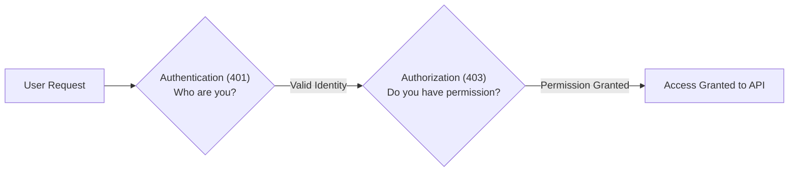

### 🎯 Core Terms to Remember
* **Authentication (AuthN):** Validating the identity of a user or system.
* **Authorization (AuthZ):** Granting or denying access to specific resources based on permissions or roles.
* **401 Unauthorized:** HTTP status code meaning *"You are not logged in or your credentials are invalid"*.
* **403 Forbidden:** HTTP status code meaning *"I know who you are, but you do not have permission to view or touch this resource"*.

### 💡 Quick Pro-Tip
Remember the HTTP status code difference! `401` means unauthenticated (missing or invalid token), while `403` means authenticated but unauthorized (forbidden role).

---

## 2. What is the Difference Between OAuth 2.0, OpenID Connect (OIDC), and JWT?

### ⚡ Direct Answer / 30-Second Pitch
> "**OpenID Connect (OIDC)** is an identity protocol built on top of OAuth 2.0 to handle **Authentication** (returning an `ID Token` to identify the user). **OAuth 2.0** is an **Authorization** framework enabling third-party apps to access APIs via an `Access Token`. A **JSON Web Token (JWT)** is the compact, cryptographically signed format used to transport these tokens."

### 🧠 Easy Mental Model / Everyday Analogy
* **The Luxury Hotel & Valet Parking:**
  * **OIDC (Your Government ID at Hotel Check-In):** You show your Driving License to the hotel reception. They verify your identity and confirm: *"Yes, this is Mr. Sharma."* This gives you an **ID Token** (used by the frontend to show your name and avatar).
  * **OAuth 2.0 (The Hotel Valet Parking Key):** When you hand your car to the hotel valet driver, you don't give him your house keys, credit card, or full legal authority over your life! You give him a special valet key that *only* starts the engine and drives up to 15 km/h. This is an **Access Token** (scoped permission).
  * **JWT (The RFID Digital Chip inside the Valet Card):** The valet card contains an encrypted RFID chip. When scanned at the parking gate, the electronic gate reads the signed chip and opens immediately without calling hotel reception.

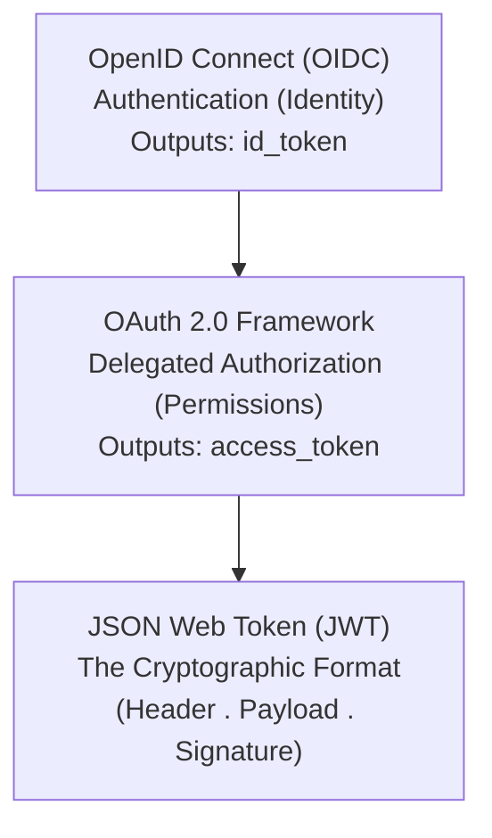

### 💬 Simple Explanation
* **OIDC:** Gives your Angular/React frontend proof of who is logged in (`id_token`).
* **OAuth 2.0:** Coordinates the permissions flow so the frontend can call the backend API on the user's behalf (`access_token`).
* **JWT:** The actual bearer token string (`eyJhbGciOi...`) containing the user's ID, role, expiration date, and digital signature.

### 🎯 Core Terms to Remember
* **OAuth 2.0 (RFC 6749):** The authorization framework for scoped API access.
* **OpenID Connect (OIDC):** The identity layer on top of OAuth 2.0 providing single sign-on (SSO).
* **ID Token:** A token meant exclusively for the frontend client to display user profile info.
* **Access Token:** A token sent to backend APIs in the `Authorization: Bearer <token>` header.

### 💡 Quick Pro-Tip
Never send an `id_token` to your backend Web API to authorize requests! Always send the `access_token`. An `id_token` is meant strictly for the client UI, not for API authorization.

---

## 3. What is Inside a JSON Web Token (JWT), and How Does the Server Verify It?

### ⚡ Direct Answer / 30-Second Pitch
> "A JWT is a string composed of three Base64URL-encoded parts separated by dots: **Header**, **Payload**, and **Signature** (`Header.Payload.Signature`). The server verifies the token by calculating the cryptographic signature using the secret key or public certificate and confirming that it matches the token's signature."

### 🧠 Easy Mental Model / Everyday Analogy
* **The Signed Concert Wristband:**
  * You purchase a VIP pass for an A.R. Rahman music concert. The organizer fastens a tamper-proof paper wristband onto your arm.
  * **Header:** Printed text specifying the wristband material and security stamp type.
  * **Payload:** Printed details: *"Rahul Sharma, VIP Lounge Access, Valid until 11:00 PM"*. Anyone standing next to you can read it (Base64 is readable, not encrypted!).
  * **Signature:** An official holographic security stamp embossed by the event organizer.
  * When you enter the VIP lounge, the security guard does not call the concert ticketing headquarters. He simply inspects the **holographic stamp**. If someone tried to alter "General" to "VIP" with a pen, the stamp would be broken!

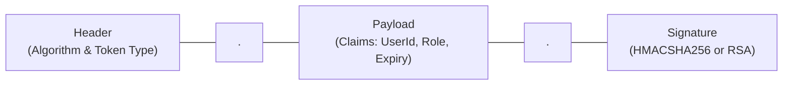

### 💬 Simple Explanation
A typical JWT looks like: `xxxxx.yyyyy.zzzzz`
1. **Header:** Contains the algorithm (`"alg": "HS256"`) and type (`"typ": "JWT"`).
2. **Payload (Claims):** Contains user details:
   ```json
   {
     "sub": "user_12345",
     "name": "Rahul Sharma",
     "role": "Admin",
     "exp": 1735689600
   }
   ```
3. **Signature:** The server hashes the Header + Payload together with a secret key:
   `HMACSHA256(base64(Header) + "." + base64(Payload), SecretKey)`

**Crucial Fact:** A JWT is **signed, NOT encrypted** (unless using JWE). Anyone can paste a JWT into `jwt.io` and read the user's name and email! Never store sensitive secrets like passwords, credit card numbers, or Aadhaar numbers inside a JWT payload.

### 🎯 Core Terms to Remember
* **Base64URL Encoding:** A URL-safe text encoding used to transmit binary data safely in HTTP headers.
* **Claims:** Key-value pairs inside the JWT payload representing identity and permission attributes (`sub`, `role`, `exp`).
* **Cryptographic Signature:** A hash proving the token was created by an authorized server and has not been tampered with.

### 💡 Quick Pro-Tip
Always configure your API's `TokenValidationParameters` with `ClockSkew = TimeSpan.Zero` in production! By default, ASP.NET Core adds a 5-minute grace period to expired tokens, allowing expired tokens to work for an extra 5 minutes.

---

## 4. Symmetric (HS256) vs. Asymmetric (RS256) Token Signing: What is the Difference?

### ⚡ Direct Answer / 30-Second Pitch
> "**Symmetric signing (HS256)** uses a single shared secret key to both sign and verify tokens. **Asymmetric signing (RS256)** uses a public/private key pair: the Identity Provider uses its **Private Key** to sign tokens, while any microservice can verify tokens using the IDP's **Public Key** without ever knowing the private key."

### 🧠 Easy Mental Model / Everyday Analogy
* **Single Padlock Key vs. Public Postal Mailbox:**
  * **Symmetric (HS256) = Single Padlock Key Shared with Friends:**
    * You have a padlocked wooden box. You and 5 friends all have duplicate copies of the exact same physical brass key.
    * Anyone who has the key can lock the box (sign a token) and unlock the box (verify a token).
    * **The danger:** If even *one* friend loses the key or turns rogue, the entire security of the box is completely compromised for everyone!
  * **Asymmetric (RS256) = The Public Postbox Slit:**
    * Anyone in the city can drop a letter through the postbox slot (**Public Key**). The public key is freely available to everyone.
    * But **only the postman holds the master physical key** (**Private Key**) to unlock the back door and retrieve the mail. 
    * If 100 microservices need to verify customer tokens, they only need the IDP's Public Key. Even if a hacker compromises an order microservice, they cannot forge new fake tokens!

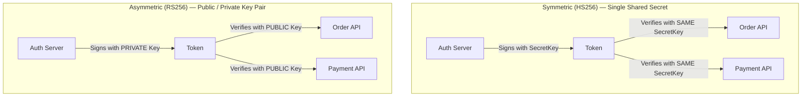

### 💬 Simple Explanation
* **HS256 (HMAC-SHA256):** Fast and simple, but all services must share the secret string (`MySuperSecretPassword123!`). If one service leaks the string, an attacker can generate fake "Admin" tokens.
* **RS256 (RSA-SHA256):** Standard for enterprise microservices and IDPs (like Azure AD, Keycloak, Auth0, Okta). The Auth server signs with a private RSA key. Microservices automatically download the public keys from a standard URL (`/.well-known/openid-configuration/jwks`).

### 🎯 Core Terms to Remember
* **HS256:** Symmetric signing algorithm using a shared secret.
* **RS256:** Asymmetric signing algorithm using an RSA private/public key pair.
* **JWKS (JSON Web Key Set):** A public JSON endpoint where an Identity Provider publishes its active public keys for automatic signature validation.

### 💡 Quick Pro-Tip
Always use **RS256** in microservice architectures! It eliminates the need to distribute sensitive secret keys across multiple microservice configuration files or environment variables.

---

## 5. If JWT is Stateless, How Do You Handle Instant Logout or Revoking a Banned User?

### ⚡ Direct Answer / 30-Second Pitch
> "Because JWTs are stateless, an API verifies tokens mathematically without querying a database on every call. To revoke a token instantly before it naturally expires, we use **Short-Lived Access Tokens (e.g., 5–15 minutes)** paired with a **Redis Blocklist/Revocation Cache** checked during sensitive calls, or we revoke the user's **Refresh Token** in the database to block future renewals."

### 🧠 Easy Mental Model / Everyday Analogy
* **The Stamped Office Visitor Badge & Security Gate:**
  * When a visitor enters an office building, the security desk stamps a visitor badge: *"Valid until 5:00 PM"*.
  * As the visitor moves between floors, guards look at the badge stamp and let him pass without calling reception every single time (stateless efficiency).
  * **What if the visitor starts misbehaving at 2:00 PM?**
    * Reception cannot magically erase the ink stamp on his physical badge!
    * **Solution:** Reception radios the security guards: *"Add Visitor Badge #42 to the Banned List on your clipboard."* (Redis blocklist).
    * When Badge #42 tries to enter the executive boardroom, security checks the short clipboard list and blocks him immediately.

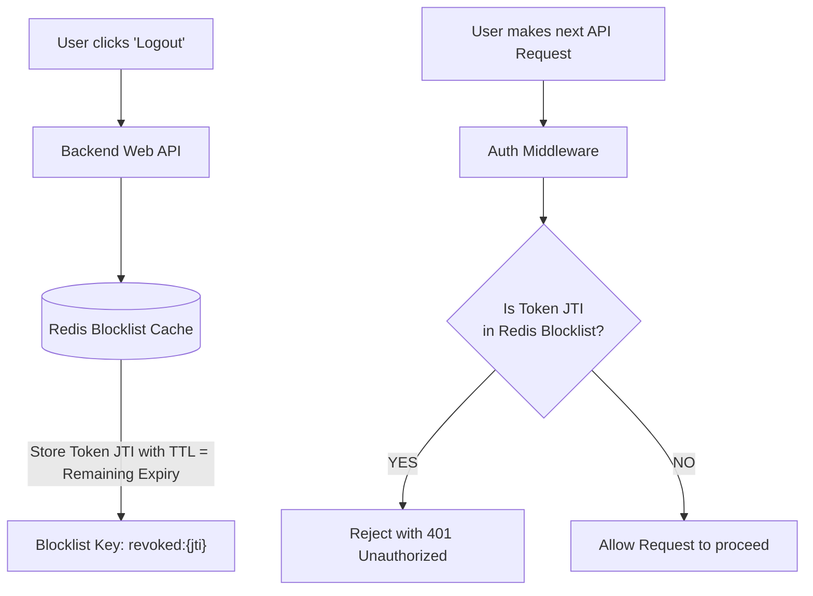

### 💬 Simple Explanation
Two complementary strategies are used in production:
1. **Short Expiration Windows:** Set access token lifetime to 10 minutes. If a user is banned, the maximum window they can continue making read requests is 10 minutes.
2. **Redis Blocklist with Automatic Expiry (TTL):**
   * Every JWT has a unique identifier claim called **`jti`** (JWT ID).
   * When a user logs out, the API stores that `jti` in a Redis cache with a Time-To-Live (TTL) equal to the remaining lifetime of the token.
   * If the token expires in 7 minutes, the Redis entry automatically self-deletes after 7 minutes. This keeps the Redis cache tiny!
3. **Refresh Token Revocation:** For long-term sessions, the persistent Refresh Token in the database is marked `IsRevoked = true`. When the 10-minute access token expires, the client cannot refresh.

### 🎯 Core Terms to Remember
* **Stateless Token:** A token verified purely through cryptographic math without checking a central database.
* **`jti` (JWT ID):** A standard claim providing a globally unique identifier for a specific token.
* **Time-To-Live (TTL):** An expiration counter in Redis that automatically deletes a cached key after a specific duration.
* **Token Family Rotation:** Automatically invalidating all refresh tokens if an old refresh token is reused, detecting stolen tokens.

### 💡 Quick Pro-Tip
Never set access token expiration to 24 hours or 30 days! Keep Access Tokens ultra-short (5 to 15 minutes), and use Refresh Tokens stored securely in `HttpOnly, Secure, SameSite=Strict` cookies to seamlessly refresh them.

---

## 6. What is CORS (Cross-Origin Resource Sharing), and Why Do Browsers Block API Requests?

### ⚡ Direct Answer / 30-Second Pitch
> "CORS is a **browser security mechanism** enforcing the Same-Origin Policy. It prevents malicious JavaScript running on one website (e.g., `evil-hacker.com`) from making unauthorized background HTTP requests to read sensitive data from another domain (e.g., `my-bank.com`). The browser blocks the response unless the backend API explicitly returns headers permitting that specific origin."

### 🧠 Easy Mental Model / Everyday Analogy
* **The Gated Apartment Society Security Guard:**
  * Imagine you live in a luxury gated apartment community (`apartment-society.com`).
  * A stranger standing on the public street outside (`unknown-stranger.com`) tells an Uber delivery boy: *"Walk into Flat 402 and bring me the homeowner's laptop."*
  * The delivery boy arrives at the society entrance gate. The **Gated Security Guard (The Web Browser)** stops him!
  * The guard calls your flat: *"Sir, an external person from the public street wants to access your flat. Do you have him on your approved guest list?"* (**The CORS Preflight Check**).
  * If you say *"Yes, he is approved"* (`Access-Control-Allow-Origin: public-street.com`), the guard lets him enter. If not, the guard turns him away at the gate.

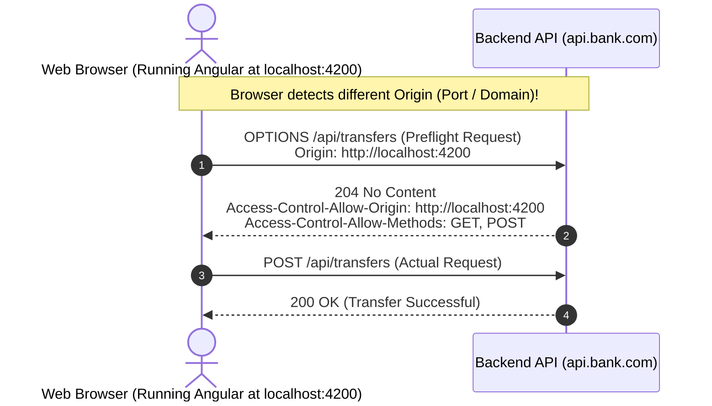

### 💬 Simple Explanation
* **What is an Origin?** An origin is defined by three things: **Protocol + Domain + Port** (e.g., `https://localhost:4200`). If *any* of the three differs, it is considered a **Cross-Origin** request!
* **Why do browsers enforce it?** If you log into your bank website, your browser stores session cookies. If you then visit a malicious phishing site in another tab, that phishing site's JavaScript could make a background `fetch('https://your-bank.com/api/balance')`. The browser would automatically attach your bank cookies! CORS ensures the browser refuses to hand that data to the malicious site unless the bank explicitly authorized it.
* **The Preflight Check (`OPTIONS`):** For non-simple requests (like `POST` with JSON or custom `Authorization` headers), the browser automatically sends an HTTP `OPTIONS` request first to ask the server for permission.

### 🎯 Core Terms to Remember
* **Same-Origin Policy (SOP):** The fundamental web security rule isolating distinct website contexts in the browser.
* **CORS (Cross-Origin Resource Sharing):** HTTP headers allowing servers to specify which external origins are allowed to read responses.
* **Preflight Request:** An automatic HTTP `OPTIONS` probe sent by the browser before the real request to check allowed origins, methods, and headers.
* **`Access-Control-Allow-Origin`:** The response header returned by the server containing approved client domains.

### 💡 Quick Pro-Tip
Never configure `AllowAnyOrigin()` together with `AllowCredentials()` in ASP.NET Core! Not only is it rejected by modern browsers, but using wildcards (`*`) in production exposes your API to cross-site request attacks. Always specify exact allowed domain origins.

---

## 7. What are SQL Injection and XSS (Cross-Site Scripting), and How Do We Prevent Them?

### ⚡ Direct Answer / 30-Second Pitch
> "**SQL Injection (SQLi)** occurs when malicious SQL fragments are concatenated into database queries, allowing attackers to read or wipe the database. We prevent it using **parameterized queries and ORMs like EF Core**. **Cross-Site Scripting (XSS)** occurs when malicious JavaScript is injected into web pages viewed by other users. We prevent it via **automatic HTML sanitization/encoding in Angular/React** and **Content Security Policy (CSP) headers**."

### 🧠 Easy Mental Model / Everyday Analogy
* **The Sneaky Restaurant Order Slip & The Public Notice Board:**
  * **SQL Injection = Sneaky Instruction on a Restaurant Order Slip:**
    * You write your meal order on a slip of paper for the kitchen: *"Dish: Paneer Butter Masala"*.
    * An attacker writes: *"Paneer Butter Masala; DROP TABLE Orders; --"*
    * If the chef blindly reads the slip as cooking instructions and follows everything written on it, he cooks the meal and then destroys the entire restaurant kitchen!
    * **The Fix:** A standardized menu order card where dish names are selected by item numbers (**Parameterization**), separating the user's text from the chef's commands.
  * **XSS = Malicious Graffiti on the Community Notice Board:**
    * A society notice board lets residents post announcements.
    * A malicious resident pins a note written with invisible itching powder. 
    * Every innocent resident who touches the note to read it gets poisoned!
    * **The Fix:** The society covers the notice board in a secure glass display case (**HTML encoding & sanitization**), preventing anyone from putting toxic materials where others can touch them.

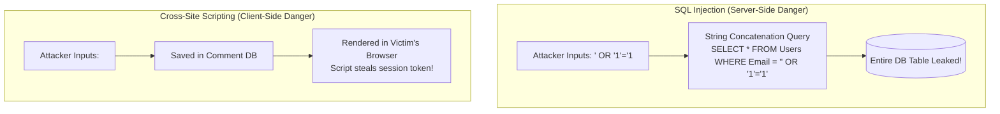

### 💬 Simple Explanation
* **Preventing SQL Injection:**
  * Never concatenate strings: `$"SELECT * FROM Users WHERE Id = '{id}'"` ❌
  * Always use parameterized queries: `db.QueryAsync("SELECT * FROM Users WHERE Id = @Id", new { id })` ✅
  * EF Core LINQ queries (`_db.Users.Where(u => u.Id == id)`) are **parameterized automatically by default**.
* **Preventing XSS:**
  * Modern frameworks like Angular and React automatically encode all dynamic variables in templates (`{{ userInput }}` escapes `<script>` tags to `&lt;script&gt;`).
  * Never use bypass mechanisms like `[innerHTML]` with unsanitized content or `bypassSecurityTrustHtml` without strict sanitization.

### 🎯 Core Terms to Remember
* **SQL Injection (SQLi):** Exploiting untrusted input concatenated into database query strings.
* **Parameterized Query:** Sending SQL commands and user parameters separately to the database engine so user input can never be parsed as executable commands.
* **Cross-Site Scripting (XSS):** Injecting executable client-side scripts into web applications viewed by other users.
* **Content Security Policy (CSP):** HTTP header restricting the sources from which scripts, styles, and images can be loaded in the browser.

### 💡 Quick Pro-Tip
Be extremely cautious with raw SQL in EF Core! Methods like `FromSqlInterpolated` are safe because they parameterize automatically, but `FromSqlRaw` with string concatenation (`string.Format` or `$"..."`) is **vulnerable to SQL injection**.

---

## 8. What is the Difference Between Unit Testing and Integration Testing with `WebApplicationFactory`?

### ⚡ Direct Answer / 30-Second Pitch
> "**Unit Tests** isolate a single class or method in memory, replacing all dependencies (like databases and HTTP clients) with mocks to test internal logic in milliseconds. **Integration Tests with `WebApplicationFactory`** boot the entire ASP.NET Core API pipeline in-memory, executing real HTTP requests through routing, middleware, model binding, authorization, and database access against real databases (via Testcontainers) to test the system as a whole."

### 🧠 Easy Mental Model / Everyday Analogy
* **Testing a Car Engine Spark Plug vs. Taking the Assembled Car on a Test Track:**
  * **Unit Testing = Spark Plug Test Bench:** 
    * A technician removes a single spark plug from the engine, clamps it into a test bench, and checks if it produces an electric spark when voltage is applied.
    * It takes 2 seconds. But it tells you *nothing* about whether the transmission shifts smoothly or if the brakes work!
  * **Integration Testing = Driving the Assembled Car on a Test Track:**
    * You assemble the complete car—engine, transmission, fuel pump, electrical wiring, steering wheel.
    * You turn the ignition key, press the accelerator, and see if the car drives smoothly around the track.
    * It tests that all real components work together seamlessly under real conditions.

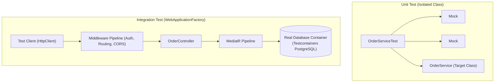

### 💬 Simple Explanation
| Feature | Unit Testing (xUnit + Moq) | Integration Testing (`WebApplicationFactory`) |
| :--- | :--- | :--- |
| **Scope** | Single method or class. | Entire HTTP pipeline, middleware, and database. |
| **Speed** | Blazing fast (1–5 milliseconds per test). | Slightly slower (50–300 milliseconds per test). |
| **Dependencies** | Mocked out (`Mock<IRepository>`). | Real dependencies (e.g., real SQL Server in Docker). |
| **What It Catches** | Boundary conditions, algorithm edge cases. | Broken EF Core SQL translations, middleware order bugs, auth policy errors. |
| **Confidence** | Moderate (mocks can make false assumptions). | Extremely high (matches real production behavior). |

### 🎯 Core Terms to Remember
* **Unit Testing:** Testing small, isolated units of code independently from external systems.
* **`WebApplicationFactory<Program>`:** Built-in ASP.NET Core test harness that configures and hosts the complete web application in memory for integration testing.
* **Testcontainers:** A library that spins up real, ephemeral Docker containers (PostgreSQL, SQL Server, Redis, Kafka) directly during test suite execution.
* **Mock:** A simulated object that mimics the behavior of a real interface with predefined return values.

### 💡 Quick Pro-Tip
Never mock Entity Framework Core `DbContext` in unit tests! Mocking `IQueryable` is notoriously fragile and hides SQL translation errors. Use `WebApplicationFactory` with **Testcontainers** to test EF Core against a real database instance.

---

## 9. What is Docker, and Why Do We Use Multi-Stage Dockerfiles?

### ⚡ Direct Answer / 30-Second Pitch
> "**Docker** packages an application along with all its runtime dependencies, configuration, and libraries into a standardized, isolated container that runs identically on any operating system. A **Multi-Stage Dockerfile** uses separate build and runtime environments: heavy compilers and SDKs build the code in Stage 1, while only the compiled binaries are copied into a clean, lightweight, non-root runtime image in Stage 2."

### 🧠 Easy Mental Model / Everyday Analogy
* **The Commercial Restaurant Kitchen vs. The Dining Table:**
  * Imagine a fine-dining restaurant.
  * In the **Commercial Kitchen (Stage 1 - Build Stage)**, the chef has big industrial mixers, meat cleavers, sacks of raw flour, vegetable peelings, and heavy cooking utensils everywhere. It is messy, heavy, and takes up huge space.
  * But when the food is ready, the waiter **does not bring the chopping board, knives, and flour sacks to your dining table!**
  * The waiter transfers only the finished, beautifully plated dish onto a clean porcelain plate (**Stage 2 - Final Runtime Stage**) and carries only that clean plate to the customer.
  * Your Docker container in production contains *only* the compiled `.dll` files—no heavy SDK compilers or raw source code!

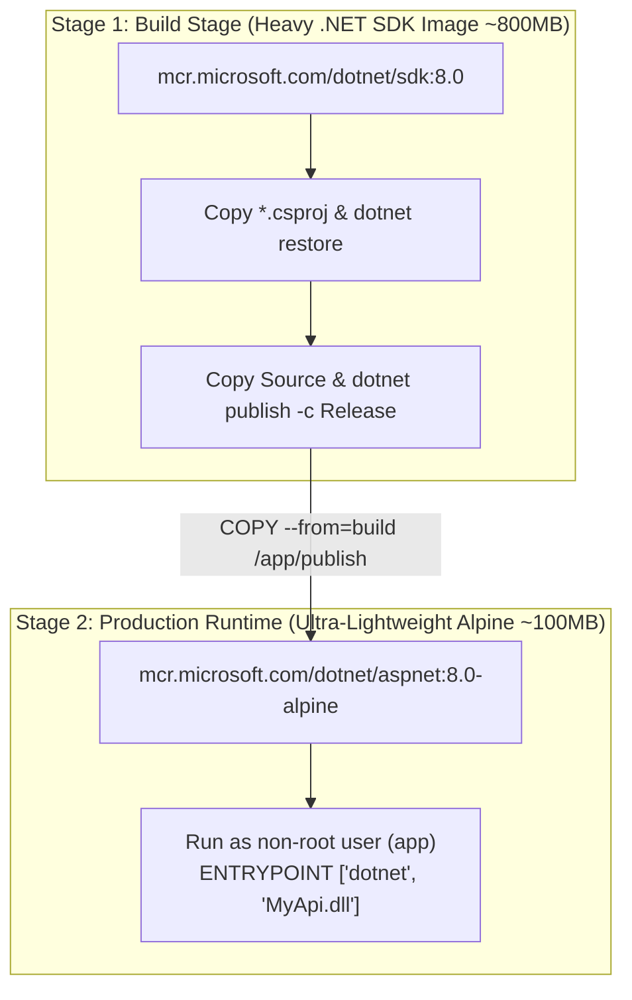

### 💬 Simple Explanation
* **Why not a single-stage Dockerfile?** If you build and run using the .NET SDK image, your final container image will be over **850 MB**! It contains the C# compiler, NuGet caches, and command-line tools that attackers can exploit if your container is breached.
* **The Multi-Stage Solution:**
  1. **Stage 1 (Build):** Starts from `dotnet/sdk:8.0`. Restores NuGet packages, compiles source code, and creates published binaries.
  2. **Stage 2 (Runtime):** Starts from a tiny, hardened `dotnet/aspnet:8.0-alpine` image (~100 MB). Copies *only* the published `.dll` files from Stage 1.
  3. Runs under an unprivileged user (UID `1654` / `app`).
  4. Result: 8x smaller image size, faster deployment downloads, and drastically smaller security attack surface.

### 🎯 Core Terms to Remember
* **Container Image:** An immutable, standalone, executable package containing everything needed to run an application.
* **Multi-Stage Build:** A Docker build pattern using multiple `FROM` statements to separate compilation tools from the final runtime image.
* **Layer Caching:** Docker's optimization where unchanged layers (like NuGet restore) are reused across builds to accelerate compilation.
* **Non-Root User:** Running container processes as an unprivileged user to prevent container escape attacks from gaining root control of the host machine.

### 💡 Quick Pro-Tip
Always copy `.csproj` files and execute `dotnet restore` *before* copying the rest of your source code in your Dockerfile! This allows Docker to cache the restored package layer, saving minutes of build time on every commit.

---

## 10. In Kubernetes, What is the Difference Between Liveness and Readiness Probes?

### ⚡ Direct Answer / 30-Second Pitch
> "A **Liveness Probe** checks if your container is still alive (not deadlocked or crashed); if it fails, Kubernetes **kills and restarts the container**. A **Readiness Probe** checks if your container is currently ready to accept live user traffic (e.g., warm caches, database connection ready); if it fails, Kubernetes **temporarily stops routing traffic to the pod** without killing it."

### 🧠 Easy Mental Model / Everyday Analogy
* **The Doctor's Health Checkup: Pulse vs. Fitness to Work:**
  * **Liveness Probe = Checking if the patient has a heartbeat/pulse:**
    * The doctor checks: *"Is the patient breathing?"*
    * If the heart has stopped completely (application process is frozen in a hard deadlock), the doctor initiates emergency resuscitation (**Kubernetes restarts the container**).
  * **Readiness Probe = Checking if the employee is fit to return to the office:**
    * An employee has a severe headache or fever. He is very much alive (heart is beating), but he cannot write code today.
    * You don't kill the employee! You tell him to rest at home for a day (**Kubernetes temporarily removes the pod from the load balancer**).
    * Once the fever subsides and caches warm up, he returns to active duty.

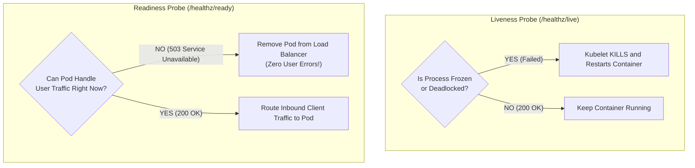

### 💬 Simple Explanation
| Feature | Liveness Probe (`/healthz/live`) | Readiness Probe (`/healthz/ready`) |
| :--- | :--- | :--- |
| **Question Asked** | *"Is the application process completely frozen or broken?"* | *"Can this pod serve customer requests right now?"* |
| **Action on Failure** | Kubelet **terminates and restarts** the pod container. | Kubelet **removes the pod IP** from the Service endpoint. |
| **Checks Performed** | Lightweight internal check (process responsiveness). | Dependency checks (database connection, cache warmup). |
| **Frequency** | Every 10–15 seconds. | Every 5–10 seconds. |
| **Danger of Misconfiguration** | If it checks external databases and the DB lags, **K8s restarts all pods at once**, causing a catastrophic restart loop! | If misconfigured, the pod simply stops receiving traffic. |

### 🎯 Core Terms to Remember
* **Liveness Probe:** Kubernetes diagnostic check determining when to restart a container.
* **Readiness Probe:** Kubernetes diagnostic check determining when a container can receive network traffic.
* **Startup Probe:** A probe used for slow-starting legacy apps that pauses liveness and readiness checks until startup completes.
* **Cascading Restart Storm:** A production outage where failing external dependencies cause liveness probes to fail, triggering endless reboot cycles across all Kubernetes pods.

### 💡 Quick Pro-Tip
Never check external databases or message brokers inside your **Liveness Probe**! If SQL Server experiences a temporary 10-second query spike, checking the database in the liveness probe causes Kubernetes to reboot all 50 API pods simultaneously, turning a minor database delay into a catastrophic total outage.

---

## 11. What is the Difference Between Blue-Green Deployment and Canary Deployment?

### ⚡ Direct Answer / 30-Second Pitch
> "**Blue-Green Deployment** runs two identical production environments (Blue = current version, Green = new version); once Green passes verification, 100% of traffic is switched instantly at the router. **Canary Deployment** rolls out the new version to a small subset of servers and gradually shifts a percentage of user traffic (e.g., 5% $\rightarrow$ 25% $\rightarrow$ 100%) while monitoring error rates."

### 🧠 Easy Mental Model / Everyday Analogy
* **Switching Railway Platforms vs. The Coal Mine Canary Bird:**
  * **Blue-Green Deployment = Switching Train Platforms at the Central Station:**
    * Platform 1 (Blue) has Train Version 1.0 boarding passengers.
    * On Platform 2 (Green), the railway engineers park the brand-new Version 2.0 train. They test the air conditioning, check the engine, and inspect the seats without any passengers on board.
    * Once verified, the station master flips the main railway signal (**Router / Load Balancer**). All incoming passengers are directed to Platform 2.
    * If anything goes wrong, the station master flips the signal back to Platform 1 in 2 seconds!
  * **Canary Deployment = The Coal Mine Canary Bird:**
    * In historic coal mines, miners carried a caged canary bird underground. 
    * If toxic carbon monoxide gas leaked, the sensitive canary showed distress first, warning the miners to evacuate before humans were harmed.
    * In software: You send 5% of real users to the new version (the canary). If error metrics spike, you immediately roll back, affecting only that tiny 5% sample while 95% of users never noticed an issue!

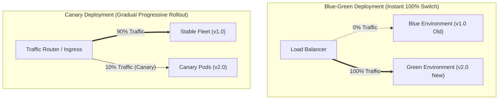

### 💬 Simple Explanation
| Feature | Blue-Green Deployment | Canary Deployment |
| :--- | :--- | :--- |
| **Traffic Shift** | All-at-once (0% $\rightarrow$ 100% instant cutover). | Incremental (e.g., 5% $\rightarrow$ 25% $\rightarrow$ 50% $\rightarrow$ 100%). |
| **Infrastructure Cost** | Requires 2x infrastructure during deployment window. | Minimal extra infrastructure (only 1–2 canary pods). |
| **Rollback Speed** | Near-instantaneous (flip router back to Blue). | Fast (scale canary pods down to zero). |
| **User Blast Radius** | If an undiscovered bug exists, 100% of users see it. | If a bug exists, only 5% of users experience it. |
| **Database Migrations** | Requires strict backward-compatible database schemas. | Requires strict backward-compatible database schemas. |

### 🎯 Core Terms to Remember
* **Blue-Green Deployment:** Zero-downtime release strategy switching between two identical environments.
* **Canary Deployment:** Progressive delivery technique routing a fractional slice of production traffic to test a new version.
* **Blast Radius:** The scope of users or systems impacted if a deployed software version fails.
* **Feature Toggles / Flags:** Application-level configuration switches allowing features to be turned on or off in production without redeploying code.

### 💡 Quick Pro-Tip
Regardless of whether you use Blue-Green or Canary, **database schema changes must always be backward-compatible**! Never drop or rename columns in the same release as your code deployment. Follow the *Expand and Contract* pattern: add the new column first, deploy code that writes to both, and drop the old column in a future release.
