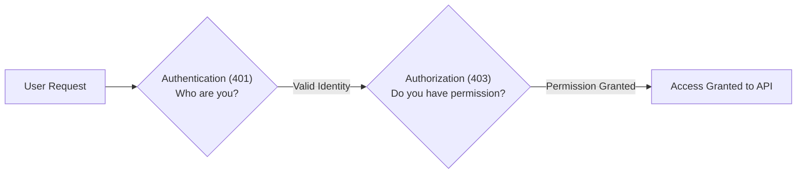
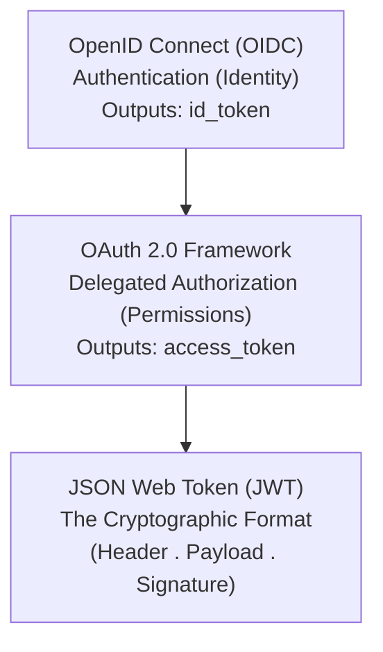
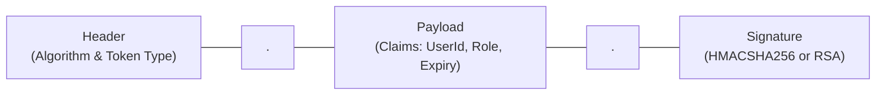
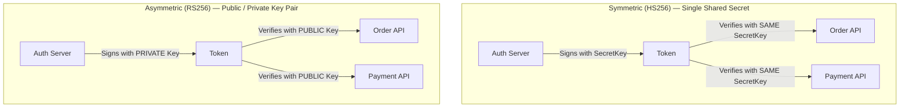
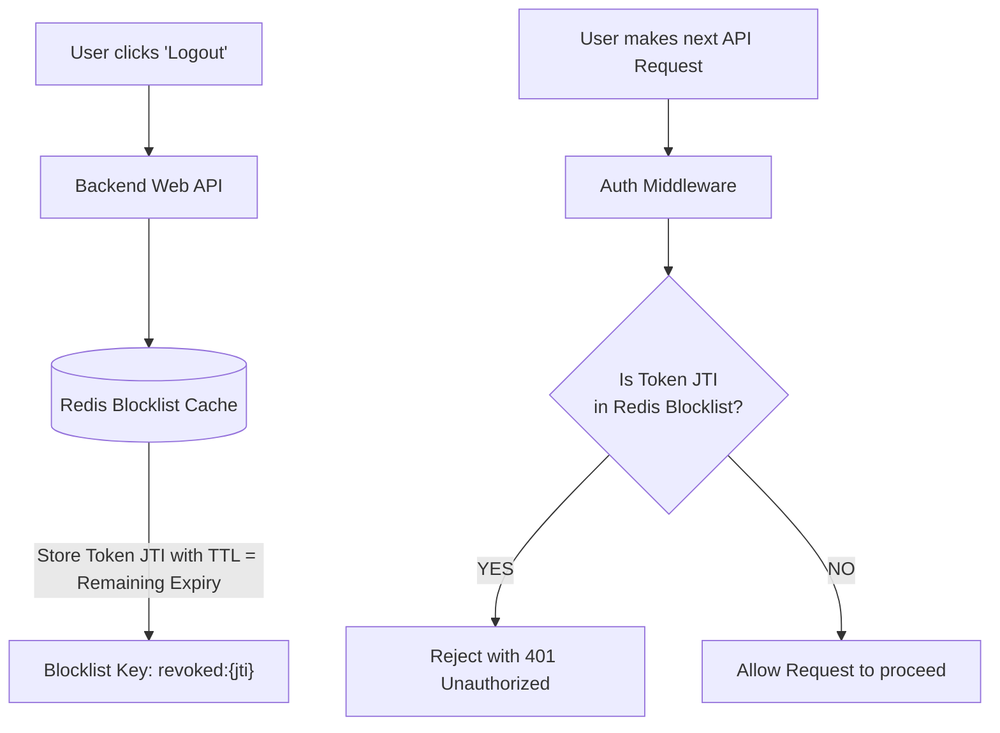
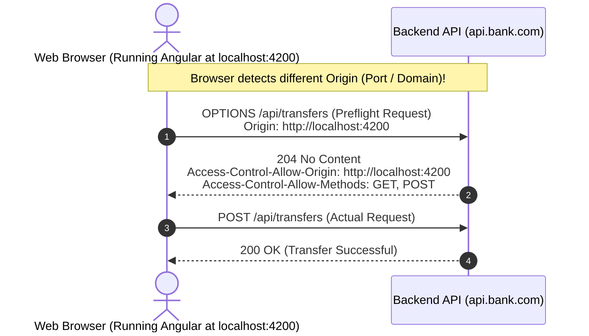
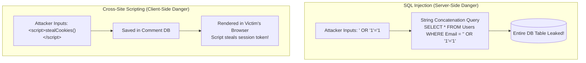
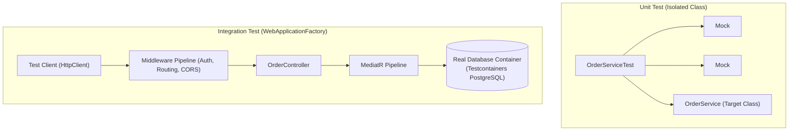
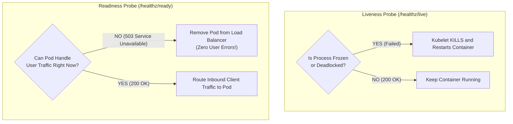
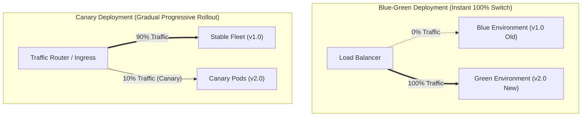

# 06. Security, Testing & DevOps: Basic Interview & Screening Guide (India Context)

> **Target Audience:** Screening rounds, technical phone screens, Technical Round 1 (0–6+ YOE), and rapid revision.  
> **Standard:** Speakable Senior English v1 (SSE-1) — concise, spoken-first, rubric-aligned interview answers.

---

# TABLE OF CONTENTS

- [Q1: What is the difference between Authentication and Authorization?](#q1-what-is-the-difference-between-authentication-and-authorization)
- [Q2: What is the difference between OAuth 2.0, OpenID Connect (OIDC), and JWT?](#q2-what-is-the-difference-between-oauth-20-openid-connect-oidc-and-jwt)
- [Q3: What is inside a JSON Web Token (JWT) and how does the server verify it?](#q3-what-is-inside-a-json-web-token-jwt-and-how-does-the-server-verify-it)
- [Q4: What is the difference between Symmetric (HS256) and Asymmetric (RS256) signing?](#q4-what-is-the-difference-between-symmetric-hs256-and-asymmetric-rs256-signing)
- [Q5: How do you handle instant logout or token revocation with stateless JWTs?](#q5-how-do-you-handle-instant-logout-or-token-revocation-with-stateless-jwts)
- [Q6: What is Cross-Origin Resource Sharing (CORS) and why do browsers block requests?](#q6-what-is-cross-origin-resource-sharing-cors-and-why-do-browsers-block-requests)
- [Q7: What are SQL Injection and Cross-Site Scripting (XSS), and how do you prevent them?](#q7-what-are-sql-injection-and-cross-site-scripting-xss-and-how-do-you-prevent-them)
- [Q8: What is the difference between Unit Testing and Integration Testing with WebApplicationFactory?](#q8-what-is-the-difference-between-unit-testing-and-integration-testing-with-webapplicationfactory)
- [Q9: What is Docker and why should you use Multi-Stage Docker builds?](#q9-what-is-docker-and-why-should-you-use-multi-stage-docker-builds)
- [Q10: What is the difference between Kubernetes Liveness and Readiness Probes?](#q10-what-is-the-difference-between-kubernetes-liveness-and-readiness-probes)
- [Q11: What is the difference between Blue-Green Deployment and Canary Deployment?](#q11-what-is-the-difference-between-blue-green-deployment-and-canary-deployment)

---

## Q1: What is the difference between Authentication and Authorization?
*Commonly asked at: TCS, Infosys, Cognizant, Wipro, Accenture*

**⚡ One-line answer**
Authentication verifies who you are [identity], while Authorization verifies what resources or actions you are allowed to access [permissions].

**🗣️ Spoken answer (30–45 seconds)**
Authentication validates caller identity through credentials, tokens, or biometric proof, returning HTTP 401 when invalid. Authorization evaluates verified claims and roles to grant or deny resource access, returning HTTP 403 when forbidden. Authentication must execute before authorization. In ASP.NET Core, `UseAuthentication` hydrates `HttpContext.User` before `UseAuthorization` inspects claims. In our APIs, setting `ClockSkew = TimeSpan.Zero` ensures expired tokens are rejected immediately.

**🎯 Terms the interviewer listens for**
- ⭐ **Authentication [AuthN]**: Cryptographic verification of user or system identity.
- ⭐ **Authorization [AuthZ]**: Evaluating claims, roles, or policies to grant access.
- ⭐ **HTTP 401 Unauthorized**: Missing or invalid authentication credentials.
- ⭐ **HTTP 403 Forbidden**: Valid identity lacks sufficient permission for the resource.
- **ClaimsPrincipal**: Managed security object holding verified claims identities in `HttpContext`.

**🧠 Memory hook**
Passport proves your identity [Authentication]; Visa or boarding seat ticket gives you entry permission [Authorization].

**💻 Code**


**⚠️ Likely follow-up**
**Question:** Why does ASP.NET Core return 401 instead of 403 when a user lacks a required role?
**Answer:** If the request lacks authentication entirely, it returns 401. If the user is authenticated but fails role or policy checks, the framework returns 403 Forbidden.

**📊 Quick comparison**
| Feature | Authentication (AuthN) | Authorization (AuthZ) |
| :--- | :--- | :--- |
| Focus | Identity verification | Permission evaluation |
| Failure Code | HTTP 401 Unauthorized | HTTP 403 Forbidden |
| Pipeline Order | Executes first (`UseAuthentication`) | Executes second (`UseAuthorization`) |

---

## Q2: What is the difference between OAuth 2.0, OpenID Connect (OIDC), and JWT?
*Commonly asked at: TCS, Infosys, Cognizant, Capgemini, LTIMindtree*

**⚡ One-line answer**
OAuth 2.0 is an authorization framework for delegated permissions, OpenID Connect adds an authentication identity layer on top of it, and JWT is the compact token format.

**🗣️ Spoken answer (30–45 seconds)**
OpenID Connect handles identity verification by issuing an ID token to client applications. OAuth 2.0 handles delegated access by issuing access tokens with specific scopes for APIs. A JSON Web Token is the cryptographically signed container format used to transport these claims between parties. The client UI inspects the ID token to display profile info, while the API inspects the access token to authorize endpoints.

**🎯 Terms the interviewer listens for**
- ⭐ **OAuth 2.0 [RFC 6749]**: Delegated authorization framework issuing scoped access tokens.
- ⭐ **OpenID Connect [OIDC]**: Identity protocol layered on OAuth 2.0 providing Single Sign-On [SSO].
- ⭐ **ID Token**: JWT meant exclusively for client applications to read profile details.
- ⭐ **Access Token**: Bearer token presented in HTTP Authorization headers to access APIs.
- **Scope**: Granular permission boundary requested by client applications.

**🧠 Memory hook**
OIDC is your passport at hotel check-in; OAuth is the valet parking key that only runs the car engine; JWT is the RFID chip inside the keycard.

**💻 Code**


**⚠️ Likely follow-up**
**Question:** Should a backend Web API ever accept an ID token for authorization?
**Answer:** No. An ID token is intended strictly for the client application to display user information. APIs must only accept and validate access tokens.

**📊 Quick comparison**
| Concept | Primary Role | Output Token | Target Consumer |
| :--- | :--- | :--- | :--- |
| OIDC | Authentication | `id_token` | Frontend Client UI |
| OAuth 2.0 | Authorization | `access_token` | Backend Resource API |
| JWT | Data Format | Encoded Token String | Both Client and Server |

---

## Q3: What is inside a JSON Web Token (JWT) and how does the server verify it?
*Commonly asked at: TCS, Infosys, Wipro, Accenture, Cognizant*

**⚡ One-line answer**
A JWT consists of three Base64URL parts separated by dots—Header, Payload, and Signature—verified by recalculating the cryptographic signature against the IDP key.

**🗣️ Spoken answer (30–45 seconds)**
A JWT structure contains a header with signing metadata, a payload with identity claims, and a digital signature. The server validates the token by computing the cryptographic hash over the header and payload using the public key or shared secret. If the calculated signature matches the token signature, the token is untampered. Payload claims are Base64URL-encoded, not encrypted, meaning sensitive secrets should never be placed inside them.

**🎯 Terms the interviewer listens for**
- ⭐ **JOSE Header**: Metadata defining signing algorithm (`alg`) and token type (`typ`).
- ⭐ **Payload claims**: Key-value pairs containing standard (`sub`, `iss`, `aud`, `exp`) and custom claims.
- ⭐ **Digital signature**: Cryptographic hash verifying token authenticity and integrity.
- ⭐ **Base64URL**: URL-safe string encoding without encryption.
- **ClockSkew**: Grace period tolerance for server time drift that should be set to zero.

**🧠 Memory hook**
A signed concert wristband: Header is the band material, Payload is your printed seat name, Signature is the holographic anti-counterfeit seal.

**💻 Code**


**⚠️ Likely follow-up**
**Question:** Is user data inside a standard JWT encrypted?
**Answer:** No. It is only Base64URL encoded. Anyone can decode and read the payload. Confidential data requires Nested JWTs or JSON Web Encryption [JWE].

**📊 Quick comparison**
| Segment | Content | Security Role |
| :--- | :--- | :--- |
| Header | Algorithm & key ID | Instructs validator which key to use |
| Payload | Claims (`sub`, `exp`, roles) | Carries user attributes and permissions |
| Signature | Cryptographic hash | Proves token was not altered in transit |

---

## Q4: What is the difference between Symmetric (HS256) and Asymmetric (RS256) signing?
*Commonly asked at: TCS, Infosys, Cognizant, Persistent, Nagarro*

**⚡ One-line answer**
Symmetric signing (HS256) uses a shared secret to sign and verify, while Asymmetric signing (RS256) uses a private key to sign and public keys to verify.

**🗣️ Spoken answer (30–45 seconds)**
Symmetric signing uses one secret key across all services, which creates risk if any microservice leaks that secret. Asymmetric signing uses a private key on the identity provider to sign tokens, while resource APIs verify tokens using the identity provider's public keys. In modern architectures, APIs download public keys dynamically from a JWKS endpoint. Asymmetric signing eliminates shared-secret distribution and provides non-repudiation.

**🎯 Terms the interviewer listens for**
- ⭐ **HS256 [HMAC-SHA256]**: Symmetric signing using a single shared secret key.
- ⭐ **RS256 [RSA-SHA256]**: Asymmetric signing using RSA public/private key pairs.
- ⭐ **JWKS [JSON Web Key Set]**: Standard endpoint (`/.well-known/jwks.json`) publishing public keys.
- **Non-repudiation**: Mathematical proof that only the private key owner generated the signature.
- **Key rotation**: Updating signing certificates without downtime or redeploying APIs.

**🧠 Memory hook**
HS256 is one physical key duplicated among roommates; RS256 is a public postbox slot anyone can drop mail into, but only the postman holds the key to open.

**💻 Code**


**⚠️ Likely follow-up**
**Question:** Why do enterprise microservices avoid HS256?
**Answer:** HS256 requires sharing the secret key across all services. If one service is compromised, an attacker can forge tokens for every other service in the enterprise.

**📊 Quick comparison**
| Metric | HS256 (Symmetric) | RS256 (Asymmetric) |
| :--- | :--- | :--- |
| Signing Key | Shared secret | Private key (Auth server only) |
| Validation Key | Same shared secret | Public key (JWKS endpoint) |
| Non-Repudiation | No (both parties share key) | Yes (only private key can sign) |
| Microservices Fit | Monolith or private subnet | Standard enterprise default |

---

## Q5: How do you handle instant logout or token revocation with stateless JWTs?
*Commonly asked at: TCS, Infosys, Cognizant, Wipro, Walmart*

**⚡ One-line answer**
Pair short-lived access tokens with refresh token revocation in the database, and use a distributed Redis blocklist keyed by token identifier (`jti`) for immediate invalidation.

**🗣️ Spoken answer (30–45 seconds)**
Because JWT validation is stateless, an API does not query databases on every request. For immediate revocation, we enforce short access token lifetimes between five and fifteen minutes. On explicit logout, we store the unique token identifier (`jti`) in a distributed Redis blocklist with a Time-To-Live matching the token's remaining lifespan. Subsequent API requests check the cache before processing sensitive operations, and the database marks the refresh token revoked.

**🎯 Terms the interviewer listens for**
- ⭐ **Short-lived access token**: Five-to-fifteen-minute expiration limiting exposure window.
- ⭐ **`jti` [JWT ID]**: Unique identifier claim embedded inside individual tokens.
- ⭐ **Redis blocklist**: Distributed in-memory store tracking revoked token IDs.
- ⭐ **Time-To-Live [TTL]**: Automatic Redis key expiry matching remaining token lifetime.
- **Refresh Token Rotation**: Revoking old refresh tokens upon single use to detect reuse.

**🧠 Memory hook**
A stamped visitor badge: security cannot erase the ink once stamped, but they keep a small banned list on a clipboard at sensitive doors.

**💻 Code**


**⚠️ Likely follow-up**
**Question:** Does checking Redis on every request destroy JWT statelessness?
**Answer:** Yes, it introduces state. To minimize latency, we only check Redis on state-modifying operations (POST, PUT, DELETE) or financial transactions, while standard reads rely on short 5-minute expirations.

**📊 Quick comparison**
| Strategy | Latency Impact | Revocation Speed | Best Use Case |
| :--- | :--- | :--- | :--- |
| Short Expiry (5–15 min) | Zero (pure math) | Delayed until expiry | Standard reads |
| Redis `jti` Blocklist | Sub-millisecond | Instant | Logout & emergency lock |
| Refresh Revocation | Zero during session | At next refresh cycle | Password change / session end |

---

## Q6: What is Cross-Origin Resource Sharing (CORS) and why do browsers block requests?
*Commonly asked at: TCS, Infosys, Cognizant, Accenture, Capgemini*

**⚡ One-line answer**
CORS is a browser security mechanism enforcing the Same-Origin Policy, preventing malicious scripts on one origin from reading sensitive responses from another origin.

**🗣️ Spoken answer (30–45 seconds)**
CORS is enforced strictly by browsers, not backend servers. An origin consists of protocol, domain, and port. If any element differs, the browser sends a preflight OPTIONS request to verify allowed origins, HTTP methods, and headers. If the server does not return matching `Access-Control-Allow-Origin` headers, the browser blocks the response from client JavaScript. In ASP.NET Core, `UseCors` must run between `UseRouting` and `UseAuthentication`.

**🎯 Terms the interviewer listens for**
- ⭐ **Same-Origin Policy [SOP]**: Browser isolation boundary based on protocol, host, and port.
- ⭐ **Preflight check [OPTIONS]**: Preliminary HTTP probe inspecting allowed methods and headers.
- ⭐ **`Access-Control-Allow-Origin`**: Response header declaring permitted client origins.
- ⭐ **Middleware ordering**: Placing `UseCors` after `UseRouting` and before `UseAuthentication`.
- **Credentialed requests**: Handling cookies and auth headers with `AllowCredentials`.

**🧠 Memory hook**
A gated society guard: delivery person from outside street must be verified against the resident's guest list before being allowed through the main gate.

**💻 Code**


**⚠️ Likely follow-up**
**Question:** Why should you avoid `AllowAnyOrigin()` with `AllowCredentials()` in ASP.NET Core?
**Answer:** The CORS specification explicitly forbids wildcard `*` with credentials for security. Modern browsers reject the response to prevent cross-site credential leakage.

**📊 Quick comparison**
| Scenario | Triggers Preflight? | Reason |
| :--- | :--- | :--- |
| `GET` with standard headers | No | Simple request |
| `POST` with `application/json` | Yes | Content-Type is non-simple |
| Request with `Authorization: Bearer` | Yes | Custom header requires pre-approval |

---

## Q7: What are SQL Injection and Cross-Site Scripting (XSS), and how do you prevent them?
*Commonly asked at: TCS, Infosys, Cognizant, Wipro, HCL*

**⚡ One-line answer**
SQL Injection manipulates backend database queries through concatenated input, while XSS injects malicious client-side scripts into pages viewed by other users.

**🗣️ Spoken answer (30–45 seconds)**
SQL Injection occurs when untrusted input alters database command structure, prevented by using parameterized queries and ORMs like EF Core. Cross-Site Scripting occurs when attackers inject client scripts into browser DOM trees to hijack session tokens. Modern frontend frameworks like Angular prevent XSS through automatic HTML template encoding. Content Security Policy headers provide an additional defense layer. In EF Core, avoid `FromSqlRaw` with string concatenation.

**🎯 Terms the interviewer listens for**
- ⭐ **SQL Injection [SQLi]**: Altering SQL execution trees via unsanitized user inputs.
- ⭐ **Parameterized queries**: Transmitting query commands and parameters separately to database engines.
- ⭐ **Cross-Site Scripting [XSS]**: Executing untrusted JavaScript inside victim browser contexts.
- ⭐ **Contextual encoding**: Escaping HTML characters (`<`, `>`, `&`) in templates automatically.
- ⭐ **Content Security Policy [CSP]**: HTTP header restricting approved script execution origins.

**🧠 Memory hook**
SQLi is sneaking destructive instructions onto a restaurant order slip; XSS is posting poison-tipped notices on a public bulletin board.

**💻 Code**


**⚠️ Likely follow-up**
**Question:** Is EF Core completely immune to SQL Injection?
**Answer:** Standard LINQ queries and `FromSqlInterpolated` are safe because they parameterize values. However, `FromSqlRaw` used with string interpolation or concatenation is vulnerable.

**📊 Quick comparison**
| Vulnerability | Attack Location | Primary Impact | Primary Defense |
| :--- | :--- | :--- | :--- |
| SQLi | Backend Database | Data exfiltration / deletion | Parameterized queries & ORMs |
| XSS | Client Browser | Session token hijacking | Contextual encoding & CSP headers |

---

## Q8: What is the difference between Unit Testing and Integration Testing with WebApplicationFactory?
*Commonly asked at: TCS, Infosys, Cognizant, Deloitte, EY*

**⚡ One-line answer**
Unit tests isolate a single class using mocks for fast validation, while integration tests with WebApplicationFactory run real HTTP requests through the full pipeline.

**🗣️ Spoken answer (30–45 seconds)**
Unit tests verify isolated class logic in memory, replacing external dependencies like repositories with test doubles. Integration testing with `WebApplicationFactory` boots the complete ASP.NET Core pipeline in memory, executing routing, middleware, model binding, and authorization against a real database using Testcontainers. Unit tests give fast feedback on edge cases, while integration tests guarantee that middleware ordering and database SQL translations function correctly.

**🎯 Terms the interviewer listens for**
- ⭐ **`WebApplicationFactory<Program>`**: In-memory test harness hosting ASP.NET Core applications.
- ⭐ **Testcontainers**: Ephemeral Docker containers powering real database integration tests.
- ⭐ **Isolation**: Testing unit logic without hitting network or file system dependencies.
- ⭐ **Pipeline verification**: Testing middleware ordering, model validation, and auth filters.
- **Mocking**: Simulating external interfaces using tools like Moq or NSubstitute.

**🧠 Memory hook**
Unit test is testing a spark plug on a workbench; Integration test is driving the assembled car around a test track.

**💻 Code**


**⚠️ Likely follow-up**
**Question:** Why avoid mocking EF Core `DbContext` in unit tests?
**Answer:** Mocking `IQueryable` is brittle and fails to catch SQL translation bugs. Using `WebApplicationFactory` with real Testcontainers database instances provides authentic verification.

**📊 Quick comparison**
| Metric | Unit Tests (xUnit + Mocks) | Integration Tests (`WebApplicationFactory`) |
| :--- | :--- | :--- |
| Execution Speed | 1–5 milliseconds | 50–300 milliseconds |
| Scope | Single method or class | Full HTTP pipeline & database |
| Dependencies | Mocked | Real via Testcontainers |
| Confidence | Algorithmic logic | Production deployment readiness |

---

## Q9: What is Docker and why should you use Multi-Stage Docker builds?
*Commonly asked at: TCS, Infosys, Cognizant, Capgemini, Nagarro*

**⚡ One-line answer**
Docker packages applications into portable containers, and Multi-Stage builds separate heavy SDK build environments from hardened, lightweight runtime images.

**🗣️ Spoken answer (30–45 seconds)**
Docker containerization ensures consistent execution across development and production environments. A multi-stage Dockerfile uses the heavy .NET SDK image to compile source code and publish binaries in stage one, then copies only the published artifacts into an ultra-lightweight Alpine or Chiseled runtime image in stage two. Running as a non-root user reduces the security attack surface and slashes image sizes from eight hundred megabytes down to eighty megabytes.

**🎯 Terms the interviewer listens for**
- ⭐ **Multi-Stage Build**: Using multiple `FROM` instructions to isolate compilers from production artifacts.
- ⭐ **Non-root user (`app`)**: Running container processes with unprivileged permissions for security.
- ⭐ **Layer caching**: Ordering `COPY *.csproj` and `dotnet restore` before source code to speed up builds.
- ⭐ **Hardened runtime**: Using minimal base images like Alpine or Ubuntu Chiseled.
- **Attack surface**: Reducing installed system utilities to prevent exploitation.

**🧠 Memory hook**
Commercial kitchen: chefs use heavy mixers and cleavers to prepare food in the kitchen, but waiters only bring the clean porcelain plate to the dining table.

**💻 Code**
```dockerfile
# Stage 1: Build
FROM mcr.microsoft.com/dotnet/sdk:8.0 AS build
WORKDIR /src
COPY ["MyApi.csproj", "./"]
RUN dotnet restore
COPY . .
RUN dotnet publish -c Release -o /app/publish /p:UseAppHost=false

# Stage 2: Final Runtime
FROM mcr.microsoft.com/dotnet/aspnet:8.0-alpine AS final
WORKDIR /app
COPY --from=build /app/publish .
USER $APP_UID
ENTRYPOINT ["dotnet", "MyApi.dll"]
```

**⚠️ Likely follow-up**
**Question:** Why copy the `.csproj` file separately before copying the rest of the source code?
**Answer:** Docker caches layers. If project files don't change, Docker skips the expensive `dotnet restore` step and uses cached packages, cutting build times significantly.

**📊 Quick comparison**
| Attribute | Single-Stage Dockerfile | Multi-Stage Dockerfile |
| :--- | :--- | :--- |
| Image Size | ~850 MB (includes SDK) | ~100 MB (runtime only) |
| Security Risk | High (compilers & tools present) | Hardened & non-root |
| Build Performance | Slower rebuilds | Fast layer caching |

---

## Q10: What is the difference between Kubernetes Liveness and Readiness Probes?
*Commonly asked at: TCS, Infosys, Cognizant, Wells Fargo, Walmart*

**⚡ One-line answer**
Liveness probes check if a container process is deadlocked and restart it, while Readiness probes check if the container is ready to receive network traffic.

**🗣️ Spoken answer (30–45 seconds)**
Liveness probes detect unrecoverable process failures like deadlocks. If a liveness probe fails, the kubelet kills and restarts the pod. Readiness probes determine whether a pod is ready to accept incoming traffic, such as during startup warmup or temporary saturation. If a readiness probe fails, Kubernetes removes the pod IP from load balancing without restarting it. Never include external database checks inside liveness probes, as database blips can trigger cascading pod reboot storms.

**🎯 Terms the interviewer listens for**
- ⭐ **Liveness Probe**: Diagnostic restart trigger detecting frozen application runtimes.
- ⭐ **Readiness Probe**: Traffic router gatekeeper directing traffic only to warm pods.
- ⭐ **Startup Probe**: Grace period probe protecting slow-initializing legacy workloads.
- ⭐ **Cascading reboot storm**: Outage caused when shared database delays trigger fleet-wide liveness restarts.
- **Endpoint slice**: Kubernetes networking model updating active service backends.

**🧠 Memory hook**
Liveness is checking for a heartbeat [restart if dead]; Readiness is checking if an employee is fit for work [rest if feverish].

**💻 Code**


**⚠️ Likely follow-up**
**Question:** Why is querying SQL Server inside a liveness probe dangerous?
**Answer:** If the database slows down, all API pod liveness probes fail simultaneously. Kubernetes kills all pods at once, causing a total application outage.

**📊 Quick comparison**
| Probe Type | Failure Action | Endpoint Checked | Ideal Check Scope |
| :--- | :--- | :--- | :--- |
| Liveness | Container restarted | `/healthz/live` | Internal process responsiveness |
| Readiness | Traffic halted | `/healthz/ready` | Cache warmup & DB connectivity |
| Startup | Suspends other probes | `/healthz/startup` | One-time initialization |

---

## Q11: What is the difference between Blue-Green Deployment and Canary Deployment?
*Commonly asked at: TCS, Infosys, Cognizant, Wipro, Accenture*

**⚡ One-line answer**
Blue-Green switches 100% of traffic instantly between two identical environments, while Canary routes a small percentage of live traffic to test a new version gradually.

**🗣️ Spoken answer (30–45 seconds)**
Blue-Green deployment maintains two production environments. Traffic points to Blue while Green is deployed and tested. Once verified, the router flips all traffic to Green instantly, allowing immediate rollback if issues arise. Canary deployment rolls out new versions to a fractional slice of production users—like five percent—while monitoring metrics and error rates. If telemetry is stable, traffic increases progressively to one hundred percent. Both patterns require backward-compatible database schemas.

**🎯 Terms the interviewer listens for**
- ⭐ **Blue-Green Deployment**: Instant traffic cutover between two full environments.
- ⭐ **Canary Deployment**: Progressive percentage-based traffic routing.
- ⭐ **Blast radius**: Minimizing the user population exposed to potential regression bugs.
- ⭐ **Expand-and-Contract**: Two-phase database migration pattern preserving schema compatibility.
- **Traffic splitting**: Routing traffic based on HTTP headers or percentages via Ingress.

**🧠 Memory hook**
Blue-Green is flipping train platforms at a terminal; Canary is the miner's canary warning of danger before the whole crew advances.

**💻 Code**


**⚠️ Likely follow-up**
**Question:** How do you handle database migrations during a Blue-Green deployment?
**Answer:** Schema changes must be backward-compatible. Using the Expand-and-Contract pattern, add new nullable columns or tables first so both old and new application versions function concurrently.

**📊 Quick comparison**
| Metric | Blue-Green Deployment | Canary Deployment |
| :--- | :--- | :--- |
| Traffic Cutover | Instantaneous (100%) | Incremental (5% → 25% → 100%) |
| Infrastructure Overhead | 2x capacity during switch | Minimal (1–2 extra pods) |
| Blast Radius | Entire user base | Controlled fraction of users |
| Rollback Mechanism | Instant router flip | Scale down canary pods |
