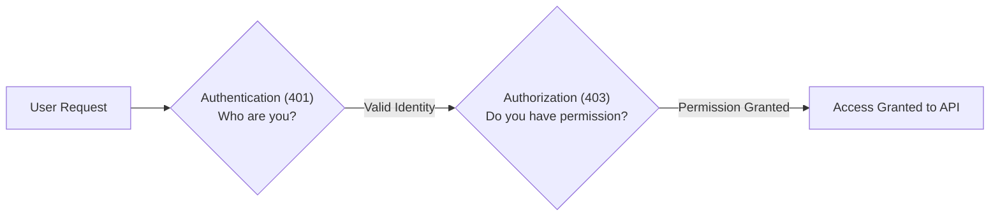
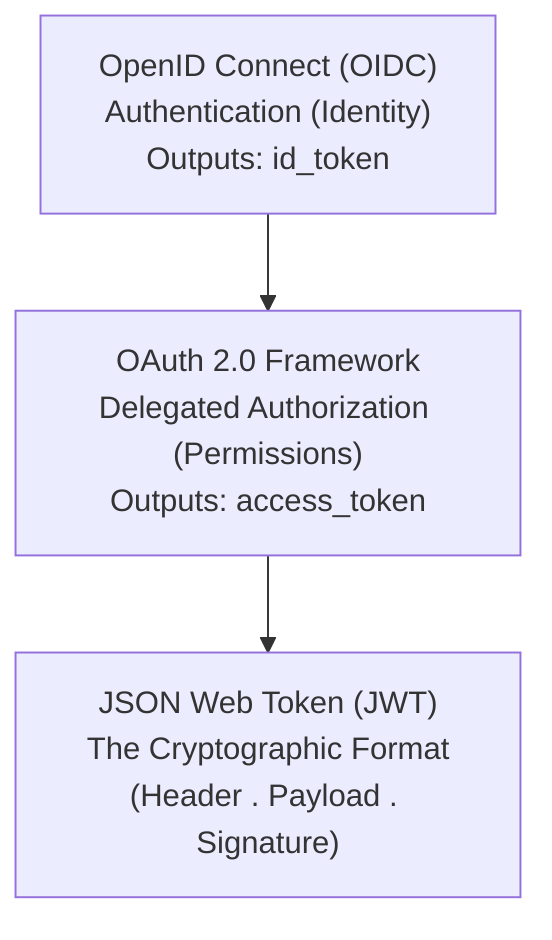
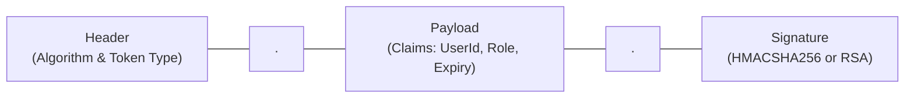
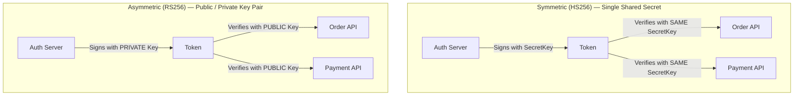
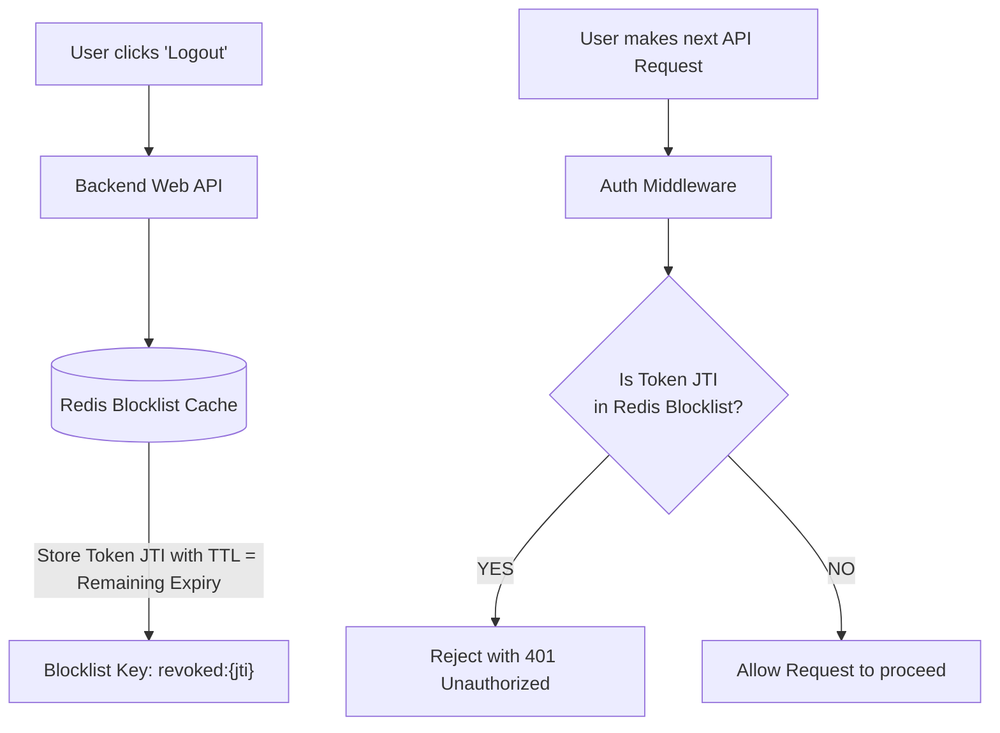
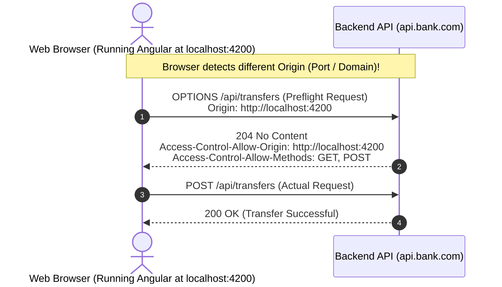
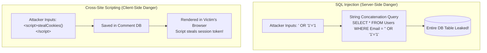
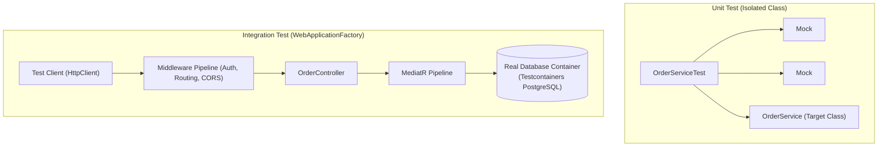
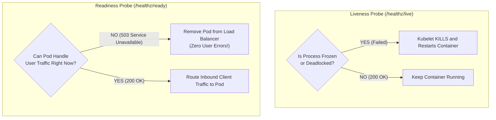
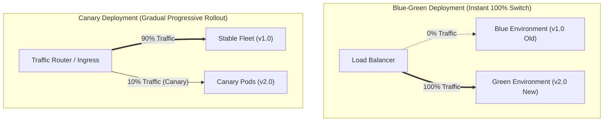

# 06. Security, Testing & DevOps: Basic Interview & Screening Guide (India Context)

> **Target Audience:** Screening rounds, technical phone screens, Technical Round 1 (0–6+ YOE), and rapid revision.  
> **Standard:** Speakable Senior English v1 (SSE-1) — concise, spoken-first, rubric-aligned interview answers.

---

# TABLE OF CONTENTS

- [Q1: What is the difference between Authentication and Authorization?](#q1-what-is-the-difference-between-authentication-and-authorization)
- [Q2: What is the difference between OAuth 2.0, OpenID Connect (OIDC), and JWT?](#q2-what-is-the-difference-between-oauth-20-openid-connect-oidc-and-jwt)
- [Q3: What is inside a JSON Web Token (JWT) and how does the server verify it?](#q3-what-is-inside-a-json-web-token-jwt-and-how-does-the-server-verify-it)
- [Q4: What is the difference between Symmetric (HS256) and Asymmetric (RS256) signing?](#q4-what-is-the-difference-between-symmetric-hs256-and-asymmetric-rs256-signing)
- [Q5: How do you handle instant logout or token revocation with stateless JWTs?](#q5-how-do-you-handle-instant-logout-or-token-revocation-with-stateless-jwts)
- [Q6: What is Cross-Origin Resource Sharing (CORS) and why do browsers block requests?](#q6-what-is-cross-origin-resource-sharing-cors-and-why-do-browsers-block-requests)
- [Q7: What are SQL Injection and Cross-Site Scripting (XSS), and how do you prevent them?](#q7-what-are-sql-injection-and-cross-site-scripting-xss-and-how-do-you-prevent-them)
- [Q8: What is the difference between Unit Testing and Integration Testing with WebApplicationFactory?](#q8-what-is-the-difference-between-unit-testing-and-integration-testing-with-webapplicationfactory)
- [Q9: What is Docker and why should you use Multi-Stage Docker builds?](#q9-what-is-docker-and-why-should-you-use-multi-stage-docker-builds)
- [Q10: What is the difference between Kubernetes Liveness and Readiness Probes?](#q10-what-is-the-difference-between-kubernetes-liveness-and-readiness-probes)
- [Q11: What is the difference between Blue-Green Deployment and Canary Deployment?](#q11-what-is-the-difference-between-blue-green-deployment-and-canary-deployment)

---

## Q1: What is the difference between Authentication and Authorization?
*Commonly asked at: TCS, Infosys, Cognizant, Wipro, Accenture*

**⚡ One-line answer**
**Authentication** means cryptographic verification of user or system identity, whereas Authorization determines permitted resources and actions.

**🗣️ Spoken answer (30–45 seconds)**
**Authentication** means validating caller identity through credentials, certificates, or tokens, returning HTTP 401 when invalid. In contrast, **authorization** evaluates verified user claims and roles to grant or deny resource access, returning **HTTP 403 Forbidden** when permissions are insufficient. Authentication must always execute before authorization. In ASP.NET Core, the middleware pipeline runs UseAuthentication to hydrate the ClaimsPrincipal before UseAuthorization inspects security policies. In our APIs, setting ClockSkew to zero ensures expired JWT tokens are rejected immediately.

**🎯 Terms the interviewer listens for**
- ⭐ **Authentication** — cryptographic verification of user or system identity
- ⭐ **Authorization** — evaluating claims, roles, or policies to grant access
- ⭐ **HTTP 403 Forbidden** — status returned when valid identities lack required permissions
- **HTTP 401 Unauthorized** — status returned when authentication credentials are missing
- **ClaimsPrincipal** — managed security object holding verified claims in HttpContext
- **ClockSkew** — token-expiry grace period setting defaulting to five minutes

**🧠 Memory hook**
Passport proves your identity [Authentication]; Visa or boarding seat ticket gives you entry permission [Authorization].

**💻 Code**


**⚠️ Likely follow-up**
**Question:** Why does ASP.NET Core return 401 instead of 403 when a user lacks a required role?
**Answer:** If the request lacks authentication entirely, it returns 401. If the user is authenticated but fails role or policy checks, the framework returns 403 Forbidden.

**📊 Quick comparison**
| Feature | Authentication (AuthN) | Authorization (AuthZ) |
| :--- | :--- | :--- |
| Focus | Identity verification | Permission evaluation |
| Failure Code | HTTP 401 Unauthorized | HTTP 403 Forbidden |
| Pipeline Order | Executes first (`UseAuthentication`) | Executes second (`UseAuthorization`) |

---

## Q2: What is the difference between OAuth 2.0, OpenID Connect (OIDC), and JWT?
*Commonly asked at: TCS, Infosys, Cognizant, Capgemini, LTIMindtree*

**⚡ One-line answer**
**OAuth 2.0** is an authorization framework for delegated permissions, OpenID Connect handles authentication, and JWT is the token format.

**🗣️ Spoken answer (30–45 seconds)**
**OAuth 2.0** is an authorization framework issuing scoped access tokens to allow delegated third-party access to protected APIs. Layered directly on top, **OpenID Connect** is an identity protocol providing authentication and single sign-on by issuing an ID token containing user profile claims. A **JSON Web Token (JWT)** is the compact, cryptographically signed container format used to transport these identity claims across networks. In my project, client single-page apps use OpenID Connect for user sign-in and OAuth 2.0 access tokens to query backend microservices.

**🎯 Terms the interviewer listens for**
- ⭐ **OAuth 2.0** — delegated authorization framework issuing scoped access tokens
- ⭐ **OpenID Connect** — identity authentication protocol layered on top of OAuth 2.0
- ⭐ **JSON Web Token (JWT)** — compact, cryptographically signed container format transporting identity claims
- **Access token** — bearer token presented in HTTP headers authorizing API access
- **ID token** — security token meant exclusively for client applications reading profile
- **Scope** — granular permission boundary requested by client applications

**🧠 Memory hook**
OIDC is your passport at hotel check-in; OAuth is the valet parking key that only runs the car engine; JWT is the RFID chip inside the keycard.

**💻 Code**


**⚠️ Likely follow-up**
**Question:** Should a backend Web API ever accept an ID token for authorization?
**Answer:** No. An ID token is intended strictly for the client application to display user information. APIs must only accept and validate access tokens.

**📊 Quick comparison**
| Concept | Primary Role | Output Token | Target Consumer |
| :--- | :--- | :--- | :--- |
| OIDC | Authentication | `id_token` | Frontend Client UI |
| OAuth 2.0 | Authorization | `access_token` | Backend Resource API |
| JWT | Data Format | Encoded Token String | Both Client and Server |

---

## Q3: What is inside a JSON Web Token (JWT) and how does the server verify it?
*Commonly asked at: TCS, Infosys, Wipro, Accenture, Cognizant*

**⚡ One-line answer**
**JSON Web Token (JWT)** is a compact URL-safe token format consisting of Header, Payload, and digital Signature parts.

**🗣️ Spoken answer (30–45 seconds)**
A **JSON Web Token (JWT)** consists of three Base64URL-encoded parts separated by periods. The JOSE Header specifies the token type and cryptographic algorithm. The payload contains **payload claims**, which are key-value statements detailing user identity, issuer, audience, and expiration. The server verifies integrity using the **digital signature**, meaning a cryptographic hash computed across the header and payload using the identity provider's key. If calculated hashes match, the token is authentic. In my project, rejecting unsigned tokens prevented token tampering vulnerabilities.

**🎯 Terms the interviewer listens for**
- ⭐ **JSON Web Token (JWT)** — compact URL-safe security token transporting signed identity claims
- ⭐ **Payload claims** — key-value statements detailing user identity and token validity
- ⭐ **Digital signature** — cryptographic hash verifying token authenticity and message integrity
- **JOSE Header** — metadata section defining signing algorithm and token type
- **Base64URL** — URL-safe string encoding scheme representing binary token data
- **ClockSkew** — server time drift tolerance that should be set to zero

**🧠 Memory hook**
A signed concert wristband: Header is the band material, Payload is your printed seat name, Signature is the holographic anti-counterfeit seal.

**💻 Code**


**⚠️ Likely follow-up**
**Question:** Is user data inside a standard JWT encrypted?
**Answer:** No. It is only Base64URL encoded. Anyone can decode and read the payload. Confidential data requires Nested JWTs or JSON Web Encryption [JWE].

**📊 Quick comparison**
| Segment | Content | Security Role |
| :--- | :--- | :--- |
| Header | Algorithm & key ID | Instructs validator which key to use |
| Payload | Claims (`sub`, `exp`, roles) | Carries user attributes and permissions |
| Signature | Cryptographic hash | Proves token was not altered in transit |

---

## Q4: What is the difference between Symmetric (HS256) and Asymmetric (RS256) signing?
*Commonly asked at: TCS, Infosys, Cognizant, Persistent, Nagarro*

**⚡ One-line answer**
**RS256** is an asymmetric signing algorithm using a private key to sign and public keys to verify tokens.

**🗣️ Spoken answer (30–45 seconds)**
Symmetric signing uses **HS256**, meaning a single shared secret key shared between the token issuer and all resource APIs, creating security risks if any service leaks the secret. In contrast, **RS256** is an asymmetric algorithm using an identity provider's private key to sign tokens, while resource APIs verify signatures using the matching public key. APIs fetch public keys dynamically from a **JSON Web Key Set (JWKS)** endpoint. In my project, adopting RS256 enabled non-repudiation and zero-downtime key rotation across our microservices.

**🎯 Terms the interviewer listens for**
- ⭐ **RS256** — asymmetric algorithm using RSA public and private key pairs
- ⭐ **HS256** — symmetric algorithm using a single shared secret key
- ⭐ **JSON Web Key Set (JWKS)** — standard endpoint publishing public keys for signature verification
- **Non-repudiation** — cryptographic proof that only the private key owner signed token
- **Key rotation** — updating signing certificates dynamically without service downtime
- **Shared secret vulnerability** — risk where compromised consumers can forge authentication tokens

**🧠 Memory hook**
HS256 is one physical key duplicated among roommates; RS256 is a public postbox slot anyone can drop mail into, but only the postman holds the key to open.

**💻 Code**


**⚠️ Likely follow-up**
**Question:** Why do enterprise microservices avoid HS256?
**Answer:** HS256 requires sharing the secret key across all services. If one service is compromised, an attacker can forge tokens for every other service in the enterprise.

**📊 Quick comparison**
| Metric | HS256 (Symmetric) | RS256 (Asymmetric) |
| :--- | :--- | :--- |
| Signing Key | Shared secret | Private key (Auth server only) |
| Validation Key | Same shared secret | Public key (JWKS endpoint) |
| Non-Repudiation | No (both parties share key) | Yes (only private key can sign) |
| Microservices Fit | Monolith or private subnet | Standard enterprise default |

---

## Q5: How do you handle instant logout or token revocation with stateless JWTs?
*Commonly asked at: TCS, Infosys, Cognizant, Wipro, Walmart*

**⚡ One-line answer**
**Token revocation** means invalidating stateless access tokens prior to expiration using centralized distributed cache blacklists.

**🗣️ Spoken answer (30–45 seconds)**
Because JSON Web Tokens are stateless, servers cannot naturally revoke them before their expiration timestamp. Senior architectures address this by pairing short-lived access tokens with a **refresh token**, meaning a long-lived revokable token stored securely in the database. When immediate logout occurs, the server marks the refresh token revoked. For instant access token invalidation, the server stores the token's unique JTI inside a high-speed **Redis blacklist**, checking incoming requests against the cache. In my project, this **token revocation** pattern provided sub-second session revocation.

**🎯 Terms the interviewer listens for**
- ⭐ **Token revocation** — invalidating active access tokens prior to natural expiration time
- ⭐ **Refresh token** — long-lived revokable token used to obtain new access tokens
- ⭐ **Redis blacklist** — in-memory distributed cache storing revoked token identifiers
- **JTI (JWT ID)** — unique identifier claim embedded in tokens for revocation tracking
- **Stateless token** — token verifiable independently without querying central database state
- **Sliding expiration** — extending session lifetime dynamically during active user activity

**🧠 Memory hook**
A stamped visitor badge: security cannot erase the ink once stamped, but they keep a small banned list on a clipboard at sensitive doors.

**💻 Code**


**⚠️ Likely follow-up**
**Question:** Does checking Redis on every request destroy JWT statelessness?
**Answer:** Yes, it introduces state. To minimize latency, we only check Redis on state-modifying operations (POST, PUT, DELETE) or financial transactions, while standard reads rely on short 5-minute expirations.

**📊 Quick comparison**
| Strategy | Latency Impact | Revocation Speed | Best Use Case |
| :--- | :--- | :--- | :--- |
| Short Expiry (5–15 min) | Zero (pure math) | Delayed until expiry | Standard reads |
| Redis `jti` Blocklist | Sub-millisecond | Instant | Logout & emergency lock |
| Refresh Revocation | Zero during session | At next refresh cycle | Password change / session end |

---

## Q6: What is Cross-Origin Resource Sharing (CORS) and why do browsers block requests?
*Commonly asked at: TCS, Infosys, Cognizant, Accenture, Capgemini*

**⚡ One-line answer**
**CORS** is a browser security protocol that permits or restricts web pages from requesting resources across different origins.

**🗣️ Spoken answer (30–45 seconds)**
The browser enforces the **Same-Origin Policy**, meaning a core security rule blocking client scripts from reading HTTP responses from a different origin unless permitted. To allow cross-domain requests, servers implement **CORS**, which is an HTTP header exchange negotiating access permissions between browser and server. Before non-simple requests execute, the browser sends a **preflight OPTIONS request** to inspect allowed HTTP methods, origins, and headers. In my project, configuring strict allowed origins in ASP.NET Core middleware prevented cross-origin data leakage while blocking insecure wildcard access.

**🎯 Terms the interviewer listens for**
- ⭐ **CORS** — browser mechanism managing cross-origin resource sharing via HTTP headers
- ⭐ **Same-Origin Policy** — security standard restricting documents from accessing different domain resources
- ⭐ **Preflight OPTIONS request** — preliminary browser request verifying server permissions before sending payload
- **Access-Control-Allow-Origin** — HTTP response header specifying authorized client origin domains
- **Access-Control-Allow-Credentials** — header allowing client cookies and authorization headers across origins
- **Origin header** — request header sent by browser identifying calling site origin

**🧠 Memory hook**
A gated society guard: delivery person from outside street must be verified against the resident's guest list before being allowed through the main gate.

**💻 Code**


**⚠️ Likely follow-up**
**Question:** Why should you avoid `AllowAnyOrigin()` with `AllowCredentials()` in ASP.NET Core?
**Answer:** The CORS specification explicitly forbids wildcard `*` with credentials for security. Modern browsers reject the response to prevent cross-site credential leakage.

**📊 Quick comparison**
| Scenario | Triggers Preflight? | Reason |
| :--- | :--- | :--- |
| `GET` with standard headers | No | Simple request |
| `POST` with `application/json` | Yes | Content-Type is non-simple |
| Request with `Authorization: Bearer` | Yes | Custom header requires pre-approval |

---

## Q7: What are SQL Injection and Cross-Site Scripting (XSS), and how do you prevent them?
*Commonly asked at: TCS, Infosys, Cognizant, Wipro, HCL*

**⚡ One-line answer**
**Parameterized query** is a database query mechanism that separates executable SQL code from user-supplied input parameters.

**🗣️ Spoken answer (30–45 seconds)**
SQL injection happens when untrusted user input alters database query syntax. We eliminate this vulnerability using a **parameterized query**, which treats all user inputs strictly as typed data parameters rather than executable SQL code. In contrast, **Cross-Site Scripting (XSS)** occurs when malicious scripts are injected into web pages and executed by victim browsers. We prevent XSS using **context-aware encoding**, meaning encoding dynamic HTML output, and configuring Content-Security-Policy headers. In my project, using EF Core LINQ queries and automated anti-XSS encoding eliminated both vulnerability classes completely.

**🎯 Terms the interviewer listens for**
- ⭐ **Parameterized query** — query mechanism treating user input strictly as data values
- ⭐ **Cross-Site Scripting (XSS)** — vulnerability where malicious scripts execute within victim browser contexts
- ⭐ **Context-aware encoding** — escaping user input according to HTML, JavaScript, or URL context
- **SQL injection** — attack altering relational database queries through malicious input strings
- **Content-Security-Policy** — HTTP header restricting sources of executable scripts on web pages
- **ORM abstraction** — object-relational mapping frameworks providing automated parameterized queries

**🧠 Memory hook**
SQLi is sneaking destructive instructions onto a restaurant order slip; XSS is posting poison-tipped notices on a public bulletin board.

**💻 Code**


**⚠️ Likely follow-up**
**Question:** Is EF Core completely immune to SQL Injection?
**Answer:** Standard LINQ queries and `FromSqlInterpolated` are safe because they parameterize values. However, `FromSqlRaw` used with string interpolation or concatenation is vulnerable.

**📊 Quick comparison**
| Vulnerability | Attack Location | Primary Impact | Primary Defense |
| :--- | :--- | :--- | :--- |
| SQLi | Backend Database | Data exfiltration / deletion | Parameterized queries & ORMs |
| XSS | Client Browser | Session token hijacking | Contextual encoding & CSP headers |

---

## Q8: What is the difference between Unit Testing and Integration Testing with WebApplicationFactory?
*Commonly asked at: TCS, Infosys, Cognizant, Deloitte, EY*

**⚡ One-line answer**
**WebApplicationFactory** is an in-memory test harness that boots the full ASP.NET Core pipeline for integration testing.

**🗣️ Spoken answer (30–45 seconds)**
Unit testing validates individual methods in isolation, using **mocking frameworks** like Moq to simulate external dependencies without hitting network or disk resources. In contrast, integration testing uses **WebApplicationFactory**, which is an in-memory test server bootstrapping the complete ASP.NET Core pipeline, including routing, model validation, and authorization filters. We combine WebApplicationFactory with **Testcontainers**, meaning ephemeral Docker containers providing real PostgreSQL or SQL Server databases for tests. In my project, integration tests running against Testcontainers caught EF Core SQL translation bugs that unit tests missed.

**🎯 Terms the interviewer listens for**
- ⭐ **WebApplicationFactory** — in-memory test harness hosting and executing the complete web pipeline
- ⭐ **Testcontainers** — library managing lightweight throwaway Docker containers for integration tests
- ⭐ **Mocking frameworks** — libraries replacing real dependencies with simulated test double objects
- **Unit testing** — validating isolated class methods in memory without external dependencies
- **Pipeline verification** — testing middleware ordering, model validation, and authorization policies
- **Ephemeral database** — temporary database instances created and destroyed per test run

**🧠 Memory hook**
Unit test is testing a spark plug on a workbench; Integration test is driving the assembled car around a test track.

**💻 Code**


**⚠️ Likely follow-up**
**Question:** Why avoid mocking EF Core `DbContext` in unit tests?
**Answer:** Mocking `IQueryable` is brittle and fails to catch SQL translation bugs. Using `WebApplicationFactory` with real Testcontainers database instances provides authentic verification.

**📊 Quick comparison**
| Metric | Unit Tests (xUnit + Mocks) | Integration Tests (`WebApplicationFactory`) |
| :--- | :--- | :--- |
| Execution Speed | 1–5 milliseconds | 50–300 milliseconds |
| Scope | Single method or class | Full HTTP pipeline & database |
| Dependencies | Mocked | Real via Testcontainers |
| Confidence | Algorithmic logic | Production deployment readiness |

---

## Q9: What is Docker and why should you use Multi-Stage Docker builds?
*Commonly asked at: TCS, Infosys, Cognizant, Capgemini, Nagarro*

**⚡ One-line answer**
**Multi-Stage Build** is a Docker container pattern separating heavy compilation environments from hardened, lightweight production runtime images.

**🗣️ Spoken answer (30–45 seconds)**
A **Multi-Stage Build** uses multiple FROM statements in a single Dockerfile, compiling source code inside a heavy SDK image in stage one, then copying only compiled binaries into a **hardened runtime image** in stage two. This shrinks production images from eight hundred megabytes down to eighty megabytes. Furthermore, configuring a **non-root user** ensures container processes run without root privileges, minimizing the attack surface. In my project, multi-stage builds using Ubuntu Chiseled images cut deployment transfer times by ninety percent while eliminating security vulnerabilities.

**🎯 Terms the interviewer listens for**
- ⭐ **Multi-Stage Build** — Dockerfile pattern isolating compilers from final production container images
- ⭐ **Hardened runtime image** — minimal base container image stripped of unnecessary system binaries
- ⭐ **Non-root user** — unprivileged container account restricting process execution permissions for security
- **Layer caching** — ordering build instructions to reuse cached container filesystem layers
- **Attack surface** — aggregate system entry points vulnerable to security exploitation
- **Chiseled containers** — minimal distroless container images containing only essential application dependencies

**🧠 Memory hook**
Commercial kitchen: chefs use heavy mixers and cleavers to prepare food in the kitchen, but waiters only bring the clean porcelain plate to the dining table.

**💻 Code**
```dockerfile
# Stage 1: Build
FROM mcr.microsoft.com/dotnet/sdk:8.0 AS build
WORKDIR /src
COPY ["MyApi.csproj", "./"]
RUN dotnet restore
COPY . .
RUN dotnet publish -c Release -o /app/publish /p:UseAppHost=false

# Stage 2: Final Runtime
FROM mcr.microsoft.com/dotnet/aspnet:8.0-alpine AS final
WORKDIR /app
COPY --from=build /app/publish .
USER $APP_UID
ENTRYPOINT ["dotnet", "MyApi.dll"]
```

**⚠️ Likely follow-up**
**Question:** Why copy the `.csproj` file separately before copying the rest of the source code?
**Answer:** Docker caches layers. If project files don't change, Docker skips the expensive `dotnet restore` step and uses cached packages, cutting build times significantly.

**📊 Quick comparison**
| Attribute | Single-Stage Dockerfile | Multi-Stage Dockerfile |
| :--- | :--- | :--- |
| Image Size | ~850 MB (includes SDK) | ~100 MB (runtime only) |
| Security Risk | High (compilers & tools present) | Hardened & non-root |
| Build Performance | Slower rebuilds | Fast layer caching |

---

## Q10: What is the difference between Kubernetes Liveness and Readiness Probes?
*Commonly asked at: TCS, Infosys, Cognizant, Wells Fargo, Walmart*

**⚡ One-line answer**
**Liveness Probe** is a Kubernetes diagnostic check that restarts container processes when unrecoverable deadlocks or crashes occur.

**🗣️ Spoken answer (30–45 seconds)**
A **Liveness Probe** monitors container process health, instructing Kubernetes to kill and restart the pod when application deadlocks or fatal freezes occur. In contrast, a **Readiness Probe** determines whether a container is ready to accept incoming network traffic, temporarily removing unhealthy pods from service load balancers without restarting them. You must never query external databases inside liveness checks, because database latency spikes trigger a **cascading reboot storm**, crashing the entire cluster. In my project, separating health endpoints into lightweight liveness and comprehensive readiness stabilized our microservices.

**🎯 Terms the interviewer listens for**
- ⭐ **Liveness Probe** — diagnostic health check triggering container restarts upon fatal deadlocks
- ⭐ **Readiness Probe** — gatekeeper check routing traffic only to fully warmed containers
- ⭐ **Cascading reboot storm** — cluster failure caused when shared dependency outages trigger fleet restarts
- **Startup Probe** — grace period check protecting slow-starting legacy container workloads
- **Endpoint slice** — Kubernetes resource tracking network addresses of ready pods
- **Kubelet** — primary node agent responsible for running container health probes

**🧠 Memory hook**
Liveness is checking for a heartbeat [restart if dead]; Readiness is checking if an employee is fit for work [rest if feverish].

**💻 Code**


**⚠️ Likely follow-up**
**Question:** Why is querying SQL Server inside a liveness probe dangerous?
**Answer:** If the database slows down, all API pod liveness probes fail simultaneously. Kubernetes kills all pods at once, causing a total application outage.

**📊 Quick comparison**
| Probe Type | Failure Action | Endpoint Checked | Ideal Check Scope |
| :--- | :--- | :--- | :--- |
| Liveness | Container restarted | `/healthz/live` | Internal process responsiveness |
| Readiness | Traffic halted | `/healthz/ready` | Cache warmup & DB connectivity |
| Startup | Suspends other probes | `/healthz/startup` | One-time initialization |

---

## Q11: What is the difference between Blue-Green Deployment and Canary Deployment?
*Commonly asked at: TCS, Infosys, Cognizant, Wipro, Accenture*

**⚡ One-line answer**
**Blue-Green Deployment** is a deployment strategy switching 100% of production traffic instantly between two identical environment stacks.

**🗣️ Spoken answer (30–45 seconds)**
**Blue-Green Deployment** maintains two identical production environments, deploying new code to the idle Green stack before flipping router traffic instantly from Blue to Green, enabling immediate rollback if issues emerge. In contrast, **Canary Deployment** routes a fractional percentage of live user traffic—such as five percent—to the new version, expanding traffic progressively while monitoring error rates to limit the **blast radius**. Both patterns require backward-compatible database migrations using the expand-and-contract pattern. In my project, Canary deployments via Kubernetes ingress prevented flawed releases from affecting our entire user base.

**🎯 Terms the interviewer listens for**
- ⭐ **Blue-Green Deployment** — deployment strategy switching traffic completely between two identical environments
- ⭐ **Canary Deployment** — progressive deployment routing small traffic percentages to test releases
- ⭐ **Blast radius** — maximum scope of impact and user population exposed to bugs
- **Expand-and-contract** — two-phase database refactoring pattern maintaining backward schema compatibility
- **Traffic splitting** — routing user requests based on HTTP headers or percentages
- **Zero-downtime deployment** — releasing software updates without interrupting live end-user services

**🧠 Memory hook**
Blue-Green is flipping train platforms at a terminal; Canary is the miner's canary warning of danger before the whole crew advances.

**💻 Code**


**⚠️ Likely follow-up**
**Question:** How do you handle database migrations during a Blue-Green deployment?
**Answer:** Schema changes must be backward-compatible. Using the Expand-and-Contract pattern, add new nullable columns or tables first so both old and new application versions function concurrently.

**📊 Quick comparison**
| Metric | Blue-Green Deployment | Canary Deployment |
| :--- | :--- | :--- |
| Traffic Cutover | Instantaneous (100%) | Incremental (5% → 25% → 100%) |
| Infrastructure Overhead | 2x capacity during switch | Minimal (1–2 extra pods) |
| Blast Radius | Entire user base | Controlled fraction of users |
| Rollback Mechanism | Instant router flip | Scale down canary pods |
