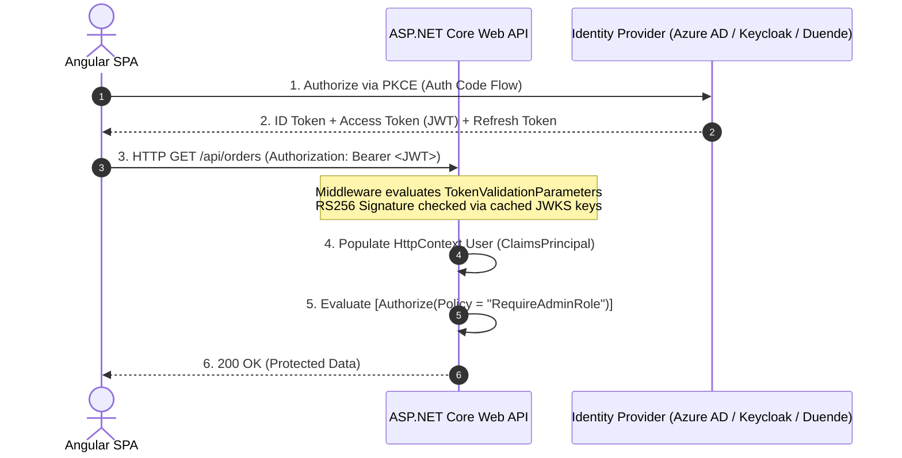

# 07. Security, Testing, DevOps & Adjacent Senior Skills (6+ YOE)

> **Target Audience:** Senior Full-Stack / Backend Engineers & Tech Leads (6+ Years Experience) preparing for Tier-1 Product Companies, GCCs (Wells Fargo, Morgan Stanley, JPMorgan, Walmart, Target), and High-Growth Indian Unicorns.  
> **Purpose:** Master the high-frequency adjacent topics that separate mid-level developers from senior engineering leads: OAuth2/OIDC & JWT security architecture, reliable integration testing with `WebApplicationFactory`, production Docker/Kubernetes containerization, and senior pull request code review standards.

---

## 1. Security Architecture & Identity (OAuth2, OpenID Connect & JWT)

### 1.1 OAuth2 vs. OpenID Connect (OIDC) vs. JWT

**⚡ One-line answer**
**OpenID Connect** is an identity protocol layered on OAuth2 to provide authentication, whereas OAuth2 provides delegated resource authorization.

**🗣️ Spoken answer (30–45 seconds)**
We strictly separate identity from access. **OpenID Connect** is an identity verification protocol providing user authentication via ID tokens for client profiles. In contrast, **OAuth2** is a delegated authorization framework issuing scoped access tokens for APIs without sharing user credentials. The **JSON Web Token**, a digitally signed container format carrying identity and permission claims, serves as our access token. APIs treat this as a **Bearer token**, a security credential granting access to whoever presents it over TLS, validating the asymmetric signature against identity provider endpoints without calling databases.

**🧠 Memory hook**
  * **OpenID Connect (Your Indian Passport / Aadhaar Card):** 
    * Proves **identity**. It tells the airport authority *who you are* (Name, Photo, Date of Birth). This is your **ID Token** (used only by the frontend client).
  * **OAuth2 (Your Flight Boarding Pass):** 
    * Proves **delegated access permissions**. The boarding pass doesn't care about your family history; it gives you the right to enter **Gate 14B**, board **Flight 6E-204**, and access the **Business Lounge**. This is your **Access Token**.
  * **JWT (The Tamper-Proof Cryptographic Barcode on the Pass):** 
    * When you reach the boarding gate, the security guard does not call the Ministry of External Affairs to check your passport again. He simply scans the **digital cryptographic barcode** on your boarding pass. The airport's public key confirms the pass is genuine, unexpired, and hasn't been altered with a pen!

**🎯 Terms the interviewer listens for**
- ⭐ **OpenID Connect** — identity verification protocol providing user authentication via ID tokens
- ⭐ **OAuth2** — delegated authorization framework issuing scoped access tokens for APIs
- ⭐ **JSON Web Token** — digitally signed container format carrying identity and permission claims
- **Bearer token** — security credential granting access to whoever presents it over TLS
- **ID token** — cryptographically signed token consumed by clients for identity verification
- **Access token** — credential presented to APIs to authorize specific requested operations



**💻 Code**
* **The Scenario:** In a banking portal (e.g., Wells Fargo / Morgan Stanley), an Angular SPA authenticates an investment advisor via Okta/Azure AD and requests authorization to execute fund transfers on the Backend Web API.
* **❌ Bad Production Code / Practice (The Junior Unverified Token Trap):**
  ```csharp
  // JUNIOR ANTI-PATTERN: Decoding unverified Base64 payload or using ID Token for API calls
  public IActionResult ProcessTransferJunior([FromHeader] string authorization)
  {
      var token = authorization.Replace("Bearer ", "");
      // CRITICAL SECURITY VULNERABILITY: Reading payload without cryptographic signature verification!
      // An attacker can change "role": "User" to "role": "Admin" in Base64 and gain full access!
      var handler = new JwtSecurityTokenHandler();
      var jwt = handler.ReadJwtToken(token); 
      var role = jwt.Claims.First(c => c.Type == "role").Value;
      return Ok();
  }
  ```
* **✅ Senior Production Code (Asymmetric Cryptographic Signature & Audience Validation):**
  ```csharp
  // Program.cs - Strict ASP.NET Core JWT Validation
  builder.Services.AddAuthentication(JwtBearerDefaults.AuthenticationScheme)
      .AddJwtBearer(options =>
      {
          options.Authority = "https://identity.bank.com/oauth2/v1";
          options.Audience = "api://transfer-service"; // Rejects tokens minted for other APIs
          options.RequireHttpsMetadata = true;
          
          options.TokenValidationParameters = new TokenValidationParameters
          {
              ValidateIssuer = true,
              ValidIssuer = "https://identity.bank.com/oauth2/v1",
              ValidateAudience = true,
              ValidAudience = "api://transfer-service",
              ValidateLifetime = true,
              ClockSkew = TimeSpan.Zero, // Eliminate 5-minute grace period for expired tokens
              ValidateIssuerSigningKey = true // Validates RS256 signature against IDP JWKS endpoint
          };
      });
  ```
* **🗣️ What to Say in the Interview:**
  > *"We strictly enforce separation between OIDC and OAuth2: OIDC provides the `id_token` consumed exclusively by the Angular client for UI profile rendering, while OAuth2 issues an RS256-signed `access_token` for API authorization. Our backend APIs never parse unverified Base64 claims; they validate the cryptographic signature against the IDP's JWKS endpoint and enforce strict `ValidAudience` checks to prevent token substitution attacks."*

---

### 1.2 The ASP.NET Core Authentication Pipeline Sequence

When an incoming request with a `Bearer <token>` header hits an ASP.NET Core API, middleware executes in a strict sequence:

1. **`UseRouting()`**: Matches the incoming URL to an endpoint route.
2. **`UseAuthentication()`**: 
   * Reads the `Authorization: Bearer <token>` header.
   * Validates the **4 Core Token Rules**:
     1. **Issuer (`ValidIssuer`):** Did our trusted IDP (e.g., Azure AD / Keycloak) issue this token?
     2. **Audience (`ValidAudience`):** Was this token meant for *our* API (e.g., `api://orders-service`), or for a completely different service?
     3. **Lifetime (`ValidateLifetime`):** Is `exp` (expiration time) in the future? (Includes a small clock skew tolerance).
     4. **Signature (`IssuerSigningKey`):** Was the token signed by the IDP's private key? (Validated against the IDP's public JWKS keys).
   * Unpacks the claims into a `ClaimsIdentity` and binds it to **`HttpContext.User`**.
3. **`UseAuthorization()`**:
   * Evaluates endpoint `[Authorize]` attributes and custom policies (e.g., checking roles, tenant IDs, or specific scopes).
   * Short-circuits with **`401 Unauthorized`** if unauthenticated, or **`403 Forbidden`** if authenticated but lacking the required policy permissions.

**🎯 Terms the interviewer listens for**
  * **Authentication Middleware (`UseAuthentication`):** ASP.NET Core pipeline component that extracts credentials, invokes registered authentication handlers (`JwtBearerHandler`), and builds the security context.
  * **`TokenValidationParameters`:** The core configuration object defining cryptographic validation thresholds (`ValidateIssuer`, `ValidateAudience`, `ValidateLifetime`, `ClockSkew = TimeSpan.Zero`).
  * **`ClaimsPrincipal` & `ClaimsIdentity`:** The .NET identity architecture where a security principal aggregates one or more identity claims representing identity and roles.
  * **Authorization Middleware (`UseAuthorization`):** The pipeline gatekeeper evaluating policy rules and requirement handlers, returning `401 Unauthorized` (identity absent/invalid) or `403 Forbidden` (insufficient privileges).
  * **JWKS (JSON Web Key Set) Endpoint:** The standardized OpenID discovery endpoint (`/.well-known/openid-configuration/jwks`) publishing public RSA/EC keys used by APIs to verify signatures without manual key coordination.

**💻 Code**
* **The Scenario:** A multi-tenant banking platform where customers from Tenant A must never access records belonging to Tenant B, enforced via custom authorization policies.
* **❌ Bad Production Architecture / Code (Middleware Inversion & Default Clock Skew Trap):**
  ```csharp
  // JUNIOR ANTI-PATTERN: Reversed middleware order & permissive 5-minute clock skew
  var app = builder.Build();

  // CRITICAL BUG 1: UseAuthorization runs BEFORE UseAuthentication!
  // HttpContext.User is still empty/anonymous when policies evaluate!
  app.UseAuthorization();
  app.UseAuthentication();

  // CRITICAL BUG 2: Default ClockSkew is 5 minutes!
  // Expired tokens remain valid for a full 300 seconds after revocation!
  ```
* **✅ Senior Production Code (Custom Requirement Handler with Tenant Validation):**
  ```csharp
  public sealed class TenantAccessRequirement : IAuthorizationRequirement { }

  public sealed class TenantAccessHandler : AuthorizationHandler<TenantAccessRequirement>
  {
      private readonly IHttpContextAccessor _httpContextAccessor;

      public TenantAccessHandler(IHttpContextAccessor httpContextAccessor) => _httpContextAccessor = httpContextAccessor;

      protected override Task HandleRequirementAsync(AuthorizationHandlerContext context, TenantAccessRequirement requirement)
      {
          var httpContext = _httpContextAccessor.HttpContext;
          var routeTenantId = httpContext?.Request.RouteValues["tenantId"]?.ToString();
          var userTenantId = context.User.FindFirst("tenant_id")?.Value;

          // Cross-tenant breach attempt blocked immediately
          if (!string.IsNullOrEmpty(userTenantId) && userTenantId == routeTenantId)
          {
              context.Succeed(requirement);
          }
          return Task.CompletedTask;
      }
  }

  // Program.cs - Correct Pipeline Ordering
  app.UseRouting();
  app.UseAuthentication(); // 1. Authenticates & sets HttpContext.User
  app.UseAuthorization();  // 2. Evaluates policies against HttpContext.User
  app.MapControllers();
  ```
* **🗣️ What to Say in the Interview:**
  > *"Middleware ordering is non-negotiable in ASP.NET Core: `UseAuthentication()` must strictly precede `UseAuthorization()`, otherwise policies execute against an unpopulated `ClaimsPrincipal`. Furthermore, we always set `ClockSkew = TimeSpan.Zero` in production `TokenValidationParameters` to eliminate the default 5-minute grace period that allows expired tokens to linger."*

---

### 1.3 Symmetric (HS256) vs. Asymmetric (RS256) Signing

| Feature | HS256 (Symmetric Shared Secret) | RS256 (Asymmetric Public/Private Key) |
| :--- | :--- | :--- |
| **How it Works** | The **exact same secret key** is used to both sign and verify tokens. | The IDP signs with a **Private Key**; APIs verify with a **Public Key**. |
| **Security Risk in Microservices** | **Extreme Hazard:** Every microservice must hold the secret key. If a junior developer logs or leaks the secret in one service, attackers can forge admin tokens across the entire company! | **Industry Standard:** Microservices only possess the IDP's public key (fetched automatically from `/.well-known/openid-configuration/jwks`). Compromising an API reveals nothing to forge tokens. |
| **Enterprise Fit** | Monoliths with only 1 backend service. | Enterprise Microservices & Cloud Architectures. |

**🎯 Terms the interviewer listens for**
  * **Symmetric HMAC-SHA256 (HS256):** Cryptographic signing algorithm using a single shared secret for both generation and verification; unacceptable in multi-service distributed architectures.
  * **Asymmetric RSA-SHA256 (RS256):** Public-key cryptography algorithm where the authentication authority keeps the private key confidential and publishes the public key for stateless verification.
  * **ECDSA (ES256):** Elliptic Curve Digital Signature Algorithm providing equivalent 128-bit cryptographic security to RSA-3072 with substantially smaller key sizes and lower CPU verification costs.
  * **Key Rollover / Invalidation:** The scheduled rotation of cryptographic keys facilitated by `kid` (Key ID) headers in the JWT and automatic refresh from the IDP JWKS endpoint.

**💻 Code**
* **The Scenario:** An enterprise cluster of 15 microservices (Order, Payment, Inventory, Analytics, etc.).
* **❌ Bad Production Architecture (HS256 Shared Secret Leak):**
  A junior developer places `"JwtSecret": "SuperSecretKey999!"` in every microservice's `appsettings.json`. When a low-privilege analytics microservice repository is compromised, the attacker extracts the key and uses it to forge valid administrator JWTs for the Payment Service!
* **✅ Senior Production Code (Zero-Secret Asymmetric RS256 Verification):**
  Microservices never hold signing keys. They configure ASP.NET Core to verify against the central identity provider's JWKS:
  ```csharp
  builder.Services.AddAuthentication(JwtBearerDefaults.AuthenticationScheme)
      .AddJwtBearer(options =>
      {
          // Automatically downloads and caches public keys from Keycloak / Azure AD JWKS endpoint
          options.Authority = "https://identity.enterprise.com/realms/production";
          options.MetadataAddress = "https://identity.enterprise.com/realms/production/.well-known/openid-configuration";
          options.TokenValidationParameters = new TokenValidationParameters
          {
              ValidateIssuer = true,
              ValidIssuer = "https://identity.enterprise.com/realms/production",
              ValidateAudience = true,
              ValidAudience = "account-api",
              ValidateIssuerSigningKey = true // Uses public keys from JWKS; private key NEVER leaves Identity Provider!
          };
      });
  ```
* **🗣️ What to Say in the Interview:**
  > *"We strictly ban symmetric HS256 in our microservices cluster because sharing the secret key across 15 services violates the principle of least privilege—one leaked repository compromises the entire enterprise. Instead, we use asymmetric RS256 or ES256: the central Identity Provider signs tokens with a private HSM key, while microservices verify signatures statelessly using public keys cached from the JWKS endpoint."*

---

### 1.4 Stateless JWT Revocation (Handling Instant Logout & Banned Users)

* **The Problem:** By design, JWTs are completely stateless. Once issued, a JWT remains valid until its expiration timestamp (`exp`), even if the user logs out, changes their password, or gets terminated by HR!
* **Enterprise Solution (Hybrid Revocation Pattern):**
  1. **Short Lifetimes:** Keep Access Tokens short-lived (typically **5 to 15 minutes**). Use Refresh Tokens stored securely in `HttpOnly, Secure, SameSite=Strict` cookies to silently fetch new tokens.
  2. **Redis Blacklist for Instant Logout:**
     * Every JWT contains a unique claim: `jti` (JWT ID / UUID).
     * When a user logs out or is revoked, write the token's `jti` into **Redis** with a Time-To-Live (TTL) equal to the remaining lifespan of that specific token.
     * An ASP.NET Core custom middleware or `OnTokenValidated` event performs a sub-millisecond Redis check: if the `jti` exists in the blacklist, reject the request with `401 Unauthorized`.
     * Once the token expires naturally, Redis auto-evicts the key—keeping the blacklist memory footprint minimal!

**🎯 Terms the interviewer listens for**
  * **Short-Lived Access Token:** An ephemeral bearer token (5–15 minute lifetime) that limits the exposure window if intercepted by an attacker.
  * **Refresh Token Rotation (RTR):** A security mechanism where every token refresh exchange invalidates the old refresh token and issues a brand-new cryptographically random refresh token.
  * **Token Family Revocation / Reuse Detection:** An automated breach-detection protocol; if a previously consumed refresh token is presented, the IDP suspects token theft and invalidates the entire chain of active sessions for that user.
  * **`jti` (JWT ID) Denylist / Blacklist:** Utilizing the standard `jti` claim stored in an in-memory Redis cluster with a Time-To-Live (TTL) matching the token's remaining lifetime to achieve instantaneous token invalidation.
  * **Cookie Hardening (`HttpOnly; Secure; SameSite=Strict`):** Defense-in-depth browser cookie attributes preventing JavaScript cross-site reading (`HttpOnly`), enforcing TLS-only transport (`Secure`), and prohibiting cross-origin submission (`SameSite=Strict`).

**💻 Code**
* **The Scenario:** In a banking portal, an executive's mobile device is stolen while an active 1-hour session is open. Security operations initiates an emergency session kill.
* **❌ Bad Production Architecture (Relational DB Lookup Trap):**
  Querying SQL Server on every single HTTP request (`SELECT IsRevoked FROM Sessions WHERE TokenId = @id`). Under 20,000 req/sec, this creates intense database connection pool exhaustion and destroys the stateless performance benefits of JWTs!
* **✅ Senior Production Code (Redis JTI Denylist & Refresh Token Rotation):**
  ```csharp
  // Program.cs - Instant Token Invalidation via Redis JTI Denylist
  builder.Services.AddAuthentication(JwtBearerDefaults.AuthenticationScheme)
      .AddJwtBearer(options =>
      {
          options.Events = new JwtBearerEvents
          {
              OnTokenValidated = async context =>
              {
                  var redis = context.HttpContext.RequestServices.GetRequiredService<IConnectionMultiplexer>();
                  var db = redis.GetDatabase();

                  var jti = context.Principal?.FindFirst(JwtRegisteredClaimNames.Jti)?.Value;
                  if (string.IsNullOrEmpty(jti))
                  {
                      context.Fail("Token missing mandatory JTI claim.");
                      return;
                  }

                  // Sub-millisecond in-memory blacklist check
                  if (await db.KeyExistsAsync($"denylist:jti:{jti}"))
                  {
                      context.Fail("Token has been revoked by security logout.");
                  }
              }
          };
      });
  ```
  ```csharp
  // AuthService.cs - Logout Endpoint writes to Redis with precise remaining TTL
  public async Task LogoutAsync(string jwtToken)
  {
      var handler = new JwtSecurityTokenHandler();
      var jwt = handler.ReadJwtToken(jwtToken);
      var jti = jwt.Claims.First(c => c.Type == JwtRegisteredClaimNames.Jti).Value;
      
      var remainingLifetime = jwt.ValidTo - DateTime.UtcNow;
      if (remainingLifetime > TimeSpan.Zero)
      {
          var db = _redis.GetDatabase();
          // Auto-evicts once token expires naturally, keeping memory consumption near zero
          await db.StringSetAsync($"denylist:jti:{jti}", "REVOKED", remainingLifetime);
      }
  }
  ```
* **🗣️ What to Say in the Interview:**
  > *"To revoke inherently stateless JWTs without killing API throughput, we use a hybrid revocation pattern: Access tokens are kept short-lived (10 minutes) and verified statelessly in memory. Upon emergency logout, we extract the unique `jti` claim and push it into a Redis denylist with a TTL matching only the token's remaining lifespan. The `OnTokenValidated` hook checks this in sub-milliseconds, giving us immediate revocation with zero relational database overhead."*

---

### 1.5 Proof Key for Code Exchange (PKCE) for Single Page Applications (RFC 7636)

**⚡ One-line answer**
**PKCE** is an OAuth security extension preventing authorization code interception on public clients using cryptographic verifiers.

**🗣️ Spoken answer (30–45 seconds)**
Because single-page applications are a **public client**, an application running in browsers unable to store secrets securely, they cannot protect credentials. We protect them using **PKCE**, which is an OAuth extension mitigating authorization code interception attacks on public clients. The client creates a **code verifier**, a high-entropy cryptographic random secret string generated locally by the client. It sends a SHA-256 hash during initial authorization. When redeeming the authorization code for tokens, the client proves ownership using the original verifier, defeating malicious code interception.

**🧠 Memory hook**
  * Imagine you send a courier to collect an exam hall ticket. You create a secret password in your head (*"Tiger-99"*, the `code_verifier`).
  * You hash it with SHA-256 (*"a7f4b..."*, the `code_challenge`) and tell the school office: *"Only give my ticket to someone who can prove the original password matching this hash."*
  * When your courier arrives with the auth code, your app presents the raw secret password. The school office hashes it, confirms it matches, and hands over your Access Token. Even if a spy stole the auth code at the gate, they cannot redeem it without the secret password!

**🎯 Terms the interviewer listens for**
- ⭐ **PKCE** — OAuth extension mitigating authorization code interception attacks on public clients
- ⭐ **Public client** — application running in browsers unable to store secrets securely
- ⭐ **Code verifier** — high-entropy cryptographic random secret string generated locally by the client
- **Code challenge** — Base64URL-encoded SHA-256 hash of the code verifier sent to IDP
- **Authorization code interception** — exploit where malicious scripts intercept redirected authorization code tokens
- **Authorization code flow** — multi-step OAuth grant exchanging credentials for tokens via redirects

**💻 Code**
* **The Scenario:** An Angular 18 Single Page Application authenticates users against Azure Active Directory / Keycloak.
* **❌ Bad Production Flow (The Deprecated Implicit Grant Flow):**
  Configuring the client to receive access tokens directly in the URL hash fragment (`response_type=token`). The access token is permanently exposed in browser history, HTTP referer headers, and vulnerable to malicious browser extensions.
* **✅ Senior Production Code (Client-Side PKCE Challenge Generation):**
  ```typescript
  // pkce-utils.ts - Production PKCE Generator in Angular / Web Crypto API
  export async function generatePkceChallenge(): Promise<{ verifier: string; challenge: string }> {
      // 1. Generate 32 cryptographically random bytes (high entropy)
      const randomBytes = new Uint8Array(32);
      window.crypto.getRandomValues(randomBytes);
      const verifier = base64UrlEncode(randomBytes);

      // 2. Compute SHA-256 hash
      const encoder = new TextEncoder();
      const data = encoder.encode(verifier);
      const digest = await window.crypto.subtle.digest('SHA-256', data);
      const challenge = base64UrlEncode(new Uint8Array(digest));

      // 3. Store verifier in sessionStorage for the token exchange step
      sessionStorage.setItem('pkce_verifier', verifier);

      return { verifier, challenge };
  }

  function base64UrlEncode(array: Uint8Array): string {
      return btoa(String.fromCharCode(...array))
          .replace(/\+/g, '-')
          .replace(/\//g, '_')
          .replace(/=+$/, '');
  }
  ```
* **🗣️ What to Say in the Interview:**
  > *"Because browser Single Page Applications cannot hide a client secret, we strictly forbid the deprecated OAuth Implicit flow. We implement the Authorization Code Flow with PKCE (RFC 7636). The Angular app uses the Web Crypto API to generate a high-entropy `code_verifier` and sends the SHA-256 `code_challenge` in the auth redirect. Even if a malicious browser extension intercepts the authorization code from the redirect URL, they cannot redeem it without the original client-side verifier."*

---

### 1.6 Web Vulnerability Defenses: CORS, SQL Injection (SQLi) & XSS

**⚡ One-line answer**
**Defense-in-depth** means layering multiple defensive controls like parameterized queries, CSP headers, and CORS restrictions to stop web exploits.

**🗣️ Spoken answer (30–45 seconds)**
We enforce a defense-in-depth strategy across web layers. To govern API access, browsers enforce **Cross-Origin Resource Sharing**, a browser security mechanism controlling which external domains access backend resources. To eradicate **SQL injection**, which is an exploit injecting malicious syntax into queries to alter database execution, we mandate parameterized queries and Entity Framework Core abstractions. Against **Cross-Site Scripting**, an attack injecting malicious executable scripts into another user's browser session, we implement strict output encoding and Content Security Policy headers, preventing unauthorized script execution and token theft.

**🧠 Memory hook**
  * **CORS (The Visitor Badge Policy):** Prevents random unauthorized websites from secretly making requests to your internal intranet APIs using the user's browser credentials.
  * **SQL Injection (The Pre-Printed Banking Form):** Instead of writing a free-text letter where someone can write *"Transfer ₹100; also delete all records;"*, you use a pre-printed form with fixed parameter boxes that treat text purely as data, never as executable SQL commands!
  * **XSS (Sanitizing Mail Packages):** Scanning and stripping harmful scripts before displaying user-submitted comments on your website so other users' browsers aren't hijacked.

**🎯 Terms the interviewer listens for**
- ⭐ **Cross-Origin Resource Sharing** — browser security mechanism controlling which external domains access backend resources
- ⭐ **SQL injection** — exploit injecting malicious syntax into queries to alter database execution
- ⭐ **Cross-Site Scripting** — attack injecting malicious executable scripts into another user's browser session
- **Preflight OPTIONS** — automated probe sent by browsers verifying server permissions before requests
- **Parameterized query** — database query treating user inputs strictly as typed data parameters
- **Content Security Policy** — HTTP header restricting domains allowed to execute client scripts

**💻 Code**
* **The Scenario:** A public Web API processing financial search queries and customer profile updates.
* **❌ Bad Production Architecture / Code (The Security Swiss-Cheese Anti-Pattern):**
  ```csharp
  // JUNIOR ANTI-PATTERN 1: Permissive CORS allowing cross-origin credential theft
  builder.Services.AddCors(p => p.AddDefaultPolicy(b => 
      b.AllowAnyOrigin().AllowAnyMethod().AllowAnyHeader())); // CSRF Hazard!

  // JUNIOR ANTI-PATTERN 2: SQL Injection via string interpolation
  var users = await _dbContext.Users
      .FromSqlRaw($"SELECT * FROM Users WHERE Email = '{userInputEmail}'") // Attack: ' OR '1'='1
      .ToListAsync();
  ```
* **✅ Senior Production Code (Hardened Headers & Parameterized Queries):**
  ```csharp
  // Program.cs - Hardened CORS Whitelist with Credentials
  builder.Services.AddCors(options =>
  {
      options.AddPolicy("ProductionCorsPolicy", policy =>
      {
          policy.WithOrigins("https://portal.bank.com", "https://admin.bank.com")
                .WithMethods("GET", "POST", "PUT", "DELETE")
                .WithHeaders("Authorization", "Content-Type", "X-Correlation-Id")
                .AllowCredentials(); // Strictly forbidden with AllowAnyOrigin!
      });
  });

  // Secure Middleware: Security Headers & Content Security Policy (CSP)
  app.Use(async (context, next) =>
  {
      context.Response.Headers.Append("Content-Security-Policy", "default-src 'self'; script-src 'self'; object-src 'none'; frame-ancestors 'none';");
      context.Response.Headers.Append("X-Frame-Options", "DENY");
      context.Response.Headers.Append("X-Content-Type-Options", "nosniff");
      context.Response.Headers.Append("Strict-Transport-Security", "max-age=31536000; includeSubDomains; preload");
      await next();
  });

  // Safe Parameterized Query (Eradicates SQL Injection)
  var users = await _dbContext.Users
      .Where(u => u.Email == userInputEmail) // Automatically compiled to sp_executesql @p0
      .AsNoTracking()
      .ToListAsync();
  ```
* **🗣️ What to Say in the Interview:**
  > *"We enforce defense-in-depth across our web tier: CORS policies reject wildcards and strictly whitelist our specific frontend domains with credentials; EF Core LINQ parameterized queries compile into parameterized `sp_executesql` calls to eliminate SQL injection; and our edge middleware injects strict CSP and HSTS headers to eliminate Cross-Site Scripting and clickjacking vectors."*

---

## 2. Senior Automated Testing: Unit & Integration Testing

Senior engineers are expected to design **reliable, non-flaky automated test suites** that run cleanly in CI/CD pipelines without slowing down deployments.

### 2.1 Integration Testing with `WebApplicationFactory<Program>` & Testcontainers

**⚡ One-line answer**
**WebApplicationFactory** is an in-memory test host running ASP.NET Core middleware and endpoints without binding to physical sockets.

**🗣️ Spoken answer (30–45 seconds)**
We write deterministic integration tests using **WebApplicationFactory**, an in-memory test hosting abstraction running real middleware pipelines without network ports. Rather than using in-memory SQLite, which masks SQL syntax and locking bugs, we pair it with **Testcontainers**, a library programmatically provisioning real Docker database containers for integration tests. This achieves full **dialect fidelity**, which is the requirement that tests execute against identical database engines used in production like SQL Server. We swap external third-party payment gateways using service descriptor replacement, providing ultra-fast, reproducible end-to-end testing in CI pipelines.

**🧠 Memory hook**
  * Testing against an **In-Memory SQLite database** is like practicing cricket on a flat marble living room floor—it bounces easily, but it gives you zero preparation for a real turf pitch!
  * In-memory SQLite does not support SQL Server stored procedures, table locking, rowversion concurrency, CTEs, or JSON columns.
  * **Senior Standard:** Use `WebApplicationFactory` combined with **Testcontainers** to spin up a real, temporary Dockerized SQL Server or Postgres instance for 100% dialect fidelity.

**🎯 Terms the interviewer listens for**
- ⭐ **WebApplicationFactory** — in-memory test host running middleware pipelines without network ports
- ⭐ **Testcontainers** — library programmatically provisioning real Docker database containers for tests
- ⭐ **Dialect fidelity** — requirement that tests execute against identical production database engines
- **In-memory TestServer** — lightweight loopback server processing HTTP requests directly in memory
- **Service descriptor replacement** — dependency injection pattern swapping external dependencies with test doubles
- **Optimistic concurrency token** — version column validating record modifications to detect concurrent update collisions

**💻 Code**
* **The Scenario:** Testing Order placement verifying database foreign keys, optimistic concurrency tokens (`RowVersion`), and payment mock responses.
* **❌ Bad Production Practice (The In-Memory Provider Illusion):**
  ```csharp
  // JUNIOR ANTI-PATTERN: Using InMemoryDatabase hides SQL dialect bugs and concurrency deadlocks
  services.AddDbContext<AppDbContext>(opts => 
      opts.UseInMemoryDatabase("TestDb")); // Ignores transactions, RowVersion concurrency, and locks!
  ```
* **✅ Senior Production Code (Testcontainers + Dynamic Connection String):**
  ```csharp
  using Testcontainers.MsSql;
  using Microsoft.AspNetCore.Mvc.Testing;
  using Microsoft.AspNetCore.Hosting;
  using Microsoft.Extensions.DependencyInjection;
  using Xunit;

  public sealed class IntegrationTestWebAppFactory : WebApplicationFactory<Program>, IAsyncLifetime
  {
      private readonly MsSqlContainer _dbContainer = new MsSqlBuilder()
          .WithImage("mcr.microsoft.com/mssql/server:2022-latest")
          .Build();

      public async Task InitializeAsync()
      {
          await _dbContainer.StartAsync(); // Spins up throwaway Docker SQL Server in ~3 seconds
      }

      protected override void ConfigureWebHost(IWebHostBuilder builder)
      {
          builder.ConfigureServices(services =>
          {
              // 1. Remove production DbContext registration
              var dbDescriptor = services.SingleOrDefault(d => d.ServiceType == typeof(DbContextOptions<AppDbContext>));
              if (dbDescriptor != null) services.Remove(dbDescriptor);

              // 2. Wire up Testcontainer SQL Server with 100% dialect fidelity
              services.AddDbContext<AppDbContext>(opts =>
                  opts.UseSqlServer(_dbContainer.GetConnectionString()));

              // 3. Swap third-party external payment client with test double
              var payDescriptor = services.SingleOrDefault(d => d.ServiceType == typeof(IPaymentGatewayClient));
              if (payDescriptor != null) services.Remove(payDescriptor);
              services.AddScoped<IPaymentGatewayClient, FakePaymentGatewayClient>();
          });
      }

      public new async Task DisposeAsync()
      {
          await _dbContainer.StopAsync();
      }
  }

  // The Concrete Test Class
  public class OrderEndpointTests : IClassFixture<IntegrationTestWebAppFactory>
  {
      private readonly HttpClient _client;

      public OrderEndpointTests(IntegrationTestWebAppFactory factory)
      {
          _client = factory.CreateClient();
      }

      [Fact]
      public async Task PlaceOrder_ValidPayload_Returns201CreatedAndPersistsRow()
      {
          var response = await _client.PostAsJsonAsync("/api/v1/orders", new CreateOrderDto(Guid.NewGuid(), 2500m));
          response.EnsureSuccessStatusCode();
          Assert.Equal(HttpStatusCode.Created, response.StatusCode);
      }
  }
  ```
* **🗣️ What to Say in the Interview:**
  > *"We avoid EF Core's InMemory provider because it masks SQL Server transactions, CTEs, and row-version concurrency exceptions. Instead, our integration test suite combines `WebApplicationFactory` with Testcontainers to launch real Dockerized SQL Server instances. We override service descriptors to stub external payment gateways, guaranteeing 100% database dialect fidelity with sub-second in-memory HTTP execution."*

---

### 2.2 Eliminating Test Flakiness & Concurrency Bugs in xUnit

* **Why Integration Tests Randomly Fail in CI/CD Pipelines:**
  * By default, **xUnit executes test classes in parallel** (across multiple threads), but executes tests *within the same class sequentially*.
  * If two test classes write records to the same shared database tables or mutate static `HttpClient.DefaultRequestHeaders`, race conditions cause random 401 Unauthorized errors or Primary Key collision exceptions!

**🎯 Terms the interviewer listens for**
  * **Parallel Test Execution Boundary:** xUnit's concurrency model executing distinct test classes across concurrent ThreadPool threads while serializing tests within the same class.
  * **Test Collection Fixture (`[Collection]` / `ICollectionFixture<T>`):** An xUnit concurrency barrier grouping related test classes into a shared execution partition that runs strictly sequentially to prevent shared database collisions.
  * **Respawn Database Checkpointer:** An ultra-fast database reset utility that inspects foreign key dependency graphs and issues high-speed SQL `DELETE` commands to reset state in under 15ms without dropping tables or re-running migrations.
  * **Deterministic Test Isolation:** The core testing principle requiring that every test produces identical outcomes regardless of execution order, thread concurrency, or CI server environment.
  * **Transient State Pollution:** Test flakiness caused when one test mutates shared global state (static headers, singleton caches, shared database records) and leaks dirty state into subsequent tests.

**💻 Code**
* **The Scenario:** A suite of 250 integration tests running in an Azure DevOps / GitHub Actions pipeline failing intermittently with duplicate key errors.
* **❌ Bad Production Practice (Dropping Database Between Tests):**
  Running `context.Database.EnsureDeleted()` and `context.Database.Migrate()` before every test. This takes 4 to 8 seconds per test, stretching a 250-test suite run to over 25 minutes!
* **✅ Senior Production Code (Respawn High-Speed Checkpoint Reset):**
  ```csharp
  [CollectionDefinition("SharedDatabaseCollection")]
  public class SharedDatabaseCollection : ICollectionFixture<IntegrationTestWebAppFactory>
  {
      // Serializes all test classes in this collection to prevent parallel table collisions
  }

  [Collection("SharedDatabaseCollection")]
  public class PaymentIntegrationTests : IAsyncLifetime
  {
      private readonly IntegrationTestWebAppFactory _factory;
      private Respawner _respawner = default!;

      public PaymentIntegrationTests(IntegrationTestWebAppFactory factory) => _factory = factory;

      public async Task InitializeAsync()
      {
          // Initializes Respawn checkpointer once
          _respawner = await Respawner.CreateAsync(_factory.GetDbConnectionString(), new RespawnerOptions
          {
              TablesToIgnore = new[] { "__EFMigrationsHistory" },
              SchemasToInclude = new[] { "dbo" }
          });

          // High-speed cleanup in 15ms using intelligent reverse foreign-key DELETEs!
          await _respawner.ResetAsync(_factory.GetDbConnectionString());
      }

      public Task DisposeAsync() => Task.CompletedTask;

      [Fact]
      public async Task ProcessRefund_ExistingOrder_SucceedsDeterministically()
      {
          // Runs on pristine database state guaranteed!
      }
  }
  ```
* **🗣️ What to Say in the Interview:**
  > *"To eradicate test flakiness in our CI pipeline, we use xUnit `[Collection]` fixtures to create strict concurrency boundaries around database tests, preventing parallel classes from colliding on shared tables. Between individual test runs, instead of sluggishly dropping and migrating databases, we use Respawn to execute intelligent reverse foreign-key deletions in under 15 milliseconds, maintaining 100% test isolation."*

---

## 3. Cloud, Docker & Kubernetes (Containerization Basics)

### 3.1 Production Multi-Stage Dockerfile for .NET Core API

**⚡ One-line answer**
**Multi-stage build** means separating heavy SDK compilation stages from lightweight runtime stages to produce minimal secure containers.

**🗣️ Spoken answer (30–45 seconds)**
Production Dockerfiles require a **multi-stage build**, a container design pattern decoupling SDK build tooling from lean production runtime images. In the build stage, we leverage **Docker layer caching**, a build optimization skipping unchanged instructions by copying dependency manifests before source code. In the final stage, we copy compiled binaries into an Alpine Linux runtime. Crucially, we enforce **non-root execution**, which is running containerized application processes under unprivileged user IDs to prevent breakout exploits. This shrinks image size and strips compilers and shells from production.

**🧠 Memory hook**
  * **Stage 1 (The Kitchen Prep Area):** Has heavy cleavers, industrial dough mixers, sacks of flour, and vegetable peelings. This is the **.NET SDK** stage. You need all these tools to cook the meal.
  * **Stage 2 (The Customer's Dining Plate):** When the food is served to the customer, you do not bring the industrial dough mixer and potato peels to their dining table! You bring only the clean, finished dish on a porcelain plate. This is the **Lightweight Runtime** stage.

**🎯 Terms the interviewer listens for**
- ⭐ **Multi-stage build** — container design pattern decoupling SDK build tooling from runtime images
- ⭐ **Docker layer caching** — build optimization skipping unchanged instructions by copying manifests before code
- ⭐ **Non-root execution** — running containerized application processes under unprivileged user IDs safely
- **Alpine Linux base image** — minimalist hardened operating system image minimizing vulnerabilities and disk footprint
- **Attack surface minimization** — removing compilers, shells, and package managers from production containers
- **Distroless image** — container image containing strictly the application binary and runtime dependencies

**💻 Code**
* **The Scenario:** Packaging an enterprise ASP.NET Core Web API for deployment to an Azure Kubernetes Service (AKS) or Amazon EKS cluster.
* **❌ Bad Production Dockerfile (Single-Stage Root Container Anti-Pattern):**
  ```dockerfile
  # JUNIOR ANTI-PATTERN: Single stage with entire SDK running as root
  FROM mcr.microsoft.com/dotnet/sdk:8.0
  WORKDIR /app
  COPY . .
  RUN dotnet publish -c Release -o out
  # DISASTERS:
  # 1. Bloated image size: ~900 MB, wasting deployment bandwidth and registry storage.
  # 2. Attack Surface: Leaves compilers, source code, bash, and curl inside the runtime image.
  # 3. Security Violation: Runs as root (UID 0), making container breakout exploits trivial!
  ENTRYPOINT ["dotnet", "out/OrderService.Api.dll"]
  ```

* **✅ Senior Production Dockerfile (Multi-Stage, Layer-Cached, Non-Root Alpine Build):**
```dockerfile
# =========================================================================
# STAGE 1: Build & Publish Environment (.NET SDK)
# =========================================================================
FROM mcr.microsoft.com/dotnet/sdk:8.0-alpine AS build
WORKDIR /src

# Leverage Docker layer caching: Copy csproj files and restore dependencies FIRST!
# If source code changes but dependencies don't, Docker reuses the cached restore layer.
COPY ["src/OrderService.Api/OrderService.Api.csproj", "src/OrderService.Api/"]
RUN dotnet restore "src/OrderService.Api/OrderService.Api.csproj"

# Copy remaining source code and publish release binaries
COPY . .
WORKDIR "/src/src/OrderService.Api"
RUN dotnet publish -c Release -o /app/publish /p:UseAppHost=false

# =========================================================================
# STAGE 2: Ultra-Lightweight Production Runtime (ASP.NET Alpine)
# =========================================================================
FROM mcr.microsoft.com/dotnet/aspnet:8.0-alpine AS runtime
WORKDIR /app

# Security Best Practice: Run as unprivileged non-root user (UID 1654 / app in .NET 8+)
USER app

# Copy only the compiled binaries from Stage 1 (Leaves heavy SDK, compilers & source behind)
COPY --from=build /app/publish .

EXPOSE 8080
ENV ASPNETCORE_URLS=http://+:8080

ENTRYPOINT ["dotnet", "OrderService.Api.dll"]
```

* **🗣️ What to Say in the Interview:**
  > *"Our production Dockerfiles always use multi-stage builds. Stage 1 utilizes the .NET 8 SDK to restore dependencies and compile binaries, while Stage 2 copies only compiled assemblies into a hardened `aspnet:8.0-alpine` base image. This shrinks image size from 900MB down to 105MB and enforces non-root execution via `USER app` to satisfy enterprise SOC2 / CIS container security standards."*

---

### 3.2 Kubernetes Health Probes: Liveness vs. Readiness

**⚡ One-line answer**
**Liveness probe** is a health check restarting frozen containers, whereas a readiness probe pauses ingress traffic without killing pods.

**🗣️ Spoken answer (30–45 seconds)**
Kubernetes separates process health from traffic readiness. A **liveness probe** is a health check determining if an internal process is deadlocked to trigger container restarts. In contrast, a **readiness probe** is a health check verifying if a container is prepared to receive network ingress traffic. If readiness fails, Kubernetes removes the pod from load balancers without killing it. Liveness probes must never check remote databases, avoiding a **cascading restart storm**, which is an outage where failing dependencies trigger simultaneous pod restarts, crashing recovering databases upon reboot.

**🧠 Memory hook**
  * **Liveness Probe (The Doctor Checking Pulse):** 
    * Is the patient alive or has their heart stopped completely? If the process has suffered a fatal deadlock or frozen thread pool, restart it immediately (CPR).
  * **Readiness Probe (The Restaurant Waiter):** 
    * Has the kitchen finished prepping tables and warming up the ovens? If the chef is still loading data from the database or warming up the Redis cache, the waiter tells incoming diners: *"Please wait in the lobby, we are not seating guests yet."* The kitchen is alive, but not ready for orders.

**🎯 Terms the interviewer listens for**
- ⭐ **Liveness probe** — health check determining if an internal process is deadlocked
- ⭐ **Readiness probe** — health check verifying if a container is prepared for ingress
- ⭐ **Cascading restart storm** — outage where failing dependencies trigger simultaneous pod restarts crashing databases
- **Startup probe** — diagnostic check overriding liveness checks during lengthy initial startup routines
- **Horizontal Pod Autoscaler** — controller adjusting pod replica counts dynamically based on resource metrics
- **Service endpoints slice** — routing table tracking active ready pod IP addresses in Kubernetes

| Probe | Purpose | Action on Failure | What it Should Check |
| :--- | :--- | :--- | :--- |
| **Liveness Probe** (`/healthz/live`) | Checks if the internal process is responsive or deadlocked. | Kubernetes **kills the container and spins up a new pod**. | Only internal process responsiveness. **NEVER check external databases or message brokers here!** |
| **Readiness Probe** (`/healthz/ready`) | Checks if the pod can actively process incoming user requests. | Kubernetes **removes the pod from the Load Balancer Service** (keeps it running). | Downstream connectivity (SQL Server database connection pool, Redis cache ping, RabbitMQ reachability). |

**💻 Code**
* **The Scenario:** 50 API pods running during a transient 15-second primary database failover.
* **❌ Bad Kubernetes Manifest (The Cascading Restart Storm Trap):**
  ```yaml
  # JUNIOR ANTI-PATTERN: Probing database in Liveness Probe
  livenessProbe:
    httpGet:
      path: /healthz/ready # CRITICAL: Contains SQL Server connectivity check!
      port: 8080
    periodSeconds: 5
    failureThreshold: 2
  # CATASTROPHE: During a 15-second DB network hiccup, all 50 pods fail liveness!
  # Kubelet restarts all 50 pods simultaneously, hammering the rebooting DB with 50 connection storms!
  ```

* **✅ Senior Production Configuration (Independent Liveness, Readiness & Startup Probes):**
  ```yaml
  # kubernetes-deployment.yaml - Production Pod Health Probes
  apiVersion: apps/v1
  kind: Deployment
  metadata:
    name: order-service-api
  spec:
    replicas: 10
    template:
      spec:
        containers:
        - name: api
          image: enterprise-registry.azurecr.io/order-service:1.4.2
          ports:
          - containerPort: 8080
          # 1. Startup Probe: Gives app up to 60s to warm up caches before liveness checks kick in
          startupProbe:
            httpGet:
              path: /healthz/live
              port: 8080
            initialDelaySeconds: 5
            periodSeconds: 5
            failureThreshold: 12
          # 2. Liveness Probe: Strictly process pulse. If thread pool deadlocked, restart pod.
          livenessProbe:
            httpGet:
              path: /healthz/live
              port: 8080
            periodSeconds: 10
            timeoutSeconds: 2
            failureThreshold: 3
          # 3. Readiness Probe: If DB / Redis unreachable, remove pod from LB routing WITHOUT killing it!
          readinessProbe:
            httpGet:
              path: /healthz/ready
              port: 8080
            periodSeconds: 5
            timeoutSeconds: 2
            failureThreshold: 2
  ```

```csharp
// Program.cs - ASP.NET Core Health Checks Setup
builder.Services.AddHealthChecks()
    .AddCheck("self", () => HealthCheckResult.Healthy(), tags: new[] { "live" })
    .AddSqlServer(builder.Configuration.GetConnectionString("DefaultConnection")!, tags: new[] { "ready" })
    .AddRedis(builder.Configuration.GetConnectionString("Redis")!, tags: new[] { "ready" });

var app = builder.Build();

// Liveness: Only validates that the internal ASP.NET Core process is responsive
app.MapHealthChecks("/healthz/live", new HealthCheckOptions
{
    Predicate = check => check.Tags.Contains("live")
});

// Readiness: Validates that DB and Redis dependencies are actively reachable
app.MapHealthChecks("/healthz/ready", new HealthCheckOptions
{
    Predicate = check => check.Tags.Contains("ready")
});
```

* **🗣️ What to Say in the Interview:**
  > *"In Kubernetes, we strictly isolate Liveness and Readiness probes. Our Liveness probe (`/healthz/live`) only checks process pulse to restart frozen threadpools, and NEVER touches external databases. External dependencies like SQL Server and Redis are isolated to the Readiness probe (`/healthz/ready`). During a database failover, pods are temporarily taken out of the load balancer slice rather than killed, preventing a catastrophic 50-pod cascading restart storm."*

---

---

### 3.3 CI/CD Deployment Strategies: Blue-Green, Canary & Feature Toggles

**⚡ One-line answer**
**Blue-green deployment** means running two identical production environments to enable instantaneous zero-downtime cutovers and fast rollbacks.

**🗣️ Spoken answer (30–45 seconds)**
We achieve zero-downtime releases using progressive deployment strategies. A **Blue-green deployment** means a zero-downtime release methodology running two identical production environments with router cutover. It enables instantaneous traffic switching and immediate rollbacks. For critical APIs, we prefer a **Canary release**, which is a progressive delivery strategy routing a small percentage of production traffic to test telemetry before full rollout. Furthermore, we decouple deployments from feature releases using **feature flags**, runtime toggles enabling conditional activation of code paths without redeploying binaries, allowing dark launches and immediate kill-switches.

**🧠 Memory hook**
  * **Blue-Green (Switching Tracks):** You have two parallel railway tracks. Blue is active. You test a new train completely on Green. Once verified, you pull the track switch—all incoming trains immediately run on Green. If anything squeaks, you flip the switch back to Blue in 1 second.
  * **Canary (The Coal Mine Bird):** Miners sent a canary bird into the mine first. If the canary thrived, miners entered. In software, you route 2% of user traffic to the Canary release. If error logs spike, you shut the gate before 98% of users ever notice.

**🎯 Terms the interviewer listens for**
- ⭐ **Blue-green deployment** — zero-downtime release methodology running two identical environments with router cutover
- ⭐ **Canary release** — progressive delivery strategy routing a small percentage of production traffic
- ⭐ **Feature flags** — runtime toggles enabling conditional activation of code paths without redeployment
- **Rolling update** — deployment strategy incrementally replacing old pods with new pods
- **Mean Time To Recovery** — DevOps reliability metric measuring duration required to restore failed services
- **Pod Disruption Budget** — Kubernetes policy guaranteeing minimum available pod replicas during disruptions

**💻 Code**
* **The Scenario:** Deploying an upgraded Payment Ingestion engine (v2) on Kubernetes during high-volume business hours.
* **❌ Bad Production Deployment (Big-Bang Kubernetes Rolling Update):**
  Triggering an immediate `kubectl set image deployment` replacing 100% of replicas. If an edge-case null-pointer exists in the new payment gateway SDK, 100% of incoming customer payments immediately fail with 500 errors. Rolling back requires pulling the old image, restarting 20 pods, and takes 8 minutes of downtime!
* **✅ Senior Production Configuration (Canary Routing with Feature Gates):**
  ```yaml
  # istio-canary-virtualservice.yaml - 95% to Stable (v1), 5% to Canary (v2)
  apiVersion: networking.istio.io/v1alpha3
  kind: VirtualService
  metadata:
    name: payment-service-route
  spec:
    hosts:
    - payment-service.enterprise.svc.cluster.local
    http:
    - route:
      - destination:
          host: payment-service
          subset: v1
        weight: 95
      - destination:
          host: payment-service
          subset: v2
        weight: 5
  ```
  ```csharp
  // PaymentController.cs - Micro-Rollout using ASP.NET Core FeatureManagement
  [HttpPost("process")]
  public async Task<IActionResult> ProcessPayment([FromBody] PaymentRequest request, CancellationToken ct)
  {
      if (await _featureManager.IsEnabledAsync("UseV2PaymentSdk"))
      {
          // Dark launch path: easily killed in 1 second via Azure App Configuration without redeploying!
          return Ok(await _v2PaymentService.ProcessAsync(request, ct));
      }

      return Ok(await _legacyPaymentService.ProcessAsync(request, ct));
  }
  ```
* **🗣️ What to Say in the Interview:**
  > *"For mission-critical financial microservices, we never perform big-bang rolling updates. We use progressive Canary releases managed via Istio or Argo Rollouts, routing 5% of production traffic to the new revision while Datadog monitors error budgets and P99 latency. In code, high-risk paths are wrapped in ASP.NET Core Feature Flags, allowing engineering to flip an emergency killswitch in Azure App Configuration in under one second without redeploying."*

---

## 4. Senior Code Review Checklist & Mentorship (The Lead Bar)

In Indian product companies and GCCs, technical round interviewers frequently ask:  
> *"Walk me through how you review a Pull Request from a mid-level or junior engineer. What specific red flags do you look for?"*

### 1. Concurrency & Threading Red Flags
* **❌ The Junior Anti-Pattern (Sync-over-Async):**
  ```csharp
  // JUNIOR CODE: ThreadPool starvation hazard!
  var user = _userService.GetUserAsync(id).GetAwaiter().GetResult();
  ```
* **✅ Senior Review Fix:**
  > *"Please convert the calling method to `async Task<IActionResult>` and `await` the invocation. Using `.GetAwaiter().GetResult()` blocks the thread pool worker thread while waiting on asynchronous I/O, risking thread pool starvation under 500+ concurrent requests."*
  ```csharp
  var user = await _userService.GetUserAsync(id, cancellationToken);
  ```

### 2. Database & ORM Performance Traps
* **❌ The Junior Anti-Pattern (Unbounded Query & Missing AsNoTracking):**
  ```csharp
  // JUNIOR CODE: OutOfMemory hazard + ChangeTracker bloat
  var orders = await _dbContext.Orders.Where(o => o.Status == "Active").ToListAsync();
  ```
* **✅ Senior Review Fix:**
  > *"For read-only operations, append `.AsNoTracking()` to prevent EF Core from snapshotting all entities in memory. In addition, always enforce pagination via `.Take(pageSize)` to prevent unbounded queries from crashing container memory as the table grows to millions of rows."*
  ```csharp
  var orders = await _dbContext.Orders
      .AsNoTracking()
      .Where(o => o.Status == "Active")
      .OrderByDescending(o => o.CreatedAtUtc)
      .Take(50)
      .ToListAsync(cancellationToken);
  ```

### 3. Dependency Injection & Object Lifetime Leaks
* **❌ The Junior Anti-Pattern (Captive Dependency):**
  ```csharp
  // JUNIOR CODE: Injected Scoped DbContext into a Singleton BackgroundService!
  public class CacheWarmerSingleton : IHostedService
  {
      private readonly AppDbContext _context; // CAPTIVE DEPENDENCY!
      public CacheWarmerSingleton(AppDbContext context) => _context = context;
  }
  ```
* **✅ Senior Review Fix:**
  > *"Injecting scoped `AppDbContext` into a singleton captures the instance for the application's entire lifetime, causing concurrency violations and unbounded memory leaks. Inject `IServiceScopeFactory` and create an explicit scope per execution tick."*
  ```csharp
  public class CacheWarmerSingleton : BackgroundService
  {
      private readonly IServiceScopeFactory _scopeFactory;
      public CacheWarmerSingleton(IServiceScopeFactory scopeFactory) => _scopeFactory = scopeFactory;

      protected override async Task ExecuteAsync(CancellationToken stoppingToken)
      {
          using var scope = _scopeFactory.CreateScope();
          var context = scope.ServiceProvider.GetRequiredService<AppDbContext>();
          // Safe scoped execution
      }
  }
  ```

### 4. Security & Broken Object-Level Authorization (BOLA / IDOR)
* **❌ The Junior Anti-Pattern (Unauthenticated Resource Access):**
  ```csharp
  // JUNIOR CODE: Fetches order purely by route parameter without checking owner!
  [HttpGet("orders/{orderId}")]
  public async Task<IActionResult> GetOrder(Guid orderId)
  {
      return Ok(await _orderRepo.GetByIdAsync(orderId)); // BOLA / IDOR Vulnerability!
  }
  ```
* **✅ Senior Review Fix:**
  > *"This endpoint is vulnerable to Broken Object-Level Authorization (OWASP Top 10 BOLA/IDOR). Any authenticated user could guess another user's `orderId` and view their invoice. Verify that the authenticated `ClaimsPrincipal` owns the requested order."*
  ```csharp
  [HttpGet("orders/{orderId}")]
  [Authorize]
  public async Task<IActionResult> GetOrder(Guid orderId, CancellationToken ct)
  {
      var currentUserId = Guid.Parse(User.FindFirstValue(ClaimTypes.NameIdentifier)!);
      var order = await _orderRepo.GetByIdAsync(orderId, ct);
      
      if (order == null) return NotFound();
      if (order.CustomerId != currentUserId && !User.IsInRole("Admin"))
      {
          return Forbid(); // Return 403 Forbidden
      }

      return Ok(order);
  }
  ```

### 5. Observability & Cooperative Cancellation
* **❌ The Junior Anti-Pattern (Unstructured Log & Missing CancellationToken):**
  ```csharp
  // JUNIOR CODE: String interpolation destroys log indexing; hangs on client disconnect
  _logger.LogInformation($"Processing order {order.Id} for amount {order.Total}");
  await _httpClient.PostAsJsonAsync("/notify", order);
  ```
* **✅ Senior Review Fix:**
  > *"Avoid string interpolation in logging because it compiles to static strings and destroys structured indexing in Elasticsearch/Datadog; use parameterized message templates. Also, ensure `CancellationToken` is passed to the HTTP invocation so resources are freed immediately if the client disconnects."*
  ```csharp
  _logger.LogInformation("Processing order {OrderId} for amount {OrderTotal}", order.Id, order.Total);
  await _httpClient.PostAsJsonAsync("/notify", order, cancellationToken);
  ```

* **🗣️ What to Say in the Interview:**
  > *"When reviewing pull requests, I look far beyond code style—I focus on non-functional failure modes. Specifically: 1) Threading traps like sync-over-async or captive DI lifetimes; 2) Database performance like missing `.AsNoTracking()` or N+1 queries; 3) Security flaws like BOLA/IDOR where resource ownership isn't validated against the `ClaimsPrincipal`; and 4) Production readiness like structured message logging and cooperative `CancellationToken` forwarding."*
