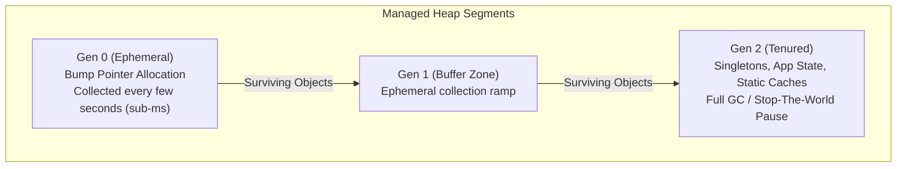
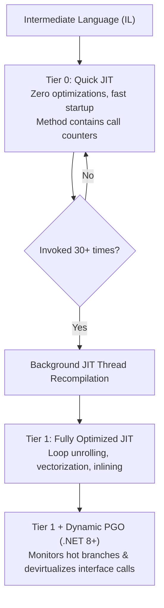

# 09. .NET Core & CLR Ultra-Deep Internals (Niche & Low-Latency Architecture)

> 🔬 **OPTIONAL DEEP INTERNALS APPENDIX (TIER-3):**  
> This document covers deep runtime engine mechanics, byte-level memory layouts, and low-level CLR execution internals.  
> **These details are Tier-3 internals: they are optional reference material and not expected or required in spoken interview answers.** Standard senior and lead rounds focus on real-world delivery: SOLID principles, `IEnumerable` vs `IQueryable`, DI lifetimes, EF Core queries, async deadlocks, and SQL Server indexes.  
> 
> **Refer to this document only when diving into:**  
> 1. Core runtime and low-latency infrastructure libraries.  
> 2. Systems where sub-millisecond GC latency profiling is required.  
> 3. Production memory dump analysis (`dotnet-dump`, SOS lldb).

---

# Table of Contents
1. [CLR Memory Layout: 64-Bit Object Header, MethodTable & Byte Padding](#1-clr-memory-layout-64-bit-object-header-methodtable--byte-padding)
2. [Generational Garbage Collection & Card Table (Write Watch Mechanism)](#2-generational-garbage-collection--card-table-write-watch-mechanism)
3. [Large Object Heap (LOH) & Pinned Object Heap (POH) Internals](#3-large-object-heap-loh--pinned-object-heap-poh-internals)
4. [Workstation GC vs Server GC: The Kubernetes Container CGroup Trap](#4-workstation-gc-vs-server-gc-the-kubernetes-container-cgroup-trap)
5. [The Disposable Pattern, SafeHandle & Finalizer / FReachable Queues](#5-the-disposable-pattern-safehandle--finalizer--freachable-queues)
6. [Async/Await State Machine Lowering: Struct Builders & ExecutionContext](#6-asyncawait-state-machine-lowering-struct-builders--executioncontext)
7. [Tiered Compilation: Tier 0 Quick JIT, Tier 1 PGO & Dynamic PGO](#7-tiered-compilation-tier-0-quick-jit-tier-1-pgo--dynamic-pgo)
8. [Production Memory Diagnostics: dotnet-dump, SOS & Linux Crash Triage](#8-production-memory-diagnostics-dotnet-dump-sos--linux-crash-triage)

---

## 1. CLR Memory Layout: 64-Bit Object Header, MethodTable & Byte Padding

### The Physical Anatomy of a Managed Object
Every reference-type instance allocated on the managed heap carries an unavoidable **16-byte overhead** on 64-bit operating systems before any of its fields are stored:

```mermaid
flowchart LR
    subgraph Managed Object Layout in RAM (64-Bit CLR)
        direction LR
        SH["SyncBlockIndex<br>(8 Bytes)"] --> MT["MethodTable Pointer<br>(TypeHandle - 8 Bytes)"]
        MT --> F1["Field 1: int Id<br>(4 Bytes)"]
        F1 --> P1["Padding<br>(4 Bytes alignment)"]
        P1 --> F2["Field 2: string Ref<br>(8 Bytes Pointer)"]
    end
```

1. **Object Header / SyncBlockIndex (8 bytes):**
   * Precedes the actual object reference pointer.
   * Holds the index pointing into the CLR's global synchronization table (`SyncTableEntry`) when a thread calls `lock(obj)` or `Monitor.Enter(obj)`.
   * Also stores the default hash code (`RuntimeHelpers.GetHashCode`) and GC bit flags (pinned, marked).
2. **TypeHandle / MethodTable Pointer (8 bytes):**
   * The object reference variable in your C# code (`MyClass obj`) points **directly here**, not to the SyncBlock.
   * Points to the runtime type descriptor (`MethodTable`) in unmanaged EE memory, containing interface dispatch maps, virtual method tables (vtable), and garbage collection field descriptors.
3. **Instance Fields & Memory Alignment:**
   * Fields are packed by the JIT compiler based on `[StructLayout]` rules (default is `LayoutKind.Auto`).
   * The CLR aligns field boundaries to 8-byte boundaries on 64-bit architectures. A single `bool` field takes 1 byte + 7 bytes of padding.
   * Minimum reference object allocation size on the heap is **24 bytes** (16 bytes header + 8 bytes payload/padding), even for `new object()`.

```csharp
// Demonstrating Object Header Overhead
public class EmptyNode { } // Takes 24 bytes in RAM! (8 SyncBlock + 8 MethodTable + 8 Min-Payload)

public class OrderItem
{
    public int Quantity;     // 4 bytes
    public bool IsActive;    // 1 byte
    // 3 bytes JIT alignment padding here!
    public decimal Price;    // 16 bytes
    // Total instance size = 16 (header) + 4 + 1 + 3 + 16 = 40 bytes on managed heap
}
```

---

## 2. Generational Garbage Collection & Card Table (Write Watch Mechanism)

### The Generational Hypothesis & The Tracing Engine
The .NET Garbage Collector operates on the empirical rule that **newly allocated objects have the shortest lifespans (<90% die in Gen 0), while older objects remain referenced for a long time.**



### The Card Table & Card Bundles (Write Barrier Mechanics)
* **The Problem:** When Gen 0 fills up, the GC must find all live Gen 0 objects. If an older Gen 2 object holds a reference to a brand-new Gen 0 object, must the GC scan the entire multi-gigabyte Gen 2 heap? No! That would defeat the speed of Gen 0 ephemeral collections.
* **The Solution (JIT Write Barrier):**
  * The CLR allocates a physical byte array called the **Card Table**, where each byte represents a 512-byte block of heap memory.
  * Whenever your code mutates an object reference (e.g., `parentGen2Obj.Child = newGen0Obj`), the JIT compiler inserts a low-level machine instruction called a **Write Barrier**:
    ```asm
    ; JIT Write Barrier Assembly snippet:
    mov [rcx+16], rax        ; Write object pointer
    shr rcx, 9               ; Divide destination address by 512 (get card index)
    mov byte ptr [r11+rcx], 0FFh ; Mark Card Table byte as DIRTY (0xFF)
    ```
  * During a Gen 0 collection, the GC only inspects the dirty cards in the Card Table to locate cross-generational roots without scanning gigabytes of clean Gen 2 RAM.

---

## 3. Large Object Heap (LOH) & Pinned Object Heap (POH) Internals

### The LOH 85,000-Byte Threshold & Free-List Swiss Cheese
* Any object **85,000 bytes or larger** (such as `new byte[85000]`, large strings, or giant collections) bypasses Gen 0 and Gen 1 and lands directly on the **Large Object Heap (LOH)**.
* **Why the threshold exists:** Moving a 100 MB buffer across memory chips costs hundreds of milliseconds of CPU cache invalidation. Therefore, **the GC sweeps dead objects on LOH into a free-list but does NOT compact them by default.**
* **The Swiss-Cheese Allocation Trap:**
  1. Service allocates 100 KB PDF buffers continuously.
  2. Buffers are collected, leaving 100 KB holes in memory.
  3. A new request asks for a 120 KB buffer. It cannot fit into any 100 KB hole!
  4. The CLR expands process virtual memory. Eventually, `OutOfMemoryException` occurs even when the machine has 4 GB of unfragmented RAM!

```csharp
// Forcing One-Time LOH Compaction for batch jobs (.NET 4.5.1+)
public void PerformMaintenanceLohCompaction()
{
    GCSettings.LargeObjectHeapCompactionMode = GCLargeObjectHeapCompactionMode.CompactOnce;
    GC.Collect(2, GCCollectionMode.Forced, blocking: true, compacting: true);
}
```

### Pinned Object Heap (POH - .NET 5+)
* When communicating with native OS sockets or file descriptors (`GCHandleType.Pinned`), buffers cannot be moved in RAM.
* In older .NET versions, pinning an object on Gen 0 prevented the GC from compacting memory around it, creating "pinning islands" that fragmented the Small Object Heap.
* .NET 5+ introduced the **Pinned Object Heap (POH)**:
  ```csharp
  // Allocating directly on the Pinned Object Heap
  byte[] pinnedBuffer = GC.AllocateArray<byte>(4096, pinned: true);
  ```

---

## 4. Workstation GC vs Server GC: The Kubernetes Container CGroup Trap

### Architecture Comparison
| Feature | Workstation GC | Server GC |
| :--- | :--- | :--- |
| **Target Workload** | Desktop apps (WPF, MAUI), CLI tools | High-throughput Backend Web APIs (Kestrel) |
| **Heaps & Threads** | 1 Managed Heap, 1 GC Thread | **1 Dedicated Managed Heap + 1 GC Thread per logical CPU core** |
| **Collection Mode** | Background / Concurrent | Dedicated high-priority threads running concurrently |
| **Memory Appetite** | Conservative (frequent collections) | Aggressive (delays collections to maximize throughput) |

### The Kubernetes Pod OOMKilled Trap (Exit Code 137)
* **The Failure Mode:**
  * You deploy an ASP.NET Core API on a 64-core Kubernetes physical node, but set container limits to `cpu: "1"`, `memory: "512Mi"`.
  * By default, .NET Server GC inspects the physical host, sees 64 cores, and spawns **64 independent managed heaps and 64 GC threads**.
  * Each heap allocates initial memory segments. 64 heaps easily consume >512 MB before the first Gen 2 collection is even triggered!
  * The Linux kernel cgroup controller notices the memory threshold breached and instantly sends `SIGKILL` (`OOMKilled`, Exit Code 137).

* **The Production Fix:**
  ```xml
  <!-- In .csproj for small Kubernetes microservice pods (< 1 GB RAM) -->
  <PropertyGroup>
    <ServerGarbageCollection>false</ServerGarbageCollection> <!-- Use Workstation GC -->
  </PropertyGroup>
  ```
  Or configure container environment variables:
  ```yaml
  env:
    - name: DOTNET_GCHeapHardLimitPercent
      value: "75" # Trigger GC when pod reaches 75% of memory limit
  ```

---

## 5. The Disposable Pattern, SafeHandle & Finalizer / FReachable Queues

### Finalizer Internal Pipeline
When a class defines a Finalizer (`~MyClass()`):
1. **Allocation Phase:** The CLR places a reference to the instance into the internal **Finalization Queue**.
2. **First GC Cycle (Dead Object Detected):** The GC finds the object is dead, but notices it is in the Finalization Queue. It **promotes the object to Gen 1 / Gen 2 (resurrecting it)** and moves its reference to the **FReachable Queue**.
3. **Finalizer Thread Execution:** A single dedicated CLR background thread runs down the FReachable Queue, calling each object's finalizer method.
4. **Second GC Cycle:** The object is finally collected and its memory reclaimed.
* **Impact:** Every class with a finalizer **survives at least one extra GC collection cycle** and delays memory reclamation!

```csharp
// Standard Disposable Pattern with SafeHandle & GC.SuppressFinalize
public class NativeFileReader : IDisposable
{
    private SafeFileHandle? _handle;
    private bool _disposed;

    public NativeFileReader(string path)
    {
        _handle = File.OpenHandle(path);
    }

    public void Dispose()
    {
        Dispose(true);
        // Suppress finalization so object skips the FReachable queue promotion!
        GC.SuppressFinalize(this);
    }

    protected virtual void Dispose(bool disposing)
    {
        if (_disposed) return;

        if (disposing)
        {
            // Dispose managed state
            _handle?.Dispose();
            _handle = null;
        }

        _disposed = true;
    }
}
```

---

## 6. Async/Await State Machine Lowering: Struct Builders & ExecutionContext

### What the Roslyn Compiler Generates Under the Hood
When you write:
```csharp
public async Task<int> FetchDataAsync()
{
    var data = await _client.GetAsync("/api");
    return data.StatusCode == HttpStatusCode.OK ? 1 : 0;
}
```

The C# compiler lowers this method into an explicit **hidden struct** implementing `IAsyncStateMachine`:
```csharp
[CompilerGenerated]
private struct <FetchDataAsync>d__1 : IAsyncStateMachine
{
    public int <>1__state;
    public AsyncTaskMethodBuilder<int> <>t__builder;
    public HttpClient _client;
    private HttpResponseMessage <data>5__2;
    private TaskAwaiter<HttpResponseMessage> <>u__1;

    public void MoveNext()
    {
        int num = this.<>1__state;
        try
        {
            TaskAwaiter<HttpResponseMessage> awaiter;
            if (num != 0)
            {
                // Step 1: Call synchronous start
                awaiter = this._client.GetAsync("/api").GetAwaiter();
                if (!awaiter.IsCompleted)
                {
                    this.<>1__state = 0;
                    this.<>u__1 = awaiter;
                    // Hook continuation to ThreadPool IOCP callback
                    this.<>t__builder.AwaitUnsafeOnCompleted(ref awaiter, ref this);
                    return; // Yield thread back to pool!
                }
            }
            else
            {
                awaiter = this.<>u__1;
                this.<>u__1 = default;
                this.<>1__state = -1;
            }

            // Step 2: Resume on threadpool worker thread
            this.<data>5__2 = awaiter.GetResult();
            int result = this.<data>5__2.StatusCode == HttpStatusCode.OK ? 1 : 0;
            this.<>t__builder.SetResult(result);
        }
        catch (Exception exception)
        {
            this.<>1__state = -2;
            this.<>t__builder.SetException(exception);
        }
    }

    public void SetStateMachine(IAsyncStateMachine stateMachine) { }
}
```

* **Key Mechanics:**
  * When an asynchronous operation yields (`!awaiter.IsCompleted`), the struct is boxed to the heap **only if it cannot complete synchronously**.
  * `ExecutionContext.Capture()` captures ambient security, culture, and `AsyncLocal<T>` state and flows it across thread boundaries.
  * `AwaitUnsafeOnCompleted` is used internally because it skips capturing Windows code access security (CAS), reducing CPU dispatch overhead.

---

## 7. Tiered Compilation: Tier 0 Quick JIT, Tier 1 PGO & Dynamic PGO

In modern .NET (.NET 6/7/8+), code is not compiled to maximum optimization immediately:



1. **Tier 0 (Quick JIT):** Compiles code with no optimizations so the application boots instantly. Methods are injected with stub call counters.
2. **Tier 1 (Optimized JIT):** When a method is called $\approx 30$ times, the runtime schedules it for re-JITting on a background thread. The next time it runs, it swaps the pointer to the Tier 1 vectorized native code.
3. **Dynamic PGO (Profile-Guided Optimization - Default in .NET 8+):** The JIT profiles hot code paths at runtime. If an interface dispatch (e.g., `ILogger.Log`) is always called with `ConsoleLogger`, the JIT **devirtualizes the interface call into a direct non-virtual inline invocation**, achieving C++ level throughput.

---

## 8. Production Memory Diagnostics: dotnet-dump, SOS & Linux Crash Triage

### Diagnostic Toolkit for High-CPU & Memory Leak Post-Mortem
When an API container crashes or spikes to 100% CPU in production without throwing managed exceptions:

1. **Capturing a Full Memory Dump on Linux:**
   ```bash
   # Install diagnostic tool
   dotnet tool install -g dotnet-dump

   # Find process ID
   dotnet-dump ps

   # Capture core dump of hanging process
   dotnet-dump collect -p <PID> --type Full -o /tmp/crash_dump.dmp
   ```

2. **Analyzing the Dump with SOS Commands:**
   ```bash
   dotnet-dump analyze /tmp/crash_dump.dmp

   # Inside the interactive SOS shell:
   > dumpheap -stat           # List object counts and total bytes grouped by type
   > dumpheap -min 85000      # Inspect all objects currently on the Large Object Heap
   > clrstack -all            # Print call stacks of every active managed thread
   > syncblk                  # Show locks currently held by threads (detect deadlocks!)
   > verifyheap               # Detect memory corruption or Swiss-cheese fragmentation
   ```
