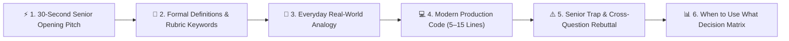
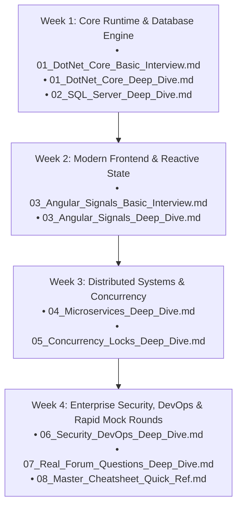

# Senior Full-Stack & Backend (.NET + SQL Server + Angular + Microservices) Interview Master Suite

[](https://dotnet.microsoft.com/)
[](https://learn.microsoft.com/en-us/dotnet/csharp/)
[](https://www.microsoft.com/sql-server)
[](https://angular.dev/)
[-orange)](#target-audience--enterprise-context)
[](#target-audience--enterprise-context)
[](#interactive-offline-study-portal-study_portalhtml)

> A battle-tested, production-grounded, comprehensive technical interview repository specifically designed for **Senior Developers, Technical Leads, Module Leads, and Full-Stack Architects (5–10+ Years of Experience)** interviewing across the Indian technology ecosystem and global enterprise capability centers.

---

## 🎯 Target Audience & Enterprise Context

This master curriculum is curated from real-world evaluation rubrics used across:

* **Global Capability Centers (GCCs) & Tier-1 Investment Banks:**  
  *Wells Fargo, JPMorgan Chase, Morgan Stanley, Barclays, Goldman Sachs, HSBC, Standard Chartered, Walmart Global Tech India, Lowe's India, Target Technology India, Optum (UnitedHealth Group), Fidelity Investments, Deutsche Bank.*
* **Top Global IT Services & Consultancies:**  
  *Tata Consultancy Services (TCS), Infosys, Cognizant, Wipro, Accenture India, Capgemini, HCLTech, LTIMindtree, Nagarro, EPAM Systems, Persistent Systems, Hexaware, Coforge, Virtusa, Deloitte USI, EY GDS, PwC India, KPMG.*
* **High-Scale Indian Product Companies & Unicorns:**  
  *Flipkart, Swiggy, Zomato, PhonePe, Paytm, MakeMyTrip, Zepto, Razorpay, Meesho.*

### 💡 Why This Suite Is Different
Most interview repositories fall into two failure modes:
1. **The Pure Trivia Trap:** Obsessing over theoretical compiler trivia (e.g., Tiered PGO stub tables, cgroup math, card table byte layouts) that hiring managers almost never evaluate in live rounds.
2. **The Fluffy Analogy Trap:** Giving conversational analogies ("SOLID is like a Swiss Army knife") without knowing the **exact academic definitions and technical rubric keywords** that interviewers check on their scoring sheets.

**This suite bridges the gap.** Esoteric CLR engine trivia is isolated into an appendix ([`09_DotNet_CLR_Ultra_Deep_Niche_Internals.md`](09_DotNet_CLR_Ultra_Deep_Niche_Internals.md)), while every core question combines **formal computer science definitions**, **scoring rubric buzzwords**, **intuitive Indian mental models**, **5–15 line runnable code**, and **cross-examination traps**.

---

## 🏛️ The 6-Part Senior Answer Architecture

Every single question across the deep dive modules is structured using the **6-Part Senior Answer Architecture**:



| Component | Purpose & Execution |
| :--- | :--- |
| **1. ⚡ 30-Second Senior Opening Pitch** | The immediate, confident answer given in the first 30 seconds that immediately demonstrates senior architectural mastery. |
| **2. 🎯 Formal Definitions & Rubric Keywords** | **The verbatim academic terms panel interviewers listen for:** exact CS definitions, official RFC numbers, evaluation rubric keywords (*Dynamic vtable dispatch*, *Managed pointer*, *RFC 7807 ProblemDetails*, *Push-pull reactivity DAG*, *Cartesian explosion*, *Thread starvation*, *Two-Phase Commit*), and authentic project delivery phrasing. |
| **3. 🧠 Everyday Real-World Analogy** | High-retention, culturally intuitive mental models (Aadhaar cards, Swiggy delivery kitchens, IRCTC Tatkal booking queues, Mumbai local train footboards, Domino's buzzers, UPI idempotent transactions) for rapid recall under interview stress. |
| **4. 💻 Modern Production Code (5–15 Lines)** | Clean, runnable, modern C# 12 / T-SQL / TypeScript code contrasting the junior anti-pattern with the senior production solution. |
| **5. ⚠️ Senior Trap & Cross-Question** | The follow-up curveball question the panel asks to test if you copied the answer, paired with the battle-tested senior rebuttal. |
| **6. 📊 Decision Guide ("When to Use What")** | Markdown comparison matrices specifying exact trade-offs, performance overheads, and implementation rules. |

---

## 📚 Complete Curriculum & Syllabus Navigation

The repository contains **17 master documents** organized into two dedicated tracks: **🟢 Screening / Technical Round 1 Hitlists** and **🟣 Senior Deep Dives & System Design**.

| Module # | Document File | Track | Target Audience & Topics Covered |
| :---: | :--- | :---: | :--- |
| **01** | [`01_DotNet_Core_Basic_Interview.md`](01_DotNet_Core_Basic_Interview.md) | 🟢 Screening | **Top 26 Screening Hitlist:** SOLID, `IEnumerable` vs `IQueryable`, String vs `StringBuilder`, `ref`/`out`, `throw ex`, DI lifetimes, Middleware vs Filters, JWT, CORS, EF Core loading, Async/Await, SQL salary, Clustered index. |
| **01** | [`01_DotNet_Core_Deep_Dive.md`](01_DotNet_Core_Deep_Dive.md) | 🟣 Deep Dive | **48 Senior Technical Questions:** 6 Comprehensive Modules: C# OOP internals, ASP.NET Core request pipeline, EF Core 8 performance tuning, Async/Await & ThreadPool IOCP, GoF & Enterprise Design Patterns, SQL Relational Engine. |
| **02** | [`02_SQL_Server_Basic_Interview.md`](02_SQL_Server_Basic_Interview.md) | 🟢 Screening | **Top 15 SQL Screening Questions:** Clustered vs Non-Clustered index leaf locators, Nth highest salary, `DELETE` vs `TRUNCATE` transaction logging, `UNION` vs `UNION ALL`, PK vs Unique, SP vs UDF, ACID banking scenario. |
| **02** | [`02_SQL_Server_Deep_Dive.md`](02_SQL_Server_Deep_Dive.md) | 🟣 Deep Dive | **21 Deep Dive Query Tuning Questions:** Execution plans, Index Seek vs Scan, Missing Index DMV recommendations, Parameter Sniffing & `OPTIMIZE FOR`, Deadlock graph triage, TempDB allocation contention (`PAGELATCH_UP`). |
| **03** | [`03_Angular_Signals_Basic_Interview.md`](03_Angular_Signals_Basic_Interview.md) | 🟢 Screening | **Top 30 Angular Screening Questions:** Angular 17/18 Signals, Standalone Components, `OnPush` change detection, Component Lifecycle, RxJS operators, HTTP Interceptors, Route Guards, Template vs Reactive Forms. |
| **03** | [`03_Angular_Signals_Deep_Dive.md`](03_Angular_Signals_Deep_Dive.md) | 🟣 Deep Dive | **43 Deep Dive Frontend Questions:** Push-pull reactive DAG graph, Zoneless Angular scheduling, Glitch-free diamond problem, Higher-order flattening (`switchMap`/`mergeMap`/`concatMap`/`exhaustMap`), Memory leak prevention. |
| **04** | [`04_Microservices_Basic_Interview.md`](04_Microservices_Basic_Interview.md) | 🟢 Screening | **Microservices Core Screening:** Monolith vs Microservices, API Gateway pattern, Service Discovery, Synchronous (REST/gRPC) vs Asynchronous (Kafka/RabbitMQ) communication, Distributed Tracing (Correlation IDs). |
| **04** | [`04_Microservices_Deep_Dive.md`](04_Microservices_Deep_Dive.md) | 🟣 Deep Dive | **9 Enterprise Distributed System Patterns:** Saga Pattern (Choreography vs Orchestration), Transactional Outbox & Debezium CDC, CQRS + Event Sourcing, Circuit Breaker with Polly v8, YARP reverse proxy, Distributed Caching. |
| **05** | [`05_Concurrency_Locks_Basic_Interview.md`](05_Concurrency_Locks_Basic_Interview.md) | 🟢 Screening | **Concurrency Screening:** Process vs Thread, ThreadPool vs `new Thread()`, `lock` statement basics, Deadlock definition, `Task.Run` vs direct invocation, Thread safety best practices. |
| **05** | [`05_Concurrency_Locks_Deep_Dive.md`](05_Concurrency_Locks_Deep_Dive.md) | 🟣 Deep Dive | **8 High-Concurrency Pitfalls:** Hardware IOCP non-blocking I/O, Sync-over-async thread starvation, `SemaphoreSlim` vs `lock` in async code, Coffman's 4 deadlock conditions, Redis Redlock fencing tokens, SpinLock vs Monitor. |
| **06** | [`06_Security_DevOps_Basic_Interview.md`](06_Security_DevOps_Basic_Interview.md) | 🟢 Screening | **Security & DevOps Screening:** Authentication vs Authorization, JWT structure (Header.Payload.Signature), HTTPS/TLS handshake, Docker containers vs VMs, CI/CD pipeline stages, AppSettings secrets management. |
| **06** | [`06_Security_DevOps_Deep_Dive.md`](06_Security_DevOps_Deep_Dive.md) | 🟣 Deep Dive | **10 Production Hardening Pillars:** JWT RFC 7519 validation & `ClockSkew = TimeSpan.Zero`, OWASP API Top 10 BOLA/IDOR, `WebApplicationFactory` integration testing, Non-root Dockerfiles, Kubernetes Liveness & Readiness probes. |
| **07** | [`07_Real_Forum_Questions_Basic_Interview.md`](07_Real_Forum_Questions_Basic_Interview.md) | 🟢 Screening | **Top 25 Community Screening Questions:** Live questions asked in TCS, Infosys, Cognizant, Wipro, Accenture, and Capgemini screening rounds. |
| **07** | [`07_Real_Forum_Questions_Deep_Dive.md`](07_Real_Forum_Questions_Deep_Dive.md) | 🟣 Deep Dive | **36 Community Technical Lead Questions:** Curated real interview questions from AmbitionBox, Glassdoor, and LeetCode Discuss with full senior architecture answers. |
| **08** | [`08_Master_Cheatsheet_Quick_Ref.md`](08_Master_Cheatsheet_Quick_Ref.md) | 🌟 Revision | **Master Revision Cheatsheet:** Ultra-condensed cheat sheets for last-hour revision before entering an interview. 1-page summaries of .NET, SQL, Angular, and Microservices. |
| **08** | [`08_Real_Forum_Questions_DotNet_SQL_India.md`](08_Real_Forum_Questions_DotNet_SQL_India.md) | 🟣 Deep Dive | **100+ Indian IT Company Hitlist:** Company-wise breakdown of exact questions asked at TCS, Infosys, Wipro, Cognizant, Accenture, Capgemini, EPAM, Nagarro, and GCCs. |
| **09** | [`09_DotNet_CLR_Ultra_Deep_Niche_Internals.md`](09_DotNet_CLR_Ultra_Deep_Niche_Internals.md) | 🔬 Appendix | **Ultra-Deep CLR & HFT Internals:** Card tables & write watch, POH memory layout, Server GC cgroup CPU quota math, Roslyn async state machine lowering, Tiered Dynamic PGO, `dotnet-dump` and SOS diagnostics. |

---

## 💻 Interactive Offline Study Portal (`Study_Portal.html`)

The repository includes a modern, zero-dependency, self-contained single-page web portal: **[`Study_Portal.html`](Study_Portal.html)**.

```
┌────────────────────────────────────────────────────────────────────────┐
│  ⚡ Senior Full-Stack Interview Master Suite              [ ☀️ 🌘 📜 ]  │
├───────────────────┬────────────────────────────────────────────────────┤
│  🔍 Filter...     │  🟣 01. .NET Core & C# (Indian Senior Rounds)      │
│  [All][🟢][🟣][🌟] │  ────────────────────────────────────────────────  │
│                   │  ## Q1: SOLID Principles with Project Examples     │
│  📁 .NET Core     │  ⚡ 30-Second Opening Pitch                        │
│    🟢 Basic Q&A   │  "The SOLID principles form the architectural..."  │
│    🟣 Deep Dive   │                                                    │
│  📁 SQL Server    │  🎯 Formal Definitions & Rubric Keywords           │
│    🟢 Basic Q&A   │  • High Cohesion, Low Coupling, RFC 7807...        │
│    🟣 Deep Dive   │                                                    │
│  📁 Angular 17/18 │  🧠 Everyday Indian Analogy                        │
│  📁 Microservices │  • Single Responsibility: A Swiss Army knife vs... │
│  📁 Concurrency   │                                                    │
│  📁 Security      │  💻 Simple, Clean, Runnable Code                   │
│  📁 Cheatsheet    │  ```csharp                                         │
│                   │  public class OrderTaxCalculator : ITaxCalculator  │
│                   │  ```                                               │
└───────────────────┴────────────────────────────────────────────────────┘
```

### Portal Key Features:
* **100% Offline & Zero Dependencies:** Double-click [`Study_Portal.html`](Study_Portal.html) in any web browser (`Chrome`, `Edge`, `Firefox`, `Safari`). Runs directly from disk without running a web server or Node.js.
* **Instant Sub-Millisecond Search:** Real-time search across all 17 embedded markdown modules and 200+ interview questions.
* **Filter Pills:** Quickly filter between `All`, `🟢 Basic Q&A`, `🟣 Senior Deep Dive`, and `🌟 Revision Cheatsheet`.
* **Theme Switching:** Choose between **Deep Dark / Dracula**, **Clean Day / Light**, and **Warm Reading Sepia**.
* **Interactive TOC Drawer:** Press `Alt + T` or click the Table of Contents button to open an in-page section navigator with instant search.
* **Code Highlighting & 1-Click Copy:** Built-in syntax highlighting for C#, SQL, TypeScript, Bash, and JSON with formatted copy-to-clipboard buttons.
* **Interactive Mermaid Diagrams:** High-performance flowchart and sequence diagram rendering for distributed system architectures.

---

## 🗓️ 30-Day Interview Preparation Strategy (For 5–10+ YOE)

If you have 4 weeks before your technical rounds, follow this proven roadmap:



### Detailed Study Plan:
1. **Week 1: .NET & SQL Foundation**
   * Master the 26 screening questions in [`01_DotNet_Core_Basic_Interview.md`](01_DotNet_Core_Basic_Interview.md).
   * Review memory management (Generations 0/1/2, LOH, `IDisposable`, `GC.SuppressFinalize`).
   * Practice query execution plans, parameter sniffing, and deadlock graphs in [`02_SQL_Server_Deep_Dive.md`](02_SQL_Server_Deep_Dive.md).
2. **Week 2: Angular 17/18 Signals & RxJS Mastery**
   * Understand why Signals replace Zone.js dirty checking and solve the diamond dependency problem.
   * Master the flattening operators: `switchMap` (search/cancel), `concatMap` (sequential queue), `mergeMap` (parallel), `exhaustMap` (login clicks).
3. **Week 3: Microservices & ThreadPool Concurrency**
   * Study Saga Pattern (Orchestration vs Choreography) and the Transactional Outbox pattern with CDC in [`04_Microservices_Deep_Dive.md`](04_Microservices_Deep_Dive.md).
   * Learn why `Task.Result` causes ThreadPool starvation and how hardware IOCP threads work in [`05_Concurrency_Locks_Deep_Dive.md`](05_Concurrency_Locks_Deep_Dive.md).
4. **Week 4: Enterprise Security, Docker/K8s & Mock Screening**
   * Review JWT validation (`ValidateLifetime = true`, `ClockSkew = TimeSpan.Zero`), OWASP API Top 10 BOLA/IDOR, and non-root Docker builds in [`06_Security_DevOps_Deep_Dive.md`](06_Security_DevOps_Deep_Dive.md).
   * Perform rapid-fire mock interviews using [`08_Master_Cheatsheet_Quick_Ref.md`](08_Master_Cheatsheet_Quick_Ref.md).

---

## 🚀 Quick Start Guide

### 1. View in Browser (Recommended)
Simply open [`Study_Portal.html`](Study_Portal.html) in your browser:
```bash
# Linux
xdg-open Study_Portal.html

# macOS
open Study_Portal.html

# Windows
start Study_Portal.html
```

### 2. Keyboard Shortcuts in Study Portal
* `Ctrl + B` (or `Cmd + B`): Toggle Sidebar visibility.
* `Alt + T`: Toggle Table of Contents Drawer.
* `Esc`: Close open drawers and search dialogs.

---

## 🤝 Contributing

Contributions are welcome! If you recently attended a technical round at a Tier-1 product firm, GCC, or consultancy in India and encountered a new architectural question or trap:
1. Fork the repository.
2. Add the question adhering strictly to the **6-Part Senior Answer Architecture**.
3. Submit a pull request.

---

## 📄 License

This interview preparation suite is released under the [MIT License](LICENSE). Free for personal use, mentorship, and educational purposes.
